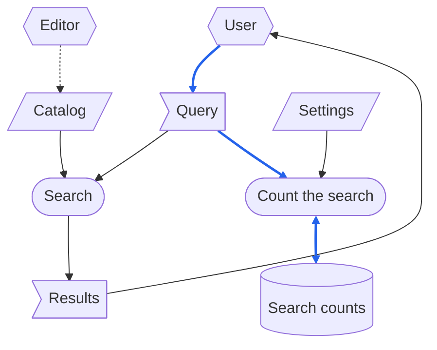

# DFD

> [[ASD-STE100_ISSUE9.pdf]]  `2026-10-13`  `d1f4ea9e7cd6`
> [[ste-custom]]  `2026-10-30`  `8cc2e2061175`

> 本檔案以 ASD-STE100 Simplified Technical English（STE）第 9 版寫成。
> 技術用字：black、blue、box、caller、catalog、cylinder、defect、diagram、document、dotted arrow、dotted line、edit、file、flag、hexagon、legend、line、mermaid、operating system、parallelogram、parameter、process、query、request、section、setting、two-headed arrow、user、writer。

DFD（data flow diagram，資料流程圖）表示資料如何在一個流程的各個 process 之間移動。
本文件列出所有 DFD 都相同的項目。
這些項目是資料的種類、形狀、線，以及要檢查的兩種缺陷。
因此，每一份畫出 DFD 的文件都引用本文件，不再重新列出這些項目。
為某一種流程訂定規則的那一節，也會說明該流程必須包含的項目。

# Types of Data

DFD 畫出的每一份資料，都屬於三種之一，而且只屬於一種：

- **record**：由某個 process 寫入、而且在寫入它的那次執行之後，system 仍會保留的資料。
  record 只指 system 會保留的資料。
  DFD 的線表示哪些資料會進入 record。
  如果 record 也可以是 system 不保留的資料，線就無法表示 system 保留哪些資料。
- **external input**：來自 system 外部的來源、而且在一次執行結束之後仍然存在的資料。
  一個例子是 system 只讀取的檔案。
  沒有任何 process 寫入 external input，流程也會表示這一點。
- **one-run data**：只在一次執行期間存在的資料。
  它的來源並不重要：可以是 caller 提供的 request，也可以是 system 交回的結果。

# Shapes

- 每一種資料各有不同的形狀，每一個 **process** 則有第四種形狀。
  process 是一個工作單位，不是作業系統的行程。
- role 與 system 互動，但不是 system 的一部分。
  例如 caller，以及手動修改 input 的人。
  DFD 以第五種形狀畫出 role，並標出 role 讀取的資料與它提供的資料。
  如果 DFD 沒有畫出 role，交給 role 的產出在圖上就沒有終點。
  同樣地，role 提供的 input 在圖上也沒有來源。

# Lines

- 實線搬移資料。
  雙頭箭頭是一個 process 既讀取、也寫入的資料。
- 實線有兩種顏色，這兩種資料各用一種：
  1. process 寫入 record，或用來組成 record 某一部分的資料。
  2. 停在接收它的 process 或 role 的資料。
     例如一個不寫入任何資料的檢查所讀取的資料。

  只控制 process 如何運作的資料，屬於第二種。
  例如，參數或設定就是第二種的資料。
  即使那個 process 會寫入 record，這條規則也一樣適用。
- 虛線不搬移資料。
  它只表示順序，或一個人手動做出的變更。
- 一條線是流程運作時移動的資料。
  一份文件引用另一份文件時，沒有資料移動。
  因此，DFD 不在這兩份文件之間畫線。
  如果 DFD 在那裡畫了線，這條線就表示有 process 讀取資料，但其實沒有 process 讀取它。
  於是讀者會去找根本不存在的資料。
- 圖的下方有一段圖例，說明每一種形狀與每一種線。

# Example

這個例子是一個在目錄中尋找資料的 system。
system 在目錄中為使用者的查詢找出結果。
system 也會計算每一次查詢。
下面的圖使用 mermaid，形狀與顏色和所有 DFD 的一致：

圖的讀法：

- 平行四邊形是 external input：Catalog 與 Settings。
- 旗形是 one-run data：Query 與 Results。
- 圓柱 Search counts 是 record。
- 圓角方框是 process：Search，以及 Count the search。
- 六角形是 system 外部的 role。
  User 提供 Query，並讀取 Results。
  Editor 手動修改 Catalog。
- 實線箭頭搬移資料。
  雙頭箭頭是 Search counts，Count the search 既讀取、也寫入它。
- 藍色箭頭搬移會進入 record 的資料。
  Query 從 User 進入 Count the search，成為 Search counts 的一部分。
  黑色箭頭搬移停在接收它的 process 的資料。
  其中一條黑色箭頭，把同一個 Query 搬進 Search，而 Search 不保留任何資料。
  另一條黑色箭頭搬移 Settings，它只控制 Count the search 如何運作。
  即使 Count the search 會寫入 record，這條箭頭仍是黑色。
- 虛線箭頭不搬移資料。
  它是 Editor 手動做出的變更。

# What Counts as a Defect

- **一份 record 有不止一個寫入者。**
  流程寫入的每一份 record 都有一個寫入者，而且只有一個。
  必要時，把一份 record 拆成幾份各有一個寫入者的 record。
  如果一份 record 有兩個寫入者，一個 process 可能再次運作，抹掉另一個 process 的結果。
  system 不會告訴你這件事。
  只有由幾個 process 依序編輯的 record，才可以有不止一個寫入者，如本節最後一項所說。
- **資料沒有來源。**
  process 讀取的每一份資料，都必須有下列來源之一：
  - 它是 external input。
  - system 外部的 role 提供它。
  - 某個 process 寫入它。

  如果一份資料沒有任何這些來源，就沒有 process 或 role 會產生它。
  要到資料第一次缺少時，你才會發現這個錯誤。
- **不算缺陷：依序編輯的 record。**
  有些 process 可以依序編輯同一份 record。
  這時，第一個之後的每一個 process，都會讀取這份 record，也會寫入它。
  DFD 以雙頭箭頭表示這一點。
  因此，每一個 process 都在前一個 process 留下的 record 上增補，不會抹掉它的任何部分。

  第一個寫入者也讀取這份 record 時，這份 record 在流程開始之前就已存在。
  排在第一個寫入者之前的 process，也可以讀取這份 record。
  那個 process 讀到的是它找到這份 record 時的狀態，而不是後面的 process 所寫入的資料。

  這種 record 會造成一個問題。
  當它的第一個寫入者再次運作時，它會把其他 process 的工作再做一次。
  因此，流程必須說明這種情況下的處理程序：
  - 第一個寫入者在取代這份 record 之前，先取得核准。
  - 或者，其他 process 再次運作。
