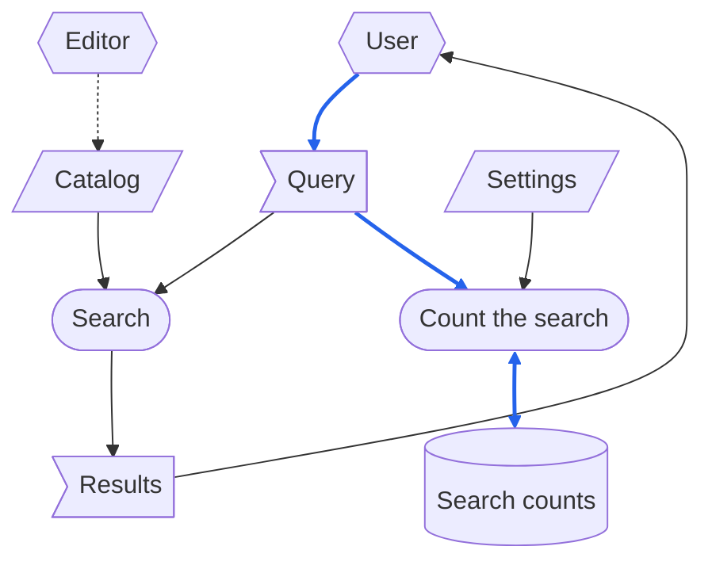

# DFD

> [[ASD-STE100_ISSUE9.pdf]]  `2026-10-13`  `d1f4ea9e7cd6`
> [[ste-custom]]  `2026-10-30`  `8cc2e2061175`

> This file is in ASD-STE100 Simplified Technical English (STE), Issue 9.
> Technical words: black, blue, box, caller, catalog, cylinder, defect, diagram, document, dotted arrow, dotted line, edit, file, flag, hexagon, legend, line, mermaid, operating system, parallelogram, parameter, process, query, request, section, setting, two-headed arrow, user, writer.

A DFD (data flow diagram) shows how data moves through the processes of a flow.
This document gives the items that are the same in all DFDs.
These items are the types of data, the shapes, the lines, and the two defects to look for.
Thus, each document that shows a DFD refers to this document, and does not give these items again.
The section that gives the rules for a flow also tells the items that the flow must contain.

# Types of Data

Each data item that a DFD shows is of one of three types, and of only one:

- A **record**: data that a process writes, and that the system keeps after the run that wrote it.
  A record is only data that the system keeps.
  The lines of a DFD show which data gets to a record.
  If a record can also be data that the system does not keep, the lines do not show which data the system keeps.
- An **external input**: data that comes from a source external to the system, and that stays when a run ends.
  An example is a file that the system only reads.
  No process writes an external input, and the flow shows this.
- **One-run data**: data that is there only during one run.
  Its source is not important: it can be a request that a caller supplies, or a result that the system gives back.

# Shapes

- Each type of data has a different shape, and each **process** has a fourth shape.
  A process is a unit of work, not a process of the operating system.
- A role interacts with the system, but is not a part of it.
  Examples are the caller, and the person who changes an input manually.
  The DFD shows a role in a fifth shape, with the data that the role reads and the data that it supplies.
  If the DFD does not show the role, an output that goes to the role has no end on the diagram.
  Also, an input that the role supplies has no source on the diagram.

# Lines

- A solid line moves data.
  A two-headed arrow is data that one process reads and also writes.
- Solid lines have two colors, one for each of these two types of data:
  1. Data that a process writes into a record, or uses to make a part of a record.
  2. Data that stops at the process or the role that gets it.
     An example is the data that a check reads, when the check writes no data.

  Data that only controls how a process operates is of the second type.
  For example, a parameter or a setting is data of the second type.
  This rule also applies when that process writes a record.
- A dotted line moves no data.
  It shows only a sequence, or a change that a person makes manually.
- A line is data that moves while the flow operates.
  When one document refers to a different document, no data moves.
  Thus, the DFD shows no line between the two documents.
  If the DFD shows a line there, the line tells that a process reads data, but no process reads it.
  Then a reader looks for data that is not there.
- Below the diagram, a legend identifies each shape and each type of line.

# Example

The example is a system that finds data in a catalog.
The system finds the results for the query of a user in the catalog.
The system also counts each query.
The diagram that follows uses mermaid, with the shapes and the colors of all DFDs:

How to read the diagram:

- Parallelograms are external inputs: Catalog and Settings.
- Flags are one-run data: Query and Results.
- The cylinder, Search counts, is a record.
- Rounded boxes are processes: Search, and Count the search.
- Hexagons are roles external to the system.
  The User supplies the Query and reads the Results.
  The Editor changes the Catalog manually.
- Solid arrows move data.
  The two-headed arrow is Search counts, which Count the search reads and also writes.
- Blue arrows move data that goes into a record.
  The Query goes from the User into Count the search, and becomes a part of Search counts.
  Black arrows move data that stops at the process that gets it.
  One black arrow moves the same Query into Search, which keeps no data.
  The other black arrow moves Settings, which only controls how Count the search operates.
  This arrow is black, although Count the search writes a record.
- The dotted arrow moves no data.
  It is the change that the Editor makes manually.

# What Counts as a Defect

- **A record with more than one writer.**
  Each record that the flow writes has one writer, and only one.
  If necessary, divide a record into some records that each have one writer.
  If a record has two writers, one process can operate again and erase the result of the other process.
  The system does not tell you about this.
  Only a record that processes edit in turn can have more than one writer, as the last item of this section tells.
- **Data with no source.**
  Each data item that a process reads must have one of these sources:
  - It is an external input.
  - A role external to the system supplies it.
  - A process writes it.

  If a data item has none of these sources, no process or role makes it.
  You find this error only the first time that the data is missing.
- **Not a defect: a record edited in turn.**
  Some processes can edit one record in turn.
  Then each process after the first one reads the record and also writes it.
  The DFD shows this with a two-headed arrow.
  Thus, each process adds to the record that the previous process left, and erases no part of it.

  When the first writer also reads the record, the record was there before the flow started.
  A process before the first writer can read the record.
  That process reads the record in the condition that it found it, not the data that a subsequent process writes.

  A record of this type causes one problem.
  When its first writer operates again, it does again the work of the other processes.
  Thus, the flow must tell the procedure for this condition:
  - The first writer gets approval before it replaces the record.
  - Or, the other processes operate again.
