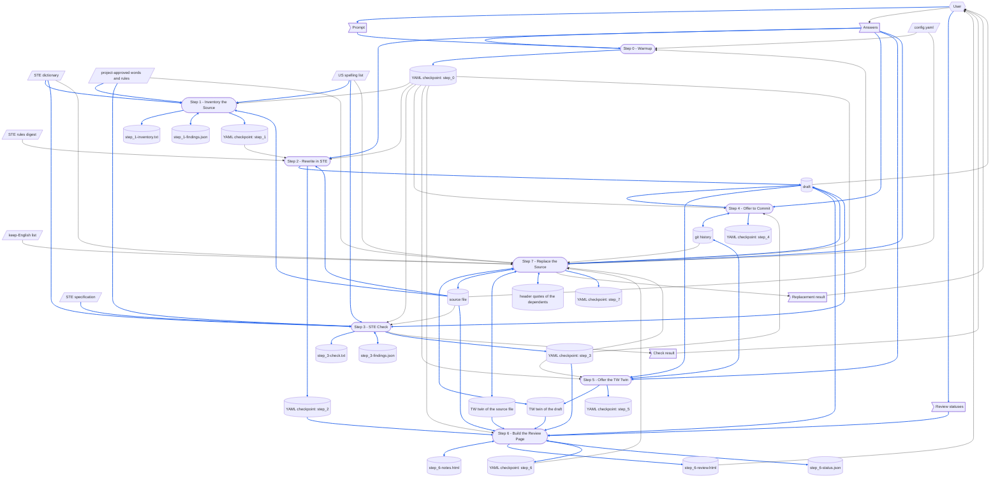

# asd-ste

> [DFD.md](../../references/DFD.md)  `2026-10-18`  `09fb4a7e4730`
> [us-spelling.json](../../references/us-spelling.json)  `2026-10-13`  `8871984ff0d8`
> [md-style.md](../../rules/md-style.md)  `2026-10-30`  `6484ff7dc0b2`
> [skill-writing.md](../../rules/skill-writing.md)  `2026-10-30`  `c7696bf6351a`
> [report-yaml-rules.md](../../rules/report-yaml-rules.md)  `2026-10-30`  `f11dcf524233`
> [SKILL-tmp.md](../../templates/SKILL-tmp.md)  `2026-10-30`  `6ca6e607f75c`
> [README-tmp.md](../../templates/README-tmp.md)  `2026-10-19`  `43ace64a88a6`
> [depends_on.py](../../scripts/depends_on.py)  `2026-10-16`  `53b1d3e60eca`
> [chinese/SKILL.md](../chinese/SKILL.md)  `2026-10-16`  `2a03562d5a11`

asd-ste skill 由哪些部分組成，以及它的 [SKILL.md](SKILL.md) 依賴哪些檔案。
skill 每次執行都會載入整份 SKILL.md，所以執行時用不到的部分放在這裡：SKILL.md 不連到本檔，也沒有任何一次執行會載入它。
修改本 skill 之前先讀這份：做完 When the Skill Is Changed 列出的每一項修改，再跑那裡列出的檢查。
skill 的各個 step 怎麼寫，見 [skill-writing.md](../../rules/skill-writing.md)。

圖中的路徑都用簡寫：`asd-ste/` 指 `.github/common/skills/asd-ste/`，`common/` 指 `.github/common/`，`external/` 位於 workspace 根目錄。
`<name>.md` 是一次執行所改寫的檔案，draft 是它的改寫，位於 draft tool 在它旁邊給出的路徑。
`checkpoints/asd-ste/{parent}-{name}/` 同樣位於 workspace 根目錄，是 Checkpoint Dir：裡面有 YAML checkpoint `process.yaml`，以及 Step 1、Step 3 與 Step 6 寫出的檔案。

# When the Skill Runs

## Dataflow

一次執行如何把它的 prompt 變成它留下的東西：[SKILL.md](SKILL.md) 中 Workflow 的每一個 step，以及每個 step 讀寫的資料，以 [DFD.md](../../references/DFD.md) 的畫法畫成 DFD。
SKILL.md 的各個 step 寫明自己讀寫什麼；這張圖把它畫出來，讓被較後 step 覆寫的 record、沒有來源的資料，或讀取較後 step 所寫之物的 step，一眼就看得出來。
step 的名稱與它的標題完全相同、連編號一起，讀者就不必猜是哪一個 step。
只畫 step 在執行時讀寫的東西；step 只引用的文件不畫。



圖的讀法：

- 平行四邊形是 external input：`config.yaml`、STE rules digest、STE dictionary、project-approved words 與 project rules、US spelling list、keep-English list 與 STE specification——沒有任何 step 會寫入它們。
  旗形是 one-run data：prompt 與 Answers、Step 3 印出的檢查結果、使用者在 review page 上設定的 review status，以及 Step 7 印出的取代結果。
  圓柱是 record：source file 與它的 TW twin，只有 Step 7 會寫入；draft 與它的 TW twin；YAML checkpoint 中每個 step 的群組；Step 1、Step 3 與 Step 6 寫在 Checkpoint Dir 的七個檔案；git history；以及 dependent 的 header quote。
  圓角方框是 step。
- 六角形是 skill 之外的 role：使用者，提供 prompt、Answers 與 review status，並閱讀檢查結果、draft、review page 與取代結果。
- 實線箭頭沿著資料移動的方向搬移資料；雙頭箭頭表示某個 step 對同一份資料既讀又寫。
- 藍色箭頭承載的資料，本身會被寫進某個 record，或被轉成某個 record 的內容；其餘箭頭一律是黑色。
  prompt 與 Answers 會寫進 YAML checkpoint，findings file 列出的 source file 骨架、字典的替換詞、檔案用到的 project-approved word，以及每一個英式拼法的美式拼法也是，所以它們的箭頭是藍色。
  source file 經由 Step 2 進入 draft，Step 2 用 STE 把它重新說一遍；STE specification 經由 Step 3 進入 draft，Step 3 把它的指紋記錄在 header quote 中——Step 3 也同樣記錄 ste-custom.md 的指紋。
  Step 6 以 source file、draft、兩者的 TW twin、`step_2` 中保留原文措辭的陳述、`step_3` 中留下的警告，以及它自己寫的 review notes 產生 review page，所以這些箭頭都是藍色。
  review status 經由 Step 6 啟動的 review server 寫進 `step_6-status.json`，review builder 下一次建頁時再把它們放上頁面，所以它們的箭頭也是藍色。
  Step 7 把 draft 與它的 TW twin 放到 source file 與它的 TW twin 的位置，在 dependent 的 header quote 中重新記錄 source file，並把使用者的回答存進 `step_7`，所以這些箭頭也是藍色。
  只決定某個 step 怎麼做的資料，例如 `config.yaml`、`step_0` 裡的路徑、`step_1` 裡的清冊、`step_3` 裡的 verdict、`step_6` 指名的 review page、Step 7 從 git history 讀取的修改、STE rules digest，或 Step 3 只拿來比對的 source file，即使那個 step 會寫 record，也維持黑色。
- YAML checkpoint 是一個檔案，但每個 step 擁有自己的群組，所以圖中每個群組各畫成一個 record，各自只有一個寫入者。
  Step 0 會重新開始這個檔案，所以一次執行的群組絕不會和先前執行的混在一起。
  在 `run step N` 底下，Step N 從 YAML checkpoint 讀取 `step_0` 與它之前各 step 的群組：也就是從 checkpoint 指向 Step 1 到 Step 7 的箭頭。
- 有些 record 是輪流編輯的。
  Step 2 整份寫出 draft，Step 3 修正它，並讀取它所修正的內容；重跑 Step 2 會覆寫 Step 3 的修正，所以 Step 2 在覆寫已存在的檔案之前會先詢問。
  Step 1 與 Step 3 各自透過 `check_ste.py` 寫出一個 findings file，再把它讀回來存進自己的群組。
  Step 4 與 Step 5 各自在先前的執行與使用者留下的 git history 上加一個 commit。
  Step 6 寫出 review notes，它的 review builder 再把它們讀回來，產生 review page。
  Step 6 啟動的 review server 在使用者設定每一個 review status 時寫入 `step_6-status.json`，那時執行已經結束；Step 6 再次執行時，review builder 會把它讀回來。
  Step 7 讀取 Step 2、Step 3 與 Step 5 留下的 draft 與它的 TW twin，把它們寫到 source file 與它的 TW twin 的位置，然後刪除它們。
- source file 與它的 TW twin 在這次執行之前就已存在：Step 7 之前的每一個 step，讀到的都是它們原本的樣子；Step 7 是它們唯一的寫入者，它讀取自己寫入的內容來檢查。
  Step 7 在 dependent 的 header quote 中重新記錄 source file 之前，也會先讀取這次執行找到的那份 header quote。

## Step Purposes

每個 step 都以它在 SKILL.md 中的標題命名，並附上它的 Purpose：它為何要獨立存在。

- Step 0 - Warmup
  在寫入任何東西之前，先確定要改寫的是哪個檔案、它的 draft 要放在哪裡——憑猜測進行的一次執行會改寫錯的 `DFD.md`，而 workflow 後面沒有任何東西會察覺。
- Step 1 - Inventory the Source
  從整份檔案一次決定哪些東西必須原樣進入 draft、散文又在哪裡違反 STE——若在改寫時逐句決定，同一個標題會在一節裡被改了措辭，同一個識別碼會在下一節被「簡化」。
  這也是最後一個時間點，能在只能照抄它們的改寫開始之前，拒絕不是英文的來源檔，或 kept span 違反 STE 的來源檔。
- Step 2 - Rewrite in STE
  產出改寫——這是本 workflow 中唯一屬於意義判斷、而不是文字比對的部分，也是本 skill 存在的理由。
- Step 3 - STE Check
  證明改寫保住了 source file 的骨架，並遵守程式能量測的每一條規則——少了一行 fence 內容、一個 placeholder 或一個連結的改寫，讀起來依然通順，只有與 source file 比對才抓得到。
- Step 4 - Offer to Commit
  讓 draft 有一個自己的 commit——`chinese` skill 只會以 git 保存的來源檔為準來就地更新 twin，而沒有詢問就做的 commit，會把使用者尚未完成的編輯一起帶進去。
- Step 5 - Offer the TW Twin
  讓使用者也能擁有繁體中文版的 draft，但不把它當成預設——twin 是每一次後續編輯都必須多動的一份檔案，所以只在使用者答應時才寫。
- Step 6 - Build the Review Page
  為必須核准 draft 的使用者，把 source file 放在它每一個句子的旁邊——STE check 證明了骨架與可量測的規則，但改寫後的陳述是否仍主張來源所主張的，要由讀者判斷，而手動對照四份檔案的讀者，會漏掉跑掉的那個句子。
- Step 7 - Replace the Source
  只在使用者核准 draft 之後才改動 source file，並且和依賴它的一切一次改完——手動取代會忘了 TW twin、把 draft 留在原處，或讓另一個 workspace 裡的文件繼續記錄一份已經不再寫著它當初讀到內容的檔案。

## Files Each Step Uses

skill-writing.md 中「哪些 step 執行腳本」那條規則，本 skill 的回答只寫這一次：
**Step 1、Step 3、Step 6 與 Step 7 以腳本完成自己的工作，Step 0 以腳本取得它的路徑，Step 2、Step 4 與 Step 5 不用**，因為清冊與檢查都是精確的比對，程式做得更快，也不會漏掉任何一處，review page 每次都以同樣的方式排出四份檔案、為每一個 line reference 加上連結，取代也每次都以同樣的方式刪減 header note、把 TW twin 的 pairing line 改為連回 source file、找出 dependent；而 Step 0 必須判斷使用者指的是哪個檔案，Step 2 是改寫本身——一種關於意義、沒有任何程式做得到的判斷——Step 4 與 Step 5 則取決於使用者的回答。
Step 6 自己寫 review notes，因為審核者該對照什麼，是對改寫的一種解讀；版面與每一個 line reference 的檢查，則交給它的腳本。
Step 7 自己閱讀每一個 dependent，因為修改之後它是否仍然成立，是一種閱讀判斷；取代與搜尋則交給 draft tool。
每個 step 也都執行 step saver `save_step.py`，把自己的群組存進 YAML checkpoint：把一長串清單抄進 YAML，是程式做起來不會漏掉任何一筆的工作。

```
Step 0 - Warmup
  reads   config.yaml (optional)
  reads   <name>.md: that it exists, and that its frontmatter parses
  checks  that these exist:
          asd-ste/scripts/check_ste.py
          asd-ste/scripts/draft.py
          asd-ste/scripts/save_step.py
          asd-ste/scripts/make_review.py
          asd-ste/scripts/review_server.js
          asd-ste/references/ste-rules.md
          asd-ste/references/ste-dictionary.json (missing: stop, and name convert_spec.py to rebuild it)
          asd-ste/references/ste-custom.md
          common/references/us-spelling.json
          common/scripts/depends_on.py
  runs    draft.py paths
          ├─ reads the header quote of <name>.md
          └─ prints the paths of <name>-tw.md, the draft, the draft's TW twin and the Checkpoint Dir
  runs    save_step.py --new
          └─ writes the YAML checkpoint afresh: step_0

Step 1 - Inventory the Source
  reads   the YAML checkpoint: step_0 (under run step 1)
  runs    check_ste.py
          ├─ reads ste-dictionary.json
          ├─ reads ste-custom.md
          ├─ reads common/references/us-spelling.json
          ├─ reads <name>.md
          ├─ writes step_1-inventory.txt
          └─ writes step_1-findings.json
  runs    save_step.py
          ├─ reads step_1-findings.json
          └─ writes the YAML checkpoint: step_1

Step 2 - Rewrite in STE
  reads   the YAML checkpoint: step_0, and step_1 with step_1-inventory.txt (under run step 2)
  reads   ste-rules.md (whole)
  reads   <name>.md
  writes  the draft
  runs    save_step.py
          └─ writes the YAML checkpoint: step_2

Step 3 - STE Check
  reads   the YAML checkpoint: step_0 (under run step 3)
  runs    check_ste.py
          ├─ reads ste-dictionary.json, ste-custom.md, us-spelling.json, <name>.md, the draft
          ├─ writes step_3-check.txt
          └─ writes step_3-findings.json
  edits   the draft
  runs    depends_on.py record
          ├─ reads external/ASD-STE100_ISSUE9.pdf (its bytes only)
          ├─ reads ste-custom.md (its bytes)
          └─ writes the header quote of the draft
  runs    save_step.py
          ├─ reads step_3-findings.json
          └─ writes the YAML checkpoint: step_3

Step 4 - Offer to Commit
  reads   the YAML checkpoint: step_0 and step_3 (under run step 4)
  writes  git (on the user's yes)
  runs    save_step.py
          └─ writes the YAML checkpoint: step_4

Step 5 - Offer the TW Twin
  reads   the YAML checkpoint: step_0 and step_3 (under run step 5)
  runs    the chinese skill (on the user's yes)
          ├─ reads common/references/tw-keep-english.md
          ├─ runs scan_md.py, diff_md.py, check_parity.py
          └─ writes the draft's TW twin, and offers its own commit
  runs    save_step.py
          └─ writes the YAML checkpoint: step_5

Step 6 - Build the Review Page
  reads   the YAML checkpoint: step_0 (under run step 6), step_2 when it is there, and step_3
  reads   <name>.md, <name>-tw.md, the draft, the draft's TW twin
  writes  step_6-notes.html
  runs    make_review.py
          ├─ reads <name>.md, <name>-tw.md, the draft, the draft's TW twin
          ├─ reads the YAML checkpoint: step_2 when it is there, and step_3
          ├─ reads step_6-notes.html
          ├─ reads step_6-status.json (when it is there)
          └─ writes step_6-review.html
  runs    review_server.js --probe, and starts review_server.js in the background when none answers
          ├─ serves every step_6-review.html under checkpoints/asd-ste/
          └─ writes step_6-status.json, at each review status the user sets
  runs    save_step.py
          └─ writes the YAML checkpoint: step_6

Step 7 - Replace the Source
  reads   the YAML checkpoint: step_0, step_3 and step_6 (under run step 7)
  reads   config.yaml (optional): the skillGroups roots
  runs    draft.py replace (on the user's approval)
          ├─ reads the draft and the draft's TW twin
          ├─ writes <name>.md and <name>-tw.md
          └─ deletes the draft and the draft's TW twin
  runs    draft.py dependents
          └─ reads the header quote of each Markdown file under each root
  reads   git: the change to <name>.md
  reads   each dependent, where it cites <name>.md
  runs    depends_on.py record
          └─ writes the header quote of each dependent that still holds
  runs    check_ste.py --ste
          └─ reads ste-dictionary.json, ste-custom.md, us-spelling.json, <name>.md
  runs    the chinese skill's check_parity.py
          └─ reads <name>.md, <name>-tw.md, common/references/tw-keep-english.md
  runs    depends_on.py check
          └─ reads each dependent recorded again, and <name>.md
  runs    save_step.py
          └─ writes the YAML checkpoint: step_7
```

沒有任何一次執行會讀 SKILL-tw.md、README.md、本檔、ste-custom-tw.md 或 `convert_spec.py`。
SKILL.md 雖然引用 md-style.md，但那只是給寫作者看的。

# When the Skill Is Changed

`⇄`：兩邊一起改。
`─▶`：依賴另一方的規定或格式。

```
asd-ste/SKILL.md
 ├─⇄ asd-ste/SKILL-tw.md
 │     every change goes into both: the chinese skill's diff_md.py, a translation, then check_parity.py
 │     └─▶ common/references/tw-keep-english.md: which terms stay English
 ├─⇄ asd-ste/README.md and README-tw.md
 │     the Dataflow and Step Purposes name each step exactly as its heading:
 │     a step added, removed or renamed changes both
 ├─⇄ asd-ste/scripts/check_ste.py
 │     what Steps 1, 3 and 7 say the script prints, its checks and its exit codes,
 │     its --ste alone, --custom, --spelling, --report and --findings options, and the keys of a findings file
 ├─⇄ asd-ste/scripts/draft.py
 │     what Steps 0 and 7 say the script takes, prints and exits with, and the keys its paths command prints;
 │     the script alone knows the name of a draft, and no document gives it;
 │     its recheck command, which ste-custom.md says to run once a day, saves step_3 as Step 3 does
 │     └─▶ common/skills/chinese/scripts/check_parity.py: replace finds the TW twin's pairing line
 │           as the parity check does, and points it back at the source file
 ├─⇄ asd-ste/scripts/save_step.py
 │     its options, and the keys each step saves with it
 ├─⇄ asd-ste/scripts/make_review.py
 │     what Step 6 says the script takes, prints and exits with, the line references of the review notes,
 │     and the keys of step_2 and step_3 it lists on the review page
 │     └─⇄ asd-ste/scripts/review_server.js: the status box of an item and its key, the status
 │           and healthz paths the page asks, and the shape of step_6-status.json
 ├─⇄ asd-ste/scripts/review_server.js (Node.js)
 │     the port, the probe's exit codes and the start commands that Step 6 gives
 ├─⇄ asd-ste/references/ste-rules.md (declared in SKILL.md's header quote)
 │     Step 2 builds the draft by its House Rules
 ├─⇄ asd-ste/scripts/convert_spec.py
 │     Step 0's rebuild command, and what the STE dictionary is
 ├─▶ common/scripts/depends_on.py: the record commands of Steps 3 and 7, and the header quote format
 ├─▶ common/skills/chinese/scripts/check_parity.py: Step 7's parity check
 ├─▶ common/rules/skill-writing.md: how the steps are written
 ├─▶ common/rules/report-yaml-rules.md: the shape of the YAML checkpoint and the fields it requires
 └─▶ common/rules/md-style.md: one sentence on each line
       └─ checked by reformat_md.py and check_reformat.py (--twin: the twin's sentences one for one)

asd-ste/README.md
 ├─⇄ asd-ste/README-tw.md: line for line, through the chinese skill
 ├─▶ common/references/DFD.md: how the Dataflow is drawn
 │     a step or a piece of data added or removed redraws the DFD and renumbers its blue arrows
 └─ README.mermaid.html, README-tw.mermaid.html: the views mermaid-view writes when it shows them

asd-ste/references/ste-rules.md
 ├─▶ external/ASD-STE100_ISSUE9.pdf (header quote)
 │     a digest of Part 1, the writing rules: no run reads the PDF itself
 │     a new issue makes depends_on.py check report CHANGED: read the digest again
 ├─⇄ asd-ste/scripts/check_ste.py
 │     the script makes the House Rules marked *checked*: kept spans, one sentence per line,
 │     the head of the file with its Technical words line, tables, and the project-approved words;
 │     it also makes the sentence and paragraph limits, the GR-1 and GR-6 warnings and the spelling check of rule 1.14
 └─⇄ asd-ste/scripts/draft.py
       the two header notes of House Rule 5: the draft's, and the one a file keeps once a draft replaced it

asd-ste/references/ste-custom.md (the project-approved words and the project rules)
 ├─⇄ asd-ste/references/ste-custom-tw.md: line for line, through the chinese skill
 ├─⇄ asd-ste/scripts/check_ste.py
 │     --custom finds the Words table by its header row, and reads Word, Part of speech and Forms;
 │     a rule that the Rules table marks as checked has its check in the script, as double negatives do
 ├─▶ external/ASD-STE100_ISSUE9.pdf (header quote): the words it adds are beyond that issue
 └─ declared by each draft, and each STE file a draft replaced, whether or not it uses one of the words:
       a word or a rule added, changed or removed shows each of them CHANGED in depends_on.py check;
       after the last change of the day, draft.py recheck checks each one again and records it,
       in a commit of its own; the draft being worked on gets run step 3 at once

asd-ste/scripts/check_ste.py
 ├─▶ the structure of asd-ste/references/ste-dictionary.json (spec, approved, forms, unapproved)
 ├─▶ the Words table of asd-ste/references/ste-custom.md (Word, Part of speech, Forms, Meaning, Why)
 └─▶ the structure of common/references/us-spelling.json (words, not_british)

common/references/us-spelling.json (the US spelling list, shared)
 ├─▶ common/rules/md-style.md: the rule "Write English in American spelling", which the list serves
 └─ a word added: an STE file may now hold it; check each draft again with run step 3,
       and each STE file a draft replaced with check_ste.py --ste

asd-ste/scripts/convert_spec.py (maintenance only; needs pypdf and cryptography)
 ├─▶ external/ASD-STE100_ISSUE9.pdf: the dictionary pages of Part 2
 └─ writes ste-dictionary.json: a new structure changes check_ste.py with it
       it is committed with the skill, so no run needs the PDF to check a word

common/scripts/depends_on.py (shared)
 └─ a change reaches Step 3 here, and the chinese and check-md-deps skills

the templates and the tools
 ├─▶ common/templates/SKILL-tmp.md and README-tmp.md: the structure gen-skill writes from
 ├─ common/skills/CLAUDE.md: points an agent that changes a skill to this file and skill-writing.md
 └─ common/skills/check-skill: checks SKILL.md and this file against the two templates,
    the Dataflow, Step Purposes, Files Each Step Uses and header quote of this file among them

outputs already written (after a rule, the dictionary, or the project-approved words or rules change)
 ├─ each draft: run /asd-ste again, or check it with run step 3
 ├─ each draft's TW twin: when its draft changes, update it through the chinese skill
 ├─ each STE file a draft replaced, such as DFD.md: check it with check_ste.py --ste, and correct it by hand;
 │    its TW twin follows through the chinese skill
 ├─ checkpoints/asd-ste/*/step_6-review.html: a page built before make_review.py, or one of the four files
 │    it shows, changed: build it again with run step 6
 ├─ checkpoints/asd-ste/*/step_6-status.json: an item whose text changes is pending again;
 │    a change to how make_review.py makes an item's key makes every item pending
 └─ checkpoints/asd-ste/*/process.yaml: a change to the keys a step saves leaves older checkpoints
    in the old shape, until the next run of their source file starts them afresh
```

改動之後，執行涵蓋它的檢查：

- 以 `git show` 把 commit `1710643` 時的 DFD.md 與它的 draft——Step 7 取代之前的 DFD.md，與使用者核准的 draft——寫到 repository 以外的目錄，加上 `--custom` 與 `--spelling` 執行 `check_ste.py`：單獨對 DFD.md 做清冊，再對兩者做檢查，兩者都要通過。
- 以同樣方式寫出 commit `ed0076e` 時的 DFD.md 與它的 draft，加上 `--spelling` 執行 `check_ste.py`：檢查在圖裡的 `Catalogue` 失敗，並說明要先改 source file；那份 DFD.md 的清冊以 `3` 結束，verdict 為 `SOURCE-FIRST`，並問到標題裡的 *Kinds*。
- 對 Step 7 取代過的 `.github/common/references/DFD.md` 執行 `check_ste.py --ste`：它要通過。
- `draft.py`：對 `.github/common/references/DFD.md` 執行 `paths`，`ste` 為 true；對 commit `1710643` 時的 DFD.md、DFD-tw.md 與它們的 draft 的副本執行 `replace`，它把每一份 draft 寫到它的副本上，header note 只剩兩行，並刪除 draft，再執行一次則以 `1` 結束；以本 workspace 與 InvestForge 為根目錄，對 `.github/common/references/DFD.md` 執行 `dependents`，列出 header quote 記錄它的文件。
  對 commit `9722c0f` 時的 SKILL-tmp.md、SKILL-tmp-tw.md 與它們的 draft 的副本執行 `replace`，它把 TW twin 的 pairing line 改為連回 SKILL-tmp.md，對這兩份執行 `check_parity.py` 沒有失敗；把那一行從 draft 的 TW twin 拿掉，它則以 `1` 結束，什麼都不寫。
- `draft.py recheck`：在 workspace 以外的目錄放一份 `.github` 與 `checkpoints/asd-ste` 的副本，給它自己的 `.git` 目錄，並在副本的 ste-custom.md 多加一列；`--dry-run` 列出每一份記錄 ste-custom.md 的檔案，以及各自會做的檢查；被加上分號的 draft 保留舊的紀錄，它的 TW twin 也一樣，`recheck` 以 `1` 結束；另一份 draft 加上字典沒有的詞，那則警告列為新的，而那份 draft 照樣重記；拿掉分號之後，`recheck` 以 `0` 結束，`--dry-run` 一份都不列。
- 對 SKILL.md 與 SKILL-tw.md、README.md 與 README-tw.md、ste-custom.md 與 ste-custom-tw.md 各執行一次 `check_parity.py`：都沒有失敗。
- 對 SKILL.md 與本檔執行 `depends_on.py check`：每一個宣告的檔案都是 UNCHANGED，或已經讀過並重新記錄。
- `/check-skill asd-ste`：每一項檢查都通過，或每一個 finding 都已處理。
- 以 `git show` 把 commit `1710643` 時的 DFD.md 連同它的 TW twin 與兩份 draft，寫到 workspace 以外、名為 `test` 的目錄——workspace 底下多一份 DFD.md，`[[DFD]]` 就會指到兩份檔案，`depends_on.py` 拒絕記錄——再從 workspace 根目錄對它執行 Step 0、1、3、4 與 6：它的 YAML checkpoint `checkpoints/asd-ste/test-DFD/process.yaml` 有 `step_0`、`step_1`、`step_3`、`step_4` 與 `step_6`，每個都有 `title` 與 `time`，而且 `step_6-review.html` 打開時先是 review notes，每一個 line reference 都是連結。
- 以指到 draft 最後一行之後的 review notes 執行 `make_review.py`：它以 `1` 結束，不寫出頁面。
- 在空著的 port 上以那次執行的頁面執行 `review_server.js`：`--probe` 在那裡以 `0` 結束，在沒有任何程式使用的 port 上以 `1` 結束；`/` 列出 `test-DFD`；以頁面上一個 key 送出的 `PUT /test-DFD/status` 會寫進 `step_6-status.json` 並能讀回，用頁面上沒有的 key 送出的則以 `400` 拒絕。

# Tracked Dependencies

header quote 宣告一個檔案依賴哪些檔案，`depends_on.py check` 則指出其中哪些檔案在宣告記錄之後改過。
SKILL.md 只宣告 ste-rules.md，Step 2 依它寫作。
本檔宣告 SKILL.md 在 skill 之外的其餘依賴，讓 SKILL.md 保持精簡。

```
asd-ste/SKILL.md
  ─▶ asd-ste/references/ste-rules.md

asd-ste/README.md (and README-tw.md, which copies its header quote)
  ─▶ common/references/DFD.md
  ─▶ common/references/us-spelling.json
  ─▶ common/rules/md-style.md
  ─▶ common/rules/skill-writing.md
  ─▶ common/rules/report-yaml-rules.md
  ─▶ common/templates/SKILL-tmp.md
  ─▶ common/templates/README-tmp.md
  ─▶ common/scripts/depends_on.py
  ─▶ common/skills/chinese/SKILL.md

external/ASD-STE100_ISSUE9.pdf
  ◀─ asd-ste/references/ste-rules.md
  ◀─ asd-ste/references/ste-custom.md, and its twin ste-custom-tw.md
  ◀─ each draft, and each STE file a draft replaced, such as DFD.md
  ◀─ the TW twin of each, whose header quote the chinese skill copies

asd-ste/references/ste-custom.md
  ◀─ each draft, and each STE file a draft replaced, whether or not its prose uses one of its words
  ◀─ the TW twin of each, whose header quote the chinese skill copies
```

其中任何一個被回報為 CHANGED 時，先讀它改了什麼，讓 SKILL.md 與本檔跟著一致，再以 `depends_on.py record` 重新記錄。
