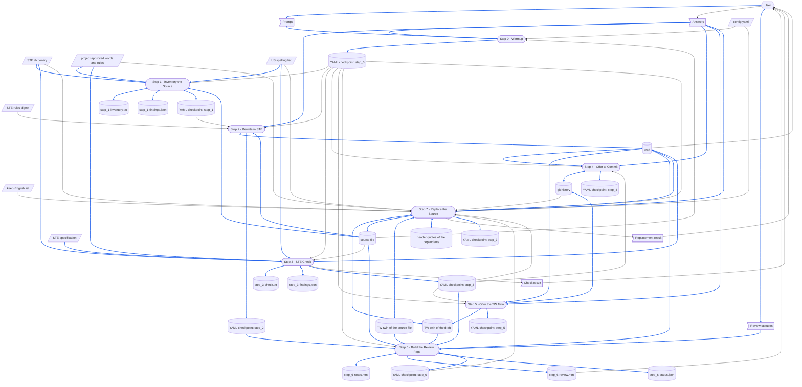

# asd-ste

> [DFD.md](../../references/DFD.md)  `2026-10-18`  `09fb4a7e4730`
> [us-spelling.json](../../references/us-spelling.json)  `2026-10-13`  `8871984ff0d8`
> [md-style.md](../../rules/md-style.md)  `2026-10-30`  `6484ff7dc0b2`
> [skill-writing.md](../../rules/skill-writing.md)  `2026-10-30`  `c7696bf6351a`
> [report-yaml-rules.md](../../rules/report-yaml-rules.md)  `2026-10-30`  `f11dcf524233`
> [SKILL-tmp.md](../../templates/SKILL-tmp.md)  `2026-10-30`  `6ca6e607f75c`
> [README-tmp.md](../../templates/README-tmp.md)  `2026-10-19`  `43ace64a88a6`
> [depends_on.py](../../scripts/depends_on.py)  `2026-10-16`  `53b1d3e60eca`
> [chinese/SKILL.md](../chinese/SKILL.md)  `2026-10-16`  `2a03562d5a11`

What the asd-ste skill is made of, and what its [SKILL.md](SKILL.md) depends on.
A skill loads its whole SKILL.md each time it runs, so the parts a run does not need are kept here: SKILL.md does not link to this file, and no run loads it.
Read it before changing the skill: make every change that When the Skill Is Changed names, then run the checks listed there.
How the steps of a skill are written is in [skill-writing.md](../../rules/skill-writing.md).

The paths in the diagrams are short: `asd-ste/` is `.github/common/skills/asd-ste/`, `common/` is `.github/common/`, and `external/` is at the workspace root.
`<name>.md` is the file a run rewrites, and the draft is its rewrite, at the path the draft tool gives beside it.
`checkpoints/asd-ste/{parent}-{name}/`, also at the workspace root, is the Checkpoint Dir: it holds the YAML checkpoint, `process.yaml`, and the files Steps 1, 3 and 6 write.

# When the Skill Runs

## Dataflow

How a run turns its prompt into what it leaves behind: every step of the Workflow in [SKILL.md](SKILL.md), and the data each one reads and writes, drawn as a DFD in the notation of [DFD.md](../../references/DFD.md).
The steps of SKILL.md say what each one reads and writes; the diagram draws it, so that a record a later step overwrites, data with no source, or a step reading what a later step writes shows at a glance.
A step is named exactly as its heading, number included, so that no reader has to guess which step is meant.
Only what a step reads or writes at run time is drawn; a document a step only cites is not.



How to read the diagram:

- A parallelogram is an external input: `config.yaml`, the STE rules digest, the STE dictionary, the project-approved words and the project rules, the US spelling list, the keep-English list and the STE specification — none of which any step writes.
  A flag is one-run data: the prompt and the Answers, the check result Step 3 prints, the review statuses the user sets on the review page, and the replacement result Step 7 prints.
  A cylinder is a record: the source file and its TW twin, which only Step 7 writes; the draft and its TW twin; each step's group of the YAML checkpoint; the seven files Steps 1, 3 and 6 write in the Checkpoint Dir; the git history; and the header quotes of the dependents.
  A rounded box is a step.
- A hexagon is a role outside the skill: the user, who supplies the prompt, the Answers and the review statuses, and reads the check result, the draft, the review page and the replacement result.
- A solid arrow moves data, the way the data moves; a two-headed arrow is data one step both reads and writes.
- A blue arrow carries data that is itself written into a record, or turned into a record's content; every other arrow is black.
  The prompt and the Answers go into the YAML checkpoint, and so do the source file's skeleton, the dictionary's replacements, the project-approved words a file uses and the American spelling of each British one, which the findings files list, so their arrows are blue.
  The source file reaches the draft through Step 2, which says it again in STE, and the STE specification reaches it through Step 3, which records its fingerprint in the header quote — as it records that of ste-custom.md.
  Step 6 builds the review page from the source file, the draft, their TW twins, the statements kept in source wording in `step_2`, the warnings left in `step_3` and the review notes it writes, so each of those arrows is blue.
  The review statuses go into `step_6-status.json` through the review server Step 6 starts, and the review builder puts them on the page it builds next, so their arrows are blue as well.
  Step 7 puts the draft and its TW twin in the place of the source file and its TW twin, records the source file again in the header quotes of the dependents, and saves the user's answer in `step_7`, so those arrows are blue too.
  Data that only steers how a step works, such as `config.yaml`, the paths in `step_0`, the inventory in `step_1`, the verdict in `step_3`, the review page that `step_6` names, the change that Step 7 reads from the git history, the STE rules digest, or the source file that Step 3 only compares against, stays black even when that step writes a record.
- The YAML checkpoint is one file, but each step owns its group, so the diagram draws one record for each group, each with one writer.
  Step 0 starts the file afresh, so a run never mixes its groups with an earlier run's.
  Under `run step N`, Step N reads `step_0`, and the groups of the steps before it, from the YAML checkpoint: the arrows from the checkpoint into Steps 1 to 7.
- Some records are edited in turn.
  Step 2 writes the draft whole and Step 3 corrects it, reading what it corrects; re-running Step 2 overwrites Step 3's corrections, so Step 2 asks before it overwrites a file that exists.
  Steps 1 and 3 each write a findings file through `check_ste.py`, and read it back to save their group.
  Step 4 and Step 5 each add a commit to the git history as earlier runs and the user left it.
  Step 6 writes the review notes, and its review builder reads them back to build the review page.
  The review server that Step 6 starts writes `step_6-status.json` at each review status the user sets, after the run has ended, and the review builder reads it back when Step 6 runs again.
  Step 7 reads the draft and its TW twin as Steps 2, 3 and 5 left them, writes them into the place of the source file and its TW twin, and deletes them.
- The source file and its TW twin were there before the run: every step before Step 7 reads them as it found them, and Step 7, their one writer, reads what it wrote to check it.
  Step 7 also reads each dependent's header quote, as the run found it, before it records the source file there again.

## Step Purposes

Each step, named exactly as its heading in SKILL.md, with its Purpose: why it exists as a step.

- Step 0 - Warmup
  Pin down which file is rewritten and where its draft goes before anything is written — a run that guesses rewrites the wrong `DFD.md`, and nothing later in the workflow would notice.
- Step 1 - Inventory the Source
  Settle, from the whole file at once, what must reach the draft unchanged and where the prose breaks STE — decided sentence by sentence while rewriting, a heading gets reworded in one section and an identifier "simplified" in the next.
  It is also the last point at which a source that is not English, or one whose kept spans break STE, can be turned away before a rewrite that could only copy them.
- Step 2 - Rewrite in STE
  Produce the rewrite — the one part of this workflow that is a judgement about meaning rather than a comparison of text, and the reason the skill exists.
- Step 3 - STE Check
  Prove that the rewrite kept the source file's skeleton and keeps every rule a program can measure — a rewrite that lost a fenced line, a placeholder or a link still reads well, and only a comparison with the source file catches it.
- Step 4 - Offer to Commit
  Give the draft a commit of its own — the `chinese` skill updates a twin in place only against a source that git holds, and a commit made without asking would carry the user's unfinished edits along with it.
- Step 5 - Offer the TW Twin
  Let the user have the draft in 繁體中文 as well without making it the default — a twin is one more file that every later edit must touch, so it is written only on a yes.
- Step 6 - Build the Review Page
  Put the source file beside every sentence of the draft for the user who must approve it — the STE check proves the skeleton and the measured rules, but whether a rewritten statement still claims what its source claimed is for a reader to judge, and a reader who compares four files by hand misses the sentence that moved.
- Step 7 - Replace the Source
  Change the source file only once the user has approved the draft, and in one move with everything that depends on it — a replacement done by hand forgets the TW twin, leaves the draft behind, or leaves a document in another workspace recording a file that no longer says what it read.

## Files Each Step Uses

The scripted-versus-not rule of skill-writing.md, answered once for this skill:
**Steps 1, 3, 6 and 7 run a script for their work, Step 0 runs one for its paths, and Steps 2, 4 and 5 do not**, because the inventory and the check are exact comparisons that a program makes faster and without missing one, the review page lays out four files and links every line reference the same way each time, and the replacement cuts the header note, points the TW twin's pairing line back at the source file and finds the dependents the same way each time, whereas Step 0 has to decide which file the user meant, Step 2 is the rewrite itself — a judgement about meaning that no program can make — and Steps 4 and 5 turn on the user's answers.
Step 6 writes its review notes itself, because what a reviewer should compare is a reading of the rewrite, and leaves the layout and the check of every line reference to its script.
Step 7 reads each dependent itself, because whether it still holds after the change is a reading, and leaves the replacement and the search to the draft tool.
Every step also runs the step saver, `save_step.py`, to save its group of the YAML checkpoint: copying a long list into YAML is work a program does without missing an entry.

```
Step 0 - Warmup
  reads   config.yaml (optional)
  reads   <name>.md: that it exists, and that its frontmatter parses
  checks  that these exist:
          asd-ste/scripts/check_ste.py
          asd-ste/scripts/draft.py
          asd-ste/scripts/save_step.py
          asd-ste/scripts/make_review.py
          asd-ste/scripts/review_server.js
          asd-ste/references/ste-rules.md
          asd-ste/references/ste-dictionary.json (missing: stop, and name convert_spec.py to rebuild it)
          asd-ste/references/ste-custom.md
          common/references/us-spelling.json
          common/scripts/depends_on.py
  runs    draft.py paths
          ├─ reads the header quote of <name>.md
          └─ prints the paths of <name>-tw.md, the draft, the draft's TW twin and the Checkpoint Dir
  runs    save_step.py --new
          └─ writes the YAML checkpoint afresh: step_0

Step 1 - Inventory the Source
  reads   the YAML checkpoint: step_0 (under run step 1)
  runs    check_ste.py
          ├─ reads ste-dictionary.json
          ├─ reads ste-custom.md
          ├─ reads common/references/us-spelling.json
          ├─ reads <name>.md
          ├─ writes step_1-inventory.txt
          └─ writes step_1-findings.json
  runs    save_step.py
          ├─ reads step_1-findings.json
          └─ writes the YAML checkpoint: step_1

Step 2 - Rewrite in STE
  reads   the YAML checkpoint: step_0, and step_1 with step_1-inventory.txt (under run step 2)
  reads   ste-rules.md (whole)
  reads   <name>.md
  writes  the draft
  runs    save_step.py
          └─ writes the YAML checkpoint: step_2

Step 3 - STE Check
  reads   the YAML checkpoint: step_0 (under run step 3)
  runs    check_ste.py
          ├─ reads ste-dictionary.json, ste-custom.md, us-spelling.json, <name>.md, the draft
          ├─ writes step_3-check.txt
          └─ writes step_3-findings.json
  edits   the draft
  runs    depends_on.py record
          ├─ reads external/ASD-STE100_ISSUE9.pdf (its bytes only)
          ├─ reads ste-custom.md (its bytes)
          └─ writes the header quote of the draft
  runs    save_step.py
          ├─ reads step_3-findings.json
          └─ writes the YAML checkpoint: step_3

Step 4 - Offer to Commit
  reads   the YAML checkpoint: step_0 and step_3 (under run step 4)
  writes  git (on the user's yes)
  runs    save_step.py
          └─ writes the YAML checkpoint: step_4

Step 5 - Offer the TW Twin
  reads   the YAML checkpoint: step_0 and step_3 (under run step 5)
  runs    the chinese skill (on the user's yes)
          ├─ reads common/references/tw-keep-english.md
          ├─ runs scan_md.py, diff_md.py, check_parity.py
          └─ writes the draft's TW twin, and offers its own commit
  runs    save_step.py
          └─ writes the YAML checkpoint: step_5

Step 6 - Build the Review Page
  reads   the YAML checkpoint: step_0 (under run step 6), step_2 when it is there, and step_3
  reads   <name>.md, <name>-tw.md, the draft, the draft's TW twin
  writes  step_6-notes.html
  runs    make_review.py
          ├─ reads <name>.md, <name>-tw.md, the draft, the draft's TW twin
          ├─ reads the YAML checkpoint: step_2 when it is there, and step_3
          ├─ reads step_6-notes.html
          ├─ reads step_6-status.json (when it is there)
          └─ writes step_6-review.html
  runs    review_server.js --probe, and starts review_server.js in the background when none answers
          ├─ serves every step_6-review.html under checkpoints/asd-ste/
          └─ writes step_6-status.json, at each review status the user sets
  runs    save_step.py
          └─ writes the YAML checkpoint: step_6

Step 7 - Replace the Source
  reads   the YAML checkpoint: step_0, step_3 and step_6 (under run step 7)
  reads   config.yaml (optional): the skillGroups roots
  runs    draft.py replace (on the user's approval)
          ├─ reads the draft and the draft's TW twin
          ├─ writes <name>.md and <name>-tw.md
          └─ deletes the draft and the draft's TW twin
  runs    draft.py dependents
          └─ reads the header quote of each Markdown file under each root
  reads   git: the change to <name>.md
  reads   each dependent, where it cites <name>.md
  runs    depends_on.py record
          └─ writes the header quote of each dependent that still holds
  runs    check_ste.py --ste
          └─ reads ste-dictionary.json, ste-custom.md, us-spelling.json, <name>.md
  runs    the chinese skill's check_parity.py
          └─ reads <name>.md, <name>-tw.md, common/references/tw-keep-english.md
  runs    depends_on.py check
          └─ reads each dependent recorded again, and <name>.md
  runs    save_step.py
          └─ writes the YAML checkpoint: step_7
```

No run reads SKILL-tw.md, this file, README-tw.md, ste-custom-tw.md or `convert_spec.py`.
SKILL.md cites md-style.md, but only for the writer to read.

# When the Skill Is Changed

`⇄`: the two change together.
`─▶`: depends on the rules or the format of the other.

```
asd-ste/SKILL.md
 ├─⇄ asd-ste/SKILL-tw.md
 │     every change goes into both: the chinese skill's diff_md.py, a translation, then check_parity.py
 │     └─▶ common/references/tw-keep-english.md: which terms stay English
 ├─⇄ asd-ste/README.md and README-tw.md
 │     the Dataflow and Step Purposes name each step exactly as its heading:
 │     a step added, removed or renamed changes both
 ├─⇄ asd-ste/scripts/check_ste.py
 │     what Steps 1, 3 and 7 say the script prints, its checks and its exit codes,
 │     its --ste alone, --custom, --spelling, --report and --findings options, and the keys of a findings file
 ├─⇄ asd-ste/scripts/draft.py
 │     what Steps 0 and 7 say the script takes, prints and exits with, and the keys its paths command prints;
 │     the script alone knows the name of a draft, and no document gives it;
 │     its recheck command, which ste-custom.md says to run once a day, saves step_3 as Step 3 does
 │     └─▶ common/skills/chinese/scripts/check_parity.py: replace finds the TW twin's pairing line
 │           as the parity check does, and points it back at the source file
 ├─⇄ asd-ste/scripts/save_step.py
 │     its options, and the keys each step saves with it
 ├─⇄ asd-ste/scripts/make_review.py
 │     what Step 6 says the script takes, prints and exits with, the line references of the review notes,
 │     and the keys of step_2 and step_3 it lists on the review page
 │     └─⇄ asd-ste/scripts/review_server.js: the status box of an item and its key, the status
 │           and healthz paths the page asks, and the shape of step_6-status.json
 ├─⇄ asd-ste/scripts/review_server.js (Node.js)
 │     the port, the probe's exit codes and the start commands that Step 6 gives
 ├─⇄ asd-ste/references/ste-rules.md (declared in SKILL.md's header quote)
 │     Step 2 builds the draft by its House Rules
 ├─⇄ asd-ste/scripts/convert_spec.py
 │     Step 0's rebuild command, and what the STE dictionary is
 ├─▶ common/scripts/depends_on.py: the record commands of Steps 3 and 7, and the header quote format
 ├─▶ common/skills/chinese/scripts/check_parity.py: Step 7's parity check
 ├─▶ common/rules/skill-writing.md: how the steps are written
 ├─▶ common/rules/report-yaml-rules.md: the shape of the YAML checkpoint and the fields it requires
 └─▶ common/rules/md-style.md: one sentence on each line
       └─ checked by reformat_md.py and check_reformat.py (--twin: the twin's sentences one for one)

asd-ste/README.md
 ├─⇄ asd-ste/README-tw.md: line for line, through the chinese skill
 ├─▶ common/references/DFD.md: how the Dataflow is drawn
 │     a step or a piece of data added or removed redraws the DFD and renumbers its blue arrows
 └─ README.mermaid.html, README-tw.mermaid.html: the views mermaid-view writes when it shows them

asd-ste/references/ste-rules.md
 ├─▶ external/ASD-STE100_ISSUE9.pdf (header quote)
 │     a digest of Part 1, the writing rules: no run reads the PDF itself
 │     a new issue makes depends_on.py check report CHANGED: read the digest again
 ├─⇄ asd-ste/scripts/check_ste.py
 │     the script makes the House Rules marked *checked*: kept spans, one sentence per line,
 │     the head of the file with its Technical words line, tables, and the project-approved words;
 │     it also makes the sentence and paragraph limits, the GR-1 and GR-6 warnings and the spelling check of rule 1.14
 └─⇄ asd-ste/scripts/draft.py
       the two header notes of House Rule 5: the draft's, and the one a file keeps once a draft replaced it

asd-ste/references/ste-custom.md (the project-approved words and the project rules)
 ├─⇄ asd-ste/references/ste-custom-tw.md: line for line, through the chinese skill
 ├─⇄ asd-ste/scripts/check_ste.py
 │     --custom finds the Words table by its header row, and reads Word, Part of speech and Forms;
 │     a rule that the Rules table marks as checked has its check in the script, as double negatives do
 ├─▶ external/ASD-STE100_ISSUE9.pdf (header quote): the words it adds are beyond that issue
 └─ declared by each draft, and each STE file a draft replaced, whether or not it uses one of the words:
       a word or a rule added, changed or removed shows each of them CHANGED in depends_on.py check;
       after the last change of the day, draft.py recheck checks each one again and records it,
       in a commit of its own; the draft being worked on gets run step 3 at once

asd-ste/scripts/check_ste.py
 ├─▶ the structure of asd-ste/references/ste-dictionary.json (spec, approved, forms, unapproved)
 ├─▶ the Words table of asd-ste/references/ste-custom.md (Word, Part of speech, Forms, Meaning, Why)
 └─▶ the structure of common/references/us-spelling.json (words, not_british)

common/references/us-spelling.json (the US spelling list, shared)
 ├─▶ common/rules/md-style.md: the rule "Write English in American spelling", which the list serves
 └─ a word added: an STE file may now hold it; check each draft again with run step 3,
       and each STE file a draft replaced with check_ste.py --ste

asd-ste/scripts/convert_spec.py (maintenance only; needs pypdf and cryptography)
 ├─▶ external/ASD-STE100_ISSUE9.pdf: the dictionary pages of Part 2
 └─ writes ste-dictionary.json: a new structure changes check_ste.py with it
       it is committed with the skill, so no run needs the PDF to check a word

common/scripts/depends_on.py (shared)
 └─ a change reaches Step 3 here, and the chinese and check-md-deps skills

the templates and the tools
 ├─▶ common/templates/SKILL-tmp.md and README-tmp.md: the structure gen-skill writes from
 ├─ common/skills/CLAUDE.md: points an agent that changes a skill to this file and skill-writing.md
 └─ common/skills/check-skill: checks SKILL.md and this file against the two templates,
    the Dataflow, Step Purposes, Files Each Step Uses and header quote of this file among them

outputs already written (after a rule, the dictionary, or the project-approved words or rules change)
 ├─ each draft: run /asd-ste again, or check it with run step 3
 ├─ each draft's TW twin: when its draft changes, update it through the chinese skill
 ├─ each STE file a draft replaced, such as DFD.md: check it with check_ste.py --ste, and correct it by hand;
 │    its TW twin follows through the chinese skill
 ├─ checkpoints/asd-ste/*/step_6-review.html: a page built before make_review.py, or one of the four files
 │    it shows, changed: build it again with run step 6
 ├─ checkpoints/asd-ste/*/step_6-status.json: an item whose text changes is pending again;
 │    a change to how make_review.py makes an item's key makes every item pending
 └─ checkpoints/asd-ste/*/process.yaml: a change to the keys a step saves leaves older checkpoints
    in the old shape, until the next run of their source file starts them afresh
```

After a change, run the checks that cover it:

- `check_ste.py`, with `--custom` and `--spelling`, on DFD.md and its draft as commit `1710643` holds them — DFD.md before Step 7 replaced it, and the draft the user approved — written out with `git show` to a directory outside the repository: on DFD.md alone, for the inventory, and on the two, for the check: both pass.
- `check_ste.py`, with `--spelling`, on DFD.md and its draft as commit `ed0076e` holds them, written out the same way: the check fails on `Catalogue` in the diagram, and says to change the source file first; the inventory of that DFD.md exits `3` with the verdict `SOURCE-FIRST`, and asks about *Kinds* in a heading.
- `check_ste.py --ste` on `.github/common/references/DFD.md`, which Step 7 replaced: it passes.
- `draft.py`: `paths` on `.github/common/references/DFD.md` says that `ste` is true; `replace`, on copies of DFD.md, DFD-tw.md and their drafts as commit `1710643` holds them, writes each draft over its copy with a header note of two lines and deletes the drafts, and a second run exits `1`; `dependents` of `.github/common/references/DFD.md`, with this workspace and InvestForge as the roots, lists the documents whose header quote records it.
  `replace`, on copies of SKILL-tmp.md, SKILL-tmp-tw.md and their drafts as commit `9722c0f` holds them, points the pairing line of the TW twin back at SKILL-tmp.md, and `check_parity.py` on the two finds no failure; with that line taken out of the draft's TW twin, it exits `1` and writes nothing.
- `draft.py recheck`, on a copy of `.github` and `checkpoints/asd-ste` in a directory outside the workspace, with a `.git` directory of its own and one more row in the copy's ste-custom.md: `--dry-run` lists every file that records ste-custom.md, with the check each one would get; a draft given a semicolon keeps its old record, and so does its TW twin, and `recheck` exits `1`; a word outside the dictionary added to another draft is listed as a new warning, and that draft is recorded; once the semicolon is gone, `recheck` exits `0`, and `--dry-run` lists none.
- `check_parity.py` for SKILL.md with SKILL-tw.md, for README.md with README-tw.md, and for ste-custom.md with ste-custom-tw.md: no failure.
- `depends_on.py check` on SKILL.md and on this file: every declared file is UNCHANGED, or read and recorded again.
- `/check-skill asd-ste`: every check passes, or each finding is settled.
- A run of Steps 0, 1, 3, 4 and 6 on DFD.md as commit `1710643` holds it, written out with `git show`, with its TW twin and the two drafts, to a directory named `test` outside the workspace — a second DFD.md under the workspace makes `[[DFD]]` name two files, and `depends_on.py` refuses to record it — and run from the workspace root: its YAML checkpoint, `checkpoints/asd-ste/test-DFD/process.yaml`, holds `step_0`, `step_1`, `step_3`, `step_4` and `step_6`, each with its `title` and `time`, and `step_6-review.html` opens on the review notes, with every line reference a link.
- `make_review.py` with review notes that name a line past the end of the draft: it exits `1` and writes no page.
- `review_server.js` on a free port, with the page of that run: `--probe` exits `0` there and `1` on a port nothing uses; `/` lists `test-DFD`; a `PUT /test-DFD/status` with one key of the page is written to `step_6-status.json` and read back, and one with a key the page does not hold is refused with `400`.

# Tracked Dependencies

A header quote declares what a file depends on, and `depends_on.py check` says which of those files changed since the declaration was recorded.
SKILL.md declares only ste-rules.md, which Step 2 writes by.
This file declares the rest of what SKILL.md depends on outside the skill, so that SKILL.md stays short.

```
asd-ste/SKILL.md
  ─▶ asd-ste/references/ste-rules.md

asd-ste/README.md (and README-tw.md, which copies its header quote)
  ─▶ common/references/DFD.md
  ─▶ common/references/us-spelling.json
  ─▶ common/rules/md-style.md
  ─▶ common/rules/skill-writing.md
  ─▶ common/rules/report-yaml-rules.md
  ─▶ common/templates/SKILL-tmp.md
  ─▶ common/templates/README-tmp.md
  ─▶ common/scripts/depends_on.py
  ─▶ common/skills/chinese/SKILL.md

external/ASD-STE100_ISSUE9.pdf
  ◀─ asd-ste/references/ste-rules.md
  ◀─ asd-ste/references/ste-custom.md, and its twin ste-custom-tw.md
  ◀─ each draft, and each STE file a draft replaced, such as DFD.md
  ◀─ the TW twin of each, whose header quote the chinese skill copies

asd-ste/references/ste-custom.md
  ◀─ each draft, and each STE file a draft replaced, whether or not its prose uses one of its words
  ◀─ the TW twin of each, whose header quote the chinese skill copies
```

When one of them is reported CHANGED, read what changed, bring SKILL.md and this file in line, and then record it again with `depends_on.py record`.
