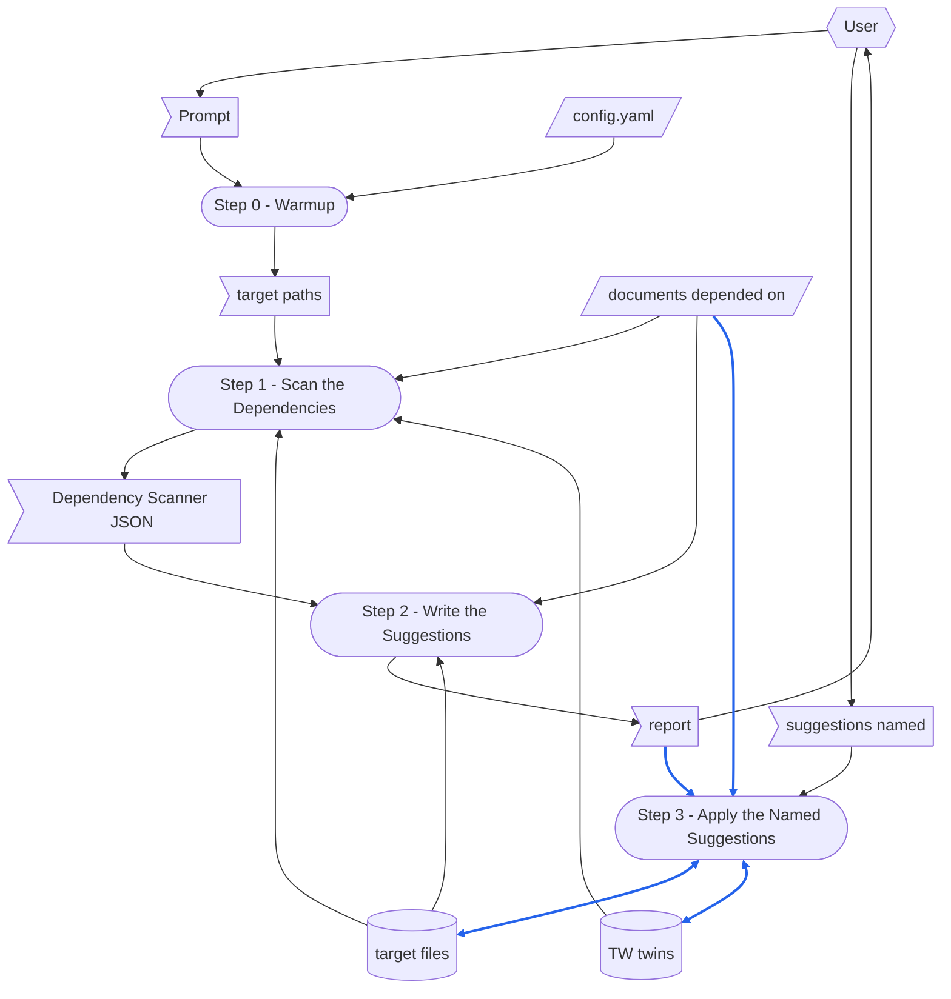

本文件為 [SKILL.md](.github/common/skills/check-md-deps/SKILL.md) 的繁體中文版。
任一份改了某節，另一份必須在同一次執行中一起改。

> [check-wiki-doc](../check-wiki-doc/SKILL.md)  `2026-10-10`  `12fef3478fea`

# TERMINOLOGY

在每個 skill 中意義都相同的 term。

- **no forward-reference** — 一個 step 絕不可依賴排在它之後的 step 的規則。
  為了控制流程而指名後面的 step 並不違反它；借用那個 step 的輸出才違反。

# DEDICATED TERMINOLOGY

本 skill 領域專屬的 term。
定義各個 step 所倚賴的每一個名詞，然後在下方**使用該 term**，而不是重述它的意思——定義歸字彙表所有，重述它的 step 終將與它偏離。

- **target file** — 本次執行所檢查的 Markdown 檔，在 prompt 中以路徑指名；在那裡指名的目錄，代表其下的每一個 `.md` 檔。
- **header quote** — 一份 **target file** 開頭的 `>` 行，位於它的 frontmatter、文件標題或 twin 的 pairing line 之下：target file 有自己的版本時，第一行就是它——`> Version: 261010`——其餘每一行一個 **dependency**：先是連到所依賴文件的連結，只有 target file 引用的各節才算數時接著寫 `cited`，然後是確認的日期，以及那份文件當時的 **fingerprint**，各自放在自己的 inline code 中——`` > [[RSDC-Standard]]  `2026-10-10`  `a6b1c2712472` ``。
  **Dependency Checker** 的 docstring 是這個格式唯一的定義。
- **dependency** — **header quote** 在 Version 行之後的一行：target file 倚賴它所連結的文件，每當那份文件改變，target file 就要重讀一次。
- **fingerprint** — 所連結文件內容之 SHA-256 的前 12 個十六進位數字，照 **Dependency Checker** 的算法計算；該行寫著 `cited` 時，只涵蓋 target file 引用的各節。
- **verdict** — **Dependency Scanner** 對一個 dependency 的發現：`UNCHANGED`；`CHANGED`——自 target file 上一次與那份文件確認以來，那份文件改了，所以 target file 可能不再成立；`NO_RECORD`；`NOTHING_CITED`；`MISSING`；或 `UNRESOLVED`。
- **TW twin** — **target file** 旁邊的 `<name>-tw.md`：它的繁體中文翻譯，由 `chinese` skill 撰寫。
  檔名本身以 `-tw.md` 結尾的 target file 就是 twin，不再檢查它的 twin。
- **twin verdict** — **Twin Differ** 依 git 對一份 TW twin 的發現：`UNCHANGED`；`INCREMENTAL`——自最後一次改動 twin 的 commit 以來，target file 改了，change set 列出要重新翻譯的部分；`FULL`——沒有可以據以更新 twin 的 baseline，並附上原因，例如 twin 從沒 commit 過，或 twin 自己有尚未 commit 的修改；或 `UNCHECKED`，表示比對無法執行。
- **format problem** — **Dependency Checker** 在本該是 dependency 的地方，無法當成 dependency 讀取的一行：格式錯誤、放在 header quote 之外，或第二次宣告同一份文件。
- **criteria** — 一次執行要檢查的四件事，每一件都是報告中某一部分的標題：
  1. **Format** — 每一行 dependency 都讀得成一個 dependency、位於 header quote 中、只宣告一次、恰好連到一個檔案，而且 `cited` 的那一行有可以引用的節。
  2. **Recorded** — 每一個 dependency 都帶有日期與 fingerprint。
  3. **Current** — 每一個記下的 fingerprint，都是那份文件現在的 fingerprint。
  4. **Twin** — 每一份 TW twin 都跟上了它的 target file。
- **suggestion** — 報告中的一個編號項目，`<criterion>.<n>`：一項可以直接進行的修改，或一個由使用者在選項之間做的決定。
- **report format** — check-wiki-doc 報告的形狀，本 skill 的報告採用它：每一個 criterion 一個 verdict，每一項發現都以 `file:line` 連結並附上原文行，suggestion 編在它所回應的發現之下，需要使用者決定的，則依序寫出原文行、問題，再列出選項。
- **Dependency Checker** — 共用的 `depends_on.py`：它讀取 header quote、計算 fingerprint，並重新記下它們（`record`）。
- **Dependency Scanner** — 本 skill 的 `scan_md_deps.py`：程式能找到的、關於 target file 之 header quote 的一切——每一個 dependency 的 verdict、每一個 format problem，以及對於文件在 git 中的 `CHANGED` dependency：自它的日期以來的各個 commit、它當初據以確認之內容所在的 commit，以及從那之後的 diff——還有，對於旁邊有 TW twin 的 target file，它的 twin verdict 與 change set，全部輸出為一份 JSON。
  它不寫任何東西。
- **Twin Differ** — `chinese` skill 的 `diff_md.py`，由 **Dependency Scanner** 以命令執行：依 git 找出一份檔案自最後一次改動它的 TW twin 的 commit 以來改了什麼。
  本 skill 絕不編輯它。

# CONFIGURATION

本 skill 執行時所使用的具體值。

- **Dependency Checker** — `{skillGroups.common}/scripts/depends_on.py`。
- **Dependency Scanner** — `{skillGroups.common}/skills/check-md-deps/scripts/scan_md_deps.py`。
- **Twin Differ** — `{skillGroups.common}/skills/chinese/scripts/diff_md.py`。
- **report format** — [check-wiki-doc](../check-wiki-doc/SKILL.md) 的「4. 回報」。

# MUST FOLLOW

- 必須逐步執行 workflow，並顯示每個 step 的編號。
- 每個 step 必須自足。
  **No forward-reference。**
- 程式能以 deterministic 方式完成的 step 必須以腳本執行。
  需要閱讀、判斷或摘要的 step **不可**腳本化——請寫成自然語言指示，讓 agent 直接執行。
- **本 skill 沒有 `run step N` 選擇子——每一次執行都是完整的執行。**
  它不保留 YAML checkpoint 讓 step 讀回，而一次完整的執行只花一次掃描。
- **本 skill 既不產出 MD report，也不產出 YAML checkpoint。**
  它的產出是對話中的報告；它唯一會改動的檔案是 target file，而且只在 Step 3——TW twin 則只透過 `chinese` skill 改動，Step 3 在使用者指名 twin 的 suggestion 時執行它。
- **在使用者指名要套用的 suggestion 之前，不改動任何檔案。**
  報告才是一次執行的目的；沒被要求就做的修正，會把它所修正的發現藏起來。
- **絕不建議本次執行還沒資格提出的 record。**
  只有在讀過一個 dependency 的文件改動之處、並確認 target file 仍然成立之後，才建議對它 `record`；為了讓 verdict 安靜下來而做的 record，是在替一份沒人檢查過的檔案背書。
- 依照 [scratch-rules.md](.github/common/rules/scratch-rules.md) 決定一次執行的拋棄式檔案放在哪裡，以及如何清理。

# Prompt Examples


## Prompt 1

```
/check-md-deps
.github/common/skills/compile-skill/SKILL.md
```

## Prompt 2

```
/check-md-deps
.github/common/skills/gen-rsdc-skill/assets
.github/common/skills/gen-rsdc-app/assets/RSDC-App-tmp.md
```

## Prompt 3

```
RSDC-App-tmp.md 的依賴還是最新的嗎？
```


# Dataflow

一次執行如何把它的 prompt 變成它留下的東西：**Workflow** 的每一個 step，以及每個 step 讀寫的資料，以 [DFD.md](.github/common/references/DFD.md) 的畫法畫成 DFD。
各個 step 寫明自己讀寫什麼；這張圖把它畫出來，讓有兩個寫入者的 record、沒有來源的資料，或讀取較後 step 所寫之物的 step，一眼就看得出來。
step 的名稱與它的標題完全相同、連編號一起，讀者就不必猜是哪一個 step。
只畫 step 在執行時讀寫的東西；step 只是引用的文件不畫。
本 skill 不產出的輸出，就刪掉它的節點與箭頭。



圖的讀法：

- 平行四邊形是 external input：`config.yaml`，以及 target file 所依賴的文件。
  旗形是 one-run data：prompt、Step 0 從中解析出的 target file 路徑、Dependency Scanner 的 JSON、報告，以及使用者指名的 suggestion。
  圓柱是 record：target file，只有 Step 3 會寫入它；以及 TW twin，由 Step 3 交給 `chinese` skill 寫入。
  圓角方框是 step。
- 六角形是 skill 之外的 role：User，提供 prompt、讀取報告，並指名要套用的 suggestion。
- 實線箭頭沿著資料移動的方向搬移資料；雙頭箭頭表示某個 step 對同一份資料既讀又寫。
  虛線箭頭不承載任何資料：它表示一個順序，或一次手動做出的變更。
- 藍色箭頭承載的資料，本身會被寫進某個 record，或被轉成某個 record 的內容：套用的 suggestion、記進 target file 的所依賴文件的 fingerprint，以及譯進 TW twin 的 target file。
  其餘箭頭一律是黑色；使用者指名的 suggestion，只決定 Step 3 要套用其中哪些。

# Steps at a Glance

每個 step 的總覽，每個 step 一列，名稱與它的標題完全相同：它執行的 script（不執行時寫「—」）。
本 skill 不寫 YAML checkpoint，所以 YAML 欄一律寫「—」。

| Step | Script | YAML |
|---|---|---|
| Step 0 - Warmup | — | — |
| Step 1 - Scan the Dependencies | `scan_md_deps.py`，它會執行 `diff_md.py` | — |
| Step 2 - Write the Suggestions | — | — |
| Step 3 - Apply the Named Suggestions | `depends_on.py record`，用於要 record 的 suggestion；`chinese` skill，用於 twin 的 suggestion；`scan_md_deps.py` | — |


# Workflow

每個 step 以一條 **Purpose** 開頭：一句話說明這個 step 為何要獨立存在——把它折進相鄰的 step 裡，本 skill 會損失什麼。
它不是該 step 所做之事的摘要；下方的項目已經講了那些，而重述它們的 Purpose 只是第二份副本，終將與之偏離。

**Step 1 執行腳本，Step 3 為每一項要 record 的 suggestion 執行一支；Step 0 與 Step 2 不執行**，因為找出改了什麼、header quote 在哪裡違反了它的格式，是程式能窮盡進行的比對；而判斷一份 target file 所倚賴的文件改了之後，它是否仍然成立——以及要改寫成什麼—— 則是一種閱讀。

## Step 0 - Warmup

- **Purpose**：確定本次執行要檢查哪些檔案、它的程式在哪裡，讓後面沒有任何 step 得去猜路徑。

- 先執行 `.venv`——腳本需要 `PyYAML`。

- 讀取 workspace 根目錄的 workspace config [config.yaml](config.yaml)（有的話）並解析：
  - **`skillGroups`**：群組名稱 -> skills 根目錄的對應——本 skill 自己的目錄是 `{skillGroups.common}\skills\check-md-deps\`，而 **Dependency Checker** 位於 `{skillGroups.common}\scripts\` 之下。
  - 在下方各 step 中（包含指令內）凡出現 `{skillGroups.common}` 之處，都代換為解析後的值。
  - 沒有 `config.yaml` 時，把 `{skillGroups.common}` 當成本 skill 自己的目錄往上兩層——放著 `skills\` 的那一層——並且不帶 `--config` 執行：連結中用到 `config.yaml` 某個值（例如 `{wikiDir}`）的 dependency，就會顯示為 `UNRESOLVED`；連到 target file 所在 vault 之外的 `[[Name]]`——例如寫在其他 workspace 的文件連到 RSDC standard——則顯示為 `MISSING`；報告也會說明原因。

- 執行 workflow 前，先確認 **Dependency Scanner** 與 **Dependency Checker** 存在。
  沒有 **Twin Differ** 時，每一份 TW twin 都會顯示為 `UNCHECKED`。

- prompt 採用上方 **Prompt Examples** 所示形式之一。
  從中解析：
  - **target file**：指令之後各自獨立一行的每一個路徑，或自然語言請求所指名的檔案——目錄代表其下的每一個 `.md` 檔。

- 若解析不出任何 target file，向使用者索取。

- 顯示 target file 的路徑。


## Step 1 - Scan the Dependencies

- **Purpose**：讓程式找出讀者可能漏掉的每一項事實——用眼睛比對的 fingerprint、隔了一行空行而落在 header quote 之外的一行、一份文件自它的日期以來改了什麼——讀者只需要處理需要判斷的部分。

- 對 Step 0 的 target file 路徑執行 **Dependency Scanner**；Step 0 找到 `config.yaml` 時，加上 `--config`。
  - 範例：`python {skillGroups.common}\skills\check-md-deps\scripts\scan_md_deps.py ".github\common\skills\compile-skill\SKILL.md" --config config.yaml`

- 腳本：
  1. 找出每一份 target file 的 **header quote**，讀取其中的每一個 **dependency**，並列出每一個 **format problem**——格式錯誤、位置錯誤，或第二次宣告。
  2. 解析每一個連結，計算現在的 **fingerprint**，並給每一個 dependency 它的 **verdict**；`cited` 的 dependency 還會列出它的 fingerprint 涵蓋哪些節。
  3. 對於文件在 git 中的每一個 `CHANGED` dependency：列出自該 dependency 的日期以來的各個 commit，找出 baseline——內容帶有記下之 fingerprint 的最新 commit，找不到時，就取那個日期當天或之前的最後一個 commit，並標為近似——再給出被計算 fingerprint 的文字從 baseline 到現在的 diff。
  4. 對旁邊有 **TW twin** 的每一份 target file，執行 **Twin Differ**，給 twin 它的 **twin verdict**，並附上它印出的 baseline 與 change set。
  5. 把這一切輸出為一份 JSON，不寫任何東西。

- 依它的 exit status 行事：
  - `0`：每一個 dependency 與每一份 TW twin 都是 `UNCHANGED`，也沒有 format problem；繼續。
  - `1`：找到了某些東西；繼續。
  - `2`：某個 target 路徑不存在或無法讀取；回報它印出的內容，向使用者索取路徑，並重新執行這個 step。

- 為每一份 target file 顯示它的各個 dependency 及其 verdict、它的 format problem 數量，以及它有 TW twin 時的 twin verdict。


## Step 2 - Write the Suggestions

- **Purpose**：把事實變成使用者可以一次處理一項的決定——一份文件改了之後，target file 是否仍然正確，是一種閱讀，而不是比對。

- 讀取 Step 1 的 JSON。
  對每一個 `CHANGED` dependency，讀它的 diff——沒有 diff 時，讀它列出的各節，或整份文件現在的樣子——以及 target file 中倚賴它的各行：引用它所列各節的那些行，或對於不是 `cited` 的 dependency，倚賴那份文件的每一行。
  對每一份 twin verdict 不是 `UNCHANGED` 的 TW twin，讀它的 change set 與它給出的原因。

- 適用於下方每一條指示的規則：
  - 以 **report format**，用 prompt 的語言寫報告。
    不做 check-wiki-doc 回寫架構文件的那一步：這個 step 不寫任何東西。
  - 每一項發現都以 JSON 與上面讀到的內容為依據——不捏造任何改動，也不捏造任何一行。
    無法從中判斷 target file 是否仍然成立時，就把它列為使用者的決定，並說明哪裡不明。
  - 每一行都完整引用，就像 check-wiki-doc 那樣，絕不截短。
  - 建議 record 的 suggestion，要寫出 target file 與連結——也就是 **Dependency Checker** 的 `record` 所需的參數——而且只在 MUST FOLLOW 允許時才提出。

- 依序回報四項 **criteria**，每一項附上它的 verdict、它的發現，以及這些發現的 **suggestion**：
  1. **Format**：對每一個 format problem，寫出那一行應有的完整寫法——或者，對第二次宣告，說明要保留哪一行；對 `UNRESOLVED` 或 `MISSING` 的連結，寫出指名該檔案的連結，或在不清楚原本指的是哪個檔案時，列為一項決定；對 `NOTHING_CITED`，寫出要拿掉的 `cited`，或 target file 缺少的引用。
  2. **Recorded**：對每一個 `NO_RECORD` dependency，寫出要讀的文件，以及接著要做的 record——或者，當文件已不再寫著 target file 所倚賴的內容時，寫出 target file 要怎麼改。
  3. **Current**：對每一個 `CHANGED` dependency，寫出各個 commit 與改動，接著，改動讓 target file 仍然正確時，寫出要做的 record；不正確時，逐行寫出 target file 要怎麼改——或者在不清楚該改哪一邊時，照 report format 的寫法，列為兩者之間的一項決定。
  4. **Twin**：對每一份 twin verdict 為 `INCREMENTAL` 的 TW twin，寫出它的 change set，接著是對 target file 執行 `chinese` skill 的 suggestion——它只翻譯 change set；對 `FULL`，寫出原因，接著是執行 `chinese` skill 的 suggestion——它翻譯整份檔案；或者，當 twin 自己有尚未 commit 的修改時，列為一項決定：先手動 commit 那些修改，讓 `chinese` skill 保留它們、只翻譯改過的部分，或讓它翻譯整份檔案、蓋過它們；對 `UNCHECKED`，寫出是什麼讓比對無法執行。

- 報告結尾要說明還沒有改動任何檔案，並請使用者以編號指名要套用的 suggestion。


## Step 3 - Apply the Named Suggestions

- **Purpose**：只改動使用者同意的部分，並證明改動生效——沒被要求就做的修正，會把它所修正的發現藏起來。

- 只有在使用者以編號指名 Step 2 報告中的 suggestion 之後，才執行這個 step——`做 1.1 3.2`、`1.1-1.3`，或某一個 criterion 的每一項 suggestion。
  某個編號不清楚，或在那份報告中找不到對應時，就問；絕不猜。

- 照報告的寫法套用每一項被指名的 suggestion：
  - 修改：只改它指名的那幾行，其他都不動；
  - record：對 target file 與它指名的連結執行 **Dependency Checker** 的 `record`，`cited` 的 dependency 加上 `--cited`。
    target file 旁邊有 twin（`<name>-tw.md`）時，也以同樣方式 record 它：`chinese` skill 會把 header quote 原封不動複製到 twin，所以兩者必須保持同一份 record。
    - 範例：`python {skillGroups.common}\scripts\depends_on.py record ".github\common\skills\compile-skill\README.md" --target "[[SkillCompiler-RSDC]]" --cited`
  - twin：對 target file 執行 `chinese` skill——例如 `/chinese .github\common\skills\compile-skill\SKILL.md`。
    twin 有 baseline 時，它只翻譯 change set；沒有時，翻譯整份檔案；它在寫入前會先詢問，並在使用者同意時把兩份一起 commit。
    更新了卻沒有 commit 的 twin，在接下來的掃描中會顯示為 `FULL`——它的修改尚未 commit——直到兩份一起 commit 為止。

- 對改動過的 target file 再執行一次 **Dependency Scanner**，做法與 Step 1 相同。
  - 範例：`python {skillGroups.common}\skills\check-md-deps\scripts\scan_md_deps.py ".github\common\skills\compile-skill\SKILL.md"`

- 回報每一項被指名的 suggestion 已完成，附上掃描現在給出的 verdict，並說明哪些 suggestion 還沒套用。
