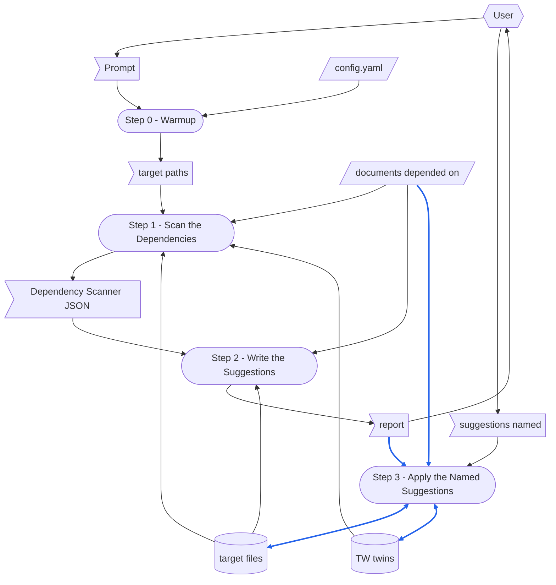

> [check-wiki-doc](../check-wiki-doc/SKILL.md)  `2026-10-10`  `12fef3478fea`

# TERMINOLOGY

Terms that mean the same thing in every skill.

- **no forward-reference** — the rule that a step must never depend on a step that comes after it.
  Naming a later step to route control flow does not break it; borrowing that step's output does.

# DEDICATED TERMINOLOGY

Terms specific to this skill's domain.
Define every noun the steps rely on, then **use the term** below instead of restating what it means — the glossary owns the definition, and a step that repeats it will drift from it.

- **target file** — a Markdown file this run checks, named on the prompt by its path; a directory named there stands for every `.md` file under it.
- **header quote** — the `>` lines at the head of a **target file**, under its frontmatter, its title or a twin's pairing line: the target file's own version first, when it gives one — `> Version: 261010` — then one **dependency** on each line: a link to the document depended on, then `cited` when only the sections the target file cites count, then the date it was confirmed and that document's **fingerprint** then, each in inline code of its own — `` > [[RSDC-Standard]]  `2026-10-10`  `a6b1c2712472` ``.
  The **Dependency Checker**'s docstring is the one definition of the format.
- **dependency** — one line of a **header quote** after its Version line: the target file relies on the document it links, and is read again whenever that document changes.
- **fingerprint** — the first 12 hex digits of the SHA-256 of the linked document's content, as the **Dependency Checker** computes it, narrowed to the sections the target file cites when the line says `cited`.
- **verdict** — what the **Dependency Scanner** finds of one dependency: `UNCHANGED`; `CHANGED` — the document changed since the target file was confirmed against it, so the target file may no longer hold; `NO_RECORD`; `NOTHING_CITED`; `MISSING`; or `UNRESOLVED`.
- **TW twin** — the `<name>-tw.md` beside a **target file**: its 繁體中文 translation, which the `chinese` skill writes.
  A target file whose own name ends in `-tw.md` is a twin, and is not checked for one.
- **twin verdict** — what the **Twin Differ** finds of a TW twin, from git: `UNCHANGED`; `INCREMENTAL` — the target file changed since the commit that last changed its twin, and the change set names what to translate again; `FULL` — no baseline the twin can be updated from, with the reason, such as a twin never committed or one with uncommitted changes of its own; or `UNCHECKED`, when the comparison could not run.
- **format problem** — a line the **Dependency Checker** cannot take as a dependency where one belongs: malformed, misplaced outside the header quote, or declaring a document a second time.
- **criteria** — the four things a run checks, each the heading of one part of the report:
  1. **Format** — every dependency line is read as one, sits in the header quote, is declared once and links to exactly one file, and a `cited` line has a section to cite.
  2. **Recorded** — every dependency carries a date and a fingerprint.
  3. **Current** — every recorded fingerprint is the document's fingerprint now.
  4. **Twin** — every TW twin has kept up with its target file.
- **suggestion** — one numbered item of the report, `<criterion>.<n>`: a change that can be made directly, or a decision between options that the user makes.
- **report format** — the shape of check-wiki-doc's report, which this skill's report takes: a verdict for each criterion, every finding linked as `file:line` with its original line, the suggestions numbered under the finding they answer, and those that need the user's decision set out as original lines, problem, then options.
- **Dependency Checker** — the shared `depends_on.py`: it reads a header quote, computes fingerprints, and records them anew (`record`).
- **Dependency Scanner** — this skill's `scan_md_deps.py`: everything a program can find about the target files' header quotes — each dependency's verdict, each format problem, and, for a `CHANGED` dependency whose document is in git, the commits since its date, the commit whose content it was confirmed against, and the diff since then — and, for a target file with a TW twin, its twin verdict and change set, as one JSON.
  It writes nothing.
- **Twin Differ** — the `chinese` skill's `diff_md.py`, which the **Dependency Scanner** runs as a command: from git, what changed in a file since the commit that last changed its TW twin.
  This skill never edits it.

# CONFIGURATION

Concrete values this skill runs with.

- **Dependency Checker** — `{skillGroups.common}/scripts/depends_on.py`.
- **Dependency Scanner** — `{skillGroups.common}/skills/check-md-deps/scripts/scan_md_deps.py`.
- **Twin Differ** — `{skillGroups.common}/skills/chinese/scripts/diff_md.py`.
- **report format** — 「4. 回報」 of [check-wiki-doc](../check-wiki-doc/SKILL.md).

# MUST FOLLOW

- Must run workflow step by step, and display each step number.
- Each step must be self-contained.
  **No forward-reference.**
- A step that a program can do deterministically must be run as a script.
  A step that needs reading, judgement, or summarization **must not** be scripted — write it as natural-language instructions for the agent to perform directly.
- **This skill has no `run step N` selector — every run is a whole run.**
  It keeps no YAML checkpoint for a step to read back, and a whole run costs one scan.
- **This skill produces neither an MD report nor a YAML checkpoint.**
  Its product is the report in the conversation; the only files it changes are target files, in Step 3 alone — and a TW twin, only through the `chinese` skill, which Step 3 runs for a twin suggestion the user names.
- **Change no file before the user names the suggestions to apply.**
  The report is what a run is for; a fix made unasked hides the finding it fixes.
- **Never suggest a record the run has not earned.**
  A `record` is suggested only for a dependency whose document has been read where it changed, and the target file found to still hold; a record made to silence a verdict vouches for a file nobody checked.
- Follow [scratch-rules.md](.github/common/rules/scratch-rules.md) for where a run's throwaway files go and how they are cleaned up.

# Prompt Examples


## Prompt 1

```
/check-md-deps
.github/common/skills/compile-skill/SKILL.md
```

## Prompt 2

```
/check-md-deps
.github/common/skills/gen-rsdc-skill/assets
.github/common/skills/gen-rsdc-app/assets/RSDC-App-tmp.md
```

## Prompt 3

```
RSDC-App-tmp.md 的依賴還是最新的嗎？
```


# Dataflow

How a run turns its prompt into what it leaves behind: every step of the **Workflow**, and the data each one reads and writes, drawn as a DFD in the notation of [DFD.md](.github/common/references/DFD.md).
The steps say what each one reads and writes; the diagram draws it, so that a record with two writers, data with no source, or a step reading what a later step writes shows at a glance.
A step is named exactly as its heading, number included, so that no reader has to guess which step is meant.
Only what a step reads or writes at run time is drawn; a document a step only cites is not.
Drop the nodes and arrows for any output this skill does not produce.



How to read the diagram:

- A parallelogram is an external input: `config.yaml`, and the documents the target files depend on.
  A flag is one-run data: the prompt, the target paths Step 0 parses from it, the Dependency Scanner JSON, the report, and the suggestions the user names.
  A cylinder is a record: the target files, which Step 3 alone writes, and the TW twins, which Step 3 has the `chinese` skill write.
  A rounded box is a step.
- A hexagon is a role outside the skill: the user, who supplies the prompt, reads the report, and names the suggestions to apply.
- A solid arrow moves data, the way the data moves; a two-headed arrow is data one step both reads and writes.
  A dotted arrow carries no data: it is an order, or a change made by hand.
- A blue arrow carries data that is itself written into a record, or turned into a record's content: the suggestions applied, the fingerprints of the documents depended on, recorded in the target files, and a target file translated into its TW twin.
  Every other arrow is black; the suggestions named only choose which of them Step 3 applies.

# Steps at a Glance

Each step at a glance, one row per step, named exactly as its heading: the script it runs, or a dash when it runs none.
This skill writes no YAML checkpoint, so every YAML cell is a dash.

| Step | Script | YAML |
|---|---|---|
| Step 0 - Warmup | — | — |
| Step 1 - Scan the Dependencies | `scan_md_deps.py`, which runs `diff_md.py` | — |
| Step 2 - Write the Suggestions | — | — |
| Step 3 - Apply the Named Suggestions | `depends_on.py record`, for a suggestion that records; the `chinese` skill, for a twin suggestion; `scan_md_deps.py` | — |


# Workflow

Each step opens with a **Purpose**: one sentence saying why that step exists as a step — what this skill would lose by folding it into its neighbour.
It is not a summary of what the step does; the bullets below it already say that, and a Purpose that repeats them is a second copy that will drift.

**Step 1 runs a script, and Step 3 runs one for every suggestion that records; Step 0 and Step 2 do not**, because finding what changed, and where a header quote breaks its format, is a comparison a program makes exhaustively, whereas deciding whether a target file still holds after a document it relies on changed — and what to write instead — is a reading.

## Step 0 - Warmup

- **Purpose**: settle which files this run checks and where its programs are, so that no later step guesses a path.

- Run `.venv` first — the scripts need `PyYAML`.

- Read the workspace config [config.yaml](config.yaml) at the workspace root, when there is one, and resolve:
  - **`skillGroups`**: the group name -> skills-root map — this skill's own directory is `{skillGroups.common}\skills\check-md-deps\`, and the **Dependency Checker** lies under `{skillGroups.common}\scripts\`.
  - Substitute the resolved values wherever `{skillGroups.common}` appears in the steps below (including in commands).
  - Without a `config.yaml`, take `{skillGroups.common}` to be the directory two levels above this skill's own — the one that holds `skills\` — and run without `--config`: a dependency whose link names a value of `config.yaml`, such as `{wikiDir}`, then shows as `UNRESOLVED`, and a `[[Name]]` link to a note outside the target file's vault — the RSDC standard, for a document written in another workspace — shows as `MISSING`; the report says why.

- Check the **Dependency Scanner** and the **Dependency Checker** exist before running the workflow.
  Without the **Twin Differ**, every TW twin shows as `UNCHECKED`.

- The prompt takes one of the forms shown in **Prompt Examples** above.
  Parse it for:
  - the **target files**: each path on its own line after the command, or the files a natural-language request names — a directory stands for every `.md` file under it.

- If no target file can be parsed, ask the user for it.

- Display the target paths.


## Step 1 - Scan the Dependencies

- **Purpose**: let a program find every fact a reader could miss — a fingerprint compared by eye, a line one blank line out of the header quote, what changed in a document since its date — so that a reader is left only what needs judgement.

- Run the **Dependency Scanner** on the target paths of Step 0, with `--config` when Step 0 found a `config.yaml`.
  - Example: `python {skillGroups.common}\skills\check-md-deps\scripts\scan_md_deps.py ".github\common\skills\compile-skill\SKILL.md" --config config.yaml`

- The script:
  1. Finds each target file's **header quote**, reads each **dependency** on it, and lists every **format problem** — malformed, misplaced or a second declaration.
  2. Resolves each link, computes the **fingerprint** now, and gives each dependency its **verdict**; a `cited` dependency also names the sections its fingerprint covers.
  3. For each `CHANGED` dependency whose document is in git: lists the commits since the dependency's date, finds the baseline — the newest commit whose content has the recorded fingerprint, or failing that the last commit on or before that date, marked approximate — and gives the diff of the fingerprinted text from the baseline to now.
  4. For each target file with a **TW twin** beside it, runs the **Twin Differ** and gives the twin its **twin verdict**, with the baseline and the change set it prints.
  5. Prints it all as one JSON, and writes nothing.

- Act on its exit status:
  - `0`: every dependency and every TW twin is `UNCHANGED`, and there is no format problem; continue.
  - `1`: something was found; continue.
  - `2`: a target path does not exist or cannot be read; report what it printed, ask for the path, and run this step again.

- Display, for each target file, its dependencies with their verdicts, its count of format problems, and its twin verdict when it has a TW twin.


## Step 2 - Write the Suggestions

- **Purpose**: turn the facts into decisions the user can take one at a time — whether a changed document still leaves the target file true is a reading, not a comparison.

- Read the JSON of Step 1.
  For each `CHANGED` dependency, read its diff — or, with no diff, the sections it names, or the whole document, as they are now — and the lines of the target file that rely on it: those citing the sections it names, or, for a dependency that is not `cited`, every line that relies on the document.
  For each TW twin whose twin verdict is not `UNCHANGED`, read its change set and the reason it gives.

- Rules that apply to every instruction below:
  - Write the report in the **report format**, in the language of the prompt.
    Leave out check-wiki-doc's write-back to its architecture document: this step writes nothing.
  - Base every finding on the JSON and on what was read above — invent no change and no line.
    When it cannot be decided from them whether the target file still holds, make it a decision for the user, and say what is unknown.
  - Quote every line in full, as check-wiki-doc does, never cut short.
  - A suggestion to record names the target file and the link — what the **Dependency Checker**'s `record` takes — and is made only as MUST FOLLOW allows.

- Report the four **criteria** in order, each with its verdict, its findings and their **suggestions**:
  1. **Format**: for each format problem, the line as it should read, in full — or, for a second declaration, which line to keep; for an `UNRESOLVED` or `MISSING` link, the link that names the file, or a decision when it is not clear which file was meant; for `NOTHING_CITED`, the `cited` to drop, or the citation the target file lacks.
  2. **Recorded**: for each `NO_RECORD` dependency, the document to read, and then the record to make — or the change to the target file, when the document no longer says what the target file relies on.
  3. **Current**: for each `CHANGED` dependency, the commits and the change, then either the record to make, when the change leaves the target file true, or the edit to the target file, line by line, when it does not — or a decision between the two, set out as the report format sets it out, when it is unclear which side should change.
  4. **Twin**: for each TW twin whose twin verdict is `INCREMENTAL`, its change set, then the suggestion to run the `chinese` skill on the target file, which translates only the change set; for `FULL`, the reason, then the suggestion to run the `chinese` skill, which translates the whole file — or, when the twin has uncommitted changes of its own, a decision between committing them first, by hand, so that the `chinese` skill keeps them and translates only what changed, and letting it translate the whole file over them; for `UNCHECKED`, what stopped the comparison.

- End the report by saying that no file has been changed, and that the user names the suggestions to apply by their numbers.


## Step 3 - Apply the Named Suggestions

- **Purpose**: change exactly what the user agreed to, and show that it took — a fix made unasked hides the finding it fixes.

- Run this step only once the user names suggestions of the report of Step 2 by their numbers — `做 1.1 3.2`, `1.1-1.3`, or every suggestion of one criterion.
  When a number is unclear, or names nothing in that report, ask; never guess.

- Apply each named suggestion as the report wrote it:
  - an edit: change exactly the lines it names, and no other;
  - a record: run the **Dependency Checker**'s `record` on the target file and the link it names, with `--cited` for a `cited` dependency.
    When a twin sits beside the target file, `<name>-tw.md`, record it the same way: the `chinese` skill copies the header quote into the twin unchanged, so the two must keep the same record.
    - Example: `python {skillGroups.common}\scripts\depends_on.py record ".github\common\skills\compile-skill\README.md" --target "[[SkillCompiler-RSDC]]" --cited`
  - a twin: run the `chinese` skill on the target file — e.g. `/chinese .github\common\skills\compile-skill\SKILL.md`.
    It translates only the change set when the twin has a baseline, and the whole file when it has none; it asks before it writes, and commits the pair on the user's yes.
    A twin updated and not committed shows as `FULL` in the scan that follows, its changes being uncommitted, until the pair is committed.

- Run the **Dependency Scanner** again on the target files changed, as Step 1 does.
  - Example: `python {skillGroups.common}\skills\check-md-deps\scripts\scan_md_deps.py ".github\common\skills\compile-skill\SKILL.md"`

- Report each named suggestion as done, with the verdicts the scan now gives, and say which suggestions remain unapplied.
