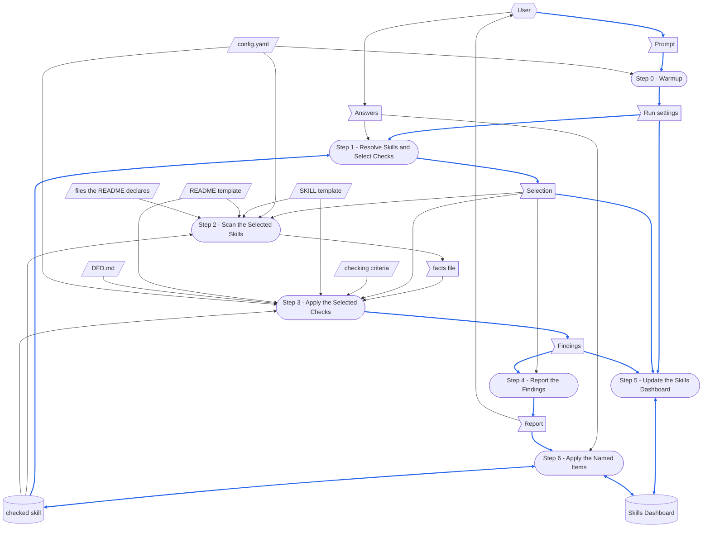

# check-skill

> [DFD.md](../../references/DFD.md)  `2026-10-18`  `09fb4a7e4730`
> [md-style.md](../../rules/md-style.md)  `2026-10-30`  `6484ff7dc0b2`
> [skill-writing.md](../../rules/skill-writing.md)  `2026-10-30`  `c7696bf6351a`
> [scratch-rules.md](../../rules/scratch-rules.md)  `2026-10-18`  `f3bc07a86022`
> [SKILL-tmp.md](../../templates/SKILL-tmp.md)  `2026-10-30`  `6ca6e607f75c`
> [README-tmp.md](../../templates/README-tmp.md)  `2026-10-19`  `43ace64a88a6`
> [depends_on.py](../../scripts/depends_on.py)  `2026-10-16`  `53b1d3e60eca`
> [chinese/SKILL.md](../chinese/SKILL.md)  `2026-10-16`  `2a03562d5a11`

check-skill skill 由哪些部分組成，以及它的 [SKILL.md](SKILL.md) 依賴哪些檔案。
skill 每次執行都會載入整份 SKILL.md，所以執行時用不到的部分放在這裡：SKILL.md 不連到本檔，也沒有任何一次執行會載入它。
修改本 skill 之前先讀這份：做完 When the Skill Is Changed 列出的每一項修改，再跑那裡列出的檢查。
skill 的各個 step 怎麼寫，見 [skill-writing.md](../../rules/skill-writing.md)。

圖中的路徑都用簡寫：`check-skill/` 指 `.github/common/skills/check-skill/`，`common/` 指 `.github/common/`。
`<skill>/` 是某個 checked skill 的目錄，`{wikiDir}` 是 `config.yaml` 所給的 wiki 根目錄，`temp/` 位於 workspace 根目錄。

# When the Skill Runs

## Dataflow

一次執行如何把它的 prompt 變成它留下的東西：[SKILL.md](SKILL.md) 中 Workflow 的每一個 step，以及每個 step 讀寫的資料，以 [DFD.md](../../references/DFD.md) 的畫法畫成 DFD。
SKILL.md 的各個 step 寫明自己讀寫什麼；這張圖把它畫出來，讓被較後 step 覆寫的 record、沒有來源的資料，或讀取較後 step 所寫之物的 step，一眼就看得出來。
step 的名稱與它的標題完全相同、連編號一起，讀者就不必猜是哪一個 step。
只畫 step 在執行時讀寫的東西；step 只引用的文件不畫。



圖的讀法：

- 平行四邊形是 external input：`config.yaml`、兩份 template、checked skill 的 README.md 所宣告的檔案、checking criteria 與 DFD.md——沒有任何 step 會寫入它們。
  旗形是 one-run data：prompt 與 Answers、Step 0 解析出的執行設定、Step 1 做出的選取、Step 2 寫出的 facts file、Step 3 記下的 finding，以及 Step 4 印出的報告。
  facts file 雖然是一個檔案，卻只存在於一次執行之中：Step 5 會刪除它，所以把它畫成 one-run data。
  圓柱是 record：checked skill——它的 SKILL.md 與 README.md、它們的 twin、它的腳本與參考檔——以及 Skills Dashboard。
  圓角方框是 step。
- 六角形是 skill 之外的 role：使用者，提供 prompt 與 Answers——在選單中選的 check，以及看完報告後指名的 item——並閱讀報告。
- 實線箭頭沿著資料移動的方向搬移資料；雙頭箭頭表示某個 step 對同一份資料既讀又寫。
- 藍色箭頭承載的資料，本身會被寫進某個 record，或被轉成某個 record 的內容；其餘箭頭一律是黑色。
  prompt 中的 skill 名稱、Step 1 解析出的路徑與這次執行的日期，會成為 Skills Dashboard 的列；finding 則成為它的計數，並透過報告成為 Step 6 所做的編輯，所以它們的箭頭是藍色。
  只決定某個 step 怎麼做的資料，例如 `config.yaml`、template、criteria、DFD.md、facts、Answers，或 Step 2 與 Step 3 所讀到的 checked skill，維持黑色。
- 有兩個 record 是輪流編輯的，而且兩者在這次執行之前就已存在。
  Skills Dashboard 先由 Step 5、再由 Step 6 編輯，兩者都會讀取自己要合併進去的那張表，所以誰也不會抹掉對方寫的東西。
  checked skill 由 Step 1 到 Step 3 照它被找到時的樣子讀取，只有 Step 6 會依使用者指名的 item 寫入它。

## Step Purposes

每個 step 都以它在 SKILL.md 中的標題命名，並附上它的 Purpose：它為何要獨立存在。

- Step 0 - Warmup
  在同一處把 config、兩份 template 與時鐘一次固定下來，讓後續每個 step 都以相同的解析值為依據，也讓一次執行不可能裂成兩個 `{yymmdd-hh}` 戳記。
- Step 1 - Resolve Skills and Select Checks
  在讀進任何一個檔案之前，就把「檢查什麼」與「檢查哪些項目」兩件事一併定案，讓後續沒有任何 step 需要去猜一項沒有發話的 check 是通過了、還是從未被選取。
- Step 2 - Scan the Selected Skills
  把蒐集與判定分開——一次掃描就記錄下每個檔案含有什麼，讓每一項讀取事實的 check 都以同一份 facts file 為依據，而不是重讀一遍該 skill、各自認定自己看到了什麼。
- Step 3 - Apply the Selected Checks
  讓六項只在「讀什麼」上有差別的 check 共用同一個判定迴圈，這樣一次縮到單一判準的執行，就不必再拖著五個空轉的 step。
- Step 4 - Report the Findings
  逐項 check，把每個問題與解決它的變更放在同一個編號之下，讓使用者靠指名編號逐項決定，而不必在問題與它的修正之間來回捲動。
- Step 5 - Update the Skills Dashboard
  留下對話結束後一次執行唯一的痕跡——少了它，下週就沒有任何東西能說出哪些 skill 被檢查過、何時檢查的，以及還有什麼沒解決。
- Step 6 - Apply the Named Items
  只執行使用者選定的那些 item，並在 dashboard 上標記該 skill，因為一個被編輯過、那一列卻仍讀作「已檢查」的 skill，比根本沒有那一列更糟。

## Files Each Step Uses

skill-writing.md 中「哪些 step 執行腳本」那條規則，本 skill 的回答只寫這一次：
**Step 2 與 Step 5 以腳本完成自己的工作；Step 0、Step 1、Step 3、Step 4 與 Step 6 不用**，因為蒐集事實與合併 dashboard 都是精確的工作，程式做起來一行也不會漏；而解析 prompt 取決於使用者的用詞，判定一項偏差與撰寫報告是閱讀與判斷，處理一個 item 則是改寫文字並保住它的意思。
Step 6 也會執行 dashboard 的腳本，但只用來標記它編輯過的 skill。

```
Step 0 - Warmup
  reads   config.yaml
  checks  that these exist:
          check-skill/scripts/scan_skill.py
          check-skill/scripts/update_dashboard.py
          check-skill/references/checking-criteria.md
          common/references/DFD.md
          common/scripts/depends_on.py
          common/templates/SKILL-tmp.md
          common/templates/README-tmp.md

Step 1 - Resolve Skills and Select Checks
  checks  that each skill named resolves to <skill>/SKILL.md under a skillGroups root
  asks    the user which checks to apply, when the prompt names none

Step 2 - Scan the Selected Skills
  runs    scan_skill.py
          ├─ reads config.yaml
          ├─ reads common/templates/SKILL-tmp.md and README-tmp.md: their headings
          ├─ reads every text file in <skill>/, SKILL.md and README.md among them
          ├─ loads common/scripts/depends_on.py: reads every file README.md's header quote declares
          └─ writes temp/check-skill-facts-{yymmdd-hh}.yaml
  reads   the facts file

Step 3 - Apply the Selected Checks
  reads   check-skill/references/checking-criteria.md
  reads   the facts file
  reads   for check 1: common/templates/SKILL-tmp.md and README-tmp.md
  reads   for check 2: config.yaml, and <skill>/config.yaml when there is one
  reads   for checks 3 and 5: <skill>/SKILL.md whole, and for check 5 every script in <skill>/scripts/
  reads   for check 6: common/references/DFD.md, and <skill>/SKILL.md and <skill>/README.md whole

Step 4 - Report the Findings
  writes  nothing: the report is in the chat

Step 5 - Update the Skills Dashboard
  runs    update_dashboard.py, once for each checked skill
          └─ edits {wikiDir}/dashboard/skills.md
  deletes temp/check-skill-facts-{yymmdd-hh}.yaml

Step 6 - Apply the Named Items
  edits   the files of <skill>/ that the named items change, and their 繁體中文 twins
  runs    update_dashboard.py --mark-modified
          └─ edits {wikiDir}/dashboard/skills.md
```

沒有任何一次執行會讀 SKILL-tw.md、README.md、本檔或 checking-criteria-tw.md。

# When the Skill Is Changed

`⇄`：兩邊一起改。
`─▶`：依賴另一方的規定或格式。

```
check-skill/SKILL.md
 ├─⇄ check-skill/SKILL-tw.md
 │     every change goes into both: the chinese skill's diff_md.py, a translation, then check_parity.py
 │     └─▶ common/references/tw-keep-english.md: which terms stay English
 ├─⇄ check-skill/README.md and README-tw.md
 │     the Dataflow, Step Purposes and Files Each Step Uses name each step exactly as its heading:
 │     a step added, removed or renamed changes all three
 ├─⇄ check-skill/references/checking-criteria.md and checking-criteria-tw.md
 │     the six checks and the inputs Step 3 gives each one, and the fact groups the criteria read
 ├─⇄ check-skill/scripts/scan_skill.py
 │     the facts Step 2 lists and the arguments it passes, and the fact groups the criteria read
 ├─⇄ check-skill/scripts/update_dashboard.py
 │     the --result format of Step 5, and the dashboard's cells: one for each check
 ├─▶ common/templates/SKILL-tmp.md and README-tmp.md: the headings check 1 compares against,
 │     read from the templates at run time, so a heading added there needs no change here
 ├─▶ common/rules/skill-writing.md: what criteria 1.4, 1.7 and 1.10 to 1.14 hold a skill to
 ├─▶ common/references/DFD.md: what check 6 holds a Dataflow to
 ├─▶ common/scripts/depends_on.py: the header quote format, and the statuses criterion 1.13 reads
 ├─▶ common/rules/scratch-rules.md: where the facts file goes and how it is cleaned up
 └─▶ common/rules/md-style.md: one sentence on each line
       └─ checked by reformat_md.py and check_reformat.py (--twin: the twin's sentences one for one)

check-skill/README.md
 ├─⇄ check-skill/README-tw.md: line for line, through the chinese skill
 └─▶ common/references/DFD.md: how the Dataflow is drawn
       a step or a piece of data added or removed redraws the DFD and renumbers its blue arrows

check-skill/scripts/scan_skill.py
 └─▶ common/scripts/depends_on.py: read_lines, entries, citations, resolve and fingerprint,
       loaded as a module, so a change to them changes the statuses criterion 1.13 reads

the skill that writes what this one checks
 └─ common/skills/gen-skill: writes from the same two templates, so a criterion of check 1
    and what gen-skill writes change together

outputs already written
 └─ {wikiDir}/dashboard/skills.md: a cell keeps the verdict of the criteria it was checked by,
    until a run re-applies the check; a new check is a new column in update_dashboard.py
```

改動之後，執行涵蓋它的檢查：

- 對 asd-ste、gen-skill 與 check-skill 執行 `scan_skill.py`，workspace 沒有 `config.yaml` 時加上 `--config`：每一個都有 README.md、沒有缺少的標題、Step Purposes 與 Files Each Step Uses 都沒有漏掉 step，而且 header quote 的每一項都是 UNCHANGED。
- 對 SKILL.md 與 SKILL-tw.md、README.md 與 README-tw.md、checking-criteria.md 與 checking-criteria-tw.md 各執行一次 `check_parity.py`：都沒有失敗。
- 對本檔執行 `depends_on.py check`：每一個宣告的檔案都是 UNCHANGED，或已經讀過並重新記錄。
- `/check-skill check-skill`：每一項檢查都通過，或每一個 finding 都已處理。

# Tracked Dependencies

header quote 宣告一個檔案依賴哪些檔案，`depends_on.py check` 則指出其中哪些檔案在宣告記錄之後改過。
本檔宣告 SKILL.md 在 skill 之外的依賴，讓 SKILL.md 保持精簡。

```
check-skill/README.md (and README-tw.md, which copies its header quote)
  ─▶ common/references/DFD.md
  ─▶ common/rules/md-style.md
  ─▶ common/rules/skill-writing.md
  ─▶ common/rules/scratch-rules.md
  ─▶ common/templates/SKILL-tmp.md
  ─▶ common/templates/README-tmp.md
  ─▶ common/scripts/depends_on.py
  ─▶ common/skills/chinese/SKILL.md
```

其中任何一個被回報為 CHANGED 時，先讀它改了什麼，讓 SKILL.md 與本檔跟著一致，再以 `depends_on.py record` 重新記錄。
