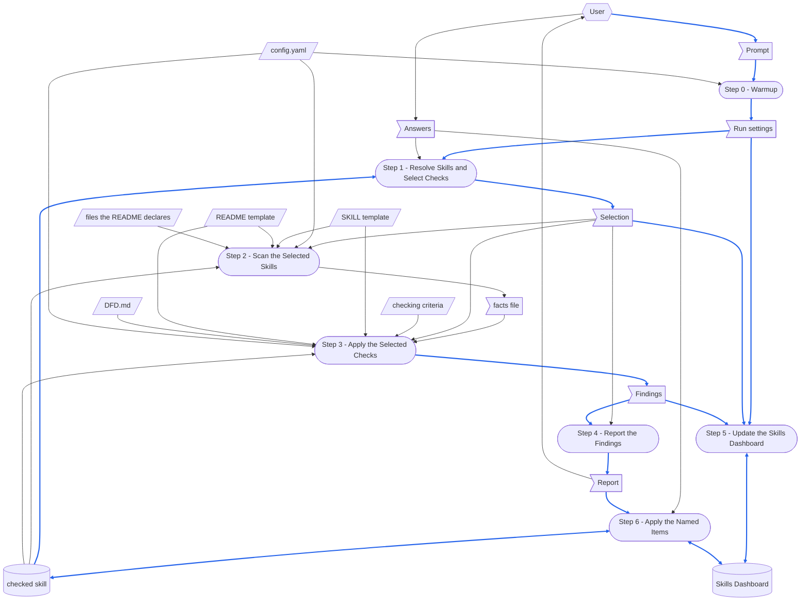

# check-skill

> [DFD.md](../../references/DFD.md)  `2026-10-18`  `09fb4a7e4730`
> [md-style.md](../../rules/md-style.md)  `2026-10-30`  `6484ff7dc0b2`
> [skill-writing.md](../../rules/skill-writing.md)  `2026-10-30`  `c7696bf6351a`
> [scratch-rules.md](../../rules/scratch-rules.md)  `2026-10-18`  `f3bc07a86022`
> [SKILL-tmp.md](../../templates/SKILL-tmp.md)  `2026-10-30`  `6ca6e607f75c`
> [README-tmp.md](../../templates/README-tmp.md)  `2026-10-19`  `43ace64a88a6`
> [depends_on.py](../../scripts/depends_on.py)  `2026-10-16`  `53b1d3e60eca`
> [chinese/SKILL.md](../chinese/SKILL.md)  `2026-10-16`  `2a03562d5a11`

What the check-skill skill is made of, and what its [SKILL.md](SKILL.md) depends on.
A skill loads its whole SKILL.md each time it runs, so the parts a run does not need are kept here: SKILL.md does not link to this file, and no run loads it.
Read it before changing the skill: make every change that When the Skill Is Changed names, then run the checks listed there.
How the steps of a skill are written is in [skill-writing.md](../../rules/skill-writing.md).

The paths in the diagrams are short: `check-skill/` is `.github/common/skills/check-skill/`, and `common/` is `.github/common/`.
`<skill>/` is the directory of a checked skill, `{wikiDir}` is the wiki root that `config.yaml` gives, and `temp/` is at the workspace root.

# When the Skill Runs

## Dataflow

How a run turns its prompt into what it leaves behind: every step of the Workflow in [SKILL.md](SKILL.md), and the data each one reads and writes, drawn as a DFD in the notation of [DFD.md](../../references/DFD.md).
The steps of SKILL.md say what each one reads and writes; the diagram draws it, so that a record a later step overwrites, data with no source, or a step reading what a later step writes shows at a glance.
A step is named exactly as its heading, number included, so that no reader has to guess which step is meant.
Only what a step reads or writes at run time is drawn; a document a step only cites is not.



How to read the diagram:

- A parallelogram is an external input: `config.yaml`, the two templates, the files a checked skill's README.md declares, the checking criteria and DFD.md — none of which any step writes.
  A flag is one-run data: the prompt and the Answers, the run settings Step 0 resolves, the selection Step 1 makes, the facts file Step 2 writes, the findings Step 3 records and the report Step 4 prints.
  The facts file is a file, but it lives only within the run: Step 5 deletes it, so it is drawn as one-run data.
  A cylinder is a record: the checked skill — its SKILL.md and README.md, their twins, its scripts and references — and the Skills Dashboard.
  A rounded box is a step.
- A hexagon is a role outside the skill: the user, who supplies the prompt and the Answers — the checks chosen in the picker and the items named after the report — and reads the report.
- A solid arrow moves data, the way the data moves; a two-headed arrow is data one step both reads and writes.
- A blue arrow carries data that is itself written into a record, or turned into a record's content; every other arrow is black.
  The skill names in the prompt, the paths Step 1 resolves and the date of the run become rows of the Skills Dashboard, and the findings become its counts and, through the report, the edits Step 6 makes, so their arrows are blue.
  Data that only steers how a step works, such as `config.yaml`, the templates, the criteria, DFD.md, the facts, the Answers, or the checked skill as Steps 2 and 3 read it, stays black.
- Two records are edited in turn, and both exist before the run.
  The Skills Dashboard is edited by Step 5 and then by Step 6, each reading the table it merges into, so neither erases what the other wrote.
  The checked skill is read as it is found by Steps 1 to 3, and written only by Step 6, on the items the user names.

## Step Purposes

Each step, named exactly as its heading in SKILL.md, with its Purpose: why it exists as a step.

- Step 0 - Warmup
  Fix the config, the two templates and the clock for the whole run in one place, so every later step argues from the same resolved values and no run can split across two `{yymmdd-hh}` stamps.
- Step 1 - Resolve Skills and Select Checks
  Settle both what is checked and what it is checked for before a single file is read, so no later step has to guess whether a silent check passed or was never selected.
- Step 2 - Scan the Selected Skills
  Separate gathering from judging — one pass records what the files contain, so every check that reads facts argues from the same facts file instead of re-reading the skill and deciding for itself what it saw.
- Step 3 - Apply the Selected Checks
  Keep one judging loop for six checks that differ only in what they read, so a run narrowed to a single criterion does not drag five empty steps behind it.
- Step 4 - Report the Findings
  Put each problem and the change that settles it under one number, check by check, so the user decides item by item by naming a number instead of scrolling between a problem and its fix.
- Step 5 - Update the Skills Dashboard
  Leave the only trace a run keeps once the chat is gone — without it, nothing says next week which skills were checked, when, and what was still open.
- Step 6 - Apply the Named Items
  Carry out exactly the items the user chose and flag the skill on the dashboard, because an edited skill whose row still reads as checked is worse than having no row at all.

## Files Each Step Uses

The scripted-versus-not rule of skill-writing.md, answered once for this skill:
**Steps 2 and 5 run a script for their work; Steps 0, 1, 3, 4 and 6 do not**, because gathering the facts and merging the dashboard are exact work that a program does without missing a line, whereas resolving the prompt turns on the user's words, judging a deviation and writing the report are reading and judgement, and settling an item rewrites prose so that it keeps its meaning.
Step 6 also runs the dashboard script, only to mark the skill it edited.

```
Step 0 - Warmup
  reads   config.yaml
  checks  that these exist:
          check-skill/scripts/scan_skill.py
          check-skill/scripts/update_dashboard.py
          check-skill/references/checking-criteria.md
          common/references/DFD.md
          common/scripts/depends_on.py
          common/templates/SKILL-tmp.md
          common/templates/README-tmp.md

Step 1 - Resolve Skills and Select Checks
  checks  that each skill named resolves to <skill>/SKILL.md under a skillGroups root
  asks    the user which checks to apply, when the prompt names none

Step 2 - Scan the Selected Skills
  runs    scan_skill.py
          ├─ reads config.yaml
          ├─ reads common/templates/SKILL-tmp.md and README-tmp.md: their headings
          ├─ reads every text file in <skill>/, SKILL.md and README.md among them
          ├─ loads common/scripts/depends_on.py: reads every file README.md's header quote declares
          └─ writes temp/check-skill-facts-{yymmdd-hh}.yaml
  reads   the facts file

Step 3 - Apply the Selected Checks
  reads   check-skill/references/checking-criteria.md
  reads   the facts file
  reads   for check 1: common/templates/SKILL-tmp.md and README-tmp.md
  reads   for check 2: config.yaml, and <skill>/config.yaml when there is one
  reads   for checks 3 and 5: <skill>/SKILL.md whole, and for check 5 every script in <skill>/scripts/
  reads   for check 6: common/references/DFD.md, and <skill>/SKILL.md and <skill>/README.md whole

Step 4 - Report the Findings
  writes  nothing: the report is in the chat

Step 5 - Update the Skills Dashboard
  runs    update_dashboard.py, once for each checked skill
          └─ edits {wikiDir}/dashboard/skills.md
  deletes temp/check-skill-facts-{yymmdd-hh}.yaml

Step 6 - Apply the Named Items
  edits   the files of <skill>/ that the named items change, and their 繁體中文 twins
  runs    update_dashboard.py --mark-modified
          └─ edits {wikiDir}/dashboard/skills.md
```

No run reads SKILL-tw.md, this file, README-tw.md or checking-criteria-tw.md.

# When the Skill Is Changed

`⇄`: the two change together.
`─▶`: depends on the rules or the format of the other.

```
check-skill/SKILL.md
 ├─⇄ check-skill/SKILL-tw.md
 │     every change goes into both: the chinese skill's diff_md.py, a translation, then check_parity.py
 │     └─▶ common/references/tw-keep-english.md: which terms stay English
 ├─⇄ check-skill/README.md and README-tw.md
 │     the Dataflow, Step Purposes and Files Each Step Uses name each step exactly as its heading:
 │     a step added, removed or renamed changes all three
 ├─⇄ check-skill/references/checking-criteria.md and checking-criteria-tw.md
 │     the six checks and the inputs Step 3 gives each one, and the fact groups the criteria read
 ├─⇄ check-skill/scripts/scan_skill.py
 │     the facts Step 2 lists and the arguments it passes, and the fact groups the criteria read
 ├─⇄ check-skill/scripts/update_dashboard.py
 │     the --result format of Step 5, and the dashboard's cells: one for each check
 ├─▶ common/templates/SKILL-tmp.md and README-tmp.md: the headings check 1 compares against,
 │     read from the templates at run time, so a heading added there needs no change here
 ├─▶ common/rules/skill-writing.md: what criteria 1.4, 1.7 and 1.10 to 1.14 hold a skill to
 ├─▶ common/references/DFD.md: what check 6 holds a Dataflow to
 ├─▶ common/scripts/depends_on.py: the header quote format, and the statuses criterion 1.13 reads
 ├─▶ common/rules/scratch-rules.md: where the facts file goes and how it is cleaned up
 └─▶ common/rules/md-style.md: one sentence on each line
       └─ checked by reformat_md.py and check_reformat.py (--twin: the twin's sentences one for one)

check-skill/README.md
 ├─⇄ check-skill/README-tw.md: line for line, through the chinese skill
 └─▶ common/references/DFD.md: how the Dataflow is drawn
       a step or a piece of data added or removed redraws the DFD and renumbers its blue arrows

check-skill/scripts/scan_skill.py
 └─▶ common/scripts/depends_on.py: read_lines, entries, citations, resolve and fingerprint,
       loaded as a module, so a change to them changes the statuses criterion 1.13 reads

the skill that writes what this one checks
 └─ common/skills/gen-skill: writes from the same two templates, so a criterion of check 1
    and what gen-skill writes change together

outputs already written
 └─ {wikiDir}/dashboard/skills.md: a cell keeps the verdict of the criteria it was checked by,
    until a run re-applies the check; a new check is a new column in update_dashboard.py
```

After a change, run the checks that cover it:

- `scan_skill.py` on asd-ste, gen-skill and check-skill, with `--config` when the workspace has no `config.yaml`: each has a README.md with no missing heading, no step missing from its Step Purposes or Files Each Step Uses, and every header quote entry UNCHANGED.
- `check_parity.py` for SKILL.md with SKILL-tw.md, for README.md with README-tw.md, and for checking-criteria.md with checking-criteria-tw.md: no failure.
- `depends_on.py check` on this file: every declared file is UNCHANGED, or read and recorded again.
- `/check-skill check-skill`: every check passes, or each finding is settled.

# Tracked Dependencies

A header quote declares what a file depends on, and `depends_on.py check` says which of those files changed since the declaration was recorded.
This file declares what SKILL.md depends on outside the skill, so that SKILL.md stays short.

```
check-skill/README.md (and README-tw.md, which copies its header quote)
  ─▶ common/references/DFD.md
  ─▶ common/rules/md-style.md
  ─▶ common/rules/skill-writing.md
  ─▶ common/rules/scratch-rules.md
  ─▶ common/templates/SKILL-tmp.md
  ─▶ common/templates/README-tmp.md
  ─▶ common/scripts/depends_on.py
  ─▶ common/skills/chinese/SKILL.md
```

When one of them is reported CHANGED, read what changed, bring SKILL.md and this file in line, and then record it again with `depends_on.py record`.
