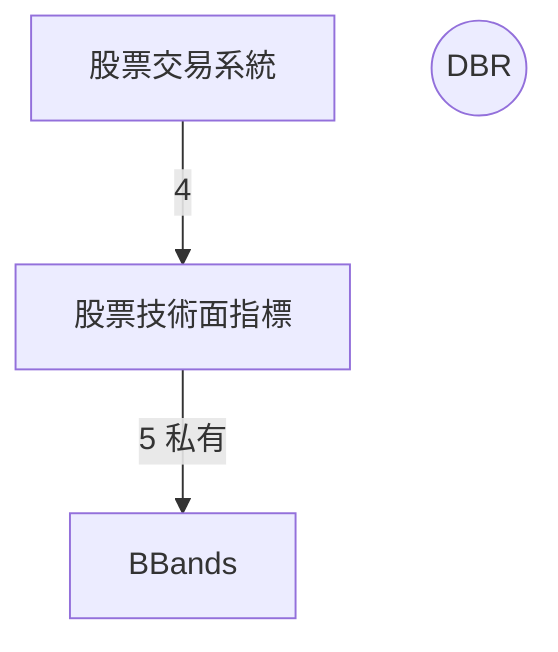

# dependency-graph — 依賴圖的產生方式與規則

本檔案是**依賴圖產生規則的唯一出處**。
SKILL.md 步驟 4（回填後重新產生、比對圖與表）與步驟 5（修改後重新產生）都依這裡的規則。
依賴圖是 `check-wiki-doc` 的產出，不是文件要遵守的規範，所以不列入 `checking-criteria.md` 的條文。

依賴圖有兩種形式，都由同一份〈文件依賴狀態表〉產生，內容必須一致：

- **mermaid 依賴圖**：寫在架構文件〈文件依賴圖〉一節。
  規則見第 1～5 節。
- **HTML 依賴圖**：架構文件旁的獨立 HTML 檔，畫的就是那張 mermaid 圖，另外可點選邊上的數字展開術語。
  規則見第 6 節。

## 1. 圖的地位

- **依賴圖是〈文件依賴狀態表〉的衍生物，不是宣告。**
  依賴關係的權威來源是〈文件依賴關係表〉；狀態表把關係表的〈依賴〉欄攤平成一列一條邊，圖再由狀態表產生。
  三者牴觸時，以關係表為準。
- 只有圖旁**註明由〈文件依賴狀態表〉產生**的圖，才適用本檔的重新產生規則。
	- 有註明：整段重新產生，**不逐條手改**。
	- 沒有註明、而與關係表牴觸：不要自行重畫，回報給使用者。

## 2. 圖旁說明

圖的上方要有一段說明，寫明四件事：

- 本圖由 `check-wiki-doc` 依〈文件依賴狀態表〉產生、請勿手改，邊的順序與該表的列序相同。
- 指向 HTML 依賴圖的連結，寫法見 6.1。
- 線上數字是該邊的 `術語數`。
- 線型的**級距**，以及 `私有` 標記的意義。

**級距以架構文件為準**，不寫死在本檔。
產生時讀圖旁寫的級距；說明段本身不動，除非使用者要求改級距。
唯一的例外是缺了 HTML 連結，或 HTML 的位置變了：產生 HTML 後補上或改正那一行。

參考寫法（級距數字僅為範例）：

```markdown
本圖由 `check-wiki-doc` 依〈文件依賴狀態表〉產生，**請勿手改**；邊的順序與該表的列序相同。

互動版：[{架構文件名}-文件依賴圖.html](file:///…/{架構文件名}-文件依賴圖.html)——外觀與本圖相同，可點選邊上的數字展開該邊借用的術語。

- 線上數字：該邊的 `術語數`。
- 線型依 `術語數` 分級：
	- 粗線 `==>`：≥ 8。
	- 一般線 `-->`：2～7。
	- 虛線 `-.->`：1。
- 數字旁標 `私有`：私有下層的邊。
```

## 3. 圖的結構

使用 mermaid `graph TD`，分成三段，依序以註解標出：



### 3.1 定義節點

- **納管文件**（〈文件依賴關係表〉〈名稱〉欄裡的）用方框：`ID[名稱]`。
- 標籤就是文件名稱，與關係表的連結文字一致，不帶 `.md`、不帶版號。
- ID 只用英數字與底線，不與既有 ID 重複。

### 3.2 定義外部概念／指標

- 〈依賴〉欄指向、但**未納管**的文件或概念（如 `DBR`、`Alpha and Beta`）用圓形：`ID((名稱))`。
- 某個外部概念後來被納管時，把它從這一段移到「定義節點」，改成方框，ID 不變。

### 3.3 建立依賴關係

- **一列一條邊，順序與〈文件依賴狀態表〉的列序相同**，不另行排序。
- 寫法：`上層節點 線型|術語數| 下層節點`。
	- 線上數字＝狀態表該列的 `術語數`。
	- 線型依圖旁說明的級距選 `==>`、`-->`、`-.->`。
	- 私有下層（關係表〈依賴〉欄標 `（私有）`）的邊，在數字後加 ` 私有`，例如 `TechInd -->|5 私有| BBands`。
- `術語數` 為 0 的邊照樣畫出，不因為零借用就從圖上拿掉——刪邊是對依賴關係的修改，要等使用者決定。
  級距沒有涵蓋 0 時，不要自己發明線型，回報給使用者補級距。

## 4. 何時重新產生

- **步驟 4 回填之後**：〈文件依賴狀態表〉的 `術語數` 或 `狀態` 改過，就依表整段重新產生「建立依賴關係」那一段。
  這屬於回填，不必等使用者同意。
- **步驟 5 修改之後**：動到依賴邊、術語借用關係，或改了文件名稱，先更新狀態表，再依表重新產生。
- 重新產生時：
	- 「建立依賴關係」整段重寫。
	- 「定義節點」與「定義外部概念/指標」**既有的定義不動**，只在以下情況增改：
		- 表中出現圖上沒有節點的文件或概念 → 依 3.1／3.2 新增一個節點。
		- 文件改名 → 只改該節點的標籤，ID 不動。
	- 圖旁說明不動。
- mermaid 圖重新產生時，**HTML 依賴圖一併重新產生**（見第 6 節），兩者不可一新一舊。

## 5. 檢查圖是否正確

步驟 4 回填時據此查圖，結果列進回報，但不計入任何一條規範的判定：

- 依〈文件依賴狀態表〉照本檔規則重新產生一次，與現有的圖比對。
  不一致時直接以重新產生的結果取代（屬步驟 4 的回填，不必等使用者）。
- 圖上的邊與〈文件依賴關係表〉的邊集合不一致，代表〈文件依賴狀態表〉本身缺列或多列 → 回報，由使用者補表，再重新產生圖。

## 6. HTML 依賴圖

### 6.1 檔名與位置

- 檔名是 `{架構文件名}-文件依賴圖.html`，例如 `投資系統架構.md` 對應 `投資系統架構-文件依賴圖.html`。
- 放在**架構文件同一個目錄**。
- 它是產出物，**不手改**。
  要改外觀或互動，改範本 `assets/dependency-graph.html`，再重新產生。
- 架構文件〈文件依賴圖〉的圖旁說明要有一行連到它（見第 2 節參考寫法）：
	- 連結用 `file://` 絕對路徑，照抄腳本最後印出的 `link:` 那一行，路徑中的空白與中文已編碼好。
	- 不用 `[[…]]` 或相對路徑：Obsidian 預設不認得 `.html`，這兩種寫法會被當成未解析的連結；`file://` 則交給系統，用瀏覽器開啟。
	- 架構文件或 HTML 搬了位置，連結要跟著改。

### 6.2 產生方式

一律用腳本產生，不手寫 HTML——每條邊的術語要逐列從上層文件抄出，手抄必然漏列：

```bash
python3 {skillGroups.common}/skills/check-wiki-doc/scripts/build_dependency_graph.py \
  --arch "<架構文件路徑>" --root "<wikiRootDir>"
```

- `--root` 取 `config.yaml` 的 `wikiRootDir`，路徑開頭的 `~` 先展開。
  腳本在它底下依檔名找納管文件。
	- 同名檔案有多份時，優先取與架構文件同一個 Obsidian 庫裡的那份，並印出警告。
- `--out` 可另指輸出路徑，預設就是 6.1 的位置。
- 腳本把資料填進範本的 `/*__GRAPH_DATA__*/null`。
  範本本身不含任何架構文件的資料，可供所有架構文件共用。

### 6.3 資料來源

| 資料 | 取自 |
| ---- | ---- |
| 文件、`階層`、`（私有）` | 〈文件依賴關係表〉 |
| 邊、`術語數`、`狀態`、`備註` | 〈文件依賴狀態表〉 |
| 圖本身（節點、邊、線型、數字、排版） | 〈文件依賴圖〉的 mermaid 程式碼，原封不動 |
| 頁首圖例的級距 | 〈文件依賴圖〉的圖旁說明（同第 2 節） |
| 每條邊借用的術語 | 上層文件第 2 節〈使用術語〉 |

- mermaid 的每條邊，依兩端節點的標籤對應到〈文件依賴狀態表〉的一列，取得 `狀態`、`備註` 與術語。
- 術語歸屬哪條邊，與 `術語數` 的數法相同：`經由` 有值時算在 `經由` 那條邊，為空時算在 `出處` 那條。
- `出處` 寫成 `X（未納管）` 時，視為 `X`。
- 第 2 節分成多張表（以 `###` 分組）時，每張表都讀。

### 6.4 版面

- **與 mermaid 圖一模一樣**：HTML 不自行排版，而是用 mermaid.js 直接繪製〈文件依賴圖〉裡的那段 mermaid 程式碼。
  節點位置、形狀、線型、線上數字都與架構文件裡的圖相同。
	- 顏色用 mermaid 的預設主題，深色模式用 `dark` 主題。
   Obsidian 會套自己的主題色，所以顏色可能略有差異，形狀與排版不變。
	- 因此**先重新產生 mermaid 圖，再產生 HTML**。
   順序反了，HTML 畫的就是舊圖。
- 互動時的標亮與淡化，只是在 mermaid 畫好的 SVG 上疊加樣式，不改變圖本身。

### 6.5 互動

- **點選邊上的數字**：側欄展開這條邊借用的全部術語。
	- 每個術語列出 `出處`、`經由`、`定義`、`本層用法`。
	- 同時顯示狀態表這一列的 `術語數`、`狀態` 與 `備註`。
- **點選文件**：側欄列出它的下層與上層，各附術語數，點選可跳到那條邊。
	- 被點選的文件在圖上**反白**（整個節點填上底色、文字轉為反色），與它相連的邊和文件只加外框標亮，其餘淡化。
- **搜尋術語**：依術語名稱比對，列出它走過的邊與所在的列，並在圖上標亮那些邊。
- **點空白處或按 Esc**：回到總覽，列出最重的邊與待處理的邊。
- **圖的大小跟隨瀏覽器視窗**：視窗放大縮小，整張圖跟著縮放，始終完整顯示。
  不提供滾輪縮放與拖曳平移。
- mermaid.js 由 jsdelivr 載入，開啟時需要網路。

### 6.6 產生時的警告

腳本遇到下列情況不中斷，而是在 stderr 印出警告；回報時照錄：

- `表上 術語數 N，第 2 節掃到 M 列`：〈文件依賴狀態表〉待回填。
  步驟 4 回填過後不該再出現；仍出現就代表腳本與 `術語數` 的數法不一致，回報給使用者。
- `第 2 節有走 X 的術語，但〈文件依賴狀態表〉沒有這條邊`：缺邊。
  照第 5 節回報，由使用者補表。
- mermaid 圖與〈文件依賴狀態表〉對不上，代表 mermaid 圖沒有依表重新產生。
  先照第 4 節重新產生 mermaid 圖，再產生 HTML：
	- `mermaid 圖有 A → B，但〈文件依賴狀態表〉沒有這一列`。
	- `〈文件依賴狀態表〉有 A → B，但 mermaid 圖沒有這條邊`。
	- `mermaid 圖上 A → B 的數字是 N，表上是 M`。
- 找不到文件、同名檔案多份、第 2 節某列不足六欄：照錄回報。

架構文件缺〈文件依賴關係表〉、〈文件依賴狀態表〉或〈文件依賴圖〉任何一節，〈文件依賴圖〉裡沒有 mermaid 程式碼，或讀不到級距時，腳本**中止、不產生**——排版與級距都不自行假設。
