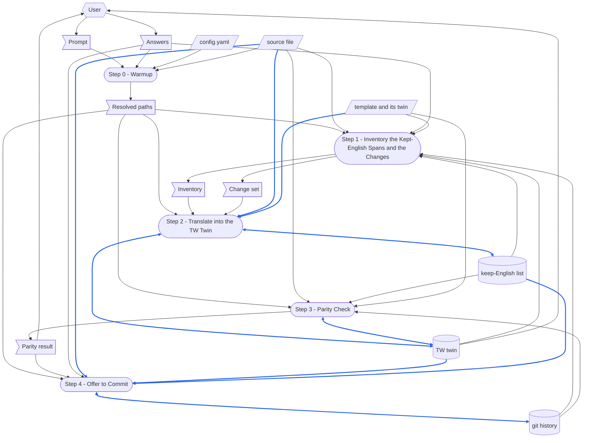

本文件為 [SKILL.md](.github/common/skills/chinese/SKILL.md) 的繁體中文版。
任一份改了某節，另一份必須在同一次執行中一起改。

# TERMINOLOGY

在每個 skill 中意義都相同的 term。

- **`run step N`** — 放在 prompt 結尾、指名某一個 step 的選擇子。
  它**只**執行那一個 step，然後停止。
- **no forward-reference** — 一個 step 絕不可依賴排在它之後的 step 的規則。
  為了控制流程而指名後面的 step 並不違反它；借用那個 step 的輸出才違反。

# DEDICATED TERMINOLOGY

本 skill 領域專屬的 term。

- **source file** — 本次執行所翻譯的英文 Markdown 檔：一個 skill 的 `SKILL.md`、一份 template、一份參考文件、一份規則檔——任何 `.md` 都可以。
  它只讀、絕不寫入。
- **TW twin** — 本次執行寫在 source file 旁邊的檔案，檔名是在 `.md` 前面插入 `-tw`：`SKILL.md` 變成 `SKILL-tw.md`，`RSDC-App-tmp.md` 變成 `RSDC-App-tmp-tw.md`。
  其中的 `tw` 指台灣，取自語系代碼 `zh-TW`——台灣使用的繁體中文——而不是 twin 的縮寫。
  它是 twin，而不只是譯文：同一份文件換成另一種語言，source file 的骨架——標題、fenced block、表格與連結——原封不動，並與它保持同步：任一份改了某節，另一份必須在同一次執行中一起改。
  它是本 skill 的輸出；一次執行唯一會寫入的其他檔案是 **keep-English list**，而且只用來新增 term。
- **line for line** — source file 沒有 frontmatter 時，TW twin 的排法：行數與來源檔相同，每一行都是同一行號那一行的譯文——來源檔是空行的地方是空行，是清單項目的地方是同樣縮排的清單項目，表格列有同樣多的儲存格，每一條 fence 行與 fence 裡的每一行都逐字相同。
  這樣兩份就能以機械方式比對，一份裡改過的節，在另一份的同一行就找得到。
  有 frontmatter 的來源檔——每一份 `SKILL.md`——不在此列：它譯好的 `description` 會變成一個 folded block，它的 twin 也多出一行 **pairing line**，所以它的各行無法保住行號，改為逐個標題比對。
- **term** — 在 source file 的主題裡有固定意思的詞或片語，例如 *checkpoint*、*commit*、*placeholder* 或 *verdict*，和平常意思下的一般用字相對。
- **glossary term** — source file 在它的 `# TERMINOLOGY` 或 `# DEDICATED TERMINOLOGY` 標題底下，或在任何層級名為 `Terminology` 的標題底下（例如 RSDC 的 `2.1 Terminology`），以 `- **name** — definition` 條列項目定義的 term。
  在其他地方以粗體開頭的條列項目——例如 MUST FOLLOW 底下的一條規則——不是 glossary term。
  以其他形式的字彙表定義 term 的檔案——一份 term 清單、一張定義表——同樣有 glossary term，只是只有閱讀才找得到。
- **kept-English span** — source file 中必須原封不動進入 TW twin 的片段：每一行 `#` 標題、每一個 fenced code block、每一個 inline-code span、每一個連結目標與 wiki link（`[[name]]`）、檔頭引用區的每一行（文件開頭的 `>` 行，每一行是一個連到它所依賴之文件的連結，以及其後的 inline code）、frontmatter 的鍵以及 `description` 以外的每一個值、每一個 **glossary term**（凡是指稱所定義之物的地方，不論是否粗體）、**keep-English list** 上的每一個 term（凡是以清單所給的意思使用的地方），以及每一個 `{PLACEHOLDER}` token 與每一個 `{placeholder}` token。
- **keep-English list** — 每一份繁體中文 twin 在散文中都保留英文的 term 共用清單，附有決定哪些 term 屬於它的規則，以及每個 term 所取代的中文譯法。
  每一個會寫 twin 的 skill 都共用它，所以一個 term 決定一次，在所有 twin 中讀起來都一樣。
- **pairing line** — TW twin 中連回 source file 的那一行。
  有 frontmatter 時它是新增的：緊接在 frontmatter 底下的一行，連回 source file，並聲明任一邊改了某節，另一邊必須在同一次執行中一起改——這是本 skill 唯一會加入、而 source file 沒有的內容。
  沒有 frontmatter 時什麼都不新增，twin 才能保持 **line for line**：當 source file 的開頭——第一節之上——連到某個 `-tw.md` 檔時，含有那個連結的那一行就譯成 pairing line，連結改指回英文檔——同一個目標，把 `-tw.md` 換成 `.md`；沒有這樣的連結時，twin 也就沒有 pairing line。
- **template** — source file 所填寫自的檔案，由它的檔頭引用區指名：一個以 `-tmp` 結尾的 `[[name]]`，例如 `> [[RSDC-App-tmp]]`；先在 source file 的 vault 裡找，找不到再到 `{skillGroups.common}` 找；它旁邊有自己的 TW twin，**line for line**。
  檔頭引用區沒有指名 template 的 source file，就沒有 template。
- **shared line** — source file 中，除去兩端空白之後與其 **template** 某一行完全相同的行：那一行不是空行、fence 內的行、標題、引用或表格的分隔列，也不含尚待填寫的 `{PLACEHOLDER}`——也就是文件原封不動取自 template 的句子、表格列或標籤。
  它在 TW twin 中的那一行，照抄 template twin 同一行號的那一行，好讓填自同一份 template 的每一份文件，共有的內容都用同樣的寫法，也就是 template twin 審定過的寫法。
- **parity check** — 證明 TW twin 保住了 source file 骨架的比對：同樣的標題行、同樣的順序，同樣逐字相同的 fenced block，同樣的表格欄數，同樣的連結目標，每一節同樣的 inline-code span 與章節引用，每一個 **glossary term** 粗體的次數至少一樣多，frontmatter 仍能解析且鍵相同——來源檔沒有時，twin 也沒有——以及在 **line for line** 時，行數相同、每一個行號上的行種類也相同。
  給定 **keep-English list** 時，它也會對 twin 散文中找到的每一個被標記的譯法發出警告，對 twin 中每一個會讓頁面顯示出星號的 `**` 發出警告；給定 **template** 時，也會對寫法與 template twin 不同的每一個 **shared line** 發出警告。
- **baseline** — 最後一次改動 TW twin 的 commit，連同那個 commit 所保存的 source file：也就是 twin 上一次翻譯時所依據的來源檔版本——前提是兩者一起 commit，正如 Step 4 commit 它們的方式。
  從它到目前的 source file 所做的 `git diff`，就是 twin 寫成之後改動的內容。
- **change set** — source file 自它的 **baseline** 以來改動的內容，由 Step 1 的 `diff_md.py` 從 `git diff` 讀出：以 **line for line** 寫成的 twin，是每個 hunk 的來源行，以及它們所取代的 twin 行；逐個標題比對的 twin，則是 hunk 碰到的各節——整節翻譯——以及它們所取代的 twin 各節。
  它的 verdict 決定 Step 2 做什麼：`UNCHANGED`，什麼都不做；`INCREMENTAL`，只翻譯 change set；`FULL`，翻譯整份檔案，因為沒有可以據以更新 twin 的 baseline。

# CONFIGURATION

本 skill 執行時所使用的具體值。

- **source file** — prompt 給的 `.md` 路徑，相對於 workspace 或絕對路徑皆可；prompt 指名的是一個 skill 時，則是 `{skillGroups[<group>]}\skills\<skill-name>\SKILL.md`。
  於 Step 0 解析。
- **TW twin** — `<name>-tw.md`，位於 source file 自己的目錄，其中 `<name>` 是 source file 去掉 `.md` 的檔名。
- **keep-English list** — `{skillGroups.common}\references\tw-keep-english.md`。

# MUST FOLLOW

- 必須逐步執行 workflow，並顯示每個 step 的編號。
- 每個 step 必須自足。
  **No forward-reference。**
- 程式能以 deterministic 方式完成的 step 必須以腳本執行。
  需要閱讀、判斷或摘要的 step **不可**腳本化——請寫成自然語言指示，讓 agent 直接執行。
- **遵守 `run step N` 選擇子**：執行 Step N，然後停止；絕不執行較後的 step。
  本 skill 不寫 YAML checkpoint，所以每個 step 都從 prompt 與磁碟上的檔案重新推導自己的輸入——它做得到，因為 source file、TW twin 與它們的 git history 是任何 step 唯一需要的狀態。
- **本 skill 既不產出 MD report，也不產出 YAML checkpoint。**
  TW twin 是它的輸出；它唯一會寫入的其他檔案是 **keep-English list**，而且只用來新增本次執行決定的 term。
  它唯一的另一項寫入，是 Step 4 所做的 commit，而且只在使用者答應時才做。
- **只在使用者答應時 commit，而且只 commit 本次執行的檔案。**
  Step 4 在目前所在的分支上，commit TW twin、它的 source file 與 **keep-English list** 中有改動的那幾份——絕不包含其他已暫存或已修改的檔案，也絕不推送、不建立新分支、不改寫既有的 commit。
  沒有先問就做的 commit，會把使用者對來源檔尚未完成的修改，連同 twin 一起寫進歷史紀錄。
- **source file 是唯讀的。**
  絕不編輯、重新排版、重新編號或「修正」它——即使翻譯暴露出它真正的缺陷也一樣。
  回報缺陷，留給使用者處理。
- **拒絕本來就是繁體中文、或本身就是 TW twin 的來源檔。**
  它的 twin 會是一份逐字相同的副本外加一行 pairing line——兩份說同一件事的檔案，終將彼此偏離，而且無從分辨哪一份才是最新的。
  Step 0 會拒絕檔名已經以 `-tw.md` 結尾的檔案；至於語言，由 Step 1 的 `scan_md.py` 決定，而不是讀者的眼睛，它的 verdict 具有約束力。
- **絕不翻譯 kept-English span。**
  換了語言的標題、識別碼、旗標、路徑、連結目標或 placeholder token，就不再對得上它所指稱的東西，parity check 也會拒絕它。
- **shared line 從 template 的 twin 照抄，絕不翻譯。**
  它在 twin 中的那一行，就是 Step 1 印出的 template twin 那一行，縮排則跟 source 那一行相同。
  template twin 寫成某個樣子的句子，若在每一份文件裡重新翻譯，每一份都會變成不同的句子；讀者比較填自同一份 template 的兩份文件時，會看到兩種譯法，而 template 原本只想說一條規則。
  找不到、沒有 twin，或 twin 不是 line for line 的 template，不提供任何 shared line：Step 1 會說明原因，每一行都照常翻譯。
- **glossary term 凡是指稱所定義之物，不論是否粗體，都保留英文。**
  同一個字用於一般意義時是散文，要翻譯：在一個定義了 **run** command 的 skill 裡，「run the script」用的是一般動詞。
  不確定某處用法屬於哪一種時，保留英文。
  一個 term 在這一句被翻譯、下一句又保留英文，讀者就分不出哪個中文字才是被定義的那個，字彙表也就不再描述這份 twin。
- **keep-English list 指定保留英文的 term 就保留英文，新的 term 則依這份清單的規則決定。**
  清單上的 term 在散文中絕不翻譯。
  清單上沒有的 term，若有一種以上常見的中文譯法，或指稱 system 中的某種類型、狀態、outcome 或 role，就保留英文，否則就翻譯；保留英文的 term 要在同一次執行中加入清單，讓下一份 twin 不必重新決定就做出相同的選擇。
  同一個概念在兩份 twin 中有兩種寫法，讀者就無法分辨這兩個詞指的是同一件事。
- **在 frontmatter 中，只翻譯 `description` 的值，其他都不翻。**
  `name` 以及其他每一個鍵與值都原封不動複製。
  把譯好的 description 寫成 folded block scalar——`description: >-` 後面接一行縮排的文字——絕不寫成 plain scalar。
  中文 description 會帶有引號、括號與冒號，plain scalar 遇到第一個 `: ` 就會壞掉，連同旁邊的 `name` 鍵一起拖垮整份文件。
  在宣告這個 step 完成之前，先用 `yaml.safe_load` 重新解析寫好的 frontmatter。
- **沒有 frontmatter 時，line for line 翻譯。**
  來源檔的每一行恰好變成 twin 的一行，留在同一個行號：英文在哪裡換行，中文就在哪裡換行，絕不合併、拆分或移動任何一行。
  斷行要落在全形標點上或英文字旁邊，絕不落在兩個中文字之間——顯示時換行會變成一個空格，在中文句子中間留下一個多餘的空隙。
- **twin 有 baseline 時，只翻譯 change set。**
  **change set** 沒有列到的 TW twin 每一行都逐字保留，只有 Step 1 的 verdict 是 `FULL` 時才翻譯整份檔案。
  沒改的行再翻一次，就改寫了別人已經讀過的譯文，也讓下一次審查 twin 變成審查整份檔案。
- **讓粗體保持為粗體。**
  碰到標點符號的 `**`，只有在它另一側是空白或標點時，CommonMark 才會把它讀成粗體：`。**` 後面要接空格、標點或行尾，`**「` 前面要是空格、標點或行首。
  否則頁面會直接顯示星號——所以粗體句子要以 `。**` 加一個空格結尾，或把標點放在粗體之外。
- **把 TW twin 寫成不帶 BOM 的 UTF-8**，使用建立檔案的工具——就地更新時，則使用編輯檔案的工具。
  絕不透過 PowerShell 的雙引號字串輸出它：反引號是 PowerShell 的跳脫字元，所以每一個 inline-code span 兩側的反引號都會默默改寫文字（`` `r `` 變成 CR、`` `n `` 變成 LF，其他的則失去反引號）。
- **標點符號跟隨它所在片段的語言。**
  中文散文使用全形標點（`，` `。` `（）` `、`）；kept-English span 則完全保留它的 ASCII 標點。
  破折號 `—` 在中文散文中變成 `——`，在 kept-English span 中仍是 `—`。
- **英文與中文之間留一個空白。**
  英文詞、數字、inline-code span 或 placeholder token（`{PLACEHOLDER}`、`{variable}`）緊貼中文字時，中間留一個空白；緊貼全形標點時不必留。
  兩個中文字之間永遠不留空白，中間隔著粗體標記也一樣——所以 placeholder 填入的若是中文，它在 template 裡前後的空白要一併拿掉。
- **在 skill 結束前，顯示 TW twin 的路徑**——只顯示路徑，絕不顯示其內容，呈現為可點擊的 Markdown 連結，絕不用 inline code 或純文字。
  每一次執行都要這麼做，包括像 `run step 0` 這樣的部分執行。

# Prompt Examples


## Prompt 1

```
/chinese
.github\common\skills\check-skill\SKILL.md
```

## Prompt 2

```
/chinese
check-skill
run step 3
```

## Prompt 3

```
把 check-skill 的 SKILL.md 翻譯成繁體中文存成 SKILL-tw.md，章節名稱和 terminology 保留英文
```

## Prompt 4

```
/chinese
.github\common\skills\gen-rsdc-app\assets\RSDC-App-tmp.md
```

# Dataflow

一次執行如何把它的 prompt 變成它留下的東西：**Workflow** 的每一個 step，以及每個 step 讀寫的資料，以 [DFD.md](.github/common/references/DFD.md) 的畫法畫成 DFD。
各個 step 寫明自己讀寫什麼；這張圖把它畫出來，讓被較後 step 覆寫的 record、沒有來源的資料，或讀取較後 step 所寫之物的 step，一眼就看得出來。
step 的名稱與它的標題完全相同、連編號一起，讀者就不必猜是哪一個 step。
只畫 step 在執行時讀寫的東西；step 只是引用的文件不畫。
本 skill 不產出的輸出，就刪掉它的節點與箭頭。



圖的讀法：

- 平行四邊形是 external input：`config.yaml`、source file，以及它的檔頭引用區指名的 template 與 template 的 twin——沒有任何 step 會寫入它們。
  旗形是 one-run data：prompt 與 Answers、Step 0 解析出的路徑、Step 1 印出的清冊與 change set，以及 Step 3 印出的 parity 結果。
  圓柱是 record：TW twin、keep-English list 與 git history。
  圓角方框是 step。
- 六角形是 skill 之外的 role：User，提供 prompt 與 Answers，並讀取 parity 結果與 TW twin。
- 實線箭頭沿著資料移動的方向搬移資料；雙頭箭頭表示某個 step 對同一份資料既讀又寫。
- 藍色箭頭承載的資料，本身會被寫進某個 record，或被轉成某個 record 的內容；其餘箭頭一律是黑色。
  template 的 twin 經由 Step 2 進入 TW twin——Step 2 照抄它的 shared line——所以那一支箭頭是藍色；Step 1 與 Step 3 只拿它來比對。
  只決定某個 step 怎麼做的資料，例如 `config.yaml`、Step 0 解析出的路徑、清冊、change set，或 Step 1 與 Step 3 從 git history 讀出的 baseline，即使那個 step 會寫 record，也仍然是黑色。
- 三份 record 都是就地修改。
  Step 1 讀到的 keep-English list，是 Step 2 在其中新增 term 之前、先前的執行所留下的樣子；Step 1 讀取 TW twin、Step 2 讀取它要保留的各行，之後 Step 2 才改寫 change set 指名的部分——或者在整份翻譯時，Step 2 讀取它即將覆寫的 twin，只為了它的文件標題；Step 3 修正它所檢查的 TW twin，所以 TW twin 由 Step 2 與 Step 3 依序編輯；Step 1 與 Step 3 讀到的 git history，則是 Step 4 在其中新增 commit 之前、先前的執行與使用者所留下的樣子。
  每個寫入者也都讀取它所改的 record，這正是雙向箭頭所畫的。

# Steps at a Glance

每個 step 的總覽：它執行的 script。
本 skill 不寫 YAML checkpoint——每個 step 都從 prompt 與磁碟上的檔案重新推導自己的輸入（MUST FOLLOW）——所以 YAML 欄一律是「—」。

| Step | Script | YAML |
|---|---|---|
| Step 0 - Warmup | — | — |
| Step 1 - Inventory the Kept-English Spans and the Changes | `scan_md.py`, `diff_md.py` | — |
| Step 2 - Translate into the TW Twin | — | — |
| Step 3 - Parity Check | `check_parity.py`, `diff_md.py --verify` | — |
| Step 4 - Offer to Commit | — | — |


# Workflow

每個 step 以一條 **Purpose** 開頭：一句話說明這個 step 為何要獨立存在——把它折進相鄰的 step 裡，本 skill 會損失什麼。

**Step 1 與 Step 3 執行腳本；Step 0、Step 2 與 Step 4 不執行**，因為清冊、change set 與各項檢查都是精確的比對，程式做得更快，也不會漏掉任何一處；而 Step 0 必須判斷使用者的意思， Step 2 是翻譯本身——一種關於意義、沒有任何程式做得到的判斷——Step 4 則取決於使用者的回答，它的 commit 只是一個 `git` 指令。

## Step 0 - Warmup

- **Purpose**：在任何翻譯開始之前，先確定要翻譯的是哪個檔案、它的 twin 要放在哪裡——憑猜測進行的一次執行，會把 twin 寫進另一個 skill 的目錄，而 workflow 後面沒有任何東西會察覺。

- 先執行 `.venv`——Step 1 與 Step 3 的腳本會 import `PyYAML`，而 `diff_md.py` 會執行 `git`。

- 讀取 workspace 根目錄的 workspace config [config.yaml](config.yaml) 並解析：
  - **`skillGroups`**：群組名稱 -> skills 根目錄的對應——單獨的 skill 名稱解析為 `{skillGroups[<group>]}\skills\<skill-name>\SKILL.md`，本 skill 自己的目錄是 `{skillGroups.common}\skills\chinese\`。
  - 在下方各 step 中（包含指令內）凡出現 `{skillGroups.common}` 或 `{skillGroups[<group>]}` 之處，都代換為解析後的值。
  - 若 `config.yaml` 不存在或缺少 `skillGroups`，停止並詢問使用者。

- 本 skill 不呼叫任何 Azure DevOps API，也不需要 `ADO_PAT`——它只讀寫本機檔案。
  絕不索取憑證。

- 執行 workflow 前先確認下列腳本／檔案是否存在。
  - `{skillGroups.common}\skills\chinese\scripts\scan_md.py`
  - `{skillGroups.common}\skills\chinese\scripts\check_parity.py`
  - `{skillGroups.common}\skills\chinese\scripts\diff_md.py`
  - `{skillGroups.common}\references\tw-keep-english.md`
  - `{skillGroups.common}\scripts\depends_on.py`——`scan_md.py` 與 `check_parity.py` 用它讀取 source file 的檔頭引用區。

- prompt 採用上方 **Prompt Examples** 所示形式之一。
  從中解析：
  - **source file**（必要）：一個 `.md` 檔的路徑——相對於 workspace 或絕對路徑皆可，如 Prompt 1 與 Prompt 4——或一個單獨的 skill 名稱，代表那個 skill 的 `SKILL.md`，在每一個 `skillGroups` 根目錄下尋找 `<root>\skills\<name>\SKILL.md` 來解析。
    一個名稱若在不只一個根目錄下都找得到，就是有歧義：列出所有符合的項目並詢問是哪一個，絕不直接挑第一個。
  - **`run step N`**（選用）：放在結尾的 step 選擇子。

- 若缺少必要輸入，向使用者索取。
  本 skill 絕不提供檔案清單讓人挑選——prompt 沒有指名任何檔案時，請使用者輸入路徑或 skill 名稱，並等待回答。

- 確認 source file 存在；遇到下列情況時停止並說明哪一項檢查失敗，而不是照樣翻譯：
  - 檔名不是以 `.md` 結尾——本 skill 只翻譯 Markdown；
  - 檔名以 `-tw.md` 結尾——它本身已經是 TW twin，它的 twin 只會是一份副本；
  - 它是一份 `SKILL.md`，而它的 YAML frontmatter 無法解析出 `name` 鍵——這樣的檔案不是 skill；
  - 它以一段無法解析的 frontmatter 開頭——twin 的 frontmatter 就無法拿來與它比對。

- 推導 TW twin 的路徑：source file 自己的目錄，加上在 `.md` 前面插入 `-tw` 的檔名。
  若該檔已存在，先說明；要就地更新還是覆寫，由 Step 1 決定。

- 保存標準化的 skill 叫用方式，供後續 step 參考。

- 顯示解析出的 source file 路徑與 TW twin 路徑。


## Step 1 - Inventory the Kept-English Spans and the Changes

- **Purpose**：一次讀完整份檔案，確定哪些內容必須不經翻譯保留下來，以及到底哪些內容需要翻譯——若在翻譯時逐段決定，同一個識別碼最後會在這一節是英文、在下一節是中文；而整份重新翻譯的 twin，會改寫別人已經讀過的各行。
  這也是最後一個還能把不需要翻譯的來源檔擋下來的時間點。

- 以 `--file` 與 `--keep` 參數執行腳本 `scan_md.py`。
  - `--file`：Step 0 解析出的 source file。
  - `--keep`：**keep-English list**。
  - 範例：`python {skillGroups.common}\skills\chinese\scripts\scan_md.py --file ".github\common\skills\check-skill\SKILL.md" --keep "{skillGroups.common}\references\tw-keep-english.md"`

- 腳本把清冊印到 **stdout**，不寫任何檔案：
  1. 檔案是否有 frontmatter、能否解析，以及它帶有哪些鍵。
  2. 每一行 `#` / `##` / `###` 標題，依序列出，並附行號。
  3. fenced code block 的數量，以及每一條 fence 的行號。
  4. 每一個 inline-code span（去除重複），以及每一個 **glossary term**——只從兩個 TERMINOLOGY 節與名為 Terminology 的節讀取，所以 MUST FOLLOW 底下以粗體開頭的規則不會被誤認為 glossary term。
  5. 每一個 Markdown 連結與 wiki link（`[[name]]`），列出顯示文字與目標。
  6. 每一個 `{PLACEHOLDER}` token 與每一個 `{placeholder}` token。
     已停用寫法的 placeholder 兩者都不是：一則警告會列出它，並附上在 source file 與其 twin 中轉換它的指令。
  7. 每一個表格區塊的欄數。
  8. 散文中用到的每一個 **keep-English list** term，以及出現次數。
  9. 形狀：twin 是否以 **line for line** 寫成；若是，它的 pairing line——第一節之上連到某個 `-tw.md` 檔的那一行，以及 twin 同一行要連回的目標——或說明沒有這一行。
  10. **template**：檔頭引用區指名的 `[[name]]`、它與它的 twin 在哪裡找到，以及 source 中的每一個 **shared line**——它的行號與 template twin 對它的寫法——或說明檔頭引用區沒有指名 template，或它指名的 template 為什麼不提供 shared line。
  11. 散文中 CJK 字元的比例、帶有 CJK 的標題行數、`description` 是否帶有 CJK，以及 `translatable` 或 `ALREADY-CHINESE` 的 **verdict**。
      fenced block 與 inline-code span 不列入計算，所以只是引用了一段中文字串的英文檔案不會被它誤判。

- **若腳本以 `2` 結束，它的 verdict 是 `ALREADY-CHINESE`——就在這裡停止本 skill。**
  回報它印出的比例，並說明來源檔不需要翻譯；不要進入 Step 2，也不要寫 TW twin。
  以 `0` 結束表示 `translatable`，執行繼續。

- 閱讀印出的清冊。
  它列出的每一項都是 kept-English span；以其他形式的字彙表定義的 **glossary term** 也是，只是腳本看不到——要閱讀檔案去找。
  除此之外都不是：兩者皆非的字詞就是散文，要翻譯。

- 以 `--en` 與 `--tw` 參數執行腳本 `diff_md.py`。
  - `--en`：Step 0 解析出的 source file。
  - `--tw`：Step 0 推導出的 TW twin 路徑。
  - 範例：`python {skillGroups.common}\skills\chinese\scripts\diff_md.py --en ".github\common\skills\check-skill\SKILL.md" --tw ".github\common\skills\check-skill\SKILL-tw.md"`

- 腳本從 git 讀取 **baseline**，印到 **stdout**，不寫任何檔案：
  1. 形狀：line for line，或逐個標題比對。
  2. baseline 的 commit、日期與主旨——或說明沒有 baseline，以及原因。
  3. **change set**：以 line for line 寫成的 twin，是每個 hunk 的來源行，以及它們所取代的 twin 行、或要接在其後的 twin 行；逐個標題比對的 twin，是每一組要整節翻譯的各節、它們所取代的 twin 各節或要接在其後的 twin 行，以及 frontmatter 是否改動。
  4. `UNCHANGED`、`INCREMENTAL` 或 `FULL` 的 verdict。

- 依 verdict 行事：
  - `UNCHANGED`——TW twin 已經翻譯了來源檔目前的樣子。
    說明這一點；Step 2 不寫任何東西。
  - `INCREMENTAL`——Step 2 只翻譯 change set。
  - `FULL`——沒有可以據以更新 twin 的 baseline：還沒有 twin、它不在 git 裡、它有自己尚未 commit 的修改，或在它上一次 commit 時就沒有與來源檔對齊。
    還沒有 twin 時，直接繼續。
    twin 已存在時，說明它為何無法就地更新，並詢問是否以整份翻譯覆寫它；拒絕就結束這次執行，什麼都不寫。
    原因是 twin 自己尚未 commit 的修改時，說明先 commit 就能保住那些修改，而下一次執行也就只會翻譯改動的部分。

- 顯示清冊的簡短摘要：標題數、fence 數、term 數、keep-English term 數、連結數、表格數、shared line 數，以及 twin 是否以 line for line 寫成——還有 verdict，以及它留下多少行或多少節要翻譯。


## Step 2 - Translate into the TW Twin

- **Purpose**：產出譯文——這是本 workflow 中唯一屬於意義判斷、而不是文字比對的部分，也是本 skill 存在的理由。

- **這個 step 沒有腳本**——把以一種語言寫成的論述轉成另一種語言，同時不動它的識別碼，是任何程式都做不到的閱讀與寫作，所以請自己依照下方的指示進行。

- 讀取 **keep-English list**，以及 source file——整份翻譯時讀全部，就地更新時讀 change set 及其周圍的各行。
  以 Step 1 的清冊作為 kept-English span 的清單，並以它的 verdict 決定這個 step 做什麼：`UNCHANGED`，什麼都不做，這個 step 就此結束；`INCREMENTAL`，進行下方的就地更新；`FULL`，建立下方的整份 twin。

- 適用於下方每一條指示的規則：
  - **只翻譯散文。**
    每一個 kept-English span 都逐字照搬。
  - **每一個 shared line 都照抄** template 的 twin，照 Step 1 印出的樣子、縮排跟 source 那一行相同，不翻譯——就地更新與完整建立時都一樣。
  - **glossary term 凡是指稱所定義之物，不論是否粗體，都保留英文**，同一個字用於一般意義時則翻譯。
    `description` 也不例外：它當作 term 使用的 term，在那裡同樣保留英文。
  - **keep-English list 上的每一個 term 都保留英文**，只要它是以清單所給的意思使用。
    清單上沒有的 term，就套用清單的規則；若它保留英文，就在這個 step 結束前把它加入清單——附上它所取代的譯法，以及在不會誤報的情況下可以搜尋時，要標記的那一個。
  - **不新增、不刪除、不合併、不拆分、不重排任何東西。**
    來源檔的一個條列項目變成 twin 的一個條列項目，一個編號項目變成一個編號項目，一個段落變成一個段落，順序相同——沒有 frontmatter 時，一行也變成一行。
    frontmatter 底下的 pairing line 是唯一允許的新增——不加譯者註，不加額外解釋，也不替讀起來彆扭的論述做整理。
  - **強調保留在來源檔放置的地方。**
    加粗的警告仍然加粗，落在承載同樣份量的中文字上，並且寫成頁面仍會顯示為粗體的樣子。
  - 若一句話無法在不改變其主張的情況下譯出，就把英文 term 留在句中，圍繞它翻譯，而不是改寫那個主張。

- verdict 是 `INCREMENTAL` 時，就地更新 TW twin：
  - 只翻譯 change set 指名的部分，遵守上方的每一條規則，以及下方建立 TW twin 的各點中、它碰到的每一點——改動過的文件標題照樣逐字照搬，改動過的 pairing line 仍然連回 source file。
  - **Line for line**：每個 hunk 的每一行來源行各給 twin 一行，放在 change set 指定的地方——取代它指名的 twin 行，或接在它指名的 twin 行之後。
    沒有來源行的 hunk，就刪除它指名的 twin 行。
  - **逐個標題比對**：把每一組的來源各節整節翻譯，標題也包括在內——來源檔沒改的每一句，都保留 twin 原本的寫法——放在它指名的 twin 各節的位置，或接在它指名的 twin 行之後。
    change set 說 `description` 改了時，重新翻譯它；frontmatter 其他改動過的鍵則照搬。
  - 先讀每一處改動周圍的 twin 各行，讓 twin 已經譯過的 term，在新加入的行裡也譯成一樣。
  - 每一處改動都用編輯檔案的工具進行，其他每一行維持原樣——就地更新時，絕不重寫整份檔案。

- verdict 是 `FULL` 時，建立 TW twin：
  1. **Frontmatter**——只在 source file 有 frontmatter 時。
     `name` 以及其他每一個鍵與值都不變；`description` 的值要翻譯，寫成 folded block scalar（`description: >-` 加上一行縮排的文字）。
     沒有 frontmatter 的來源檔，twin 也沒有 frontmatter。
  2. **Pairing line**——有 frontmatter 時：緊接在它底下的一行，以檔名連回 source file，並聲明任一邊改了某節，另一邊必須在同一次執行中一起改。
     沒有 frontmatter 時，什麼都不新增：Step 1 在 source file 中找到 pairing line 的話，就在它自己的行號上翻譯它，並把它的連結指向 Step 1 印出的目標——同一個目標，把 `-tw.md` 換成 `.md`——那一行上的其他連結維持原樣。
  3. **標題**——每一行 `#` 標題都逐字照搬，包括它的層級、編號與用字，文件標題也一樣。
     被覆寫的 TW twin 若在文件標題上還帶著 `（繁體中文）` 後綴，就把它拿掉：檔名已經說明哪一份是 twin，標題不同，只是多一個每支檢查程式都得放過的例外。
  4. **Fenced block**——逐字照搬，fence 標記與內容都一樣。
     prompt 範例就是使用者要輸入的內容；翻譯它，它就不能用了。
  5. **連結**——目標絕不改變，pairing line 上的那個連結除外。
     顯示文字只有在它是散文時才翻譯；顯示文字若是檔名或標題名稱，就維持原樣。
  6. **表格**——欄數相同，表頭儲存格保留英文。
     儲存格中的字面 `|` 要跳脫成 `\|`，否則它會默默多出一欄。
  7. **散文**——翻譯成繁體中文，kept-English span 留在中文句子裡，緊貼中文字的那一側留一個空白。
  8. **各行**——沒有 frontmatter 時，來源檔的每一行對應 twin 的一行，留在同一個行號，依 MUST FOLLOW 的規定換行與斷行。

- 以不帶 BOM 的 UTF-8，把 TW twin 寫到 Step 0 推導出的路徑，使用建立檔案的工具。

- 顯示 TW twin 的路徑，以及翻譯了多少行或多少節。


## Step 3 - Parity Check

- **Purpose**：證明 twin 保住了來源檔的骨架——掉了一個標題、少關一個 fence 或少了一個表格欄位的譯文，讀起來仍然完全通順，只有拿來源檔比對才抓得到。

- 以 `--en`、`--tw` 與 `--keep` 參數執行腳本 `check_parity.py`。
  - `--en`：Step 0 解析出的 source file。
  - `--tw`：它旁邊的 TW twin。
  - `--keep`：**keep-English list**。
  - 範例：`python {skillGroups.common}\skills\chinese\scripts\check_parity.py --en ".github\common\skills\check-skill\SKILL.md" --tw ".github\common\skills\check-skill\SKILL-tw.md" --keep "{skillGroups.common}\references\tw-keep-english.md"`

- 腳本為每一項比對在 **stdout** 印出一行，任何一項失敗就以非零值結束：
  1. frontmatter：source file 有 frontmatter 時，兩份都能解析、帶有相同的鍵、持有相同的 `name`，而且來源檔有的 `description` 在 twin 中不是空的；source file 沒有時，twin 也沒有。
  2. 標題行完全相同，順序也相同，文件標題也一樣——標題是 kept-English span，所以以逐字相等作為判準。
     舊 twin 的文件標題若還以 `（繁體中文）` 結尾，會通過，但附一則警告。
  3. fence 的數量相等，而且是偶數——奇數表示有一個區塊從未關閉——每一個區塊也都逐字相同。
  4. 表格數量相符，每個表格的欄數也相符；比對每一列之前，先去掉跳脫的 `\|`。
  5. pairing line。
     有 frontmatter 時，TW twin 在第一個標題之上帶有一個連回 source file 的連結——這是 twin 唯一可以有、而來源檔沒有的連結。
     沒有 frontmatter 時，若 source file 的開頭連到某個 `-tw.md` 檔，twin 的同一行就要連回同一個目標，只是把 `-tw.md` 換成 `.md`。
     不論哪一種，腳本都會先把 pairing line 的連結放到一邊，再比對其餘的連結。
  6. 其餘的連結目標（包括 wiki link 的 `[[name]]`）一對一相符，順序相同。
  7. 每一節的 inline-code span 都與來源檔相同。
     它們以段落為單位讀取、以集合比對：跨兩行的 span 仍是同一個 span，中文在英文說「which」的地方重複一個名稱也不會漏掉什麼；只有一邊才有的 span，就是被漏掉或被翻譯了。
     pairing line 不列入比對，來源檔中指名 twin 的 span，與 twin 中指名來源檔的 span 視為同一個。
  8. 每一節的章節引用都與來源檔相同：`§2.3`，以及在填寫自 **template** 的檔案中，不帶 § 的 `2.3`。
  9. 來源檔中的每一個 `{PLACEHOLDER}` token 與每一個 `{placeholder}` token 都出現在 twin 中，而且兩份檔案都沒有已停用寫法的 placeholder。
  10. 每一節的條列項目與編號項目數量相符——這項檢查抓得到翻譯途中掉了一個條列項目的情形，那樣的譯文讀起來完全通順，其他每一項比對也都看不出來。
  11. 每一個 **glossary term** 在 twin 中粗體的次數，至少與來源檔一樣多。
      粗體標示 term，所以次數變少，就是有 term 被翻譯了。
  12. **line for line**，在 source file 沒有 frontmatter 時：行數相同，每一個行號上的行種類也相同——空行、標題、fence 內的行、表格列、引用、某個縮排下的條列或編號項目，或某個縮排下的文字。
  13. twin 能以 UTF-8 解碼，而且不帶 BOM。

- 它也會為 twin 中未加粗使用次數少於來源檔的每一個 **glossary term** 印出一行 `[WARN]`。
  警告不會讓執行失敗，因為同一個字可能是被正確翻譯的一般用字。
  閱讀來源檔中該 term 未加粗的用法：一般用字被翻譯是對的；term 被翻譯就是不相符，要像其他不相符一樣修正。

- 它也會為 **keep-English list** 標記、而它在 twin 散文中找到的每一個譯法印出一行 `[WARN]`，並附上所在的行。
  逐一閱讀：被標記的字用來指稱清單上的 term，就是不相符，要像其他不相符一樣修正；同一個字用在講別的事的句子裡，則是對的，維持原樣。

- 它也會為 twin 中每一行含有頁面會顯示成星號的 `**` 的行印出一行 `[WARN]`，並附上周圍的文字。
  依 MUST FOLLOW 的說明逐一修正，除非來源檔是刻意顯示同樣的星號。

- source 指名了 **template** 時，每一個 **shared line** 的寫法都與 template twin 相同，它會印出一行 `[PASS]`；否則為每一個不同的印出一行 `[WARN]`，並附上 template twin 的寫法：照抄它。
  不提供 shared line 的 template 也會印出一行 `[WARN]`，說明原因——一行都沒有檢查。

- 它也會為 twin 中英文緊貼中文字、中間沒有空白的每一行——inline-code span 與 placeholder token 都算英文——以及兩個中文字之間有空白的每一行（中間隔著粗體標記也算），各印出一行 `[WARN]`。
  依 MUST FOLLOW 的說明逐一修正。

- 在 Step 2 就地更新了 twin 的那次執行中，再以同樣的 `--en` 與 `--tw`，加上 `--verify`，執行腳本 `diff_md.py`。
  它檢查 **change set** 之外的每一行或每一節，是否仍逐字是 baseline twin 的內容，有一處不是就以 `1` 結束：`[FAIL]` 指出 Step 2 應該保留的一行或一節，而 `git show <baseline>:<twin path>` 會印出 baseline twin，可以從中還原。
  在 `run step 3` 下沒有執行 Step 2，所以不做這項檢查。
  - 範例：`python {skillGroups.common}\skills\chinese\scripts\diff_md.py --en ".github\common\skills\check-skill\SKILL.md" --tw ".github\common\skills\check-skill\SKILL-tw.md" --verify`

- 若任一支腳本以非零值結束，逐一回報每個不相符之處及其所在的行，修正 **TW twin**，並重新執行這個 step 直到通過。
  **修正 twin，絕不修正 source file。**

- 若某個不相符之處其實是 source file 本身的缺陷——一個未關閉的 fence、一列欄數不對的表格、一個已停用寫法的 placeholder——就直接說明，不動來源檔，並回報為需要使用者另外執行一次來修正的事項。

- 顯示 parity 的結果。


## Step 4 - Offer to Commit

- **Purpose**：給下一次執行它的 **baseline**——下一次執行拿來源檔與最後一次改動 TW twin 的 commit 做 diff，所以沒有 commit 的 twin，或沒有連同它所翻譯的來源檔一起 commit 的 twin，都會讓下一次執行沒有精確的東西可以 diff，只好再把整份檔案翻譯一次。

- 只有在本次執行有東西可以 commit、而且 twin 沒有問題時，才提議 commit。
  遇到下列情況時跳過這個 step，並說明原因：
  - Step 2 什麼都沒寫——Step 1 的 verdict 是 `UNCHANGED`；
  - source file 不在 git repository 裡；
  - TW twin 沒有通過 parity check——在完整的執行中看 Step 3 的結果；在 `run step 4` 下，先執行 Step 3 的 `check_parity.py` 指令。

- 為涉及的每一個 repository，列出它的 commit 會包含什麼，此外什麼都不包含：
  - TW twin；
  - source file，在 git 顯示它有改動時——twin 現在翻譯的正是那些修改；
  - **keep-English list**，在本次執行有在其中新增 term 時。
    在 `run step 4` 下無從得知這一點，所以 git 顯示它有改動時，就問一下。
    它位於 `{skillGroups.common}` 的 repository，不一定是 twin 所在的 repository：這時每一個 repository 各自 commit。

- 詢問使用者是否要 commit，並為每一個 repository 列出它的檔案、它的分支、commit 的主旨，以及那裡已經暫存、但這次 commit 不會包含的其他東西。
  commit 中有檔案帶著本次執行沒做的改動時，要明白說出來——例如使用者可能還不打算 commit 的來源檔修改，或 keep-English list 中先前加入的 term。
  - 主旨依照該 repository 最近的主旨，以 `git log -5 --format=%s` 讀取：最近的主旨寫的是改動的 skill 或文件名稱時，這次就寫 source file 所屬的那一個。

- 使用者答應時，對每一個 repository：
  - 先 `git add` 每一個 git 還不認得的新檔案，再以 `git commit -m "<subject>" -- <files>` 只 commit 列出的檔案，讓其他已暫存的東西仍然留在暫存區、不進入這次 commit。
  - 絕不 `git commit -a`，絕不推送、改寫上一個 commit、建立或切換分支，也絕不略過該 repository 的 hook。
    hook 拒絕 commit 時，回報它的輸出，這個 step 就停在那裡。

- 使用者拒絕時，什麼都不 commit，並說明下一次執行會發現 twin 帶著尚未 commit 的修改，所以在它 commit 之前，無法就地更新它。

- 顯示每一個 commit 的 hash 與主旨，或說明什麼都沒有 commit，最後以可點擊的 Markdown 連結呈現 TW twin 的路徑作結。
