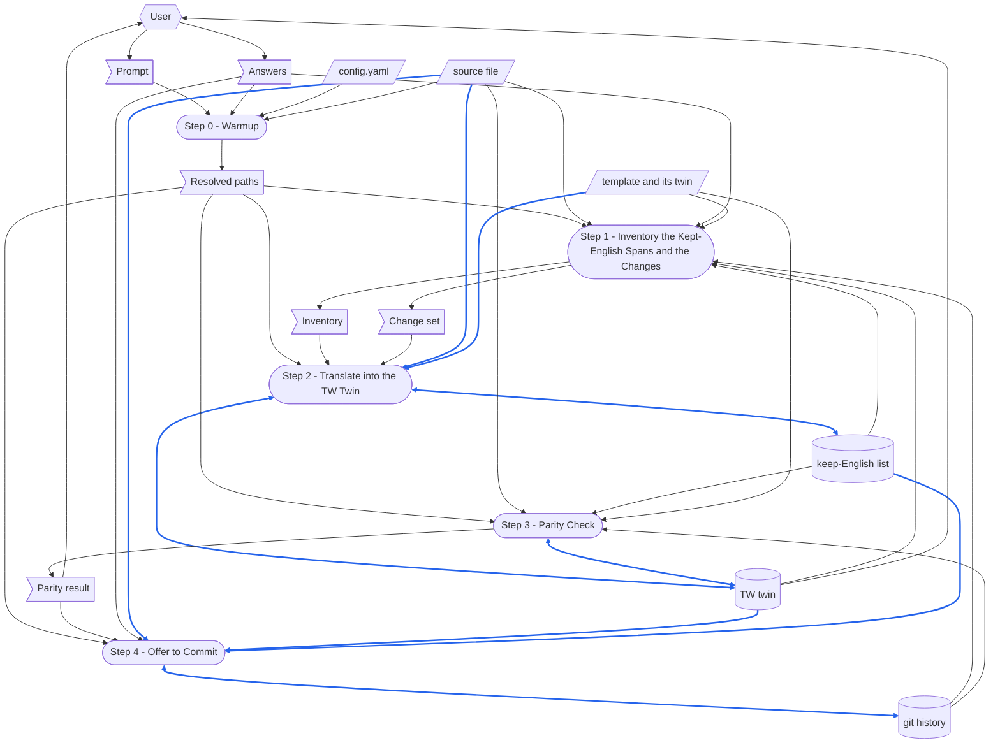

# TERMINOLOGY

Terms that mean the same thing in every skill.

- **`run step N`** — a trailing prompt selector naming one step.
  It runs **only** that step, then stops.
- **no forward-reference** — the rule that a step must never depend on a step that comes after it.
  Naming a later step to route control flow does not break it; borrowing that step's output does.

# DEDICATED TERMINOLOGY

Terms specific to this skill's domain.

- **source file** — the English Markdown file this run translates: a skill's `SKILL.md`, a template, a reference, a rule file — any `.md`.
  It is read and never written.
- **TW twin** — the file this run writes beside the source file, named by inserting `-tw` before `.md`: `SKILL.md` becomes `SKILL-tw.md`, `RSDC-App-tmp.md` becomes `RSDC-App-tmp-tw.md`.
  The `tw` is Taiwan's, as in the locale `zh-TW` — 繁體中文 as written in Taiwan — and is not short for twin.
  It is a twin, not just a translation: the same document in another language, with the source file's skeleton — its headings, fenced blocks, tables and links — kept unchanged, and kept in step with it: a section changed in one is changed in the other in the same run.
  It is this skill's output; the only other file a run writes to is the **keep-English list**, and only to add a term.
- **line for line** — how a TW twin is laid out when its source file has no frontmatter: as many lines as the source, each the translation of the line at the same number — a blank line where the source has one, a list item where it has one at the same indent, a table row with as many cells, and every fence line and fenced line byte for byte.
  The two can then be compared mechanically, and a section changed in one is found at the same line in the other.
  A source with a frontmatter — every `SKILL.md` — is exempt: its translated `description` becomes a folded block and its twin gains a **pairing line**, so its lines cannot keep their numbers, and it is matched heading by heading instead.
- **term** — a word or a phrase with one fixed meaning in the source file's subject, such as *checkpoint*, *commit*, *placeholder* or *verdict*, as opposed to an ordinary word in its everyday sense.
- **glossary term** — a term the source file defines as a `- **name** — definition` bullet under its `# TERMINOLOGY` or `# DEDICATED TERMINOLOGY` heading, or under a heading named `Terminology` at any level — an RSDC's `2.1 Terminology`.
  A bullet that opens with bold anywhere else — a rule under MUST FOLLOW — is not one.
  A file that defines its terms in a glossary of another shape — a list of terms, a table of definitions — has glossary terms too, but only reading finds them.
- **kept-English span** — a stretch of the source file that must reach the TW twin unchanged: every `#` heading line, every fenced code block, every inline-code span, every link target and wiki link (`[[name]]`), every line of the header quote (the `>` lines at the head of the file, each a link to a document it depends on and the inline code after it), the frontmatter's keys and every value but the `description`, every **glossary term** wherever it names the defined thing — bold or not — every term on the **keep-English list** wherever it is used in the meaning the list gives it, and every `{PLACEHOLDER}` token and every `{placeholder}` token.
- **keep-English list** — the shared list of terms every 繁體中文 twin keeps in English in its prose, with the rule that decides which terms belong on it and the Chinese renderings each one replaces.
  Every skill that writes a twin shares it, so a term decided once reads the same in all of them.
- **pairing line** — the line of the TW twin that links back to the source file.
  Under a frontmatter it is added: one line directly under the frontmatter, linking back to the source file and stating that a section changed on one side must be changed on the other in the same run — the only content this skill adds that the source file does not have.
  Without a frontmatter nothing is added, so the twin stays **line for line**: when the top of the source file — above its first section — links to a `-tw.md` file, the line holding that link is translated as the pairing line, the link pointed back at the English file — the same target with `-tw.md` replaced by `.md`; when it does not, the twin has no pairing line either.
- **template** — the file a source file was filled from, as its header quote names it: a `[[name]]` ending in `-tmp`, such as `> [[RSDC-App-tmp]]`, found in the source file's vault or else in `{skillGroups.common}`, with a TW twin of its own beside it, **line for line**.
  A source file whose header quote names no template has none.
- **shared line** — a line of the source file that is, whitespace at either end aside, a line of its **template**: not blank, fenced, a heading, a quote or a table's rule, and holding no `{PLACEHOLDER}` left to fill — a sentence, a row or a label the document took from the template unchanged.
  Its TW twin line is copied from the template's twin, the line at the same number there, so that every document filled from one template words what they share alike, as the template's twin was reviewed to word it.
- **parity check** — the comparison that proves the TW twin kept the source file's skeleton: the same heading lines in the same order, the same fenced blocks byte for byte, the same table column counts, the same link targets, the same inline-code spans and section citations in every section, every **glossary term** bolded at least as often, a frontmatter that still parses with the same keys — or none where the source has none — and, **line for line**, the same line count and the same kind of line at every number.
  Given the **keep-English list**, it also warns about every flagged rendering it finds in the twin's prose, it warns about every `**` the twin set where the page would show the asterisks, and, given a **template**, it warns about every **shared line** worded otherwise than the template's twin words it.
- **baseline** — the commit that last changed the TW twin, with the source file as that commit holds it: the version of the source the twin was last translated from, when the two were committed together — as Step 4 commits them.
  A `git diff` from it to the source as it stands is what has changed since the twin was written.
- **change set** — what the source file has changed since its **baseline**, as Step 1's `diff_md.py` reads it from `git diff`: for a twin written **line for line**, each hunk's source lines and the twin lines they replace; for one matched heading by heading, the sections a hunk touches — translated whole — and the twin sections they replace.
  Its verdict says what Step 2 does: `UNCHANGED`, nothing; `INCREMENTAL`, the change set alone; `FULL`, the whole file, because there is no baseline the twin can be updated from.

# CONFIGURATION

Concrete values this skill runs with.

- **source file** — the `.md` path the prompt gives, workspace-relative or absolute; or `{skillGroups[<group>]}\skills\<skill-name>\SKILL.md` when the prompt names a skill instead.
  Resolved in Step 0.
- **TW twin** — `<name>-tw.md`, in the source file's own directory, where `<name>` is the source file's name without `.md`.
- **keep-English list** — `{skillGroups.common}\references\tw-keep-english.md`.

# MUST FOLLOW

- Must run workflow step by step, and display each step number.
- Each step must be self-contained.
  **No forward-reference.**
- A step that a program can do deterministically must be run as a script.
  A step that needs reading, judgement, or summarization **must not** be scripted — write it as natural-language instructions for the agent to perform directly.
- **Honour a `run step N` selector**: run Step N, then stop; never a later step.
  This skill writes no YAML checkpoint, so each step re-derives its inputs from the prompt and from the files on disk — which it can, because the source file, the TW twin and their git history are the only state any step needs.
- **This skill produces neither an MD report nor a YAML checkpoint.**
  The TW twin is its output; the only other file it writes to is the **keep-English list**, and only to add a term the run decided.
  Its one other write is the commit Step 4 makes, and only on the user's yes.
- **Commit only on the user's yes, and only this run's files.**
  Step 4 commits the TW twin, its source file and the **keep-English list**, where they changed, on the branch already checked out — never another file that is staged or modified, and never with a push, a new branch or an amend.
  A commit made without asking puts the user's unfinished edits to the source into history along with the twin.
- **The source file is read-only.**
  Never edit, reformat, renumber or "fix" it — not even when the translation exposes a real defect in it.
  Report the defect and leave it for the user.
- **Refuse a source that is already Traditional Chinese, or is itself a TW twin.**
  A twin of it is a byte-identical copy plus a pairing line — two files saying the same thing, which will drift apart and leave no way to tell which one is current.
  Step 0 turns away a file whose name already ends in `-tw.md`; for the language, Step 1's `scan_md.py` decides, not the reader's eye, and its verdict is binding.
- **Never translate a kept-English span.**
  A heading, an identifier, a flag, a path, a link target or a placeholder token that changes language stops matching the thing it names, and the parity check will reject it.
- **Copy a shared line from the template's twin; never translate it.**
  Its twin line is the template twin's line, as Step 1 prints it, with the source line's indent.
  A sentence the template's twin words one way, translated afresh in each document, comes out a different sentence in each, and a reader comparing two documents filled from one template sees two translations where the template meant one rule.
  A template that cannot be found, has no twin, or whose twin is not line for line gives no shared lines: Step 1 says why, and every line is translated.
- **A glossary term stays English wherever it names the defined thing, bold or not.**
  The same word in its ordinary sense is prose and is translated: in a skill that defines a **run** command, "run the script" uses the plain verb.
  When it is unclear which a use is, keep it English.
  A term translated in one sentence and kept in the next leaves the reader unable to tell which Chinese word is the defined one, and the glossary stops describing the twin.
- **A term stays English when the keep-English list says so, and a new one is decided by the list's rule.**
  A term on the list is never translated in prose.
  A term not on it stays English when it has more than one common Chinese rendering or names a type, state, outcome or role in the system, and is translated otherwise; one kept English is added to the list in the same run, so the next twin makes the same choice without making it again.
  A concept rendered two ways in two twins leaves a reader unable to tell that the two words name one thing.
- **In a frontmatter, translate the `description` value and nothing else.**
  The `name`, and every other key and value, is copied unchanged.
  Write the translated description as a folded block scalar — `description: >-` followed by an indented line — never as a plain scalar.
  A Chinese description carries quotes, parentheses and colons, and a plain scalar breaks on the first `: `, taking the sibling `name` key down with the document.
  Re-parse the written frontmatter with `yaml.safe_load` before calling the step done.
- **Without a frontmatter, translate line for line.**
  Each source line becomes exactly one twin line, at the same number: wrap the Chinese where the English wraps, and never join, split or move a line.
  Break a line at a full-width punctuation mark or beside an English word, never between two Chinese characters — a renderer turns the line break into a space, a stray gap in the middle of a Chinese sentence.
- **Translate only the change set when the twin has a baseline.**
  Every line of the TW twin that the **change set** leaves out is kept byte for byte, and the whole file is translated only when Step 1's verdict is `FULL`.
  An unchanged line translated again rewrites a translation someone has already read, and turns the next review of the twin into a review of the whole file.
- **Keep bold readable as bold.**
  CommonMark reads a `**` that touches a punctuation mark as bold only when whitespace or punctuation stands on its other side: after `。**` comes a space, a punctuation mark or the end of the line, and before `**「` a space, a punctuation mark or the start of the line.
  Otherwise the page shows the asterisks — so end a bold sentence with `。**` and a space, or keep the mark outside the bold.
- **Write the TW twin as UTF-8 without a BOM**, using the file-creation tool — or, to update it in place, the file-editing tool.
  Never echo it through a PowerShell double-quoted string: a backtick is PowerShell's escape character, so the backticks around every inline-code span would silently rewrite the text (`` `r `` to CR, `` `n `` to LF, everything else losing its backtick).
- **Punctuation follows the language of the span it sits in.**
  Chinese prose takes full-width punctuation (`，` `。` `（）` `、`); a kept-English span keeps its ASCII punctuation exactly.
  An em-dash `—` becomes `——` in Chinese prose and stays `—` inside a kept-English span.
- **A space sets English apart from Chinese.**
  An English word, a number, an inline-code span or a placeholder token (`{PLACEHOLDER}`, `{variable}`) that touches a Chinese character has one space between them, and needs none against full-width punctuation.
  Two Chinese characters never have a space between them, whether or not a bold marker stands between them too — so a placeholder filled with Chinese words loses the spaces it had in the template.
- **Before the skill ends, display the TW twin path** — the path only, never its contents, rendered as a clickable Markdown link and never as inline code or plain text.
  Do this for every run, including a partial one such as `run step 0`.

# Prompt Examples


## Prompt 1

```
/chinese
.github\common\skills\check-skill\SKILL.md
```

## Prompt 2

```
/chinese
check-skill
run step 3
```

## Prompt 3

```
把 check-skill 的 SKILL.md 翻譯成繁體中文存成 SKILL-tw.md，章節名稱和 terminology 保留英文
```

## Prompt 4

```
/chinese
.github\common\skills\gen-rsdc-app\assets\RSDC-App-tmp.md
```

# Dataflow

How a run turns its prompt into what it leaves behind: every step of the **Workflow**, and the data each one reads and writes, drawn as a DFD in the notation of [DFD.md](.github/common/references/DFD.md).
The steps say what each one reads and writes; the diagram draws it, so that a record a later step overwrites, data with no source, or a step reading what a later step writes shows at a glance.
A step is named exactly as its heading, number included, so that no reader has to guess which step is meant.
Only what a step reads or writes at run time is drawn; a document a step only cites is not.
Drop the nodes and arrows for any output this skill does not produce.



How to read the diagram:

- A parallelogram is an external input: `config.yaml`, the source file, and the template its header quote names, with the template's twin — none of which any step writes.
  A flag is one-run data: the prompt and the Answers, the paths Step 0 resolved, the inventory and the change set Step 1 prints, and the parity result Step 3 prints.
  A cylinder is a record: the TW twin, the keep-English list and the git history.
  A rounded box is a step.
- A hexagon is a role outside the skill: the user, who supplies the prompt and the Answers, and reads the parity result and the TW twin.
- A solid arrow moves data, the way the data moves; a two-headed arrow is data one step both reads and writes.
- A blue arrow carries data that is itself written into a record, or turned into a record's content; every other arrow is black.
  The template's twin reaches the TW twin through Step 2, which copies its shared lines, so that arrow is blue; Step 1 and Step 3 only compare against it.
  Data that only steers how a step works, such as `config.yaml`, the paths Step 0 resolved, the inventory, the change set, or the baseline Step 1 and Step 3 read from the git history, stays black even when that step writes a record.
- All three records are changed in place.
  Step 1 reads the keep-English list as earlier runs left it, before Step 2 adds a term to it; Step 1 reads the TW twin, and Step 2 the lines it keeps, before Step 2 rewrites what the change set names — or, in a full translation, Step 2 reads the twin it is about to overwrite, for its title alone; Step 3 corrects the TW twin it checks, so the TW twin is edited in turn by Step 2 and Step 3; and Step 1 and Step 3 read the git history as earlier runs and the user left it, before Step 4 adds a commit to it.
  Every writer also reads the record it changes, which is what the two-headed arrow draws.

# Steps at a Glance

Each step at a glance: the script it runs.
This skill writes no YAML checkpoint — each step re-derives its inputs from the prompt and from the files on disk (MUST FOLLOW) — so every YAML cell is a dash.

| Step | Script | YAML |
|---|---|---|
| Step 0 - Warmup | — | — |
| Step 1 - Inventory the Kept-English Spans and the Changes | `scan_md.py`, `diff_md.py` | — |
| Step 2 - Translate into the TW Twin | — | — |
| Step 3 - Parity Check | `check_parity.py`, `diff_md.py --verify` | — |
| Step 4 - Offer to Commit | — | — |


# Workflow

Each step opens with a **Purpose**: one sentence saying why that step exists as a step — what this skill would lose by folding it into its neighbour.

**Steps 1 and 3 run a script; Steps 0, 2 and 4 do not**, because the inventory, the change set and the checks are exact comparisons that a program makes faster and without missing one, whereas Step 0 has to decide what the user meant, Step 2 is the translation itself — a judgement about meaning that no program can make — and Step 4 turns on the user's answer, its commit being one `git` command.

## Step 0 - Warmup

- **Purpose**: pin down which file is being translated and where its twin goes before any translating starts — a run that guesses writes the twin into another skill's directory, and nothing later in the workflow would notice.

- Run `.venv` first — the Step 1 and Step 3 scripts import `PyYAML`, and `diff_md.py` runs `git`.

- Read the workspace config [config.yaml](config.yaml) at the workspace root and resolve:
  - **`skillGroups`**: the group name -> skills-root map — a bare skill name resolves to `{skillGroups[<group>]}\skills\<skill-name>\SKILL.md`, and this skill's own directory is `{skillGroups.common}\skills\chinese\`.
  - Substitute the resolved values wherever `{skillGroups.common}` or `{skillGroups[<group>]}` appears in the steps below, including in commands.
  - If `config.yaml` is missing or `skillGroups` is absent, stop and ask the user.

- This skill calls no Azure DevOps API and needs no `ADO_PAT` — it reads and writes local files only.
  Never prompt for a credential.

- Check if the below scripts/files exist before running workflow.
  - `{skillGroups.common}\skills\chinese\scripts\scan_md.py`
  - `{skillGroups.common}\skills\chinese\scripts\check_parity.py`
  - `{skillGroups.common}\skills\chinese\scripts\diff_md.py`
  - `{skillGroups.common}\references\tw-keep-english.md`
  - `{skillGroups.common}\scripts\depends_on.py` — `scan_md.py` and `check_parity.py` read the source file's header quote with it.

- The prompt takes one of the forms shown in **Prompt Examples** above.
  Parse it for:
  - **source file** (required): either a path to a `.md` file — workspace-relative or absolute, as in Prompt 1 and Prompt 4 — or a bare skill name, which stands for that skill's `SKILL.md`, resolved by looking for `<root>\skills\<name>\SKILL.md` under every `skillGroups` root.
    A name that matches under more than one root is ambiguous: list the matches and ask which one, never pick the first.
  - **`run step N`** (optional): a trailing step selector.

- If a required input is missing, ask the user for it.
  This skill never offers a list of files to choose from — when the prompt names none, ask the user to type the path or the skill name and wait for the answer.

- Confirm the source file exists, then stop and say which check failed, rather than translating it anyway, when:
  - its name does not end in `.md` — this skill translates Markdown only;
  - its name ends in `-tw.md` — it is a TW twin already, and a twin of it would be a copy;
  - it is a `SKILL.md` whose YAML frontmatter does not parse with a `name` key — such a file is not a skill;
  - it opens with a frontmatter that does not parse — the twin's frontmatter could not be checked against it.

- Derive the TW twin path: the source file's own directory, and its name with `-tw` inserted before `.md`.
  If it already exists, say so; whether it is updated in place or overwritten is Step 1's to settle.

- Save the canonical skill invocation for reference in later steps.

- Display the resolved source file path and TW twin path.


## Step 1 - Inventory the Kept-English Spans and the Changes

- **Purpose**: settle, from the whole file at once, what must survive untranslated and what must be translated at all — decided span by span while translating, the same identifier ends up English in one section and Chinese in the next, and a twin translated again in full rewrites lines someone has already read.
  It is also the last point at which a source that needs no translating can still be turned away.

- Run the script `scan_md.py` with the `--file` and `--keep` arguments.
  - `--file`: the source file resolved in Step 0.
  - `--keep`: the **keep-English list**.
  - Example: `python {skillGroups.common}\skills\chinese\scripts\scan_md.py --file ".github\common\skills\check-skill\SKILL.md" --keep "{skillGroups.common}\references\tw-keep-english.md"`

- The script prints its inventory to **stdout** and writes no file:
  1. Whether the file has a frontmatter, whether it parses, and which keys it carries.
  2. Every `#` / `##` / `###` heading line, in order, with its line number.
  3. The fenced-code-block count and the line number of each fence.
  4. Every inline-code span, deduplicated, and every **glossary term** — read from the two TERMINOLOGY sections and any section named Terminology only, so a rule that opens with bold under MUST FOLLOW is not mistaken for one.
  5. Every Markdown link and wiki link (`[[name]]`), as display text and target.
  6. Every `{PLACEHOLDER}` token and every `{placeholder}` token.
     A placeholder in a retired form is neither: a warning lists it, with the command that converts it in the source file and its twin.
  7. Each table block's column count.
  8. Every term on the **keep-English list** that the prose uses, with how often.
  9. The shape: whether the twin is written **line for line**, and if so its pairing line — the line above the first section that links to a `-tw.md` file, with the target the twin's same line links back to — or that there is none.
  10. The **template**: the `[[name]]` the header quote names, where it and its twin were found, and every **shared line** the source holds — its line number and the template twin's wording of it — or that the header quote names none, or why the template it names gives no shared lines.
  11. The CJK share of the prose, how many heading lines carry CJK, whether the `description` does, and a **verdict** of `translatable` or `ALREADY-CHINESE`.
      Fenced blocks and inline-code spans are excluded from the measure, so an English file that merely quotes a Chinese string is not caught by it.

- **If the script exits `2`, its verdict is `ALREADY-CHINESE` — stop the skill here.**
  Report the ratios it printed and say that the source needs no translation; do not go on to Step 2, and do not write a TW twin.
  Exit `0` means `translatable` and the run continues.

- Read the printed inventory.
  Everything it lists is a kept-English span; so is a **glossary term** the file defines in a glossary of another shape, which the script cannot see — read the file for one.
  Nothing else is: a word that is neither is prose and gets translated.

- Run the script `diff_md.py` with the `--en` and `--tw` arguments.
  - `--en`: the source file resolved in Step 0.
  - `--tw`: the TW twin path Step 0 derived.
  - Example: `python {skillGroups.common}\skills\chinese\scripts\diff_md.py --en ".github\common\skills\check-skill\SKILL.md" --tw ".github\common\skills\check-skill\SKILL-tw.md"`

- The script reads the **baseline** from git, prints to **stdout** and writes no file:
  1. The shape: line for line, or heading by heading.
  2. The baseline's commit, date and subject — or that there is none, and why.
  3. The **change set**: for a twin written line for line, each hunk's source lines, and the twin lines they replace or the twin line they go after; for one matched heading by heading, each group of sections to translate whole, the twin sections they replace or the twin line they go after, and whether the frontmatter changed.
  4. A verdict of `UNCHANGED`, `INCREMENTAL` or `FULL`.

- Act on the verdict:
  - `UNCHANGED` — the TW twin already translates the source as it stands.
    Say so; Step 2 writes nothing.
  - `INCREMENTAL` — Step 2 translates the change set alone.
  - `FULL` — there is no baseline the twin can be updated from: there is no twin yet, it is not in git, it has uncommitted changes of its own, or at its last commit it did not line up with the source.
    With no twin yet, go on.
    When the twin exists, say why it cannot be updated in place and ask whether to overwrite it with a full translation; a refusal ends the run with nothing written.
    When the reason is the twin's own uncommitted changes, say that committing them first keeps them, and that the next run then translates only what changed.

- Display a short summary of the inventory: heading count, fence count, term count, keep-English term count, link count, table count, shared line count, and whether the twin is written line for line — and the verdict, with how many lines or sections it leaves to translate.


## Step 2 - Translate into the TW Twin

- **Purpose**: produce the translation — the one part of this workflow that is a judgement about meaning rather than a comparison of text, and the reason the skill exists.

- **No script for this step** — rendering an argument written in one language into another, while leaving its identifiers alone, is reading and writing that no program can do, so follow the instructions below yourself.

- Read the **keep-English list**, and the source file — all of it for a full translation, the change set and the lines around it for one in place.
  Use the Step 1 inventory as the list of kept-English spans, and its verdict to decide what this step does: `UNCHANGED`, nothing, and the step ends here; `INCREMENTAL`, the update in place below; `FULL`, the whole twin built below.

- Rules that apply to every instruction below:
  - **Translate prose only.**
    Every kept-English span is copied through byte for byte.
  - **Copy every shared line** from the template's twin as Step 1 printed it, with the source line's indent, instead of translating it — in an update in place as in a full build.
  - **Keep each glossary term English wherever it names the defined thing**, bold or not, and translate the same word where it is used in its ordinary sense.
    The `description` is no exception: a term it uses as the term stays English there too.
  - **Keep every term on the keep-English list English** where it is used in the meaning the list gives it.
    For a term the list lacks, apply the list's rule; if it stays English, add it to the list before the step ends — with the renderings it replaces, and the one to flag when it can be searched for without false alarms.
  - **Do not add, drop, merge, split or reorder anything.**
    One source bullet becomes one twin bullet, one numbered item one numbered item, one paragraph one paragraph, in the same order — and, without a frontmatter, one line one line.
    The pairing line under a frontmatter is the single permitted addition — no translator's note, no extra explanation, no tidying of an argument that reads awkwardly.
  - **Keep the emphasis where the source put it.**
    A bolded warning stays bold, on the Chinese words that carry the same weight, set so that the page still renders it bold.
  - If a sentence cannot be rendered without changing what it claims, keep the English term inline and translate around it rather than paraphrasing the claim.

- Update the TW twin in place, when the verdict is `INCREMENTAL`:
  - Translate only what the change set names, under every rule above and every point of the build below that it touches — a changed title is copied as it is, a changed pairing line still points back at the source file.
  - **Line for line**: give each hunk's source lines one twin line each, and put them where the change set says — in place of the twin lines it names, or after the twin line it names.
    A hunk with no source lines deletes the twin lines it names.
  - **Heading by heading**: translate each group's source sections whole, headings included — keeping the twin's own wording for every sentence the source did not change — and put them in place of the twin sections it names, or after the twin line it names.
    Translate the `description` again when the change set says it changed, and copy any other frontmatter key that changed.
  - Read the twin lines around each change first, so that a term the twin already renders is rendered the same way in the lines being added.
  - Make each change with the file-editing tool, and leave every other line as it stands — never rewrite the whole file in an update in place.

- Build the TW twin, when the verdict is `FULL`:
  1. **Frontmatter** — only where the source file has one.
     `name`, and every other key and value, unchanged; the `description` value translated, written as a folded block scalar (`description: >-` plus an indented line).
     A source without a frontmatter gets a twin without one.
  2. **Pairing line** — under a frontmatter: one line directly under it, linking back to the source file by its file name and stating that a section changed on one side must be changed on the other in the same run.
     Without a frontmatter, add nothing: where Step 1 found a pairing line in the source file, translate it at its own line number and point its link at the target Step 1 printed — the same target with `-tw.md` replaced by `.md` — leaving every other link on that line as it is.
  3. **Headings** — every `#` heading line copied byte for byte, including its level, its numbering and its wording — the document's title too.
     A `（繁體中文）` suffix the TW twin being overwritten still carries on its title is dropped: the file name already says which file is the twin, and a title that differs is one more exception every checker would have to excuse.
  4. **Fenced blocks** — copied byte for byte, fence markers and contents alike.
     A prompt example is what the user types; translating it makes it stop working.
  5. **Links** — targets never change, but for the pairing link.
     Display text is translated only when it is prose; display text that is a filename or a heading name stays as it is.
  6. **Tables** — the same number of columns, with the header cells kept English.
     Escape a literal `|` inside a cell as `\|`, or it silently adds a column.
  7. **Prose** — translated into Traditional Chinese, with the kept-English spans left standing inside the Chinese sentences, a space on either side where they touch a Chinese character.
  8. **Lines** — without a frontmatter, one twin line for every source line, at the same number, wrapped and broken as MUST FOLLOW says.

- Write the TW twin to the path Step 0 derived, as UTF-8 without a BOM, using the file-creation tool.

- Display the TW twin path, and how many lines or sections were translated.


## Step 3 - Parity Check

- **Purpose**: prove the twin kept the source's skeleton — a translation that dropped a heading, unbalanced a fence or lost a table column still reads perfectly, and only a comparison against the source catches it.

- Run the script `check_parity.py` with the `--en`, `--tw` and `--keep` arguments.
  - `--en`: the source file resolved in Step 0.
  - `--tw`: the TW twin beside it.
  - `--keep`: the **keep-English list**.
  - Example: `python {skillGroups.common}\skills\chinese\scripts\check_parity.py --en ".github\common\skills\check-skill\SKILL.md" --tw ".github\common\skills\check-skill\SKILL-tw.md" --keep "{skillGroups.common}\references\tw-keep-english.md"`

- The script prints one line per comparison to **stdout** and exits non-zero if any of them fails:
  1. The frontmatter: where the source file has one, both parse, carry the same keys and hold the same `name`, and a `description` the source has is not empty in the twin; where it has none, neither has the twin.
  2. The heading lines are identical, in order, the title included — headings are kept-English spans, so byte equality is the test.
     An older twin's title that still ends in `（繁體中文）` passes, with a warning.
  3. The fenced-block counts are equal, and even — an odd count means a block was never closed — and every block is the same byte for byte.
  4. The table count matches, and so does each table's column count, comparing every row after stripping escaped `\|` first.
  5. The pairing line.
     Under a frontmatter, the TW twin carries a link back to the source file above its first heading — the one link the twin may have that the source does not.
     Without a frontmatter, a source file whose top links to a `-tw.md` file has the twin's same line link back to the same target with `-tw.md` replaced by `.md`.
     Either way the script sets the pairing links aside before comparing the rest.
  6. The remaining link targets, a wiki link's `[[name]]` among them, match one for one, in order.
  7. Every section holds the same inline-code spans as the source's.
     They are read paragraph by paragraph and compared as sets: a span wrapped over two lines is one span, and a name the Chinese repeats where the English says "which" loses nothing, but a span only one side holds was lost or translated.
     The pairing line is set aside, and a span naming the twin in the source matches the one naming the source in the twin.
  8. Every section holds the same section citations as the source's: `§2.3`, and, in a file filled from a **template**, a bare `2.3` too.
  9. Every `{PLACEHOLDER}` token and every `{placeholder}` token in the source appears in the twin, and neither file holds a placeholder in a retired form.
  10. The bullet and numbered-item counts match per section — the check that catches a bullet dropped mid-translation, which reads perfectly and is invisible to every other comparison.
  11. Every **glossary term** is bolded in the twin at least as often as in the source.
      Bold marks a term, so a lower count is a term that was translated.
  12. **Line for line**, where the source file has no frontmatter: the same line count, and the same kind of line at every number — blank, heading, fenced, table row, quote, a bullet or numbered item at its indent, or text at its indent.
  13. The twin decodes as UTF-8 and carries no BOM.

- It also prints a `[WARN]` line for each **glossary term** the twin uses unbolded fewer times than the source.
  A warning does not fail the run, because the same word may be an ordinary word rightly translated.
  Read the source's unbolded uses of that term: an ordinary word translated is right; a term translated is a mismatch, corrected like any other.

- It also prints a `[WARN]` line for each rendering the **keep-English list** flags that it finds in the twin's prose, with the lines it is on.
  Read each one: the flagged word used for the listed term is a mismatch, corrected like any other; the same word in a sentence about something else is right and stays.

- It also prints a `[WARN]` line for each line of the twin holding a `**` that the page would show as asterisks, with the text around it.
  Correct each one as MUST FOLLOW says, unless the source file shows the same asterisks on purpose.

- When the source names a **template**, it also prints a `[PASS]` line when every **shared line** is worded as the template's twin words it, and otherwise a `[WARN]` line for each one that is not, with the template twin's wording: copy it.
  A template that gives no shared lines is a `[WARN]` too, saying why — none was checked.

- It also prints a `[WARN]` line for each line of the twin where English touches a Chinese character with no space between them — an inline-code span and a placeholder token count as English — and for each line with a space between two Chinese characters, a bold marker between them or not.
  Correct each one as MUST FOLLOW says.

- In a run whose Step 2 updated the twin in place, also run the script `diff_md.py` with the same `--en` and `--tw`, and `--verify`.
  It checks that every line or section outside the **change set** is still byte for byte what the baseline twin holds, and exits `1` when one is not: a `[FAIL]` names a line or section Step 2 should have kept, and `git show <baseline>:<twin path>` prints the baseline twin to restore it from.
  Under `run step 3` no Step 2 ran, so this check is not made.
  - Example: `python {skillGroups.common}\skills\chinese\scripts\diff_md.py --en ".github\common\skills\check-skill\SKILL.md" --tw ".github\common\skills\check-skill\SKILL-tw.md" --verify`

- If either script exits non-zero, report each mismatch with its line, correct the **TW twin**, and re-run this step until it passes.
  **Fix the twin, never the source file.**

- If a mismatch turns out to be the source file's own defect — an unclosed fence, a table row with the wrong column count, a placeholder in a retired form — say so plainly, leave the source alone, and report it as something for the user to fix in a separate run.

- Display the parity result.


## Step 4 - Offer to Commit

- **Purpose**: give the next run its **baseline** — it diffs the source against the commit that last changed the TW twin, so a twin left uncommitted, or committed without the source it translates, leaves the next run nothing exact to diff against, and it translates the whole file again.

- Offer a commit only when this run has something to commit and the twin is sound.
  Skip the step, saying why, when:
  - Step 2 wrote nothing — Step 1's verdict was `UNCHANGED`;
  - the source file is not in a git repository;
  - the TW twin fails the parity check — Step 3's result in a whole run; under `run step 4`, run Step 3's `check_parity.py` command first.

- Gather, for each repository involved, what its commit would hold, and nothing else:
  - the TW twin;
  - the source file, when git shows it changed — the twin now translates those edits;
  - the **keep-English list**, when this run added a term to it.
    Under `run step 4`, which cannot know that, ask about it when git shows it changed.
    It lies in the repository of `{skillGroups.common}`, which may not be the twin's: then each repository gets a commit of its own.

- Ask the user whether to commit, showing for each repository its files, its branch, the commit subject, and anything else already staged there, which the commit leaves out.
  Name it plainly when a file in the commit holds changes this run did not make — edits to the source file the user may not mean to commit yet, or earlier terms in the keep-English list.
  - The subject follows the repository's recent subjects, read with `git log -5 --format=%s`: where they name the skill or document changed, it names the source file's.

- On a yes, for each repository:
  - `git add` each file that is new to git, then commit exactly the gathered files with `git commit -m "<subject>" -- <files>`, so that whatever else is staged stays staged and out of the commit.
  - Never `git commit -a`, never push, amend, create or switch a branch, and never skip the repository's hooks.
    A hook that rejects the commit is reported with its output, and the step stops there.

- On a no, commit nothing, and say that the next run will find the twin with uncommitted changes, so it cannot update it in place until it is committed.

- Display each commit's hash and subject, or that nothing was committed, then close with the TW twin path as a clickable Markdown link.
