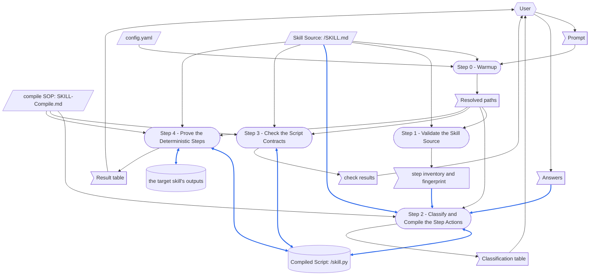

# compile-skill

> [DFD.md](../../references/DFD.md)  `2026-10-20`  `09fb4a7e4730`
> [md-style.md](../../rules/md-style.md)  `2026-10-30`  `6484ff7dc0b2`
> [skill-writing.md](../../rules/skill-writing.md)  `2026-10-30`  `c7696bf6351a`
> [scratch-rules.md](../../rules/scratch-rules.md)  `2026-10-20`  `f3bc07a86022`
> [SKILL-tmp.md](../../templates/SKILL-tmp.md)  `2026-10-30`  `6ca6e607f75c`
> [README-tmp.md](../../templates/README-tmp.md)  `2026-10-20`  `43ace64a88a6`
> [chinese/SKILL.md](../chinese/SKILL.md)  `2026-10-20`  `2a03562d5a11`
> [[SkillCompiler-RSDC]]  `cited`  `2026-10-20`  `0ac8fa44bb74`

這份 README.md 說明 compile-skill skill 由哪些部分組成，以及它的 [SKILL.md](SKILL.md) 依賴哪些檔案。
skill 每次執行時，都會讀取整份 SKILL.md，以及它的 compile SOP [SKILL-Compile.md](references/SKILL-Compile.md)。
因此，執行時不需要的部分都放在這份 README.md，compile SOP 與它所依據的設計文件 [SkillCompiler-RSDC.md](references/SkillCompiler-RSDC.md) 之間的關係，也寫在這裡。
SKILL.md 沒有連到這份 README.md 或設計文件的連結，所以沒有任何一次執行會讀它們。

修改本 skill 之前，先讀這份 README.md。
做完「When the Skill Is Changed」列出的每一項修改，再做那裡列出的檢查。
skill 的各個 step 怎麼寫，見 [skill-writing.md](../../rules/skill-writing.md)。

圖中的路徑都用簡寫：`compile-skill/` 指 `.github/common/skills/compile-skill/`，`common/` 指 `.github/common/`。
`<target>/` 是一次執行所編譯之 skill 的目錄，即 `{skillGroups[<group>]}/skills/<skill-name>/`。

# When the Skill Runs

## Dataflow

本節說明一次執行如何把它的 prompt 變成它的輸出。
它畫出 [SKILL.md](SKILL.md) 中 Workflow 的每一個 step，以及每個 step 讀寫的資料。
它是以 [DFD.md](../../references/DFD.md) 的畫法畫成的 DFD。
SKILL.md 的各個 step 寫明每個 step 讀寫哪些資料，這張圖則把這些資料畫出來。
因此，被後續 step 再次寫入的 record，以及沒有來源的資料，在圖上一眼就看得出來。
讀取後續 step 所寫資料的 step，也一樣看得出來。

每個 step 的名稱都和它的標題相同，連編號一起，因此每個讀者都知道一個方框指的是哪一個 step。
圖中只畫出 step 在執行時讀寫的資料。
step 只引用的文件不畫。



圖的讀法：

- 平行四邊形是 external input，旗形是 one-run data，圓柱是 record。
  external input 是 `config.yaml`、Skill Source 與 compile SOP，沒有任何 step 寫入它們。
  record 是 Compiled Script，以及 Step 4 的執行所寫出的 target skill 輸出。
  圓角方框是 step。
- 六角形是 skill 外部的 role：使用者，提供 prompt 與 Answers，並閱讀 Classification table、check results 與 Result table。
  Answers 是使用者在 Step 2 的回答：每個沒有執行程式的 Deterministic step 是 chore、core work 還是 cognitive，以及是否覆寫既有的 Compiled Script。
- 實線箭頭沿著資料移動的方向搬移資料。
  雙頭箭頭是某個 step 既讀又寫的資料：Step 2 讀取既有的 Compiled Script，取得它的 docstring 所記錄的決定，再重新寫出 script；Step 4 的執行找到 target skill 先前的輸出，並寫出新的輸出。
  Step 3 與 Step 4 也會執行 Compiled Script，並在 compile SOP Step 3 修正它時，再整份寫出它。
  虛線箭頭不搬移資料：它表示順序，或一項由人做的變更。
- 藍色箭頭搬移的資料會進入某個 record，或成為某個 record 的內容。
  step inventory 中的指紋、Skill Source 與 Answers 成為 Compiled Script 的內容，Step 3 與 Step 4 在修正它時會再寫一次，而 Step 4 的執行寫出 target skill 的輸出。
  其餘箭頭一律是黑色。
  只決定某個 step 如何運作的資料，箭頭是黑色，即使那個 step 會寫 record。
  例如 `config.yaml`、Step 0 解析出的路徑，以及 compile SOP。

## Step Purposes

每個 step，以它在 SKILL.md 中的標題為名，並附上它的 Purpose：要有這個 step 的原因。

- Step 0 - Warmup
  確定 prompt 指的是**哪一個**檔案、它的 script 會放在哪裡——靠猜的執行會編譯錯 skill，或寫進別的 skill 的目錄，而後面的 step 都察覺不到，因為每個 step 都只檢查交給它的那個檔案。
- Step 1 - Validate the Skill Source
  判定**那個**檔案是否根本是本 skill 能編譯的來源——若折進 Step 2，verdict 就會出自閱讀，而不是出自 Source Scanner。
- Step 2 - Classify and Compile the Step Actions
  把來源變成程式碼——決定每個 step 是什麼、並寫出做這件事的程式碼，是這個 workflow 中唯一需要判斷的地方，也是本 skill 存在的理由。
- Step 3 - Check the Script Contracts
  把由程式進行的 contract 檢查，與需要判斷的 Step 4 證明分開，並排在它之前：違反 contract 的 script 一旦在 workspace 中執行，什麼事都可能做。
- Step 4 - Prove the Deterministic Steps
  證明編譯出的 step 確實做了來源所說的事——一個 script 可以遵守每一項介面 contract，卻仍然寫出錯誤的報告，而只有對照來源所記載的內容實際執行它，才看得出來。

## Files Each Step Uses

這份 README.md 只說明一次，這個 skill 如何遵守 skill-writing.md 的「scripted-versus-not」規則：
**Step 1 與 Step 3 執行 script，Step 0、2 與 4 不執行**，因為 Step 0 要決定使用者的意思，沒有 script 做得到，而 Step 2 與 Step 4 是一次編譯所需要的判斷：為 step 分類、寫出 script，以及判斷它的執行產出了什麼。

```
Step 0 - Warmup
  reads   config.yaml
  checks  that these exist:
          compile-skill/scripts/scan_source.py
          compile-skill/scripts/check_compiled.py
          compile-skill/references/SKILL-Compile.md
  checks  that <target>/SKILL.md exists

Step 1 - Validate the Skill Source
  runs    compile-skill/scripts/scan_source.py
          ├─ reads <target>/SKILL.md
          └─ prints the step inventory, the fingerprint and the verdict

Step 2 - Classify and Compile the Step Actions
  reads   <target>/SKILL.md, whole
  reads   compile-skill/references/SKILL-Compile.md, whole
  asks    the user, with a menu, about each Deterministic step that runs no program
  writes  <target>/skill.py

Step 3 - Check the Script Contracts
  runs    compile-skill/scripts/check_compiled.py
          ├─ reads <target>/SKILL.md and <target>/skill.py
          └─ runs <target>/skill.py only in temporary places outside the workspace
  reads   compile-skill/references/SKILL-Compile.md: its Step 3, when a check fails
  writes  <target>/skill.py again, when a check fails

Step 4 - Prove the Deterministic Steps
  reads   compile-skill/references/SKILL-Compile.md: its Step 4, and its Step 3 when a difference lies in the script
  runs    <target>/skill.py --export-schema, then --step <id> for each Deterministic step
          └─ writes what the target skill's step writes, on a side-effect-free input
  writes  <target>/skill.py again, when a difference lies in the script
```

沒有任何一次執行會讀 SKILL-tw.md、這份 README.md 或 README-tw.md、compile SOP 的 twin，或設計文件與它的 twin。

# When the Skill Is Changed

`⇄`：兩份檔案一起改。
`─▶`：一份檔案依賴另一份的規定或格式。

```
compile-skill/SKILL.md
 ├─⇄ compile-skill/SKILL-tw.md
 │     every change goes into both: the chinese skill's diff_md.py, a translation, then check_parity.py
 │     └─▶ common/references/tw-keep-english.md: which terms stay English
 ├─⇄ compile-skill/README.md and README-tw.md
 │     the Dataflow, Step Purposes and Files Each Step Uses name each step exactly as its heading:
 │     a step added, removed or renamed changes all three
 ├─⇄ compile-skill/references/SKILL-Compile.md (the compile SOP)
 │     the steps cite its steps by number and heading, and MUST FOLLOW maps them onto this skill's:
 │     a step of it renamed, renumbered, added or removed changes both
 ├─⇄ compile-skill/scripts/scan_source.py and check_compiled.py
 │     what Steps 1 and 3 say each program takes and exits with
 ├─▶ common/rules/skill-writing.md: how the steps are written
 ├─▶ common/rules/scratch-rules.md: where a run's throwaway files go and how they are cleaned up
 └─▶ common/rules/md-style.md: one sentence on each line
       └─ checked by reformat_md.py and check_reformat.py (--twin: the twin's sentences one for one)

compile-skill/references/SKILL-Compile.md (the compile SOP)
 ├─⇄ compile-skill/references/SKILL-Compile-tw.md: line for line, through the chinese skill
 └─▶ compile-skill/references/SkillCompiler-RSDC.md (the design document)
       the compile SOP is written from it, and holds no link to it, so that no run reads the design document:
       a change to the sections listed below the tree goes into the compile SOP in the same run

compile-skill/references/SkillCompiler-RSDC.md (the design document)
 ├─⇄ compile-skill/references/SkillCompiler-RSDC-tw.md: line for line, through the chinese skill
 ├─⇄ compile-skill/scripts/scan_source.py and check_compiled.py: the code keeps what the document says
 ├─▶ common/references/RSDC-Standard.md, DFD.md and the RSDC template of gen-rsdc-skill (its header quote)
 └─ checked by gen-rsdc-skill's check_rsdc.py, alone and with its twin

compile-skill/README.md
 ├─⇄ compile-skill/README-tw.md: line for line, through the chinese skill
 └─▶ common/references/DFD.md: how the Dataflow is drawn
       a step or a piece of data added or removed redraws the DFD and renumbers its blue arrows

the templates and the tools
 ├─▶ common/templates/SKILL-tmp.md and README-tmp.md: the structure gen-skill writes from
 └─ common/skills/check-skill: checks SKILL.md and this file against the two templates

outputs already written
 └─ every <target>/skill.py compiled before a change, such as InvestForge's report-inv-week/skill.py
       its fingerprint covers only its own SKILL.md: a change to the compile SOP or the design document
       does not make it stale, so compile it again when the change touches what a Compiled Script must be
```

compile SOP 是依據設計文件的這些節寫成的：§1.4 *System Goals*、§2.1 *Terminology*、§2.2 *Artifact Types*、§2.3 *Dataflow*、§2.4 *Naming and Data Structures*、§2.5 *Derivation Rules*、§2.7 *CLI*、§2.8 *Invariants*、§3.1 *Core Component Responsibilities*、§3.2 *Execution Flow*、§4.1 *Key Development Guidelines*、§4.2 *Implementation Guidelines and Tools*、§4.3 *Safety and Robustness* 與 §4.4 *Verification Obligations*。
它的 Step 1 到 Step 4 是 §3.2 *Execution Flow* 中 Compiler 的部分：Classify、Write、Check contracts 或 Prove the steps 所要求的修正，以及 Prove the steps 中的判斷。
Validate 與 Check contracts 屬於 Source Scanner 與 Contract Checker：由 SKILL.md 執行它們，就像它執行 Compiled Script 一樣。
這份 README.md 的 header quote 只記錄這些節的指紋，所以設計文件其餘部分的改動，例如它的 Defects，不會要求重讀 compile SOP。

改動之後，做適用於它的檢查：

- 對 SKILL.md 與 SKILL-tw.md、README.md 與 README-tw.md，以及 compile SOP 與設計文件和它們的 twin，各執行一次 `check_parity.py`：四次檢查都沒有 `[FAIL]` 行。
- 對這份 README.md 執行 `depends_on.py check`：header quote 中的每一個檔案都是 UNCHANGED，或你讀過改動、讓 compile SOP 跟它一致，並重新記錄該檔案。
- 對設計文件執行 `check_rsdc.py --rsdc`，單獨一次、加上 `--tw` 一次：沒有任何檢查失敗。
- `/check-skill compile-skill`：每一項檢查都沒有問題，或你對每一個結果都做出決定。
- 改動涉及 Compiled Script 必須是什麼時：編譯一個拋棄式的 skill，它有一個 Deterministic step 與一個 Cognitive step，確認 Step 3 與 Step 4 通過，再刪除它。

# Tracked Dependencies

header quote 列出一個檔案所依賴的檔案。
`depends_on.py check` 指出其中哪些檔案在 `depends_on.py record` 記錄之後改過。
為了讓 SKILL.md 與 compile SOP 保持精簡，並讓設計文件不進入任何一次執行，這份 README.md 列出它們所依賴的檔案。

```
compile-skill/README.md (and README-tw.md, which copies its header quote)
  ─▶ common/references/DFD.md
  ─▶ common/rules/md-style.md
  ─▶ common/rules/skill-writing.md
  ─▶ common/rules/scratch-rules.md
  ─▶ common/templates/SKILL-tmp.md
  ─▶ common/templates/README-tmp.md
  ─▶ common/skills/chinese/SKILL.md
  ─▶ compile-skill/references/SkillCompiler-RSDC.md: only the sections the compile SOP is written from
```

如果 `depends_on.py check` 把其中某個檔案顯示為 CHANGED，就讀它的改動。
讓 SKILL.md、compile SOP 與這份 README.md 跟它一致，再以 `depends_on.py record` 重新記錄。
