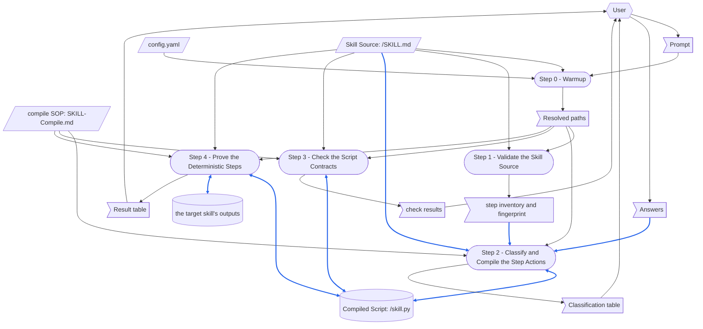

# compile-skill

> [DFD.md](../../references/DFD.md)  `2026-10-20`  `09fb4a7e4730`
> [md-style.md](../../rules/md-style.md)  `2026-10-30`  `6484ff7dc0b2`
> [skill-writing.md](../../rules/skill-writing.md)  `2026-10-30`  `c7696bf6351a`
> [scratch-rules.md](../../rules/scratch-rules.md)  `2026-10-20`  `f3bc07a86022`
> [SKILL-tmp.md](../../templates/SKILL-tmp.md)  `2026-10-30`  `6ca6e607f75c`
> [README-tmp.md](../../templates/README-tmp.md)  `2026-10-20`  `43ace64a88a6`
> [chinese/SKILL.md](../chinese/SKILL.md)  `2026-10-20`  `2a03562d5a11`
> [[SkillCompiler-RSDC]]  `cited`  `2026-10-20`  `0ac8fa44bb74`

This README.md tells about the parts of the compile-skill skill, and about the files that its [SKILL.md](SKILL.md) depends on.
Each time the skill runs, it reads all of its SKILL.md, and its compile SOP, [SKILL-Compile.md](references/SKILL-Compile.md).
Thus, the parts that a run does not need are in this README.md, and so is how the compile SOP relates to the design document it is written from, [SkillCompiler-RSDC.md](references/SkillCompiler-RSDC.md).
SKILL.md does not have a link to this README.md or to the design document, thus no run reads them.

Read this README.md before you change the skill.
Make each change that "When the Skill Is Changed" names, and then do the checks that it gives.
[skill-writing.md](../../rules/skill-writing.md) tells how to write the steps of a skill.

The paths in the diagrams are short: `compile-skill/` is `.github/common/skills/compile-skill/`, and `common/` is `.github/common/`.
`<target>/` is the directory of the skill a run compiles, `{skillGroups[<group>]}/skills/<skill-name>/`.

# When the Skill Runs

## Dataflow

This section shows how a run changes its prompt into its outputs.
It shows each step of the Workflow in [SKILL.md](SKILL.md), and the data that each step reads and writes.
It is a DFD in the notation of [DFD.md](../../references/DFD.md).
The steps of SKILL.md tell which data each step reads and writes, and the diagram shows this data.
Thus, the diagram immediately shows a record that a subsequent step writes again, and data that has no source.
It also shows a step that reads the data that a subsequent step writes.

The name of each step is the same as its heading, with its number, thus each reader knows which step a box identifies.
The diagram shows only the data that a step reads or writes when it runs.
It does not show a document that a step only refers to.



How to read the diagram:

- A parallelogram is an external input, a flag is one-run data, and a cylinder is a record.
  The external inputs are `config.yaml`, the Skill Source and the compile SOP, which no step writes.
  The records are the Compiled Script and the target skill's outputs that Step 4's runs write.
  A rounded box is a step.
- A hexagon is a role external to the skill: the user, who supplies the prompt and the Answers, and reads the Classification table, the check results and the Result table.
  The Answers are the user's replies in Step 2: chore, core work or cognitive for each Deterministic step that runs no program, and whether to overwrite an existing Compiled Script.
- A solid arrow moves data, in the direction in which the data moves.
  A two-headed arrow is data that one step reads and also writes: Step 2 reads an existing Compiled Script for the decisions its docstring records, and writes the script again; Step 4's runs find the target skill's earlier outputs and write new ones.
  Step 3 and Step 4 also run the Compiled Script, and write it again, whole, when compile SOP Step 3 corrects it.
  A dotted arrow moves no data: it is a sequence, or a change that a person makes.
- A blue arrow moves data that goes into a record, or that becomes the content of a record.
  The fingerprint of the step inventory, the Skill Source and the Answers become the content of the Compiled Script, which Step 3 and Step 4 write again when it is corrected, and Step 4's runs write the target skill's outputs.
  All the other arrows are black.
  Data that only controls how a step operates has a black arrow, although that step writes a record.
  Examples are `config.yaml`, the paths Step 0 resolved, and the compile SOP.

## Step Purposes

Each step, with the same name as its heading in SKILL.md, and its Purpose: the cause to have this step.

- Step 0 - Warmup
  Pin down **which** file the prompt means and where its script would go — a run that guesses compiles the wrong skill, or writes into another skill's directory, and no later step can notice, because each one checks only the file it is handed.
- Step 1 - Validate the Skill Source
  Decide whether **that** file is one this skill can compile at all — folded into Step 2, the verdict would come from a reading rather than from the Source Scanner.
- Step 2 - Classify and Compile the Step Actions
  Turn the source into code — deciding what each step is and writing the code that does it is the one judgment in this workflow, and the reason the skill exists.
- Step 3 - Check the Script Contracts
  Keep the contract checks, which a program makes, apart from Step 4's proof, which needs judgment, and ahead of it: a script that breaks a contract may do anything once it runs in the workspace.
- Step 4 - Prove the Deterministic Steps
  Show that the compiled steps do what the source says — a script can keep every interface contract and still write the wrong report, and only running it against what the source documents shows that.

## Files Each Step Uses

This README.md tells one time how the skill obeys the "scripted-versus-not" rule of skill-writing.md:
**Steps 1 and 3 run a script, and Steps 0, 2 and 4 do not**, because Step 0 decides what the user meant, which no script can, and Steps 2 and 4 are the judgment a compile needs: classifying the steps, writing the script, and judging what its runs produced.

```
Step 0 - Warmup
  reads   config.yaml
  checks  that these exist:
          compile-skill/scripts/scan_source.py
          compile-skill/scripts/check_compiled.py
          compile-skill/references/SKILL-Compile.md
  checks  that <target>/SKILL.md exists

Step 1 - Validate the Skill Source
  runs    compile-skill/scripts/scan_source.py
          ├─ reads <target>/SKILL.md
          └─ prints the step inventory, the fingerprint and the verdict

Step 2 - Classify and Compile the Step Actions
  reads   <target>/SKILL.md, whole
  reads   compile-skill/references/SKILL-Compile.md, whole
  asks    the user, with a menu, about each Deterministic step that runs no program
  writes  <target>/skill.py

Step 3 - Check the Script Contracts
  runs    compile-skill/scripts/check_compiled.py
          ├─ reads <target>/SKILL.md and <target>/skill.py
          └─ runs <target>/skill.py only in temporary places outside the workspace
  reads   compile-skill/references/SKILL-Compile.md: its Step 3, when a check fails
  writes  <target>/skill.py again, when a check fails

Step 4 - Prove the Deterministic Steps
  reads   compile-skill/references/SKILL-Compile.md: its Step 4, and its Step 3 when a difference lies in the script
  runs    <target>/skill.py --export-schema, then --step <id> for each Deterministic step
          └─ writes what the target skill's step writes, on a side-effect-free input
  writes  <target>/skill.py again, when a difference lies in the script
```

No run reads SKILL-tw.md, this README.md or README-tw.md, the compile SOP's twin, or the design document and its twin.

# When the Skill Is Changed

`⇄`: the two files change together.
`─▶`: one file depends on the rules or the format of the other.

```
compile-skill/SKILL.md
 ├─⇄ compile-skill/SKILL-tw.md
 │     every change goes into both: the chinese skill's diff_md.py, a translation, then check_parity.py
 │     └─▶ common/references/tw-keep-english.md: which terms stay English
 ├─⇄ compile-skill/README.md and README-tw.md
 │     the Dataflow, Step Purposes and Files Each Step Uses name each step exactly as its heading:
 │     a step added, removed or renamed changes all three
 ├─⇄ compile-skill/references/SKILL-Compile.md (the compile SOP)
 │     the steps cite its steps by number and heading, and MUST FOLLOW maps them onto this skill's:
 │     a step of it renamed, renumbered, added or removed changes both
 ├─⇄ compile-skill/scripts/scan_source.py and check_compiled.py
 │     what Steps 1 and 3 say each program takes and exits with
 ├─▶ common/rules/skill-writing.md: how the steps are written
 ├─▶ common/rules/scratch-rules.md: where a run's throwaway files go and how they are cleaned up
 └─▶ common/rules/md-style.md: one sentence on each line
       └─ checked by reformat_md.py and check_reformat.py (--twin: the twin's sentences one for one)

compile-skill/references/SKILL-Compile.md (the compile SOP)
 ├─⇄ compile-skill/references/SKILL-Compile-tw.md: line for line, through the chinese skill
 └─▶ compile-skill/references/SkillCompiler-RSDC.md (the design document)
       the compile SOP is written from it, and holds no link to it, so that no run reads the design document:
       a change to the sections listed below the tree goes into the compile SOP in the same run

compile-skill/references/SkillCompiler-RSDC.md (the design document)
 ├─⇄ compile-skill/references/SkillCompiler-RSDC-tw.md: line for line, through the chinese skill
 ├─⇄ compile-skill/scripts/scan_source.py and check_compiled.py: the code keeps what the document says
 ├─▶ common/references/RSDC-Standard.md, DFD.md and the RSDC template of gen-rsdc-skill (its header quote)
 └─ checked by gen-rsdc-skill's check_rsdc.py, alone and with its twin

compile-skill/README.md
 ├─⇄ compile-skill/README-tw.md: line for line, through the chinese skill
 └─▶ common/references/DFD.md: how the Dataflow is drawn
       a step or a piece of data added or removed redraws the DFD and renumbers its blue arrows

the templates and the tools
 ├─▶ common/templates/SKILL-tmp.md and README-tmp.md: the structure gen-skill writes from
 └─ common/skills/check-skill: checks SKILL.md and this file against the two templates

outputs already written
 └─ every <target>/skill.py compiled before a change, such as InvestForge's report-inv-week/skill.py
       its fingerprint covers only its own SKILL.md: a change to the compile SOP or the design document
       does not make it stale, so compile it again when the change touches what a Compiled Script must be
```

The compile SOP is written from these sections of the design document: §1.4 *System Goals*, §2.1 *Terminology*, §2.2 *Artifact Types*, §2.3 *Dataflow*, §2.4 *Naming and Data Structures*, §2.5 *Derivation Rules*, §2.7 *CLI*, §2.8 *Invariants*, §3.1 *Core Component Responsibilities*, §3.2 *Execution Flow*, §4.1 *Key Development Guidelines*, §4.2 *Implementation Guidelines and Tools*, §4.3 *Safety and Robustness* and §4.4 *Verification Obligations*.
Its Step 1 to Step 4 are the Compiler's part of §3.2 *Execution Flow*: Classify, Write, the correction that Check contracts or Prove the steps calls for, and the judgment in Prove the steps.
Validate and Check contracts are the Source Scanner's and the Contract Checker's: SKILL.md runs them, as it runs the Compiled Script.
The header quote of this README.md records the fingerprint of these sections alone, so a change to the rest of the design document, such as its Defects, does not ask for the compile SOP to be read again.

After a change, do the checks that apply to it:

- `check_parity.py` for SKILL.md with SKILL-tw.md, for README.md with README-tw.md, and for the compile SOP and the design document with their twins: the four checks show no `[FAIL]` line.
- `depends_on.py check` on this README.md: it gives UNCHANGED for each file in the header quote, or you read the change, bring the compile SOP in line with it, and record the file again.
- `check_rsdc.py --rsdc` on the design document, alone and with `--tw`: no check fails.
- `/check-skill compile-skill`: each check shows no problem, or you make a decision about each result.
- When the change touches what a Compiled Script must be: compile a throwaway skill that has a Deterministic step and a Cognitive step, check that Steps 3 and 4 pass, and delete it.

# Tracked Dependencies

A header quote gives the files that a file depends on.
`depends_on.py check` tells which of these files changed after `depends_on.py record` recorded them.
To keep SKILL.md and the compile SOP short, and to keep the design document out of a run, this README.md gives the files that they depend on.

```
compile-skill/README.md (and README-tw.md, which copies its header quote)
  ─▶ common/references/DFD.md
  ─▶ common/rules/md-style.md
  ─▶ common/rules/skill-writing.md
  ─▶ common/rules/scratch-rules.md
  ─▶ common/templates/SKILL-tmp.md
  ─▶ common/templates/README-tmp.md
  ─▶ common/skills/chinese/SKILL.md
  ─▶ compile-skill/references/SkillCompiler-RSDC.md: only the sections the compile SOP is written from
```

If `depends_on.py check` shows one of these files as CHANGED, read the change.
Make SKILL.md, the compile SOP and this README.md agree with it, and then record it again with `depends_on.py record`.
