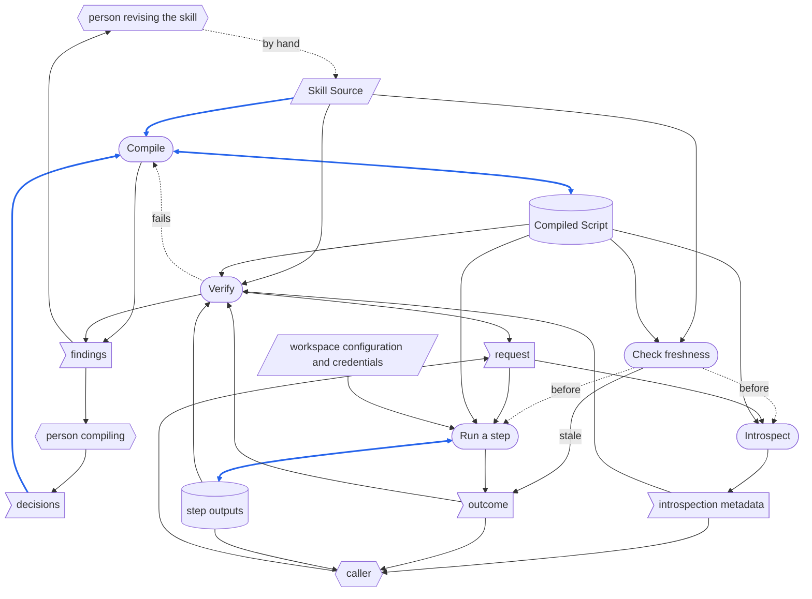
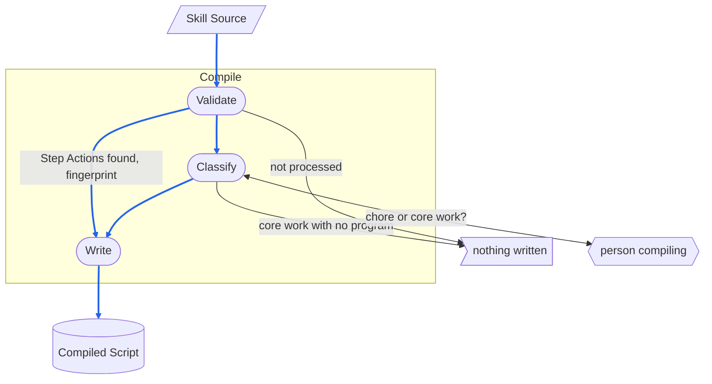
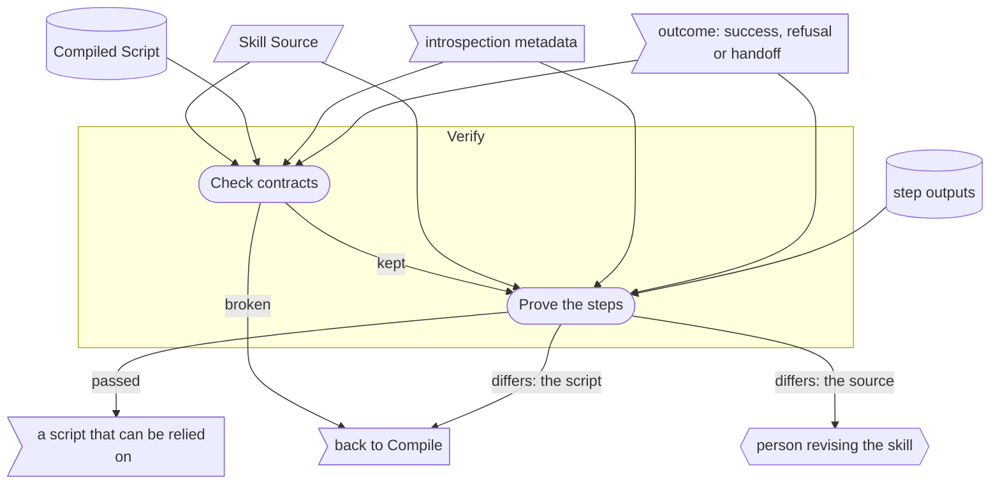

# Skill Compiler - RSDC

> [[RSDC-Standard]]  `2026-10-30`  `ac0745864e75`
> [[DFD]]  `2026-10-20`  `09fb4a7e4730`
> [[RSDC-Skill-System-tmp]]  `2026-10-20`  `50af8a37a22e`

- **System**: SkillCompiler —— skill compiler：它把一個 skill 的 workflow 編譯成 headless 的 Python script，讓程式能做的 step 不靠 LLM 就能執行，並檢查它寫出的 script。
- **Run as**: `python <program> <arguments>`
- **Authority**: 任何與本文件不一致的實作，就是要改的那一方。

# 1. Requirements — "What problem does this solve?"

本章定義 skill compiler 的目標與它要解決的痛點，絕不觸及它如何建構：
不寫技術、不寫架構、不寫檔案或程式，也不寫從某一次執行中量到的數字。
指名 skill compiler 接管的是什麼（即使那是一支程式），以及舊做法讓使用者付出什麼代價，描述的是使用者面對的問題，所以寫在這一章。

## 1.1 Target Users

- **AI automation agents** —— 閱讀 skill 的定義，並把它轉成可以自行執行之 script 的 AI agent。
- **Automation workflow users** —— 在終端機中一再執行同一個 skill 的任務、並希望每一次執行的成本越低越好的開發者與終端使用者。
- **Caller** —— 替他們執行 compiled skill、並把它的發現轉成他們讀的東西的一方：依程序工作的 AI agent，或一個人。

## 1.2 Core Vision

大幅降低重複執行自動化任務的 Token 消耗，將自然語言的 skill 描述編譯成高度 deterministic、可獨立執行的自動化腳本。
同時，實現核心執行邏輯與使用者介面的徹底解耦，打造出易於整合、擴充且具備高度防呆機制的自動化生態系。

## 1.3 Current Pain Points

現在 skill 只能透過 agent 執行：每一次執行，LLM 都重新閱讀 skill 的自然語言 step，並逐一執行，程式做得到的 step 與需要判斷的 step 都一樣。
skill compiler 在 skill 的 workflow 定型之後，接管程式做得到的 step。
它刻意不接管兩件事：需要 LLM 的 step，它交還給使用者或 agent；修正 workflow，則留在 skill 本身。

- **成本與效能耗損** —— 每次執行 skill 都依賴 LLM 重新閱讀龐大的自然語言指示，導致極高的 token 花費與緩慢的回應速度。
- **script 臃腫與耦合** —— 傳統 script 若要兼顧自動化排程與人類互動，往往在核心邏輯中混雜介面渲染與等待輸入的邏輯，導致 system 難以維護，也不利於擴充到 Web、GUI 與 TUI 等平台。
- **全自動與半自動的界線模糊** —— 傳統 script 無法處理需要 LLM 語意理解的任務，而全由 LLM 驅動的 workflow 又缺乏暫停點，使用者在需要手動確認時難以介入。
- **skill 與它的 compiled script 之間的無聲漂移** —— skill 的自然語言定義在編譯之後被修改時，沒有任何跡象顯示 compiled script 所做的事已不再是定義所說的，過時的 script 於是繼續被當成最新版本執行。

## 1.4 System Goals

- **行為等同** —— 編譯只能改變一個 workflow 的成本，不能改變其他任何事：執行 compiled script 所留下的結果，必須與透過 Agent 執行 skill 所留下的相同。
- **雙重邊界識別** —— system 必須能從兩個維度區分 step 的屬性：
  - **Execution dimension** —— 區分可以 headless 執行的 Automated 流程，與需要人類 / Agent 介入的 Interactive 流程。
  - **Cognitive dimension** —— 區分純程式邏輯的 Deterministic，與需要 LLM 處理語意判斷的 Cognitive。
- **執行與互動分離** —— system 必須讓可自動執行的任務邏輯，與人類輸入、確認、引導等互動流程保持清楚分離。
- **step 自我描述** —— system 必須能以清楚、結構化的方式描述任務 step、所需輸入與執行邊界，使外部工具或 Agent 能據此引導使用者完成 workflow。
- **可追溯的新鮮度** —— system 必須能判斷一份 compiled script 是否仍反映目前的 skill 定義，使由過時定義編譯而成的 script 絕不會被誤認為最新版本。
- **穩定後才編譯** —— skill 要等它的 workflow 穩定下來之後才編譯，因為編譯的目的，是不再為已經定型的工作支付 token。
  當 compiled script 的產出偏離預期太多時，處理方式是退回 skill 本身：修改 skill、以 skill 的方式執行，直到它再次穩定，才重新編譯出新版的腳本。
  compiled script 從來不是修正 workflow 的地方。
- **不花 token** —— 每一個可自動化的 step 都抽離成不依賴 LLM 的固定邏輯：compiled script 只依固定規則判斷，它沒有任何部分會閱讀或解讀散文，所以同樣的輸入永遠得到同樣的結果，一次呼叫也不花任何 token。
  token 只在編譯 skill 時花費，skill 的每一個版本一次。

# 2. Specification — "What are the system rules?"

本章定義 skill compiler 的資料是什麼、資料如何在它的 stage 之間移動、它的 record 如何配置與命名、它所需的每個值如何推導，以及它的輸出必須講清楚什麼。
這是讀者拿來對照檢查 skill compiler 的部分，所以這裡的每一句陳述，都必須是實際執行它就可能被推翻的。
它指名 caller 執行的程式，以及程式從 Compiled Script 中讀出的欄位，因為這些名稱就是 contract；設計的其他部分一概不指名。

## 2.1 Terminology

後面各節所依賴、卻沒有一節定義的每一個名詞，各在這裡定義一次。

- **Caller** —— 1.1 所說的 caller 在本章中的 role：執行這些程式的一方。
  它是在終端機前執行某支程式的人、背後有人操作的使用者介面、scheduler，或 Agent。
  caller 位於 system 之外：它選擇要執行哪一個 Step Action、提供該 step 的 input variable，而每一次執行的結局都回到它。
- **Person revising the skill** —— 以人手撰寫與修改 skill 之 `SKILL.md` 的一方：變更進入它的唯一途徑。
- **Person compiling** —— 要求編譯某個 skill、並決定編譯留給人決定之事的一方。
- **Step Action** —— skill 的 `SKILL.md` 中，`Workflow` 區段底下以 `Step 0`、`Step 1`、`Step 2` 等標題宣告的 step。
- **Cognitive dimension** —— step 的結果是否需要 LLM：**Deterministic**，純程式邏輯；或 **Cognitive**，需要 LLM 處理的語意判斷。
- **Execution dimension** —— step 是否需要人：**Automated**，可以 headless 執行的流程；或 **Interactive**，需要人類 / Agent 介入的流程。
- **Action type** —— 兩個 dimension 交叉而成的四種 type 之一：Deterministic Automated、Cognitive Automated、Deterministic Interactive 與 Cognitive Interactive。
  每個 Step Action 恰好有一種。
- **Input variable** —— Step Action 在一次執行中向 caller 取得的值，宣告時帶有名稱、是否 required、提示說明與 data type。
- **Handoff** —— Cognitive step 不被執行、而以之結束的結局：控制權還給使用者或 Agent，由他們透過 skill 本身執行該 step。
- **Introspection** —— compiled script 向 caller 描述它自己——它有哪些 Step Action、每一個的 Action type，以及每一個需要哪些輸入——而不執行其中任何一個。
- **Core work** —— 處理 skill 自己資料的工作，必須早已是 skill 所執行的程式。
- **Chore** —— 由共用規則或該 step 自己的文字完整規定的雜務，例如讀取設定、解析 request 或寫入 checkpoint，可由編譯直接寫進 script。

## 2.2 Artifact Types

skill compiler 處理的每一種資料：它是什麼、用來做什麼，以及它的內容必須是什麼。
一次 compile 處理一份 Skill Source，至多寫出一份 Compiled Script；一次呼叫執行一份 Compiled Script 的一個 Step Action，或描述它全部的 Step Action。
它的資料分三種：**external input**，來自 system 外部、存在時間超過任何一次執行；**record**，由 system 寫入、在寫入它的那次執行之後仍保留；以及 **one-run data**，只存在於一次執行之中，不論它從哪裡來。

**External input**

- **Skill Source** —— 位於 `skills` 目錄各子目錄下的 `SKILL.md` 檔案。
  這是本 system 唯一接受的 skill source 格式。

*Workspace configuration and credentials* —— 以下各份輸入，合稱 **workspace configuration and credentials**：compiled skill 的 step 從 script 執行時所在的環境讀取的東西。
它們位於 caller 執行 script 時的工作目錄之下，以及它的環境中。

- **Workspace configuration** —— workspace 的設定檔；step 讀取它的方式，與 skill 自己的 step 讀取它的方式相同。
- **Credentials** —— Skill Source 所讀取的每一個 credential，從它所指名的環境變數或金鑰儲存區讀取。

**Record**

- **Compiled Script** —— 由 Skill Source 轉換而成的可執行 artifact，寫成 Skill Source 所在目錄中名為 `skill.py` 的檔案——每個 caller 都在那裡找它，它也從那裡找到它必須對照檢查自己的 Skill Source。
  它是 **headless** 的：執行期間絕不停下來要求輸入，並透過明確的輸入與輸出 contract 對外提供能力。
  它還必須帶有編譯時所依據之 Skill Source 確切內容的 fingerprint，以及編譯的時間，且不必執行它就能讀取。
- **Step outputs** —— skill 自己的檔案與保存的狀態，也就是 Deterministic step 執行時寫出的那些。

**One-run data**

- **Request** —— caller 交給一次執行的東西：一個 Step Action 的 step identifier 與它的 input variable，或要求 introspection 的 request。
  一次 compile 會像 caller 那樣，自己給出它所要求之執行的 request。
- **Outcome** —— 每支程式結束時交回給 caller 的東西：它的 exit status，以及它印出的各行。
  對一次 Step Action 的執行而言，它是三者之一：成功；refusal——無法依要求執行，於是什麼都沒做；或 handoff——把 Cognitive step 留給使用者或 Agent。
  三者各以自己的 exit status 結束，而 stale script 的 refusal 也有它自己的 exit status，讓 caller 知道該重新編譯 script，而不是修改自己的 request。
  無法分辨它們的 caller，會把 refusal 或 handoff 當成成功，下一個 step 便從從未完成的工作出發。
- **Introspection metadata** —— introspection 印出的東西：Compiled Script 有哪些 Step Action、每一個的 Action type，以及每一個接受哪些 input variable。
- **Decisions** —— person compiling 在一次 compile 中的回答：對每一個工作沒有執行任何程式的 Deterministic Step Action，那部分工作是 core work 還是 chore。
- **Findings** —— 一次 compile 所回報的東西：Skill Source 為何不被處理、哪些 step 是沒有程式支撐的 core work、Compiled Script 違反的每一項 contract，以及每一個結果與其 Skill Source 所說不同的 step，並指出差異出在 script 還是來源。

## 2.3 Dataflow

資料如何在 skill compiler 的活動之間移動：有哪些 stage、每個 stage 讀取與寫入什麼、每一份資料由誰寫入、誰可以讀，以及資料本身強加了什麼順序。
一次執行屬於兩個 phase 之一：**compile phase** 把 Skill Source 變成一份可以被依賴的 Compiled Script，**call phase** 則使用那份 script，caller 要求幾次就執行幾次。
每個 phase 依序執行它自己的 stage：

- **Compile** 把 Skill Source 變成 Compiled Script。
- **Verify** 只以 caller 執行 script 的方式執行 Compiled Script——經由它的 introspection 與執行，絕不伸進它的內部——並另外讀取它的文字，藉此證明它遵守各項 contract，且做的正是它的 Skill Source 所說的事。
  正因為它只以 caller 的方式執行 script，它證明的就是 caller 實際會遇到的情況：伸進 script 內部的檢查，可能在 caller 所用的入口壞掉時照樣通過。
- **Check freshness** 依 Compiled Script 帶有的 fingerprint（2.2），判斷這份 Compiled Script 是否仍與它所編譯的 Skill Source 相符。
  它由 Compiled Script 在每一次呼叫一開始自己執行，任何 caller 都無法跳過。
- **Introspect** 在 caller 要求時執行 introspection。
- **Run a step** 依 step identifier 選出一個 Step Action 並執行它。

| Phase | Stages | Who acts | How often | Tokens |
|---|---|---|---|---|
| compile | Compile、Verify | AI automation agent | skill 的每一個版本一次 | 會花費：分類 step、寫出 script、判斷它產出的東西，都需要 LLM |
| call | Check freshness、Introspect、Run a step | caller；Check freshness 由 Compiled Script 對自己執行 | caller 每要求一次就一次 | 不花費：Cognitive step 會 handoff，而不是被執行 |

### DFD



圖例：

- **平行四邊形** —— external input：Skill Source，以及 workspace configuration and credentials。
- **旗形** —— one-run data：request 與 outcome、introspection metadata、decisions 與 findings。
- **圓柱** —— record：Compiled Script 與 step outputs。
- **圓角框** —— stage。
- **六角形** —— system 外部的 role：person revising the skill，以人手修改 Skill Source，並讀取出在它之中的 findings；person compiling，提供 decisions，並讀取一次 compile 的 findings；以及 caller，提供 request，並讀取 introspection metadata、outcome 與 step outputs。
- **雙向箭頭** —— 同一個 stage 既讀取、也寫入的資料：Compiled Script——重新編譯時會再次提出它所記錄的 decisions——以及 step outputs——step 在其中找到先前 step 留下的東西。
- **藍色實線** —— 本身被寫進 record、或被轉成 record 內容的資料：Skill Source 與 decisions，由 Compile 轉成 Compiled Script；以及 Run a step 寫出的 step outputs。
  只決定 stage 怎麼做的資料——input variable、workspace configuration——即使該 stage 會寫 record，也不是藍色；credential 永遠不是藍色，因為它從不被寫到任何地方。
- **黑色實線** —— 其他資料：不會超出所到達之 stage 或 role 的資料。
- **虛線** —— 不承載資料：表示順序，或從 system 外部做出的變更；這裡的 *by hand* 是 person revising the skill 對 Skill Source 所做的變更，*before* 是每一次呼叫一開始的 freshness 檢查，*fails* 是 Verify 送回 Compile 的 script。

### Data Read/Write Rules

圖畫不出來的資料性質——凡適用者，是否整份寫入、寫入後是否唯讀、由誰刪除：

- **external input** 不由任何 stage 寫入；讀取它們的每個 stage 都只讀不寫。
- **Skill Source** 只有在 person revising the skill 修改它時才會改變，而變更只經由 Compile 才會到達 Compiled Script：流程中沒有任何東西會把變更從 script 帶回來源。
- **Workspace configuration and credentials** 在 call phase 中，從 script 執行時所在的環境讀取，絕不由 script 存放的位置推導；credential 絕不從命令列取得，也絕不向人詢問。
  以自身位置定位 workspace 的 script，一旦同一個 skill 被多個 workspace 共用就會出錯；而放在命令列上的 credential，機器上的其他每個程序都讀得到。
- **request 與 outcome** 只存在於該次執行之中。
  兩者都不寫進任何 record：每一次執行的 outcome，都回到請求那次執行的一方——caller 或 Verify——不寫到任何地方。
  除此之外沒有東西保留它們，也就沒有東西刪除它們。
  caller 從 introspection metadata 中選定它的 request：一個 step identifier 與該 step 的 input variable，一次一個呼叫；credential 絕不在其中。
  caller 若已經知道自己要請求什麼，可以跳過 Introspect，例如只執行一道固定指令的 scheduler；但它仍只能請求 metadata 所宣告的 step 與輸入，因為其他任何請求都會在做任何工作之前被拒絕。
  沒有 metadata，caller 只能猜測 identifier 與輸入，而每一次猜錯，都換來一次被拒絕的執行。
  Verify 也以同樣的方式給出 request，但它是 compile phase 的一個 stage，而不是來自外部的 caller：它所得知的，回到編譯之中，而不是進入 skill 原本要做的工作。
- **introspection metadata** 在 call phase 中產生，交給 caller 或 Verify；它不寫到任何地方，產生它也不做任何工作。
  會做事的 introspection 無法用來「執行前先看」，因為看就已經是執行。
- **decisions 與 findings** 只存在於一次 compile 之中。
  decisions 寫進 Compiled Script，重新編譯時會把每一項再次作為預設提出；findings 則不寫到任何地方。
- **Compiled Script** 只由 Compile 寫入，而且整份寫入，並由兩個 phase 讀取。
  它絕不為了改變行為而被編輯：變更從 Skill Source 進入，只有重新編譯才會到達 script。
  手動修改過的 script，會做它的 Skill Source 沒有說的事，而下一次編譯會悄悄抹掉那次修改。
  Verify 要求的修正屬於編譯的一部分：Compile 再次寫出 script，Verify 從第一項檢查起重新檢查一次，使被依賴的 script 永遠是整份通過過的那一份。
  修正後沒有重新檢查的部分，是沒有人看過它通過的部分。
  call phase 絕不寫入它，compile phase 也不交給 call phase 任何其他 record：改動 script 的 call phase，等於在手動修改它；而交出的任何其他 record，都會在 Compiled Script 之外，成為「這個 skill 做什麼」的第二份定義。
- Compiled Script 帶有的 **fingerprint 與編譯時間**，由 Compile 依它所讀取的 Skill Source 內容寫入，未重新編譯就絕不改寫——那等於替一份沒有人對照修改後來源檢查過的程式碼背書。
  Compiled Script 在每一次呼叫一開始的 Check freshness 中自己讀取它們，不必執行任何 step；若要執行才能發現，stale 的 script 早已做完它的來源不再要求的工作。
- **step outputs** 在 call phase 中由 Run a step 寫入，寫法與 skill 的該 step 完全相同——相同的檔案、名稱、位置與結構——之後的呼叫讀取它們，與寫出它們的那次呼叫不共享任何記憶體。
  產出不同的 script 無法取代 skill：每一個讀取那些產出的東西，都得知道它們是兩者中的哪一個產出的。
  沒有任何 stage 刪除它們：它們是 skill 自己的東西，就像透過 agent 執行之後一樣。
  compile phase 唯一會讀取的 step outputs，是 Verify 自己所請求之執行的產出，而 Verify 只用不改變任何共享事物的輸入，請求執行 Deterministic step。
  會改變共享狀態的 step 不執行，並回報為未執行及其原因：它是這次驗證沒有證明的 step，而不是通過的 step。

### Order Imposed by the Data

- **Compile 先於 Verify** —— 在 Compile 寫出 Compiled Script 之前，沒有東西可以驗證；而尚未通過 Verify 的 script 還沒有編譯完成，任何東西都不依賴它。
- **Check freshness 先於 Introspect 與 Run a step** —— 每一次呼叫都先檢查 Compiled Script 帶有的 fingerprint，所以無論 caller 是誰，stale 的 script 都會拒絕，而不是被執行；Verify 發現 script 為 stale 時就不再往下做，而是重新編譯它，不驗證它。
  Introspect 只需要 Compiled Script，caller 何時要求就何時進行。
- **Run a step 依 Skill Source 的順序** —— 彼此相依的 step 依 Skill Source 的順序執行，因為一個 step 只能從先前 step 保存下來的東西、或它們讀過的檔案中，找到先前 step 的產出——與 skill 自己單獨執行某一步時的找法相同。
  依賴前一次呼叫留在記憶體中之狀態的 step，只有在所有 step 於同一個程序中依序執行時才能運作——而一次只呼叫一個 step 的使用者介面或 scheduler 從來不會這樣做。
- 沒有任何 stage 讀取後面 stage 寫入的東西。
  Verify 所請求的每一次執行，都是一次獨立的呼叫，Verify 要等那次呼叫結束，才讀取它交回的東西。

### Exception Paths

- **什麼都不寫入就結束** —— Skill Source 屬於不處理的情況時，一次 compile 什麼都不寫：它的路徑不是 `skills/*/SKILL.md`、它沒有 `Workflow` 區段或其中沒有 `Step N` 標題，或兩個 Step Action 共用同一個 identifier。
  此時 Compile 停止，其他 stage 也就沒有東西可讀：半成品 script 看起來像已編譯，實際上卻是在猜測來源的意思。
  findings 列出每一項理由，就像 Source Scanner 的 `INVALID` verdict 以 exit status `2` 印出的那樣。
  person compiling 判定某個 Deterministic step 的部分工作是沒有程式支撐的 core work 時，一次 compile 也什麼都不寫：它列出那些 step 後結束，每一個都附上它需要程式來做的事。
  一次呼叫除非成功，否則什麼都不寫：Run a step 的每次呼叫，恰好以下列其中一種 outcome 結束，而只有第一種會寫入東西：
  - Deterministic step 的產出，exit status 為 `0`；
  - stale script 在做任何工作之前的 refusal，exit status 為 `4`，標準輸出什麼都沒有；
  - 在做任何工作之前的 refusal，並指名缺少的輸入，exit status 為 `2`；
  - Cognitive step 的 handoff，把控制權還給使用者或 Agent，由他們透過 skill 本身執行該 step，exit status 為 `3`；
  - 對不對應任何 Step Action 之 identifier 的 refusal，exit status 為 `2`。
- **中途停止** —— Verify 的一項發現，會讓 compile 停在兩個去處之一。
  script 違反某項 contract，或某個 step 產出了它的 Skill Source 沒有說的東西時，缺陷在 script：它回到 Compile，再次被寫出，並從頭重新驗證。
  差異出在 Skill Source 本身時——某個 step 沒有說明它產出什麼，或說得含糊——沒有任何 script 會是對的，因為沒有東西可以忠實於它：skill 還不穩定，這項發現離開 compile phase，交給 person revising the skill，之後以重新編譯的形式回來。
  為了填補來源的缺口而修補出來的 script，會做來源從未說過的事，這正是本流程所禁止的手動修改。
  無論哪一種，Compile 最後寫出的 Compiled Script 都留在它被寫出的地方，沒有任何東西依賴它；findings 說明哪些 step 通過、哪些沒有執行及原因，以及哪些不同。
- **從中途重新進入** —— 重新編譯是回到 compile phase 的唯一途徑，而且一定經過 person revising the skill。
  它的起因是 Check freshness 發現 script 為 stale、Verify 發現來源有缺口，或是 script 的產出偏離預期太多：skill 先被修改、以 skill 的方式執行直到穩定，再重新編譯，而 Compile 會像第一次一樣，整份寫出 Compiled Script。
  在 call phase 中，Run a step 可以單獨執行任何一個 Step Action，作為一次獨立的呼叫：它只從先前 step 的 step outputs 中找到它們留下的東西，並以上述的某一種 outcome 結束。

## 2.4 Naming and Data Structures

skill compiler 寫出或讀取的資料如何命名與配置。

- **Skill Source** —— `SKILL.md`，直接位於 skill 自己的目錄中，該目錄的上層目錄名為 `skills`。
- **Compiled Script** —— `skill.py`，在它的 Skill Source 旁邊，同一個目錄中。
- **Introspection metadata** —— 一份 JSON 文件，單獨印在標準輸出上。

兩個檔案並排放在一起：

```text
skills/
`-- target_skill/
    |-- SKILL.md       (Skill Source: read when compiling, and by every freshness check)
    `-- skill.py       (Compiled Script: pure CLI script, no built-in UI, supports introspection and multidimensional step execution)
```

編譯與檢查 skill 的程式存放在哪裡，不屬於這個配置：system 只要求它們能讀取 `skills/*/SKILL.md`，並在它旁邊寫出 `skill.py`。
路徑形狀不同的 `SKILL.md` 不被處理：這個形狀就是區分 Skill Source 與其他每一份 Markdown 檔案的依據。
每個 step 必須具備唯一的 identifier。
支援階層與英數組合的 identifier，例如 `1`、`2`、`3`、`1.1`、`1.2`、`2.a`、`2.b`。
**system 執行時一律強制透過 identifier 進行路由呼叫。**

Compiled Script 的欄位，程式解析它的文字就能讀取，不必 import 或執行它：

| Field | Meaning |
|---|---|
| `SOURCE_SHA256` | 它編譯時所依據之 Skill Source 內容的 fingerprint：一個 module 層級的常數，以單純的字串常值賦值 |
| `COMPILED_AT` | 它編譯的日期與時間：一個 module 層級的常數，以單純的字串常值賦值 |
| module docstring | 以 Skill Source 的 `description` 開頭，接著列出每個 Step Action 及其 identifier 與 type、執行其中一個的指令，並對每個在 Skill Source 中工作沒有執行程式的 Deterministic step，記錄人判定它為 chore |

重新編譯時會讀回這些 decisions，並各自作為預設選項再次提出，讓未改變的 step 不必被問兩次。

introspection metadata 採用以下形式：

```json
{
  "skill_name": "example_skill",
  "steps": [
    {
      "id": "1.1",
      "name": "Fetch raw data",
      "type": "deterministic_automated",
      "description": "Run a local Python web crawler to fetch data",
      "arguments": []
    },
    {
      "id": "1.2",
      "name": "Analyze article sentiment",
      "type": "cognitive_automated",
      "description": "Call an LLM to classify text sentiment; this system only provides a handoff prompt",
      "arguments": []
    },
    {
      "id": "1.3",
      "name": "Set export path",
      "type": "deterministic_interactive",
      "description": "Requires the user to specify a local backup directory",
      "arguments": [
        {
          "name": "output_path",
          "required": true,
          "type": "path",
          "description": "Target path for export"
        }
      ]
    },
    {
      "id": "2.0",
      "name": "Human creative review",
      "type": "cognitive_interactive",
      "description": "A human and AI jointly review revision suggestions; this system only provides a handoff prompt",
      "arguments": []
    }
  ]
}
```

introspection metadata 的欄位：

| Field | Meaning |
|---|---|
| `skill_name` | `SKILL.md` frontmatter 中的 `name`，frontmatter 沒有時則為 skill 的目錄名稱 |
| `steps` | Skill Source 的每一個 Step Action，依來源順序，不多也不少：也就是 `--step` 所接受的 identifier |
| `steps[].id` | step identifier |
| `steps[].name` | step 的人類可讀名稱 |
| `steps[].type` | step 的 Action type |
| `steps[].description` | step 的人類可讀說明 |
| `steps[].arguments` | step 接受的每一個 input variable |
| `arguments[].name` | input variable 的名稱 |
| `arguments[].required` | 它是否為 required |
| `arguments[].type` | 它的 data type |
| `arguments[].description` | 它的提示說明 |

caller 讀的是這些名稱，而不是它們的意思：拼法不同的 type，是沒有任何 caller 認得的 type。

存放代碼標籤的欄位，以及每個欄位可能存放的每一個代碼標籤：

| Field | Values |
|---|---|
| `steps[].type` | `deterministic_automated`、`cognitive_automated`、`deterministic_interactive`、`cognitive_interactive` |
| `arguments[].type` | `string`、`integer`、`number`、`boolean`、`path` |

`SOURCE_SHA256` 存放 64 個小寫十六進位數字，`COMPILED_AT` 則是含 UTC 位移的 ISO 8601 日期時間。

## 2.5 Derivation Rules

skill compiler 並非直接觀察而來的每個值如何推導。

### Step Identifier

- Step Action 的 identifier，就是其 `Step N` 標題去掉前導零的編號。
- 指示混合了多種 Action type 的 step，依來源順序拆成 `N.1`、`N.2`、…，每一個恰好一種 type，拆分後就不再以整體被指定；其他每個 step 都保留 `N`。
- 兩個標題使用同一個編號，會使 Skill Source 不合法。
  否則一個 identifier 會指向兩個不同的 step，而一次呼叫會執行 script 碰巧留下的那一個。

### Action Type

每個 Step Action 依 Cognitive dimension 與 Execution dimension 的正交交叉，嚴格歸入四種 Action type 之一：

| Cognitive \ Execution | Automated (headless automatic execution) | Interactive (interactive prompt intervention) |
| :---- | :---- | :---- |
| **Deterministic (純程式邏輯)** | **1. Deterministic Automated** - *特徵*：本機純邏輯、無 token 消耗、由本 system 一鍵靜默完成。 | **3. Deterministic Interactive** - *特徵*：本機純邏輯、無 token 消耗、需人類於本 system 輸入本地參數後執行。 |
| **Cognitive (LLM 依賴)** | **2. Cognitive Automated** - *特徵*：需 LLM 處理自動化任務。**本 system 不處理**，視為 handoff 中斷點。 | **4. Cognitive Interactive** - *特徵*：需 LLM 與人類高度互動引導。**本 system 不處理**，視為 handoff 中斷點。 |

每個 Step Action 依下列準則放進矩陣：

- **Cognitive dimension——依 step 的結果需要什麼來判斷，而不是看它的指示怎麼寫。**
  讀取、解析、計算、渲染，或呼叫程式也能呼叫的服務，屬於 Deterministic。
  透過只有 Agent 能使用的介面所做的呼叫，若同一個呼叫不靠 LLM 也做得到——透過該服務自己的介面、既有的輔助程式或函式庫——就是 Deterministic；只有在沒有這種途徑時才是 Cognitive。
  若改以措辭判斷，聽起來像在分析的 step 會白白成為 handoff，聽起來像機械操作的 step 則會被編譯成猜測。
- **Execution dimension——依 step 的輸入來判斷。**
  需要從人取得某個值的 step——隨 request 一併提供，或向人詢問——屬於 Interactive，而每一個這樣的值都是它的一個 input variable，並帶有它所接受之值的種類；若 Skill Source 沒有給它預設值，則為 required。
  不需要任何它無法自行讀到之物的 step，屬於 Automated。
  step 需要、卻沒有對應 input variable 的值，除了猜測之外別無來源。
- **type 與輸入一致。**
  Deterministic Automated step 不要求任何 input variable，Deterministic Interactive step 至少宣告一個。
  否則一個信任 type、對 Automated step 什麼都不提供的 caller，根本無法執行它。
- **step 所執行的程式只被呼叫，絕不被重寫。**
  Skill Source 中執行某支程式的 Deterministic Step Action，會被編譯成呼叫同一支程式。
  重寫的版本可能在沒有人執行過的地方與原程式不同，而且之後原程式每改一次，兩者就分歧得更遠。

### Core Work or Chore

- Deterministic Step Action 有一部分工作沒有執行任何程式時，由 person compiling 逐一決定那部分工作是 core work 還是 chore；Compile 絕不自行決定這件事。
- 先前一次 compile 記錄在 Compiled Script 中的回答，會作為預設提出，但絕不代替那個人回答：沒有得到回答的問題，會讓這次 compile 停止。
- Core work 若沒有程式支撐，會讓編譯停止、什麼都不寫，並交回給 person revising the skill：先寫成 skill 所執行的程式，以 skill 的方式執行直到穩定。
  若改由 Compile 寫出，那就是 skill 從未執行過的行為。

### Source Fingerprint

- Skill Source 的 fingerprint，是它的文字以 UTF-8 解碼、移除任何 byte-order mark、把每個換行統一為 LF，再以 UTF-8 編碼後的 SHA-256 小寫十六進位摘要：它描述的是文字而不是位元組，所以一份未修改之 `SKILL.md` 的 CRLF checkout，不會被誤認為已修改。
- 它取自被分類的同一份內容，使 script 記錄的恰好就是它所編譯的來源；若取自之後的另一次讀取，它擔保的會是一份從未被編譯過的來源。
- fingerprint 缺失、或與目前 Skill Source 的 fingerprint 不同的 Compiled Script 即為 **stale**，必須重新編譯。
  Compiled Script 在做任何事之前會自己檢查這一點：stale 的 script 拒絕每一次呼叫，任何 caller 都不會誤用它。

## 2.6 Presentation Contract

skill compiler 呈現的是資料，不是報告：透過 introspection metadata 呈現的 Compiled Script，以及每支程式的 outcome。
把它們轉成使用者讀的東西的人，決定其形式與文字；以下是資料本身必須講清楚的事，讓任何忠實的呈現都不會誤導。

**introspection metadata 講清楚的事**

- **每一個 Step Action，依來源順序，不多也不少。**
  metadata 中缺少的 step 永遠無法提供給任何人，而 Skill Source 沒有的 step，則是沒有人寫下過的行為。
- **每個 step 的名稱與說明。**
  只以 identifier 呈現的 step，人無從得知它做什麼，也就無法選擇它。
- **每個 step 屬於四種 Action type 中的哪一種。**
  沒有被告知 step 之 type 的 caller，無法分辨哪些 step 可以無人值守地執行：它會去執行 Cognitive step，結果只拿到 handoff；或沒有先收集輸入就執行 Interactive step，結果只拿到 refusal。
- **每一個 input variable，以及它是否 required、它的提示說明與它的 data type。**
  沒有被告知 variable 之 data type 的 caller，只能為它提供一個自由輸入的文字框，而種類錯誤的值要到 step 執行時才會被發現。

**outcome 講清楚的事**

- **一次執行以成功、refusal、handoff 或 stale refusal 中的哪一個結束，單看 exit status 就知道。**
  不是從執行本身、而是從其他東西（例如是否出現了 step outputs）推斷出來的 outcome，無法分辨 refusal 與 handoff。
- **refusal 針對的是什麼。**
  refusal 指名哪裡不對——缺少的輸入、種類錯誤的值，或不對應任何 step 的 identifier——讓 caller 能修正它的 request；stale refusal 在標準輸出什麼都不印，並在標準錯誤輸出說明 script 必須重新編譯，因為沒有任何 request 能修正它。
- **被 handoff 的 step 該由誰來做。**
  handoff 訊息說明該 step 是 cognitive 任務，必須由使用者或 Agent 為它另外呼叫 skill。

**每一種呈現都要回答的問題**

1. *沒有東西可報告時，record 與 outcome 寫什麼？
   被略過的數量在哪裡回報？*
   沒有任何 Step Action 的 Skill Source 不被處理，findings 會說明這一點，也不會寫出 Compiled Script。
   沒有事可做的 step 會成功，產出的是 skill 自己的 step 在這種情況下寫出的東西。
   Verify 沒有證明的東西不會被悄悄略過：它沒有執行的每一個 step，都以「未執行」連同原因列在 findings 中，Contract Checker 也會印出它的檢查有幾項失敗。
2. *caller 能自行啟動哪些程式？
   不能的，為什麼？*
   三支都可以：Compiled Script、Source Scanner 與 Contract Checker 都從命令列執行。
   Compile，以及 Verify 中證明各 step 的那一部分，都不是程式：它們需要 AI automation agent 的判斷，在有人要求編譯某個 skill 時才開始。
3. *每一次讀取，都在 caller 的環境中實際觀察到成功過嗎？*
   不是每一次都有。
   Contract Checker 只在 workspace 之外一個空的地方執行 script，那裡找不到任何 workspace configuration；只有 Verify 從 workspace 中請求的執行，才會觀察到 Deterministic step 在那裡所做的讀取，而且只限於它執行的 step。
   它沒有執行的 step，會回報為未執行。
4. *資料若在 system 之外也取得得到，system 交得出那個位址嗎？*
   Compiled Script 可以：2.4 把它的位置固定在 Skill Source 旁邊，而一次 compile 最後會指名它的路徑。
   step outputs 是 skill 自己的檔案，位於它的 step 寫入它們的地方；system 不為它們交出自己的位址。
5. *範圍收窄之後，record 裡的計數與後續動作的作用範圍一致嗎？*
   沒有可收窄的計數：一次呼叫執行一個 Step Action，而 introspection metadata 無論 caller 要求什麼，永遠列出每一個 Step Action。
6. *批次的上限是什麼？
   超出時如何拒絕，會不會留下做到一半的 record？*
   沒有批次：一次呼叫執行一個 Step Action，一次 compile 處理一份 Skill Source。
   Compile 整份寫出 Compiled Script，refusal 與 handoff 什麼都不寫。
   中途失敗的 step 會不會留下寫到一半的 step outputs，由 skill 自己的 step 決定，script 照原樣保留這一點。
7. *被拒絕的 caller 下一步該做什麼？*
   收到 refusal（`2`）之後，修正它所指名的東西——補上缺少的輸入、給出種類正確的值，或使用 introspection metadata 宣告的 identifier——再執行一次該 step。
   收到 stale refusal（`4`）之後，讓 script 重新編譯，絕不自己把 fingerprint 寫進去。
   收到 handoff（`3`）之後，透過 skill 本身執行該 step。
8. *輸出預設觸及到哪裡，範圍擴大時誰會知道？*
   不會超出 skill 自己的 step 所及之處：step 在由工作目錄找到的 workspace 中，寫出相同位置的相同檔案。
   Source Scanner 與 Contract Checker 不寫入任何在它們結束後仍留存的東西，而 Contract Checker 只在 workspace 之外的暫存地點執行 script。
   除了修改 Skill Source 之外，沒有任何東西會擴大它的範圍，而修改 Skill Source 會讓 script 成為 stale，直到重新編譯為止。

## 2.7 CLI

每支程式都是 Python script，由 caller 以 `python <program> <arguments>` 執行。
命令列是 caller 接觸 system 的唯一途徑：它傳入參數，讀回 exit status、印出的各行與寫出的 record，絕不 import 程式來呼叫它的函式。

程式能做的工作，由三支程式完成：call phase 中的 Compiled Script，以及 compile phase 中的 Source Scanner 與 Contract Checker。
2.2 的 request 以 Compiled Script 的參數傳入：step identifier 以 `--step` 傳入，每個 input variable 以一個以它命名的選項傳入，introspection 的 request 則以 `--export-schema` 傳入。
Source Scanner 與 Contract Checker 讀取的每一個位置也都以參數傳入，兩者都不假設自己身在何處。
從自己所在之處去找輸入的程式，一旦放到別處就會停擺。
Compiled Script 是唯一的例外，而且只限於它的 Skill Source：它在自己旁邊找 Skill Source，因為它就是在那裡被編譯的；workspace 則從工作目錄找到。

下列兩條規則對三支程式都成立：

- **程式的名稱屬於它的 contract。**
  為了執行某支程式而寫的程序，是依名稱找到它的；改了名的程式，會讓每一個這樣的程序無聲無息地失效。
- **每一個 exit status 只代表一種發現**，所以執行程式的一方只看 status 就能採取行動。
  若格式錯誤的命令與不合法的來源共用同一個代碼，打錯的路徑就會被回報成 skill 的缺陷；若 stale 的 script 與檢查失敗共用同一個代碼，它就會被手動修正，而不是重新編譯。

caller 使用 Compiled Script 的方式有兩種：執行一個 step，或先詢問有什麼可以執行——也就是 Run a step 與 Introspect（2.3）。
使用者介面依 introspection 建立 step 列表與輸入表單，scheduler 或 Agent 藉它得知哪些 step 可以無人值守地執行、哪些必須 handoff，而在終端前的人可以先讀它、或讀 script 自己的說明，再選擇要執行哪個 step。

compile phase 中有兩項判斷是精確的檢驗，各由一支程式做出，而不是靠閱讀：一份 Skill Source 是否會被處理，以及一份 Compiled Script 是否遵守它的 contract。
閱讀會放過差一點就合格的對象——差一個字元的 step 標題，或在 metadata 前面多印了一行、或在等待回答的 script，讀起來跟沒有這麼做的一模一樣——只有程式分辨得出來，後者還必須實際執行 script。
兩支程式都從命令列執行，不寫入任何在它結束後仍留存的東西，也絕不改變 skill 的目錄：改變了被檢查對象的檢查，擔保的會是一個已經不存在的東西。

- **Compiled Script**，程式 `skill.py` —— Check freshness、Introspect 與 Run a step 的計算：一次執行一個 Step Action，或描述全部的 Step Action。
  - **Invocation** —— `python skill.py --step <id> [--<name> <value> ...]` 執行 identifier 為 `<id>` 的那一個 Step Action（2.5），它的每個 input variable 都以一個以該 variable 命名的選項傳入；`python skill.py --export-schema` 是 introspection，不執行任何業務邏輯。
    introspection 選項是專屬的，並且不出現在 script 的說明中：說明是寫給人看的純文字，會隨著人而改變。
  - **Standard output** —— introspection 時，以一份 JSON 文件輸出 introspection metadata，此外什麼都沒有（2.4）——前面多一行 log，就會破壞每一個 caller 的 JSON 解析器。
    handoff 時，印出訊息 `This step is a cognitive task and cannot be processed by this system. Please have the user or Agent invoke the corresponding Skill separately.`
  - **Exit status** —— `0` 成功；`2` refusal，在做任何工作之前，並指名哪裡不對——缺少 required 輸入、值的種類錯誤，或 identifier 不對應任何 step；`3` handoff，來自 Cognitive step，在它印出 handoff 訊息之後；`4` stale（2.5），由 Check freshness（2.3）在任何一次呼叫（包括 introspection）中結束，且標準輸出什麼都沒有。
  - **Refuses** —— stale script 的每一次呼叫，以 `4`；缺少 required 輸入、值的種類錯誤，以及不對應任何 Step Action 的 identifier，各以 `2`。
- **Source Scanner**，程式 `scan_source.py` —— Compile 計算的第一部分：判定一份 Skill Source 是否會被處理（2.3、2.4），並列出編譯所依據的內容。
  - **Invocation** —— `python scan_source.py --file <path>`，其中 `--file` 指名要判定的 `SKILL.md`；required。
  - **Standard output** —— 路徑是否具有 2.4 所接受的形狀；skill 的名稱；其內容的 fingerprint（2.5）；**step inventory**——每個 Step Action 的 identifier、標題與行範圍，以及它所執行的程式，每一支都標明是否在 skill 的目錄中；不影響來源有效性的警告；以及 verdict `valid` 或 `INVALID`，判定為 INVALID 時附上每一項理由。
  - **Exit status** —— `0` valid；`2` INVALID——不得從這份來源編譯出任何東西；`64` 沒有 verdict——命令格式錯誤，或檔案不存在、無法讀取。
  - **Refuses** —— 格式錯誤的命令，以及不存在或無法讀取的檔案，各以 `64`。
- **Contract Checker**，程式 `check_compiled.py` —— Verify 計算的第一部分：依本文件為 Compiled Script 規定的各項 contract 檢查它，只以 caller 的方式使用它，並讀取它的文字。
  - **Invocation** —— `python check_compiled.py --source <path> --script <path> [--timeout <seconds>]`，其中 `--source` 指名 Skill Source，`--script` 指名由它編譯出的 Compiled Script，兩者皆為 required；`--timeout` 是 script 的一次執行可以花多久，超過即視為在等待回答，選用，預設 60。
  - **Standard output** —— 每一項檢查一行，標明通過或失敗，並附上它的發現；script 的 introspection 所宣告的 Step Action；以及失敗的檢查有幾項。
  - **Exit status** —— `0` 每一項檢查都通過；`1` 至少一項檢查失敗；`2` Skill Source 為 INVALID，其他都沒有檢查；`4` Compiled Script 為 stale（2.5），其他都沒有檢查；`64` 沒有 verdict——命令格式錯誤，或它所指名的檔案不存在、無法讀取。
  - **Refuses** —— 格式錯誤的命令，以及它所指名、但不存在或無法讀取的檔案，各以 `64`。

## 2.8 Invariants

在每一個 stage 都成立、沒有例外的規則：

- **沒有任何程式等待人。**
  因為 script 是 headless 的，即使呼叫它的是人，也不會被詢問任何事：缺少的輸入是一個指名它的 refusal，由人補上後再執行一次。
  會等待回答的 script，會讓 scheduler 永遠停在那裡，因為那裡沒有人可以回答。
- **程式中不用 LLM。**
  system 的每一支程式都只依固定規則判斷：同樣的輸入得到同樣的結果，一次呼叫不花任何 token。
  Compiled Script 的 Cognitive step 不含任何 LLM 呼叫：它以 handoff 結束。
  只有 Compile 與 Verify 會花 token，skill 的每一個版本一次；需要 LLM 的程式，所做的判斷沒有人能重現。
- **Cognitive step 絕不以 deterministic 邏輯近似。**
  猜測會執行、回報成功，而且是錯的，下游沒有任何東西能把它和正確的結果區分開來；handoff 則明白說出該由誰來做這件事。
- **未知的 identifier 一律拒絕。**
  指名一個不對應任何 Step Action 之 identifier 的呼叫，會被拒絕，絕不會被忽略。
  被忽略的呼叫，等於替從未執行的工作回報成功。

1.4 的目標，以及承載它們的規則：

| Goal | Carried by |
|---|---|
| 行為等同 | 2.3，Run a step 寫出 step outputs 的方式與 skill 的該 step 完全相同，而 Verify 對照來源證明每一個 Deterministic step；2.5 Action Type，step 所執行的程式只被呼叫，絕不被重寫 |
| 雙重邊界識別 | 2.1，兩個 dimension；2.5 Action Type，把每一個 Step Action 歸入四種 Action type 之一 |
| 執行與互動分離 | 2.5 Action Type，step 從人取得的每一個值都是它的 input variable；上面的「沒有任何程式等待人」 |
| step 自我描述 | 2.4，introspection metadata 的欄位；2.6，metadata 講清楚的事 |
| 可追溯的新鮮度 | 2.5 Source Fingerprint；2.3，每一次呼叫都最先進行 Check freshness |
| 穩定後才編譯 | 2.3，重新編譯是回到 compile phase 的唯一途徑，而且經過 person revising the skill |
| 不花 token | 2.7，call phase 的每一個 stage 都由 Compiled Script 計算；上面的「程式中不用 LLM」 |

# 3. Design — "How is the system structured?"

本章描述執行 2.3 各 stage 的 component，以及各自如何完成工作。
本章沒有 Directory Structure：Source Scanner 與 Contract Checker 放在哪裡，由執行它們的一方決定，而且每一個位置都以參數傳給它們；唯一要緊的擺放方式——Compiled Script 在它的 Skill Source 旁邊——是一項 contract，已由 2.4 固定。
本章也沒有 Presentation Form：沒有人使用 system 自己的控制項——命令列與它交回的東西已由 2.7 固定——而讀者看到的形式，如 2.6 所說，由呈現資料的一方決定。

## 3.1 Core Component Responsibilities

每個 component 一條——2.7 指名的每一個，以及 system 之外沒有任何東西呼叫的每一個——寫出它唯一的工作與它的邊界：跨越邊界的一次修改，就是對兩個 component 的修改。
2.3 的每一個 stage 都由其中一個執行；沒有任何 component 執行的 stage，是沒有人實作的活動。

- **Compiler** —— 1.1 中執行編譯的 AI automation agent，而本文件就是它編譯所需的全部：無論它依循哪一套程序，都依照這裡陳述的規則，建出 Compiled Script 以及下列的程式。
  在 Dataflow 中，它執行 Compile，以及 Verify 中需要判斷的那一部分：挑選可以安全執行的輸入，並閱讀跑回來的結果。
  它唯一的工作：把 Skill Source 變成一份遵守第 2 章每一條規則的 Compiled Script，並判斷 script 的執行產出了什麼。
  它的邊界：它絕不編輯 Skill Source，絕不自行決定某項工作是 core work 還是 chore，並把程式能決定的事——來源是否會被處理、script 是否遵守它的 contract——留給 Source Scanner 與 Contract Checker。
- **Source Scanner** —— 2.7 中判定 Skill Source 的程式。
  它執行 Compile 的第一部分 Validate。
  它唯一的工作：判定一份 Skill Source 是否會被處理，並列出 Step Action、每一個所執行的程式，以及編譯所依據的 fingerprint。
  它的邊界：它什麼都不改變，而 step 如何分類，是 Compiler 的事。
- **Contract Checker** —— 2.7 中檢查 Compiled Script 的程式。
  它執行 Verify 的第一部分 Check contracts。
  它唯一的工作：程式能對 Compiled Script 做的每一項檢查，方法是只以 caller 的方式執行 script，並讀取它的文字。
  它的邊界：它不執行任何 Deterministic step 的實際工作——證明各 step 是 Compiler 的事——也不改變 skill 的目錄或 workspace。
- **Compiled Script** —— 2.7 中的程式，每個被編譯的 skill 一份，由 Compiler 寫出；它的各部分如下：
  - **Action Logic Builders** —— `skill.py` 內的函式，每個 Step Action 一個。
    在 Dataflow 中，它們執行 Run a step。
    它們唯一的工作：各負責一個 Step Action——呼叫 skill 的該 step 所執行的程式、做人判定為 chore 的工作，或把 Cognitive step handoff 出去。
    它們的邊界：builder 絕不呼叫另一個 step 的 builder，也不為之後的呼叫在記憶體中保留任何東西。
  - **Schema Exporter** —— `skill.py` 中以 schema JSON 回應 introspection 的部分。
    在 Dataflow 中，它執行 Introspect。
    它唯一的工作：印出 introspection metadata。
    它的邊界：它不執行任何 Step Action。
  - **Source Fingerprint** —— `skill.py` 所記錄、關於它所編譯之 Skill Source 的兩個值——fingerprint 與編譯時間——以及在每一次呼叫一開始，將該 fingerprint 與 script 旁邊的 Skill Source 比對的那項檢查。
    在 Dataflow 中，那項檢查就是 Check freshness。
    它唯一的工作：拒絕 stale script 的每一次呼叫。
    它的邊界：它絕不改寫它所保存的值，那些值只由 Compile 寫入。

它們如何互動：Compiler 從命令列執行 Source Scanner 與 Contract Checker，並讀取它們印出的內容，而它只以 caller 的方式執行 Compiled Script；Contract Checker 以它所載入的 Source Scanner 自己的程序判定 Skill Source，使兩者對一份來源或它的 fingerprint 永遠不會有不同的看法；而在 `skill.py` 中，Source Fingerprint 在每一次呼叫中最先執行，先於 Schema Exporter 或任何 Action Logic Builder。

## 3.2 Execution Flow

3.1 的每一個 component 在運行時如何完成工作：它的 step 依序寫出，用程式碼裡的名稱，包括 component 自己選擇、而非資料強制的分支、重試、平行處理與順序。
需要畫圖時，以 DFD 的記法繪製。
這裡引用第 2 章的規則，絕不重述。
Source Scanner 與 Contract Checker 執行期間都不詢問任何事，而且各自只依據自己的發現決定 exit status。

### Compiler

Compiler 依序執行 Compile 與 Verify，兩者都展開畫在下面，它的 step 用本節的名稱稱呼。

#### Inside Compile

把 Compile 展開：它依序做什麼。



| Inside Compile | Reads | Passes on |
|---|---|---|
| Validate | Skill Source：它所在的位置、它的 `Workflow` 區段與 `Step N` 標題 | 找到的 Step Action、每一個所執行的程式以及它是否在 skill 的目錄中，以及所讀內容的 fingerprint——或使編譯停止的發現 |
| Classify | 每個 Step Action 的指示，依 2.5 的準則；每一個所執行的程式；人對每個沒有執行程式之 Deterministic step 的決定 | 每個 step identifier，以及它的 Action type、input variable 與它所呼叫的程式——以及對每個工作沒有執行程式的 Deterministic step，人的決定：chore 或 core work |
| Write | Validate 與 Classify 傳下來的東西 | 整份 Compiled Script |

**Compile 內部的順序。**
Validate 最先，使不處理的來源不會被分類，也不會被寫出任何東西。
Classify 在 Write 之前，因為腳本的結構取決於 type。
Write 記錄的 fingerprint，就是 Validate 從它所讀內容取得的那一個，如 2.5 所要求。
工作沒有執行程式的 Deterministic step，會在 Classify 與 Write 之間交給人決定，而沒有程式支撐的 core work 會讓編譯就此停止：一旦 Write 執行過，裝著 skill 從未執行過之行為的 script 就已經存在了。

#### Inside Verify

把 Verify 展開：它依序做什麼。



圖例：

- **六角形** —— person revising the skill，位於 system 之外。
- **指向六角形的箭頭** —— 出在來源的發現交到那裡，而不是送回 Compile。

| Inside Verify | Reads | Passes on |
|---|---|---|
| Check contracts | Compiled Script 本身的文字（不必執行就能讀取）；它的 introspection metadata，對照 Skill Source 的 Step Action；腳本單獨執行時的 outcome——在 workspace 之外一個空的地方、不給任何輸入——包括每一個 Cognitive step、每一個缺少輸入的 Interactive step，以及一個不對應任何 step 的 identifier；以及一份 Skill Source 已被修改之腳本副本的 outcome | 腳本違反的每一項 contract，或沒有 |
| Prove the steps | 每一個 Deterministic step：依來源順序、從 workspace 中、以各自獨立的呼叫、用不改變任何共享事物的輸入各執行一次；它的 outcome 與產出；它在 Skill Source 中的 step 說它產出什麼 | 每個 step 的結果：通過、未執行及原因，或一處差異——以及差異出在腳本還是來源 |

**Verify 內部的順序。**
Check contracts 最先，而且不實際執行任何東西：違反 contract 的腳本一旦在 workspace 中執行，什麼事都可能做——等待一個永遠不會來的回答，或寫到不該寫的地方——所以它要先遵守 contract，才會被證明。
Prove the steps 以各自獨立的呼叫執行每一個 step，就像 caller 那樣，使依賴另一次呼叫留在記憶體中之狀態的 step 在這裡就失敗，而不是到使用時才失敗。
會改變共享狀態的 step 不執行，如 2.3 所說。

### Source Scanner

1. 它把檔案當成文字讀取一次，並由同一份文字計算 fingerprint，使 fingerprint 描述的恰好就是被判定的內容。
2. 它檢查路徑的形狀：名為 `SKILL.md` 的檔案，位於一個上層目錄名為 `skills` 的目錄中。
3. 若有 frontmatter，它從中讀取 skill 的名稱；無法解析的 frontmatter 會被回報。
4. 它找出 fenced block 之外的每一個標題，把第一個文字為 `Workflow` 的標題（任何層級）當作 Workflow 區段，區段在下一個同層級或更高層級的標題處結束。
5. 在該區段中，每一個形如 `Step N` 的標題——一個數字，其後是標題結尾、一個空格，或標題前的破折號或冒號——就是一個 Step Action。
   它的 identifier 是去掉前導零的那個數字，範圍延伸到下一個同層級或更高層級的標題。
   只是開頭像 step 的標題，例如 `Step 1.5` 或 `Step 2a`，是警告，不是 Step Action。
6. 它為每個 Step Action 收集該 step 所執行的程式：step 的 inline code 或 fenced block 中，每一個帶有程式副檔名——`.py`、`.js`、`.mjs`、`.cjs`、`.ts`、`.sh`、`.ps1`、`.cmd` 或 `.bat`——的檔名，依首次出現的順序。
   skill 的目錄底下（工具產生的目錄除外）任何地方有同名檔案時，該程式就標為在 skill 的目錄中。
   只被提及、並未執行的檔名也會被收集；分辨兩者是 Classify 的判斷。
7. 路徑形狀不對、沒有 Workflow 區段或其中沒有 Step Action，或兩個 Step Action 共用同一個 identifier 時，判定為 INVALID；否則為 valid。
   step 順序錯亂與編號缺口是警告。

### Contract Checker

1. 它以 Source Scanner 自己的程序再判定一次 Skill Source，使兩支程式對一份來源或它的 fingerprint 永遠不會有不同的看法；來源為 INVALID 時，檢查就此結束。
2. 它不執行 Compiled Script，只讀取它的文字。
   記錄的 fingerprint 最先檢查：缺失、或與 Skill Source 的不同，檢查就以 stale 結束。
   接著是記錄的編譯時間，以及單憑它的文字、或它所執行的直譯器就能看出的每一條撰寫規則。
3. 它依上面 Check contracts 的方式執行 script，每一次執行都有時間上限：先是它的說明與它的 introspection，接著——手上有了 introspection metadata 之後——單獨執行每一個 Cognitive step、在缺少 required 輸入下執行每一個 Interactive step，以及一個不對應任何 step 的 identifier。
   metadata 與 step inventory 比對：每一個來源 step 都在、可以整個或拆分但絕不同時兩者、沒有來源所沒有的 step、依來源順序。
   Deterministic step 所執行、且位於 skill 目錄中的每一支程式，都必須出現在腳本的文字中；在 skill 目錄中沒有對應檔案的檔名，太常只是被提及而已，因此不檢查。
   所有執行結束後，執行所在的地方必須仍是空的。
4. 它把 skill 的目錄複製到第二個暫存地點，修改副本的 `SKILL.md`，再把複製出的腳本執行兩次——它的 introspection 與它的第一個 step——兩次都必須以 stale 結束，且標準輸出什麼都沒有。
   skill 自己的目錄絕不被碰到。
5. 它把 skill 的目錄與第一次執行之前的狀態比對：必須沒有改變。

### Compiled Script

1. 在每一次呼叫一開始（包括 `--export-schema`），它依 2.5 的規則計算自己目錄中 `SKILL.md` 的 fingerprint，並與 `SOURCE_SHA256` 比對。
   Skill Source 是 script 唯一一個從自身位置去找的檔案，因為它就是在 script 旁邊被編譯的。
   兩者不一致、或 `SKILL.md` 不存在時，它在標準錯誤輸出寫明 script 已 stale、必須重新編譯，並以 stale status 退出。
2. `click` 讀取命令列：缺少 required 選項，或值被它的 parameter type 拒絕，都會在做任何工作之前，以 refusal status 結束這次呼叫。
3. 有 `--export-schema` 時，Schema Exporter 印出 introspection metadata，並以 `0` 退出。
4. 有 `--step <id>` 時，它執行該 step 的 Action Logic Builder；不對應任何 step 的 identifier，以 refusal status 結束。
   Cognitive step 的 builder 印出 handoff 訊息，並以 `3` 退出；Deterministic step 的 builder 做該 step 的工作，並以 `0` 退出。

# 4. Coding — "How should the code be written?"

本章讓程式碼維持品質，並讓程式在每一個平台上都一樣運作：它遵守的規則、可以使用的工具、如何保持安全、每一項宣稱如何被證明，以及它還在哪裡沒做到。

## 4.1 Key Development Guidelines

- **Strictly Headless** —— 在 `skill.py` 中，絕不呼叫 `input()`、`click.prompt()` 或任何其他會等待人的東西，使沒有任何程式等待人（2.8）。
  每個 input variable 都以命令列選項傳入；credential 是唯一的例外，從 Skill Source 讀取它的環境變數或金鑰儲存區讀取。

## 4.2 Implementation Guidelines and Tools

- Python 3.10 以上，使用 workspace 的 `.venv`。
- `click`，用來建構 Compiled Script 的命令列介面；`PyYAML`，Source Scanner 用它讀取 frontmatter。
- 每個函式都加上 type hint。
- 每個檔案都以 UTF-8 讀取，並移除任何 byte-order mark。
- Compiled Script `skill.py`：
  - 為每個 input variable 的選項，指定與它宣告的 `type` 相符的 `click` parameter type——`path` 用 `click.Path`，其餘分別用 `str`、`int`、`float` 與 `bool`——使種類錯誤的值在做任何工作之前就被拒絕。
  - 以 `hidden=True` 宣告 `--export-schema`；收到它時，以 Python 內建的 `json.dumps()` 輸出 metadata（2.4），隨即 `sys.exit(0)`。
  - 照 2.4 的配置寫出 `SOURCE_SHA256`、`COMPILED_AT` 與 module docstring。
  - 從目前的工作目錄——也就是 workspace configuration 檔所在之處——解析 workspace，絕不從 script 自己的檔案位置推導。

## 4.3 Safety and Robustness

- **Refusal 由 `click` 產生** —— 缺少 required 選項、值被它的 parameter type 拒絕，以及不對應任何 step 的 identifier——以 `click.BadParameter` 拋出——都以 `click` 的 usage-error 狀態 2 退出，也就是 2.7 的 refusal status，且在做任何工作之前。

## 4.4 Verification Obligations

本文件陳述的每一條規則、如何證明它成立，以及由誰證明；3.1 的每一個 component 都至少在一列中被指名，因為沒有任何一列證明的 component，無從證明它能運作。
一條規則要在它的行為被觀察到時才算被證明，而不是讀過應當產生它的程式碼就算。
這張表是前面各章規則的收束點：在這裡沒有列、或被標為 *not verified* 的規則，只在沒有人違反它的期間成立——與一條從未被寫下的規則無異。

| Claim | Rule | Proven by | Performed by |
|---|---|---|---|
| 不處理的來源得不到 script | 2.3、2.7 | 在任何分類之前得出的格式 verdict；verdict 不合法即停止執行 | Source Scanner |
| 每個 Step Action 有一個取自其 `Step N` 標題的 identifier | 2.5 | 同一個編號用了兩次即判定不合法 | Source Scanner |
| stale 的 script 被重新編譯，絕不被依賴 | 2.5、2.7 | 在任何其他檢查之前，比對記錄的 fingerprint 與目前的 Skill Source | Contract Checker |
| stale 的 script 拒絕每一次呼叫 | 2.5、2.7、3.2 | 從一份 `SKILL.md` 已被修改的目錄副本執行 script，無論 introspection 或執行，都以代碼 4 結束，且標準輸出什麼都沒有 | Contract Checker |
| 沒有任何東西等待人 | 2.8、4.1 | script 的文字中沒有等待輸入的呼叫，且每次執行都不給任何輸入、並有時間上限 | Contract Checker |
| Python 3.10+、`click` 與 type hint | 4.2 | 直譯器，以及腳本的文字 | Contract Checker |
| Introspection 是隱藏的，並輸出一份符合 schema 格式的 JSON 文件 | 2.4、2.7 | `--help` 列出 `--step` 但不列出該旗標；該旗標的輸出能解析為一份文件，帶有每一個必要的鍵、Action type 與參數 `type` | Contract Checker |
| metadata 依來源順序列出每一個 Step Action，不多也不少 | 2.4 | 它的 identifier 對照 Skill Source 的 identifier | Contract Checker |
| 輸入符合 Action type | 2.5 | 沒有任何 Deterministic Automated step 要求輸入；每個 Deterministic Interactive step 都宣告了輸入 | Contract Checker |
| Cognitive step 會 handoff | 2.7、2.8 | 每一個單獨執行時，都印出 handoff 訊息並以 handoff 代碼結束 | Contract Checker |
| 缺少的輸入在做任何工作之前被拒絕 | 2.7、4.3 | 每個 Interactive step 在缺少 required 輸入下執行時，都指名缺少的那一個，並以 refusal status 結束 | Contract Checker |
| 不對應任何 step 的 identifier 被拒絕 | 2.7、2.8 | 以這種 identifier 執行，以 refusal status 結束 | Contract Checker |
| Introspection 與 refusal 不寫入任何東西 | 2.3、2.7 | 每次執行都在 workspace 之外一個空的地方進行，除了兩次 stale 的執行之外，每次執行後都確認那裡仍是空的，而 skill 的目錄保持不變 | Contract Checker |
| Deterministic step 寫出的，就是 skill 的該 step 所寫出的 | 1.4、2.3 | 從 workspace 中用不改變任何共享事物的輸入把該 step 執行一次，與其來源 step 所說的產出比對 | Compiler——先觀察，再判斷 |
| 單獨執行的 step 從保存下來的東西中找到先前的工作 | 2.3 | 那次執行中的每一個 step 都是各自獨立的呼叫 | Compiler |
| 執行程式的 Deterministic step 呼叫該程式，而不是重寫它 | 2.5 | Skill Source 中 Deterministic step 所執行、且位於 skill 目錄中的每一支程式，都出現在 Compiled Script 的文字中；放在別處的程式不檢查 | Contract Checker |
| Core work 若沒有程式支撐，會讓編譯停止 | 2.5 | 每個工作沒有執行程式的 Deterministic step，都在寫入任何東西之前交給人決定，決定記錄在 Compiled Script 中 | Compiler——由人決定 |
| Source Scanner 與 Contract Checker 遵守它們的命令列 contract | 2.7 | — | *not verified* |
| 每個 step 的 Action type 正確 | 2.5 | 在寫任何程式碼之前把分類呈現給人看；沒有任何檢查證明它 | *not verified* |
| Cognitive step 不含任何 LLM 呼叫 | 2.8 | — | *not verified* |
| credential 絕不從命令列取得 | 2.3、4.1 | — | *not verified* |
| workspace 從工作目錄解析 | 2.3、4.2 | — | *not verified*：以自身位置找 workspace 的腳本，只要兩者剛好一致，每一項檢查都會通過 |
| 每個輸入的 `click` parameter type 與它宣告的 `type` 相符 | 4.2 | — | *not verified* |
| module docstring 以 description 開頭，並列出每一個 Step Action | 2.4 | — | *not verified* |
| Compiled Script 絕不被手動修改 | 2.3 | — | *not verified*：fingerprint 涵蓋的是 Skill Source，不是腳本 |

**標為 not verified 的那幾列**，是尚待撰寫的檢查。
除了一項之外，都能做成機械式的檢查——在腳本的文字中找 LLM client、接收 credential 的選項、由腳本自身位置組出的路徑、與宣告不符的選項 type、不以 description 開頭的 docstring、以各種來源與腳本執行 Source Scanner 與 Contract Checker，以及另外記錄腳本本身的 fingerprint。
分類是例外：它是判斷，也會一直是判斷；正是為了讓人能修正它，分類才在寫任何程式碼之前就呈現出來。

## 4.5 Defects

程式做了第 2 章說它不該做之事的每一處，各附觀察到的地方與代價：

- **Source Scanner 讀取 Skill Source 兩次。**
  `scan_source.py` 先讀取它所判定的文字，再為了 fingerprint 重新讀取一次檔案，所以兩次讀取之間若有變更，得到的 fingerprint 就屬於另一份來源，而不是被判定的那一份，違反 2.5。
  這是讀程式碼時看到的，不是在執行中觀察到的；它會讓 Compiled Script 替一份沒有人編譯過的來源背書。
- **Contract Checker 不檢查 stale 執行寫了什麼。**
  `check_compiled.py` 先確認它執行 script 的地方仍是空的，然後才在同一個地方執行 script 的 stale 副本兩次，所以 stale script 若在拒絕之前在那裡寫了東西，照樣會通過，但 2.3 規定 refusal 什麼都不寫。
  這是讀程式碼時看到的，不是在執行中觀察到的。
- **無法解析的 stale script 被回報成檢查失敗。**
  `check_compiled.py` 在讀取記錄的 fingerprint 之前先解析 script，script 無法解析時就以 `1` 結束，所以有語法錯誤的 stale script 會被回報成要修正的 script，而不是要重新編譯的 script，違反 2.7。
  這是讀程式碼時看到的，不是在執行中觀察到的。
