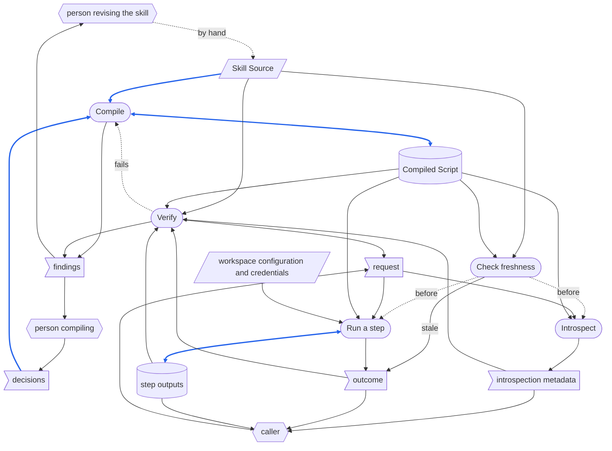
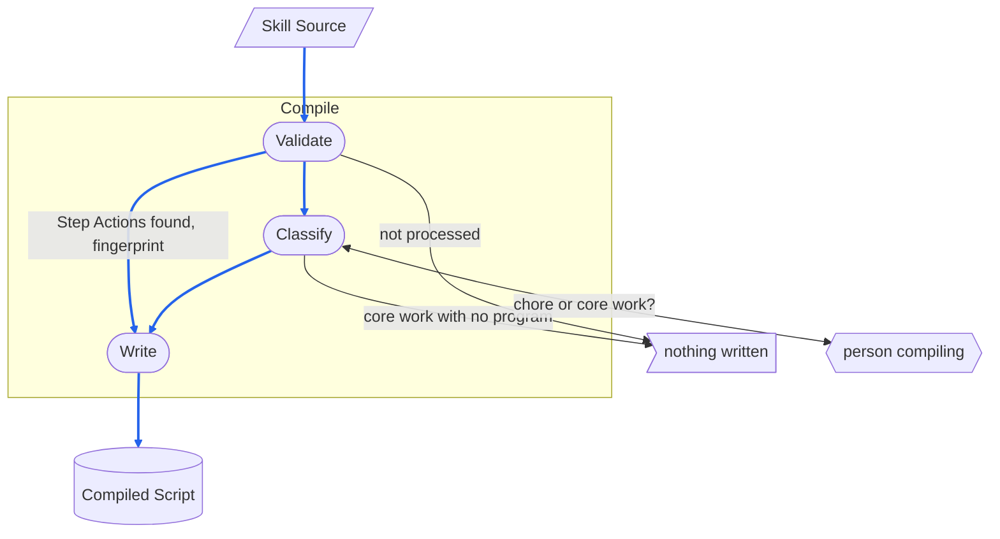
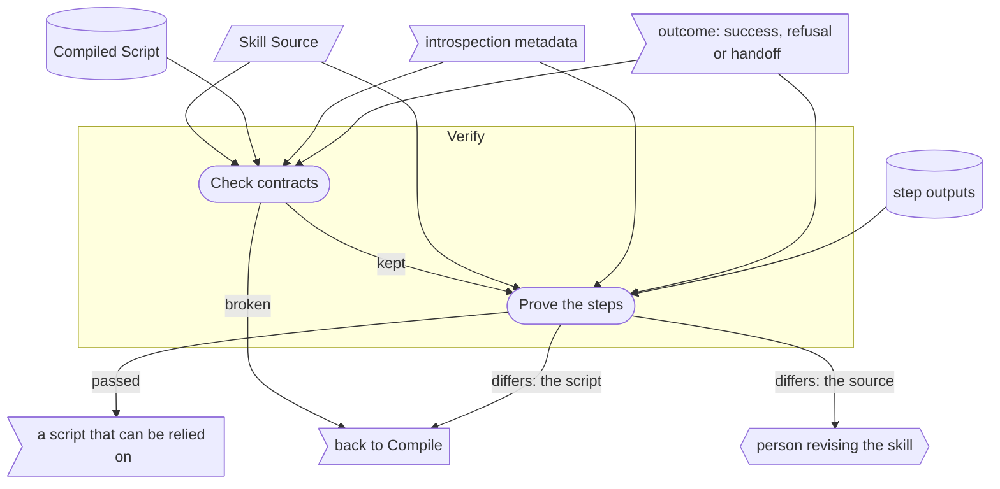

# Skill Compiler - RSDC

> [[RSDC-Standard]]  `2026-10-30`  `ac0745864e75`
> [[DFD]]  `2026-10-20`  `09fb4a7e4730`
> [[RSDC-Skill-System-tmp]]  `2026-10-20`  `50af8a37a22e`

- **System**: SkillCompiler — the skill compiler: it compiles the workflow of a skill into a headless Python script, so that the steps a program can do run without an LLM, and it checks the script it writes.
- **Run as**: `python <program> <arguments>`
- **Authority**: any implementation disagreeing with this document is what changes.

# 1. Requirements — "What problem does this solve?"

This chapter defines the skill compiler's goals and the pain points it answers, and never touches on how it is built:
no technology, no architecture, no file and no program, and no figure measured from a run.
Naming what the skill compiler takes over from — even a program — and what the old way costs the user describes the user's problem, so it belongs here.

## 1.1 Target Users

- **AI automation agents** — AI agents that read a skill's definition and turn it into a script that runs on its own.
- **Automation workflow users** — developers and terminal users who run the same skill's tasks again and again, and want each run to cost as little as possible.
- **Callers** — whatever runs a compiled skill for them and turns what it finds into something they read: an AI agent following a procedure, or a person.

## 1.2 Core Vision

Significantly reduce the token cost of repeatedly executing automation tasks by compiling natural-language skill descriptions into highly deterministic, independently executable automation scripts.
At the same time, fully decouple core execution logic from user interfaces, creating an automation ecosystem that is easy to integrate, extend, and guard against misuse.

## 1.3 Current Pain Points

Today a skill runs only through an agent: on every run, an LLM reads the skill's natural-language steps again and performs each one, those a program could do as much as those that need judgment.
The skill compiler takes over the steps a program can do, once a skill's workflow has settled.
It deliberately carries over neither the steps that need an LLM, which it hands back to the user or an agent, nor the correcting of a workflow, which stays with the skill itself.

- **Cost and performance waste** — each skill execution depends on an LLM rereading large natural-language instructions, resulting in high token cost and slow response time.
- **Bloated and coupled scripts** — traditional scripts that support both automation scheduling and human interaction often mix interface rendering and input-waiting logic into the core logic, making the system hard to maintain and difficult to extend across platforms such as Web, GUI, and TUI.
- **Blurred boundary between full automation and semi-automation** — traditional scripts cannot handle tasks that require LLM semantic understanding, while fully LLM-driven workflows lack pause points, making it difficult for users to intervene when manual confirmation is needed.
- **Silent drift between a skill and its compiled script** — when a skill's natural-language definition changes after it was compiled, nothing shows that the compiled script now does what the definition no longer says, so an outdated script keeps running as if it were current.

## 1.4 System Goals

- **Behavioral equivalence** — compiling must change what a workflow costs and nothing else: running the compiled script must leave the same results as running the skill through an Agent.
- **Double-boundary recognition** — the system must be able to distinguish step attributes along two dimensions:
  - **Execution dimension** — distinguish between Automated flows that can run headlessly and Interactive flows that require human / Agent intervention.
  - **Cognitive dimension** — distinguish between Deterministic pure program logic and Cognitive semantic judgments that require LLM handling.
- **Execution apart from interaction** — the system must keep automatable task logic clearly separated from human input, confirmation, guidance, and other interaction flows.
- **Self-describing steps** — the system must describe task steps, required inputs, and execution boundaries in a clear, structured way so that external tools or Agents can guide users through the workflow.
- **Traceable freshness** — the system must be able to tell whether a compiled script still reflects the current skill definition, so that a script compiled from an outdated definition is never mistaken for a current one.
- **Stable before compiling** — a skill is compiled only after its workflow has stabilized, since the purpose of compiling is to stop paying tokens for work that has settled.
  When a compiled script's results deviate too far from what is expected, the remedy is to go back to the skill itself: the skill is revised and run as a skill until it is stable again, and only then compiled into a new version of the script.
  The compiled script is never where the workflow is corrected.
- **No tokens** — every automatable step is extracted into fixed logic that does not depend on an LLM: a compiled script decides by fixed rules alone, and nothing in it reads or interprets prose, so the same inputs always give the same result, and a call costs no tokens.
  Tokens are spent only when a skill is compiled, once for each version of it.

# 2. Specification — "What are the system rules?"

This chapter defines what the skill compiler's data is, how data moves between its stages, how its records are laid out and named, how each value it needs is derived, and what its output must make plain.
This is the part a reader checks the skill compiler against, so every statement here is one that could be falsified by running it.
It names the programs a caller runs, and the fields a program reads out of a Compiled Script, because their names are contracts; it names no other part of the design.

## 2.1 Terminology

Every noun the later sections rely on and none of them defines, each defined here once.

- **Caller** — a caller of 1.1, in the role this chapter gives it: whoever runs the programs.
  It is a person running one from a terminal, a user interface with a person behind it, a scheduler, or an Agent.
  A caller stands outside the system: it chooses which Step Action to run and supplies that step's input variables, and what every run ends in goes back to it.
- **Person revising the skill** — whoever writes and revises a skill's `SKILL.md`, by hand: the only way a change enters it.
- **Person compiling** — whoever asks for a skill to be compiled, and decides what compiling leaves to a person.
- **Step Action** — a step declared under the `Workflow` section of a skill's `SKILL.md` using a heading such as `Step 0`, `Step 1`, `Step 2`, and so on.
- **Cognitive dimension** — whether a step's result needs an LLM: **Deterministic**, pure program logic, or **Cognitive**, a semantic judgment that requires LLM handling.
- **Execution dimension** — whether a step needs a person: **Automated**, a flow that can run headlessly, or **Interactive**, a flow that requires human / Agent intervention.
- **Action type** — one of the four types where the two dimensions cross: Deterministic Automated, Cognitive Automated, Deterministic Interactive and Cognitive Interactive.
  Each Step Action has exactly one.
- **Input variable** — a value a Step Action takes from its caller for one run, declared with its name, whether it is required, its prompt text and its data type.
- **Handoff** — what a Cognitive step ends in instead of being run: control returns to the user or Agent, who performs that step through the skill itself.
- **Introspection** — a compiled script describing itself to a caller — which Step Actions it has, the Action type of each and the inputs each needs — while running none of them.
- **Core work** — work on the skill's own data, which must already be a program the skill runs.
- **Chore** — upkeep that shared rules or the step's own text fully specify, such as reading configuration, parsing the request or writing a checkpoint, which compiling may write into the script itself.

## 2.2 Artifact Types

Every kind of data the skill compiler handles: what it is, what it is for, and what its content must be.
A compile handles one Skill Source and writes at most one Compiled Script; a call runs one Step Action of one Compiled Script, or describes them all.
Its data is of three kinds: **external inputs**, which come from outside the system and outlast any run; **records**, which the system writes and keeps after the run that wrote them; and **one-run data**, which lives for one run only, wherever it comes from.

**External inputs**

- **Skill Source** — a `SKILL.md` file located under a subdirectory of the `skills` directory.
  This is the only skill source format accepted by the system.

*Workspace configuration and credentials* — the inputs below, named together as **workspace configuration and credentials**: what the steps of a compiled skill read from the environment the script runs in.
They lie under the working directory the caller runs the script from, and in its environment.

- **Workspace configuration** — the configuration file of the workspace, which a step reads as the skill's own step reads it.
- **Credentials** — each credential the Skill Source reads, from the environment variable or key store it names.

**Records**

- **Compiled Script** — an executable artifact converted from a Skill Source, written as a file named `skill.py` in the Skill Source's own directory — the place every caller looks for it, and from which it finds the Skill Source it must check itself against.
  It is **headless**: it never stops during a run to ask for input, and it exposes its capabilities through explicit input and output contracts.
  It must also carry a fingerprint of the exact Skill Source content it was compiled from, together with the time it was compiled, readable without running it.
- **Step outputs** — the skill's own files and persisted state, as a Deterministic step writes them when it runs.

**One-run data**

- **The request** — what the caller gives a run: the step identifier of one Step Action and its input variables, or the request for introspection.
  A compile gives the requests of the runs it asks for itself, as a caller does.
- **The outcome** — what each program hands back when it ends: its exit status, and the lines it prints.
  For a run of a Step Action it is one of three: a success; a refusal, when the run cannot be done as asked and nothing is done; or a handoff, which leaves a Cognitive step to the user or Agent.
  Each ends with an exit status of its own, and a stale script's refusal has one of its own as well, so that a caller knows to have the script recompiled rather than to change its request.
  A caller that cannot tell them apart takes a refusal or a handoff for success, and the next step starts from work that was never done.
- **Introspection metadata** — what introspection prints: the Step Actions the Compiled Script has, the Action type of each and the input variables each takes.
- **The decisions** — what the person compiling answers during one compile: for each Deterministic Step Action whose work runs no program, whether that work is core work or a chore.
- **The findings** — what one compile reports: why a Skill Source is not processed, which steps are core work with no program, each contract the Compiled Script breaks, and each step whose result differs from what its Skill Source says, with whether the difference lies in the script or in the source.

## 2.3 Dataflow

How data moves between the skill compiler's activities: what the stages are, what each stage reads and writes, who writes each piece of data and who may read it, and what order the data itself imposes.
A run belongs to one of two phases: the **compile phase** turns a Skill Source into a Compiled Script that can be relied on, and the **call phase** uses that script, as often as callers ask.
Each phase runs its own stages, in this order:

- **Compile** turns a Skill Source into a Compiled Script.
- **Verify** proves that a Compiled Script keeps its contracts and does what its Skill Source says, by running it only the way a caller does — through its introspection and its runs, never by reaching inside it — and by also reading its text.
  Because it runs the script only as a caller does, what it proves is what a caller will meet: a check that reached inside the script could pass while the way in that callers use is broken.
- **Check freshness** tells whether a Compiled Script still matches the Skill Source it was compiled from, by the fingerprint the Compiled Script carries (2.2).
  The Compiled Script performs it itself, at the start of every invocation, so no caller can skip it.
- **Introspect** performs introspection whenever a caller asks.
- **Run a step** runs one Step Action, chosen by its step identifier.

| Phase | Stages | Who acts | How often | Tokens |
|---|---|---|---|---|
| compile | Compile, Verify | an AI automation agent | once for each version of a skill | spent: classifying the steps, writing the script and judging what it produced all need an LLM |
| call | Check freshness, Introspect, Run a step | a caller; the Compiled Script performs Check freshness on itself | every time a caller asks | none: a Cognitive step is handed off, not run |

### DFD



How to read the diagram:

- **Parallelogram** — an external input: the Skill Source, and the workspace configuration and credentials.
- **Flag** — one-run data: the request and the outcome, the introspection metadata, the decisions and the findings.
- **Cylinder** — a record: the Compiled Script and the step outputs.
- **Rounded box** — a stage.
- **Hexagon** — a role outside the system: the person revising the skill, who changes the Skill Source by hand and reads the findings that lie in it; the person compiling, who supplies the decisions and reads the findings of a compile; and the caller, who supplies the request and reads the introspection metadata, the outcome and the step outputs.
- **Two-headed arrow** — data the same stage both reads and writes: the Compiled Script, whose recorded decisions a recompile offers again, and the step outputs, in which a step finds what earlier steps left.
- **Blue solid arrow** — data that is itself written into a record, or turned into the content of one: the Skill Source and the decisions, which Compile turns into the Compiled Script, and the step outputs Run a step writes.
  Data that only steers what a stage does — an input variable, the workspace configuration — is not blue, even when the stage writes a record; a credential is never blue, since it is never written anywhere.
- **Black solid arrow** — any other data: data that goes no further than the stage or role it reaches.
- **Dotted arrow** — no data: an order, or a change made from outside the system; here *by hand* is the change the person revising the skill makes to the Skill Source, *before* the check of freshness that opens every invocation, and *fails* a script that Verify sends back to Compile.

### Data Read/Write Rules

What the diagram cannot show about the data it draws — where it applies, whether it is written whole, whether it is read-only once written, and who deletes it:

- **External inputs** are written by no stage; every stage that reads one only reads it.
- **The Skill Source** changes only when the person revising the skill revises it, and a change reaches the Compiled Script only through Compile: nothing in the flow carries a change from the script back to the source.
- **Workspace configuration and credentials** are read in the call phase, from the environment the script runs in, never derived from where the script is stored, and a credential is never taken from a command line or asked for.
  A script that locates its workspace from its own location breaks as soon as one skill is shared by several workspaces, and a credential on a command line is readable by every other process on the machine.
- **The request and the outcome** last as long as the run.
  Neither is written into a record: the outcome of each run goes back to whoever asked for the run — the caller, or Verify — and is written nowhere.
  Nothing else keeps them, so nothing deletes them.
  A caller chooses its request from the introspection metadata: a step identifier and that step's input variables, one invocation at a time, and never a credential.
  It may skip Introspect when it already knows what it will ask for, as a scheduler running one fixed command does; it can still ask only for a step and inputs the metadata declares, since anything else is refused before any work.
  Without the metadata a caller would be guessing at identifiers and inputs, and every wrong guess would cost a refused run.
  Verify gives requests the same way, but it is a stage of the compile phase rather than a caller from outside: what it learns goes back into compiling, not into the work the skill was written for.
- **The introspection metadata** is produced in the call phase and goes to the caller, or to Verify; it is written nowhere, and producing it does no work.
  An introspection that does work cannot be used to look before running, because looking would already be running.
- **The decisions and the findings** last as long as one compile.
  The decisions are written into the Compiled Script, and a recompile offers each again as its default; the findings are written nowhere.
- **The Compiled Script** is written by Compile alone, whole, and read by both phases.
  It is never edited to change what it does: a change enters through the Skill Source and reaches the script only by compiling again.
  A script edited by hand does something its Skill Source does not say, and the next compilation silently undoes the edit.
  A correction Verify calls for is part of compiling: Compile writes the script again and Verify checks it again from its first check, so the script that is relied on is always one that passed as a whole.
  A part corrected and not checked again is a part nobody has seen pass.
  The call phase never writes it, and the compile phase hands the call phase no other record: a call phase that changed the script would be editing it by hand, and any other record handed over would be a second definition of what the skill does, beside the Compiled Script.
- **The fingerprint and the compile time** the Compiled Script carries are written by Compile, from the Skill Source content it read, and never rewritten without compiling again — that would certify code nobody checked against the changed source.
  The Compiled Script reads them itself, in Check freshness at the start of every invocation, without running any step; found out only by running it, a stale script would already have done work its source no longer asks for.
- **The step outputs** are written in the call phase, by Run a step, exactly as the skill's step writes them — the same files, names, places and structure — and later invocations read them, sharing no memory with the one that wrote them.
  A script whose outputs differ cannot replace the skill: everything that reads those outputs would have to know which of the two produced them.
  No stage deletes them: they are the skill's own, as after a run through an agent.
  The only step outputs the compile phase reads are those of the runs Verify asks for itself, and Verify asks for a Deterministic step's run only on an input that changes nothing shared.
  A step that would change shared state is not run, and is reported as not run, with the reason: it is a step this verification has not proved, not one that passed.

### Order Imposed by the Data

- **Compile before Verify** — until Compile has written the Compiled Script there is nothing to verify, and a script that has not passed Verify has not finished being compiled, so nothing relies on it.
- **Check freshness before Introspect and Run a step** — every invocation checks the fingerprint the Compiled Script carries first, so a stale script refuses rather than runs, whoever its caller is; Verify goes no further with a script found stale, which is recompiled rather than verified.
  Introspect needs nothing but the Compiled Script, and runs whenever a caller asks.
- **Run a step in the Skill Source's order** — steps that depend on each other run in the Skill Source's order, because a step finds what earlier steps produced only in what they persisted or in the files they read — the way the skill's own single-step run finds it.
  A step that relied on memory left by an earlier invocation would work only when every step ran in sequence in one process, which a user interface or a scheduler calling one step at a time never does.
- No stage reads what a later stage writes.
  Each run Verify asks for is a call of its own, and Verify reads what that call hands back only once it has ended.

### Exception Paths

- **Ending with nothing written** — a compile writes nothing when its Skill Source is not processed: its path is not `skills/*/SKILL.md`, it has no `Workflow` section or no `Step N` heading in it, or two Step Actions share an identifier.
  Compile then stops, and no other stage has anything to read: a partial script would look compiled while encoding a guess at what the source meant.
  The findings give every reason, as the Source Scanner's `INVALID` verdict, with exit status `2`, prints them.
  A compile also writes nothing when the person compiling judges part of a Deterministic step's work to be core work with no program: it ends listing those steps, each with what it needs a program for.
  A call writes nothing unless it succeeds: an invocation of Run a step ends in exactly one of these outcomes, and only the first writes anything:
  - the outputs of a Deterministic step, with exit status `0`;
  - a refusal by a stale script, before any work, with exit status `4` and nothing on standard output;
  - a refusal before any work, naming the input that is missing, with exit status `2`;
  - a handoff from a Cognitive step, returning control to the user or Agent, who performs that step through the skill itself, with exit status `3`;
  - a refusal of an identifier that names no Step Action, with exit status `2`.
- **Stopping midway** — a finding from Verify ends the compile in one of two places.
  When the script breaks a contract, or a step produces something its Skill Source does not say, the defect is the script's: it goes back to Compile, is written again, and is verified again from the start.
  When the difference lies in the Skill Source itself — a step that does not say what it produces, or says it ambiguously — no script can be right, because there is nothing to be faithful to: the skill is not yet stable, and the finding leaves the compile phase for the person revising the skill, coming back as a recompile.
  A script patched to cover a gap in its source does something the source never said, which is exactly the hand edit this flow forbids.
  Either way the Compiled Script that Compile last wrote stays where it was written, and nothing relies on it; the findings say which steps passed, which were not run and why, and which differ.
- **Re-entering midway** — a recompile is the only way back into the compile phase, and it passes through the person revising the skill.
  It starts when Check freshness finds the script stale, when Verify finds a gap in the source, or when the script's results deviate too far from what was expected: the skill is revised and run as a skill until it is stable, then compiled again, and Compile writes the Compiled Script whole, as the first time.
  In the call phase, Run a step runs any one Step Action alone, as an invocation of its own: it finds what earlier steps left only in their step outputs, and ends in one of the outcomes above.

## 2.4 Naming and Data Structures

How the data the skill compiler writes or reads is named and laid out.

- **Skill Source** — `SKILL.md`, directly inside a skill's own directory, whose parent directory is named `skills`.
- **Compiled Script** — `skill.py`, beside its Skill Source, in the same directory.
- **Introspection metadata** — one JSON document, printed alone on standard output.

The two files lie side by side:

```text
skills/
`-- target_skill/
    |-- SKILL.md       (Skill Source: read when compiling, and by every freshness check)
    `-- skill.py       (Compiled Script: pure CLI script, no built-in UI, supports introspection and multidimensional step execution)
```

Where the programs that compile and check a skill are kept is not part of this layout: the system needs only that they can read `skills/*/SKILL.md` and write `skill.py` beside it.
A `SKILL.md` whose path has any other shape is not processed: the shape is what tells a Skill Source from every other Markdown file.
Each step must have a unique identifier.
Hierarchical and alphanumeric identifiers are supported, such as `1`, `2`, `3`, `1.1`, `1.2`, `2.a`, and `2.b`.
**At runtime, the system must always route calls by identifier.**

The Compiled Script's fields, which a program reads by parsing its text, without importing or running it:

| Field | Meaning |
|---|---|
| `SOURCE_SHA256` | the fingerprint of the Skill Source content it was compiled from: a module-level constant, assigned a plain string literal |
| `COMPILED_AT` | the date and time it was compiled: a module-level constant, assigned a plain string literal |
| the module docstring | opens with the Skill Source's `description`, then lists every Step Action with its identifier and type, the command that runs one, and — for each Deterministic step whose work runs no program in the Skill Source — that a person judged it a chore |

A recompile reads those decisions back and offers each as its default, so a person is not asked the same question twice about an unchanged step.

The introspection metadata takes this form:

```json
{
  "skill_name": "example_skill",
  "steps": [
    {
      "id": "1.1",
      "name": "Fetch raw data",
      "type": "deterministic_automated",
      "description": "Run a local Python web crawler to fetch data",
      "arguments": []
    },
    {
      "id": "1.2",
      "name": "Analyze article sentiment",
      "type": "cognitive_automated",
      "description": "Call an LLM to classify text sentiment; this system only provides a handoff prompt",
      "arguments": []
    },
    {
      "id": "1.3",
      "name": "Set export path",
      "type": "deterministic_interactive",
      "description": "Requires the user to specify a local backup directory",
      "arguments": [
        {
          "name": "output_path",
          "required": true,
          "type": "path",
          "description": "Target path for export"
        }
      ]
    },
    {
      "id": "2.0",
      "name": "Human creative review",
      "type": "cognitive_interactive",
      "description": "A human and AI jointly review revision suggestions; this system only provides a handoff prompt",
      "arguments": []
    }
  ]
}
```

The introspection metadata's fields:

| Field | Meaning |
|---|---|
| `skill_name` | the `name` in the `SKILL.md` frontmatter, or the skill's directory name when the frontmatter has none |
| `steps` | every Step Action of the Skill Source, in source order, and no other: the identifiers `--step` accepts |
| `steps[].id` | the step identifier |
| `steps[].name` | a human-readable name for the step |
| `steps[].type` | the step's Action type |
| `steps[].description` | a human-readable description of the step |
| `steps[].arguments` | each input variable the step takes |
| `arguments[].name` | the input variable's name |
| `arguments[].required` | whether it is required |
| `arguments[].type` | its data type |
| `arguments[].description` | its prompt text |

A caller reads these names, not their meaning: a type spelled differently is a type no caller recognizes.

The fields that hold code labels, with every code label each may hold:

| Field | Values |
|---|---|
| `steps[].type` | `deterministic_automated`, `cognitive_automated`, `deterministic_interactive`, `cognitive_interactive` |
| `arguments[].type` | `string`, `integer`, `number`, `boolean`, `path` |

`SOURCE_SHA256` holds 64 lowercase hexadecimal digits, and `COMPILED_AT` an ISO 8601 date-time with its UTC offset.

## 2.5 Derivation Rules

How each value the skill compiler does not observe directly is derived.

### Step Identifier

- A Step Action's identifier is the number of its `Step N` heading, without leading zeros.
- A step whose instructions mix Action types is split into `N.1`, `N.2`, … in source order, each of exactly one type, and is then never also addressed as a whole; every other step keeps `N`.
- Two headings with the same number make the Skill Source invalid.
  Otherwise one identifier would name two different steps, and a call would run whichever one the script happened to keep.

### Action Type

Each Step Action is strictly classified into one of the four Action types through the orthogonal intersection of the Cognitive dimension and the Execution dimension:

| Cognitive \ Execution | Automated (headless automatic execution) | Interactive (interactive prompt intervention) |
| :---- | :---- | :---- |
| **Deterministic (pure program logic)** | **1. Deterministic Automated** - *Characteristics*: local pure logic, no token cost, silently completed by this system with one action. | **3. Deterministic Interactive** - *Characteristics*: local pure logic, no token cost, requires the human to input local parameters in this system before execution. |
| **Cognitive (LLM-dependent)** | **2. Cognitive Automated** - *Characteristics*: requires an LLM to process an automation task. **This system does not process it**; it is treated as a handoff interruption point. | **4. Cognitive Interactive** - *Characteristics*: requires high-interaction guidance between an LLM and a human. **This system does not process it**; it is treated as a handoff interruption point. |

Each Step Action is placed in the matrix by these criteria:

- **Cognitive dimension — judged by what the step's result needs, not by how its instructions read.**
  Reading, parsing, computing, rendering, or calling a service that a program can call is Deterministic.
  A call made through an interface only an Agent can use is Deterministic when the same call can be made without an LLM — through the service's own interface, an existing helper, or a library — and Cognitive only when no such route exists.
  Judged by wording instead, a step that merely sounds analytical is handed off for nothing, and one that merely sounds mechanical is compiled into a guess.
- **Execution dimension — judged by the step's inputs.**
  A step that takes a value from a person, given with the request or asked for, is Interactive, and each such value is one of its input variables, with the kind of value it takes, and required when the Skill Source gives it no default.
  A step that needs nothing it cannot read for itself is Automated.
  A value the step needs but is not given an input variable for has nowhere to come from except a guess.
- **Type and inputs agree.**
  A Deterministic Automated step requires no input variable, and a Deterministic Interactive step declares at least one.
  Otherwise a caller that trusts the type, supplying nothing to an Automated step, cannot run it at all.
- **A program the step runs is called, never rewritten.**
  A Deterministic Step Action whose Skill Source step runs a program is compiled into a call to that same program.
  A rewrite can differ from the program in ways nobody has run, and the two drift further apart with every later change to the program.

### Core Work or Chore

- When part of a Deterministic Step Action's work runs no program, the person compiling decides, step by step, whether that work is core work or a chore; Compile never decides this alone.
- An answer recorded in the Compiled Script of an earlier compile is offered as the default, and never stands in for the person's: a question left unanswered stops the compile.
- Core work with no program stops compilation with nothing written, and goes back to the person revising the skill, to be written as a program the skill runs and run as a skill until it is stable.
  Written by Compile instead, it would be behavior the skill has never run.

### Source Fingerprint

- The fingerprint of a Skill Source is the lowercase SHA-256 hex digest of its text, decoded as UTF-8 with any byte-order mark removed and every line ending normalized to LF, then re-encoded as UTF-8: it describes the text rather than the bytes, so a CRLF checkout of an unchanged `SKILL.md` is not mistaken for an edited one.
- It is taken from the same content that is classified, so the script records exactly the source it was compiled from; taken from a later read, it would vouch for a source that was never compiled.
- A Compiled Script whose fingerprint is missing, or differs from that of the current Skill Source, is **stale**, and is recompiled.
  The Compiled Script checks this itself before it does anything: a stale script refuses every invocation, so no caller can run it by mistake.

## 2.6 Presentation Contract

What the skill compiler presents is data, not a report: the Compiled Script, through its introspection metadata, and each program's outcome.
Whoever turns them into something its users read decides its form and its words; what follows is what the data itself must make plain, so that no faithful presentation of it can mislead.

**What the introspection metadata makes plain**

- **Every Step Action, in source order, and no other.**
  A step missing from the metadata can never be offered to anyone, and one the Skill Source does not have is behavior nobody wrote down.
- **A name and a description for each step.**
  A step offered by its identifier alone cannot be chosen by a person, who has no way to tell what it does.
- **Which of the four Action types each step belongs to.**
  A caller that is not told a step's type cannot tell which steps it may run unattended: it runs a Cognitive step and gets only a handoff, or runs an Interactive step without first collecting its inputs and gets only a refusal.
- **Each input variable, with whether it is required, its prompt text and its data type.**
  A caller that is not told a variable's data type can offer nothing but a free text box for it, and a value of the wrong kind is found only once the step runs.

**What the outcome makes plain**

- **Which of success, refusal, handoff and a stale refusal a run ended in, by its exit status alone.**
  An outcome read from anything but the run itself, such as whether step outputs appeared, cannot tell a refusal from a handoff.
- **What a refusal is about.**
  A refusal names what was wrong — the missing input, the value of the wrong kind, or the identifier that names no step — so that the caller can correct its request; a stale refusal prints nothing on standard output and says on standard error that the script must be recompiled, since no request can correct it.
- **Who must do a step that is handed off.**
  The handoff message says that the step is a cognitive task, and that the user or an Agent must invoke the skill for it.

**The questions every presentation answers**

1. *What do the records and the outcome say when there is nothing to report?
   Where is the skipped count reported?*
   A Skill Source with no Step Action is not processed, the findings say so, and no Compiled Script is written.
   A step with nothing to do succeeds, with what the skill's own step writes then.
   What Verify leaves unproven is not skipped silently: each step it did not run is in the findings as not run, with the reason, and the Contract Checker prints how many of its checks failed.
2. *Which programs can the caller start itself?
   For those it cannot, why not?*
   All three: the Compiled Script, the Source Scanner and the Contract Checker each run from a command line.
   Compile, and the part of Verify that proves the steps, are no program: they need the judgment of an AI automation agent, and start when a person asks for a skill to be compiled.
3. *Has every read been observed to succeed in the caller's own environment?*
   Not every one.
   The Contract Checker runs the script only in an empty place outside the workspace, where no workspace configuration can be found; only the runs Verify asks for from the workspace observe the reads a Deterministic step makes there, and only for the steps it runs.
   A step it does not run is reported as not run.
4. *If the data is also reachable outside the system, can the system hand over that address?*
   Yes for the Compiled Script, whose place 2.4 fixes beside its Skill Source, and whose path a compile ends by naming.
   The step outputs are the skill's own files, at the places its steps write them; the system hands over no address of its own for them.
5. *After the scope is narrowed, do the counts in the record match the scope of the next action?*
   There is no count to narrow: a call runs one Step Action, and the introspection metadata always lists every Step Action, whatever a caller asks.
6. *What is the limit of a batch?
   How is an excess refused, and can it leave a half-written record?*
   There is no batch: an invocation runs one Step Action, and a compile handles one Skill Source.
   Compile writes the Compiled Script whole, and a refusal or a handoff writes nothing.
   Whether a step that fails partway leaves half-written step outputs is decided by the skill's own step, which the script keeps as it is.
7. *What should a refused caller do next?*
   After a refusal, `2`, correct what it names — supply the missing input, give a value of the right kind, or use an identifier the introspection metadata declares — and run the step again.
   After a stale refusal, `4`, have the script recompiled, and never write a fingerprint into it.
   After a handoff, `3`, perform that step through the skill itself.
8. *How far does the output reach by default, and who finds out when that widens?*
   No farther than the skill's own step reaches: a step writes the same files, at the same places, in the workspace found from the working directory.
   The Source Scanner and the Contract Checker write nothing that outlasts them, and the Contract Checker runs the script only in temporary places outside the workspace.
   Nothing widens the reach but a change to the Skill Source, which makes the script stale until it is compiled again.

## 2.7 CLI

Every program is a Python script, run by its caller as `python <program> <arguments>`.
The command line is the only way a caller reaches the system: it passes arguments in and reads back the exit status, the lines printed and the records written, and it never imports a program to call its functions.

Three programs do the work a program can do: the Compiled Script, in the call phase, and the Source Scanner and the Contract Checker, in the compile phase.
The request of 2.2 arrives as the Compiled Script's arguments: the step identifier as `--step`, each input variable as an option named after it, and the request for introspection as `--export-schema`.
Every location the Source Scanner and the Contract Checker read arrives as an argument too, and neither assumes a location of its own.
A program that found its inputs from where it sits would stop working the moment it was kept anywhere else.
The Compiled Script is the one exception, and only for its Skill Source, which it finds beside itself because it is compiled there; the workspace it finds from the working directory.

Two rules hold for all three:

- **A program's name is part of its contract.**
  A procedure written to run a program finds it by name, and a renamed program breaks every such procedure without a word.
- **Each exit status names one finding**, so whoever runs a program can act on the status alone.
  Were a malformed command to share the code of an invalid source, a mistyped path would be reported as a defect in the skill; were a stale script to share the code of a failed check, it would be corrected by hand instead of compiled again.

A caller uses the Compiled Script in one of two ways: it runs a step, or it first asks what there is to run — Run a step and Introspect (2.3).
A user interface builds its step list and input forms from introspection, a scheduler or Agent learns from it which steps can run unattended and which must be handed off, and a person at a terminal can read it, or the script's own help, before choosing a step.

Two judgments in the compile phase are exact tests, and each is made by a program rather than by a reading: whether a Skill Source is processed at all, and whether a Compiled Script keeps its contracts.
A reading lets a near miss through — a step heading one character off, or a script that prints one stray line before its metadata or waits for an answer, reads exactly like one that does not — and only a program tells them apart, for the second by running the script.
Each is run from a command line, writes nothing that outlasts it, and never changes the skill's directory: a check that changed what it checks would vouch for something that no longer exists.

- **Compiled Script**, the program `skill.py` — the computation of Check freshness, Introspect and Run a step: it runs one Step Action at a time, or describes them all.
  - **Invocation** — `python skill.py --step <id> [--<name> <value> ...]` runs the one Step Action whose identifier is `<id>` (2.5), each of its input variables given as an option named after it; `python skill.py --export-schema` is introspection, and runs no business logic.
    The introspection option is a dedicated one, hidden from the script's help: the help is plain text written for people, and changes with them.
  - **Standard output** — for introspection, the introspection metadata as one JSON document and nothing else (2.4): one log line before it breaks every caller's JSON parser.
    For a handoff, the message `This step is a cognitive task and cannot be processed by this system. Please have the user or Agent invoke the corresponding Skill separately.`
  - **Exit status** — `0` success; `2` refusal, before any work is done, naming what was wrong — a required input missing, a value of the wrong kind, or an identifier that names no step; `3` handoff, from a Cognitive step, after it prints the handoff message; `4` stale (2.5), ended by Check freshness (2.3) in any invocation, introspection included, with nothing on standard output.
  - **Refuses** — every invocation of a stale script, with `4`; a required input missing, a value of the wrong kind, and an identifier that names no Step Action, each with `2`.
- **Source Scanner**, the program `scan_source.py` — the first part of Compile's computation: it decides whether a Skill Source is processed at all (2.3, 2.4), and lists what compiling works from.
  - **Invocation** — `python scan_source.py --file <path>`, where `--file` names the `SKILL.md` to judge; required.
  - **Standard output** — whether the path has the shape 2.4 accepts; the skill's name; the fingerprint of its content (2.5); the **step inventory** — each Step Action's identifier, title and line span, and the programs it runs, each marked as in the skill's directory or not; warnings that leave the source valid; and the verdict, `valid` or `INVALID`, with every reason for an invalid one.
  - **Exit status** — `0` valid; `2` INVALID — nothing may be compiled from this source; `64` no verdict — the command was malformed, or the file is missing or cannot be read.
  - **Refuses** — a malformed command, and a file that is missing or cannot be read, each with `64`.
- **Contract Checker**, the program `check_compiled.py` — the first part of Verify's computation: it checks a Compiled Script against the contracts this document sets for it, using it only as a caller does, and reading its text.
  - **Invocation** — `python check_compiled.py --source <path> --script <path> [--timeout <seconds>]`, where `--source` names the Skill Source and `--script` the Compiled Script compiled from it, both required, and `--timeout` how long one run of the script may take before it is taken to be waiting for an answer, optional, 60 by default.
  - **Standard output** — one line for each check, marked passed or failed, with what it found; the Step Actions the script's introspection declares; and how many checks failed.
  - **Exit status** — `0` every check passed; `1` at least one check failed; `2` the Skill Source is INVALID, and nothing else was checked; `4` the Compiled Script is stale (2.5), and nothing else was checked; `64` no verdict — the command was malformed, or a file it names is missing or cannot be read.
  - **Refuses** — a malformed command, and a file it names that is missing or cannot be read, each with `64`.

## 2.8 Invariants

Rules that hold in every stage, without exception:

- **No program waits for a person.**
  Because the script is headless, even a person who calls it is asked nothing: a missing input is a refusal that names it, and the person supplies it and runs the step again.
  A script that waited for an answer would stop a scheduler for good, with nobody there to give one.
- **No LLM in a program.**
  Every program of the system decides by fixed rules alone: the same inputs give the same results, and a call costs no tokens.
  A Cognitive step of a Compiled Script contains no LLM call: it ends in a handoff.
  Only Compile and Verify spend tokens, once for each version of a skill; a program that needed an LLM would make a judgment nobody could repeat.
- **A Cognitive step is never approximated by deterministic logic.**
  A guess runs, reports success and is wrong, and nothing downstream can tell it from a correct result; a handoff says plainly who must do the work.
- **Unknown identifiers are refused.**
  A call naming an identifier that matches no Step Action is refused, never ignored.
  An ignored call reports success for work that never ran.

The goals of 1.4, and the rules that carry them:

| Goal | Carried by |
|---|---|
| Behavioral equivalence | 2.3, where Run a step writes the step outputs exactly as the skill's step writes them and Verify proves each Deterministic step against its source; 2.5 Action Type, where a program the step runs is called, never rewritten |
| Double-boundary recognition | 2.1, the two dimensions; 2.5 Action Type, which places every Step Action in one of the four Action types |
| Execution apart from interaction | 2.5 Action Type, where every value a step takes from a person is one of its input variables; No program waits for a person, above |
| Self-describing steps | 2.4, the introspection metadata's fields; 2.6, what the metadata makes plain |
| Traceable freshness | 2.5 Source Fingerprint; 2.3, where Check freshness comes first in every invocation |
| Stable before compiling | 2.3, where a recompile is the only way back into the compile phase, and passes through the person revising the skill |
| No tokens | 2.7, where every stage of the call phase is the Compiled Script's computation; No LLM in a program, above |

# 3. Design — "How is the system structured?"

This chapter describes the components that perform the stages of 2.3, and how each one does its work.
It has no Directory Structure: where the Source Scanner and the Contract Checker are kept is for whoever runs them to say, and every location reaches them as an argument; the one placement that matters, a Compiled Script beside its Skill Source, is a contract, fixed in 2.4.
Nor does it have a Presentation Form: a person uses no control of the system's own — the command line and what it hands back are fixed in 2.7 — and the form a reader is shown is decided by whoever presents the data, as 2.6 says.

## 3.1 Core Component Responsibilities

One bullet per component — each one 2.7 names, and each one nothing outside the system calls — with its one job and its boundary: a change that crosses the boundary is a change to two components.
Every stage of 2.3 is performed by one of them; a stage none performs is an activity nobody implemented.

- **Compiler** — the AI automation agent of 1.1 that compiles, and this document is all it needs to do so: whatever procedure it follows, it builds the Compiled Script, and the programs below, from the rules stated here.
  In the Dataflow, it performs Compile, and the part of Verify that needs judgment: choosing inputs that are safe to run, and reading what came back.
  Its one job: turning a Skill Source into a Compiled Script that keeps every rule of chapter 2, and judging what the script's runs produced.
  Its boundary: it never edits a Skill Source, never decides alone whether work is core work or a chore, and leaves what a program can decide — whether a source is processed, and whether a script keeps its contracts — to the Source Scanner and the Contract Checker.
- **Source Scanner** — the program of 2.7 that judges a Skill Source.
  It performs Validate, the first part of Compile.
  Its one job: deciding whether a Skill Source is processed at all, and listing the Step Actions, the programs each one runs and the fingerprint that compiling works from.
  Its boundary: it changes nothing, and how a step is classified is the Compiler's.
- **Contract Checker** — the program of 2.7 that checks a Compiled Script.
  It performs Check contracts, the first part of Verify.
  Its one job: every check of a Compiled Script that a program can make, by running the script only as a caller does and by reading its text.
  Its boundary: it runs no Deterministic step's real work — proving the steps is the Compiler's — and changes neither the skill's directory nor the workspace.
- **Compiled Script** — the program of 2.7, one for each compiled skill, written by the Compiler; its parts are these:
  - **Action Logic Builders** — the functions inside `skill.py`, one for each Step Action.
    In the Dataflow, they perform Run a step.
    Their one job: one Step Action each — calling the program the skill's step runs, doing the work a person judged a chore, or handing a Cognitive step off.
    Their boundary: a builder never calls another step's builder, and keeps nothing in memory for a later invocation.
  - **Schema Exporter** — the part of `skill.py` that answers introspection with the schema JSON.
    In the Dataflow, it performs Introspect.
    Its one job: printing the introspection metadata.
    Its boundary: it runs no Step Action.
  - **Source Fingerprint** — the two values `skill.py` records about the Skill Source it was compiled from — its fingerprint and the compile time — and the check that compares that fingerprint with the Skill Source beside the script at the start of every invocation.
    In the Dataflow, that check is Check freshness.
    Its one job: refusing every invocation of a stale script.
    Its boundary: it never rewrites the values it holds, which only Compile writes.

How they interact: the Compiler runs the Source Scanner and the Contract Checker from a command line and reads what they print, and runs the Compiled Script only as a caller does; the Contract Checker judges a Skill Source by the Source Scanner's own procedure, which it loads, so the two can never disagree about a source or its fingerprint; and inside `skill.py`, the Source Fingerprint runs first in every invocation, before the Schema Exporter or an Action Logic Builder.

## 3.2 Execution Flow

For each component of 3.1, how it does its work at run time: its steps in order, named as the code names them, with the branches, retries, parallel work and orders the component chose rather than the data forced.
Where a drawing helps, it is drawn in the notation of the DFD.
Chapter 2's rules are cited here, never restated.
The Source Scanner and the Contract Checker ask nothing while they run, and each decides its exit status only from what it found.

### Compiler

The Compiler performs Compile, then Verify, each drawn open below, its steps named as this section names them.

#### Inside Compile

Compile drawn open: what it does, in order.



| Inside Compile | Reads | Passes on |
|---|---|---|
| Validate | the Skill Source: where it sits, its `Workflow` section and its `Step N` headings | the Step Actions found, the programs each one runs and whether each is in the skill's directory, and the fingerprint of the content read — or the finding that stops compilation |
| Classify | each Step Action's instructions, by the criteria of 2.5; the programs each one runs; the person's decision on each Deterministic step that runs none | each step identifier, with its Action type, its input variables and the programs it calls — and, for a Deterministic step whose work runs no program, the person's decision: chore or core work |
| Write | what Validate and Classify passed on | the Compiled Script, whole |

**The order inside Compile.**
Validate comes first, so nothing is classified or written for a source that is not processed.
Classify comes before Write, because the script's structure follows from the types.
The fingerprint Write records is the one Validate took from the content it read, as 2.5 requires.
A Deterministic step whose work runs no program is put to a person between Classify and Write, and core work with no program stops compilation there: once Write has run, a script holding behavior the skill never ran would already exist.

#### Inside Verify

Verify drawn open: what it does, in order.



How to read the diagram:

- **Hexagon** — the person revising the skill, outside the system.
- **Arrow into the hexagon** — a finding that lies in the source goes there, and not back to Compile.

| Inside Verify | Reads | Passes on |
|---|---|---|
| Check contracts | the Compiled Script's own text, read without running it; its introspection metadata, against the Skill Source's Step Actions; the outcome of the script run alone — in an empty place outside the workspace, with nothing given as input — for each Cognitive step, each Interactive step without its inputs, and an identifier that names no step; and the outcome of a copy of the script whose Skill Source has been changed | each contract the script breaks, or none |
| Prove the steps | each Deterministic step, run once in source order from the workspace, as a separate invocation, on an input that changes nothing shared; its outcome and what it produced; what its Skill Source step says it produces | for each step: passed, not run and why, or a difference — and whether the difference lies in the script or in the source |

**The order inside Verify.**
Check contracts comes first and runs nothing for real: a script that breaks a contract may do anything once it runs in the workspace — wait for an answer that never comes, or write where nothing should — so it is proved only after it keeps them.
Prove the steps runs each step as a separate invocation, the way a caller does, so a step that relies on memory left by another fails here rather than in use.
A step that would change shared state is not run, as 2.3 says.

### Source Scanner

1. It reads the file as text once, and computes the fingerprint from that same text, so the fingerprint describes exactly what was judged.
2. It checks the path's shape: a file named `SKILL.md`, in a directory whose parent is named `skills`.
3. It reads the skill's name from the frontmatter, when there is one; a frontmatter that cannot be parsed is reported.
4. It finds every heading outside fenced blocks, and takes the first whose text is `Workflow`, at any level, as the Workflow section, which ends at the next heading of the same level or higher.
5. Within that section, each heading of the form `Step N` — a number followed by the end of the heading, a space, or a dash or colon before its title — is a Step Action.
   Its identifier is the number without leading zeros, and its span runs to the next heading of its level or higher.
   A heading that only begins like one, such as `Step 1.5` or `Step 2a`, is a warning, not a Step Action.
6. For each Step Action, it collects the programs the step runs: every file name with a program's extension — `.py`, `.js`, `.mjs`, `.cjs`, `.ts`, `.sh`, `.ps1`, `.cmd` or `.bat` — inside the step's inline code or fenced blocks, in order of first appearance.
   A program is marked as in the skill's directory when a file of that name lies anywhere under it, outside directories that tools generate.
   A name only mentioned, not run, is collected too; telling the two apart is Classify's judgment.
7. Its verdict is INVALID when the path's shape is wrong, when there is no Workflow section or no Step Action in it, or when two Step Actions share an identifier; otherwise it is valid.
   Steps out of order and gaps in the numbering are warnings.

### Contract Checker

1. It judges the Skill Source again by the Source Scanner's own procedure, so the two programs can never disagree about a source or its fingerprint; an INVALID source ends the check there.
2. It reads the Compiled Script's text without running it.
   The recorded fingerprint comes first: missing, or different from the Skill Source's, it ends the check as stale.
   Then the recorded compile time, and every rule of how the script is written that its text, or the interpreter it runs under, can show.
3. It runs the script the way Check contracts does, above, each run under the time limit: its help and its introspection, then — with the introspection metadata in hand — each Cognitive step alone, each Interactive step without its required inputs, and an identifier that names no step.
   The metadata is compared with the step inventory: every source step present, whole or split but never both, no step the source lacks, in source order.
   Each program a Deterministic step runs that is in the skill's directory must be named in the script's text; a name with no file in the skill's directory is too often one merely mentioned, and is not checked.
   After the runs, the place they ran in must still be empty.
4. It copies the skill's directory to a second temporary place, changes the copy's `SKILL.md`, and runs the copied script twice — its introspection and its first step — each of which must end as stale, with nothing on standard output.
   The skill's own directory is never touched.
5. It compares the skill's directory with its state before the first run: it must be unchanged.

### Compiled Script

1. At the start of every invocation, `--export-schema` included, it takes the fingerprint of the `SKILL.md` in its own directory by the rule of 2.5, and compares it with `SOURCE_SHA256`.
   The Skill Source is the one file the script finds from its own location, because it is compiled beside it.
   When the two differ, or the `SKILL.md` is missing, it writes to standard error that the script is stale and must be recompiled, and exits with the stale status.
2. `click` reads the command line: a missing required option, or a value its parameter type rejects, ends the invocation with the refusal status before any work is done.
3. With `--export-schema`, the Schema Exporter prints the introspection metadata and exits `0`.
4. With `--step <id>`, it runs the Action Logic Builder of that step; an identifier that names no step ends with the refusal status.
   A Cognitive step's builder prints the handoff message and exits `3`; a Deterministic step's builder does the step's work and exits `0`.

# 4. Coding — "How should the code be written?"

This chapter keeps the code's quality up and the programs working alike on every platform: the rules the code follows, the tools it may use, how it stays safe, how each claim is proved, and where it still falls short.

## 4.1 Key Development Guidelines

- **Strictly Headless** — in `skill.py`, never call `input()`, `click.prompt()` or anything else that waits for a person, so that no program waits for a person (2.8).
  Every input variable arrives as a command-line option; a credential is the one exception, read from the environment variable or key store the Skill Source reads it from.

## 4.2 Implementation Guidelines and Tools

- Python 3.10 or later, from the workspace's `.venv`.
- `click`, which builds the Compiled Script's command-line interface, and `PyYAML`, with which the Source Scanner reads a frontmatter.
- Type hints on every function.
- Every file is read as UTF-8, with any byte-order mark removed.
- For the Compiled Script, `skill.py`:
  - Give each input variable's option the `click` parameter type that matches its declared `type` — `click.Path` for `path`, and `str`, `int`, `float` and `bool` for the others — so a value of the wrong kind is refused before any work is done.
  - Declare `--export-schema` with `hidden=True`; when it is given, print the metadata (2.4) with Python's built-in `json.dumps()`, then call `sys.exit(0)`.
  - Write `SOURCE_SHA256`, `COMPILED_AT` and the module docstring as 2.4 lays them out.
  - Resolve the workspace from the current working directory, where the workspace configuration file sits, never from the script's own file location.

## 4.3 Safety and Robustness

- **Refusals come from `click`** — a missing required option, a value its parameter type rejects, and an identifier that names no step — raised as `click.BadParameter` — each exit with `click`'s usage-error status, 2, the refusal status of 2.7, before any work is done.

## 4.4 Verification Obligations

Each rule this document states, how it is shown to hold, and who shows it; every component of 3.1 is named in at least one row, since a component no row proves cannot be shown to work.
A rule is proven when its behaviour has been observed, not when the code meant to produce it has been read.
This table is where the rules of the earlier chapters end up: a rule with no row here, or with a row marked *not verified*, holds only for as long as nobody breaks it, which is no more than a rule that was never written down.

| Claim | Rule | Proven by | Performed by |
|---|---|---|---|
| A source that is not processed gets no script | 2.3, 2.7 | the format verdict, reached before anything is classified; an invalid verdict stops the run | Source Scanner |
| Each Step Action has one identifier, taken from its `Step N` heading | 2.5 | a number used twice is an invalid verdict | Source Scanner |
| A stale script is recompiled, never relied on | 2.5, 2.7 | the recorded fingerprint against the current Skill Source, before any other check | Contract Checker |
| A stale script refuses every invocation | 2.5, 2.7, 3.2 | the script, run from a copy of its directory whose `SKILL.md` has been changed, ends with code 4 and prints nothing to standard output, for introspection and for a run alike | Contract Checker |
| Nothing waits for a person | 2.8, 4.1 | the script's text holds no call that waits for input, and every run gets nothing as input and a time limit | Contract Checker |
| Python 3.10+, `click` and type hints | 4.2 | the interpreter, and the script's text | Contract Checker |
| Introspection is hidden and prints one JSON document in the schema format | 2.4, 2.7 | `--help` lists `--step` but not the flag; the flag's output parses as one document with every required key, Action type and argument `type` | Contract Checker |
| The metadata lists every Step Action, in source order, and no other | 2.4 | its identifiers against the Skill Source's | Contract Checker |
| Inputs fit the Action type | 2.5 | no Deterministic Automated step requires an input; every Deterministic Interactive step declares one | Contract Checker |
| A Cognitive step hands off | 2.7, 2.8 | each one, run alone, prints the handoff message and ends with the handoff code | Contract Checker |
| A missing input is refused before any work | 2.7, 4.3 | each Interactive step, run without its required inputs, names the missing one and ends with the refusal status | Contract Checker |
| An identifier that names no step is refused | 2.7, 2.8 | a run with such an identifier ends with the refusal status | Contract Checker |
| Introspection and refusals write nothing | 2.3, 2.7 | every run happens in an empty place outside the workspace, found still empty after every run but the two stale ones, and the skill's directory is unchanged | Contract Checker |
| A Deterministic step writes what the skill's step writes | 1.4, 2.3 | the step, run once from the workspace on an input that changes nothing shared, compared with what its source step says it produces | Compiler — observed, then judged |
| A step run alone finds earlier work in what was persisted | 2.3 | every step of that run is a separate invocation | Compiler |
| A Deterministic step that runs a program calls it rather than rewriting it | 2.5 | every program in the skill's directory that a Deterministic step of the Skill Source runs is named in the Compiled Script's text; a program kept elsewhere is not checked | Contract Checker |
| Core work with no program stops compilation | 2.5 | each Deterministic step whose work runs no program is put to a person before anything is written, and the decision is recorded in the Compiled Script | Compiler — decided by a person |
| The Source Scanner and the Contract Checker keep their command-line contracts | 2.7 | — | *not verified* |
| Each step's Action type is right | 2.5 | the classification is shown to a person before any code is written; no check proves it | *not verified* |
| A Cognitive step contains no LLM call | 2.8 | — | *not verified* |
| A credential is never taken from the command line | 2.3, 4.1 | — | *not verified* |
| The workspace is resolved from the working directory | 2.3, 4.2 | — | *not verified*: a script that finds its workspace from its own location passes every check whenever the two coincide |
| Each input's `click` type matches its declared `type` | 4.2 | — | *not verified* |
| The module docstring opens with the description and lists every Step Action | 2.4 | — | *not verified* |
| The Compiled Script is never edited by hand | 2.3 | — | *not verified*: the fingerprint covers the Skill Source, not the script |

**The rows not verified** are the checks still to be written.
All but one could be made mechanical — reading the script's text for an LLM client, an option that takes a credential, a path built from the script's own location, an option type that differs from the declared one, or a docstring that does not open with the description, running the Source Scanner and the Contract Checker on sources and scripts of every kind, and recording a fingerprint of the script itself.
The classification is the exception: it is a judgment, and stays one; it is shown before any code is written precisely so that a person can correct it.

## 4.5 Defects

Every place where the programs do what chapter 2 says they should not, each where it was observed and what it costs:

- **The Source Scanner reads a Skill Source twice.**
  `scan_source.py` reads the text it judges, then reads the file again for the fingerprint, so a change made between the two reads gives the fingerprint of a source other than the one judged, against 2.5.
  Observed by reading the code, not in a run; it would let a Compiled Script vouch for a source nobody compiled.
- **The Contract Checker does not look at what the stale runs write.**
  `check_compiled.py` confirms that the place its runs happen in is still empty, and only then runs the stale copy of the script twice from that same place, so a stale script that wrote there on its way to refusing would pass, although 2.3 has a refusal write nothing.
  Observed by reading the code, not in a run.
- **A stale script that does not parse is reported as a failed check.**
  `check_compiled.py` parses the script before it reads the recorded fingerprint, and ends with `1` when the script does not parse, so a stale script with a syntax error is reported as one to correct, not one to recompile, against 2.7.
  Observed by reading the code, not in a run.
