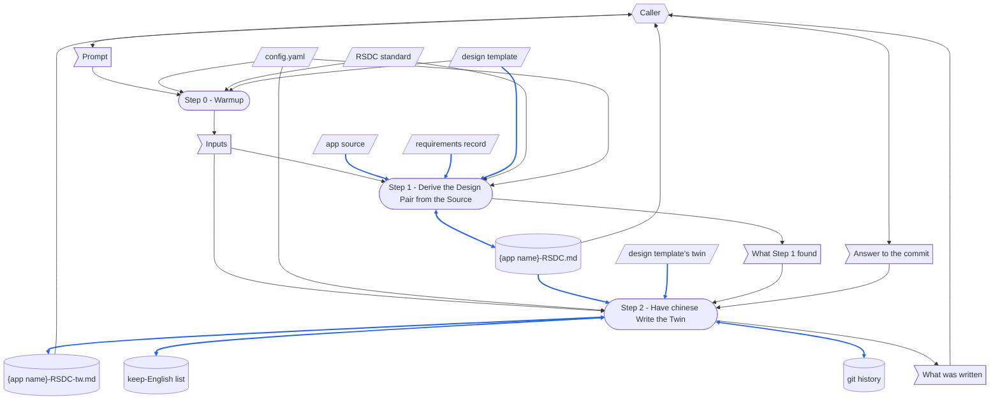

本文件為 [SKILL.md](.github/common/skills/gen-rsdc-app/SKILL.md) 的繁體中文版；真正會執行的是 SKILL.md，任一份改了某節，另一份必須在同一次執行中、以相同編號一起改。

# TERMINOLOGY

每個 skill 裡都是同一個意思的詞。

- **Checkpoint Dir** — 存放某個 skill 的 YAML checkpoint、每次執行各一份的目錄。
  每個 skill 都有自己的。
- **YAML checkpoint** — Checkpoint Dir 裡的 `process.yaml`。
  每個 step 把它的輸出寫在那裡的 `step_{N}` 群組底下，於是後面的 step 把它們讀回來，而不是重算一次。
- **MD report** — 某個 skill 寫進 wiki vault 的那份 Markdown 報告，放在一個以那個 skill 命名的資料夾裡，在它的結果各節上方帶著標準的表頭（Skill、Checkpoint、Created、Updated、Prompt）。
- **no forward-reference** — 一個 step 絕不能依賴排在它後面的 step 這條規則。
  為了安排控制流而指名後面的 step 不算違反；借用那個 step 的輸出才算。

# DEDICATED TERMINOLOGY

這個 skill 領域專屬的詞。
詞彙表擁有每一個定義——step 使用這個詞，而不重述它的意思。

- **the app** — 這個 skill 寫文件的對象：一個以 `node server.js` 啟動、自我完備的目錄，它真正的工作由 **python kernel** 完成，兩邊都只用標準函式庫。
  Node 提供服務並衍生行程；Python 做決定。
- **app dir** — prompt 第二行指名的目錄，放著 **the app** 的原始碼。
  這個 skill 讀它，而除了 **design pair**——在 **output dir** 位於它裡面時——之外，什麼都不寫進去。
- **app name** — prompt 第三行給的名稱。
  它為 **design pair** 命名。
- **output dir** — prompt 第四行指名的目錄，**design pair** 寫在這裡。
- **requirements record** — prompt 第五行指名的檔案，或 `none`：當初對 **the app** 提出了哪些要求，用提出者自己的話，連同每一項要求改了什麼。
  它是這個 app 為什麼長成這樣的原因，而那是程式碼無法顯示的。
  設計從原始碼推導；這份記錄只提供 **findings**。
- **python kernel** — **app dir** 的 `scripts\` 底下的 Python，只用標準函式庫，由伺服器衍生並轉送到頁面。
- **mountable handler** — `server.js` 旁邊的 `app.js`，匯出 `createApp(options)` 並回傳伺服器原本會用來監聽的那個 `(req, res)` 函式。
- **app config** — `server.js` 旁邊那份 `app.config.json`，也是 **the app** 唯一會讀的檔案。
- **design pair** — `{output dir}\{app name}-RSDC.md` 與它的繁體中文 twin `{app name}-RSDC-tw.md`。
  依 **RSDC** 標準寫成，它們決定*這個 app 必須是什麼*。
  這個 skill 寫英文半邊；twin 由 **chinese skill** 依它寫出。
- **RSDC** — Requirements、Specification、Design、Coding：一份 **design pair** 文件的四個部分，依這個順序。
- **design template** — 這個 skill 裡的 `assets\RSDC-App-tmp.md`，以及它的 twin `assets\RSDC-App-tmp-tw.md`。
  它擁有一份 **design pair** 的**形狀**——它帶著哪些編號的章節、每一節放什麼——於是相隔一年寫出文件的兩個 app 可以用同一種方式讀。
  **design pair** 在檔頭引用區連到它：`> [[RSDC-App-tmp]]`，好讓 **chinese skill** 從 template 的 twin 照抄 twin 與它共有的每一個句子，template 日後改了也看得出來。
  step 指向它，絕不重述那份章節清單。
- **RSDC standard** — **design pair** 所依循的章節職責規範：四個部分各自回答哪一個問題，以及各自不得向後取用什麼。
  **design template** 帶的是它的形狀，它帶的是理由；當某段內容該放哪一章有爭議時，以它為準。
- **component** — **the app** 裡一個可實作、且只有一項工作的部件：伺服器、**mountable handler**、某一個頁面、**python kernel** 的某一個進入點。
  **design pair** 的 Design 部分畫出這些邊界，而每一個 component 都至少出現在一項 **verification obligation** 裡。
- **verification obligation** — **design pair** 的 Coding 部分中，Verification Obligations 的一列：一個主張、它證明的規則、證明它的觀察與由誰來做——或標 *not verified*，並寫明目前讀過了什麼。
  每一個 **component** 都至少出現在一列；對一個這樣寫成文件的 app，這些列是「已證明」唯一的定義。
- **finding** — **requirements record** 與程式碼實際做的事之間的一項不一致：一條被要求過、卻從來沒有落地的規則，或一個沒有人要求過的行為。
- **dependency checker** — 共用的 `depends_on.py`，不是這個 skill 自己的工具：它的 `check` 把一份文件在檔頭引用區每個連結後面記下的指紋，與所連檔案現在的內容比對；**design template** 就在那裡連到 **RSDC standard**，**design pair** 則在那裡連到 **design template**，由它的 `record` 記下。
- **RSDC Checker** — gen-rsdc-skill 的 `check_rsdc.py`，不是這個 skill 自己的工具：它拿一份 RSDC 對照其檔頭引用區所指名的 template——對 **design pair** 而言就是 **design template**——每一項檢查印出 `[PASS]`、`[FAIL]` 或 `[WARN]`。
  警告標出的是只有讀者才能判定的事。
  這個 skill 只拿它檢查英文半邊；twin 由 **chinese skill** 的 parity check 證明。
- **chinese skill** — 共用的 `chinese` skill，不是這個 skill 自己的：它把一份英文 Markdown 檔翻譯成旁邊的繁體中文 twin——逐行對應，每一個標題、inline-code span 與檔頭引用區的行都保留英文，而檔案與它的 template 共有的每一行，都從 template 的 twin 照抄——然後以它的 parity check 證明這份 twin，並提議把兩份一起 commit。

# CONFIGURATION

這個 skill 執行時用到的具體值。
下面每一條路徑都是這個 skill 的常數；被寫文件的那個 app 的一切，都從 prompt 指名的東西讀取。

- **design template** — `{skillGroups.common}\skills\gen-rsdc-app\assets\RSDC-App-tmp.md`，它的 twin `RSDC-App-tmp-tw.md` 就在旁邊。
- **RSDC standard** — `{skillGroups.common}\references\RSDC-Standard.md`，其圖的記法在 `{skillGroups.common}\references\DFD.md`。
- **dependency checker** — `{skillGroups.common}\scripts\depends_on.py`。
- **RSDC Checker** — `{skillGroups.common}\skills\gen-rsdc-skill\scripts\check_rsdc.py`。
- **chinese skill** — `{skillGroups.common}\skills\chinese\SKILL.md`。
- **design pair** — `{output dir}\{app name}-RSDC.md` 與 `{output dir}\{app name}-RSDC-tw.md`。

# MUST FOLLOW

- 必須一步一步執行 workflow，並顯示每一個 step 編號。
- 每個 step 必須自我完備。
  **No forward-reference.**
- 一個程式能以 deterministic 方式完成的 step 必須以腳本執行。
  一個需要閱讀、判斷或摘要的 step **絕不可**腳本化——把它寫成自然語言指示，讓 agent 自己直接執行。
- **這個 skill 沒有 `run step N` 選擇器——每一次執行都是完整執行。**
  Step 1 從對原始碼的一次閱讀寫出設計；單獨執行它，就是從沒有讀過的東西寫出設計。
- **這個 skill 既不產生 MD report，也不產生 YAML checkpoint。**
  它的產出是 **design pair**。
  一次執行發現了什麼——**components**、**findings**、缺陷與 **verification obligations**——在最後交回，讓執行它的一方記錄。
- **每一份文件都是一對，而兩個半邊一起移動。**
  寫出 `{app name}-RSDC.md` 的那一次執行，會在同一次執行中讓 **chinese skill** 依它寫出 `{app name}-RSDC-tw.md`。
  兩份一旦分岔，就不再說出這個 app 是什麼；它們在爭論它。
- **絕不手寫 twin。**
  Step 2 把英文半邊交給 **chinese skill**，而證明 twin 保住了標題、fenced block、表格、連結、inline code，以及它與 **design template** 共有之句子的，是那個 skill 的 parity check；在這裡寫出的 twin 會跳過那項檢查。
- **design pair 絕不指名這個 skill、執行它的那一方，或任何工具。**
  一份指向產生它的那套程序的設計，是循環定義的一半，而且不留下單一來源。
  一份文件在不指名它勝過誰的情況下陳述它自己的權威：*任何與本文件不一致的實作，該改的是實作*。
- **絕不把某個 app 寫死。**
  任何 **app name**、**app dir** 路徑、通訊埠、標題或端點都不得出現在這個檔案裡、**design template** 裡，或這個 skill 的工具裡。
  prompt 指名那個 app。
- **這個 skill 不改任何程式碼，也不留下任何正在跑的東西。**
  它讀 **the app**；它從不啟動它，除了 **design pair** 之外也不寫任何檔案——它所執行的 **chinese skill** 可能在它的 keep-English list 裡加一個詞，而且只在得到同意時才 commit。
- **output dir 裡已經有的 design pair 能不能被取代，由執行這個 skill 的一方決定。**
  這個 skill 會整份取代它，因為重新推導正是它存在的目的；一份後來被加進了原始碼無法顯示之決定的 design pair，不是可以拿它來重跑的對象。

# Prompt Examples

## Prompt 1

```
/gen-rsdc-app
artifacts/InvCov
InvCov
artifacts/InvCov/docs
artifacts/InvCov/docs/Prompts.md
```

## Prompt 2

```
/gen-rsdc-app
artifacts/InvCov
InvCov
artifacts/InvCov/docs
none
```

## Prompt 3

```
Write the design pair of the app in artifacts/InvCov into its docs folder, from its source alone.
```

# Dataflow

一次執行如何把它的 prompt 變成它留下的東西：**Workflow** 的每一個 step，以及每一個 step 讀寫的資料，以 [DFD.md](.github/common/references/DFD.md) 的記法畫成一張 DFD。
各個 step 說出自己讀寫什麼；這張圖把它畫出來，讓有兩個寫入者的 record、沒有來源的資料，或讀取較後 step 所寫之物的 step，一眼就看得出來。
step 完全照它的標題命名，編號也包括在內，讓讀者不必猜是哪一個 step。
只畫 step 在執行時真正讀寫的東西；step 只是引用的文件不畫。



圖的讀法：

- 平行四邊形是 external input：`config.yaml`、**RSDC standard**、**design template** 與它的 twin、**app dir** 裡的原始碼，以及 **requirements record**。
  旗形是 one-run data：prompt、Step 0 確定下來的輸入、Step 1 發現的東西、caller 對 **chinese skill** 所提議之 commit 的回答，以及 Step 2 交回的東西。
  圓柱是 record：**design pair** 的兩個半邊、**chinese skill** 可能加進一個詞的 keep-English list，以及它可能加進一個 commit 的 git 歷史。
  圓角框是 step。
- 六角形是 skill 外部的 role：caller——一個人，或一個執行這個 skill 的 skill——它提供 prompt 與對 commit 的回答，並讀 **design pair** 與交回的東西。
- 實線箭頭承載資料，方向就是資料移動的方向；雙向箭頭是同一個 step 既讀又寫的資料。
  虛線箭頭不承載資料：它是一個順序，或一次手動做的改動。
- 藍色箭頭承載的資料本身被寫進一份 record，或被轉成一份 record 的內容：原始碼、**requirements record** 與 **design template** 變成英文半邊；英文半邊與 template 的 twin 變成 twin；**chinese skill** 保留英文的詞進入它的清單，這一對則進入 git 歷史。
  其他箭頭都是黑色；**RSDC standard**、`config.yaml`、Step 1 發現的東西與對 commit 的回答只決定 step 怎麼做、或被交回，即使那個 step 寫了 record，它們仍是黑色。
- 每一份 record 只有一個寫入者。
  Step 1 讀它即將取代的英文半邊，好說出那裡已經有什麼；Step 2 讀它更新的 twin、它加詞的清單，以及它從中找到 twin 的 baseline、並 commit 進去的歷史。

# Steps at a Glance

每一個 step 一覽，一個 step 一列，完全照它的標題命名：它執行的腳本，不執行時寫一條橫線，以及它存進 YAML checkpoint 的東西。
這個 skill 不寫 YAML checkpoint，所以每一個 YAML 欄位都是一條橫線。

| Step | Script | YAML |
|---|---|---|
| Step 0 - Warmup | `depends_on.py check` | — |
| Step 1 - Derive the Design Pair from the Source | `depends_on.py record`, `check_rsdc.py` | — |
| Step 2 - Have chinese Write the Twin | — | — |


# Workflow

每一個 step 都以一句 **Purpose** 開頭：一句話說出這個 step 為什麼自成一個 step——把它併進鄰近的 step，這個 skill 會失去什麼。

**Step 0 執行腳本，Step 1 只為了記下並檢查它寫出的東西而執行腳本，Step 2 不執行自己的腳本**，因為比對與記下一份文件對它所指名之檔案的指紋，以及拿一份文件對照其 template 的形狀，都是 deterministic 的，而從原始碼推導出設計、畫出 **component** 邊界是判斷，Step 2 則把它的工作交給 **chinese skill**，由它執行自己的腳本。

## Step 0 - Warmup

- **Purpose**：在讀原始碼之前，先確定要為哪一個 app 寫文件、它的 **design pair** 寫到哪裡，以及 **design template** 是否仍是標準的形狀——因為依過時的形狀寫出的設計，遵循的是標準早已捨棄的規則。

- 先執行 `.venv`——**dependency checker** 需要 `PyYAML`。

- 讀 workspace 根目錄的 workspace config [config.yaml](config.yaml)，解析出：
  - **`skillGroups`**：群組名稱 -> skills 根目錄的對照——這個 skill 自己的目錄是 `{skillGroups.common}\skills\gen-rsdc-app\`。
  - 在下面各 step 裡出現 `{skillGroups.common}` 的每一處，包括命令裡，都代入解析出來的值。
  - 如果 `config.yaml` 不存在，或缺了這個鍵，就停下來問使用者。

- 在執行 workflow 之前，檢查下面這些檔案存在。
  - `{skillGroups.common}\skills\gen-rsdc-app\assets\RSDC-App-tmp.md`
  - `{skillGroups.common}\skills\gen-rsdc-app\assets\RSDC-App-tmp-tw.md`
  - `{skillGroups.common}\references\RSDC-Standard.md`
  - `{skillGroups.common}\references\DFD.md`
  - `{skillGroups.common}\scripts\depends_on.py`
  - `{skillGroups.common}\skills\gen-rsdc-skill\scripts\check_rsdc.py`
  - `{skillGroups.common}\skills\chinese\SKILL.md`

- prompt 採用上面 **Prompt Examples** 所示的其中一種形式。
  **依位置**解析它：
  - **app dir**——第二行。
    一個沒有 `server.js` 的目錄，就停下來並說明沒有可以寫文件的 app。
  - **app name**——第三行。
  - **output dir**——第四行，還不存在時就建立它。
  - **requirements record**——第五行：一個檔案，或 `none`。
    指名的路徑不是檔案時就停下。
  - 少了某一行就問，絕不推測。

- 檢查 **design template** 有沒有跟上 **RSDC standard**：讀標準檔頭引用區開頭的 Version 行所寫的版本，以及 template 在指名標準之處所記下的版本；再對 **design template** 執行 **dependency checker** 的 `check`，它把每個連到標準的連結——`> [[RSDC-Standard]]` 與 `> [[DFD]]`——後面記下的指紋，與該檔案現在的內容比對：只比版本號，會漏掉在同一個版本之內做的修改。
  版本不同或有指紋改變時，在寫出任何東西之前停下。
  說出哪一項不同，並說明 `RSDC-App-tmp.md` 與它的閱讀版 `RSDC-App-tmp-tw.md` 要先跟上標準——依標準的「Changes in This Version」，內容在同一個版本之內改過時則依它的 git 歷史——再重新記下它們的版本與連到標準的連結，作為一項獨立的變更。
  依過時的形狀寫出的 **design pair**，遵循的是標準早已捨棄的規則；而一旦它帶有自己的決定，它就只能手動修正。
  - 範例：`python {skillGroups.common}/scripts/depends_on.py check "{skillGroups.common}/skills/gen-rsdc-app/assets/RSDC-App-tmp.md"`

- 顯示 **app dir**、**app name**、**output dir**、**requirements record** 或沒有它這件事，以及 template 檢查發現了什麼。

## Step 1 - Derive the Design Pair from the Source

- **Purpose**：把這個 app **是**什麼用文字定下來，是從這個 app 本身推導、而不是從當初被要求的東西推導——那是一個 app 不再是一場對話、而成為後來的讀者能拿來對照檢查的東西的那個時點。

- **沒有腳本推導設計**——從原始碼推導出設計、以及畫出 **component** 邊界是判斷；一個被要求做這件事的程式，只會是在聲稱它做了。
  這個 step 執行的兩支腳本，一支在英文半邊寫好之後記下 **design template** 的指紋，一支檢查它。

- 沒有 **requirements record** 時，把這件事說出來，並只從原始碼工作。

- **從上到下讀完這個 app 的全部原始碼**：`server.js`、`app.js`、`public\`、`scripts\`、**app config**、`tests\`。
  然後指名那些 **components**：最小的一組、每一個都只有一項工作的部件，並說出每條邊界在哪裡、以及跨過它會壞掉什麼。

- **從原始碼推導，不是從 requirements record 推導。**
  程式碼是這個 app *是*什麼；**requirements record** 是為什麼。
  兩者不一致時，**程式碼勝出**，而那個不一致本身就是一項值得寫下來的 **finding**——一條被要求過、卻從來沒有落地的規則，正是一份逆向推導出來的設計要抓的東西。

- 如果 **output dir** 裡已經有這個 **app name** 的 **design pair**，在寫之前把這件事說出來，附上它的路徑與行數：它的英文半邊會被整份取代，而它的 twin 會在同一次執行中跟著更新。

- **寫出 design pair 的英文半邊**——`{output dir}\{app name}-RSDC.md`：
  - **寫出 design template 承載的每一節，依它的順序，而它沒有的一節都不寫；它標為 Optional、而 app 沒有內容可寫的一節省略，之後各節依序遞補編號。**
    **design template** 擁有那個形狀；在這裡憑空發明的一節，會是下一個 app 不會有的一節，而被跳過的一節，會是讀者會去找的一節。
  - **從 design template 取來的每一個句子，都照 template 的原文一字不改。**
    **chinese skill** 只有在兩者完全相同時，才把那一行視為與 template 共有，也只有那時才照抄 template 的 twin 對它的寫法；在這裡改寫過的一行會被重新翻譯，兩個 app 的 twin 就會把同一條規則寫成兩種說法。
  - **在檔頭引用區連到 design template，並記下它。**
    英文半邊在連到標準的連結之下帶著 `> [[RSDC-App-tmp]]`；寫好之後，用 **dependency checker** 記下它，並傳入 workspace 的 `config.yaml`：放在另一個 workspace 的 design pair 要靠它才找得到 template。
    **chinese skill** 會把檔頭引用區原樣抄進 twin，並透過那一行找到 template 的 twin；template 日後改了，也會顯示為一項改動。
    - 範例：`python {skillGroups.common}/scripts/depends_on.py record "{output dir}/{app name}-RSDC.md" --target "[[RSDC-App-tmp]]" --config config.yaml`
  - 在 Coding 部分為 Specification 的每條規則給一項 **verification obligation**，讓每一個 **component** 都至少出現在一項裡，尚未證明的主張標 *not verified*——這些列是這個 app 對「已證明」將會擁有的唯一定義，沒有任何一列提到的規則，就沒有任何東西會檢查它。
  - **Presentation contract 的八個問題，全部作答。**
    某個 app 完全可以正當地回答「沒有這回事」；留白的才是缺口，而其中「收窄檢視後，畫面上的計數與下一個動作的作用範圍是否一致」是最常答成「否」的那一題。
  - **填寫 capability coverage 表，並對它跑兩個方向的檢查。**
    有一列卻找不到對應規則，那個能力就是沒有人同意過的。
    **授予型**規則沒有對應的列，就是一條沒有入口的規則——但**約束型**規則本來就沒有入口，期待它有會產生誤報。
  - 存檔前拿 **RSDC standard** 核對寫好的各章：Requirements 裡沒有技術、Specification 裡除了 caller 使用的介面之外沒有 component、Design 裡沒有程式庫，也沒有任何一節向後取用。
  - 把 **requirements record** 顯示出是辛苦學到的每一條規則寫下來，**連同教會它的那次失敗**。
    一條附著理由的規則，能活過下一次重寫。
  - 守住 **MUST FOLLOW** 裡那條單向規則：文件在不指名這個 skill、執行它的那一方或任何工具的情況下陳述它們的權威。
    寫「這個 app 解析」而不是「那個工具寫了」。

- **對英文半邊執行 RSDC Checker**，並修正它，直到沒有任何一項檢查失敗。
  讀每一則警告，要嘛修正英文半邊，要嘛讓那則警告留著並寫明理由。
  推導漏掉的東西——漏寫的一節、留下的 placeholder——在這裡被抓到，趕在英文半邊被翻譯之前。
  - 範例：`python {skillGroups.common}/skills/gen-rsdc-skill/scripts/check_rsdc.py --rsdc "{output dir}/{app name}-RSDC.md"`

- 把這個 step 發現的東西留下來，在這次執行結束時交回：**components**，連同每一個的原始碼住在哪裡、以及提到它的主張；**findings**；每一項缺陷，連同記錄它的那一節；以及 **RSDC Checker** 對英文半邊的 verdict，連同每一則留著的警告和它的理由。

## Step 2 - Have chinese Write the Twin

- **Purpose**：讓掌管翻譯的那個 skill，在英文半邊通過檢查之後，依它寫出並證明 twin——併進 Step 1 的話，twin 會被手寫出來，跳過那項會抓到掉了的標題、被翻譯的識別字，或被重新措辭之共有句子的 parity check。

- 對 Step 1 寫出的英文半邊執行 **chinese skill**，把路徑交給它：

  ```
  /chinese
  {output dir}\{app name}-RSDC.md
  ```

  - 它在旁邊逐行寫出 `{app name}-RSDC-tw.md`：檔頭引用區、每一個標題與每一個 inline-code span 都保留英文，英文半邊與 **design template** 共有的每一行，都從 template 的 twin 照抄。
  - 已經存在、且與它的英文半邊一起 commit 過的 twin，會就地更新：只重新翻譯自那次 commit 之後改了的部分。
    否則就翻譯整份檔案，而已經存在的 twin，要等 caller 同意才會被覆寫。
  - 它以自己的 parity check 收尾，修正 twin——絕不修正英文半邊——直到檢查通過。
  - 接著它會問要不要 commit 這一對。
    回答屬於 caller——或者，當執行這個 skill 的是另一個 skill 時，屬於它把問題轉交的那個人；一起 commit 的一對，才讓下一次執行只翻譯改了的部分。

- 這裡什麼都不翻譯，**chinese skill** 執行時也不改英文半邊——它把它的來源當成唯讀。
  它回報的英文半邊缺陷，等它結束之後才修正，然後再執行一次 **chinese skill**。

- **交回寫了什麼**，讓執行這個 skill 的一方記錄。
  顯示：
  - **design pair** 作為兩個連結，附上它的兩個半邊是以哪些章節計數比對過的；
  - 一張 **Components** 表，欄位為 **Component**（它在 design pair 裡的名字）、**File**（它的原始碼在 **app dir** 裡住在哪裡）與 **Obligations**（提到它的那些 **verification obligations** 的主張，尚未證明的每一項標 *not verified*）；
  - 一張 **Findings** 表，欄位為 **Asked for**（那筆 **requirements record**，沒有時則是 `—`）、**What the code does** 與 **Recorded as**（現在承載它的那一節）；
  - 推導中發現的每一項缺陷，附上記錄它的那一節；
  - **RSDC Checker** 對英文半邊發現了什麼：它的 verdict，以及每一則留著的警告和它的理由；
  - **chinese skill** 回報了什麼：它翻譯了整份 twin 還是只翻譯改了的部分、它的 parity 結果，以及這一對有沒有被 commit；
  - 以及沒有任何程式碼改動、也沒有留下任何正在跑的東西。
