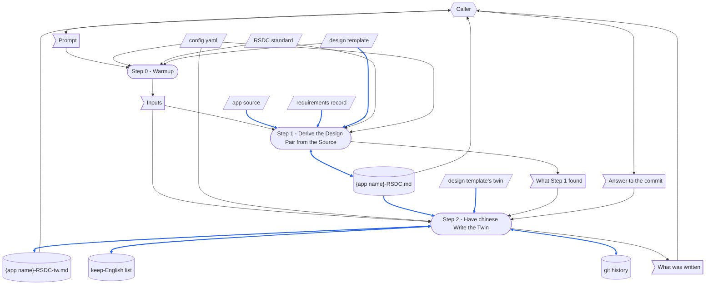

# TERMINOLOGY

Terms that mean the same thing in every skill.

- **Checkpoint Dir** — the per-run directory holding a skill's YAML checkpoint.
  Every skill has its own.
- **YAML checkpoint** — the `process.yaml` inside the Checkpoint Dir.
  Every step writes its outputs there under a `step_{N}` group, so a later step reads them back instead of recomputing them.
- **MD report** — the Markdown report a skill writes into the wiki vault, in a folder named after that skill, carrying the standard header (Skill, Checkpoint, Created, Updated, Prompt) above its result sections.
- **no forward-reference** — the rule that a step must never depend on a step that comes after it.
  Naming a later step to route control flow does not break it; borrowing that step's output does.

# DEDICATED TERMINOLOGY

Terms specific to this skill's domain.
The glossary owns each definition — a step uses the term rather than restating what it means.

- **the app** — what this skill documents: a self-contained directory started with `node server.js`, whose real work is done by the **python kernel**, both standard library only.
  Node serves and spawns; Python decides.
- **app dir** — the directory the prompt names on its second line, holding the source of **the app**.
  This skill reads it, and writes nothing into it but the **design pair**, when the **output dir** lies inside it.
- **app name** — the name the prompt gives on its third line.
  It names the **design pair**.
- **output dir** — the directory the prompt names on its fourth line, where the **design pair** is written.
- **requirements record** — the file the prompt names on its fifth line, or `none`: what was asked of **the app**, in the asker's own words, with what each request changed.
  It is why the app is shaped as it is, which the code cannot show.
  The design is derived from the source; the record only supplies **findings**.
- **python kernel** — the Python under the **app dir**'s `scripts\`, standard library only, spawned by the server and relayed to the page.
- **mountable handler** — `app.js` beside `server.js`, exporting `createApp(options)` and returning the `(req, res)` function the server would have listened with.
- **app config** — the `app.config.json` beside `server.js`, and the only file **the app** reads.
- **design pair** — `{output dir}\{app name}-RSDC.md` and its 繁體中文 twin `{app name}-RSDC-tw.md`.
  Written to the **RSDC** standard, they decide *what the app must be*.
  This skill writes the English half; the **chinese skill** writes the twin from it.
- **RSDC** — Requirements, Specification, Design, Coding: the four parts of a **design pair** document, in that order.
- **design template** — `assets\RSDC-App-tmp.md` in this skill, with its twin `assets\RSDC-App-tmp-tw.md`.
  It owns the **shape** of a **design pair** — which numbered sections it carries and what each one holds — so that two apps documented a year apart can be read the same way.
  The **design pair** links it in its header quote, `> [[RSDC-App-tmp]]`, so that the **chinese skill** copies every sentence the twin shares with it from the template's twin, and a later change to the template shows.
  A step points at it and never restates the section list.
- **RSDC standard** — the chapter-responsibility rules the **design pair** is written to: which question each of the four parts answers, and what each may not reach forward into.
  The **design template** carries its shape; it carries the reasoning, and is the reference a disagreement about where something belongs is settled against.
- **component** — one implementable piece of **the app** that has one job: the server, the **mountable handler**, one page, one **python kernel** entry point.
  The **design pair**'s Design part draws the boundaries, and every component is named in at least one **verification obligation**.
- **verification obligation** — a row of the **design pair**'s Verification Obligations, in its Coding part: a claim, the rule it proves, the observation that proves it and who makes it — or *not verified*, with what has been read so far.
  Every **component** is named in at least one; the rows are the only definition of "proved" an app documented this way has.
- **finding** — a disagreement between the **requirements record** and what the code does: a rule that was asked for and never landed, or a behaviour nobody asked for.
- **dependency checker** — the shared `depends_on.py`, not this skill's own: its `check` compares the fingerprint a document records after each link of its header quote with the linked file's content now; the **design template** links the **RSDC standard** there, and the **design pair** links the **design template**, recorded by its `record`.
- **RSDC Checker** — gen-rsdc-skill's `check_rsdc.py`, not this skill's own: it checks an RSDC against the template its header quote names — for a **design pair**, the **design template** — and prints `[PASS]`, `[FAIL]` or `[WARN]` for each check.
  A warning marks what only a reader can settle.
  This skill runs it on the English half; the twin is proved by the **chinese skill**'s parity check.
- **chinese skill** — the shared `chinese` skill, not this skill's own: it translates one English Markdown file into its 繁體中文 twin beside it — line for line, every heading, inline-code span and header-quote line kept in English, and every line the file shares with its template copied from the template's twin — then proves the twin with its parity check, and offers to commit the two.

# CONFIGURATION

Concrete values this skill runs with.
Every path below is a constant of the skill; everything about the app being documented is read from what the prompt names.

- **design template** — `{skillGroups.common}\skills\gen-rsdc-app\assets\RSDC-App-tmp.md`, with its twin `RSDC-App-tmp-tw.md` beside it.
- **RSDC standard** — `{skillGroups.common}\references\RSDC-Standard.md`, with its diagram notation in `{skillGroups.common}\references\DFD.md`.
- **dependency checker** — `{skillGroups.common}\scripts\depends_on.py`.
- **RSDC Checker** — `{skillGroups.common}\skills\gen-rsdc-skill\scripts\check_rsdc.py`.
- **chinese skill** — `{skillGroups.common}\skills\chinese\SKILL.md`.
- **design pair** — `{output dir}\{app name}-RSDC.md` and `{output dir}\{app name}-RSDC-tw.md`.

# MUST FOLLOW

- Must run workflow step by step, and display each step number.
- Each step must be self-contained.
  **No forward-reference.**
- A step that a program can do deterministically must be run as a script.
  A step that needs reading, judgement, or summarization **must not** be scripted — write it as natural-language instructions for the agent to perform directly.
- **This skill has no `run step N` selector — every run is a whole run.**
  Step 1 writes the design from one reading of the source; run alone, it would write it from none.
- **This skill produces neither an MD report nor a YAML checkpoint.**
  Its output is the **design pair**.
  What a run found — the **components**, the **findings**, the defects and the **verification obligations** — is handed back at its end, for whoever ran it to record.
- **Every document is a pair, and both halves move together.**
  A run that writes `{app name}-RSDC.md` has the **chinese skill** write `{app name}-RSDC-tw.md` from it in the same run.
  Two files that drift no longer say what the app is; they argue about it.
- **Never write the twin by hand.**
  Step 2 hands the English half to the **chinese skill**, and that skill's parity check is what proves the twin kept its headings, fences, tables, links, inline code and the sentences it shares with the **design template**; a twin written here would skip that check.
- **The design pair never names this skill, the one that ran it, or any tool.**
  A design that points at the procedure that produced it is half of a circular definition, and leaves no single source.
  A document states its own authority without naming what it outranks: *any implementation disagreeing with this document is what changes*.
- **Never hardcode an app.**
  No **app name**, **app dir** path, port, title or endpoint may appear in this file, in the **design template**, or in this skill's tools.
  The prompt names the app.
- **This skill changes no code and leaves nothing running.**
  It reads **the app**; it never starts it, and writes no file but the **design pair** — the **chinese skill** it runs may add a term to its keep-English list, and commits only on a yes.
- **Whoever runs this skill decides whether a design pair already in the output dir may be replaced.**
  This skill replaces it whole, because a re-derivation is what it is for; a pair that has since been given decisions the source cannot show is not one to run it over.

# Prompt Examples

## Prompt 1

```
/gen-rsdc-app
artifacts/InvCov
InvCov
artifacts/InvCov/docs
artifacts/InvCov/docs/Prompts.md
```

## Prompt 2

```
/gen-rsdc-app
artifacts/InvCov
InvCov
artifacts/InvCov/docs
none
```

## Prompt 3

```
Write the design pair of the app in artifacts/InvCov into its docs folder, from its source alone.
```

# Dataflow

How a run turns its prompt into what it leaves behind: every step of the **Workflow**, and the data each one reads and writes, drawn as a DFD in the notation of [DFD.md](.github/common/references/DFD.md).
The steps say what each one reads and writes; the diagram draws it, so that a record with two writers, data with no source, or a step reading what a later step writes shows at a glance.
A step is named exactly as its heading, number included, so that no reader has to guess which step is meant.
Only what a step reads or writes at run time is drawn; a document a step only cites is not.



How to read the diagram:

- A parallelogram is an external input: `config.yaml`, the **RSDC standard**, the **design template** and its twin, the source in the **app dir** and the **requirements record**.
  A flag is one-run data: the prompt, the inputs Step 0 settles, what Step 1 found, the caller's answer to the commit the **chinese skill** offers, and what Step 2 hands back.
  A cylinder is a record: the two halves of the **design pair**, the keep-English list the **chinese skill** may add a term to, and the git history it may add a commit to.
  A rounded box is a step.
- A hexagon is a role outside the skill: the caller — a person, or a skill that runs this one — who supplies the prompt and the answer to the commit, and reads the **design pair** and what was handed back.
- A solid arrow moves data, the way the data moves; a two-headed arrow is data one step both reads and writes.
  A dotted arrow carries no data: it is an order, or a change made by hand.
- A blue arrow carries data that is itself written into a record, or turned into a record's content: the source, the **requirements record** and the **design template** become the English half; the English half and the template's twin become the twin; a term the **chinese skill** keeps English goes into its list, and the pair into the git history.
  Every other arrow is black; the **RSDC standard**, `config.yaml`, what Step 1 found and the answer to the commit only steer how a step works or are handed back, and stay black even where that step writes a record.
- Each record has one writer.
  Step 1 reads the English half it is about to replace, to say what is there; Step 2 reads the twin it updates, the list it adds to, and the history it finds the twin's baseline in and commits to.

# Steps at a Glance

Each step at a glance, one row per step, named exactly as its heading: the script it runs, or a dash when it runs none, and what it saves in the YAML checkpoint.
This skill writes no YAML checkpoint, so every YAML cell is a dash.

| Step | Script | YAML |
|---|---|---|
| Step 0 - Warmup | `depends_on.py check` | — |
| Step 1 - Derive the Design Pair from the Source | `depends_on.py record`, `check_rsdc.py` | — |
| Step 2 - Have chinese Write the Twin | — | — |


# Workflow

Each step opens with a **Purpose**: one sentence saying why that step exists as a step — what this skill would lose by folding it into its neighbour.

**Step 0 runs a script, Step 1 runs scripts only to record and check what it wrote, and Step 2 runs none of its own**, because comparing and recording the fingerprints a document keeps of the files it names, and checking a document against the shape of its template, are deterministic, whereas deriving a design from source code and drawing **component** boundaries is judgement, and Step 2 hands its work to the **chinese skill**, which runs its own scripts.

## Step 0 - Warmup

- **Purpose**: settle which app is documented, where its **design pair** goes, and whether the **design template** is still the standard's shape — before the source is read, since a design written to a stale shape follows rules the standard has since dropped.

- Run `.venv` first — the **dependency checker** needs `PyYAML`.

- Read the workspace config [config.yaml](config.yaml) at the workspace root and resolve:
  - **`skillGroups`**: the group name -> skills-root map — this skill's own directory is `{skillGroups.common}\skills\gen-rsdc-app\`.
  - Substitute the resolved value wherever `{skillGroups.common}` appears in the steps below, including in commands.
  - If `config.yaml` is missing or the key is absent, stop and ask the user.

- Check the below files exist before running the workflow.
  - `{skillGroups.common}\skills\gen-rsdc-app\assets\RSDC-App-tmp.md`
  - `{skillGroups.common}\skills\gen-rsdc-app\assets\RSDC-App-tmp-tw.md`
  - `{skillGroups.common}\references\RSDC-Standard.md`
  - `{skillGroups.common}\references\DFD.md`
  - `{skillGroups.common}\scripts\depends_on.py`
  - `{skillGroups.common}\skills\gen-rsdc-skill\scripts\check_rsdc.py`
  - `{skillGroups.common}\skills\chinese\SKILL.md`

- The prompt takes one of the forms shown in **Prompt Examples** above.
  Parse it **positionally**:
  - **app dir** — the second line.
    A directory with no `server.js` is a stop saying there is no app to document.
  - **app name** — the third line.
  - **output dir** — the fourth line, created when it does not exist yet.
  - **requirements record** — the fifth line: a file, or `none`.
    A path that names no file is a stop.
  - A missing line is asked for, never inferred.

- Check that the **design template** has kept up with the **RSDC standard**: read the standard's version on the Version line its header quote opens with, and the version the template records where it names the standard; then run the **dependency checker**'s `check` on the **design template**, which compares the fingerprint recorded after each of its links to the standard — `> [[RSDC-Standard]]` and `> [[DFD]]` — with that file's content now: a version alone misses a change made under the same version.
  If the versions differ or a fingerprint has changed, stop before anything is written.
  Name what differs, and say that `RSDC-App-tmp.md` and its reading copy `RSDC-App-tmp-tw.md` are brought up to the standard first — from the standard's "Changes in This Version", or from its git history where the content changed under the same version — and their version and links to the standard recorded anew, in a change of their own.
  A **design pair** written to a stale shape follows rules the standard has since dropped, and once it carries decisions of its own it can only be corrected by hand.
  - Example: `python {skillGroups.common}/scripts/depends_on.py check "{skillGroups.common}/skills/gen-rsdc-app/assets/RSDC-App-tmp.md"`

- Display the **app dir**, the **app name**, the **output dir**, the **requirements record** or that there is none, and what the template check found.

## Step 1 - Derive the Design Pair from the Source

- **Purpose**: fix in writing what the app **is**, derived from the app rather than from what was asked — the point at which an app stops being a conversation and becomes something a later reader can check it against.

- **No script derives the design** — deriving a design from source code and drawing **component** boundaries is judgement; a program asked to do it would only be asserting it had.
  The two scripts this step runs record the **design template**'s fingerprint once the English half is written, and check it.

- With no **requirements record**, say so and work from the source alone.

- **Read the app's whole source, top down**: `server.js`, `app.js`, `public\`, `scripts\`, the **app config**, `tests\`.
  Then name the **components**: the smallest set of pieces that each have one job, saying where each boundary is and what crossing it would break.

- **Derive from the source, not from the requirements record.**
  The code is what the app *is*; the **requirements record** is why.
  Where the two disagree, **the code wins**, and the disagreement is itself a **finding** worth writing down — a rule that was asked for and never landed is exactly what a reverse-engineered design is for catching.

- If a **design pair** of that **app name** is already in the **output dir**, say so, with its path and line count, before writing: its English half is replaced whole, and its twin brought in line with it in the same run.

- **Write the English half of the design pair** — `{output dir}\{app name}-RSDC.md`:
  - **Write every section the design template carries, in its order, and none it does not; a section it marks Optional that the app has nothing for is left out, and the sections after it numbered on.**
    The **design template** owns the shape; a section invented here is one the next app will not have, and a section skipped is one a reader will look for.
  - **Keep every sentence taken from the design template exactly as the template words it.**
    The **chinese skill** treats a line as shared with the template only when the two are the same, and only then copies the template twin's wording of it; a line reworded here is translated afresh, and two apps' twins word one rule two ways.
  - **Link the design template in the header quote, and record it.**
    Under the links to the standard, the English half carries `> [[RSDC-App-tmp]]`; once it is written, record it with the **dependency checker**, passing the workspace `config.yaml`, through which a pair kept in another workspace finds the template.
    The **chinese skill** copies the header quote into the twin as it stands, and finds the template's twin through that line; a later change to the template shows as a change.
    - Example: `python {skillGroups.common}/scripts/depends_on.py record "{output dir}/{app name}-RSDC.md" --target "[[RSDC-App-tmp]]" --config config.yaml`
  - Give the Coding part a **verification obligation** for every rule of the Specification, with every **component** named in at least one and each claim not yet proven marked *not verified* — the rows are the only definition of "proved" the app will have, and a rule no row names is one nothing checks.
  - **Answer the Presentation contract's eight questions, all of them.**
    An app may legitimately answer "there is none"; a question left blank is a gap, and the one about a narrowed view's count matching the next action's scope is the one that most often turns out to be answered "no".
  - **Fill the capability coverage table and run both checks on it.**
    A row with no rule behind it is a capability nobody agreed to.
    A **granting** rule with no row is a rule with no entrance — but a **constraining** rule has no entrance by design, and expecting one produces false alarms.
  - Check the finished chapters against the **RSDC standard** before saving: nothing technical in Requirements, no component in Specification beyond the interface its callers use, no library in Design, and no section reaching forward.
  - Write down every rule the **requirements record** shows was learned the hard way, **with the failure that taught it**.
    A rule with its reason attached survives the next rewrite.
  - Keep the one-way rule in **MUST FOLLOW**: the documents state their authority without naming this skill, the one that ran it, or a tool.
    Say "the app resolves" rather than "the tool wrote".

- **Run the RSDC Checker on the English half**, and correct it until no check fails.
  Read each warning, and either correct the English half or leave the warning standing with its reason.
  What the derivation missed — a section left out, a placeholder left — is caught here, before the English half is translated.
  - Example: `python {skillGroups.common}/skills/gen-rsdc-skill/scripts/check_rsdc.py --rsdc "{output dir}/{app name}-RSDC.md"`

- Keep what this step found, to hand back at the end of the run: the **components**, with where each one's source lives and the claims that name it; the **findings**; every defect, with the section that records it; and the **RSDC Checker**'s verdict on the English half, with each warning left standing and its reason.

## Step 2 - Have chinese Write the Twin

- **Purpose**: have the twin written and proved by the skill that owns translation, from the English half once it has passed its check — folded into Step 1, the twin would be written by hand and skip the parity check that catches a dropped heading, a translated identifier or a shared sentence worded afresh.

- Run the **chinese skill** on the English half Step 1 wrote, handing it the path:

  ```
  /chinese
  {output dir}\{app name}-RSDC.md
  ```

  - It writes `{app name}-RSDC-tw.md` beside it, line for line: the header quote, every heading and every inline-code span stay English, and every line the English half shares with the **design template** is copied from the template's twin.
  - A twin already there, committed with its English half, is updated in place: only what changed since that commit is translated again.
    Otherwise the whole file is translated, and a twin already there is overwritten only once the caller says so.
  - It ends with its parity check, correcting the twin — never the English half — until the check passes.
  - It then asks whether to commit the pair.
    The answer is the caller's — or, when a skill runs this one, the person's it passes the question to; a pair committed together is what lets the next run translate only what changed.

- Translate nothing here, and do not edit the English half while the **chinese skill** runs — it treats its source as read-only.
  A defect it reports in the English half is corrected after it ends, and the **chinese skill** is run again.

- **Hand back what was written**, for whoever ran this skill to record.
  Display:
  - the **design pair** as two links, with the section counts its two halves were matched on;
  - a **Components** table with columns **Component** (its name in the design pair), **File** (where its source lives in the **app dir**) and **Obligations** (the claims of the **verification obligations** that name it, each one not yet proven marked *not verified*);
  - a **Findings** table with columns **Asked for** (the **requirements record** entry, or `—` when there is none), **What the code does** and **Recorded as** (the section that now carries it);
  - every defect the derivation found, with the section that records it;
  - what the **RSDC Checker** found on the English half: its verdict, and each warning left standing, with its reason;
  - what the **chinese skill** reported: whether it translated the whole twin or only what changed, its parity result, and whether the pair was committed;
  - and that no code changed and nothing was left running.
