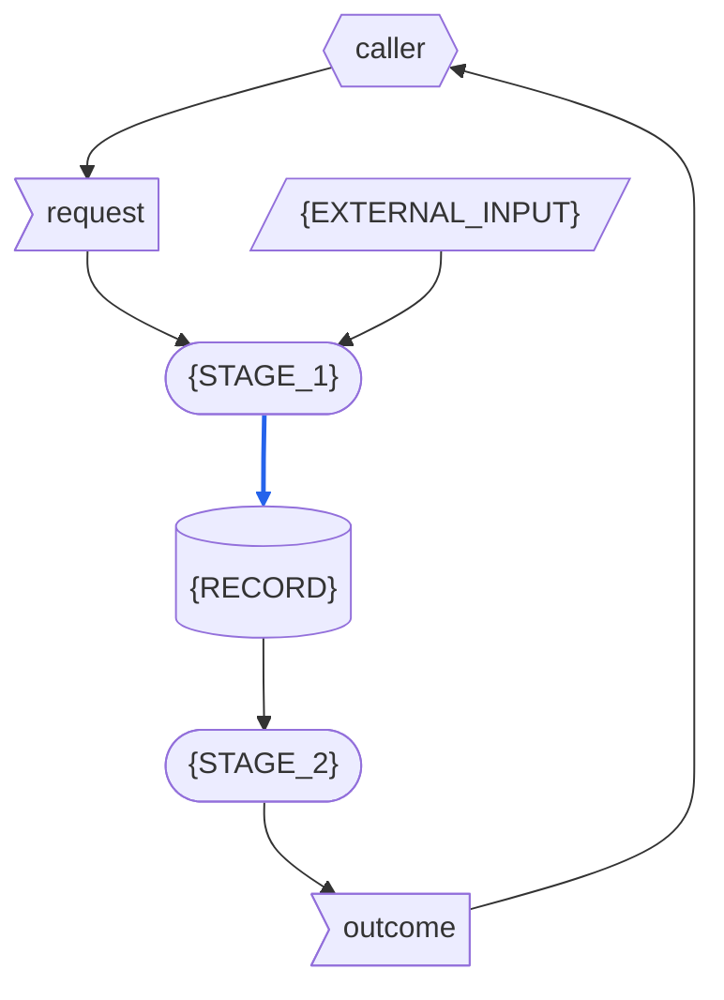

# {APP} - RSDC

> Version: 261016
> [[RSDC-Standard]]  `2026-10-30`  `ac0745864e75`
> [[DFD]]  `2026-10-18`  `09fb4a7e4730`

> **這是 template，不是一份文件。**
> 每一個 `{PLACEHOLDER}` 都以 app 自己的原始碼與它執行的結果填寫；一份填好的文件若還留著任何一個，就有一部分沒有人寫。
> 只示範一個 stage、一種資料、一條路由或一個 component 的區塊，app 有幾個就重複幾次；標為 **Optional** 的節，若 app 沒有可寫的內容就省略，之後各節的編號依序遞補。
> `RSDC-App-tmp-tw.md` 是英文版的 twin，逐行對應：它提供每一個共有句子在 RSDC twin 中的寫法；形狀只取自英文版這一份。
> 填好的文件在檔頭引用區、連到標準的連結之下，連到這個檔案：`> [[RSDC-App-tmp]]`，並由 `depends_on.py` 記下它的指紋。文件的 twin 靠這一行找到每一個共有句子的寫法；這個檔案日後改了，也靠它看得出來。
>
> 這個形狀所遵循的標準是 `{skillGroups.common}/references/RSDC-Standard.md`，**版本** 261016：也就是這個形狀最後一次與它對齊的版本。
> 上面連到標準的連結，各自在後面記下它對齊時的內容指紋。
> 這裡不重述它的規則。
> 2.3 是標準的 Dataflow，以 `{skillGroups.common}/references/DFD.md` 的記法繪製。
>
> 文件寫好之後，刪掉這一整塊，以及其他每一行以 `>` 開頭的指示——只留上面連到標準的連結。

- **App**: {APP} —— {THE_APP_IN_PLAIN_WORDS}
- **Started with**: `node server.js`
- **Authority**: 任何與本文件不一致的實作，就是要改的那一方。

# 1. Requirements — "What problem does this solve?"

本章定義這個 app 的目標與它要解決的痛點，以使用者自己的說法來寫，絕不觸及它如何建構：
不寫 component、函式庫、路由或取自 app 原始碼的識別碼，也不寫從某一次執行中量到的數字。
指名這個 app 接管的是什麼（即使那是一支程式），以及舊做法讓使用者付出什麼代價，描述的是使用者面對的問題，所以寫在這一章。

## 1.1 Target Users

- **{THE_USER}** —— {WHO_USES_THE_APP_HOW_OFTEN_AND_WHAT_THEY_NEED}
- **Caller** —— 替 {THE_USER} 呼叫這個 app 的一方：使用者操作的頁面、AI agent，或一支 script。

## 1.2 Core Vision

{WHAT_THE_APP_ACHIEVES_AND_WHY_IT_MATTERS}

## 1.3 Current Pain Points

{HOW_IT_IS_DONE_TODAY_AND_WHAT_THE_APP_TAKES_OVER_FROM_IT}
{WHAT_OF_IT_IS_DELIBERATELY_NOT_CARRIED_OVER}

> 每一條障礙都寫使用者遇到的問題，不要寫成「缺少某某功能」：那已經預設了解法。

- **{AN_OBSTACLE_IN_THE_CURRENT_PROCESS}** {THE_INEFFICIENCY_OR_MUDDLED_LOGIC_IT_CAUSES}

## 1.4 System Goals

> 每個目標的名稱要短、彼此分得開：目標表依名稱引用它。

- **{GOAL}** —— {A_PROPERTY_THE_APP_MUST_HAVE_THAT_SOMEONE_ELSE_COULD_CHECK}
- **可從 hub 開啟，也能獨自執行** —— hub 是使用者打開各個 app 的共同入口。
  使用者不必先啟動這個 app，就能從 hub 打開它；而 app 仍然可以獨自執行，不需任何修改。

# 2. Specification — "What are the system rules?"

本章定義這個 app 從外部觀察得到的行為：caller 看得到什麼、能要求什麼、又會被拒絕什麼。
這是讀者拿來對照檢查 app 的部分，所以這裡的每一句陳述，都必須是實際使用 app 就可能被推翻的。
它指名 caller 呼叫的路由，以及 hub 所掛載的 handler，因為這些名稱是契約；設計的其他部分一概不指名。

## 2.1 Terminology

後面各節所依賴、卻沒有一節定義的每一個名詞，各在這裡定義一次。

> 每個名詞只定義一次：在別處重述的 term 是第二份定義，終將偏離。
>
> 定義裡不用任何資料的名稱：資料在本節之後、於 Artifact Types 中定義。

- **Caller** —— 1.1 所說的 caller 在本章中的 role：呼叫 app 路由的一方。
- **Hub** —— 1.4 所說的 hub 在本章中的 role：app 自己的 server 以外、在它自己選定的路徑前綴之下提供這個 app 的程式。
- **{TERM}** —— {ITS_ONE_DEFINITION}

## 2.2 Artifact Types

app 處理的每一種資料：它是什麼、用來做什麼，以及它的內容必須是什麼。
它的資料分三種：**external input**，來自 app 外部、存在時間超過任何一次呼叫；**record**，由 app 寫入、在寫入它的那次呼叫之後仍保留；以及 **one-run data**，只存在於一次執行之中——對 app 來說，一次執行就是一次呼叫——不論它從哪裡來。

**External input**

> 只有當 Dataflow 把多份輸入畫成同一個節點時，才為它們命名一個群組；否則只列出各份輸入。
>
> 每份輸入位於何處，寫成 app 的設定所指定的位置——絕不寫某一台機器的絕對路徑。

*{INPUT_GROUP}* —— 以下各份輸入，合稱 **{INPUT_GROUP}**：{WHAT_THE_GROUP_IS}。
它們位於 {THE_LOCATIONS_THE_CONFIGURATION_NAMES} 之下。

- **{EXTERNAL_INPUT}** —— {WHAT_IT_IS_WHERE_IT_LIES_WHAT_IT_IS_FOR_AND_WHAT_ITS_CONTENT_MUST_BE}

**Record**

- **{RECORD}** —— {WHAT_IT_IS_WHAT_IT_IS_FOR_AND_WHAT_ITS_CONTENT_MUST_BE}

**One-run data**

- **Request** —— caller 在一次呼叫中送來的東西：{WHAT_THE_REQUEST_HOLDS}。
- **Outcome** —— app 對那次呼叫的回答：{WHAT_THE_OUTCOME_HOLDS}。

## 2.3 Dataflow

資料如何在 app 的活動之間移動：有哪些 stage、每個 stage 讀取與寫入什麼、每一份資料由誰寫入、誰可以讀，以及資料本身強加了什麼順序。
一次呼叫依序有以下各 stage：

- **{STAGE_1}** {WHAT_IT_DOES}
- **{STAGE_2}** {WHAT_IT_DOES}

### DFD

> 這張圖是唯一說出每個 stage 讀寫什麼的地方：每個 stage 都畫成圓角框，一次呼叫接觸的每一份資料都畫成它那一種的形狀。
> 每個節點都以 2.1 或 2.2 定義的名稱逐字標示。
> 只畫執行時真正讀寫的東西——文件之間的引用不搬動任何資料——而被抄進 record 的輸入，例如寫進 record 的 request 值，畫成藍色。

圖的讀法：

> 只為本圖用到的形狀或線保留條目，並在條目中指名本圖自己的例子。

- **平行四邊形** —— external input：{THE_EXTERNAL_INPUTS_DRAWN}。
- **旗形** —— one-run data：request 與 outcome。
- **圓柱** —— record：{THE_RECORDS_DRAWN}。
- **圓角框** —— stage。
- **六角形** —— app 外部的 role：{EACH_ROLE_WITH_WHAT_IT_SUPPLIES_AND_WHAT_IT_READS}。
- **雙向箭頭** —— 同一個 stage 既讀取、也寫入的資料。
- **藍色實線** —— 本身被寫進 record、或被轉成 record 內容的資料：{THIS_DIAGRAMS_BLUE_ARROWS}。
  只決定 stage 怎麼做的資料——{AN_EXAMPLE_FROM_THIS_DIAGRAM}——即使該 stage 會寫 record，也不是藍色。
- **黑色實線** —— 其他資料：不會超出所到達之 stage 或 role 的資料。
- **虛線** —— 不承載資料：表示順序，或從 app 外部做出的變更；{WHAT_IT_SHOWS_HERE}。

### Data Read/Write Rules

圖畫不出來的資料性質——凡適用者，是否整份寫入、寫入後是否唯讀、由誰刪除：

- **external input** 不由任何 stage 寫入；讀取它們的每個 stage 都只讀不寫。
- **request 與 outcome** 只存在於該次呼叫之中。
  {WHAT_OF_THEM_A_RECORD_KEEPS}
  除此之外沒有東西保留它們，也就沒有東西刪除它們。
- **{RECORD}** {WHETHER_WRITTEN_WHOLE_READ_ONLY_ONCE_WRITTEN_AND_WHO_DELETES_IT}

> app 寫入的某份 record 若有第二個寫入者、而它不先讀取這份 record，保留下面這一段並指名那份 record；否則刪除它。
> 後面的每個寫入者也都讀取的 record 是依序編輯，不算缺陷：此時也刪除這一段。

**依「唯一寫入者」判準的一項缺陷。**
app 寫入的每一份 record 都必須只有一個寫入者，除非後面的每個寫入者也都讀取它、並編輯前一個留下的東西；否則重跑一個 stage 會悄悄抹掉另一個 stage 的結果。
{THE_RECORD_WITH_TWO_WRITERS_WHAT_IT_COSTS_AND_WHAT_WOULD_REMOVE_IT}

> 某個 stage 讀取的資料若沒有任何來源——不是 external input、不是 app 外部的 role 提供的、也不是任何 stage 寫的——保留下面這一段並指名那份資料；否則刪除它。

**依「資料都有來源」判準的一項缺陷。**
stage 讀取的每一份資料，都必須是 external input、由 app 外部的 role 提供，或由某個 stage 寫入；否則沒有任何東西負責產生它，它第一次缺席時才會被發現。
{THE_DATA_WITH_NO_SOURCE_WHAT_IT_COSTS_AND_WHAT_WOULD_SUPPLY_IT}

### Order Imposed by the Data

- **{STAGE_1} 先於 {STAGE_2}** —— {THE_DATA_THAT_IMPOSES_IT}
- 沒有任何 stage 讀取後面 stage 寫入的東西。

### Exception Paths

> 每一條也寫出那次呼叫的 outcome：空的回答、錯誤碼或逾時，也都是 caller 收到的 outcome。

- **什麼都不寫入就結束** —— {WHEN_A_CALL_WRITES_NOTHING_AND_WHAT_IT_LEAVES}
- **中途停止** —— {WHEN_A_CALL_STOPS_PART_WAY_AND_WHAT_IT_LEAVES}
- **從中途重新進入** —— {WHICH_STAGE_RUNS_ALONE_AND_WITH_WHAT_RESULT}

> 這裡不展開任何 stage：stage 內部發生的事屬於 Design，畫在它的 Execution Flow 中。
> stage 內部的某個順序，或各部分之間傳遞的東西，若是某個驗證依賴的規則，就用文字寫出這條規則，寫成從 stage 外面看得到的行為，放在它所屬的規則之中——某條 Derivation Rule、某條 Invariant，或上面的某條 exception path。

## 2.4 Naming and Data Structures

app 寫出或讀取的資料如何命名與配置。

- **{DATA}** —— {ITS_NAME_AND_ENCODING}

> 只有當某個名稱遵循讀者所依賴的慣例——例如分隔符或日期格式——或 app 要從名稱或標頭中讀出某個值時，才保留下面這一行。

{EACH_NAMING_OR_PARSING_RULE_AND_WHAT_BREAKS_WHEN_IT_IS_BROKEN}

{DATA} 的欄位：

> 只有當兩個 stage 寫同一份 record 時，才保留 Part 欄。

| Field | Meaning | Part |
|---|---|---|
| `{FIELD}` | {WHAT_IT_HOLDS} | {THE_STAGE_THAT_WRITES_IT} |

> 代碼標籤就是契約：每一個都照原樣列出，因為每個讀者都逐字比對它，寫法不同的代碼標籤，就是沒有人認得的值。

存放代碼標籤的欄位，以及每個欄位可能存放的每一個代碼標籤：

| Field | Values |
|---|---|
| `{FIELD}` | {EVERY_VALUE_IT_MAY_HOLD} |

{THE_PRECISION_OF_EVERY_NUMBER_WRITTEN}

## 2.5 Config Schemas

> 沒有 Default 欄：設定檔缺少的欄位要回報為缺少，絕不由程式碼補上——預設值是被用上時從不說一聲的替代值。

app 的設定檔必須包含的欄位，以及欄位之間的限制。
app 只讀它自己的 `app.config.json`，不讀其他設定檔。
{WHAT_THE_APP_DOES_WITH_A_FILE_THAT_BREAKS_ITS_SCHEMA}

`app.config.json` 的欄位：

| Field | Meaning | Allowed values | What changing it costs |
|---|---|---|---|
| `{FIELD}` | {WHAT_IT_MEANS} | {WHAT_IT_MAY_HOLD_AND_WHICH_FIELDS_IT_DEPENDS_ON} | {WHAT_A_CHANGE_TO_IT_CHANGES} |

## 2.6 Derivation Rules

> **Optional.** 只有當 app 使用並非直接觀察而來的值時才寫。
>
> 例子用假設的數值：取自今天文件的數字，文件一改就過時。

app 並非直接觀察而來的每個值如何推導。

### {DERIVED_VALUE}

- {WHERE_IT_COMES_FROM_IN_ORDER_OF_PREFERENCE_AND_WHY}
- {WHAT_MUST_NEVER_STAND_IN_FOR_IT}
- {HOW_IT_IS_MARKED_WHEN_NO_SOURCE_ANSWERS}

## 2.7 Presentation Contract

什麼可以被顯示、顯示給誰、使用者必須能夠啟動哪些動作，以及所見與所為是否一致。

**app 的輸出講清楚的事**

- **{WHAT_IT_MUST_MAKE_PLAIN}** {HOW_AND_WHAT_GOES_WRONG_IF_IT_DOES_NOT}

**每一種呈現都要回答的問題**

> 每一題都要回答；可以正當地回答「沒有」，但不能不問。

1. *沒有結果時，使用者看到什麼？
   被略過的數量在哪裡回報？*
   {ANSWER}
2. *哪些流程是使用者自己能啟動的？
   不能啟動的那些，原因是什麼？*
   {ANSWER}
3. *每一項擷取，都已在使用者自己的環境中實際觀察到成功了嗎？*
   {ANSWER}
4. *如果這些內容在這個 app 之外也抵達得到，app 會把那個位址交給使用者嗎？*
   {ANSWER}
5. *檢視範圍縮小之後，畫面上的計數與下一個動作的範圍相符嗎？*
   {ANSWER}
6. *批次動作的上限是多少？
   超出時如何拒絕，又是否可能留下做到一半的結果？*
   {ANSWER}
7. *被拒絕的使用者接下來該做什麼？*
   {ANSWER}
8. *它預設暴露到什麼程度，暴露範圍放寬時又有誰會知道？*
   {ANSWER}

## 2.8 HTTP API

caller 可以透過 HTTP 呼叫的每一條路由——頁面、AI agent、script——以及每次呼叫執行 2.3 的哪些 stage。

caller 只透過這些路由、或 hub 所掛載的 handler 接觸 app，絕不 import 它的其他模組，也不讀它內部的檔案。

- `{METHOD} {ROUTE}` —— 執行 {THE_STAGES_IT_RUNS}。
  - **Takes** —— {WHAT_ITS_REQUEST_HOLDS}
  - **Answers** —— {WHAT_ITS_OUTCOME_HOLDS}
  - **Refuses** —— {WHAT_IT_REFUSES_AND_WITH_WHAT}
- `GET /healthz` —— 不執行任何 stage。
  - **Takes** —— 無
  - **Answers** —— app 在啟動時所解析出的內容
  - **Refuses** —— 不拒絕任何東西；它不帶任何機密

**Guards**

> 每一份允許清單、每一個上限都是一道 guard：寫出它允許什麼、拒絕什麼、值剛好落在邊界上時怎麼處理、拒絕時回答什麼，以及它守哪些路由；在它所守的每條路由的 Refuses 那一項寫上它的名稱。
> 拒絕行為沒有寫下來的 guard，日後的修改會在不知不覺中把它放寬。

- **{GUARD}** —— {WHAT_IT_ALLOWS_WHAT_IT_REFUSES_WITH_WHAT_ANSWER_AND_WHICH_ROUTES}

## 2.9 Mountable Handler

一個 hub 如何提供這個 app：它 require `app.js`，並在啟動時呼叫 `createApp(options)` 一次。

- `mountedAt` —— app 所在的路徑前綴；請求到達 handler 時，這個前綴已經被去掉。
- `{ANY_FURTHER_OPTION}` —— {WHAT_IT_DOES}

它回傳 `(req, res)` handler——或一個最終給出 handler 的 promise——像 app 自己的 server 一樣，提供 2.8 的路由，guard 也包括在內。
載入 `app.js` 不會啟動任何東西。
{WHAT_HAPPENS_WHEN_IT_CANNOT_PREPARE}

## 2.10 Invariants

在每一個 stage、每一條路由都成立、沒有例外的規則：

- **{A_RULE}** {WHAT_BREAKS_WHEN_IT_IS_BROKEN}

1.4 的目標，以及承載它們的規則：

| Goal | Carried by |
|---|---|
| {GOAL} | {THE_SECTIONS_AND_RULES_THAT_CARRY_IT} |
| 可從 hub 開啟，也能獨自執行 | 2.9 Mountable Handler |

# 3. Design — "How is the system structured?"

本章描述 app 如何被建構出來以遵守第 2 章：它的 component、每個 component 如何完成工作、檔案放在哪裡，以及每項 capability 呈現給使用者的形式。

## 3.1 Core Component Responsibilities

每個 component 一條，寫出它的檔案、它執行 2.3 的哪些 stage、它唯一的工作與它的邊界：跨越邊界的一次修改，就是對兩個 component 的修改。
2.3 的每一個 stage 都由其中一個執行；沒有任何 component 執行的 stage，是沒有人實作的活動。

- **{COMPONENT}**，檔案 `{FILE}` —— 執行 2.3 的 {ITS_STAGES}。
  它唯一的工作：{ITS_ONE_JOB}。
  它的邊界：{WHAT_A_CHANGE_CROSSING_IT_WOULD_BREAK}。

它們如何互動：{WHAT_PASSES_BETWEEN_THE_COMPONENTS_AND_THROUGH_WHAT}

> 說出它們之間傳遞什麼——路由收到的 request 與它的回答、子行程的 stdin 與 stdout，或一方寫出、另一方讀取的 2.3 record。

**Node serves and spawns; Python decides。**

> 寫出哪些決定可以由 server 做出（路由、提供內容、產生子行程、轉送），哪些屬於 Python kernel（整個 domain）。

{WHERE_THE_LINE_SITS_FOR_THIS_APP}
server 完全不解析 domain，所以換掉 kernel，就換掉了這個 app。

## 3.2 Execution Flow

3.1 的每一個 component 在運行時如何完成工作：它的 step 依序寫出，用程式碼裡的名稱，包括實作自己選擇、而非資料強制的分支、重試、平行處理與順序。
需要畫圖時，以 DFD 的記法繪製。
這裡引用第 2 章的規則，絕不重述。

> 每個 component 一個小節。
> component 工作的各個部分，以及每一部分讀取什麼、傳下什麼，值得畫出來時，就在它的小節下把它展開：一張 DFD，它的 process 是 component 的 step，用程式碼裡的名稱。

### {COMPONENT}

1. {ITS_STEPS_IN_ORDER}

## 3.3 Directory Structure

app 的檔案實際放在哪裡，以及它們分層的邏輯。
{HOW_THE_FILES_ARE_LAYERED_AND_WHY}

> 每個檔案一條：讀者才分得出一個檔案是缺了，還是改了名。
> 3.1 已指名的檔案，只寫它是哪一個 component；它的工作寫在 3.1。

- `{FILE}` —— {WHAT_IT_IS_FOR}

**什麼可以搬動，搬動的代價是什麼。**
{WHAT_MAY_MOVE_AND_WHAT_BREAKS_WHEN_IT_DOES} 這個資料夾可以整個複製到別處、不經修改就照常執行，因為 app 只讀 2.5 的 `app.config.json`，並以自己的目錄為基準解析每一個路徑。

## 3.4 Presentation Form

2.7 裡的每一條「使用者必須能夠……」：提供它的 component、它呈現給人的形式——控制項、頁面、捷徑，以及有幾個——還有使用者實際認得它的名稱。

> 每一列對應 2.7 第 2 題裡使用者自己能啟動的一個流程；對不上任何一個流程的列，是沒有人同意過的 capability：補上規則，或拿掉它。
> 第 2 題裡不能啟動的流程，以及只規定不得呈現什麼、不得對誰開放的規則，本來就沒有入口，不列入。
> 只改變揭露程度或顯示狀態、拿掉也不會讓任何驗證失效的控制項，例如全部展開、全部收合，不是 capability，不列入；app 有這類控制項時，在表下寫明，免得後人把它當成 orphan 去「修」。
> 使用者看到的名稱只寫在 Name the user sees 那一欄，不拿來描述行為、版面、位置或樣式：那些屬於第 4 章。
> Component 那一欄寫 3.1 的 component 名稱。

| Capability | Component | Form | Name the user sees |
|---|---|---|---|
| {CAPABILITY} | {COMPONENT} | {ITS_FORM_AND_HOW_MANY} | {LABEL_AS_SHOWN} |

# 4. Coding — "How should the code be written?"

本章讓程式碼維持品質，並讓 app 在每一個平台上都一樣運作：它遵守的規則、可以使用的工具、如何保持安全、已經遇過的陷阱、每一項宣稱如何被證明，以及它還在哪裡沒做到。

## 4.1 Key Development Guidelines

> 其中，在適用時包括：
>
> - **Config-driven** —— app 的邏輯依循它的 `app.config.json`，而不是寫死在程式碼裡。
> - **AI-First** —— 每一個 outcome 都說出它發現了什麼、在哪裡，讓呼叫它的 agent 不必讀程式碼就能據以行動。
> - **輸入值沒有預設值**
> - **執行時不發出 prompt**
>
> 守住第 2 章某條規則的 guideline，例如每一個位置都由 app 的設定指定，要引用那條規則，並說明程式碼如何守住它，而不是再陳述一次。

- **`server.js` 把 `listen` 放在 `require.main === module` 的判斷之後，`app.js` 匯出 `createApp(options)`。**
  否則像 2.9 的 hub 那樣載入 app 時，就會在 hub 旁邊另外啟動一個 server。
- **頁面發出的每一個位址都相對於頁面：`./api/x`，絕不是 `/api/x`。**
  否則在 2.9 的前綴之下，頁面會去問 hub 的根目錄，而不是這個 app。
- **{A_GUIDELINE}** {WHAT_BREAKS_WITHOUT_IT}

## 4.2 Implementation Guidelines and Tools

- Node {NODE_VERSION} 以上，Python {PYTHON_VERSION} 以上。
- **Node 與 Python 只用標準函式庫。**
  不 `npm install`、不 `pip install`、不用 CDN，也不在載入時抓取字型。
  app 必須能在一台什麼都沒安裝的機器上執行。
- {THE_PROGRAMMING_STYLE_SUCH_AS_TYPE_HINTS}
- {THE_ENCODING_OF_WHAT_IS_WRITTEN}

## 4.3 Safety and Robustness

> 其中，在適用時包括：兩次呼叫同時寫入同一份 record 時會發生什麼，以及由什麼阻止它；每一個輸入在寫出任何東西之前，如何對照它的契約檢查。

- **命令列上不放任何機密。**
  行程清單是其他每一個行程都讀得到的，所以密碼只能經由 `stdin` 抵達 Python，否則就完全不送。
- **2.8 的 guard 在 Python kernel 內部再強制執行一次。**
  否則只要有一條路由漏了檢查，server 就成了通往後方網路的中繼站。
- **每一個抵達頁面的值都要經過跳脫，兩種引號都包括在內。**
  否則來自 request 或檔案的值，會在頁面上被當成 markup 執行。
- **{A_SAFEGUARD}** {WHAT_BREAKS_WITHOUT_IT}

## 4.4 Platform Traps

> **Optional.** 在真的發生過之前省略。
>
> 每一條都附上讓人學到它的那次失敗——附帶理由的規則，能撐過下一次改寫；沒有附帶理由的，會被第一個覺得它礙事的人刪掉。

只收錄真的產生過「看似合理卻是錯的」結果的情況：

- **{THE_TRAP}** {THE_CASE_IT_HAPPENED_ON_AND_WHAT_NOW_PREVENTS_IT}

## 4.5 Verification Obligations

本文件陳述的每一條規則、如何證明它成立，以及由誰證明；3.1 的每一個 component 都至少在一列中被指名，因為沒有任何一列證明的 component，無從證明它能運作。
規則要在其行為被觀察到之後才算證明成立，而不是在讀過負責產生它的程式碼之後。

| Claim | Rule | Proven by | Performed by |
|---|---|---|---|
| {A_CLAIM} | {ITS_SECTION} | {THE_OBSERVATION_AND_THE_DATA_IT_WAS_MADE_ON} | {WHO_SHOWS_IT} |
| {A_CLAIM_NOT_YET_PROVEN} | {ITS_SECTION} | — | *not verified*：{WHAT_HAS_BEEN_READ_SO_FAR} |

> 每一列都已驗證時，刪除下面這一段。

**標為 not verified 的列**，是尚待撰寫的檢查。
{HOW_EACH_COULD_BE_MADE_MECHANICAL}

## 4.6 Defects

app 做了第 2 章說它不該做之事的每一處，各附觀察到的地方與代價：

- **{A_DEFECT}** {WHERE_IT_WAS_OBSERVED_AND_WHAT_IT_COSTS}

> 沒有缺陷時，以一行取代清單：目前沒有已知缺陷。
