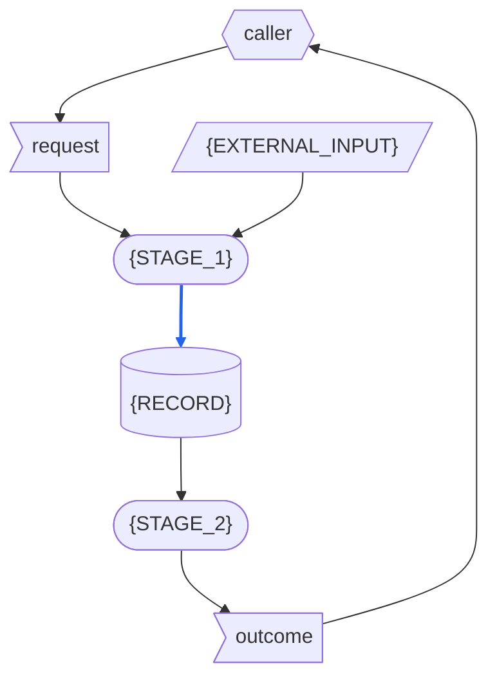

# {APP} - RSDC

> Version: 261016
> [[RSDC-Standard]]  `2026-10-30`  `ac0745864e75`
> [[DFD]]  `2026-10-18`  `09fb4a7e4730`

> **This is the template, not a document.**
> Every `{PLACEHOLDER}` is filled from the app's own source and what its runs show; a filled document still holding one has a part nobody wrote.
> A block that shows one stage, kind of data, route or component is repeated for each one the app has, and a section marked **Optional** that the app has nothing for is left out, the sections after it numbered on.
> `RSDC-App-tmp-tw.md` is this file's twin, line for line: it words every shared sentence for the RSDC twin, and the shape comes from this file alone.
> A filled document links this file in its header quote, under the links to the standard: `> [[RSDC-App-tmp]]`, its fingerprint recorded by `depends_on.py`. That line is how the document's twin finds the wording of every shared sentence, and how a later change to this file shows.
>
> The standard this shape follows is `{skillGroups.common}/references/RSDC-Standard.md`, at **Version** 261016: the version this shape was last brought in line with.
> The links to the standard above record, after each, the fingerprint of the content it was brought in line with.
> Its rules are not restated here.
> Its 2.3 is the standard's Dataflow, drawn in the notation of `{skillGroups.common}/references/DFD.md`.
>
> Delete this block when the document is written, and with it every other line that opens with `>` — all but the links to the standard above.

- **App**: {APP} — {THE_APP_IN_PLAIN_WORDS}
- **Started with**: `node server.js`
- **Authority**: any implementation disagreeing with this document is what changes.

# 1. Requirements — "What problem does this solve?"

This chapter defines the app's goals and the pain points it answers, in the user's own terms, and never touches on how it is built:
no component, library, route or identifier out of the app's own source, and no figure measured from a run.
Naming what the app takes over from — even a program — and what the old way costs the user describes the user's problem, so it belongs here.

## 1.1 Target Users

- **{THE_USER}** — {WHO_USES_THE_APP_HOW_OFTEN_AND_WHAT_THEY_NEED}
- **Callers** — whatever calls the app for {THE_USER}: the page a person works in, an AI agent, or a script.

## 1.2 Core Vision

{WHAT_THE_APP_ACHIEVES_AND_WHY_IT_MATTERS}

## 1.3 Current Pain Points

{HOW_IT_IS_DONE_TODAY_AND_WHAT_THE_APP_TAKES_OVER_FROM_IT}
{WHAT_OF_IT_IS_DELIBERATELY_NOT_CARRIED_OVER}

> State each obstacle as a problem the user meets, never as a missing feature: that already assumes the solution.

- **{AN_OBSTACLE_IN_THE_CURRENT_PROCESS}** {THE_INEFFICIENCY_OR_MUDDLED_LOGIC_IT_CAUSES}

## 1.4 System Goals

> Keep each goal's name short and distinct: the goals table cites it by name.

- **{GOAL}** — {A_PROPERTY_THE_APP_MUST_HAVE_THAT_SOMEONE_ELSE_COULD_CHECK}
- **Opens from the hub, runs alone** — the hub is the one place a user opens their apps from.
  A user opens the app from the hub without starting it first, and the app still runs alone, unchanged.

# 2. Specification — "What are the system rules?"

This chapter defines the app's externally observable behaviour: what a caller can see, ask for and be refused.
This is the part a reader checks the app against, so every statement here is one that could be falsified by using the app.
It names the routes a caller calls, and the handler a hub mounts, because their names are contracts; it names no other part of the design.

## 2.1 Terminology

Every noun the later sections rely on and none of them defines, each defined here once.

> Define each noun once: a term restated elsewhere is a second definition, and it drifts.
>
> Name no data in a definition: the data is defined after this section, in Artifact Types.

- **Caller** — a caller of 1.1, in the role this chapter gives it: whoever calls a route of the app.
- **Hub** — the hub of 1.4, in the role this chapter gives it: a program other than the app's own server that serves the app, under a path prefix it chooses.
- **{TERM}** — {ITS_ONE_DEFINITION}

## 2.2 Artifact Types

Every kind of data the app handles: what it is, what it is for, and what its content must be.
Its data is of three kinds: **external inputs**, which come from outside the app and outlast any call; **records**, which the app writes and keeps after the call that wrote them; and **one-run data**, which lives for one run only — for the app, a run is one call — wherever it comes from.

**External inputs**

> Name a group only when the Dataflow draws several inputs as one node; otherwise list the inputs alone.
>
> Give where each input lies as a location the app's configuration names — never one machine's absolute path.

*{INPUT_GROUP}* — the inputs below, named together as **{INPUT_GROUP}**: {WHAT_THE_GROUP_IS}.
They lie under {THE_LOCATIONS_THE_CONFIGURATION_NAMES}.

- **{EXTERNAL_INPUT}** — {WHAT_IT_IS_WHERE_IT_LIES_WHAT_IT_IS_FOR_AND_WHAT_ITS_CONTENT_MUST_BE}

**Records**

- **{RECORD}** — {WHAT_IT_IS_WHAT_IT_IS_FOR_AND_WHAT_ITS_CONTENT_MUST_BE}

**One-run data**

- **The request** — what a caller sends in one call: {WHAT_THE_REQUEST_HOLDS}.
- **The outcome** — the app's answer to that call: {WHAT_THE_OUTCOME_HOLDS}.

## 2.3 Dataflow

How data moves between the app's activities: what the stages are, what each stage reads and writes, who writes each piece of data and who may read it, and what order the data itself imposes.
A call has these stages, in this order:

- **{STAGE_1}** {WHAT_IT_DOES}
- **{STAGE_2}** {WHAT_IT_DOES}

### DFD

> This diagram is the one place that says what each stage reads and writes: draw every stage as a rounded box, and every piece of data a call touches in the shape of its kind.
> Label every node with a name 2.1 or 2.2 defines, verbatim.
> Draw only what is read or written at run time — a citation between documents moves no data — and draw blue an input echoed into a record, such as the request's values written into a record.

How to read the diagram:

> Keep a bullet only for a shape or a line this diagram uses, and name this diagram's own examples in it.

- **Parallelogram** — an external input: {THE_EXTERNAL_INPUTS_DRAWN}.
- **Flag** — one-run data: the request and the outcome.
- **Cylinder** — a record: {THE_RECORDS_DRAWN}.
- **Rounded box** — a stage.
- **Hexagon** — a role outside the app: {EACH_ROLE_WITH_WHAT_IT_SUPPLIES_AND_WHAT_IT_READS}.
- **Two-headed arrow** — data the same stage both reads and writes.
- **Blue solid arrow** — data that is itself written into a record, or turned into the content of one: {THIS_DIAGRAMS_BLUE_ARROWS}.
  Data that only steers what a stage does — {AN_EXAMPLE_FROM_THIS_DIAGRAM} — is not blue, even when the stage writes a record.
- **Black solid arrow** — any other data: data that goes no further than the stage or role it reaches.
- **Dotted arrow** — no data: an order, or a change made from outside the app; {WHAT_IT_SHOWS_HERE}.

### Data Read/Write Rules

What the diagram cannot show about the data it draws — where it applies, whether it is written whole, whether it is read-only once written, and who deletes it:

- **External inputs** are written by no stage; every stage that reads one only reads it.
- **The request and the outcome** last as long as the call.
  {WHAT_OF_THEM_A_RECORD_KEEPS}
  Nothing else keeps them, so nothing deletes them.
- **{RECORD}** {WHETHER_WRITTEN_WHOLE_READ_ONLY_ONCE_WRITTEN_AND_WHO_DELETES_IT}

> When a record the app writes has a second writer that does not read it first, keep the paragraph below and name the record; otherwise delete it.
> A record every later writer also reads is edited in turn and is no defect: leave the paragraph out.

**A defect by the one-writer rule.**
Every record the app writes must have one writer, unless each later writer also reads it and edits what the one before left; otherwise a rerun of one stage silently erases another stage's result.
{THE_RECORD_WITH_TWO_WRITERS_WHAT_IT_COSTS_AND_WHAT_WOULD_REMOVE_IT}

> When a stage reads data that has no source — not an external input, not supplied by a role outside the app, not written by any stage — keep the paragraph below and name the data; otherwise delete it.

**A defect by the has-a-source rule.**
Every piece of data a stage reads must be an external input, be supplied by a role outside the app, or be written by some stage; otherwise nothing is responsible for producing it, and it is found only the first time it is missing.
{THE_DATA_WITH_NO_SOURCE_WHAT_IT_COSTS_AND_WHAT_WOULD_SUPPLY_IT}

### Order Imposed by the Data

- **{STAGE_1} before {STAGE_2}** — {THE_DATA_THAT_IMPOSES_IT}
- No stage reads what a later stage writes.

### Exception Paths

> Say for each what the call's outcome is too: an empty answer, an error code or a timeout is still an outcome the caller gets.

- **Ending with nothing written** — {WHEN_A_CALL_WRITES_NOTHING_AND_WHAT_IT_LEAVES}
- **Stopping midway** — {WHEN_A_CALL_STOPS_PART_WAY_AND_WHAT_IT_LEAVES}
- **Re-entering midway** — {WHICH_STAGE_RUNS_ALONE_AND_WITH_WHAT_RESULT}

> No stage is drawn open here: what happens inside a stage is the Design's, drawn in its Execution Flow.
> Where an order inside a stage, or something passed between its parts, is a rule a verification depends on, say the rule in words, as behaviour seen from outside the stage, among the rules it belongs with — a Derivation Rule, an Invariant, an exception path above.

## 2.4 Naming and Data Structures

How the data the app writes or reads is named and laid out.

- **{DATA}** — {ITS_NAME_AND_ENCODING}

> Keep the line below only when a name follows a convention a reader relies on, such as a separator or a date format, or the app reads a value out of a name or a header.

{EACH_NAMING_OR_PARSING_RULE_AND_WHAT_BREAKS_WHEN_IT_IS_BROKEN}

{DATA}'s fields:

> Keep the Part column only when two stages write one record.

| Field | Meaning | Part |
|---|---|---|
| `{FIELD}` | {WHAT_IT_HOLDS} | {THE_STAGE_THAT_WRITES_IT} |

> A code label is a contract: list each one exactly as it is written, since every reader matches it exactly and one spelled any other way is a value nobody recognizes.

The fields that hold code labels, with every code label each may hold:

| Field | Values |
|---|---|
| `{FIELD}` | {EVERY_VALUE_IT_MAY_HOLD} |

{THE_PRECISION_OF_EVERY_NUMBER_WRITTEN}

## 2.5 Config Schemas

> There is no Default column: a field the file lacks is reported missing, never filled in by the code — a default is a substitute that never says it was used.

The fields the app's configuration file must contain, and the constraints between them.
The app reads its own `app.config.json` and no other configuration file.
{WHAT_THE_APP_DOES_WITH_A_FILE_THAT_BREAKS_ITS_SCHEMA}

`app.config.json`'s fields:

| Field | Meaning | Allowed values | What changing it costs |
|---|---|---|---|
| `{FIELD}` | {WHAT_IT_MEANS} | {WHAT_IT_MAY_HOLD_AND_WHICH_FIELDS_IT_DEPENDS_ON} | {WHAT_A_CHANGE_TO_IT_CHANGES} |

## 2.6 Derivation Rules

> **Optional.** Only when the app uses a value it does not observe directly.
>
> In an example, use hypothetical values: a number taken from today's documents goes stale when they change.

How each value the app does not observe directly is derived.

### {DERIVED_VALUE}

- {WHERE_IT_COMES_FROM_IN_ORDER_OF_PREFERENCE_AND_WHY}
- {WHAT_MUST_NEVER_STAND_IN_FOR_IT}
- {HOW_IT_IS_MARKED_WHEN_NO_SOURCE_ANSWERS}

## 2.7 Presentation Contract

What may be shown, to whom, which actions the user must be able to start, and whether what is seen is what is done.

**What the app's output makes plain**

- **{WHAT_IT_MUST_MAKE_PLAIN}** {HOW_AND_WHAT_GOES_WRONG_IF_IT_DOES_NOT}

**The questions every presentation answers**

> Answer every question; "there is none" is a legitimate answer, but no question may go unasked.

1. *What does the user see when there is no result?
   Where is the skipped count reported?*
   {ANSWER}
2. *Which flows can the user start themselves?
   For those they cannot, why not?*
   {ANSWER}
3. *Has every retrieval been observed to succeed in the user's own environment?*
   {ANSWER}
4. *If the material is also reachable outside this app, does the app hand over that address?*
   {ANSWER}
5. *After the view is narrowed, does the count on screen match the scope of the next action?*
   {ANSWER}
6. *What is the ceiling on a bulk action?
   How is an excess refused, and can it leave a half-done result?*
   {ANSWER}
7. *What should a refused user do next?*
   {ANSWER}
8. *How far is it exposed by default, and who finds out when that widens?*
   {ANSWER}

## 2.8 HTTP API

Every route a caller may call over HTTP — the page, an AI agent, a script — and the stages of 2.3 each call runs.

A caller reaches the app only through these routes, or the handler a hub mounts, and never by importing another of its modules or reading its internal files.

- `{METHOD} {ROUTE}` — runs {THE_STAGES_IT_RUNS}.
  - **Takes** — {WHAT_ITS_REQUEST_HOLDS}
  - **Answers** — {WHAT_ITS_OUTCOME_HOLDS}
  - **Refuses** — {WHAT_IT_REFUSES_AND_WITH_WHAT}
- `GET /healthz` — runs no stage.
  - **Takes** — nothing
  - **Answers** — what the app resolved at startup
  - **Refuses** — nothing; it carries no secret

**Guards**

> Every allow-list and every limit is a guard: say what it allows, what it refuses, what happens to a value exactly at the edge, with what answer it refuses, and which routes it guards; the Refuses item of each route it guards names it.
> A guard whose refusal is not written down is one a later change will widen without noticing.

- **{GUARD}** — {WHAT_IT_ALLOWS_WHAT_IT_REFUSES_WITH_WHAT_ANSWER_AND_WHICH_ROUTES}

## 2.9 Mountable Handler

How a hub serves the app: it requires `app.js` and calls `createApp(options)` once, when it starts.

- `mountedAt` — the path prefix the app answers under; requests reach the handler with it already stripped.
- `{ANY_FURTHER_OPTION}` — {WHAT_IT_DOES}

It returns the `(req, res)` handler — or a promise of it — that serves the routes of 2.8, guards included, as the app's own server would.
Loading `app.js` starts nothing.
{WHAT_HAPPENS_WHEN_IT_CANNOT_PREPARE}

## 2.10 Invariants

Rules that hold in every stage and every route, without exception:

- **{A_RULE}** {WHAT_BREAKS_WHEN_IT_IS_BROKEN}

The goals of 1.4, and the rules that carry them:

| Goal | Carried by |
|---|---|
| {GOAL} | {THE_SECTIONS_AND_RULES_THAT_CARRY_IT} |
| Opens from the hub, runs alone | 2.9 Mountable Handler |

# 3. Design — "How is the system structured?"

This chapter describes how the app is built to keep chapter 2: its components, how each component does its work, where the files live, and the form each capability takes for the user.

## 3.1 Core Component Responsibilities

One bullet per component, with its file, the stages of 2.3 it performs, its one job and its boundary: a change that crosses the boundary is a change to two components.
Every stage of 2.3 is performed by one of them; a stage none performs is an activity nobody implemented.

- **{COMPONENT}**, the file `{FILE}` — performs {ITS_STAGES} of 2.3.
  Its one job: {ITS_ONE_JOB}.
  Its boundary: {WHAT_A_CHANGE_CROSSING_IT_WOULD_BREAK}.

How they interact: {WHAT_PASSES_BETWEEN_THE_COMPONENTS_AND_THROUGH_WHAT}

> Say what passes between them — the request a route receives and its answer, a child process's stdin and stdout, or a record of 2.3 one writes and another reads.

**Node serves and spawns; Python decides.**

> Say which decisions the server is allowed to make (routing, serving, spawning, relaying) and which belong to the Python kernel (all of the domain).

{WHERE_THE_LINE_SITS_FOR_THIS_APP}
The server parses none of the domain, so swapping the kernel changes the app.

## 3.2 Execution Flow

For each component of 3.1, how it does its work at run time: its steps in order, named as the code names them, with the branches, retries, parallel work and orders the implementation chose rather than the data forced.
Where a drawing helps, it is drawn in the notation of the DFD.
Chapter 2's rules are cited here, never restated.

> One subsection per component.
> Where the parts of a component's work, and what each reads and passes on, are worth seeing, draw the component open under its subsection: a DFD, its processes the component's steps, named as the code names them.

### {COMPONENT}

1. {ITS_STEPS_IN_ORDER}

## 3.3 Directory Structure

Where the app's files physically live, and the logic of their layering.
{HOW_THE_FILES_ARE_LAYERED_AND_WHY}

> One bullet per file: only then can a reader tell a missing file from a renamed one.
> A file 3.1 already names says only which component it is; its job is written in 3.1.

- `{FILE}` — {WHAT_IT_IS_FOR}

**What is relocatable, and what that costs.**
{WHAT_MAY_MOVE_AND_WHAT_BREAKS_WHEN_IT_DOES} The folder can be copied elsewhere whole and run unchanged, because the app reads only the `app.config.json` of 2.5 and resolves every path against its own directory.

## 3.4 Presentation Form

Every "the user must be able to…" of 2.7: the component that provides it, the form it takes for a person — a control, a page, a shortcut, and how many — and the name the user knows it by.

> Each row is one flow of question 2 of 2.7 that the user can start themselves; a row that matches none of those flows is a capability nobody agreed to: write the rule, or remove it.
> The flows of question 2 the user cannot start, and the rules that only say what may not be shown or to whom it may not be open, have no entrance by their nature, and are left out.
> A control that only changes how much is revealed or how something is displayed, and whose removal would falsify no verification, such as expand all or collapse all, is not a capability and is left out; when the app has such controls, say so under the table, so that no later reader "fixes" them as orphans.
> A name the user sees goes only in the Name the user sees column, and never describes behaviour, layout, position or styling: those belong to chapter 4.
> The Component column holds the names of the components of 3.1.

| Capability | Component | Form | Name the user sees |
|---|---|---|---|
| {CAPABILITY} | {COMPONENT} | {ITS_FORM_AND_HOW_MANY} | {LABEL_AS_SHOWN} |

# 4. Coding — "How should the code be written?"

This chapter keeps the code's quality up and the app working alike on every platform: the rules the code follows, the tools it may use, how it stays safe, the traps already met, how each claim is proved, and where it still falls short.

## 4.1 Key Development Guidelines

> Among them, where they apply:
>
> - **Config-driven** — the app's logic follows its `app.config.json` instead of being written into the code.
> - **AI-First** — every outcome says what it found and where, so that the calling agent can act on it without reading the code.
> - **No default for an input value**
> - **No prompt at run time**
>
> A guideline that keeps a rule of chapter 2, such as every location coming from the app's configuration, cites that rule and says how the code keeps it, rather than stating it again.

- **`server.js` keeps its `listen` behind `require.main === module`, and `app.js` exports `createApp(options)`.**
  Otherwise loading the app, as the hub of 2.9 does, starts a server of its own beside the hub's.
- **Every address the page emits is relative to the page: `./api/x`, never `/api/x`.**
  Otherwise, served under the prefix of 2.9, the page asks the hub's root instead of the app.
- **{A_GUIDELINE}** {WHAT_BREAKS_WITHOUT_IT}

## 4.2 Implementation Guidelines and Tools

- Node {NODE_VERSION} or later, Python {PYTHON_VERSION} or later.
- **Node and Python use their standard libraries only.**
  No `npm install`, no `pip install`, no CDN, no font fetched at load.
  The app must run on a machine with nothing installed.
- {THE_PROGRAMMING_STYLE_SUCH_AS_TYPE_HINTS}
- {THE_ENCODING_OF_WHAT_IS_WRITTEN}

## 4.3 Safety and Robustness

> Among them, where they apply: what happens when two calls write the same record at once, and what stops it; how each input is checked against its contract before anything is written.

- **No secret on a command line.**
  A process list is readable by every other process, so a password reaches Python on `stdin` or not at all.
- **The guards of 2.8 are enforced again inside the Python kernel.**
  Otherwise one route that forgets a check turns the server into a relay into the network behind it.
- **Every value that reaches the page is escaped, both quote forms included.**
  Otherwise a value from a request or a file runs as markup in the page.
- **{A_SAFEGUARD}** {WHAT_BREAKS_WITHOUT_IT}

## 4.4 Platform Traps

> **Optional.** Leave it out until a case has actually happened.
>
> Give each the failure that taught it — a rule with its reason attached survives the next rewrite, and one without it is deleted by the first person who finds it inconvenient.

Only cases that have actually produced a plausible but wrong result:

- **{THE_TRAP}** {THE_CASE_IT_HAPPENED_ON_AND_WHAT_NOW_PREVENTS_IT}

## 4.5 Verification Obligations

Each rule this document states, how it is shown to hold, and who shows it; every component of 3.1 is named in at least one row, since a component no row proves cannot be shown to work.
A rule is proven when its behaviour has been observed, not when the code meant to produce it has been read.

| Claim | Rule | Proven by | Performed by |
|---|---|---|---|
| {A_CLAIM} | {ITS_SECTION} | {THE_OBSERVATION_AND_THE_DATA_IT_WAS_MADE_ON} | {WHO_SHOWS_IT} |
| {A_CLAIM_NOT_YET_PROVEN} | {ITS_SECTION} | — | *not verified*: {WHAT_HAS_BEEN_READ_SO_FAR} |

> Delete the paragraph below when every row is verified.

**The rows not verified** are the checks still to be written.
{HOW_EACH_COULD_BE_MADE_MECHANICAL}

## 4.6 Defects

Every place where the app does what chapter 2 says it should not, each where it was observed and what it costs:

- **{A_DEFECT}** {WHERE_IT_WAS_OBSERVED_AND_WHAT_IT_COSTS}

> When there is none, replace the list with one line: None known.
