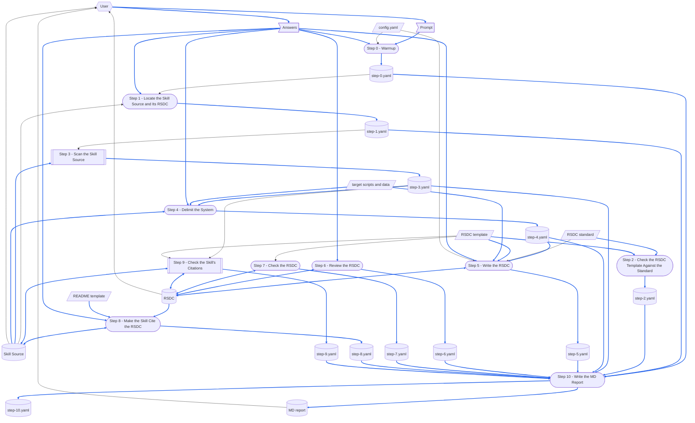

本文件為 [SKILL.md](SKILL.md) 的繁體中文版。
任一份改了某節，另一份必須在同一次執行中一起改。

> [[SkillCompiler-RSDC]]  `cited`  `2026-10-20`  `a30852332f21`

# TERMINOLOGY

在每個 skill 中意義都相同的 term。

- **`run step N`** — 放在 prompt 結尾、指名某一個 step 的選擇子。
  它**只**執行那一個 step，並從 YAML checkpoint 讀回每一個較早 step 的輸出。
- **Checkpoint Dir** — 存放某個 skill 之 YAML checkpoint 的每次執行目錄。
  每個 skill 都有自己的；本 skill 的列在 **CONFIGURATION** 之下。
- **YAML checkpoint** — Checkpoint Dir 內的 step 檔案：Step N 把它的輸出寫進 `step-{N}.yaml`，其他 step 都不改它，讓後續 step 讀回而不必重算。
- **MD report** — skill 寫進 wiki vault 的 Markdown 報告，放在以該 skill 命名的資料夾中，於結果各節之上帶有標準表頭（Skill、Checkpoint、Created、Updated、Prompt）。
- **no forward-reference** — 一個 step 絕不可依賴排在它之後的 step 的規則。
  為了控制流程而指名後面的 step 並不違反它；借用那個 step 的輸出才違反。

# DEDICATED TERMINOLOGY

本 skill 領域專屬的 term。
每一個定義都由術語表擁有——step 使用 term，而不重述它的意思。

- **target skill** — 本次執行為其撰寫設計的 skill，在 prompt 上以其目錄名稱或其 `SKILL.md` 的路徑指名。
- **Skill Source** — target skill 的 `SKILL.md`：它的指示，絕不是它所執行之程式的程式碼。
  這個名稱是 compile-skill 的，指它所編譯的檔案；沿用它，是為了讓本 skill 與 Source Scanner 用同一個名稱稱呼這個檔案。
  Step 8 編輯它；Step 9 修正它的引用，並在它裡面記下它所引用的 RSDC。
- **system** — target skill 為完成工作而執行的程式——Python script，以 deterministic 的方式執行、不用 LLM——由 Step 4 確定。
- **system name** — Step 4 給 system 的 PascalCase 名稱，例如 `StopPriceChecker`。
  RSDC pair 以它命名。
- **delimitation** — Step 4 的決定，經使用者確認：system、它的名稱、它的 stage、它各組件的 role 名稱、它各類的資料，以及哪些留在 target skill。
  Step 4 把它存在 `step-4.yaml`，Step 5 從那裡讀回。
- **Answers** — 使用者在一次執行中，對各個 step 提問的回答：一個選擇、一個確認，或一處修正。
  它們是 one-run data：提問的 step 把回答所決定的事存進自己的 step 檔案，而不存回答本身；重新執行那個 step 時會再問一次。
  只有對 delimitation 的修正會成為 RSDC 的內容；其餘的回答只決定提問的那個 step 怎麼做。
- **RSDC** — Skill Source 的 `references/` 中的 `<system name>-RSDC.md`：system 的設計。
- **RSDC twin** — RSDC 旁邊的 `<system name>-RSDC-tw.md`：同一份設計的繁體中文版，逐行對應。
  它由 `chinese` skill 撰寫。
  兩者合稱 **RSDC pair**。
- **upper document** — Skill Source，它引用 RSDC。
  RSDC 是 lower document，絕不提到 target skill（MUST FOLLOW）。
- **RSDC standard** — `RSDC-Standard.md`，其圖的記法在 `DFD.md`：每一份 RSDC 都必須包含的內容。
- **RSDC template** — 本 skill 的 `RSDC-Skill-System-tmp.md`，及其 twin `RSDC-Skill-System-tmp-tw.md`：每一份 RSDC 的形狀——依序排列的各章與各節標題、system 可以省略的節，以及每一份這類 RSDC 共有的表格與句子——而 twin 提供這些句子在 RSDC twin 中的寫法，`chinese` skill 透過 RSDC 在檔頭引用區連到 template 的那一行找到它：`> [[RSDC-Skill-System-tmp]]`。
  step 指向它，絕不重述節的清單。
- **stage** — dataflow 的一個活動，取 RSDC standard 中的意義。
  system 的 stage 在 RSDC 中命名；target skill 自己的 Dataflow 畫的則是它的 step（Step 8）。
- **step inventory** — Source Scanner 列出的 Skill Source 各 step，各附上它執行的程式。
  Step 3 把它存在 `step-3.yaml`。
- **target scripts and data** — target skill 的 script——step inventory 中的每一支程式，以及它們從 workspace 載入的每一個模組——以及它們的資料：程式讀取的輸入，和 target skill 最近幾次執行的輸出。
  RSDC 的事實從這裡讀出（Step 4 與 Step 5）；本 skill 從不寫它們。
- **Source Scanner** — compile-skill 的 `scan_source.py`，驗證一份 `SKILL.md` 並印出它的 step inventory。
  本 skill 執行它，絕不編輯它。
- **RSDC Checker** — 本 skill 的 `check_rsdc.py`：程式對照 RSDC standard 對 RSDC template、對 RSDC 本身、對 RSDC pair，以及對 Skill Source 引用 RSDC 之處所能做的檢查；它所檢查的形狀讀自 RSDC 的檔頭引用區所指名的 template。
  沒有任何檢查失敗時以 `0` 結束，有檢查失敗時以 `1` 結束，命令格式錯誤或檔案無法讀取時以 `2` 結束。
- **Dependency Checker** — 共用的 `depends_on.py`：在一份文件的檔頭引用區——開頭的 `>` 行，每一行連到它所依賴的一份文件，例如 `> [[StopPriceChecker-RSDC]]`——它在每個連結後面記下那份文件的指紋，記的是最後一次確認兩者一致時的樣子，之後說出哪些已經改過。
  Step 5 用它在 RSDC 裡記下 RSDC template，Step 9 用它在 Skill Source 裡記下 RSDC。
- **SKILL twin** — target skill 的 `SKILL-tw.md`，若有的話。
  它由 `chinese` skill 撰寫。

# CONFIGURATION

本 skill 執行時所用的具體值。

- **Checkpoint Dir** — `checkpoints/gen-rsdc-skill/{target}-{yymmdd-hhmm}/`，每個 step 在其中各有一份 `step-{N}.yaml`；其中 `{target}` 是 target skill 的目錄名稱，`{yymmdd-hhmm}` 由完整執行的 Step 0 蓋上；`run step N` 沿用同一個 target skill 最新的 Checkpoint Dir。
- **MD report** — `{wikiDir}/gen-rsdc-skill/gen-rsdc-skill-{target}-{yymmdd-hhmm}.md`，只由 Step 10 寫入，與 Checkpoint Dir 帶有相同的 `{target}` 與時間戳記，其中 `wikiDir` 來自 workspace 的 [config.yaml](config.yaml)（於 Step 0 解析）——絕不寫死 wiki 根目錄。
- **RSDC standard** — `{skillGroups.common}/references/RSDC-Standard.md`，其圖的記法在 `{skillGroups.common}/references/DFD.md`。
- **RSDC template** — [RSDC-Skill-System-tmp.md](assets/RSDC-Skill-System-tmp.md) 及其 twin [RSDC-Skill-System-tmp-tw.md](assets/RSDC-Skill-System-tmp-tw.md)，位於 `{skillGroups.common}/skills/gen-rsdc-skill/assets/`。
- **Source Scanner** — `{skillGroups.common}/skills/compile-skill/scripts/scan_source.py`。
- **RSDC Checker** — `{skillGroups.common}/skills/gen-rsdc-skill/scripts/check_rsdc.py`。
- **Dependency Checker** — `{skillGroups.common}/scripts/depends_on.py`。
- **Skill Source** — `{skillGroups[<group>]}/skills/<skill-name>/SKILL.md`，於 Step 1 解析。
- **RSDC** — Skill Source 的 `references/` 中的 `<system name>-RSDC.md`。

# MUST FOLLOW

- 必須逐 step 執行 workflow，並顯示每個 step 的編號。
- 每個 step 都必須自成一體。
  **No forward-reference.**
- 程式能以 deterministic 方式完成的 step，必須以腳本執行。
  需要閱讀、判斷或摘要的 step **絕不可**寫成腳本——要寫成自然語言的指示，由 agent 直接執行。
- **遵守 `run step N` 選擇子**：先執行 Step 0、Step 1 與 Step 2——每次執行都需要 Step 0 設定好的執行、Step 1 找到的檔案與 Step 2 所做的檢查——若 Step N 在它們之後，再執行 Step N，然後執行寫出 MD report 的 Step 10，再停止；絕不執行其他 step。
  Step N 從同一個 target skill 最新的 Checkpoint Dir 中，讀回每一個較早 step 自己檔案裡的輸出；執行經過的每一個 step 改寫自己的 `step-{N}.yaml`，其他 step 的檔案則保持原樣。
- **除了它的 YAML checkpoint 與 MD report，本 skill 只寫 RSDC 與 Skill Source**——此外什麼都不寫，也不寫任何繁體中文。
  RSDC twin 與 SKILL twin 由 `chinese` skill 撰寫，絕不由本 skill 撰寫；改動了 RSDC 或 Skill Source 的執行，會讓旁邊的 twin 過時，而 MD report 會說明這點。
- 依照 [report-md-rules.md](../../rules/report-md-rules.md) 決定 MD report 的表頭與形狀。
- 依照 [report-yaml-rules.md](../../rules/report-yaml-rules.md) 決定每一份 step 檔案帶有的欄位——`title` 與 `time`，以及在 `step-0.yaml` 中另有 `skill`、`model` 與 `prompt`——但不依照它的佈局：本 skill 每個 step 各保留一份 `step-{N}.yaml`，而不是在一份 `process.yaml` 中分 `step_{N}` 群組。
- **`step-{N}.yaml` 恰好只有一個寫入者：Step N。**
  其他 step 絕不在其中新增、修改或刪除任何東西，即使是為了取代它也不行；後續得出結論的 step，把結論寫進自己的檔案。
  多個 step 都會寫入的檔案，一旦它的第一個 step 重新執行就會遺失：重新執行會整份改寫它，之後每個 step 的結果都無聲地消失。
- 依照 [scratch-rules.md](../../rules/scratch-rules.md) 決定一次執行的拋棄式檔案放在哪裡、以及如何清理。
- **讓本 skill 停止的 step，要先保存自己的 `step-{N}.yaml`，以 `stopped` 說明它為什麼停止，而 Step 10 仍然會執行**——前提是 Step 0 已經解析出 Checkpoint Dir——讓 MD report 說出這次執行停在哪裡、為什麼停。
  停止時報告裡一個字都沒有的執行，讀起來就像從未執行過。
- **RSDC 是什麼，由 RSDC standard 與 RSDC template 決定；怎麼寫，由本文件決定。**
  每一次撰寫或審閱 RSDC 的執行，都要完整讀過 standard 與 template，絕不憑前一次執行的記憶。
  step 指名它所依循的 standard 部分，而不重述內容——複製進本文件的規則是第二份副本，兩者終將偏離。
- **執行期間絕不編輯 RSDC standard、RSDC template、Source Scanner 或 RSDC Checker**，更絕不為了讓檢查通過而改。
  看似有誤的檢查回報給使用者，在另一項獨立的變更中解決。
- **絕不改變 target skill 或其程式的行為。**
  本 skill 寫的是文件。
  行為有誤的程式，或與程式矛盾的 Skill Source step，都回報給使用者，由使用者決定是否修正——而修正是一項獨立的變更，不是撰寫設計的副作用。
- **兩份文件之間的依賴是單向的。**
  Skill Source 是 upper document：它引用 RSDC，而 RSDC 絕不提到 target skill——不提它的名稱、它的 step、它的 `SKILL.md`、它的目錄、它的 MD report、它的 YAML checkpoint、它的 agent。
  只拿到 RSDC 的 agent，必須仍然能執行 system；提到自己 caller 的設計，就不再能獨立成立，而 skill 的某個 step 一改名，它就無聲地失真。
- **RSDC 在第 2 章定義 skill 所依賴的每一個名稱**：它執行的程式及其參數（CLI）、它給的 request、它讀回的 record，以及它讓其保持一致的常數（Rule Constants）。
  skill 需要、RSDC 卻沒有定義的名稱，是 skill 自己發明的，沒有任何東西讓兩邊的拼法保持一致。
- **skill 只引用 RSDC 的第 1、2 章。**
  Design 與 Coding 是 system 的內部：保留每一項契約的重構，可以改寫它們或重新編號，而引用它們的地方會在沒有任何錯誤的情況下落空。
  當某個 step 需要第 3 或第 4 章裡的東西，那東西就是一項契約——它要移到第 2 章，step 改在那裡引用它。
  這適用於執行自己 system 的 skill；工作是撰寫那些程式本身的 skill，要讀它們的 Design，那不是本 skill 處理的對象。
- **命令列是 skill 與 system 之間唯一的介面。**
  skill 以 `python <program> <arguments>` 執行每一支程式，讀回它的 exit status、印出的各行與寫出的 record；它絕不 import 程式來呼叫它的函式。
  import 會把 skill 綁在 system 的內部，而重構可以在一個參數都不改的情況下重新安排內部——讓 skill 在沒有任何錯誤訊息的情況下壞掉。
- **程式放在哪裡，由 skill 決定**，寫在它的 CONFIGURATION 與 Directory Structure——所以 RSDC 沒有 Directory Structure 一節，這是本 skill 唯一偏離 RSDC standard 之處。
  含有目錄樹的 RSDC 會提到 skill 的目錄，而且 skill 一搬動就過時。
- **在 skill 結束前，顯示 MD report、Checkpoint Dir、RSDC 與 Skill Source 的路徑**——只顯示路徑，絕不顯示其內容，每一個都呈現為可點擊的 Markdown 連結，絕不用 inline code 或純文字。
  每次執行都要這麼做，包含像 `run step 9` 這樣的部分執行。
  - 以 `obsidian://open?vault={vaultName}&file=<vault-relative-path>` URI 連結 **MD report**——vault 位於本 workspace 之外，因此 workspace 相對的目標無法解析到它（例如 `[gen-rsdc-skill-check-stop-price-261009-1530.md](obsidian://open?vault={vaultName}&file=gen-rsdc-skill/gen-rsdc-skill-check-stop-price-261009-1530.md)`）。
  - 以 workspace 相對、正斜線的目標連結 **Checkpoint Dir**（例如 `[check-stop-price-261009-1530/](checkpoints/gen-rsdc-skill/check-stop-price-261009-1530/)`）。

# Prompt Examples


## Prompt 1

```
/gen-rsdc-skill
check-stop-price
```

## Prompt 2

```
/gen-rsdc-skill
check-stop-price
run step 9
```

## Prompt 3

```
幫 check-stop-price 寫一份 RSDC，並讓這個 skill 引用它
```


# Dataflow

一次執行如何把它的 prompt 變成它留下的東西：**Workflow** 的每一個 step，以及每個 step 讀寫的資料，以 [DFD.md](.github/common/references/DFD.md) 的畫法畫成 DFD。
各個 step 寫明自己讀寫什麼；這張圖把它畫出來，讓被較後 step 覆寫的 record、沒有來源的資料，或讀取較後 step 所寫之物的 step，一眼就看得出來。
step 的名稱與它的標題完全相同、連編號一起，讀者就不必猜是哪一個 step。
只畫 step 在執行時讀寫的東西；step 只是引用的文件不畫。
本 skill 不產出的輸出，就刪掉它的節點與箭頭。



圖的讀法：

- 平行四邊形是 external input：`config.yaml`、RSDC standard、RSDC template、README template，以及 target scripts and data。
  旗形是 one-run data：prompt 與 Answers。
  圓柱是 record：每個 step 自己在 Checkpoint Dir 中的檔案、MD report、Skill Source 與 RSDC。
  圓角方框是 step；雙邊框是執行某個 RSDC system 程式的 step，畫成關閉的——Step 3 與 Step 9 執行 Source Scanner，它的工作由 [SkillCompiler-RSDC](.github/common/skills/compile-skill/references/SkillCompiler-RSDC.md) §2.3 *Dataflow* 畫出；Step 9 另外還執行 RSDC Checker。
- 六角形是 skill 之外的 role：User，提供 prompt 與 Answers，並讀取 MD report、RSDC 與 Skill Source。
- 實線箭頭沿著資料移動的方向搬移資料；雙頭箭頭表示某個 step 對同一份資料既讀又寫。
  虛線箭頭不承載任何資料：它表示一個順序，或一次手動做出的變更。
- 藍色箭頭承載的資料，本身會被寫進某個 record，或被轉成某個 record 的內容；其餘箭頭一律是黑色。
  只決定某個 step 怎麼做的資料，例如 `config.yaml`、RSDC standard 或 Step 0 與 Step 1 解析出的路徑，即使那個 step 會寫 record，也仍然是黑色。

# Steps at a Glance

每個 step 的總覽：它執行的 script，以及它存進 Checkpoint Dir 的內容。
Step N 寫 `step-{N}.yaml`，其他 step 都不改它。

共用的 key，每個 step 的檔案都一樣：

- `title`：step 的標題，與它的標題列相同，例如 `Warmup`。
- `time`：`begin`、`end` 與 `taken`，格式依 [report-yaml-rules.md](../../rules/report-yaml-rules.md)。
- `stopped`：只在該 step 讓本 skill 停止時才有——說明它為什麼停止（MUST FOLLOW）。

各 step 執行的 script（若有），以及它自己的 key——每個 key 由存檔的那個 step 說明：

| Step | Script | YAML |
|---|---|---|
| Step 0 - Warmup | — | `skill`, `model`, `prompt`, `targetSkill`, `runStep`, `checkpointDir`, `mdReport` |
| Step 1 - Locate the Skill Source and Its RSDC | — | `skillSource`, `rsdc`, `skillTwin`, `rsdcTwin` |
| Step 2 - Check the RSDC Template Against the Standard | `check_rsdc.py --standard` | `standardVersion`, `templateVersion`, `twinVersion`, `pins`, `exitStatus` |
| Step 3 - Scan the Skill Source | `scan_source.py` | `exitStatus`, `stepInventory` |
| Step 4 - Delimit the System | — | `delimitation`, `corrections`, `disagreements` |
| Step 5 - Write the RSDC | `depends_on.py record` | `rsdc`, `lines`, `outcome`, `templateRecorded` |
| Step 6 - Review the RSDC | — | `findings`, `applied`, `lines` |
| Step 7 - Check the RSDC | `check_rsdc.py --rsdc` | `verdict`, `runs`, `warningsLeft` |
| Step 8 - Make the Skill Cite the RSDC | — | `changes`, `findings`, `applied` |
| Step 9 - Check the Skill's Citations | `scan_source.py`, `check_rsdc.py --skill`, `depends_on.py record` | `scannerVerdict`, `inventoryMatches`, `checkerVerdict`, `runs`, `contractsAdded`, `dependencyRecorded` |
| Step 10 - Write the MD Report | — | `mdReport`, `sections` |


# Workflow

每個 step 都以一句 **Purpose** 開頭：用一句話說明這個 step 為什麼要自成一個 step——把它併進相鄰的 step，本 skill 會失去什麼。

**Step 2、3、7 與 9 執行腳本；Step 0、1、4、5、6、8 與 10 不執行**，因為執行腳本的 step 是拿文字對照固定的規則——版本、編號、引用——程式能逐一檢查而不遺漏；其他 step 則要決定使用者的意思、system 的邊界在哪裡、設計要說什麼，以及一次執行要怎麼講給它的讀者，這些只有閱讀才做得到。

## Step 0 - Warmup

- **Purpose**：把這次執行設定好——它的 config、它為哪一個 skill 撰寫設計、是完整執行還是只跑一個 step，以及每個 step 存檔的 Checkpoint Dir——讓後面的 step 不必再推導自己的檔案放在哪裡。

- 先執行 `.venv`。
  Source Scanner 會 import `PyYAML`：用 `python -c "import yaml"` 確認它在；若缺少，就停止並指出缺了什麼。

- 讀取 workspace 根目錄的 workspace config [config.yaml](config.yaml) 並解析：
  - **`wikiDir`**：MD report 的根目錄——本 skill 的報告放在 `{wikiDir}/gen-rsdc-skill/` 之下。
  - **`vaultName`**：`wikiDir` 的最後一段路徑——用來組出 `obsidian://` 連結的 Obsidian vault 名稱。
  - **`skillGroups`**：群組名稱 -> skills 根目錄的對應——裸的 skill 名稱解析為 `{skillGroups[<group>]}/skills/<skill-name>/SKILL.md`，而本 skill 自己的目錄是 `{skillGroups.common}/skills/gen-rsdc-skill/`。
    以 `~` 開頭的根目錄位於家目錄之下。
  - 在下方各 step 中凡出現 `{wikiDir}`、`{vaultName}`、`{skillGroups.common}` 或 `{skillGroups[<group>]}` 之處（包含指令中），都代入解析後的值。
  - 若 `config.yaml` 不存在或缺少所需的鍵，停止，並告訴使用者缺了什麼。

- 本 skill 不呼叫任何 API，也不需要憑證。
  絕不為此提示使用者輸入。

- 執行 workflow 前，先確認下列腳本／檔案存在。
  - `{skillGroups.common}/references/RSDC-Standard.md`
  - `{skillGroups.common}/references/DFD.md`
  - `{skillGroups.common}/templates/README-tmp.md`
  - `{skillGroups.common}/skills/gen-rsdc-skill/assets/RSDC-Skill-System-tmp.md`
  - `{skillGroups.common}/skills/gen-rsdc-skill/assets/RSDC-Skill-System-tmp-tw.md`
  - `{skillGroups.common}/skills/gen-rsdc-skill/scripts/check_rsdc.py`
  - `{skillGroups.common}/skills/compile-skill/scripts/scan_source.py`

- prompt 採用上方 **Prompt Examples** 所示的其中一種形式。
  從中解析：
  - **target skill**（必要）：`/gen-rsdc-skill` 之後的第一個詞，在同一行或下一行；或是白話 prompt 所指名的 skill——可以是裸的 skill 名稱，也可以是以 `SKILL.md` 結尾的路徑。
  - **`run step N`**（選用）：結尾的 step 選擇子。

- 若缺少 target skill，請使用者輸入它的名稱或路徑，並等待回答。

- 解析 Checkpoint Dir：
  - **完整執行**從系統時鐘蓋上 `{yymmdd-hhmm}`，並建立 Checkpoint Dir。
    MD report 的路徑帶著同一個時間戳記；這個檔案由 Step 10 寫出。
  - **`run step N`** 取用 `checkpoints/gen-rsdc-skill/` 之下同一個 target skill 最新的 Checkpoint Dir。
    若沒有，說明這點並停止：Step N 要讀回較早的執行所保存的東西，而還沒有任何執行保存過。

- 保存標準化的 skill 叫用方式，供後續 step 參考。

- 保存 `step-0.yaml`，內容為：
  - `targetSkill`
  - `runStep`：N；完整執行時為 `null`。
  - `checkpointDir`
  - `mdReport`

- `step-0.yaml` 只記這一次的叫用，下一次執行的 Step 0 會覆寫它。

- 顯示 target skill、這次是完整執行還是 `run step N`，以及 Checkpoint Dir。


## Step 1 - Locate the Skill Source and Its RSDC

- **Purpose**：確定這次執行依據哪些檔案設計、寫進哪些檔案——靠猜的執行會寫進別的 skill 的 `references/`，而後面的每個 step 都只檢查交給它的檔案。

- 每一次執行都會經過這個 step，`run step N` 也一樣（MUST FOLLOW）。

- 從 `step-0.yaml` 讀回 target skill，並據以解析出 Skill Source：以 `SKILL.md` 結尾的路徑照原樣採用；裸的 skill 名稱則在每個 `skillGroups` 根目錄下以 `<root>/skills/<name>/SKILL.md` 尋找。
  在不只一個根目錄下都找到的名稱是有歧義的：列出所有相符項並詢問是哪一個，絕不挑第一個。

- 確認 Skill Source 存在，且其 YAML frontmatter 能解析出 `name` 鍵。
  不符合的檔案就不是 `SKILL.md`：停止，並說明是哪一項檢查失敗。

- 在 Skill Source 的 `references/` 中尋找 RSDC——不帶 `-tw` 的 `*-RSDC.md`：
  - **一份**：說明這點並顯示它。
    要不要改寫它，在 Step 5 對照著 delimitation 再問——不在 system 都還沒確定之前問。
  - **不只一份**：列出它們，並詢問本次執行針對的是哪一個 system。
  - **沒有**：若是 N 為 5 以上的 `run step N`，就沒有可以據以工作的東西——說明這點並停止。

- 說明 Skill Source 旁邊是否有 SKILL twin，以及 RSDC 旁邊是否有 RSDC twin。

- 保存 `step-1.yaml`，內容為：
  - `skillSource`
  - `rsdc`：它的路徑；尚無時為 `null`。
  - `skillTwin`：是否存在。
  - `rsdcTwin`：是否存在。

- `step-1.yaml` 和 `step-0.yaml` 一樣，只記這一次的叫用，下一次執行的 Step 1 會覆寫它。

- 顯示解析後的 Skill Source 路徑、RSDC 路徑（或說明尚無），以及 SKILL twin 與 RSDC twin 是否存在。


## Step 2 - Check the RSDC Template Against the Standard

- **Purpose**：在讀取 system 或寫出任何文件之前，由程式判定 RSDC template 是不是 standard 目前的形狀——依落後於 standard 的形狀寫出的 RSDC，會通過 RSDC Checker，卻仍然違反 standard，因為 checker 守的是 template 的形狀，不是 standard；而夾在 Step 0 眾多檢查之中、用眼睛比對的版本號，agent 可能一眼帶過。
  只比版本號，會漏掉在同一個版本之內做的修改，所以內容也要比對。

- 每一次執行都會經過這個 step，`run step N` 也一樣（MUST FOLLOW）。

- 對 RSDC standard 執行 **RSDC Checker**。
  它讀取 standard 檔頭引用區開頭的 Version 行所寫的版本，以及 RSDC template 與它的 twin 在指名 standard 之處所記下的版本；檢查這兩份也以同樣的方式寫出自己的版本；並把它們在每個連到 standard 的連結後面記下的指紋——檔頭引用區的 `> [[RSDC-Standard]]` 與 `> [[DFD]]`——與該檔案現在的內容比對。
  - 範例：`python {skillGroups.common}/skills/gen-rsdc-skill/scripts/check_rsdc.py --standard "{skillGroups.common}/references/RSDC-Standard.md"`

- 依它的 exit status 處理：
  - `0`：RSDC template 與它的 twin 記下的就是 standard 的版本，所記的指紋也就是它現在的內容；繼續。
  - `1`：有一個版本或指紋不同。
    **在此停止本 skill**，在任何較後的 step 讀取或寫出任何東西之前。
    說出它印出的內容，並說明 RSDC template 及其 twin——以及 RSDC Checker 與本文件，當這次變更涉及它們所檢查或所寫的內容時——要先依 RSDC standard 的「Changes in This Version」跟上它（內容在同一個版本之內改過時，依它的 git 歷史），再更新它們的版本，並用 **Dependency Checker** 重新記錄它們連到 standard 的連結，作為一項獨立的變更（MUST FOLLOW）。
  - `2`：某個檔案不存在、沒有記下版本、沒有連到 standard，或某個連到 standard 的連結後面沒有記下指紋。
    回報它印出的內容，然後停止。

- 保存 `step-2.yaml`，內容為：
  - `standardVersion`
  - `templateVersion`
  - `twinVersion`
  - `pins`：template 所連到的每一個 standard 檔案，template 與它的 twin 記下的指紋，以及該檔案現在的指紋
  - `exitStatus`

- 顯示三個版本與每個檔案的指紋（記下的與現在的），以及它們是否一致。


## Step 3 - Scan the Skill Source

- **Purpose**：由程式、而不是靠閱讀，得知哪些 step 執行哪些程式——system 就是從這些程式中劃出來的，而一個什麼程式都不執行的 skill，最好在讀任何東西之前就被擋下。

- 對 Skill Source 執行 **Source Scanner**。
  - 範例：`python {skillGroups.common}/skills/compile-skill/scripts/scan_source.py --file "{skillGroups.dedi}/skills/check-stop-price/SKILL.md"`

- 依它的 exit status 處理：
  - `0`：繼續。
  - `2`：Skill Source 沒有可讓它的 Dataflow 畫出的 step，而引用 RSDC 的 skill，在那裡畫的正是它的 step。
    **在此停止本 skill**：回報它印出的原因，不寫出任何文件——先在另一項獨立的變更中修好那個 skill。
  - `64`：修正命令或路徑，再執行一次。

- 若 step inventory 中沒有任何 step 執行程式，**在此停止本 skill**：system 就是 skill 所執行的程式，所以 target skill 沒有 system，也不為它撰寫 RSDC。
  說明這點，不寫出任何文件。

- 保存 `step-3.yaml`，內容為：
  - `exitStatus`
  - `stepInventory`：每個 step 的編號與標題，以及它執行的程式，並標明每支程式是否位於 target skill 的目錄內。

- 以一張欄位為 **Step**、**Title** 與 **Programs** 的表格顯示 step inventory，並標明每支程式是否位於 target skill 的目錄內。


## Step 4 - Delimit the System

- **Purpose**：在 RSDC 寫下任何一行之前，先確定它要規範什麼——system 與 skill 之間的邊界決定了每一章的樣貌，事後再移動它，大部分章節都得重寫。

- 從 `step-3.yaml` 讀回 step inventory。

- 完整讀過：
  - Skill Source；
  - target scripts and data。
    RSDC 描述的是程式做了什麼，而只有 target scripts and data 能顯示這點：Skill Source 寫了、程式碼卻沒有遵守的規則，是一項不一致，不是事實。

- 決定 delimitation 的規則：
  - **system 是 skill 為完成工作而執行的程式**——deterministic、不用 LLM、不花 token。
    需要閱讀或判斷的都留在 skill：閱讀散文、決定散文寫的規則是什麼意思、撰寫 MD report。
    會讀散文的 system 所做的判斷，沒有人能重現，而且它每次執行都要花 token。
  - **只服務 skill 自身簿記的程式留在 skill**，即使它是程式。
    為 skill 所讀的文件取 fingerprint、讓 skill 知道何時必須花 token 去讀它們的程式，屬於 skill，不屬於 system。
  - **散文中的規則以副本的形式進入 system。**
    當 system 需要寫在散文中的值——計畫的下限、一份風格清單——程式以具名常數攜帶它們，RSDC 為它們取一個定義好的名稱（StopPriceChecker-RSDC 稱之為 Rule Copies）。
    system 只讀副本；散文文件在 RSDC 中只作為每一份副本被引用的出處出現。
    讓副本保持一致是 skill 的事：散文改變時它才讀散文，其他時候都不讀。
  - **命名。**
    system name 是 PascalCase 的名詞片語，說出 system 做什麼，例如 `StopPriceChecker`；skill 稱 RSDC pair 為 `<system name>-RSDC`，因為「design document」這種泛稱，一旦 skill 引用兩份，就說不出指的是哪一份。
    stage 以它的活動命名——Judge、Back-solve——組件以它的 role 命名——Holding Judge——絕不以 stage 的程式為它命名。
    Dataflow 畫成一個節點的多份輸入，要給一個群組名稱，例如 holding data。
    來源文件自己的 term 維持它的寫法，例如 `SP 下限`；為它取的英文名稱，在括號中帶一次原詞。
  - **skill 與它的程式可能不一致。**
    Skill Source 說程式做了它們沒做的事時，RSDC 描述的是程式，而不一致之處回報給使用者；兩邊都不為了掩蓋它而改。

- 決定 **delimitation**：
  1. 構成 system 的程式與模組，以及留在 target skill 的那些，各附理由；以及 system 的每一個模組，是否有 system 之外的東西載入它——這決定由 2.7 指名它，還是只由 3.1 指名。
  2. system name，以及隨之而定的 RSDC pair 檔名。
  3. 各個 stage，依序排列，各以其活動命名，並附上執行它的組件及該組件的 role 名稱。
  4. 輸入——依 Dataflow 將會畫出的方式分組；record；request 與 outcome；system 外部的 role。
  5. 若程式以副本形式攜帶某些散文文件的規則，列出那些文件，以及存放副本的常數。
  6. 留在 target skill 的部分：它的閱讀與判斷、它的 MD report 及該報告的契約、它的 YAML checkpoint，以及它把檔案放在哪裡。
  7. Skill Source 與程式之間的每一處不一致，附上雙方的檔案與行號。

- 以一張 **Delimitation table** 顯示 delimitation，欄位為 **Item**、**Decision** 與 **Why**，其後列出各處不一致。
  然後請使用者確認或更正。
  確認之前什麼都不寫；套用更正後，再顯示一次這張表。

- 保存 `step-4.yaml`，內容為：
  - `delimitation`：確認後的七項決定。
  - `corrections`：使用者在確認前做的更正。
  - `disagreements`


## Step 5 - Write the RSDC

- **Purpose**：撰寫設計本身——這是本 workflow 中唯一屬於撰寫的部分，也是本 skill 存在的理由。

- 從 `step-4.yaml` 讀回 delimitation。

- 完整讀過 RSDC standard 與 RSDC template。

- 若 RSDC 已存在，顯示它的路徑與行數，並在 Delimitation table 就在眼前時詢問是否改寫——讓使用者回答時知道取代它的會是什麼。
  拒絕就結束這次執行，不寫出 RSDC。
  改寫會取代整個檔案。

- 在 Skill Source 的 `references/` 中寫出 RSDC，從 RSDC template 開始：
  - 形狀是 template 的：複製它、填滿每一個 `{PLACEHOLDER}`、刪除 template 區塊及其他每一行以 `>` 開頭的指示（連到標準的連結除外，並在它們之下加上連到 RSDC template 本身的連結 `> [[RSDC-Skill-System-tmp]]`）、system 有幾個 stage、record 或程式就把對應的區塊重複幾次，並且只省略標為 **Optional** 的節，其後各節的編號依序遞補。
    template 有的每一節都要寫、依它的順序，它沒有的節一節都不寫：在一份 RSDC 中自創的節，下一份不會有；被略過的節，讀者會去找。
  - 每一節寫什麼，由 RSDC standard 決定，並參考 template 在各節底下的指示。
  - 每一個名稱都逐字取自 delimitation。
  - 每一項事實都來自 target scripts and data：所陳述的每個行為都是在程式碼中讀到的，而每一條標為已觀察的 Verification Obligation，都指名它在哪幾次執行、多少筆資料上被觀察到——在此刻依 Step 4 讀過的輸出實際計數。

- 適用於本 step 所寫一切內容的規則：
  - 絕不提到 target skill、它的 step 或它的路徑（MUST FOLLOW）。
  - 第 1 章用白話寫——不寫檔案、程式、artifact，也不寫第 2 章的 term：2.1 稱為 Rule Copies 的東西，第 1 章寫成「計畫規則的副本」。
    提早借用的 term 是前向引用，第 1 章就不再能獨立閱讀。
  - target scripts and data 都無法確定的事實，在 RSDC 中如實說明——寫成已知缺口，或標為 *not verified* 的主張——而不是去猜。

- 以 UTF-8、不帶 byte-order mark 的格式，用建立檔案的工具寫出檔案。

- 用 **Dependency Checker** 在 RSDC 的檔頭引用區、RSDC template 那一行記下它，並傳入 workspace 的 `config.yaml`：放在另一個 workspace 的 RSDC 要靠它才找得到 template。
  `chinese` skill 透過那一行，把 RSDC 與 template 共有的每一個句子從 template 的 twin 照抄過來；之後的檢查也能看出 template 是否改過。
  - Example: `python {skillGroups.common}/scripts/depends_on.py record "{skillGroups.dedi}/skills/check-stop-price/references/StopPriceChecker-RSDC.md" --target "[[RSDC-Skill-System-tmp]]" --config config.yaml`

- 保存 `step-5.yaml`，內容為：
  - `rsdc`：它的路徑。
  - `lines`
  - `outcome`：本次執行寫出第一份 RSDC 時為 `new`，取代既有的一份時為 `rewritten`，使用者保留既有的一份時為 `refused`。
  - `templateRecorded`：記在 RSDC template 連結後面的指紋與日期——使用者保留既有的 RSDC 時沒有這一項。

- 顯示 RSDC 的路徑與行數、它是新寫的、改寫的還是保留原樣，以及記下的 template 指紋。


## Step 6 - Review the RSDC

- **Purpose**：抓出只有讀者抓得到的問題——從頭寫到尾的草稿會重複它的規則，也會漏寫某些規則的後果，而沒有程式分得出一條規則與它的重述。

- 逐節閱讀 RSDC，收集：
  - 每一處重複，分為三類：**A**，同一條規則出現在三處以上——保留在擁有它的那一節（每個 stage 都必須遵守時，就是 Invariants），其他各處引用它或刪除；**B**，兩份幾乎逐字相同的副本——只留一份；**C**，小重複——同一個定義或理由寫了兩次、綁定今天數值的例子。
    RSDC standard 要求回指的內容——目標表、能力表、驗證表、願景對目標——不算重複；
  - 每一條沒有寫出違反它會壞掉什麼的規則；
  - 1.4 中每一個在目標表那一列沒有指名任何真正承載它之規則的目標；
  - 第 2 章中每一條規定某物長什麼樣子、而不是它必須做什麼的規則——這是 RSDC standard 的判準；
  - 每一處矛盾。

- 每一類——A、B、C 與矛盾——各以一份編號清單顯示發現，每一項都指名所在章節與建議的修改。
  然後詢問要套用哪些，可依類別或依編號指定，並建議 A 與 B。
  矛盾是缺陷，無論如何都要修正。

- 把選定的修改套用到 RSDC。
  修改若搬動了一條規則，連同它的每一處引用、它在目標表的那一列，以及它在 Verification Obligations 的那一列，一起更新。

- 保存 `step-6.yaml`，內容為：
  - `findings`：每一類的編號項目，各附它指名的章節與建議的修改。
  - `applied`：使用者選定的項目，以及每一處矛盾。
  - `lines`

- 顯示做了幾處修改，以及新的行數。


## Step 7 - Check the RSDC

- **Purpose**：在最後一次手動修改之後，讓程式確認程式能確認的部分——遺留的 RSDC template placeholder 或指示、編號、前向引用、Dataflow 的各個部分、圖的線型、目標表——讓讀者漏掉的東西不會流進引用它的 skill。

- 對 RSDC 執行 **RSDC Checker**，並給它 target skill 的名稱。
  它從 RSDC 的檔頭引用區所指名的 template 讀取形狀——也就是 Step 5 記下的那個連結。
  - 範例：`python {skillGroups.common}/skills/gen-rsdc-skill/scripts/check_rsdc.py --rsdc "{skillGroups.dedi}/skills/check-stop-price/references/StopPriceChecker-RSDC.md" --skill-name check-stop-price`

- 它為每一項檢查印出一行——`[PASS]`、`[FAIL]` 或 `[WARN]`——最後印出 verdict。

- 依它的 exit status 處理：
  - `0`：繼續。
  - `1`：針對每一個 `[FAIL]` 修正 RSDC，再執行一次本 step，直到通過為止。
  - `2`：修正命令或路徑，再執行一次。

- 讀過每一個 `[WARN]`：真正的缺陷就修正；誤報就保留，並說明保留的理由。

- 保存 `step-7.yaml`，內容為：
  - `verdict`
  - `runs`：checker 在通過之前執行了幾次。
  - `warningsLeft`：每一個都附上保留的理由。

- 顯示 verdict 那一行，以及每一個保留下來的警告與保留的理由。


## Step 8 - Make the Skill Cite the RSDC

- **Purpose**：把 Skill Source 變成 upper document——在它引用 RSDC 之前，它保有自己的一份 system 規則副本，而副本會偏離。

- 讀過完整的 Skill Source、RSDC 的第 1、2 章，以及 README template `{skillGroups.common}/templates/README-tmp.md` 的 `## Dataflow`。

- 逐部分編輯 Skill Source。
  system 現在擁有的一切都從它移除，改為引用；skill 保留的，只寫一次：
  - **description**：用一句話指名 system 與 `<system name>-RSDC`，不寫任何規則值——數值改變時沒有東西會更新 description，所以寫在那裡的數值會過時。
  - **檔頭引用區**：frontmatter 正下方的一行 `> [[<system name>-RSDC]]`，宣告 skill 依賴 RSDC——Step 9 會在它後面記下 RSDC 的指紋。
  - **DEDICATED TERMINOLOGY**：`<system name>-RSDC`——skill `references/` 中的 RSDC pair，以及它規範什麼；`<system name>`——system，它的程式不花 token；RSDC——它的四章，以編號加標題引用：§2.7 *Presentation Contract*；子節則以它自己的標題引用：§2.6 *The Verdict*；stage——system 的活動，名稱見 §2.3 *Dataflow*；skill 自己的 Dataflow 畫的是 step，不是 stage；以及 RSDC 定義的每一個領域 term，用一句話加上它出自的章節，絕不多寫——重述會偏離。
  - **CONFIGURATION**：RSDC 的連結，以及旁邊的 twin 存在時它的連結——連到尚未寫出之 twin 的連結，會讓 Step 9 的腳本判為失敗；每一支程式的路徑；交給程式的每一個位置。
  - **Directory Structure**，放在 CONFIGURATION 之後的一節 `# Directory Structure`：skill 的檔案、程式、RSDC（有 twin 時連同它）與一次執行的資料所構成的目錄樹，每個路徑都照 CONFIGURATION 的寫法，並對有作用的配置附上說明。
  - **MUST FOLLOW** 增加四條規則：token 在 skill 裡花，絕不在 system 裡花——程式做的事，絕不靠閱讀來做；`<system name>-RSDC` 是 system 的正本——step 指名它所依據的章節，兩者不一致時以 RSDC 為準，並回報這個不一致，而不是在執行中自行解決；執行期間絕不編輯 `<system name>-RSDC`——對 system 的變更，要刻意地改在這一對文件的兩半、同一個節號之下；以及 `<system name>-RSDC` 絕不提到這個 skill——skill 所依賴的名稱定義在它的第 2 章，skill 不引用它的第 3、4 章，程式放在哪裡寫在 CONFIGURATION 與 Directory Structure。
  - **Dataflow**，一節 `# Dataflow`，放在 Prompt Examples 之後，畫法照 README template 的 `## Dataflow`：一張圖畫出 Workflow 的各個 step 與每個 step 讀寫的資料，附上圖例，旁邊不加表格或說明——各個 step 已經寫明自己讀寫什麼。
    執行 system 程式的 step 畫成雙框 `[["…"]]`，絕不展開：它的內部屬於 system，由圖例引用 §2.3 *Dataflow*——在這裡重畫，就成了 RSDC 那張圖的第二份副本，兩者會偏離。
    它的箭頭是 step 交給程式的東西、程式寫出的 record，以及 step 自己在 YAML checkpoint 中的群組：程式只寫它的 record，step 只寫那個群組。
  - **Report Contract**，當 skill 會寫 MD report 時，放一節 `# Report Contract`，其下有 `## Presentation Contract` 與 `## Presentation Form`。
    報告屬於 skill，所以它的契約放在這裡，不放在 RSDC；它要講清楚 RSDC 的 Presentation Contract 所要求的每一件事，而寫報告的 step 讀的是這份契約，不是 RSDC。
  - **Workflow**：執行程式的 step 寫出完整的命令——`python <program>` 加上 CLI 規定的每一個參數——以及每一種 exit status 要怎麼處理。

- 適用於每一處編輯的規則：
  - 只引用 RSDC 第 1、2 章的內容，以編號加上標題引用——§2.6 *Derivation Rules*；子節則以它自己的標題引用——§2.6 *The Verdict*。
  - 保持 target skill 的行為不變：同樣的 step、命令、輸出與順序。
    在此發現的 Skill Source 與程式之間的矛盾，在因它而改動任何東西之前，先讓使用者看到。
  - 保留 Skill Source 自己的慣例：它術語表的形式、它的路徑寫法、它共用各節的措辭。

- 然後逐節審閱 Skill Source 的重複內容，依 Step 6 的做法分成 A、B、C 三類——一個 step 必須單獨閱讀的契約，例如 Report Contract，不算重複：顯示發現、詢問要套用哪些，然後套用。

- 保存 `step-8.yaml`，內容為：
  - `changes`：Skill Source 每一部分改了什麼。
  - `findings`：重複內容的發現。
  - `applied`：已套用的發現。

- 顯示 Skill Source 的路徑，並逐部分列出改了什麼。


## Step 9 - Check the Skill's Citations

- **Purpose**：證明編輯後的 skill 仍具備 skill 的結構，且每一處引用都有著落——引用不存在的章節，或引用 Design 裡的章節，讀起來和正確的引用一模一樣。

- 照 Step 3 的做法，對 Skill Source 執行 **Source Scanner**。
  它必須以 `0` 結束。
  它的 step inventory 還必須列出 `step-3.yaml` 中 step inventory 的那些 step；未經使用者同意而改變的 step，要改回來。

- 對 RSDC 與 Skill Source 執行 **RSDC Checker**。
  - 範例：`python {skillGroups.common}/skills/gen-rsdc-skill/scripts/check_rsdc.py --rsdc "{skillGroups.dedi}/skills/check-stop-price/references/StopPriceChecker-RSDC.md" --skill "{skillGroups.dedi}/skills/check-stop-price/SKILL.md"`

- 依它的 exit status 處理：
  - `0`：用 **Dependency Checker** 在 Skill Source 檔頭引用區裡 RSDC 的那一行記下 RSDC——記的是 skill 所引用的那幾節現在的樣子——讓之後的檢查分辨得出其中哪一節改過；然後繼續。
    - 範例：`python {skillGroups.common}/scripts/depends_on.py record "{skillGroups.dedi}/skills/check-stop-price/SKILL.md" --target "[[StopPriceChecker-RSDC]]" --cited`
  - `1`：針對每一個 `[FAIL]` 修正 Skill Source，再執行一次本 step，直到通過為止。
    若 skill 需要的名稱 RSDC 沒有定義，就是 RSDC 缺了一項契約：把它加進 RSDC 的第 2 章，並也再執行一次 Step 7 的腳本。
  - `2`：修正命令或路徑，再執行一次。

- 保存 `step-9.yaml`，內容為：
  - `scannerVerdict`
  - `inventoryMatches`
  - `checkerVerdict`
  - `runs`
  - `contractsAdded`：加進 RSDC 第 2 章的名稱（若有）。
  - `dependencyRecorded`：記進 Skill Source 的指紋，以及日期。

- 顯示兩個 verdict、記下的指紋，以及加進去的契約（若有）。


## Step 10 - Write the MD Report

- **Purpose**：依各 step 保存的內容，一次講完這次執行——逐 step 附加的報告，每一節都有自己的寫入者；某個 step 單獨重新執行之後，報告就同時講著兩次不同的執行。

- 每一次執行都以這個 step 結束，`run step N` 與被某個 step 停止的執行也一樣（MUST FOLLOW），前提是 Step 0 已經解析出 Checkpoint Dir。

- 讀取 Checkpoint Dir 中的每一份 `step-{N}.yaml`。

- 依 [report-md-rules.md](../../rules/report-md-rules.md) 寫出 MD report，標題為 `RSDC for <target skill>`：表頭以 Checkpoint Dir 作為它的 Checkpoint、以 `step-0.yaml` 中標準化的 skill 叫用方式作為它的 Prompt；其後依 step 的順序，每一份 step 檔案一節，每一節只依據那一份檔案寫出，最後一節講 twin：
  - **Run**（`step-0.yaml`）：target skill、這次是完整執行還是 `run step N`，以及 Checkpoint Dir。
  - **Target Skill**（`step-1.yaml`）：Skill Source 路徑、RSDC 路徑（或說明尚無），以及 SKILL twin 與 RSDC twin 是否存在。
  - **Template and Standard**（`step-2.yaml`）：三個版本與每個檔案的指紋（記下的與現在的），以及它們是否一致。
  - **Step Inventory**（`step-3.yaml`）：一張欄位為 **Step**、**Title** 與 **Programs** 的表格，並標明每支程式是否位於 target skill 的目錄內。
  - **Delimitation**（`step-4.yaml`）：確認後的 Delimitation table，其後列出各處不一致。
  - **RSDC**（`step-5.yaml`）：它的路徑與行數，以及它是新寫的、改寫的，還是保留原樣。
  - **Review**（`step-6.yaml`）：每一類各一份編號清單列出發現，每一項標明是否已套用，以及新的行數。
  - **RSDC Check**（`step-7.yaml`）：verdict 那一行，以及每一個保留下來的警告與保留的理由。
  - **Skill Source**（`step-8.yaml`）：它的路徑、逐部分改了什麼，以及重複內容的發現，每一項標明是否已套用。
  - **Citation Check**（`step-9.yaml`）：兩個 verdict、記下的指紋，以及加進去的契約（若有）。
  - **Twins**：`step-1.yaml` 找到的每一份 twin，以及本次執行是否改動了它所翻譯的文件——RSDC twin 對應 RSDC，SKILL twin 對應 Skill Source——改動了就讓它過時，由 `chinese` skill 更新。

- 檔案中有 `stopped` 的 step，仍然有它的一節，並說明原因；Checkpoint Dir 中沒有檔案的 step，就沒有它的一節。

- 保存 `step-10.yaml`，內容為：
  - `mdReport`：它的路徑。
  - `sections`：寫出的各節。

- 以 MD report、Checkpoint Dir、RSDC 與 Skill Source 的路徑作為可點擊的 Markdown 連結作結（MUST FOLLOW），並指名本次執行讓哪些 twin 過時了。
