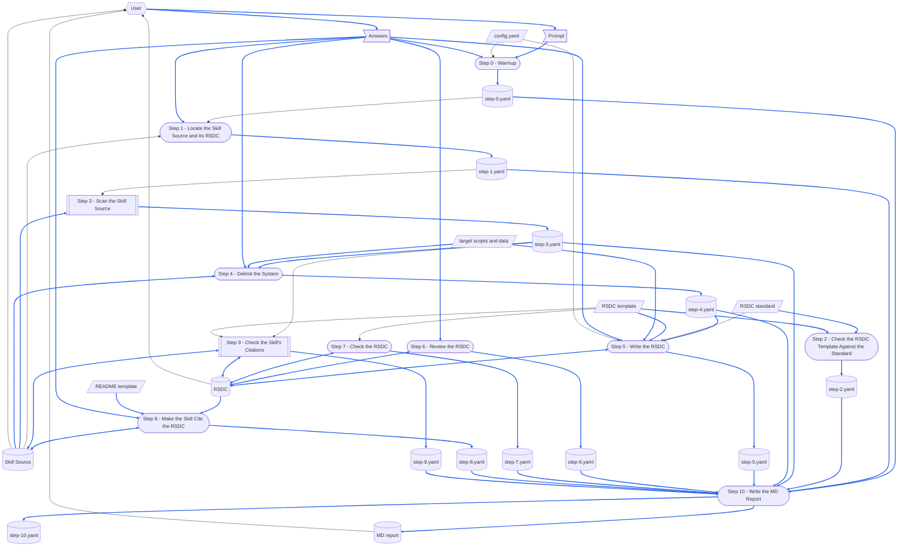

> [[SkillCompiler-RSDC]]  `cited`  `2026-10-20`  `a30852332f21`

# TERMINOLOGY

Terms that mean the same thing in every skill.

- **`run step N`** — a trailing prompt selector naming one step.
  It runs **only** that step, reading every earlier step's output back from the YAML checkpoint.
- **Checkpoint Dir** — the per-run directory holding a skill's YAML checkpoint.
  Every skill has its own; this skill's is given under **CONFIGURATION**.
- **YAML checkpoint** — the step files inside the Checkpoint Dir: Step N writes its outputs to `step-{N}.yaml`, which no other step changes, so a later step reads them back instead of recomputing them.
- **MD report** — the Markdown report a skill writes into the wiki vault, in a folder named after that skill, carrying the standard header (Skill, Checkpoint, Created, Updated, Prompt) above its result sections.
- **no forward-reference** — the rule that a step must never depend on a step that comes after it.
  Naming a later step to route control flow does not break it; borrowing that step's output does.

# DEDICATED TERMINOLOGY

Terms specific to this skill's domain.
The glossary owns each definition — a step uses the term rather than restating what it means.

- **target skill** — the skill this run designs for, named on the prompt by its directory name or by the path of its `SKILL.md`.
- **Skill Source** — the target skill's `SKILL.md`: its instructions, never the code of the programs it runs.
  The name is compile-skill's, for the file it compiles, and is kept so that this skill and the Source Scanner call the file by one name.
  Step 8 edits it, and Step 9 corrects its citations and records in it the RSDC it cites.
- **system** — the programs the target skill runs to do its work — Python scripts, deterministic and without an LLM — as Step 4 settles them.
- **system name** — the PascalCase name Step 4 gives the system, such as `StopPriceChecker`.
  It names the RSDC pair.
- **delimitation** — Step 4's decision, confirmed by the user: the system, its name, its stages, its components' role names, its data of each kind, and what stays in the target skill.
  Step 4 keeps it in `step-4.yaml`, and Step 5 reads it back from there.
- **Answers** — the user's replies to what the steps ask during a run: a choice, a confirmation or a correction.
  They are one-run data: the step that asked keeps what an answer decided in its own step file, never the answer itself, and a rerun of that step asks again.
  Only a correction to the delimitation becomes content of the RSDC; every other answer only steers the step that asked.
- **RSDC** — `<system name>-RSDC.md`, in the Skill Source's `references/`: the design of the system.
- **RSDC twin** — `<system name>-RSDC-tw.md`, beside the RSDC: the same design in 繁體中文, line for line.
  It is the `chinese` skill's to write.
  The two together are the **RSDC pair**.
- **upper document** — the Skill Source, which cites the RSDC.
  The RSDC is the lower document, and never names the target skill (MUST FOLLOW).
- **RSDC standard** — `RSDC-Standard.md`, with its diagram notation in `DFD.md`: what every RSDC must contain.
- **RSDC template** — this skill's `RSDC-Skill-System-tmp.md`, with its twin `RSDC-Skill-System-tmp-tw.md`: the shape of every RSDC — its chapter and section headings in order, the sections a system may leave out, and the tables and sentences every such RSDC shares — and, in the twin, the wording of those sentences in the RSDC twin, which the `chinese` skill finds through the link the RSDC keeps to the template in its header quote, `> [[RSDC-Skill-System-tmp]]`.
  A step points at it and never restates the section list.
- **stage** — an activity of a dataflow, in the RSDC standard's sense.
  The system's stages are named in the RSDC; the target skill's own Dataflow draws its steps instead (Step 8).
- **step inventory** — the Source Scanner's list of the Skill Source's steps, each with the programs it runs.
  Step 3 keeps it in `step-3.yaml`.
- **target scripts and data** — the target skill's scripts — every program of the step inventory, and every module they load from the workspace — and their data: the inputs the programs read, and the outputs of the target skill's most recent runs.
  The facts of the RSDC are read from them (Steps 4 and 5); this skill never writes them.
- **Source Scanner** — compile-skill's `scan_source.py`, which validates a `SKILL.md` and prints its step inventory.
  This skill runs it and never edits it.
- **RSDC Checker** — this skill's `check_rsdc.py`: the checks a program can make on the RSDC template against the RSDC standard, on the RSDC alone, on the RSDC pair, and on the Skill Source's citations of the RSDC, reading the shape it checks from the template the RSDC's header quote names.
  It exits `0` when no check failed, `1` when one did, and `2` on a malformed command or an unreadable file.
- **Dependency Checker** — the shared `depends_on.py`: in a document's header quote — the `>` lines at its head, one link to each document it depends on, such as `> [[StopPriceChecker-RSDC]]` — it records after each link that document's fingerprint as it stood when someone last confirmed the one against the other, and later says which have changed since.
  Step 5 records the RSDC template in the RSDC with it, and Step 9 the RSDC in the Skill Source.
- **SKILL twin** — the target skill's `SKILL-tw.md`, when it has one.
  It is the `chinese` skill's to write.

# CONFIGURATION

Concrete values this skill runs with.

- **Checkpoint Dir** — `checkpoints/gen-rsdc-skill/{target}-{yymmdd-hhmm}/`, holding one `step-{N}.yaml` per step, where `{target}` is the target skill's directory name and `{yymmdd-hhmm}` is stamped by Step 0 of a whole run; a `run step N` reuses the newest Checkpoint Dir of the same target skill.
- **MD report** — `{wikiDir}/gen-rsdc-skill/gen-rsdc-skill-{target}-{yymmdd-hhmm}.md`, written by Step 10 alone and carrying the same `{target}` and stamp as the Checkpoint Dir, where `wikiDir` comes from the workspace [config.yaml](config.yaml) (resolved in Step 0) — never hardcode the wiki root.
- **RSDC standard** — `{skillGroups.common}/references/RSDC-Standard.md`, with its diagram notation in `{skillGroups.common}/references/DFD.md`.
- **RSDC template** — [RSDC-Skill-System-tmp.md](assets/RSDC-Skill-System-tmp.md) and its twin [RSDC-Skill-System-tmp-tw.md](assets/RSDC-Skill-System-tmp-tw.md), in `{skillGroups.common}/skills/gen-rsdc-skill/assets/`.
- **Source Scanner** — `{skillGroups.common}/skills/compile-skill/scripts/scan_source.py`.
- **RSDC Checker** — `{skillGroups.common}/skills/gen-rsdc-skill/scripts/check_rsdc.py`.
- **Dependency Checker** — `{skillGroups.common}/scripts/depends_on.py`.
- **Skill Source** — `{skillGroups[<group>]}/skills/<skill-name>/SKILL.md`, resolved in Step 1.
- **RSDC** — `<system name>-RSDC.md`, in the Skill Source's `references/`.

# MUST FOLLOW

- Must run workflow step by step, and display each step number.
- Each step must be self-contained.
  **No forward-reference.**
- A step that a program can do deterministically must be run as a script.
  A step that needs reading, judgement, or summarization **must not** be scripted — write it as natural-language instructions for the agent to perform directly.
- **Honour a `run step N` selector**: run Step 0, Step 1 and Step 2 — every run needs the run Step 0 sets up, the files Step 1 locates and the check Step 2 makes — then Step N if it comes later, then Step 10, which writes the MD report, and stop; never another step.
  Step N reads every earlier step's output back from that step's file in the newest Checkpoint Dir of the same target skill; each step the run passes through rewrites its own `step-{N}.yaml`, and every other step's file stays as it was.
- **Besides its YAML checkpoint and MD report, this skill writes the RSDC and the Skill Source** — nothing else, and nothing in 繁體中文.
  The RSDC twin and the SKILL twin are the `chinese` skill's to write, never this skill's; a run that changes the RSDC or the Skill Source leaves the twin beside it stale, and the MD report says so.
- Follow [report-md-rules.md](../../rules/report-md-rules.md) for the MD report's header and shape.
- Follow [report-yaml-rules.md](../../rules/report-yaml-rules.md) for the fields every step file carries — `title` and `time`, and in `step-0.yaml` also `skill`, `model` and `prompt` — but not for its layout: this skill keeps one `step-{N}.yaml` per step, not `step_{N}` groups in one `process.yaml`.
- **`step-{N}.yaml` has exactly one writer: Step N.**
  No other step adds to, edits or deletes it, not even to supersede it; a later step that concludes something writes that into its own file.
  A file several steps write into is lost the moment its first step runs again: the rerun rewrites it whole, and every later step's result is gone without a word.
- Follow [scratch-rules.md](../../rules/scratch-rules.md) for where a run's throwaway files go and how they are cleaned up.
- **A step that stops the skill first saves its own `step-{N}.yaml`, with `stopped` saying why, and Step 10 still runs** — once Step 0 has resolved the Checkpoint Dir — so that the MD report says where and why the run stopped.
  A run that stops without a word in its report reads as one that never ran.
- **The RSDC standard and the RSDC template decide what an RSDC is; this file decides how one is written.**
  Read the standard and the template whole on every run that writes or reviews an RSDC, never from the memory of an earlier run.
  A step names the part of the standard it follows instead of restating it — a rule copied into this file is a second copy, and the two will drift.
- **Never edit the RSDC standard, the RSDC template, the Source Scanner or the RSDC Checker during a run**, and never to make a check pass.
  A check that seems wrong is reported to the user, and settled in a change of its own.
- **Never change what the target skill or its programs do.**
  This skill writes documents.
  A program that misbehaves, or a step of the Skill Source that contradicts a program, is reported to the user, who decides whether it is fixed — and a fix is a change of its own, not a side effect of a design.
- **The dependency between the two documents runs one way.**
  The Skill Source is the upper document: it cites the RSDC, and the RSDC never names the target skill — not its name, its steps, its `SKILL.md`, its directory, its MD report, its YAML checkpoint, its agent.
  An agent holding only the RSDC must still be able to run the system; a design that names its caller stops being enough on its own, and renaming one of the skill's steps silently falsifies it.
- **The RSDC defines in chapter 2 every name the skill depends on**: the programs it runs and their arguments (CLI), the request it gives, the records it reads back, and the constants it keeps in step (Rule Constants).
  A name the skill needs and the RSDC does not define is one the skill invented, and nothing keeps the two spellings together.
- **The skill cites only chapters 1 and 2 of the RSDC.**
  Design and Coding are the system's inside: a refactor that keeps every contract may rewrite or renumber them, and a citation into them dangles without an error.
  When a step needs something that lives in chapter 3 or 4, that thing is a contract — it moves into chapter 2, and the step cites it there.
  This holds for a skill that runs its system; a skill whose work is to write the programs themselves reads their Design, and is not what this skill is for.
- **The command line is the only interface between the skill and the system.**
  The skill runs each program as `python <program> <arguments>` and reads back its exit status, the lines it prints and the records it writes; it never imports a program to call its functions.
  An import ties the skill to the system's inside, which a refactor may rearrange without changing a single argument — breaking the skill without an error.
- **Where the skill keeps the programs is the skill's to say**, under its CONFIGURATION and its Directory Structure — so the RSDC has no Directory Structure section, the one place this skill departs from the RSDC standard.
  An RSDC holding the tree would name the skill's directory, and go stale whenever the skill moved.
- **Before the skill ends, display the paths of the MD report, the Checkpoint Dir, the RSDC and the Skill Source** — the paths only, never their contents, each rendered as a clickable Markdown link and never as inline code or plain text.
  Do this for every run, including a partial one such as `run step 9`.
  - Link the **MD report** with an `obsidian://open?vault={vaultName}&file=<vault-relative-path>` URI — the vault lives outside this workspace, so a workspace-relative target cannot resolve to it (e.g. `[gen-rsdc-skill-check-stop-price-261009-1530.md](obsidian://open?vault={vaultName}&file=gen-rsdc-skill/gen-rsdc-skill-check-stop-price-261009-1530.md)`).
  - Link the **Checkpoint Dir** with a workspace-relative, forward-slash target (e.g. `[check-stop-price-261009-1530/](checkpoints/gen-rsdc-skill/check-stop-price-261009-1530/)`).

# Prompt Examples


## Prompt 1

```
/gen-rsdc-skill
check-stop-price
```

## Prompt 2

```
/gen-rsdc-skill
check-stop-price
run step 9
```

## Prompt 3

```
幫 check-stop-price 寫一份 RSDC，並讓這個 skill 引用它
```


# Dataflow

How a run turns its prompt into what it leaves behind: every step of the **Workflow**, and the data each one reads and writes, drawn as a DFD in the notation of [DFD.md](.github/common/references/DFD.md).
The steps say what each one reads and writes; the diagram draws it, so that a record a later step overwrites, data with no source, or a step reading what a later step writes shows at a glance.
A step is named exactly as its heading, number included, so that no reader has to guess which step is meant.
Only what a step reads or writes at run time is drawn; a document a step only cites is not.
Drop the nodes and arrows for any output this skill does not produce.



How to read the diagram:

- A parallelogram is an external input: `config.yaml`, the RSDC standard, the RSDC template, the README template, and the target scripts and data.
  A flag is one-run data: the prompt and the Answers.
  A cylinder is a record: each step's own file in the Checkpoint Dir, the MD report, the Skill Source and the RSDC.
  A rounded box is a step; a double-edged box is a step that runs a program of an RSDC system, drawn shut — Step 3 and Step 9 run the Source Scanner, whose work [SkillCompiler-RSDC](.github/common/skills/compile-skill/references/SkillCompiler-RSDC.md) §2.3 *Dataflow* draws, and Step 9 runs the RSDC Checker besides.
- A hexagon is a role outside the skill: the user, who supplies the prompt and the Answers, and reads the MD report, the RSDC and the Skill Source.
- A solid arrow moves data, the way the data moves; a two-headed arrow is data one step both reads and writes.
  A dotted arrow carries no data: it is an order, or a change made by hand.
- A blue arrow carries data that is itself written into a record, or turned into a record's content; every other arrow is black.
  Data that only steers how a step works, such as `config.yaml`, the RSDC standard or the paths Steps 0 and 1 resolved, stays black even when that step writes a record.

# Steps at a Glance

Each step at a glance: the script it runs, and what it saves in the Checkpoint Dir.
Step N writes `step-{N}.yaml`, and no other step changes it.

Common keys, the same in every step's file:

- `title`: the step's title, as its heading names it — such as `Warmup`.
- `time`: `begin`, `end` and `taken`, in the forms [report-yaml-rules.md](../../rules/report-yaml-rules.md) gives.
- `stopped`: only when the step stopped the skill — why it stopped (MUST FOLLOW).

Each step's script, where it runs one, and its own keys, which the step that saves them describes:

| Step | Script | YAML |
|---|---|---|
| Step 0 - Warmup | — | `skill`, `model`, `prompt`, `targetSkill`, `runStep`, `checkpointDir`, `mdReport` |
| Step 1 - Locate the Skill Source and Its RSDC | — | `skillSource`, `rsdc`, `skillTwin`, `rsdcTwin` |
| Step 2 - Check the RSDC Template Against the Standard | `check_rsdc.py --standard` | `standardVersion`, `templateVersion`, `twinVersion`, `pins`, `exitStatus` |
| Step 3 - Scan the Skill Source | `scan_source.py` | `exitStatus`, `stepInventory` |
| Step 4 - Delimit the System | — | `delimitation`, `corrections`, `disagreements` |
| Step 5 - Write the RSDC | `depends_on.py record` | `rsdc`, `lines`, `outcome`, `templateRecorded` |
| Step 6 - Review the RSDC | — | `findings`, `applied`, `lines` |
| Step 7 - Check the RSDC | `check_rsdc.py --rsdc` | `verdict`, `runs`, `warningsLeft` |
| Step 8 - Make the Skill Cite the RSDC | — | `changes`, `findings`, `applied` |
| Step 9 - Check the Skill's Citations | `scan_source.py`, `check_rsdc.py --skill`, `depends_on.py record` | `scannerVerdict`, `inventoryMatches`, `checkerVerdict`, `runs`, `contractsAdded`, `dependencyRecorded` |
| Step 10 - Write the MD Report | — | `mdReport`, `sections` |


# Workflow

Each step opens with a **Purpose**: one sentence saying why that step exists as a step — what this skill would lose by folding it into its neighbour.

**Steps 2, 3, 7 and 9 run a script; Steps 0, 1, 4, 5, 6, 8 and 10 do not**, because the scripted steps hold text against fixed rules — a version, numbering, citations — which a program checks exhaustively, whereas the others decide what the user meant, where the system ends, what the design says and how a run is told to its reader, which only reading can.

## Step 0 - Warmup

- **Purpose**: set the run up — its config, which skill it designs for, a whole run or one step, and the Checkpoint Dir every step saves into — so that no later step re-derives where its files go.

- Run `.venv` first.
  The Source Scanner imports `PyYAML`: check it with `python -c "import yaml"`, and if it is missing, stop and name it.

- Read the workspace config [config.yaml](config.yaml) at the workspace root and resolve:
  - **`wikiDir`**: the MD report root — this skill's reports go under `{wikiDir}/gen-rsdc-skill/`.
  - **`vaultName`**: the last path segment of `wikiDir` — the Obsidian vault name used to build `obsidian://` links.
  - **`skillGroups`**: the group name -> skills-root map — a bare skill name resolves to `{skillGroups[<group>]}/skills/<skill-name>/SKILL.md`, and this skill's own directory is `{skillGroups.common}/skills/gen-rsdc-skill/`.
    A root with a leading `~` is under the home directory.
  - Substitute the resolved values wherever `{wikiDir}`, `{vaultName}`, `{skillGroups.common}` or `{skillGroups[<group>]}` appears in the steps below, including in commands.
  - If `config.yaml` is missing or a needed key is absent, stop, and tell the user what is missing.

- This skill calls no API and needs no credential.
  Never prompt for one.

- Check if the below scripts/files exist before running workflow.
  - `{skillGroups.common}/references/RSDC-Standard.md`
  - `{skillGroups.common}/references/DFD.md`
  - `{skillGroups.common}/templates/README-tmp.md`
  - `{skillGroups.common}/skills/gen-rsdc-skill/assets/RSDC-Skill-System-tmp.md`
  - `{skillGroups.common}/skills/gen-rsdc-skill/assets/RSDC-Skill-System-tmp-tw.md`
  - `{skillGroups.common}/skills/gen-rsdc-skill/scripts/check_rsdc.py`
  - `{skillGroups.common}/skills/compile-skill/scripts/scan_source.py`

- The prompt takes one of the forms shown in **Prompt Examples** above.
  Parse it for:
  - **target skill** (required): the first word after `/gen-rsdc-skill`, on its line or the next, or the skill a plain-language prompt names — a bare skill name, or a path ending in `SKILL.md`.
  - **`run step N`** (optional): a trailing step selector.

- If the target skill is missing, ask the user to type its name or path, and wait for the answer.

- Resolve the Checkpoint Dir:
  - **A whole run** stamps `{yymmdd-hhmm}` from the system clock and creates the Checkpoint Dir.
    The MD report's path carries the same stamp; Step 10 writes the file.
  - **A `run step N`** takes the newest Checkpoint Dir of the same target skill under `checkpoints/gen-rsdc-skill/`.
    If there is none, say so and stop: Step N reads back what an earlier run saved, and no run has.

- Save the canonical skill invocation for reference in later steps.

- Save `step-0.yaml` with:
  - `targetSkill`
  - `runStep`: N, or `null` on a whole run.
  - `checkpointDir`
  - `mdReport`

- `step-0.yaml` holds this invocation only, and the next run's Step 0 overwrites it.

- Display the target skill, whether this is a whole run or `run step N`, and the Checkpoint Dir.


## Step 1 - Locate the Skill Source and Its RSDC

- **Purpose**: pin down the files this run designs from and writes into — a run that guesses writes into another skill's `references/`, and every later step checks only the files it is handed.

- Every run passes through this step, a `run step N` included (MUST FOLLOW).

- Read the target skill back from `step-0.yaml`, and resolve the Skill Source from it: a path ending in `SKILL.md` is taken as it is, and a bare skill name is looked up as `<root>/skills/<name>/SKILL.md` under every `skillGroups` root.
  A name found under more than one root is ambiguous: list the matches and ask which one, never pick the first.

- Confirm the Skill Source exists and its YAML frontmatter parses with a `name` key.
  A file that does not is not a `SKILL.md`: stop, and say which check failed.

- Look in the Skill Source's `references/` for an RSDC — a `*-RSDC.md` without `-tw`:
  - **One**: say so, and display it.
    Whether to rewrite it is asked in Step 5, with the delimitation in view — not before the system has even been settled.
  - **More than one**: list them, and ask which system this run is about.
  - **None**: on a `run step N` with N of 5 or more there is nothing to work from — say so and stop.

- Say whether a SKILL twin sits beside the Skill Source, and an RSDC twin beside the RSDC.

- Save `step-1.yaml` with:
  - `skillSource`
  - `rsdc`: its path, or `null` when there is none yet.
  - `skillTwin`: whether it exists.
  - `rsdcTwin`: whether it exists.

- `step-1.yaml` holds this invocation only, like `step-0.yaml`, and the next run's Step 1 overwrites it.

- Display the resolved Skill Source path, the RSDC path or that there is none yet, and whether the SKILL twin and the RSDC twin exist.


## Step 2 - Check the RSDC Template Against the Standard

- **Purpose**: let a program decide, before the system is read or any document written, whether the RSDC template is the standard's current shape — an RSDC written to a shape behind the standard passes the RSDC Checker and still breaks the standard, since the checker holds the template's shape, not the standard's; and a version compared by eye among Step 0's checks is one an agent can pass over.
  A version alone misses a change made under the same version, so the content is compared as well.

- Every run passes through this step, a `run step N` included (MUST FOLLOW).

- Run the **RSDC Checker** on the RSDC standard.
  It reads the standard's version on the Version line its header quote opens with, and the version the RSDC template and its twin record where they name the standard; it checks that each of the two gives its own version the same way; and it compares the fingerprint they record after each of their links to the standard — `> [[RSDC-Standard]]` and `> [[DFD]]`, in their header quote — with that file's content now.
  - Example: `python {skillGroups.common}/skills/gen-rsdc-skill/scripts/check_rsdc.py --standard "{skillGroups.common}/references/RSDC-Standard.md"`

- Act on its exit status:
  - `0`: the RSDC template and its twin record the standard's version, and its content as it is now; continue.
  - `1`: a version or a fingerprint differs.
    **Stop the skill here**, before any later step reads or writes anything.
    Name what it printed, and say that the RSDC template and its twin — with the RSDC Checker and this file, where the change touches what they check or say — are brought up to the standard first, from the standard's "Changes in This Version", or from its git history where the content changed under the same version, and that their version is then updated and their links to the standard recorded anew with the **Dependency Checker**, in a change of their own (MUST FOLLOW).
  - `2`: a file is missing, records no version, does not link the standard, or records no fingerprint after a link to it.
    Report what it printed, and stop.

- Save `step-2.yaml` with:
  - `standardVersion`
  - `templateVersion`
  - `twinVersion`
  - `pins`: for each file of the standard the template links, the fingerprint the template and its twin record, and the file's fingerprint now
  - `exitStatus`

- Display the three versions and each file's fingerprint, recorded and now, and whether they agree.


## Step 3 - Scan the Skill Source

- **Purpose**: learn from a program, not a reading, which steps run which programs — the system is drawn from those programs, and a skill that runs none is best turned away before anything is read.

- Run the **Source Scanner** on the Skill Source.
  - Example: `python {skillGroups.common}/skills/compile-skill/scripts/scan_source.py --file "{skillGroups.dedi}/skills/check-stop-price/SKILL.md"`

- Act on its exit status:
  - `0`: continue.
  - `2`: the Skill Source has no steps for its Dataflow to draw, and a skill that cites an RSDC draws its steps there.
    **Stop the skill here**: report the reasons it printed, and write no document — the skill is fixed first, in a change of its own.
  - `64`: correct the command or the path, and run it again.

- If no step of the step inventory runs a program, **stop the skill here**: the system is the programs a skill runs, so the target skill has none, and no RSDC is written for it.
  Say so, and write no document.

- Save `step-3.yaml` with:
  - `exitStatus`
  - `stepInventory`: each step's number and title, and the programs it runs, each marked as inside the target skill's directory or not.

- Display the step inventory as a table with columns **Step**, **Title** and **Programs**, each program marked as inside the target skill's directory or not.


## Step 4 - Delimit the System

- **Purpose**: settle what the RSDC specifies before a line of it is written — the boundary between the system and the skill shapes every chapter, and moving it afterwards rewrites most of them.

- Read the step inventory back from `step-3.yaml`.

- Read, whole:
  - the Skill Source;
  - the target scripts and data.
    The RSDC describes what the programs do, and only the target scripts and data show that: a rule the Skill Source states and the code does not keep is a disagreement, not a fact.

- Rules that decide the delimitation:
  - **The system is the programs the skill runs to do its work** — deterministic, with no LLM, spending no tokens.
    Whatever needs reading or judgement stays in the skill: reading prose, deciding what a rule written in prose means, writing the MD report.
    A system that read prose would make judgements nobody could repeat, and every run of it would cost tokens.
  - **A program that serves only the skill's own bookkeeping stays with the skill**, even though it is a program.
    One that fingerprints the documents the skill reads, so that the skill knows when it must spend tokens reading them, is the skill's, not the system's.
  - **Rules kept in prose reach the system as copies.**
    When the system needs values written in prose — a plan's floors, a list of styles — the programs carry them as named constants, which the RSDC gives one defined name (StopPriceChecker-RSDC calls them the Rule Copies).
    The system reads only the copies; the prose documents appear in the RSDC only as the cited source of each copy.
    Keeping the copies in step is the skill's: it reads the prose when the prose changes, and at no other time.
  - **Names.**
    The system name is a noun phrase in PascalCase that says what the system does, such as `StopPriceChecker`; the skill calls the RSDC pair `<system name>-RSDC`, since a generic name such as "design document" stops saying which design is meant once a skill cites two.
    A stage is named for its activity — Judge, Back-solve — and a component for its role — Holding Judge — never a stage for its program.
    Inputs the Dataflow draws as one node get a group name, such as holding data.
    A source document's own terms keep its spelling, such as `SP 下限`, and an English name given to one carries it once, in brackets.
  - **The skill and its programs may disagree.**
    Where the Skill Source says the programs do what they do not, the RSDC describes the programs, and the disagreement goes to the user; neither side is changed to hide it.

- Decide the **delimitation**:
  1. The programs and modules that form the system, and those that stay with the target skill, each with its reason; and, for each module of the system, whether anything outside the system loads it, which decides whether 2.7 names it or 3.1 alone does.
  2. The system name, and with it the RSDC pair's file names.
  3. The stages, in order, each named for its activity, with the component that performs it and that component's role name.
  4. The inputs, grouped as the Dataflow will draw them; the records; the request and the outcome; the roles outside the system.
  5. The prose documents whose rules the programs carry as copies, if any, and the constants that hold them.
  6. What stays in the target skill: its reading and judgement, its MD report and that report's contract, its YAML checkpoint, and where it keeps its files.
  7. Every disagreement between the Skill Source and the programs, with the file and line of each side.

- Display the delimitation as a **Delimitation table** with columns **Item**, **Decision** and **Why**, followed by the disagreements.
  Then ask the user to confirm or correct it.
  Write nothing until it is confirmed; apply a correction, and display the table again.

- Save `step-4.yaml` with:
  - `delimitation`: the seven decisions as confirmed.
  - `corrections`: the changes the user made before confirming.
  - `disagreements`


## Step 5 - Write the RSDC

- **Purpose**: write the design itself — the one part of this workflow that is authorship, and the reason the skill exists.

- Read the delimitation back from `step-4.yaml`.

- Read the RSDC standard and the RSDC template, whole.

- If the RSDC exists, display its path and line count, and ask whether to rewrite it — with the Delimitation table in view, so the answer is given knowing what would replace it.
  A refusal ends the run, with no RSDC written.
  A rewrite replaces the whole file.

- Write the RSDC in the Skill Source's `references/`, starting from the RSDC template:
  - The shape is the template's: copy it, fill every `{PLACEHOLDER}`, delete its template block and every other line that opens with `>` but the links to the standard — and under them add the link to the RSDC template itself, `> [[RSDC-Skill-System-tmp]]` — repeat a block for each stage, record or program the system has, and leave out only a section marked **Optional**, numbering on the sections after it.
    Every section it carries is written, in its order, and none it does not: a section invented in one RSDC is one the next will not have, and a section skipped is one a reader will look for.
  - What each section holds is the RSDC standard's, with the template's instructions under each section.
  - Every name is taken verbatim from the delimitation.
  - Every fact comes from the target scripts and data: each behaviour stated is one read in the code, and each Verification Obligation marked observed names the runs and the counts it was observed on, counted now on the outputs Step 4 read.

- Rules that apply to everything written in this step:
  - Never name the target skill, its steps or its paths (MUST FOLLOW).
  - Chapter 1 is written in plain words — no file, program, artifact or term of chapter 2: it says "a copy of the plan's rules" where 2.1 names the Rule Copies.
    A term borrowed early is a forward reference, and chapter 1 stops reading on its own.
  - When the target scripts and data do not settle a fact, say so in the RSDC — as a known gap, or a claim *not verified* — rather than guessing it.

- Write the file as UTF-8 without a byte-order mark, with the file-creation tool.

- Record the RSDC template on its line of the RSDC's header quote with the **Dependency Checker**, passing the workspace `config.yaml`, through which an RSDC kept in another workspace finds the template.
  Through that line the `chinese` skill copies every sentence the RSDC shares with the template from the template's twin, and a later check can tell when the template changed.
  - Example: `python {skillGroups.common}/scripts/depends_on.py record "{skillGroups.dedi}/skills/check-stop-price/references/StopPriceChecker-RSDC.md" --target "[[RSDC-Skill-System-tmp]]" --config config.yaml`

- Save `step-5.yaml` with:
  - `rsdc`: its path.
  - `lines`
  - `outcome`: `new` when this run wrote the first RSDC, `rewritten` when it replaced one, or `refused` when the user kept the existing one.
  - `templateRecorded`: the fingerprint and date recorded after the link to the RSDC template — absent when the user kept the existing RSDC.

- Display the RSDC path and its line count, whether it is new, rewritten or kept, and the template fingerprint recorded.


## Step 6 - Review the RSDC

- **Purpose**: catch what only a reader can — a draft written top to bottom repeats its rules and leaves some without consequences, and no program tells a rule from its restatement.

- Read the RSDC section by section, collecting:
  - every repetition, sorted into three classes: **A**, one rule in three or more places, kept in the one section that owns it — Invariants, when every stage must obey it — while the others cite it or drop it; **B**, two near-verbatim copies, of which one is kept; **C**, small repeats — a definition or a reason given twice, an example tied to today's values.
    What the RSDC standard asks to point back — the goals table, the capability table, the verification table, the vision against the goals — is not repetition;
  - every rule that does not say what breaks when it is broken;
  - every goal of 1.4 whose row in the goals table names nothing that actually carries it;
  - every rule of chapter 2 that says what something looks like rather than what it must do — the RSDC standard's test;
  - every contradiction.

- Display the findings as one numbered list per class — A, B, C and contradictions — each item naming its sections and the change proposed.
  Then ask which to apply, by class or by number, recommending A and B.
  A contradiction is a defect and is fixed in any case.

- Apply the chosen changes to the RSDC.
  Where a change moves a rule, update every citation of it, its row of the goals table and its row of the Verification Obligations along with it.

- Save `step-6.yaml` with:
  - `findings`: each class's numbered items, each with the sections it names and the change proposed.
  - `applied`: the items the user chose, and every contradiction.
  - `lines`

- Display how many changes were made, and the new line count.


## Step 7 - Check the RSDC

- **Purpose**: let a program confirm, after the last hand edit, what a program can — a placeholder or instruction of the RSDC template left behind, numbering, forward references, the Dataflow's parts, the diagrams' line styles, the goals table — so that nothing a reader missed reaches the skill that cites it.

- Run the **RSDC Checker** on the RSDC, with the target skill's name.
  It reads the shape from the template the RSDC's header quote names — the link Step 5 recorded.
  - Example: `python {skillGroups.common}/skills/gen-rsdc-skill/scripts/check_rsdc.py --rsdc "{skillGroups.dedi}/skills/check-stop-price/references/StopPriceChecker-RSDC.md" --skill-name check-stop-price`

- It prints one line per check — `[PASS]`, `[FAIL]` or `[WARN]` — and a verdict.

- Act on its exit status:
  - `0`: continue.
  - `1`: correct the RSDC for each `[FAIL]`, and run this step again until it passes.
  - `2`: correct the command or the path, and run it again.

- Read every `[WARN]`: correct a real defect; leave a false alarm, and say why it stays.

- Save `step-7.yaml` with:
  - `verdict`
  - `runs`: how many times the checker ran before it passed.
  - `warningsLeft`: each with the reason it stays.

- Display the verdict line, and each warning left with the reason it stays.


## Step 8 - Make the Skill Cite the RSDC

- **Purpose**: turn the Skill Source into the upper document — until it cites the RSDC it keeps its own copies of the system's rules, and the copies drift.

- Read the Skill Source whole, chapters 1 and 2 of the RSDC, and the `## Dataflow` of the README template, `{skillGroups.common}/templates/README-tmp.md`.

- Edit the Skill Source part by part.
  Everything the system now owns leaves it, replaced by a citation; what the skill keeps, it states once:
  - **description**: names the system and `<system name>-RSDC` in one sentence, with no rule value — nothing updates the description when a value changes, so a value written there goes stale.
  - **Header quote**: one line directly under the frontmatter, `> [[<system name>-RSDC]]`, declaring the RSDC as what the skill depends on — Step 9 records the RSDC's fingerprint after it.
  - **DEDICATED TERMINOLOGY**: `<system name>-RSDC`, the RSDC pair in the skill's `references/`, and what it specifies; `<system name>`, the system, whose programs spend no tokens; RSDC, its four chapters, cited by number and heading — §2.7 *Presentation Contract*, or a subsection by its own heading, §2.6 *The Verdict*; stage — an activity of the system, as §2.3 *Dataflow* names it; the skill's own Dataflow draws steps, not stages; and each domain term the RSDC defines, in one sentence with the section it comes from and never more — a restatement drifts.
  - **CONFIGURATION**: the RSDC as a link, and its twin beside it when it exists — a link to a twin not yet written is one the Step 9 script fails; each program's path; every location the programs are given.
  - **Directory Structure**, a `# Directory Structure` section after CONFIGURATION: a tree of the skill's files, the programs, the RSDC with its twin when there is one, and the data of a run, each path as CONFIGURATION gives it, with a note on any placement that carries weight.
  - **MUST FOLLOW** gains four rules: tokens are spent in the skill, never in the system — never do by reading what a program does; `<system name>-RSDC` is the source of record for the system — a step names the section it builds against, and where the two disagree the RSDC wins and the disagreement is reported rather than resolved in the run; `<system name>-RSDC` is never edited during a run — a change to the system is made deliberately, to both halves of the pair under the same number; and `<system name>-RSDC` never names the skill — the names the skill depends on are defined in its chapter 2, the skill cites none of its chapters 3 and 4, and where the programs are kept is stated under CONFIGURATION and Directory Structure.
  - **Dataflow**, a `# Dataflow` section after Prompt Examples, drawn as the README template's `## Dataflow` is: one diagram of the Workflow's steps and the data each reads and writes, with its legend, and no table or prose beside it — the steps already say what each one reads and writes.
    A step that runs a program of the system is a double-edged box, `[["…"]]`, never drawn open: its inside is the system's, and the legend cites §2.3 *Dataflow* for it — redrawn here, it would be a second copy of the RSDC's diagram, and the two would drift.
    Its arrows are what the step hands the program, the records the program writes, and the step's own group of the YAML checkpoint: the program writes only its records, and the step only that group.
  - **Report Contract**, a `# Report Contract` section with `## Presentation Contract` and `## Presentation Form`, when the skill writes an MD report.
    The report is the skill's, so its contract lives here and not in the RSDC; it keeps plain everything the RSDC's Presentation Contract says, and the step that writes the report reads this contract, not the RSDC.
  - **Workflow**: a step that runs a program gives its full command — `python <program>` with every argument the CLI sets — and what to do on each exit status.

- Rules that apply to every edit:
  - Cite only chapters 1 and 2 of the RSDC, by number and heading — §2.6 *Derivation Rules*, or a subsection by its own heading, §2.6 *The Verdict*.
  - Keep what the target skill does: the same steps, commands, outputs and order.
    A contradiction between the Skill Source and the programs found here is shown to the user before anything changes because of it.
  - Keep the Skill Source's own conventions: its glossary's form, its path style, the wording of its shared sections.

- Then review the Skill Source section by section for repetition, sorting the findings into A, B and C as Step 6 does — where a contract a step must read on its own, such as the Report Contract, is not repetition: display the findings, ask which to apply, and apply them.

- Save `step-8.yaml` with:
  - `changes`: what changed in each part of the Skill Source.
  - `findings`: the repetition findings.
  - `applied`: the findings applied.

- Display the Skill Source path, and what changed, part by part.


## Step 9 - Check the Skill's Citations

- **Purpose**: prove the edited skill still has a skill's structure and that every citation lands — a citation of a section that does not exist, or of one inside the Design, reads exactly like a good one.

- Run the **Source Scanner** on the Skill Source, as Step 3 does.
  It must exit `0`.
  Its step inventory must also list the steps of the step inventory in `step-3.yaml`; a step that changed without the user's agreement is put back.

- Run the **RSDC Checker** on the RSDC and the Skill Source.
  - Example: `python {skillGroups.common}/skills/gen-rsdc-skill/scripts/check_rsdc.py --rsdc "{skillGroups.dedi}/skills/check-stop-price/references/StopPriceChecker-RSDC.md" --skill "{skillGroups.dedi}/skills/check-stop-price/SKILL.md"`

- Act on its exit status:
  - `0`: record the RSDC on its line of the Skill Source's header quote with the **Dependency Checker** — the sections of it the skill cites, as they are now — so that a later check can tell when one of them changes; then continue.
    - Example: `python {skillGroups.common}/scripts/depends_on.py record "{skillGroups.dedi}/skills/check-stop-price/SKILL.md" --target "[[StopPriceChecker-RSDC]]" --cited`
  - `1`: correct the Skill Source for each `[FAIL]`, and run this step again until it passes.
    When the skill needs a name the RSDC does not define, the RSDC lacks a contract: add it to chapter 2 of the RSDC, and run the Step 7 script again as well.
  - `2`: correct the command or the paths, and run it again.

- Save `step-9.yaml` with:
  - `scannerVerdict`
  - `inventoryMatches`
  - `checkerVerdict`
  - `runs`
  - `contractsAdded`: the names added to chapter 2 of the RSDC, if any.
  - `dependencyRecorded`: the fingerprint recorded in the Skill Source, and its date.

- Display both verdicts, the fingerprint recorded, and the contracts added, if any.


## Step 10 - Write the MD Report

- **Purpose**: tell the run once, from what its steps saved — a report appended step by step has a writer for every section, and a step run again alone leaves it telling two different runs.

- Every run ends with this step, a `run step N` and a run a step has stopped included (MUST FOLLOW), once Step 0 has resolved the Checkpoint Dir.

- Read every `step-{N}.yaml` in the Checkpoint Dir.

- Write the MD report as [report-md-rules.md](../../rules/report-md-rules.md) gives it, titled `RSDC for <target skill>`: the header, with the Checkpoint Dir as its Checkpoint and the canonical skill invocation in `step-0.yaml` as its Prompt, then one section per step file, in step order, each written from that file alone, and a last section on the twins:
  - **Run** (`step-0.yaml`): the target skill, whether this was a whole run or `run step N`, and the Checkpoint Dir.
  - **Target Skill** (`step-1.yaml`): the Skill Source path, the RSDC path or that there is none yet, and whether the SKILL twin and the RSDC twin exist.
  - **Template and Standard** (`step-2.yaml`): the three versions and each file's fingerprint, recorded and now, and whether they agree.
  - **Step Inventory** (`step-3.yaml`): a table with columns **Step**, **Title** and **Programs**, each program marked as inside the target skill's directory or not.
  - **Delimitation** (`step-4.yaml`): the Delimitation table as confirmed, followed by the disagreements.
  - **RSDC** (`step-5.yaml`): its path and line count, and whether it is new, rewritten or kept.
  - **Review** (`step-6.yaml`): the findings, one numbered list per class, each item marked applied or not, and the new line count.
  - **RSDC Check** (`step-7.yaml`): the verdict line, and each warning left with the reason it stays.
  - **Skill Source** (`step-8.yaml`): its path, what changed part by part, and the repetition findings, each marked applied or not.
  - **Citation Check** (`step-9.yaml`): both verdicts, the fingerprint recorded, and the contracts added, if any.
  - **Twins**: each twin `step-1.yaml` found, and whether this run changed what it translates — the RSDC for the RSDC twin, the Skill Source for the SKILL twin — which leaves it stale for the `chinese` skill to refresh.

- A step whose file holds `stopped` gets its section all the same, saying why; a step with no file in the Checkpoint Dir gets no section.

- Save `step-10.yaml` with:
  - `mdReport`: its path.
  - `sections`: the sections written.

- Close with the paths of the MD report, the Checkpoint Dir, the RSDC and the Skill Source as clickable Markdown links (MUST FOLLOW), and name each twin this run left stale.
