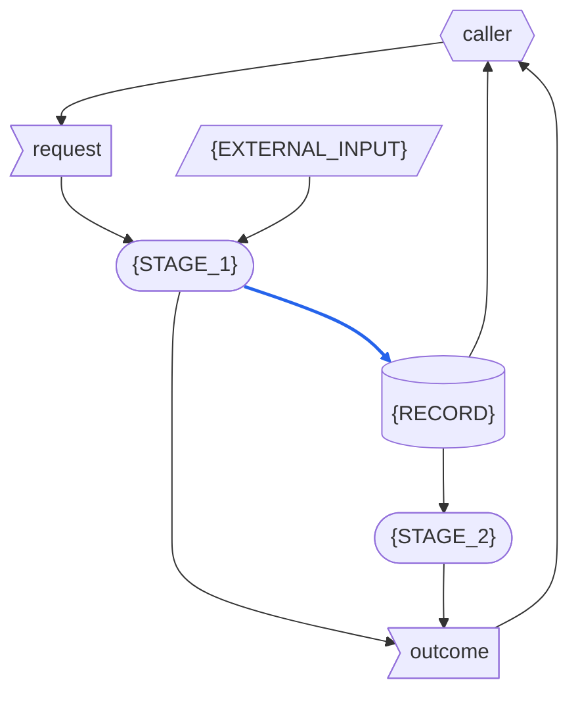

# {SYSTEM} - RSDC

> Version: 261016
> [[RSDC-Standard]]  `2026-10-30`  `ac0745864e75`
> [[DFD]]  `2026-10-18`  `09fb4a7e4730`

> **這是 template，不是一份文件。**
> 每一個 `{PLACEHOLDER}` 都以 system 自己的程式與其執行資料填寫；一份填好的文件若還留著任何一個，就有一部分沒有人寫。
> 只示範一個 stage、一種資料、一支程式或一個模組的區塊，system 有幾個就重複幾次；標為 **Optional** 的節，若 system 沒有可寫的內容就省略，之後各節的編號依序遞補。
> `RSDC-Skill-System-tmp-tw.md` 是英文版的 twin，逐行對應：它提供每一個共有句子在 RSDC twin 中的寫法；形狀只取自英文版這一份。
> 填好的文件在檔頭引用區、連到標準的連結之下，連到這個檔案：`> [[RSDC-Skill-System-tmp]]`，並由 `depends_on.py` 記下它的指紋。文件的 twin 靠這一行找到每一個共有句子的寫法；這個檔案日後改了，也靠它看得出來。
>
> 這個形狀所遵循的標準是 `{skillGroups.common}/references/RSDC-Standard.md`，**版本** 261016：也就是這個形狀最後一次與它對齊的版本。
> 上面連到標準的連結，各自在後面記下它對齊時的內容指紋。
> 這裡不重述它的規則。
> 2.3 是標準的 Dataflow，以 `{skillGroups.common}/references/DFD.md` 的記法繪製。
>
> 文件寫好之後，刪掉這一整塊，以及其他每一行以 `>` 開頭的指示——只留上面連到標準的連結。

- **System**: {SYSTEM} —— {THE_SYSTEM_IN_PLAIN_WORDS}
- **Run as**: `python <program> <arguments>`
- **Authority**: 任何與本文件不一致的實作，就是要改的那一方。

# 1. Requirements — "What problem does this solve?"

本章定義 {THE_SYSTEM} 的目標與它要解決的痛點，絕不觸及它如何建構：
不寫技術、不寫架構、不寫檔案或程式，也不寫從某一次執行中量到的數字。
指名 {THE_SYSTEM} 接管的是什麼（即使那是一支程式），以及舊做法讓使用者付出什麼代價，描述的是使用者面對的問題，所以寫在這一章。

## 1.1 Target Users

- **{THE_USER}** —— {WHO_ACTS_ON_THE_RESULTS_HOW_OFTEN_AND_WHAT_THEY_NEED}
- **Caller** —— 替 {THE_USER} 執行 {THE_SYSTEM}、並把 {THE_SYSTEM} 的發現轉成 {THE_USER} 讀的東西的一方：依程序工作的 AI agent，或一個人。

## 1.2 Core Vision

{WHAT_THE_SYSTEM_ACHIEVES_AND_WHY_IT_MATTERS}

## 1.3 Current Pain Points

{HOW_IT_IS_DONE_TODAY_AND_WHAT_THE_SYSTEM_TAKES_OVER_FROM_IT} {WHAT_OF_IT_IS_DELIBERATELY_NOT_CARRIED_OVER}

> 每一條障礙都寫使用者遇到的問題，不要寫成「缺少某某功能」：那已經預設了解法。

- **{AN_OBSTACLE_IN_THE_CURRENT_PROCESS}** {THE_INEFFICIENCY_OR_MUDDLED_LOGIC_IT_CAUSES}

## 1.4 System Goals

> 每個目標的名稱要短、彼此分得開：目標表依名稱引用它。

- **{GOAL}** —— {A_PROPERTY_THE_SYSTEM_MUST_HAVE_THAT_SOMEONE_ELSE_COULD_CHECK}
- **不花 token** —— {THE_SYSTEM} 只依固定規則判斷，它沒有任何部分會閱讀或解讀散文，所以同樣的輸入永遠得到同樣的結果，一次執行也不花任何 token。

# 2. Specification — "What are the system rules?"

本章定義 {THE_SYSTEM} 的資料是什麼、資料如何在它的 stage 之間移動、它的 record 如何配置與命名、它所需的每個值如何推導，以及它的輸出必須講清楚什麼。
這是讀者拿來對照檢查 {THE_SYSTEM} 的部分，所以這裡的每一句陳述，都必須是實際執行它就可能被推翻的。
它指名 caller 執行的程式、system 之外的程序也會載入的模組，以及存放規則副本的常數，因為這些名稱是契約；設計的其他部分一概不指名。

## 2.1 Terminology

後面各節所依賴、卻沒有一節定義的每一個名詞，各在這裡定義一次。

> 每個名詞只定義一次：在別處重述的 term 是第二份定義，終將偏離。
>
> 定義裡不用任何資料的名稱：資料在本節之後、於 Artifact Types 中定義。
>
> 只有當規則原本寫在給人讀的文件裡（例如交易計畫），而程式把它們抄成自己的常數或函式時，才保留 {THE_SOURCE_DOCUMENTS} 與 Keeper 這兩個 term。

- **Caller** —— 1.1 所說的 caller 在本章中的 role：執行這些程式的一方。
- **Run directory** —— caller 為一次執行指定的目錄，這次執行寫出的東西都放在這裡。
- **{THE_SOURCE_DOCUMENTS}** —— {WHAT_THEY_ARE}：散文，程式讀不了。
- **Keeper** —— 在任何一次執行之外，親手讓程式中的規則副本與 {THE_SOURCE_DOCUMENTS} 保持一致的一方。
- **{TERM}** —— {ITS_ONE_DEFINITION}

## 2.2 Artifact Types

{THE_SYSTEM} 處理的每一種資料：它是什麼、用來做什麼，以及它的內容必須是什麼。
{THE_SCOPE_OF_ONE_RUN}
它的資料分三種：**external input**，來自 system 外部、存在時間超過任何一次執行；**record**，由 system 寫入、在寫入它的那次執行之後仍保留；以及 **one-run data**，只存在於一次執行之中，不論它從哪裡來。

**External input**

> 只有當 Dataflow 把多份輸入畫成同一個節點時，才為它們命名一個群組；否則只列出各份輸入。
>
> 每份輸入位於何處，寫成 caller 指定的位置——絕不寫某一台機器的絕對路徑。
>
> 程式抄下 {THE_SOURCE_DOCUMENTS} 的規則時，把這些副本列為一份 external input，命名為 {COPIES}：它們就在程式裡，由 keeper 在任何一次執行之外寫入。

*{INPUT_GROUP}* —— 以下各份輸入，合稱 **{INPUT_GROUP}**：{WHAT_THE_GROUP_IS}。
它們位於 {THE_LOCATIONS_THE_CALLER_NAMES} 之下。

- **{EXTERNAL_INPUT}** —— {WHAT_IT_IS_WHERE_IT_LIES_WHAT_IT_IS_FOR_AND_WHAT_ITS_CONTENT_MUST_BE}

**Record**

- **{RECORD}** —— {WHAT_IT_IS_WHAT_IT_IS_FOR_AND_WHAT_ITS_CONTENT_MUST_BE}

**One-run data**

- **Request** —— caller 交給一次執行的東西：{WHAT_THE_REQUEST_HOLDS}。
- **Outcome** —— 每支程式結束時交回給 caller 的東西：它的 exit status，以及它印出的各行。

## 2.3 Dataflow

資料如何在 {THE_SYSTEM} 的活動之間移動：有哪些 stage、每個 stage 讀取與寫入什麼、每一份資料由誰寫入、誰可以讀，以及資料本身強加了什麼順序。
一次執行依序有以下各 stage：

- **{STAGE_1}** {WHAT_IT_DOES}
- **{STAGE_2}** {WHAT_IT_DOES}

### DFD

> 這張圖是唯一說出每個 stage 讀寫什麼的地方：每個 stage 都畫成圓角框，一次執行接觸的每一份資料都畫成它那一種的形狀。
> 每個節點都以 2.1 或 2.2 定義的名稱逐字標示。
> 只畫執行時真正讀寫的東西——文件之間的引用不搬動任何資料——而被抄進 record 的輸入，例如寫進 record 的 request 值，畫成藍色。

圖的讀法：

> 只為本圖用到的形狀或線保留條目，並在條目中指名本圖自己的例子。

- **平行四邊形** —— external input：{THE_EXTERNAL_INPUTS_DRAWN}。
- **旗形** —— one-run data：request 與 outcome。
- **圓柱** —— record：{THE_RECORDS_DRAWN}。
- **圓角框** —— stage。
- **六角形** —— system 外部的 role：{EACH_ROLE_WITH_WHAT_IT_SUPPLIES_AND_WHAT_IT_READS}。
- **雙向箭頭** —— 同一個 stage 既讀取、也寫入的資料。
- **藍色實線** —— 本身被寫進 record、或被轉成 record 內容的資料：{THIS_DIAGRAMS_BLUE_ARROWS}。
  只決定 stage 怎麼做的資料——{AN_EXAMPLE_FROM_THIS_DIAGRAM}——即使該 stage 會寫 record，也不是藍色。
- **黑色實線** —— 其他資料：不會超出所到達之 stage 或 role 的資料。
- **虛線** —— 不承載資料：表示順序，或從 system 外部做出的變更；{WHAT_IT_SHOWS_HERE}。

### Data Read/Write Rules

圖畫不出來的資料性質——凡適用者，是否整份寫入、寫入後是否唯讀、由誰刪除：

- **external input** 不由任何 stage 寫入；讀取它們的每個 stage 都只讀不寫。
- **request 與 outcome** 只存在於該次執行之中。
  {WHAT_OF_THEM_A_RECORD_KEEPS}
  除此之外沒有東西保留它們，也就沒有東西刪除它們。
- **{RECORD}** {WHETHER_WRITTEN_WHOLE_READ_ONLY_ONCE_WRITTEN_AND_WHO_DELETES_IT}

> system 寫入的某份 record 若有第二個寫入者、而它不先讀取這份 record，保留下面這一段並指名那份 record；否則刪除它。
> 後面的每個寫入者也都讀取的 record 是依序編輯，不算缺陷：此時也刪除這一段。

**依「唯一寫入者」判準的一項缺陷。**
system 寫入的每一份 record 都必須只有一個寫入者，除非後面的每個寫入者也都讀取它、並編輯前一個留下的東西；否則重跑一個 stage 會悄悄抹掉另一個 stage 的結果。
{THE_RECORD_WITH_TWO_WRITERS_WHAT_IT_COSTS_AND_WHAT_WOULD_REMOVE_IT}

> 某個 stage 讀取的資料若沒有任何來源——不是 external input、不是 system 外部的 role 提供的、也不是任何 stage 寫的——保留下面這一段並指名那份資料；否則刪除它。

**依「資料都有來源」判準的一項缺陷。**
stage 讀取的每一份資料，都必須是 external input、由 system 外部的 role 提供，或由某個 stage 寫入；否則沒有任何東西負責產生它，它第一次缺席時才會被發現。
{THE_DATA_WITH_NO_SOURCE_WHAT_IT_COSTS_AND_WHAT_WOULD_SUPPLY_IT}

### Order Imposed by the Data

- **{STAGE_1} 先於 {STAGE_2}** —— {THE_DATA_THAT_IMPOSES_IT}
- 沒有任何 stage 讀取後面 stage 寫入的東西。

### Exception Paths

> 每一條也寫出那次執行的 outcome——哪一個 exit status、印出哪些行：以 0 結束卻什麼都沒印，也是 caller 收到的 outcome。

- **什麼都不寫入就結束** —— {WHEN_A_RUN_WRITES_NOTHING_AND_WHAT_IT_LEAVES}
- **中途停止** —— {WHEN_A_RUN_STOPS_PART_WAY_AND_WHAT_IT_LEAVES}
- **從中途重新進入** —— {WHICH_STAGE_RUNS_ALONE_AND_WITH_WHAT_RESULT}

> 這裡不展開任何 stage：stage 內部發生的事屬於 Design，畫在它的 Execution Flow 中。
> stage 內部的某個順序，或各部分之間傳遞的東西，若是某個驗證依賴的規則，就用文字寫出這條規則，寫成從 stage 外面看得到的行為，放在它所屬的規則之中——某條 Derivation Rule、某條 Invariant，或上面的某條 exception path。

## 2.4 Naming and Data Structures

{THE_SYSTEM} 寫出或讀取的資料如何命名與配置。

- **Run directory** —— {WHAT_LIES_IN_IT_AND_WHICH_RUNS_SHARE_ONE}
- **{DATA}** —— {ITS_NAME_AND_ENCODING}

> 只有當某個名稱遵循讀者所依賴的慣例——例如分隔符或日期格式——或程式要從名稱或標頭中讀出某個值時，才保留下面這一行。

{EACH_NAMING_OR_PARSING_RULE_AND_WHAT_BREAKS_WHEN_IT_IS_BROKEN}

{DATA} 的欄位：

> 只有當兩個 stage 寫同一份 record 時，才保留 Part 欄。

| Field | Meaning | Part |
|---|---|---|
| `{FIELD}` | {WHAT_IT_HOLDS} | {THE_STAGE_THAT_WRITES_IT} |

> 代碼標籤就是契約：每一個都照原樣列出，因為每個讀者都逐字比對它，寫法不同的代碼標籤，就是沒有人認得的值。

存放代碼標籤的欄位，以及每個欄位可能存放的每一個代碼標籤：

| Field | Values |
|---|---|
| `{FIELD}` | {EVERY_VALUE_IT_MAY_HOLD} |

{THE_PRECISION_OF_EVERY_NUMBER_WRITTEN}

## 2.5 Config Schemas

> **Optional.** 只有當程式讀取設定檔時才寫——設定檔是 2.2 的一份 external input，這裡照 2.2 的名稱稱呼它。
>
> 沒有 Default 欄：設定檔缺少的欄位要回報為缺少，絕不由程式碼補上——預設值是被用上時從不說一聲的替代值。

{THE_SYSTEM} 讀取的每一個設定檔必須包含的欄位，以及欄位之間的限制。
{WHAT_A_PROGRAM_DOES_WITH_A_FILE_THAT_BREAKS_ITS_SCHEMA}

{CONFIG_FILE} 的欄位：

| Field | Meaning | Allowed values | What changing it costs |
|---|---|---|---|
| `{FIELD}` | {WHAT_IT_MEANS} | {WHAT_IT_MAY_HOLD_AND_WHICH_FIELDS_IT_DEPENDS_ON} | {WHAT_A_CHANGE_TO_IT_CHANGES} |

## 2.6 Derivation Rules

> **Optional.** 只有當 {THE_SYSTEM} 使用並非直接觀察而來的值時才寫。
>
> 例子用假設的數值：取自今天文件的數字，文件一改就過時。
>
> 2.1 沒有定義 {THE_SOURCE_DOCUMENTS} 時，刪除下面開頭段的第二行。

{THE_SYSTEM} 並非直接觀察而來的每個值如何推導。
{HOW_A_RULE_CITES_THE_PASSAGE_ITS_COPY_COMES_FROM}

### {DERIVED_VALUE}

- {WHERE_IT_COMES_FROM_IN_ORDER_OF_PREFERENCE_AND_WHY}
- {WHAT_MUST_NEVER_STAND_IN_FOR_IT}
- {HOW_IT_IS_MARKED_WHEN_NO_SOURCE_ANSWERS}

## 2.7 Presentation Contract

{THE_SYSTEM} 呈現的是資料，不是報告：{ITS_RECORDS}，以及每支程式的 outcome。
把它們轉成 {THE_USER} 讀的東西的人，決定其形式與文字；以下是資料本身必須講清楚的事，讓任何忠實的呈現都不會誤導。

**{RECORD} 講清楚的事**

- **{WHAT_IT_MUST_MAKE_PLAIN}** {HOW_AND_WHAT_GOES_WRONG_IF_IT_DOES_NOT}

**每一種呈現都要回答的問題**

> 每一題都要回答；可以正當地回答「沒有」，但不能不問。

1. *沒有東西可報告時，record 與 outcome 寫什麼？
   被略過的數量在哪裡回報？*
   {ANSWER}
2. *caller 能自行啟動哪些程式？
   不能的，為什麼？*
   {ANSWER}
3. *每一次讀取，都在 caller 的環境中實際觀察到成功過嗎？*
   {ANSWER}
4. *資料若在 system 之外也取得得到，system 交得出那個位址嗎？*
   {ANSWER}
5. *範圍收窄之後，record 裡的計數與後續動作的作用範圍一致嗎？*
   {ANSWER}
6. *批次的上限是什麼？
   超出時如何拒絕，會不會留下做到一半的 record？*
   {ANSWER}
7. *被拒絕的 caller 下一步該做什麼？*
   {ANSWER}
8. *輸出預設觸及到哪裡，範圍擴大時誰會知道？*
   {ANSWER}

## 2.8 CLI

每支程式都是 Python script，由 caller 以 `python <program> <arguments>` 執行。
命令列是 caller 接觸 system 的唯一途徑：它傳入參數，讀回 exit status、印出的各行與寫出的 record，絕不 import 程式來呼叫它的函式。

程式能做的工作，由 {THE_PROGRAMS_AND_SHARED_MODULES_THERE_ARE} 完成。
2.2 的 request 以程式的參數傳入：{WHICH_PROGRAM_TAKES_WHICH_OF_ITS_VALUES}。
程式讀取的每一個位置也都以參數傳入，沒有任何程式假設自己身在何處。
從自己所在之處去找輸入的程式，一旦放到別處就會停擺。

- **{COMPONENT_1}**，程式 `{FILE_1}` —— {STAGE_1} 的計算。
  - **Invocation** —— `python {FILE_1} {EVERY_ARGUMENT}`
  - **Standard output** —— {WHAT_IT_PRINTS}
  - **Exit status** —— {EACH_CODE_AND_WHEN}
  - **Refuses** —— {WHAT_IT_REFUSES_AND_WITH_WHAT_EXIT_STATUS}
- **{COMPONENT_2}**，程式 `{FILE_2}` —— {STAGE_2} 的計算。
  - **Invocation** —— `python {FILE_2} {EVERY_ARGUMENT}`
  - **Standard output** —— {WHAT_IT_PRINTS}
  - **Exit status** —— {EACH_CODE_AND_WHEN}
  - **Refuses** —— {WHAT_IT_REFUSES_AND_WITH_WHAT_EXIT_STATUS}
- **{SHARED_MODULE}**，模組 `{SHARED_MODULE_FILE}` —— {WHAT_IT_DOES}。
  system 之外的程序也會載入它——{WHO_ELSE_LOADS_IT}——所以它本身就是一個介面，而只有下列函式是與它們之間的契約：
  - `{FUNCTION_AND_ITS_ARGUMENTS}` —— {WHAT_IT_RETURNS}

> 只有當 system 之外有東西載入這個模組時，才保留模組那一條。
> 只有程式載入的模組位於 system 內部，本節不指名它，由 Core Component Responsibilities 指名。

## 2.9 Rule Constants

> **Optional.** 只有當規則原本寫在給人讀的文件裡（例如交易計畫），而程式把它們抄成自己的常數或函式時才寫。

2.2 的 {COPIES} 在 2.8 各程式中的樣子：具名的常數與函式，各自對應 {THE_SOURCE_DOCUMENTS} 的某一段。
每個名稱都是與 keeper 之間的契約：常數一旦改名，keeper 就再也找不到它，它所存的副本也就在沒人察覺的情況下過時。

這些副本出自 {THE_SOURCE_DOCUMENTS} 的以下章節：

- `{SOURCE_DOCUMENT}` —— {THE_SECTIONS_ITS_COPIES_COME_FROM}

| Constant | Kept in | Mirrors |
|---|---|---|
| `{CONSTANT}` | {COMPONENT_1} | {THE_PASSAGE_IT_COPIES} |

{WHICH_CONSTANTS_ARE_KEPT_IN_TWO_PROGRAMS_AND_WHAT_IS_DELIBERATELY_NOT_A_COPY}

## 2.10 Invariants

在每一個 stage 都成立、沒有例外的規則：

- **{A_RULE}** {WHAT_BREAKS_WHEN_IT_IS_BROKEN}
- **完全不用 LLM。**
  每一個 stage 都是程式：同樣的輸入得到同樣的 record，一次執行不花任何 token。
  需要 LLM 的 stage，所做的判斷沒有人能重現。

1.4 的目標，以及承載它們的規則：

| Goal | Carried by |
|---|---|
| {GOAL} | {THE_SECTIONS_AND_RULES_THAT_CARRY_IT} |
| 不花 token | 2.8，每一個 stage 都由一支程式計算；上面的「完全不用 LLM」 |

# 3. Design — "How is the system structured?"

本章描述執行 2.3 各 stage 的 component，以及各自如何完成工作。
本章沒有 Directory Structure：程式放在哪裡，由執行它們的一方決定，而且每一個位置都以參數傳給程式，所以這裡沒有任何東西依賴它。
本章也沒有 Presentation Form：沒有人使用 system 自己的控制項——命令列與它交回的東西已由 2.8 固定——而讀者看到的形式，如 2.7 所說，由呈現資料的一方決定。

> 沒有任何一節寫 agent 或 LLM 的 step：system 只有它的程式。

## 3.1 Core Component Responsibilities

每個 component 一條——2.8 指名的每一個，以及 system 之外沒有任何東西呼叫的每一個——寫出它唯一的工作與它的邊界：跨越邊界的一次修改，就是對兩個 component 的修改。
2.3 的每一個 stage 都由其中一個執行；沒有任何 component 執行的 stage，是沒有人實作的活動。

- **{COMPONENT_1}** —— 2.8 中執行 {STAGE_1} 的程式。
  它唯一的工作：{ITS_ONE_JOB}。
  它的邊界：{WHAT_A_CHANGE_CROSSING_IT_WOULD_BREAK}。
- **{COMPONENT_2}** —— 2.8 中執行 {STAGE_2} 的程式。
  它唯一的工作：{ITS_ONE_JOB}。
  它的邊界：{WHAT_A_CHANGE_CROSSING_IT_WOULD_BREAK}。
- **{SHARED_MODULE}** —— 2.8 中的模組，由 {WHICH_PROGRAMS_LOAD_IT} 載入，system 之外也有程序載入它。
  它唯一的工作：{ITS_ONE_JOB}。
  它的邊界：{WHAT_A_CHANGE_CROSSING_IT_WOULD_BREAK}。
- **{MODULE}**，模組 `{MODULE_FILE}` —— 由 {WHICH_PROGRAMS_LOAD_IT} 載入，system 之外沒有任何東西載入它，所以它的函式可以重新安排，而不必更動 2.8。
  它唯一的工作：{ITS_ONE_JOB}。
  它的邊界：{WHAT_A_CHANGE_CROSSING_IT_WOULD_BREAK}。

> 2.8 指名了共用模組時，保留它那一條；只有程式載入的每一個模組，各寫一條像最後一條那樣的。
> system 沒有的種類就刪除。

它們如何互動：{WHAT_PASSES_BETWEEN_THE_COMPONENTS_AND_THROUGH_WHAT}

> 說出它們之間傳遞什麼——一支程式寫出、另一支讀取的 2.3 record，或它們載入的模組——沒有任何程式呼叫另一支時，也要明說。

## 3.2 Execution Flow

3.1 的每一支程式在運行時如何完成工作：它的 step 依序寫出，用程式碼裡的名稱，包括程式自己選擇、而非資料強制的分支、重試、平行處理與順序。
需要畫圖時，以 DFD 的記法繪製。
這裡引用第 2 章的規則，絕不重述。

> 每支程式一個小節。
> 模組在運行時沒有自己的工作：它做的事，寫在載入它的程式的 step 之中。
> 程式工作的各個部分，以及每一部分讀取什麼、傳下什麼，值得畫出來時，就在它的小節下把程式展開：一張 DFD，它的 process 是程式的 step，用程式碼裡的名稱。

### {COMPONENT_1}

1. {ITS_STEPS_IN_ORDER}

### {COMPONENT_2}

1. {ITS_STEPS_IN_ORDER}

# 4. Coding — "How should the code be written?"

本章讓程式碼維持品質，並讓程式在每一個平台上都一樣運作：它遵守的規則、可以使用的工具、如何保持安全、已經遇過的陷阱、每一項宣稱如何被證明，以及它還在哪裡沒做到。

## 4.1 Key Development Guidelines

> 其中，在適用時包括：
>
> - **Config-driven** —— system 讀取設定檔時，它的邏輯依循該檔，而不是寫死在程式碼裡。
> - **AI-First** —— 程式印出的每一行都說出它發現了什麼、在哪裡，讓呼叫它的 agent 不必讀程式碼就能據以行動。
> - **輸入值沒有預設值**
> - **執行時不發出 prompt**
> - **規則值只放在 Rule Constants 一節的具名常數裡**
>
> 守住第 2 章某條規則的 guideline，例如每一個位置都以參數傳入，要引用那條規則，並說明程式碼如何守住它，而不是再陳述一次。

- **{A_GUIDELINE}** {WHAT_BREAKS_WITHOUT_IT}

## 4.2 Implementation Guidelines and Tools

- Python {PYTHON_VERSION} 以上，使用 workspace 的 `.venv`。
- {EACH_LIBRARY_AND_WHAT_IT_IS_FOR}
- {THE_PROGRAMMING_STYLE_SUCH_AS_TYPE_HINTS}
- {THE_ENCODING_OF_WHAT_IS_WRITTEN}

## 4.3 Safety and Robustness

> 其中，在適用時包括：兩次執行同時寫入同一份 record 時會發生什麼，以及由什麼阻止它；每一個輸入在寫出任何東西之前，如何對照它的契約檢查。

- **{A_SAFEGUARD}** {WHAT_BREAKS_WITHOUT_IT}

## 4.4 Platform Traps

> **Optional.** 在真的發生過之前省略。
>
> 每一條都附上讓人學到它的那次失敗——附帶理由的規則，能撐過下一次改寫；沒有附帶理由的，會被第一個覺得它礙事的人刪掉。

只收錄真的產生過「看似合理卻是錯的」結果的情況：

- **{THE_TRAP}** {THE_CASE_IT_HAPPENED_ON_AND_WHAT_NOW_PREVENTS_IT}

## 4.5 Verification Obligations

本文件陳述的每一條規則、如何證明它成立，以及由誰證明；3.1 的每一個 component 都至少在一列中被指名，因為沒有任何一列證明的 component，無從證明它能運作。
規則要在其行為被觀察到之後才算證明成立，而不是在讀過負責產生它的程式碼之後。

| Claim | Rule | Proven by | Performed by |
|---|---|---|---|
| {A_CLAIM} | {ITS_SECTION} | {THE_OBSERVATION_AND_THE_DATA_IT_WAS_MADE_ON} | {WHO_SHOWS_IT} |
| {A_CLAIM_NOT_YET_PROVEN} | {ITS_SECTION} | — | *not verified*：{WHAT_HAS_BEEN_READ_SO_FAR} |

> 每一列都已驗證時，刪除下面這一段。

**標為 not verified 的列**，是尚待撰寫的檢查。
{HOW_EACH_COULD_BE_MADE_MECHANICAL}

## 4.6 Defects

程式做了第 2 章說它不該做之事的每一處，各附觀察到的地方與代價：

- **{A_DEFECT}** {WHERE_IT_WAS_OBSERVED_AND_WHAT_IT_COSTS}

> 沒有缺陷時，以一行取代清單：目前沒有已知缺陷。
