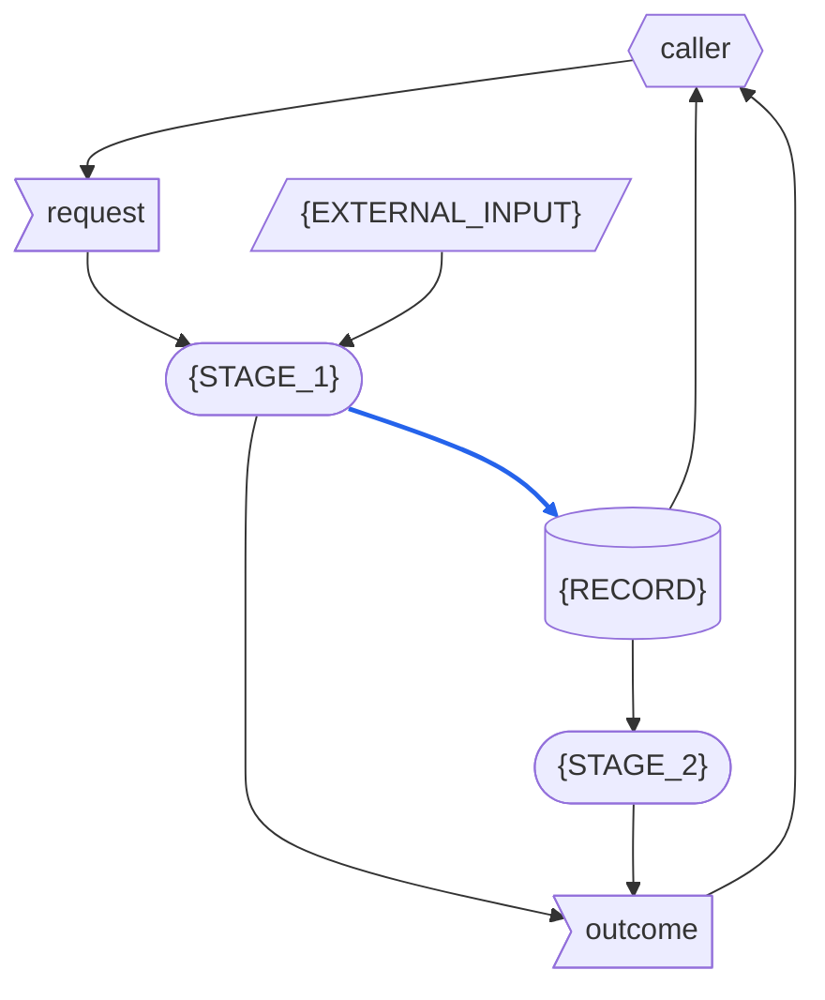

# {SYSTEM} - RSDC

> Version: 261016
> [[RSDC-Standard]]  `2026-10-30`  `ac0745864e75`
> [[DFD]]  `2026-10-18`  `09fb4a7e4730`

> **This is the template, not a document.**
> Every `{PLACEHOLDER}` is filled from the system's own programs and the data of their runs; a filled document still holding one has a part nobody wrote.
> A block that shows one stage, kind of data, program or module is repeated for each one the system has, and a section marked **Optional** that the system has nothing for is left out, the sections after it numbered on.
> `RSDC-Skill-System-tmp-tw.md` is this file's twin, line for line: it words every shared sentence for the RSDC twin, and the shape comes from this file alone.
> A filled document links this file in its header quote, under the links to the standard: `> [[RSDC-Skill-System-tmp]]`, its fingerprint recorded by `depends_on.py`. That line is how the document's twin finds the wording of every shared sentence, and how a later change to this file shows.
>
> The standard this shape follows is `{skillGroups.common}/references/RSDC-Standard.md`, at **Version** 261016: the version this shape was last brought in line with.
> The links to the standard above record, after each, the fingerprint of the content it was brought in line with.
> Its rules are not restated here.
> Its 2.3 is the standard's Dataflow, drawn in the notation of `{skillGroups.common}/references/DFD.md`.
>
> Delete this block when the document is written, and with it every other line that opens with `>` — all but the links to the standard above.

- **System**: {SYSTEM} — {THE_SYSTEM_IN_PLAIN_WORDS}
- **Run as**: `python <program> <arguments>`
- **Authority**: any implementation disagreeing with this document is what changes.

# 1. Requirements — "What problem does this solve?"

This chapter defines {THE_SYSTEM}'s goals and the pain points it answers, and never touches on how it is built:
no technology, no architecture, no file and no program, and no figure measured from a run.
Naming what {THE_SYSTEM} takes over from — even a program — and what the old way costs the user describes the user's problem, so it belongs here.

## 1.1 Target Users

- **{THE_USER}** — {WHO_ACTS_ON_THE_RESULTS_HOW_OFTEN_AND_WHAT_THEY_NEED}
- **Callers** — whatever runs {THE_SYSTEM} for {THE_USER} and turns what it finds into something {THE_USER} reads: an AI agent following a procedure, or a person.

## 1.2 Core Vision

{WHAT_THE_SYSTEM_ACHIEVES_AND_WHY_IT_MATTERS}

## 1.3 Current Pain Points

{HOW_IT_IS_DONE_TODAY_AND_WHAT_THE_SYSTEM_TAKES_OVER_FROM_IT} {WHAT_OF_IT_IS_DELIBERATELY_NOT_CARRIED_OVER}

> State each obstacle as a problem the user meets, never as a missing feature: that already assumes the solution.

- **{AN_OBSTACLE_IN_THE_CURRENT_PROCESS}** {THE_INEFFICIENCY_OR_MUDDLED_LOGIC_IT_CAUSES}

## 1.4 System Goals

> Keep each goal's name short and distinct: the goals table cites it by name.

- **{GOAL}** — {A_PROPERTY_THE_SYSTEM_MUST_HAVE_THAT_SOMEONE_ELSE_COULD_CHECK}
- **No tokens** — {THE_SYSTEM} decides by fixed rules alone, and nothing in it reads or interprets prose, so the same inputs always give the same result, and a run costs no tokens.

# 2. Specification — "What are the system rules?"

This chapter defines what {THE_SYSTEM}'s data is, how data moves between its stages, how its records are laid out and named, how each value it needs is derived, and what its output must make plain.
This is the part a reader checks {THE_SYSTEM} against, so every statement here is one that could be falsified by running it.
It names the programs a caller runs, the modules that procedures outside the system load too, and the constants that hold copies of rules, because their names are contracts; it names no other part of the design.

## 2.1 Terminology

Every noun the later sections rely on and none of them defines, each defined here once.

> Define each noun once: a term restated elsewhere is a second definition, and it drifts.
>
> Name no data in a definition: the data is defined after this section, in Artifact Types.
>
> Keep the terms {THE_SOURCE_DOCUMENTS} and Keeper only when rules written for people to read, such as a plan, are copied into the programs as constants or functions.

- **Caller** — a caller of 1.1, in the role this chapter gives it: whoever runs the programs.
- **Run directory** — the directory the caller names for a run, where everything the run writes goes.
- **{THE_SOURCE_DOCUMENTS}** — {WHAT_THEY_ARE}: prose, which no program can read.
- **Keeper** — whoever keeps the programs' copies of rules in step with {THE_SOURCE_DOCUMENTS}, by hand, outside any run.
- **{TERM}** — {ITS_ONE_DEFINITION}

## 2.2 Artifact Types

Every kind of data {THE_SYSTEM} handles: what it is, what it is for, and what its content must be.
{THE_SCOPE_OF_ONE_RUN}
Its data is of three kinds: **external inputs**, which come from outside the system and outlast any run; **records**, which the system writes and keeps after the run that wrote them; and **one-run data**, which lives for one run only, wherever it comes from.

**External inputs**

> Name a group only when the Dataflow draws several inputs as one node; otherwise list the inputs alone.
>
> Give where each input lies as a location the caller names — never one machine's absolute path.
>
> When the programs copy rules from {THE_SOURCE_DOCUMENTS}, list the copies as one external input, named {COPIES}: they lie in the programs themselves, and the keeper writes them, outside any run.

*{INPUT_GROUP}* — the inputs below, named together as **{INPUT_GROUP}**: {WHAT_THE_GROUP_IS}.
They lie under {THE_LOCATIONS_THE_CALLER_NAMES}.

- **{EXTERNAL_INPUT}** — {WHAT_IT_IS_WHERE_IT_LIES_WHAT_IT_IS_FOR_AND_WHAT_ITS_CONTENT_MUST_BE}

**Records**

- **{RECORD}** — {WHAT_IT_IS_WHAT_IT_IS_FOR_AND_WHAT_ITS_CONTENT_MUST_BE}

**One-run data**

- **The request** — what the caller gives a run: {WHAT_THE_REQUEST_HOLDS}.
- **The outcome** — what each program hands back when it ends: its exit status, and the lines it prints.

## 2.3 Dataflow

How data moves between {THE_SYSTEM}'s activities: what the stages are, what each stage reads and writes, who writes each piece of data and who may read it, and what order the data itself imposes.
A run has these stages, in this order:

- **{STAGE_1}** {WHAT_IT_DOES}
- **{STAGE_2}** {WHAT_IT_DOES}

### DFD

> This diagram is the one place that says what each stage reads and writes: draw every stage as a rounded box, and every piece of data a run touches in the shape of its kind.
> Label every node with a name 2.1 or 2.2 defines, verbatim.
> Draw only what is read or written at run time — a citation between documents moves no data — and draw blue an input echoed into a record, such as the request's values written into a record.

How to read the diagram:

> Keep a bullet only for a shape or a line this diagram uses, and name this diagram's own examples in it.

- **Parallelogram** — an external input: {THE_EXTERNAL_INPUTS_DRAWN}.
- **Flag** — one-run data: the request and the outcome.
- **Cylinder** — a record: {THE_RECORDS_DRAWN}.
- **Rounded box** — a stage.
- **Hexagon** — a role outside the system: {EACH_ROLE_WITH_WHAT_IT_SUPPLIES_AND_WHAT_IT_READS}.
- **Two-headed arrow** — data the same stage both reads and writes.
- **Blue solid arrow** — data that is itself written into a record, or turned into the content of one: {THIS_DIAGRAMS_BLUE_ARROWS}.
  Data that only steers what a stage does — {AN_EXAMPLE_FROM_THIS_DIAGRAM} — is not blue, even when the stage writes a record.
- **Black solid arrow** — any other data: data that goes no further than the stage or role it reaches.
- **Dotted arrow** — no data: an order, or a change made from outside the system; {WHAT_IT_SHOWS_HERE}.

### Data Read/Write Rules

What the diagram cannot show about the data it draws — where it applies, whether it is written whole, whether it is read-only once written, and who deletes it:

- **External inputs** are written by no stage; every stage that reads one only reads it.
- **The request and the outcome** last as long as the run.
  {WHAT_OF_THEM_A_RECORD_KEEPS}
  Nothing else keeps them, so nothing deletes them.
- **{RECORD}** {WHETHER_WRITTEN_WHOLE_READ_ONLY_ONCE_WRITTEN_AND_WHO_DELETES_IT}

> When a record the system writes has a second writer that does not read it first, keep the paragraph below and name the record; otherwise delete it.
> A record every later writer also reads is edited in turn and is no defect: leave the paragraph out.

**A defect by the one-writer rule.**
Every record the system writes must have one writer, unless each later writer also reads it and edits what the one before left; otherwise a rerun of one stage silently erases another stage's result.
{THE_RECORD_WITH_TWO_WRITERS_WHAT_IT_COSTS_AND_WHAT_WOULD_REMOVE_IT}

> When a stage reads data that has no source — not an external input, not supplied by a role outside the system, not written by any stage — keep the paragraph below and name the data; otherwise delete it.

**A defect by the has-a-source rule.**
Every piece of data a stage reads must be an external input, be supplied by a role outside the system, or be written by some stage; otherwise nothing is responsible for producing it, and it is found only the first time it is missing.
{THE_DATA_WITH_NO_SOURCE_WHAT_IT_COSTS_AND_WHAT_WOULD_SUPPLY_IT}

### Order Imposed by the Data

- **{STAGE_1} before {STAGE_2}** — {THE_DATA_THAT_IMPOSES_IT}
- No stage reads what a later stage writes.

### Exception Paths

> Say for each what the run's outcome is too — which exit status, and which lines it prints: exiting 0 with nothing printed is still an outcome the caller gets.

- **Ending with nothing written** — {WHEN_A_RUN_WRITES_NOTHING_AND_WHAT_IT_LEAVES}
- **Stopping midway** — {WHEN_A_RUN_STOPS_PART_WAY_AND_WHAT_IT_LEAVES}
- **Re-entering midway** — {WHICH_STAGE_RUNS_ALONE_AND_WITH_WHAT_RESULT}

> No stage is drawn open here: what happens inside a stage is the Design's, drawn in its Execution Flow.
> Where an order inside a stage, or something passed between its parts, is a rule a verification depends on, say the rule in words, as behaviour seen from outside the stage, among the rules it belongs with — a Derivation Rule, an Invariant, an exception path above.

## 2.4 Naming and Data Structures

How the data {THE_SYSTEM} writes or reads is named and laid out.

- **Run directory** — {WHAT_LIES_IN_IT_AND_WHICH_RUNS_SHARE_ONE}
- **{DATA}** — {ITS_NAME_AND_ENCODING}

> Keep the line below only when a name follows a convention a reader relies on, such as a separator or a date format, or a program reads a value out of a name or a header.

{EACH_NAMING_OR_PARSING_RULE_AND_WHAT_BREAKS_WHEN_IT_IS_BROKEN}

{DATA}'s fields:

> Keep the Part column only when two stages write one record.

| Field | Meaning | Part |
|---|---|---|
| `{FIELD}` | {WHAT_IT_HOLDS} | {THE_STAGE_THAT_WRITES_IT} |

> A code label is a contract: list each one exactly as it is written, since every reader matches it exactly and one spelled any other way is a value nobody recognizes.

The fields that hold code labels, with every code label each may hold:

| Field | Values |
|---|---|
| `{FIELD}` | {EVERY_VALUE_IT_MAY_HOLD} |

{THE_PRECISION_OF_EVERY_NUMBER_WRITTEN}

## 2.5 Config Schemas

> **Optional.** Only when a program reads a configuration file — an external input of 2.2, named here as 2.2 names it.
>
> There is no Default column: a field the file lacks is reported missing, never filled in by the code — a default is a substitute that never says it was used.

The fields every configuration file {THE_SYSTEM} reads must contain, and the constraints between them.
{WHAT_A_PROGRAM_DOES_WITH_A_FILE_THAT_BREAKS_ITS_SCHEMA}

{CONFIG_FILE}'s fields:

| Field | Meaning | Allowed values | What changing it costs |
|---|---|---|---|
| `{FIELD}` | {WHAT_IT_MEANS} | {WHAT_IT_MAY_HOLD_AND_WHICH_FIELDS_IT_DEPENDS_ON} | {WHAT_A_CHANGE_TO_IT_CHANGES} |

## 2.6 Derivation Rules

> **Optional.** Only when {THE_SYSTEM} uses a value it does not observe directly.
>
> In an example, use hypothetical values: a number taken from today's documents goes stale when they change.
>
> When 2.1 defines no {THE_SOURCE_DOCUMENTS}, delete the second line of the opening paragraph below.

How each value {THE_SYSTEM} does not observe directly is derived.
{HOW_A_RULE_CITES_THE_PASSAGE_ITS_COPY_COMES_FROM}

### {DERIVED_VALUE}

- {WHERE_IT_COMES_FROM_IN_ORDER_OF_PREFERENCE_AND_WHY}
- {WHAT_MUST_NEVER_STAND_IN_FOR_IT}
- {HOW_IT_IS_MARKED_WHEN_NO_SOURCE_ANSWERS}

## 2.7 Presentation Contract

What {THE_SYSTEM} presents is data, not a report: {ITS_RECORDS}, and each program's outcome.
Whoever turns them into something {THE_USER} reads decides its form and its words; what follows is what the data itself must make plain, so that no faithful presentation of it can mislead.

**What {RECORD} makes plain**

- **{WHAT_IT_MUST_MAKE_PLAIN}** {HOW_AND_WHAT_GOES_WRONG_IF_IT_DOES_NOT}

**The questions every presentation answers**

> Answer every question; "there is none" is a legitimate answer, but no question may go unasked.

1. *What do the records and the outcome say when there is nothing to report?
   Where is the skipped count reported?*
   {ANSWER}
2. *Which programs can the caller start itself?
   For those it cannot, why not?*
   {ANSWER}
3. *Has every read been observed to succeed in the caller's own environment?*
   {ANSWER}
4. *If the data is also reachable outside the system, can the system hand over that address?*
   {ANSWER}
5. *After the scope is narrowed, do the counts in the record match the scope of the next action?*
   {ANSWER}
6. *What is the limit of a batch?
   How is an excess refused, and can it leave a half-written record?*
   {ANSWER}
7. *What should a refused caller do next?*
   {ANSWER}
8. *How far does the output reach by default, and who finds out when that widens?*
   {ANSWER}

## 2.8 CLI

Every program is a Python script, run by its caller as `python <program> <arguments>`.
The command line is the only way a caller reaches the system: it passes arguments in and reads back the exit status, the lines printed and the records written, and it never imports a program to call its functions.

{THE_PROGRAMS_AND_SHARED_MODULES_THERE_ARE} do the work a program can do.
The request of 2.2 arrives as the programs' arguments: {WHICH_PROGRAM_TAKES_WHICH_OF_ITS_VALUES}.
Every location a program reads arrives as an argument too, and no program assumes a location of its own.
A program that found its inputs from where it sits would stop working the moment it was kept anywhere else.

- **{COMPONENT_1}**, the program `{FILE_1}` — {STAGE_1}'s computation.
  - **Invocation** — `python {FILE_1} {EVERY_ARGUMENT}`
  - **Standard output** — {WHAT_IT_PRINTS}
  - **Exit status** — {EACH_CODE_AND_WHEN}
  - **Refuses** — {WHAT_IT_REFUSES_AND_WITH_WHAT_EXIT_STATUS}
- **{COMPONENT_2}**, the program `{FILE_2}` — {STAGE_2}'s computation.
  - **Invocation** — `python {FILE_2} {EVERY_ARGUMENT}`
  - **Standard output** — {WHAT_IT_PRINTS}
  - **Exit status** — {EACH_CODE_AND_WHEN}
  - **Refuses** — {WHAT_IT_REFUSES_AND_WITH_WHAT_EXIT_STATUS}
- **{SHARED_MODULE}**, the module `{SHARED_MODULE_FILE}` — {WHAT_IT_DOES}.
  Procedures outside the system load it too — {WHO_ELSE_LOADS_IT} — so it is an interface of its own, and only these functions are a contract with them:
  - `{FUNCTION_AND_ITS_ARGUMENTS}` — {WHAT_IT_RETURNS}

> Keep the module's bullet only when something outside the system loads the module.
> A module only the programs load lies inside the system, and this section does not name it: Core Component Responsibilities does.

## 2.9 Rule Constants

> **Optional.** Only when rules written for people to read, such as a plan, are copied into the programs as constants or functions.

The {COPIES} of 2.2, as the programs of 2.8 hold them: named constants and functions, each mirroring one passage of {THE_SOURCE_DOCUMENTS}.
Each name is part of a contract with the keeper: a constant renamed is one the keeper can no longer find, and the copy it holds goes stale unseen.

The copies come from these sections of {THE_SOURCE_DOCUMENTS}:

- `{SOURCE_DOCUMENT}` — {THE_SECTIONS_ITS_COPIES_COME_FROM}

| Constant | Kept in | Mirrors |
|---|---|---|
| `{CONSTANT}` | {COMPONENT_1} | {THE_PASSAGE_IT_COPIES} |

{WHICH_CONSTANTS_ARE_KEPT_IN_TWO_PROGRAMS_AND_WHAT_IS_DELIBERATELY_NOT_A_COPY}

## 2.10 Invariants

Rules that hold in every stage, without exception:

- **{A_RULE}** {WHAT_BREAKS_WHEN_IT_IS_BROKEN}
- **No LLM, anywhere.**
  Every stage is a program: the same inputs give the same records, and a run costs no tokens.
  A stage that needed an LLM would make a judgement nobody could repeat.

The goals of 1.4, and the rules that carry them:

| Goal | Carried by |
|---|---|
| {GOAL} | {THE_SECTIONS_AND_RULES_THAT_CARRY_IT} |
| No tokens | 2.8, where every stage is a program's computation; No LLM, anywhere, above |

# 3. Design — "How is the system structured?"

This chapter describes the components that perform the stages of 2.3, and how each one does its work.
It has no Directory Structure: where the programs are kept is for whoever runs them to say, and every location reaches a program as an argument, so nothing here depends on it.
Nor does it have a Presentation Form: a person uses no control of the system's own — the command line and what it hands back are fixed in 2.8 — and the form a reader is shown is decided by whoever presents the data, as 2.7 says.

> No section holds a step of an agent or an LLM: the system is its programs alone.

## 3.1 Core Component Responsibilities

One bullet per component — each one 2.8 names, and each one nothing outside the system calls — with its one job and its boundary: a change that crosses the boundary is a change to two components.
Every stage of 2.3 is performed by one of them; a stage none performs is an activity nobody implemented.

- **{COMPONENT_1}** — the program of 2.8 that performs {STAGE_1}.
  Its one job: {ITS_ONE_JOB}.
  Its boundary: {WHAT_A_CHANGE_CROSSING_IT_WOULD_BREAK}.
- **{COMPONENT_2}** — the program of 2.8 that performs {STAGE_2}.
  Its one job: {ITS_ONE_JOB}.
  Its boundary: {WHAT_A_CHANGE_CROSSING_IT_WOULD_BREAK}.
- **{SHARED_MODULE}** — the module of 2.8, loaded by {WHICH_PROGRAMS_LOAD_IT} and from outside the system.
  Its one job: {ITS_ONE_JOB}.
  Its boundary: {WHAT_A_CHANGE_CROSSING_IT_WOULD_BREAK}.
- **{MODULE}**, the module `{MODULE_FILE}` — loaded by {WHICH_PROGRAMS_LOAD_IT} and by nothing outside the system, so its functions can be rearranged without changing 2.8.
  Its one job: {ITS_ONE_JOB}.
  Its boundary: {WHAT_A_CHANGE_CROSSING_IT_WOULD_BREAK}.

> Keep the shared module's bullet when 2.8 names one, and write a bullet like the last for each module only the programs load.
> Delete a kind the system does not have.

How they interact: {WHAT_PASSES_BETWEEN_THE_COMPONENTS_AND_THROUGH_WHAT}

> Say what passes between them — a record of 2.3 one program writes and another reads, a module they load — and say so when no program calls another.

## 3.2 Execution Flow

For each program of 3.1, how it does its work at run time: its steps in order, named as the code names them, with the branches, retries, parallel work and orders the program chose rather than the data forced.
Where a drawing helps, it is drawn in the notation of the DFD.
Chapter 2's rules are cited here, never restated.

> One subsection per program.
> A module does no work of its own at run time: what it does is told among the steps of the programs that load it.
> Where the parts of a program's work, and what each reads and passes on, are worth seeing, draw the program open under its subsection: a DFD, its processes the program's steps, named as the code names them.

### {COMPONENT_1}

1. {ITS_STEPS_IN_ORDER}

### {COMPONENT_2}

1. {ITS_STEPS_IN_ORDER}

# 4. Coding — "How should the code be written?"

This chapter keeps the code's quality up and the programs working alike on every platform: the rules the code follows, the tools it may use, how it stays safe, the traps already met, how each claim is proved, and where it still falls short.

## 4.1 Key Development Guidelines

> Among them, where they apply:
>
> - **Config-driven** — when the system reads a configuration file, its logic follows the file instead of being written into the code.
> - **AI-First** — every line a program prints says what it found and where, so that the calling agent can act on it without reading the code.
> - **No default for an input value**
> - **No prompt at run time**
> - **Rule values only in the named constants of the Rule Constants section**
>
> A guideline that keeps a rule of chapter 2, such as every location arriving as an argument, cites that rule and says how the code keeps it, rather than stating it again.

- **{A_GUIDELINE}** {WHAT_BREAKS_WITHOUT_IT}

## 4.2 Implementation Guidelines and Tools

- Python {PYTHON_VERSION} or later, from the workspace's `.venv`.
- {EACH_LIBRARY_AND_WHAT_IT_IS_FOR}
- {THE_PROGRAMMING_STYLE_SUCH_AS_TYPE_HINTS}
- {THE_ENCODING_OF_WHAT_IS_WRITTEN}

## 4.3 Safety and Robustness

> Among them, where they apply: what happens when two runs write the same record at once, and what stops it; how each input is checked against its contract before anything is written.

- **{A_SAFEGUARD}** {WHAT_BREAKS_WITHOUT_IT}

## 4.4 Platform Traps

> **Optional.** Leave it out until a case has actually happened.
>
> Give each the failure that taught it — a rule with its reason attached survives the next rewrite, and one without it is deleted by the first person who finds it inconvenient.

Only cases that have actually produced a plausible but wrong result:

- **{THE_TRAP}** {THE_CASE_IT_HAPPENED_ON_AND_WHAT_NOW_PREVENTS_IT}

## 4.5 Verification Obligations

Each rule this document states, how it is shown to hold, and who shows it; every component of 3.1 is named in at least one row, since a component no row proves cannot be shown to work.
A rule is proven when its behaviour has been observed, not when the code meant to produce it has been read.

| Claim | Rule | Proven by | Performed by |
|---|---|---|---|
| {A_CLAIM} | {ITS_SECTION} | {THE_OBSERVATION_AND_THE_DATA_IT_WAS_MADE_ON} | {WHO_SHOWS_IT} |
| {A_CLAIM_NOT_YET_PROVEN} | {ITS_SECTION} | — | *not verified*: {WHAT_HAS_BEEN_READ_SO_FAR} |

> Delete the paragraph below when every row is verified.

**The rows not verified** are the checks still to be written.
{HOW_EACH_COULD_BE_MADE_MECHANICAL}

## 4.6 Defects

Every place where the programs do what chapter 2 says they should not, each where it was observed and what it costs:

- **{A_DEFECT}** {WHERE_IT_WAS_OBSERVED_AND_WHAT_IT_COSTS}

> When there is none, replace the list with one line: None known.
