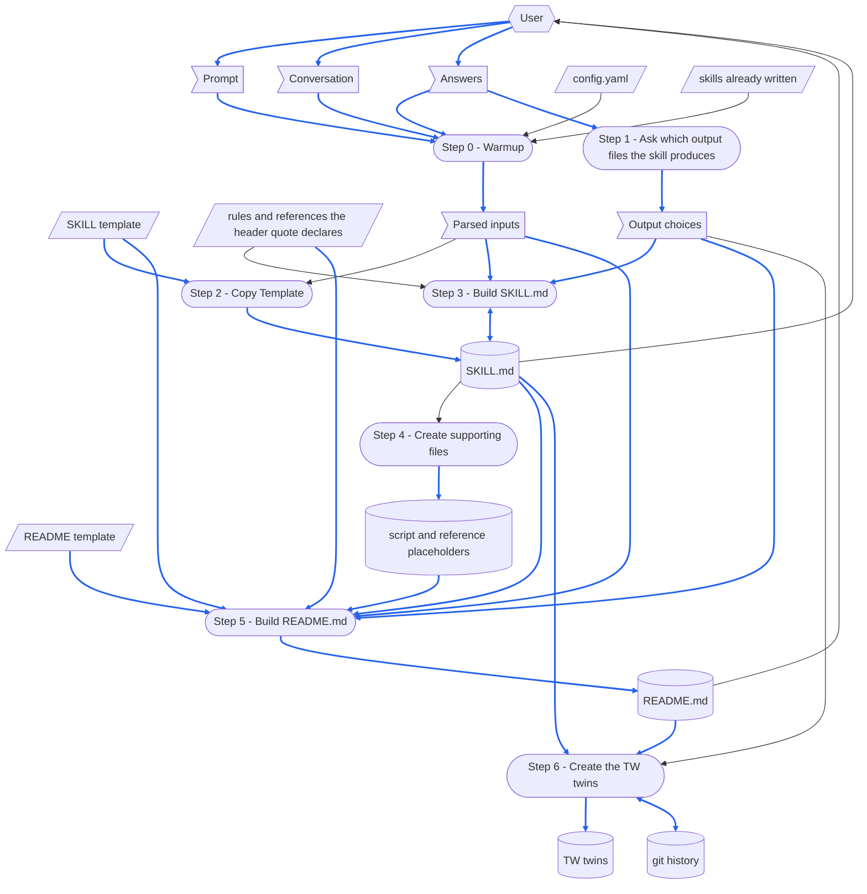

# gen-skill

> [DFD.md](../../references/DFD.md)  `2026-10-18`  `09fb4a7e4730`
> [md-style.md](../../rules/md-style.md)  `2026-10-30`  `6484ff7dc0b2`
> [skill-writing.md](../../rules/skill-writing.md)  `2026-10-30`  `c7696bf6351a`
> [SKILL-tmp.md](../../templates/SKILL-tmp.md)  `2026-10-30`  `6ca6e607f75c`
> [README-tmp.md](../../templates/README-tmp.md)  `2026-10-19`  `43ace64a88a6`
> [depends_on.py](../../scripts/depends_on.py)  `2026-10-16`  `53b1d3e60eca`
> [chinese/SKILL.md](../chinese/SKILL.md)  `2026-10-16`  `2a03562d5a11`

gen-skill skill 由哪些部分組成，以及它的 [SKILL.md](SKILL.md) 依賴哪些檔案。
skill 每次執行都會載入整份 SKILL.md，所以執行時用不到的部分放在這裡：SKILL.md 不連到本檔，也沒有任何一次執行會載入它。
修改本 skill 之前先讀這份：做完 When the Skill Is Changed 列出的每一項修改，再跑那裡列出的檢查。
skill 的各個 step 怎麼寫，見 [skill-writing.md](../../rules/skill-writing.md)。

圖中的路徑都用簡寫：`gen-skill/` 指 `.github/common/skills/gen-skill/`，`common/` 指 `.github/common/`。
`<skill>/` 是一次執行所建立的 new skill directory，即 `{skillGroups[<group>]}/skills/<skill-name>/`。

# When the Skill Runs

## Dataflow

一次執行如何把它的 prompt 變成它留下的東西：[SKILL.md](SKILL.md) 中 Workflow 的每一個 step，以及每個 step 讀寫的資料，以 [DFD.md](../../references/DFD.md) 的畫法畫成 DFD。
SKILL.md 的各個 step 寫明自己讀寫什麼；這張圖把它畫出來，讓被較後 step 覆寫的 record、沒有來源的資料，或讀取較後 step 所寫之物的 step，一眼就看得出來。
step 的名稱與它的標題完全相同、連編號一起，讀者就不必猜是哪一個 step。
只畫 step 在執行時讀寫的東西；step 只引用的文件不畫。



圖的讀法：

- 平行四邊形是 external input：`config.yaml`、`skillGroups` 各根目錄下已經寫好的 skill、兩份 template，以及新 skill 的 header quote 宣告的規則與參考文件——`skill-writing.md` 與 `DFD.md` 也在其中——沒有任何 step 會寫入它們。
  旗形是 one-run data：prompt、它上方的對話與 Answers、Step 0 解析出的輸入，以及 Step 1 詢問到的輸出選擇。
  圓柱是 record：新 skill 的 `SKILL.md`、它的腳本與參考檔佔位檔、它的 `README.md`、它的 TW twins，以及 git history。
  圓角方框是 step。
- 六角形是 skill 之外的 role：使用者，提供 prompt、對話與 Answers，並閱讀新的 `SKILL.md` 與 `README.md`。
- 實線箭頭沿著資料移動的方向搬移資料；雙頭箭頭表示某個 step 對同一份資料既讀又寫。
- 藍色箭頭承載的資料，本身會被寫進某個 record，或被轉成某個 record 的內容；其餘箭頭一律是黑色。
  新 skill 的名稱、描述與各個 step，以及決定其章節的回答，都成為 `SKILL.md` 與 `README.md` 的內容，所以它們的箭頭是藍色。
  兩份檔案所複製的 template，以及宣告的檔案也是：Step 5 會把這些檔案的指紋記錄在 header quote 中。
  只決定某個 step 怎麼做的資料，例如 `config.yaml`、已經寫好的 skill、Step 2 複製到的路徑、Step 3 寫作所依的規則，或關於 twin 的回答，維持黑色。
- 有兩個 record 是輪流編輯的。
  Step 2 整份寫出 `SKILL.md`，Step 3 填寫它，並讀取它所填寫的內容；本 skill 沒有 `run step N`，所以 Step 2 只會在新的一次執行中重跑，而那次執行要等使用者同意覆寫之後，才會重新寫出這個 skill。
  Step 6 透過 `chinese` skill，在使用者答應時，於先前的執行與使用者留下的 git history 上加一個 commit。

## Step Purposes

每個 step 都以它在 SKILL.md 中的標題命名，並附上它的 Purpose：它為何要獨立存在。

- Step 0 - Warmup
  在寫入任何檔案之前，先確定新 skill 的名稱、描述、群組與各個 step——以猜測的名稱或群組寫出的 skill，會落在沒有人會去找的地方，或蓋掉一個已經存在的 skill。
- Step 1 - Ask which output files the skill produces
  一開始就把決定兩份文件形狀的選擇問清楚——MD report、YAML checkpoint 與一組 twin，各自決定 SKILL.md 與 README.md 兩邊的章節，晚一點才問到的答案，會改寫已經寫好的內容。
- Step 2 - Copy Template
  讓 SKILL.md 從 template 的完整複本開始，使 template 帶有的每一節在填寫之前都已就位——憑記憶寫出的 SKILL.md，會漏掉沒有人記得的那幾節。
- Step 3 - Build SKILL.md
  寫出新 skill 執行時需要的內容，而且只寫這些——workflow 是 SKILL.md 中對這個 skill 的判斷、而不是 template 之複本的那一部分，也是建立這個 skill 的理由。
- Step 4 - Create supporting files
  讓各個 step 提到的每一個腳本與參考檔都有自己的檔案，下一位寫作者才能在 SKILL.md 所說的位置找到它——背後沒有檔案的名稱，要到第一次執行需要它時才會被發現。
- Step 5 - Build README.md
  趁理由還在手邊時，寫下修改 skill 需要、執行時用不到的內容——Dataflow、每個 step 的 Purpose、每個 step 用到的檔案，以及哪些檔案要一起改——而且寫在每次執行都會整份載入的 SKILL.md 之外。
- Step 6 - Create the TW twins
  讓 chinese skill 寫出 twin，由它的 parity check 證明它們——在這裡翻譯的 twin，會跳過唯一能抓到漏掉的標題或遺失的連結的那道檢查。

## Files Each Step Uses

skill-writing.md 中「哪些 step 執行腳本」那條規則，本 skill 的回答只寫這一次：
**Step 5 執行一個腳本，也就是 Dependency Checker，來記錄它的 header quote；Step 0 到 Step 4 與 Step 6 都不執行自己的腳本**，因為推斷一個 skill 的各個 step、寫出它們與它們的 Purpose、畫出它們的 Dataflow，都是對所建立之 skill 的判斷，複製 template 只是一次檔案複製，而 Step 6 把工作交給 chinese skill，由它執行自己的腳本。

```
Step 0 - Warmup
  reads   config.yaml
  reads   the conversation above the prompt: the steps of the new skill
  checks  that these exist:
          common/templates/SKILL-tmp.md
          common/templates/README-tmp.md
          common/references/DFD.md
          common/rules/skill-writing.md
          common/scripts/depends_on.py
  checks  whether a skill of the same name exists under any skillGroups root

Step 1 - Ask which output files the skill produces
  asks    the user: an MD report, a YAML checkpoint, and the TW twins

Step 2 - Copy Template
  reads   common/templates/SKILL-tmp.md
  writes  <skill>/SKILL.md

Step 3 - Build SKILL.md
  reads   common/rules/skill-writing.md
  edits   <skill>/SKILL.md

Step 4 - Create supporting files
  reads   <skill>/SKILL.md: the scripts and references its steps name
  writes  <skill>/scripts/ and <skill>/references/: a placeholder for each

Step 5 - Build README.md
  reads   common/templates/README-tmp.md
  reads   common/rules/skill-writing.md and common/references/DFD.md
  reads   <skill>/SKILL.md, <skill>/scripts/ and <skill>/references/
  writes  <skill>/README.md
  runs    depends_on.py record
          ├─ reads every file the header quote declares
          └─ writes the header quote of <skill>/README.md

Step 6 - Create the TW twins
  runs    the chinese skill, on SKILL.md and then on README.md (when Step 1's answer was yes)
          ├─ reads common/references/tw-keep-english.md
          ├─ runs scan_md.py, diff_md.py, check_parity.py
          └─ writes <skill>/SKILL-tw.md and <skill>/README-tw.md, and offers its own commit
```

沒有任何一次執行會讀 SKILL-tw.md、README.md 或本檔。

# When the Skill Is Changed

`⇄`：兩邊一起改。
`─▶`：依賴另一方的規定或格式。

```
gen-skill/SKILL.md
 ├─⇄ gen-skill/SKILL-tw.md
 │     every change goes into both: the chinese skill's diff_md.py, a translation, then check_parity.py
 │     └─▶ common/references/tw-keep-english.md: which terms stay English
 ├─⇄ gen-skill/README.md and README-tw.md
 │     the Dataflow, Step Purposes and Files Each Step Uses name each step exactly as its heading:
 │     a step added, removed or renamed changes all three
 ├─⇄ common/templates/SKILL-tmp.md and SKILL-tmp-tw.md
 │     Step 3 names the template's placeholders and the sections it edits or removes:
 │     a placeholder or a section added, renamed or removed there changes Step 3 with it
 │     a template in STE: MUST FOLLOW drops its STE header-quote lines and its header note from the copy
 ├─⇄ common/templates/README-tmp.md and README-tmp-tw.md
 │     Step 5 names the template's placeholders, its header quote lines and its sections
 │     a template in STE: MUST FOLLOW drops its STE header-quote lines and its header note from the copy
 ├─▶ common/rules/skill-writing.md: how the steps are written, here and in every skill this one writes
 ├─▶ common/references/DFD.md: how Step 5 draws a Dataflow
 ├─▶ common/scripts/depends_on.py: Step 5's record command and the header quote format
 ├─▶ common/skills/chinese/SKILL.md: what Step 6 hands it, and the twins it writes
 └─▶ common/rules/md-style.md: one sentence on each line
       └─ checked by reformat_md.py and check_reformat.py (--twin: the twin's sentences one for one)

gen-skill/README.md
 ├─⇄ gen-skill/README-tw.md: line for line, through the chinese skill
 └─▶ common/references/DFD.md: how the Dataflow is drawn
       a step or a piece of data added or removed redraws the DFD and renumbers its blue arrows

the tools
 ├─ common/skills/check-skill: checks what this skill writes against the same two templates,
 │  so a section either template gains is one that check-skill asks for
 └─ common/skills/CLAUDE.md: points an agent that changes a skill to its README.md and skill-writing.md

outputs already written
 └─ the skills written before a template changes keep their old shape,
    until each is brought in line; check-skill reports what differs
```

改動之後，執行涵蓋它的檢查：

- 對 SKILL.md 與 SKILL-tw.md、README.md 與 README-tw.md 各執行一次 `check_parity.py`：都沒有失敗。
- 對本檔執行 `depends_on.py check`：每一個宣告的檔案都是 UNCHANGED，或已經讀過並重新記錄。
- `/check-skill gen-skill`：每一項檢查都通過，或每一個 finding 都已處理。
- 執行一次 `/gen-skill`，寫出一個用過即丟的 skill，再對它執行 `/check-skill`：沒有缺少的標題，也沒有留下任何 placeholder；之後刪除那個用過即丟的 skill。

# Tracked Dependencies

header quote 宣告一個檔案依賴哪些檔案，`depends_on.py check` 則指出其中哪些檔案在宣告記錄之後改過。
本檔宣告 SKILL.md 在 skill 之外的依賴，讓 SKILL.md 保持精簡。

```
gen-skill/README.md (and README-tw.md, which copies its header quote)
  ─▶ common/references/DFD.md
  ─▶ common/rules/md-style.md
  ─▶ common/rules/skill-writing.md
  ─▶ common/templates/SKILL-tmp.md
  ─▶ common/templates/README-tmp.md
  ─▶ common/scripts/depends_on.py
  ─▶ common/skills/chinese/SKILL.md
```

其中任何一個被回報為 CHANGED 時，先讀它改了什麼，讓 SKILL.md 與本檔跟著一致，再以 `depends_on.py record` 重新記錄。
