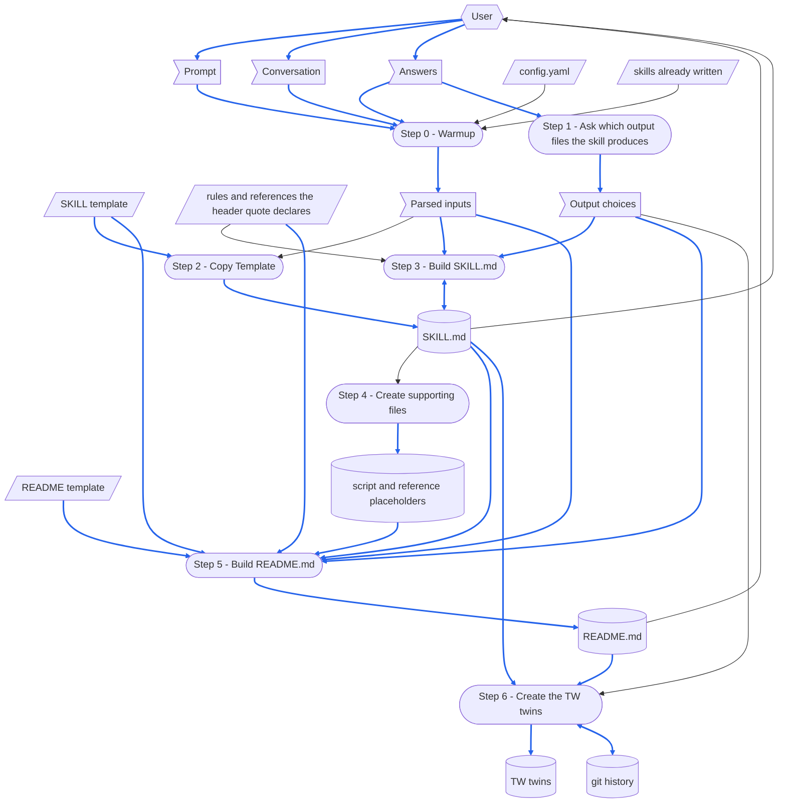

# gen-skill

> [DFD.md](../../references/DFD.md)  `2026-10-18`  `09fb4a7e4730`
> [md-style.md](../../rules/md-style.md)  `2026-10-30`  `6484ff7dc0b2`
> [skill-writing.md](../../rules/skill-writing.md)  `2026-10-30`  `c7696bf6351a`
> [SKILL-tmp.md](../../templates/SKILL-tmp.md)  `2026-10-30`  `6ca6e607f75c`
> [README-tmp.md](../../templates/README-tmp.md)  `2026-10-19`  `43ace64a88a6`
> [depends_on.py](../../scripts/depends_on.py)  `2026-10-16`  `53b1d3e60eca`
> [chinese/SKILL.md](../chinese/SKILL.md)  `2026-10-16`  `2a03562d5a11`

What the gen-skill skill is made of, and what its [SKILL.md](SKILL.md) depends on.
A skill loads its whole SKILL.md each time it runs, so the parts a run does not need are kept here: SKILL.md does not link to this file, and no run loads it.
Read it before changing the skill: make every change that When the Skill Is Changed names, then run the checks listed there.
How the steps of a skill are written is in [skill-writing.md](../../rules/skill-writing.md).

The paths in the diagrams are short: `gen-skill/` is `.github/common/skills/gen-skill/`, and `common/` is `.github/common/`.
`<skill>/` is the new skill directory a run creates, `{skillGroups[<group>]}/skills/<skill-name>/`.

# When the Skill Runs

## Dataflow

How a run turns its prompt into what it leaves behind: every step of the Workflow in [SKILL.md](SKILL.md), and the data each one reads and writes, drawn as a DFD in the notation of [DFD.md](../../references/DFD.md).
The steps of SKILL.md say what each one reads and writes; the diagram draws it, so that a record a later step overwrites, data with no source, or a step reading what a later step writes shows at a glance.
A step is named exactly as its heading, number included, so that no reader has to guess which step is meant.
Only what a step reads or writes at run time is drawn; a document a step only cites is not.



How to read the diagram:

- A parallelogram is an external input: `config.yaml`, the skills already written under the `skillGroups` roots, the two templates, and the rules and references the new skill's header quote declares, `skill-writing.md` and `DFD.md` among them — none of which any step writes.
  A flag is one-run data: the prompt, the conversation above it and the Answers, the inputs Step 0 parsed, and the output choices Step 1 asked for.
  A cylinder is a record: the new skill's `SKILL.md`, its script and reference placeholders, its `README.md`, its TW twins, and the git history.
  A rounded box is a step.
- A hexagon is a role outside the skill: the user, who supplies the prompt, the conversation and the Answers, and reads the new `SKILL.md` and `README.md`.
- A solid arrow moves data, the way the data moves; a two-headed arrow is data one step both reads and writes.
- A blue arrow carries data that is itself written into a record, or turned into a record's content; every other arrow is black.
  The new skill's name, description and steps, and the answers that shape its sections, become the content of `SKILL.md` and `README.md`, so their arrows are blue.
  So do the templates the two files are copied from, and the declared files, whose fingerprints Step 5 records in the header quote.
  Data that only steers how a step works, such as `config.yaml`, the skills already written, the path Step 2 copies to, the rules Step 3 writes by, or the answer about the twins, stays black.
- Two records are edited in turn.
  Step 2 writes `SKILL.md` whole and Step 3 fills it in, reading what it fills; the skill has no `run step N`, so Step 2 runs again only in a new run, which writes the skill afresh once the user has said to overwrite it.
  Step 6 adds a commit to the git history, through the `chinese` skill and on the user's yes, as earlier runs and the user left it.

## Step Purposes

Each step, named exactly as its heading in SKILL.md, with its Purpose: why it exists as a step.

- Step 0 - Warmup
  Settle the name, the description, the group and the steps of the new skill before any file is written — a skill written under a guessed name or group lands where nobody looks for it, or over a skill that already exists.
- Step 1 - Ask which output files the skill produces
  Settle up front the choices that shape both documents — an MD report, a YAML checkpoint and a pair of twins each decide sections of SKILL.md and README.md alike, and an answer asked for later would rewrite what was already written.
- Step 2 - Copy Template
  Start SKILL.md as an exact copy of the template, so that every section the template carries is there before any is filled — a SKILL.md written from memory drops the sections nobody remembered.
- Step 3 - Build SKILL.md
  Write what a run of the new skill needs, and only that — the workflow is the part of SKILL.md that is a judgement about the skill rather than a copy of the template, and the reason the skill is being made.
- Step 4 - Create supporting files
  Give every script and reference the steps name a file of its own, so that the next writer finds each one where SKILL.md says it is — a name with no file behind it is found only the first time a run needs it.
- Step 5 - Build README.md
  Write down what a change to the skill needs and a run does not — the Dataflow, the Purpose of each step, the files each step uses and what changes together — while the reasons are at hand, and outside SKILL.md, which every run loads whole.
- Step 6 - Create the TW twins
  Have the chinese skill write the twins, so that its parity check proves them — a twin translated here would skip the one check that catches a dropped heading or a lost link.

## Files Each Step Uses

The scripted-versus-not rule of skill-writing.md, answered once for this skill:
**Step 5 runs a script, the Dependency Checker, to record its header quote; Steps 0 to 4 and Step 6 run none of their own**, because inferring the steps of a skill, writing them and their Purposes, and drawing their Dataflow are judgements about the skill being made, copying a template is a single file copy, and Step 6 hands its work to the chinese skill, which runs its own scripts.

```
Step 0 - Warmup
  reads   config.yaml
  reads   the conversation above the prompt: the steps of the new skill
  checks  that these exist:
          common/templates/SKILL-tmp.md
          common/templates/README-tmp.md
          common/references/DFD.md
          common/rules/skill-writing.md
          common/scripts/depends_on.py
  checks  whether a skill of the same name exists under any skillGroups root

Step 1 - Ask which output files the skill produces
  asks    the user: an MD report, a YAML checkpoint, and the TW twins

Step 2 - Copy Template
  reads   common/templates/SKILL-tmp.md
  writes  <skill>/SKILL.md

Step 3 - Build SKILL.md
  reads   common/rules/skill-writing.md
  edits   <skill>/SKILL.md

Step 4 - Create supporting files
  reads   <skill>/SKILL.md: the scripts and references its steps name
  writes  <skill>/scripts/ and <skill>/references/: a placeholder for each

Step 5 - Build README.md
  reads   common/templates/README-tmp.md
  reads   common/rules/skill-writing.md and common/references/DFD.md
  reads   <skill>/SKILL.md, <skill>/scripts/ and <skill>/references/
  writes  <skill>/README.md
  runs    depends_on.py record
          ├─ reads every file the header quote declares
          └─ writes the header quote of <skill>/README.md

Step 6 - Create the TW twins
  runs    the chinese skill, on SKILL.md and then on README.md (when Step 1's answer was yes)
          ├─ reads common/references/tw-keep-english.md
          ├─ runs scan_md.py, diff_md.py, check_parity.py
          └─ writes <skill>/SKILL-tw.md and <skill>/README-tw.md, and offers its own commit
```

No run reads SKILL-tw.md, this file or README-tw.md.

# When the Skill Is Changed

`⇄`: the two change together.
`─▶`: depends on the rules or the format of the other.

```
gen-skill/SKILL.md
 ├─⇄ gen-skill/SKILL-tw.md
 │     every change goes into both: the chinese skill's diff_md.py, a translation, then check_parity.py
 │     └─▶ common/references/tw-keep-english.md: which terms stay English
 ├─⇄ gen-skill/README.md and README-tw.md
 │     the Dataflow, Step Purposes and Files Each Step Uses name each step exactly as its heading:
 │     a step added, removed or renamed changes all three
 ├─⇄ common/templates/SKILL-tmp.md and SKILL-tmp-tw.md
 │     Step 3 names the template's placeholders and the sections it edits or removes:
 │     a placeholder or a section added, renamed or removed there changes Step 3 with it
 │     a template in STE: MUST FOLLOW drops its STE header-quote lines and its header note from the copy
 ├─⇄ common/templates/README-tmp.md and README-tmp-tw.md
 │     Step 5 names the template's placeholders, its header quote lines and its sections
 │     a template in STE: MUST FOLLOW drops its STE header-quote lines and its header note from the copy
 ├─▶ common/rules/skill-writing.md: how the steps are written, here and in every skill this one writes
 ├─▶ common/references/DFD.md: how Step 5 draws a Dataflow
 ├─▶ common/scripts/depends_on.py: Step 5's record command and the header quote format
 ├─▶ common/skills/chinese/SKILL.md: what Step 6 hands it, and the twins it writes
 └─▶ common/rules/md-style.md: one sentence on each line
       └─ checked by reformat_md.py and check_reformat.py (--twin: the twin's sentences one for one)

gen-skill/README.md
 ├─⇄ gen-skill/README-tw.md: line for line, through the chinese skill
 └─▶ common/references/DFD.md: how the Dataflow is drawn
       a step or a piece of data added or removed redraws the DFD and renumbers its blue arrows

the tools
 ├─ common/skills/check-skill: checks what this skill writes against the same two templates,
 │  so a section either template gains is one that check-skill asks for
 └─ common/skills/CLAUDE.md: points an agent that changes a skill to its README.md and skill-writing.md

outputs already written
 └─ the skills written before a template changes keep their old shape,
    until each is brought in line; check-skill reports what differs
```

After a change, run the checks that cover it:

- `check_parity.py` for SKILL.md with SKILL-tw.md, and for README.md with README-tw.md: no failure.
- `depends_on.py check` on this file: every declared file is UNCHANGED, or read and recorded again.
- `/check-skill gen-skill`: every check passes, or each finding is settled.
- A run of `/gen-skill` that writes a throwaway skill, then `/check-skill` on that skill: no missing heading and no placeholder left; the throwaway skill is deleted afterwards.

# Tracked Dependencies

A header quote declares what a file depends on, and `depends_on.py check` says which of those files changed since the declaration was recorded.
This file declares what SKILL.md depends on outside the skill, so that SKILL.md stays short.

```
gen-skill/README.md (and README-tw.md, which copies its header quote)
  ─▶ common/references/DFD.md
  ─▶ common/rules/md-style.md
  ─▶ common/rules/skill-writing.md
  ─▶ common/templates/SKILL-tmp.md
  ─▶ common/templates/README-tmp.md
  ─▶ common/scripts/depends_on.py
  ─▶ common/skills/chinese/SKILL.md
```

When one of them is reported CHANGED, read what changed, bring SKILL.md and this file in line, and then record it again with `depends_on.py record`.
