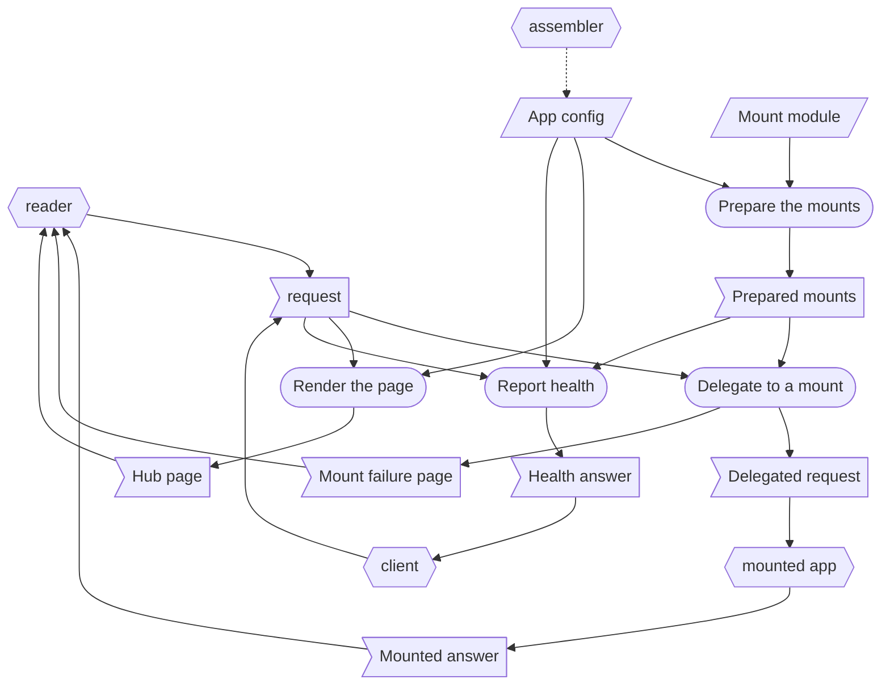

# Home - RSDC

> [[RSDC-Standard]]  `2026-10-30`  `ac0745864e75`
> [[DFD]]  `2026-10-18`  `09fb4a7e4730`
> [[RSDC-App-tmp]]  `2026-10-18`  `fe18ef9acd6f`

- **App**: Home —— 一頁按鈕，reader 可能想用的每一個 app 各一顆；它還能在自己的位址之下，親自提供其中一些 app。
- **Started with**: `node server.js`
- **Authority**: 任何與本文件不一致的實作，就是要改的那一方；關於 hub 行為的新規則先寫在這裡，絕不直接寫進程式碼。

# 1. Requirements — "What problem does this solve?"

本章定義這個 app 的目標與它要解決的痛點，以使用者自己的說法來寫，絕不觸及它如何建構：
不寫 component、函式庫、路由或取自 app 原始碼的識別碼，也不寫從某一次執行中量到的數字。
指名這個 app 接管的是什麼（即使那是一支程式），以及舊做法讓使用者付出什麼代價，描述的是使用者面對的問題，所以寫在這一章。

## 1.1 Target Users

- **A reader** —— 使用一組本機小型 app、但不該被要求記住每個 app 各自在哪個 port 回應的人。
  他們每當想用其中一個 app 時就打開 hub，從不是為了讀 hub 本身。
- **Callers** —— 替 reader 呼叫 hub 的任何東西：人在其中工作的頁面、AI agent，或一支 script。

## 1.2 Core Vision

要記的位址從好幾個變成一個。
使用者打開 hub，就能從那裡抵達每一個 app，不必知道其中任何一個被分到哪個 port。
這裡描述的是**一般意義上**的 hub：它的名稱、port、標題與按鈕，全都以設定的形式送達。
以下任何一節都不寫出特定的 hub、目錄、port、標題、標籤或網址，因為指名了其中一個的設計，描述的就只剩那一個。

## 1.3 Current Pain Points

如今每個小型 app 都靠它自己的 host 與 port 抵達，這些位址在訊息裡被傳來傳去，或記在一份連結清單裡。
hub 接管這份清單：它就是那唯一的位址，每個 app 都是它上面的一顆按鈕。
它刻意不沿用以檔案開啟的連結清單，也不沿用每一組 app 各自一頁的做法。

- **每個 app 就只是一組 host 與 port。**
  它們在訊息裡被傳來傳去，只要有一個搬家就全部變成 stale。
- **靜態連結清單試過，撐不住。**
  以 `file://` 開啟的頁面無法當成 URL 分享；而以 `http` 提供的頁面，上面任何 `file://` 按鈕都會**靜默失效**——因此同一份清單，不論用哪種方式打開都有一邊是錯的。
- **沒有任何東西說明一個 app 是做什麼的。**
  一個 port 號分不出這個 app 與那個 app。
- **每個 app 都是另一個得有人先啟動的伺服器。**
  如果抵達一個位址所指向的東西，仍然意味著好幾個 process 都得是活的，那麼「只要記一個位址」並沒有幫上忙。
  一顆指向沒人啟動的 port 的按鈕，看起來跟一顆指向已經搬家的 port 的按鈕一模一樣。
- **多一個 hub 就等於把第一個再抄一份。**
  每一道新的前門都有自己的頁面、自己的伺服器、自己的一套規則，於是修好其中一個，其他任何一個都沒被修到。

## 1.4 System Goals

- **一頁、一個位址** —— 一個頁面、一個位址，列出 reader 可能想用的每一個 app。
- **連結是設定，絕不是程式碼** —— 加一顆按鈕，就是加一行設定。
- **hub 本身也是設定** —— 程式碼裡沒有任何東西分得出這個 hub 與那個 hub。
- **按鈕不能用時，絕不宣稱它能用** —— 唯一的例外是刻意的：頁面無法 navigate 過去的連結，看起來跟其他連結一樣，理由寫在規格裡。
- **什麼都不必安裝** —— hub 能在一台沒有為它額外安裝任何東西的機器上啟動，它的頁面也不從其他任何地方載入東西。
- **預設最小暴露** —— 除非刻意放寬，hub 只回應它所在的那台機器。
- **app 可以由 hub 親自提供** —— reader 不必另一個伺服器在跑就能抵達它，而那個 app 獨自執行的能力也絲毫不減。

# 2. Specification — "What are the system rules?"

本章定義這個 app 從外部觀察得到的行為：caller 看得到什麼、能要求什麼、又會被拒絕什麼。
這是讀者拿來對照檢查 app 的部分，所以這裡的每一句陳述，都必須是實際使用 app 就可能被推翻的。
它指名 caller 呼叫的路由，以及 hub 所掛載的 handler，因為這些名稱是契約；設計的其他部分一概不指名。

## 2.1 Terminology

後面各節所依賴、卻沒有一節定義的每一個名詞，各在這裡定義一次。

- **Caller** —— 1.1 所說的 caller 在本章中的 role：呼叫 hub 路由的一方。
- **Hub** —— 1.2 所說的 hub 在本章中的 role：本文件所描述的程式，它提供一頁按鈕，並可能在它自己選定的路徑前綴之下提供一個 app。
- **Reader** —— 1.1 所說的 reader 在本章中的 role：在 hub 頁面前的那個人，藉由按鈕選擇一個 app。
- **Client** —— 頁面以外的 caller：一支 script 或一個 AI agent，詢問 hub 是否活著，並讀取回答。
- **Assembler** —— 寫 hub 設定的一方：搭建與更新 hub 的那個 skill，或手動編輯那個檔案的人。
- **Mount** —— hub 親自提供其 app 的連結：在 hub 自己位址的某個路徑之下提供，而不是連出去到那個 app 自己的 port。
- **Mount prefix** —— mount 回應時所在的路徑：路徑落在它之下的 request，會交給 mounted app。
- **Mounted app** —— mount 所提供的 app：另一個 system，hub 載入它並把 request 交給它，而它仍然可以在自己的 port 上獨自執行。
- **Dead link** —— 頁面無法 navigate 過去的連結，目前指的是位址以 `file://` 開頭的那種：瀏覽器會在以 `http` 提供的頁面上擋下它，而且什麼都不說。
- **Owner skill** —— 組裝 mounted app 的 skill：那個 app 需要建置或修復時，該去跑的是誰。

## 2.2 Artifact Types

app 處理的每一種資料：它是什麼、用來做什麼，以及它的內容必須是什麼。
它的資料分三種：**external input**，來自 app 外部、存在時間超過任何一次呼叫；**record**，由 app 寫入、在寫入它的那次呼叫之後仍保留；以及 **one-run data**，只存在於一次執行之中——對 app 來說，一次執行就是一次呼叫——不論它從哪裡來。
Prepared mounts 是唯一的例外：它們存在的時間與 hub 執行的時間一樣長。

**External input**

- **App config** —— hub 的設定，位於 `server.js` 旁邊的 `app.config.json`：它的標題、它回應的 port、link list——每一顆按鈕，依序，每一顆都有一個標籤、一個位址、一段選填的說明，若是 mount，還有 mounted app 所在的地方——以及 hub 是何時組裝的。
  它由 assembler 寫入；hub 從不寫它。
- **Mount module** —— mounted app 目錄裡的 `app.js`：mounted app 自己的檔案，hub 載入它，以取得它所委派的 handler。
  它屬於 mounted app，由它的 owner skill 寫入；hub 只載入它。

**Record**

hub 不寫任何 record：它產生的東西，沒有一樣在產生它的那次呼叫之後還存在。

**One-run data**

- **The request** —— caller 在一次呼叫中送來的東西：一個 method 與一個路徑，以及 mounted app 自己的路由所接受的任何東西；hub 只讀路徑與它的 query。
- **The outcome** —— hub 對那次呼叫的回答：Hub page、樣式表、Health answer、Mounted answer、轉址、Mount failure page，或 Refusal。
- **Prepared mounts** —— hub 從啟動到停止都保留的、關於每個 mount 的資料：mount prefix、標籤、目錄、owner skill，以及 Mount module 回傳的 handler，或沒有 handler 的原因。
- **Hub page** —— reader 打開的頁面：標題、一行摘要，以及 link list 每一筆各一顆按鈕，依它的順序。
- **Health answer** —— hub 啟動時解析出的結果，給檢查它是否活著的 client：它的標題、它有幾個連結、其中幾個是 dead link、每個 mount 及其是否已準備好，以及 hub 是何時組裝的。
- **Delegated request** —— 剝掉 mount prefix 之後的 request，也就是 mounted app 收到的樣子。
- **Mounted answer** —— mounted app 對一個 Delegated request 的回答；hub 不讀它，直接交給 caller。
- **Mount failure page** —— 在無法準備好的 mount 的 mount prefix 上回答的頁面：缺的是哪個 app、從哪個目錄缺席、由誰組裝它。
- **Refusal** —— 對 hub 不願或不能回答的 request 的回答：一個狀態碼，以及用文字寫出的理由。

## 2.3 Dataflow

資料如何在 app 的活動之間移動：有哪些 stage、每個 stage 讀取與寫入什麼、每一份資料由誰寫入、誰可以讀，以及資料本身強加了什麼順序。
hub 有以下各 stage：

- **Prepare the mounts** 在 hub 啟動時執行一次，載入 App config 裡每一個 mount 的 Mount module，並保留 Prepared mounts。
- **Delegate to a mount** 把路徑落在某個 mount prefix 之下的 request，剝掉前綴之後交給那個 mounted app；或替無法準備好的 mount 回答。
- **Render the page** 把 App config 的 link list 渲染成 Hub page。
- **Report health** 以 Health answer 回答 client。

Prepare the mounts 在 hub 回答任何東西之前執行一次；之後每個 request 最多執行其他三個中的一個，也就是它的路徑所選中的那一個，而沒有任何一個接手的 request 會被拒絕。

### DFD



圖的讀法：

- **平行四邊形** —— external input：App config 與 Mount module。
- **旗形** —— one-run data：request 與 outcome，在這裡是 Hub page、Health answer、Mounted answer 與 Mount failure page；以及在 stage 與 role 之間傳遞的東西：Prepared mounts 與 Delegated request。
- **圓角框** —— stage。
- **六角形** —— app 外部的 role：reader，提供 request 並讀取 Hub page、Mounted answer 或 Mount failure page；client，提供 request 並讀取 Health answer；assembler，寫入 App config；以及 mounted app，讀取 Delegated request 並提供 Mounted answer。
- **黑色實線** —— 不會超出所到達之 stage 或 role 的資料：在這裡是每一份資料，因為沒有東西被寫進 record，所以圖上沒有圓柱，也沒有藍色箭頭。
- **虛線** —— 不承載資料：表示順序，或從 app 外部做出的變更；在這裡是 assembler 對 App config 的寫入。

### Data Read/Write Rules

圖畫不出來的資料性質——凡適用者，是否整份寫入、寫入後是否唯讀、由誰刪除：

- **external input** 不由任何 stage 寫入；讀取它們的每個 stage 都只讀不寫。
- **App config** 在 Render the page 回答的每一個 request 都會被它讀取，因此對 link list 的修改，在下一個 request 就會反映到 Hub page。
  它的 mount 只由 Prepare the mounts 讀取，它的標題也只以啟動時解析出的結果被 Report health 讀取，因此 mount 的新增、移除或搬移，以及 Health answer 回報的標題，要等 hub 再次啟動才會改變。
- **Mount module** 只由 Prepare the mounts 載入一次；對它的修改，要等 hub 再次啟動才會反映到 hub。
- **Prepared mounts** 由 Prepare the mounts 在 hub 回答任何東西之前寫入一次，hub 執行期間絕不重寫；Delegate to a mount 與 Report health 只讀取它們。
  它們隨 process 一起消失。
- **request 與 outcome** 只存在於該次呼叫之中。
  沒有 record 保留它們之中的任何一個，因為 hub 不寫任何 record。
  除此之外沒有東西保留它們，也就沒有東西刪除它們。
- **Mounted answer** 屬於 mounted app 自己：hub 既不讀它，也不改它。

### Order Imposed by the Data

- **Prepare the mounts 先於 Delegate to a mount** —— Prepared mounts：只有在每一個 mount 都準備過之後，request 才會抵達 mount，因此 mount 自己的準備失敗，在任何人抵達之前就已知道。
- **Prepare the mounts 先於 Report health** —— Prepared mounts：Health answer 依每個 mount 準備時的結果回報它。
- **mount prefix 先於 hub 自己的路由** —— 不是資料，而是一條規則：路徑落在某個 mount prefix 之下的 request，不論路徑其餘部分是什麼，都交給 Delegate to a mount，因此 mounted app 擁有它前綴之下的一切。
- 沒有任何 stage 讀取後面 stage 寫入的東西。

### Exception Paths

- **Ending with nothing written** —— 每一次呼叫都以這種方式結束，因為 hub 不寫任何 record；不同的是 caller 得到什麼：
  - **不是路由** —— 不是 hub 的任何路由、也不落在任何 mount prefix 之下的路徑，以 404 拒絕。
  - **少了結尾斜線的 mount prefix** —— 已準備好的 mount 的前綴少了結尾斜線時，以 308 轉址到加上斜線的同一路徑，保留 query，不委派任何東西。
  - **無法準備好的 mount** —— 它的前綴以 Mount failure page 回答，狀態碼 503，而 hub 與其他每一個 mount 照常回應。
  - **樣式表不見了** —— 對它的 request 以 500 拒絕，並指名缺少的檔案。
- **Stopping midway** —— mounted app 在回答途中失敗：一次 throw，或它的 handler 交回的 promise 被 reject，會在它的前綴上以 502 回答並指名那個 app，而 hub 與其他每一個 mount 照常回應。
  如果 mounted app 已經開始它的回答，hub 只能關閉連線。
  hub 從未被交到手上的失敗——之後某個 tick 上的 throw，或 handler 啟動了卻從未回傳的 promise——會被記錄並撐過去，絕不歸咎於任何 mount，因為它所屬的 request 早已回答完畢。
- **Re-entering midway** —— 沒有任何東西會從中途重新進入：每個 request 都從它的路徑開始，而 Prepared mounts 只在 hub 再次啟動時才會改變。

## 2.4 Naming and Data Structures

app 寫出或讀取的資料如何命名與配置。

- **App config** —— `server.js` 旁邊的 `app.config.json`：UTF-8 的 JSON 物件。
- **Hub page** —— 對 `/` 與 `/index.html` 的回答：UTF-8 的 HTML，不含任何 script。
- **Health answer** —— 對 `/healthz` 的回答：UTF-8 的 JSON 物件。
- **Mount failure page** —— UTF-8 的 HTML，在 mount prefix 上以 503 回答。
- **Refusal** —— UTF-8 的純文字。

App config 的配置如下；每個欄位必須放什麼，是它的 schema，在下一節。

```
appConfig = {title, port, links, assembledAt}
links     = [{label, href, note?, mount?}]
mount     = {appDir, skill?}
```

`assembledAt` 是 `yyyy-MM-dd HH:mm:ss`，也是 hub 唯一的時間戳記：沒有別的東西記錄它的年齡。

Health answer 的欄位：

| Field | Meaning |
|---|---|
| `ok` | 永遠是 `true`：有回答就表示 hub 活著 |
| `title` | hub 的標題，依它啟動時解析的結果 |
| `links` | link list 有幾筆 |
| `dead` | 其中有幾筆是 dead link |
| `mounts` | 每個 mount 一個物件：`prefix`、`label`、`ok`——是否已準備好——以及 `error`，沒有準備好時的原因 |
| `assembledAt` | App config 的 `assembledAt` |

## 2.5 Config Schemas

app 的設定檔必須包含的欄位，以及欄位之間的限制。
app 只讀它自己的 `app.config.json`，不讀其他設定檔。
缺少檔案、不是 JSON，或缺少 `title`、`port` 或 `links` 的檔案，會讓 hub 無法啟動，並說明原因；缺少的欄位會被回報為缺少，絕不會被補上。
命令列上的 `--title` 與 `--port` 會覆寫檔案裡的 `title` 與 `port`，而 `--host` 是綁定到 loopback 以外的唯一方法。
搭建 hub、寫入這個檔案時，會拒絕沒有 `label` 或 `href` 的 link entry、`href` 不是這個 origin 上路徑的 mount，以及是 hub 自己的路由之一、或被佔用兩次的 mount prefix。

`app.config.json` 的欄位：

| Field | Meaning | Allowed values | What changing it costs |
|---|---|---|---|
| `title` | Hub page 的標題，以及它的瀏覽器分頁 | 任何文字；`--title` 會覆寫它 | 下一個對 Hub page 的 request；Health answer 要到下一次啟動 |
| `port` | hub 回應的 port | 一個 port；`--port` 會覆寫它 | 重新啟動 |
| `links` | link list：每一顆按鈕，依頁面顯示的順序 | link entry，每一筆都有 `label` 與 `href` | 下一個對 Hub page 的 request；mount 要到下一次啟動 |
| `links[].label` | 按鈕的標籤 | 文字，不可空白 | 下一個對 Hub page 的 request |
| `links[].href` | 按鈕前往的地方，逐字照登在按鈕上；若是 mount，則是這個 origin 上的一個路徑，也就是 mount prefix | 任何位址；若是 mount，則是以 `/` 開頭、不是 hub 自己的任何路由、也不是其他 mount 前綴的路徑 | 下一個對 Hub page 的 request；mount 要到下一次啟動 |
| `links[].note` | app 是做什麼的，顯示在按鈕底下 | 文字；選填 | 下一個對 Hub page 的 request |
| `links[].mount.appDir` | mounted app 的目錄，它的 Mount module 所在之處 | 一個絕對路徑 | 重新啟動 |
| `links[].mount.skill` | owner skill，一併帶著，是為了讓失敗能說出該去找誰，而不只是缺了什麼 | 一個 skill 的名稱；選填 | 重新啟動 |
| `assembledAt` | hub 是何時組裝的 | `yyyy-MM-dd HH:mm:ss` | 重新啟動 |

**mount 指名的是擁有它的是誰，不是它住在哪裡。**
assembler 依一份經過審查的登錄表寫入 mount 的 `appDir` 與 `skill`，以組裝那個 app 的東西的名字要求，絕不採用要求當下才提供的路徑。
路徑是要求者必須知道、並保持正確的東西；名字則不是，因為一個 app 被組裝在哪裡，是組裝它的那個東西的事。
要求當下才提供的路徑，是會抵達檔案系統的未經審查輸入；不在登錄表裡的名字會被拒絕，並說明要加入什麼。
登錄表同時帶著每個 app 的預設 label、href 與 note，因此以名字要求一個 mount，就足以產生一筆完整的 link entry。

**mount 是 hub 唯一會伸手到自己目錄以外去拿的東西。**
沒有 mount 的 hub 可以整個搬走；有 mount 的 hub，只能連同它所掛載的那些目錄一起搬。
改把每個 mounted app 複製進 hub，會產生靜默變成 stale 的副本，而一份 stale 的副本，遠比一個解析不了的路徑難看出來。

## 2.6 Derivation Rules

app 並非直接觀察而來的每個值如何推導。

### A mount prefix

- mount 的 `href` 的路徑，去掉它的 query、fragment 與結尾斜線：單一來源，也就是按鈕上已經顯示的位址。
- 絕不是從 request 拼出來的路徑，也絕不是單獨的 `/`。
- 不是這個 origin 上路徑的 `href` 得不到 mount prefix：那個 mount 不會被準備好，而 Health answer 會給出原因。

### The dead count

- `href` 的 scheme 是 `file` 的 link entry，在 App config 裡計數。
- 絕不是去探測某個連結是否有回應：hub 無法知道 reader 是怎麼來到這一頁的，而同一份 link list 也可能直接從檔案打開，在那裡這樣的連結是可以用的。
- 它由 Health answer 回報，也在搭建 hub 時回報，絕不出現在 Hub page 上。

## 2.7 Presentation Contract

什麼可以被顯示、顯示給誰、使用者必須能夠啟動哪些動作，以及所見與所為是否一致。
抵達 hub 的每一個人都看得到它的全部：它不問任何人是誰，除了它的設定之外什麼都不顯示。
本文件決定 hub 做什麼、告訴 reader 什麼——絕不決定它看起來是什麼樣子。
顏色、hover 狀態、框線或字體都是頁面元素的屬性，與那些元素一起決定，不在這裡。
判斷方式是「重新上色」：若一句話在按鈕換了顏色之後就不再成立，它就不屬於這份文件。

**app 的輸出講清楚的事**

- **一個頁面：一個標題、一行摘要，以及依 link list 順序排列的按鈕。**
  沒有面板、沒有篩選器、沒有控制項：hub 做的每一件事都是 navigate。
- **每顆按鈕依序帶著它的標籤、逐字照登的位址，以及該筆有 note 時的那段說明。**
  位址顯示出來而不是藏起來，因為錯的 host 或 port 正是 hub 的全部失效模式，而 reader 無法診斷自己看不到的東西。
- **按鈕恰恰就是 link list 的各筆，順序也恰恰相同。**
  頁面絕不新增、刪除、重排或改寫任何一筆——否則頁面與設定互相矛盾，而沒有任何東西說明哪一邊才對。
- **每個連結的呈現都一模一樣：頁面不標示 dead link。**
  hub 無法知道 reader 是怎麼來的：同一份 link list 也可能直接從檔案打開，在那裡那顆按鈕是可以用的，所以一個在某一頁正確的標示，在另一頁就是謊言。
  這個代價是真的，而且是被接受、不是被藏起來：點了 dead link 的 reader 什麼都得不到、也沒有任何解釋，還可能再點一次。
  這個事實被保留在不改變外觀的地方：Health answer 計算 dead link 的數量，而搭建 hub 時會指名它們。
- **頁面由 hub 在 request 當下渲染，不是在建置時產生，也不是由瀏覽器裡的 script 產生。**
  因此頁面完全不帶 script，而設定的變更會在下一個 request 反映到頁面——否則提供出去的頁面與設定可能互相矛盾。
- **一個 app 不在的 mount，是一顆能用的按鈕，通往一個誠實的頁面。**
  這顆按鈕的呈現與其他每一顆都一樣；reader 在目的地遇到 Mount failure page，指明哪個 app 從哪個目錄缺席、由誰組裝——一個理由，出現在 reader 已經走到的地方，而不是格狀排列裡一個 reader 得自己去解讀的差異。

**每一種呈現都要回答的問題**

1. *沒有結果時，使用者看到什麼？
   被略過的數量在哪裡回報？*
   link list 裡沒有任何一筆時，頁面會說沒有設定任何連結，並說明要加到 link list。
   頁面上沒有任何東西被略過：dead link 的呈現與其他連結一樣，而 dead link 的數量由 Health answer 回報，也在搭建 hub 時回報。
2. *哪些流程是使用者自己能啟動的？
   不能啟動的那些，原因是什麼？*
   reader 可以用按鈕打開 link list 上的任何一個 app，mounted app 也包括在內，也可以從 Mount failure page 回到 hub。
   此外沒有別的：頁面上沒有任何控制項，因為 hub 做的每一件事都是 navigate。
   新增、移除或重排按鈕，以及掛載一個 app，都是 assembler 的事：要修改 App config，而 reader 無法從頁面做這件事。
3. *每一項擷取，都已在使用者自己的環境中實際觀察到成功了嗎？*
   本文件沒有記錄任何一次 hub 的執行。
   hub 自己什麼都不擷取，只讀它自己的設定，並在啟動時讀每一個 Mount module；一個連結的目的地是否有回應，不是 hub 能知道的。
4. *如果這些內容在這個 app 之外也抵達得到，app 會把那個位址交給使用者嗎？*
   是：每顆按鈕都逐字照登它的位址，所以 reader 看得到任何一個 app 住在哪裡；mounted app 也保有它自己的設計給它的 port。
5. *檢視範圍縮小之後，畫面上的計數與下一個動作的範圍相符嗎？*
   沒有任何東西會縮小檢視範圍，也沒有任何動作作用在一組東西上。
6. *批次動作的上限是多少？
   超出時如何拒絕，又是否可能留下做到一半的結果？*
   沒有批次動作，而 hub 什麼都不寫，所以不會留下做到一半的東西。
7. *被拒絕的使用者接下來該做什麼？*
   在 Mount failure page 上，執行它指名的 owner skill 來組裝那個 app，然後再次啟動 hub。
   mount 上的 502 表示 mounted app 在回答途中失敗；hub 與它的其他 mount 仍然照常回應。
   404 表示這個位址不是 hub 的任何路由：回到 hub 的頁面，使用它的按鈕。
8. *它預設暴露到什麼程度，暴露範圍放寬時又有誰會知道？*
   只有 loopback，`127.0.0.1`。
   `--host` 會放寬它，而啟動時印出的幾行，會告訴讀那個主控台的人：hub 可以從其他機器抵達。
   mount 會繼承它：放寬 hub，就等於放寬掛在它上面的一切。

## 2.8 HTTP API

caller 可以透過 HTTP 呼叫的每一條路由——頁面、AI agent、script——以及每次呼叫執行 2.3 的哪些 stage。

caller 只透過這些路由接觸 hub，絕不 import 它的模組，也不讀它的檔案。

- `/`、`/index.html`，任何 method —— 執行 Render the page。
  - **Takes** —— 無
  - **Answers** —— Hub page
  - **Refuses** —— 不拒絕任何東西
- `/app.css`，任何 method —— 不執行任何 stage。
  - **Takes** —— 無
  - **Answers** —— 樣式表，依它固定的名稱
  - **Refuses** —— 不拒絕任何東西；檔案不見時以 500 拒絕
- `/healthz`，任何 method —— 執行 Report health。
  - **Takes** —— 無
  - **Answers** —— Health answer
  - **Refuses** —— 不拒絕任何東西；它不帶任何機密
- 落在某個 mount prefix 之下的任何路徑，任何 method —— 執行 Delegate to a mount。
  - **Takes** —— mounted app 自己的路由所接受的任何東西
  - **Answers** —— Mounted answer；少了結尾斜線的前綴得到 308；無法準備好的 mount 得到 Mount failure page，狀態碼 503
  - **Refuses** —— mounted app 在回答途中失敗時，以 502 拒絕，並指名那個 app
- 其他任何路徑 —— 不執行任何 stage。
  - **Takes** —— 無
  - **Answers** —— 無
  - **Refuses** —— 一切，以 404

**Guards**

- **hub 自己的路由** —— `/`、`/index.html`、`/app.css` 與 `/healthz` 永遠不能是 mount prefix：搭建 hub 時會拒絕這樣的 mount，Prepare the mounts 也會，它會把這個 mount 回報為未準備好，並指名它會遮蔽的路由，而 hub 的路由照常回應。
- **最長的前綴** —— 路徑落在兩個 mount prefix 之下的 request，交給較長的那一個，因此掛在 `/a/b` 的 app 不會被掛在 `/a` 的那個吞掉。
  路徑等於前綴本身、或是前綴後面接著 `/` 時，才算落在那個前綴之下；`/ab` 不算落在 `/a` 之下。
- **少了結尾斜線的前綴** —— 已準備好的 mount 的前綴少了結尾斜線時，以 308 轉址到加上斜線的同一路徑，保留 query，絕不照原樣委派。
  兩者在 reader 眼中看起來一樣，在瀏覽器眼中卻不同：頁面上的相對位址，在前者會對著上一層路徑解析，在後者則對著 mount 解析。
- **一個前綴、一個 mount** —— 已經被較早的 mount 佔用的 mount prefix，會對較晚的那一個拒絕，並把它回報為未準備好。
- **request 裡的路徑碰不到檔案系統** —— 樣式表依固定的名稱讀取，而 mount prefix 是與已設定的清單比對，絕不從 request 拼出來。

## 2.9 Mountable Handler

一個 hub 如何提供這個 app：它 require `app.js`，並在啟動時呼叫 `createApp(options)` 一次。
這個 hub 就是提供者，沒有任何東西掛載它，所以本節從 hub 這一側陳述這份契約：hub 對它所掛載的每一個 app 有什麼要求。

- `mountedAt` —— app 回應時所在的 mount prefix；request 抵達 handler 時，它已經被剝掉。

它回傳 `(req, res)` handler——或它的 promise——以 app 自己的伺服器會用的方式，提供 mounted app 自己的路由。
載入 `app.js` 不會啟動任何東西。

一個 app 在以下兩項都成立時就是可掛載的，而兩項都是 app 的責任，不是 hub 的：

1. **它公開自己的 request handler。**
   它在自己的 `server.js` 旁邊帶著一個 `app.js`，匯出 `createApp(options)`。
   它是 factory 而不是單純的 handler，因為這樣的 app 可能需要先準備才能回答：有的要從共用資料夾讀一份索引，有的要讀一份投影出來的檢視。
   單純的 handler 只能在第一個 request 時做這件事，把一次啟動失敗變成給最先到的人的一個壞掉的頁面。
2. **它發出的每一個位址，都相對於它自己的頁面。**
   位於 `/app.css` 的樣式表或對 `/api/data` 的呼叫，會對著 origin 解析，而不是對著 mount，所以在前綴之下它會整個離開這個 app。
   `./app.css` 與 `./api/data` 則跟著頁面，不論頁面從哪裡提供。

它的 `server.js` 只負責 listen，別的都不做，並加以防護，讓直接執行它時仍在自己的 port 上提供這個 app，而 require 它時什麼都不啟動。
這兩種執行方式是同一個 app，不是它的副本。

hub 能驗證第一項，卻無法驗證第二項。
缺少的匯出在 mount 準備時就看得到；一個漏網的絕對位址，則要到 reader 載入頁面、某個 request 落到 mount 之外時才看得到。
hub 不會掩飾第二項：它要靠觀察 mounted app 的頁面來證明，絕不是假設。

hub 無法準備一個 mount 時——目錄裡沒有 `app.js`、沒有匯出 `createApp`、handler 不是函式，或準備時發生 throw 或 reject——那個 mount 就不會被準備好：它的前綴以 Mount failure page 回答，Health answer 給出原因，而 hub 與其他每一個 mount 照常回應。

## 2.10 Invariants

在每一個 stage、每一條路由都成立、沒有例外的規則：

- **App config 是區分這個 hub 與那個 hub 的唯一東西。**
  hub 自己不帶任何標題、port、連結或位址：兩個 hub 是同一份程式碼讀兩個檔案。
  否則一個 hub 的名字寫進程式碼，會讓之後的每一個 hub 都成為第一個的副本。
- **hub 除了自己的設定之外什麼都不讀，除了那份設定所掛載的東西之外什麼都不執行。**
  它不呼叫任何服務、不開啟任何共用資料夾，也不持有任何自己的資料。
  被掛載的 app 做的是它自己設計說它做的事；hub 不稽核它，也不繼承它的保證。
- **請求永遠不會指名一個檔案，也永遠不會指名一個 mount。**
  caller 提供的任何字串，都碰不到檔案系統，也選不了目錄。
- **預設最小暴露。**
  除非明確傳入 host，否則綁定 loopback；任何更寬的綁定都要對提出要求的人說明白。
  mount 會繼承這一點：放寬 hub 就等於放寬掛在它上面的一切。
- **port 已被佔用是拒絕，不是搶。**
  hub 以非零狀態結束並說明原因，而不是讓 reader 猜是兩個伺服器中的哪一個在回答。
- **一個目錄只有一個擁有者。**
  一個 hub 的目錄只由一樣東西寫。
  兩個寫入者就意味著後跑的那個贏、先跑的那個下一次執行又把它蓋回去——而且是靜默地，因為兩邊都沒壞。
- **mounted app 的失敗留在它自己的 mount 之內。**
  好幾個 app 在同一個 process 裡，就是一個可能失去的 process，所以在某個前綴上被回答的失敗，絕不會讓 hub 或另一個 mount 停下。
  hub 從未被交到手上的失敗，同樣會被記錄並撐過去，而且不歸咎於任何 mount，因為已經沒有 request 可以歸咎。
  這有代價，而且是被接受、不是被藏起來：撐過一個沒人接住的錯誤，意味著在一個 hub 無法擔保的狀態下繼續執行，這通常正是 process 會結束的原因。
  之所以接受，是因為 hub 不持有任何自己的資料，也因為另一條路嚴格來說更糟：一個 hub 只是代為提供的 app，將能夠讓它所提供的其他每一個 app 停下。
- **掛載在兩個方向上都是加法。**
  沒有 mount 時，hub 恰恰就是它的頁面與它自己的路由；而掛載在這裡的 app，在它自己的 port 上仍然完全照舊運作。

1.4 的目標，以及承載它們的規則：

| Goal | Carried by |
|---|---|
| 一頁、一個位址 | 2.7 一個頁面；2.8 Hub page |
| 連結是設定，絕不是程式碼 | 2.5 `links`；2.7 按鈕恰恰就是 link list 的各筆 |
| hub 本身也是設定 | 2.5；Invariants，App config 是區分這個 hub 與那個 hub 的唯一東西 |
| 按鈕不能用時，絕不宣稱它能用 | 2.6 The dead count；2.7 每個連結的呈現都一模一樣、一個 app 不在的 mount |
| 什麼都不必安裝 | Invariants，hub 除了自己的設定之外什麼都不讀 |
| 預設最小暴露 | 2.7 問題 8；Invariants，預設最小暴露 |
| app 可以由 hub 親自提供 | 2.3 Delegate to a mount；2.8 Guards；2.9 Mountable Handler；Invariants，mounted app 的失敗留在它自己的 mount 之內、掛載在兩個方向上都是加法 |

# 3. Design — "How is the system structured?"

本章描述 app 如何被建構出來以遵守第 2 章：它的 component、每個 component 如何完成工作、檔案放在哪裡，以及每項 capability 呈現給使用者的形式。

## 3.1 Core Component Responsibilities

每個 component 一條，寫出它的檔案、它執行 2.3 的哪些 stage、它唯一的工作與它的邊界：跨越邊界的一次修改，就是對兩個 component 的修改。
2.3 的每一個 stage 都由其中一個執行；沒有任何 component 執行的 stage，是沒有人實作的活動。

- **Hub server**，檔案 `server.js` —— 執行 2.3 的 Prepare the mounts、Delegate to a mount、Render the page 與 Report health。
  它唯一的工作：從 App config 與 Prepared mounts 回答 2.8 的每一條路由，並擁有位址——綁定它，並說明它暴露到什麼程度。
  它的邊界：在這裡做出的、關於頁面外觀的決定，就是第二個得去改的地方；而讀取 request 所指名檔案的路由，等於把檔案系統開放給網路。
- **Stylesheet**，檔案 `public/app.css` —— 不執行 2.3 的任何 stage。
  它唯一的工作：Hub page 看起來的樣子。
  它的邊界：寫在這裡、說明頁面做什麼而不是看起來怎樣的規則，是 Hub server 不會遵守的規則。

它們如何互動：Hub server 渲染 Hub page，頁面以相對於自己的位址載入 Stylesheet，而瀏覽器要求時，Hub server 提供 Stylesheet。
頁面不是第三個 component：它沒有自己的行為，是 Hub server 的輸出。
被掛載的 app 也不是這個 system 的元件：它是另一個 system，只是透過這一個抵達。

**一切都由 Node 做；沒有 kernel。**

Hub server 處理路由、渲染 link list、提供 Stylesheet、給出 Health answer，並載入與委派給 mounted app；它不啟動任何 process，也不對任何 app 的領域做任何決定。
換掉一個 mounted app，改變的是透過 hub 抵達的東西，絕不是 hub 本身。

## 3.2 Execution Flow

3.1 的每一個 component 在運行時如何完成工作：它的 step 依序寫出，用程式碼裡的名稱，包括實作自己選擇、而非資料強制的分支、重試、平行處理與順序。
需要畫圖時，以 DFD 的記法繪製。
這裡引用第 2 章的規則，絕不重述。

### Hub server

1. 只要 `server.js` 被啟動，`main` 就會執行；沒有任何東西 require 這個 hub，因為沒有任何東西掛載它（2.9）。
2. `resolveOptions` 透過 `parseArgs` 取得 `--port`、`--host` 與 `--title`，讀取 `server.js` 旁邊的 `app.config.json`，並先依參數、再依檔案解析出 port 與標題（2.5）；host 用參數的，否則是 loopback（2.10）。
3. `prepareMounts` 執行 Prepare the mounts：對每一筆帶有 `mount` 的 link entry，`mountPrefix` 從它的 `href` 取出 mount prefix（2.6）；缺少前綴、是 hub 自己的路由之一，或已被佔用的，都會被拒絕（2.8，Guards）；接著 require 目錄裡的 `app.js`，以 `mountedAt` 呼叫 `createApp` 並等待它（2.9）。
   被拒絕或失敗時保留原因，那個 mount 維持未準備好。
4. Prepared mounts 依前綴由長到短排序。
5. 對每一個 request，`matchMount` 找出路徑落在其 mount prefix 之下的那個 mount，先於 hub 自己的路由考慮（2.3，Order Imposed by the Data）。
6. `delegate` 對沒有 handler 的 mount，以 `renderMountFailure` 產生的 Mount failure page 回答；對少了結尾斜線的前綴，以 308 回答；否則剝掉前綴、保留 query，並呼叫 handler。
   一次 throw，或 handler 回傳的 promise 被 reject，會交給 `mountFailed`，它以 502 回答，或在回答已經開始時關閉連線（2.3，Exception Paths）。
7. `/` 與 `/index.html` 以 `renderPage` 回答，它的按鈕由 `renderButtons` 產生，每一個值都經過 `esc`。
8. `/app.css` 依固定名稱從 `public/` 讀取；`/healthz` 依解析出的選項與 Prepared mounts 回答，`dead` 以 `schemeOf` 計數（2.6）；其餘一律 404。
9. port 已被佔用時會回報，process 以 3 結束（2.10）。
10. 開始 listen 之後，它安裝 handler，記錄未被接住的例外與未被處理的 rejection，並讓 hub 繼續回應（2.10）。
    開始 listen 之前，失敗仍然大聲：那時還沒有東西需要保持存活。
11. 接著它印出標題、每一個連結與 dead link 的數量、每一個 mount 及其是否已準備好、所提供的位址，以及它暴露到什麼程度（2.7，問題 8）。

### Stylesheet

1. 每次有對 `/app.css` 的 request，就從 `public/app.css` 整份讀出，它沒有自己的 step。

## 3.3 Directory Structure

app 的檔案實際放在哪裡，以及它們分層的邏輯。
hub 的檔案放在它的根目錄，以及 `public/` 與 `docs/` 之下：Hub server 與它的設定在根目錄，瀏覽器載入的東西在 `public/` 之下，而設計文件在 `docs/` 之下，hub 從不讀它們。
它的設定放在伺服器旁邊，絕不在它上面，所以目錄可以整個搬走，裡面沒有任何東西會改變意義。

- `server.js` —— Hub server。
- `public/app.css` —— Stylesheet。
- `app.config.json` —— App config。
- `start.cmd` —— 一行的啟動程式，在 Windows 上啟動 Hub server。
- `README.txt` —— hub 需要什麼，以及如何執行它。
- `docs/` —— 本設計文件與頁面的元素清單，各附它的 twin。

這個目錄也放著搭建它的 skill 對 hub 生命週期的紀錄；hub 從不讀它。
mount 不在這裡增加任何檔案：mounted app 留在它被組裝的地方、並從那裡被載入，所以不論 hub 提供幾個 app，這個配置都成立。
每一個 hub 都是同一個配置；兩個 hub 的差別，在於它們的 `app.config.json`，以及它們各自的 `docs/` 此後分歧成什麼樣子。

**什麼可以搬動，搬動的代價是什麼。**
有 mount 的 hub，只能連同它所掛載的那些目錄一起搬，因為每一個 `appDir` 都是絕對路徑（2.5）。
搬動一個 mounted app 的代價是它的 mount：在它的 `appDir` 重新寫入之前，hub 會把它回報為未準備好。
沒有 mount 時，這個資料夾可以整個複製到別處、不經修改就能執行，因為 app 只讀 2.5 的 `app.config.json`，並把每一條路徑都相對於它自己的目錄解析。

## 3.4 Presentation Form

2.7 裡的每一條「使用者必須能夠……」：提供它的 component、它呈現給人的形式——控制項、頁面、捷徑，以及有幾個——還有使用者實際認得它的名稱。

| Capability | Component | Form | Name the user sees |
|---|---|---|---|
| 打開 link list 上的一個 app，mounted app 也包括在內 | Hub server | link list 的每一筆各一顆按鈕，依它的順序 | 那一筆的標籤 |
| 從一個不在的 mount 回到 hub | Hub server | Mount failure page 上的一個連結 | Back to，後面接著 hub 的標題 |

每一列都是 2.7 問題 2 的一個流程，而 reader 能啟動的每一個流程都有一列。
Health answer 是給 client 用的，在頁面上沒有入口；新增或掛載一個 app 是 assembler 的事，也沒有入口。

# 4. Coding — "How should the code be written?"

本章讓程式碼維持品質，並讓 app 在每一個平台上都一樣運作：它遵守的規則、可以使用的工具、如何保持安全、已經遇過的陷阱、每一項宣稱如何被證明，以及它還在哪裡沒做到。

## 4.1 Key Development Guidelines

- **由設定驅動：Hub server 或 Stylesheet 裡不寫任何 host、port、標題或位址，也不寫任何 hub 的名字。**
  程式碼分不出它正在提供哪一個 hub，而這正是重點（2.10）。
- **輸入值沒有預設值：App config 缺少的欄位會被回報為缺少，絕不會被補上。**
  否則缺少 port 的 hub，會在一個沒有人選的 port 上回應，而沒有任何東西說明用了替代值（2.5）。
- **mount 是被載入，不是被啟動。**
  hub require mounted app 的 `app.js` 並呼叫它的 factory；它絕不另外產生第二個 process，也絕不啟動那個 app 自己的伺服器，所以 hub 始終是一個 process、一個 port、一樣要停的東西（2.9）。
- **Hub page 發出的每一個位址都相對於頁面：`./app.css`，絕不是 `/app.css`。**
  Mount failure page 是例外：它在前綴之下的任何深度都會回答，所以它以 `/` 連回 hub，並把樣式寫在頁面裡，因為沒有任何一個指向 Stylesheet 的相對位址，在每一個深度都正確。
- **啟動時大聲失敗，之後就地失敗。**
  格式錯誤的 App config 會讓 hub 停下，並以訊息指明哪裡錯了；port 被佔用也會讓它停下（2.5、2.10）。
  hub 開始 listen 之後，無法準備好的 mount 只會讓它自己停下，並在它自己的前綴上說明，因為一個沒有被組裝的 app，不是扣住其他按鈕的理由。
- **兩份設計文件互不指名，兩個方向都是。**
  本文件與頁面的元素清單各自說明自己的範圍，所以哪一份都可以先讀，而且另一份重新編號時，這一份也不會變成 stale。
  某一份裡的規則需要一個寫在另一份裡的理由時，那個理由會完整寫出來，而不是引用——另一個檔案裡的節號，是一個會悄悄腐爛的連結。

## 4.2 Implementation Guidelines and Tools

- Node `10` 或更新的版本：hub 需要全域的 `URL` 與 `async` 函式；hub 的任何地方都沒有釘死版本，它跑過的版本也沒有記錄。
- **Node 只用它的標準函式庫。**
  沒有 `npm install`、沒有 CDN、沒有網路字型、沒有圖片，頁面裡也沒有 script。
  hub 必須能在一台什麼都沒安裝的機器上執行。
- Hub server 由 strict mode 下的一般函式寫成，沒有框架、沒有 class，開頭以一段註解說明它決定什麼、把什麼交給 App config。
- hub 寫出的每一個頁面、檔案與 Refusal 都是 UTF-8，在它的 `content-type` 中標明，並帶著 `cache-control: no-store`；App config 以 UTF-8 讀取。

## 4.3 Safety and Robustness

- **hub 不接受任何機密，不論在命令列上或其他任何地方。**
  process 清單是其他每一個 process 都讀得到的，而 hub 沒有任何需要機密的東西。
- **每一個抵達頁面的值都要經過跳脫，兩種引號都包括在內。**
  `&`、`<`、`>`、`"` 與 `'` 在一個值成為 markup 的地方跳脫一次，而不是因為它是設定就被信任：一個值除了落在文字裡，也會落在屬性裡，沒跳脫，它就會從自己所在的屬性裡逃出來。
- **Stylesheet 依它固定的名稱讀取，絕不從 request 的路徑拼接任何東西。**
  否則一個刻意構造的路徑，就能抵達 App config 或文件（2.10）。
- **mount prefix 是與已設定的清單比對，絕不從 request 拼出來。**
  否則一個 request 就能選擇一個目錄（2.10）。
- **mounted app 的 throw、rejection 與未被接住的失敗，都由 hub 接住。**
  否則一個 app 的失敗會結束 process，連同其他每一個 mount（2.10）。
- **綁定到 loopback 以外時，hub 啟動時會宣告。**
  啟動它的人會知道，每一個 mounted app 都隨之暴露出去。

## 4.4 Platform Traps

只收錄真的產生過「看似合理卻是錯的」結果的情況：

- **瀏覽器在以 `http` 提供的頁面上擋下 `file://` 連結，而且什麼都不說。**
  在一份以 `http` 提供的靜態連結清單上遇過：它的 `file://` 按鈕點了沒有反應，看起來卻跟能用的那些一模一樣。
  hub 把這樣的連結呈現得跟其他每一個一樣，並在 Health answer 裡計數（2.7），而不是在一個標示到了別處就成為謊言的頁面上標示它。

## 4.5 Verification Obligations

本文件陳述的每一條規則、如何證明它成立，以及由誰證明；3.1 的每一個 component 都至少在一列中被指名，因為沒有任何一列證明的 component，無從證明它能運作。
規則要在其行為被觀察到之後才算證明成立，而不是在讀過負責產生它的程式碼之後。

| Claim | Rule | Proven by | Performed by |
|---|---|---|---|
| 按鈕與 App config 相符 | 2.7 | — | *not verified*：讀過 `server.js` |
| 設定文字不會變成 markup | 4.3 | — | *not verified*：讀過 `server.js` |
| Hub page 自給自足，除了 Stylesheet 之外什麼都不載入 | 2.7；4.1 | — | *not verified*：讀過 `server.js` |
| dead link 的數量在 Health answer 裡，不在頁面上 | 2.6；2.7 | — | *not verified*：讀過 `server.js` |
| hub 從它自己的目錄執行 | 3.3 | — | *not verified* |
| Hub server 沒有被特化成某一個 hub 專用 | 2.10；4.1 | — | *not verified* |
| mounted app 在它的前綴之下回答 | 2.8；2.9 | — | *not verified* |
| 前綴在 app 看到之前就被剝掉 | 2.8 | — | *not verified*：讀過 `server.js` |
| 少了結尾斜線的前綴抵達的是 mount，而不是它的上一層 | 2.8 Guards | — | *not verified*：讀過 `server.js` |
| 缺席的 mount 不會弄壞 hub | 2.9；2.10 | — | *not verified* |
| mounted app 的 throw 留在它的 mount 之內 | 2.3；2.10 | — | *not verified* |
| mounted app 被 reject 的 promise 留在它的 mount 之內 | 2.3；2.10 | — | *not verified* |
| mounted app 的 floating throw 不會致命 | 2.10 | — | *not verified* |
| mounted app 被遺忘的 rejection 不會致命 | 2.10 | — | *not verified* |
| mounted app 不發出任何絕對位址 | 2.9 | — | *not verified* |

**標為 not verified 的列**，是尚待撰寫的檢查。
每一個都可以如下改成機械化的檢查：

- 按鈕：把提供出去的頁面的錨點，依序與 App config 的標籤與 href 比對。
- markup：提供一個帶有 `<script>`、`</a>` 與雙引號的標籤與 href，並檢查輸出恰好只有一個錨點、沒有可執行的標籤。
- 自給自足：檢查提供出去的頁面，除了它自己的樣式表之外沒有任何外部參照。
- dead link 的數量：詢問 `/healthz`，把它的 `dead` 與 App config 中的 `file://` 項目比對。
- 它自己的目錄：從 hub 的目錄啟動它，並得到 `/healthz` 的回答。
- 一個 hub：由同一份原始碼提供兩份 App config，各自的頁面與各自的 App config 比對。
- 在它的前綴之下：透過 hub 詢問 mounted app 的一條路由。
- 剝掉前綴：透過 mount 詢問一條**巢狀**路徑，而不只是 mount 的根——一個只提供過 `/` 的 mount，證明不了任何關於剝掉前綴的事。
- 少了結尾斜線的前綴：不帶結尾斜線地詢問前綴，並檢查轉址。
- 缺席的 mount：設定一個指向沒有 `app.js` 的目錄的 mount，然後詢問那個前綴、`/healthz` 與其他每一個 mount。
- throw：讓一個 mount throw，詢問它的前綴，然後再詢問 hub 與其他 mount。
- rejection：同上，用一個回傳被 reject 的 promise 的 handler。
- floating throw：一個 handler 正常回傳、卻在之後的 tick 上 throw 的 mount，然後再詢問 hub，並檢查 process 是否仍然活著；一個把失敗交回來的 handler，證明不了任何關於這一項的事。
- 被遺忘的 rejection：同上，用一個 handler 啟動了卻從未回傳的 promise。
- 絕對位址：讀取 mounted app 提供出去的頁面，找以 `/` 開頭的 `src`、`href` 與 fetch 路徑；hub 無法強制這一項，所以在這裡檢查，而不是假設。

## 4.6 Defects

app 做了第 2 章說它不該做之事的每一處，各附觀察到的地方與代價：

- **App config 缺少的欄位被補上，而不是被回報。**
  App config 沒有 port、沒有標題或沒有 link list 時，Hub server 會在 port 8080 上回應、把頁面標題設為 `Home`，並且不顯示任何按鈕（2.5）。
  這是讀 `server.js` 時發現的，還沒在執行中看到；搭建 hub 時會寫入這三者，所以只有手動編輯才會遇到，而那時 hub 會在一個沒有人選的 port 上回應，沒有任何東西說明。
- **不是 JSON 的 App config 被當成空的讀取。**
  Hub server 繼續執行，沒有任何連結，用的是通用的標題與 port，而 2.5 說它應該停下並說明原因。
  這是讀 `server.js` 時發現的；reader 看到一個說沒有設定任何連結的頁面，它指向的是 link list，而不是那個壞掉的檔案。
- **對 App config 的修改，要等 hub 再次啟動才會反映到頁面。**
  Hub server 只在啟動時讀一次 `app.config.json`，雖然 2.7 說設定的變更會在下一個 request 反映到頁面。
  這是讀 `server.js` 時發現的；在重新啟動之前，提供出去的頁面與設定互相矛盾。
