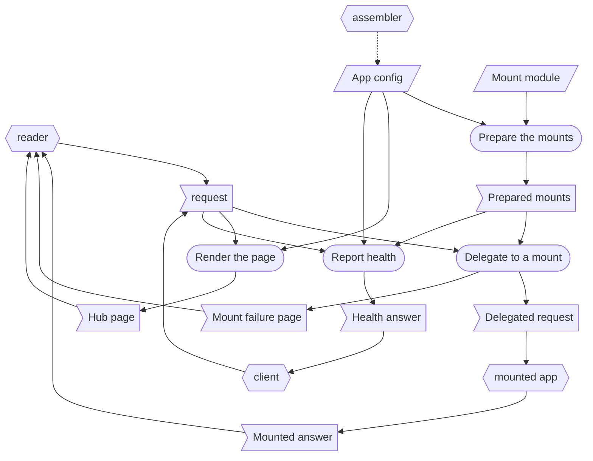

# Home - RSDC

> [[RSDC-Standard]]  `2026-10-30`  `ac0745864e75`
> [[DFD]]  `2026-10-18`  `09fb4a7e4730`
> [[RSDC-App-tmp]]  `2026-10-18`  `fe18ef9acd6f`

- **App**: Home — one page of buttons, one for each app a reader may want, which can also serve some of those apps under its own address.
- **Started with**: `node server.js`
- **Authority**: any implementation disagreeing with this document is what changes; a new rule about the hub's behavior is written here first, never straight into the code.

# 1. Requirements — "What problem does this solve?"

This chapter defines the app's goals and the pain points it answers, in the user's own terms, and never touches on how it is built:
no component, library, route or identifier out of the app's own source, and no figure measured from a run.
Naming what the app takes over from — even a program — and what the old way costs the user describes the user's problem, so it belongs here.

## 1.1 Target Users

- **A reader** — anyone who uses a set of small local apps and cannot be expected to remember which port each of them answers on.
  They open the hub whenever they want one of those apps, never to read the hub itself.
- **Callers** — whatever calls the hub for a reader: the page a person works in, an AI agent, or a script.

## 1.2 Core Vision

One address to memorize instead of several.
A reader opens the hub and reaches every app from it, without knowing which port any of them was given.
What is described here is a hub **in general**: one whose name, port, title and buttons all arrive as configuration.
No section below names a particular hub, directory, port, title, label or URL, because a design that named one would only describe that one.

## 1.3 Current Pain Points

Today each small app is reached by its own host and port, passed around in messages or kept in a list of links.
The hub takes over that list: it is the one address, and every app is a button on it.
It deliberately does not carry over a list of links opened as a file, nor a separate page for each set of apps.

- **Each app is a bare host and port.**
  They are handed around in messages and go stale the moment one moves.
- **A static list of links was tried and did not hold.**
  A page opened over `file://` cannot be shared as a URL, and a page served over `http` silently loses any `file://` button on it — so the same list is wrong in one way or the other depending on how it is opened.
- **Nothing says what an app is for.**
  A port number does not distinguish one app from another.
- **Every app is another server somebody has to have started.**
  One address to memorize does not help if reaching what it points at still means several processes being up.
  A button to a port nobody started looks exactly like a button to one that moved.
- **A second hub meant a second copy of the first.**
  Each new front door was its own page, its own server and its own set of rules, so a fix to one reached none of the others.

## 1.4 System Goals

- **One page, one address** — one page, at one address, lists every app a reader might want.
- **The links are configuration, never code** — adding a button is a line of configuration.
- **The hub itself is configuration too** — nothing in the code knows one hub from another.
- **Never claim a button works when it cannot** — the one exception is deliberate: a link the page cannot navigate to looks like every other, for a reason the specification gives.
- **Nothing to install** — the hub starts on a machine where nothing has been added for it, and its page loads nothing from anywhere else.
- **Least exposure by default** — the hub answers only the machine it runs on unless deliberately widened.
- **An app may be served by the hub itself** — a reader reaches it without a second server being up, and the app loses nothing of its ability to run alone.

# 2. Specification — "What are the system rules?"

This chapter defines the app's externally observable behavior: what a caller can see, ask for and be refused.
This is the part a reader checks the app against, so every statement here is one that could be falsified by using the app.
It names the routes a caller calls, and the handler a hub mounts, because their names are contracts; it names no other part of the design.

## 2.1 Terminology

Every noun the later sections rely on and none of them defines, each defined here once.

- **Caller** — a caller of 1.1, in the role this chapter gives it: whoever calls a route of the hub.
- **Hub** — the hub of 1.2, in the role this chapter gives it: the program this document describes, which serves a page of buttons and may serve an app under a path prefix it chooses.
- **Reader** — the reader of 1.1, in the role this chapter gives it: the person at the hub's page, who chooses an app by its button.
- **Client** — a caller other than the page: a script or an AI agent that asks the hub whether it is up, and reads the answer.
- **Assembler** — whoever writes the hub's configuration: the skill that frames and updates the hub, or a person editing the file by hand.
- **Mount** — a link whose app the hub serves itself, under a path of its own address, instead of linking away to that app's own port.
- **Mount prefix** — the path a mount answers under: a request whose path falls under it goes to the mounted app.
- **Mounted app** — the app a mount serves: another system, which the hub loads and hands requests to, and which can still run alone on its own port.
- **Dead link** — a link the page cannot navigate to, which today means one whose address starts `file://`: a browser blocks it from a page served over `http`, and says nothing.
- **Owner skill** — the skill that assembles a mounted app: who to run when that app needs building or repairing.

## 2.2 Artifact Types

Every kind of data the app handles: what it is, what it is for, and what its content must be.
Its data is of three kinds: **external inputs**, which come from outside the app and outlast any call; **records**, which the app writes and keeps after the call that wrote them; and **one-run data**, which lives for one run only — for the app, a run is one call — wherever it comes from.
The Prepared mounts are the one exception: they last as long as the hub runs.

**External inputs**

- **App config** — the hub's settings, in the `app.config.json` beside `server.js`: its title, the port it answers on, the link list — every button, in order, each a label, an address, an optional note and, for a mount, where the mounted app lives — and when the hub was assembled.
  It is written by the assembler; the hub never writes it.
- **Mount module** — the `app.js` in a mounted app's directory: the mounted app's own file, which the hub loads to get the handler it delegates to.
  It belongs to the mounted app and is written by its owner skill; the hub only loads it.

**Records**

The hub writes no record: nothing it produces outlasts the call that produced it.

**One-run data**

- **The request** — what a caller sends in one call: a method and a path, and whatever a mounted app's own route takes; the hub reads only the path and its query.
- **The outcome** — the hub's answer to that call: the Hub page, the stylesheet, the Health answer, a Mounted answer, a redirect, the Mount failure page, or a Refusal.
- **Prepared mounts** — what the hub keeps of each mount from its start to its stop: the mount prefix, the label, the directory, the owner skill, and either the handler the Mount module returned or the reason there is none.
- **Hub page** — the page a reader opens: the title, a one-line summary, and one button for each entry of the link list, in its order.
- **Health answer** — what the hub resolved when it started, for a client checking that it is up: its title, how many links it has and how many of them are dead links, each mount with whether it was prepared, and when the hub was assembled.
- **Delegated request** — the request, its mount prefix stripped, as a mounted app receives it.
- **Mounted answer** — what a mounted app answers to a Delegated request; the hub passes it to the caller unread.
- **Mount failure page** — the page answered at the mount prefix of a mount that could not be prepared: which app is missing, from which directory, and who assembles it.
- **Refusal** — the answer to a request the hub will not or cannot answer: a status, and the reason in words.

## 2.3 Dataflow

How data moves between the app's activities: what the stages are, what each stage reads and writes, who writes each piece of data and who may read it, and what order the data itself imposes.
The hub has these stages:

- **Prepare the mounts** loads, once when the hub starts, the Mount module of every mount in the App config, and keeps the Prepared mounts.
- **Delegate to a mount** hands a request whose path falls under a mount prefix to that mounted app, its prefix stripped, or answers for a mount that could not be prepared.
- **Render the page** renders the link list of the App config into the Hub page.
- **Report health** answers a client with the Health answer.

Prepare the mounts runs once, before the hub answers anything; each request then runs at most one of the other three, the one its path selects, and a request none of them takes is refused.

### DFD



How to read the diagram:

- **Parallelogram** — an external input: the App config and the Mount module.
- **Flag** — one-run data: the request and the outcome, here the Hub page, the Health answer, the Mounted answer and the Mount failure page; and what passes between stages and roles: the Prepared mounts and the Delegated request.
- **Rounded box** — a stage.
- **Hexagon** — a role outside the app: the reader, who supplies a request and reads the Hub page, a Mounted answer or the Mount failure page; a client, which supplies a request and reads the Health answer; the assembler, who writes the App config; and the mounted app, which reads a Delegated request and supplies the Mounted answer.
- **Black solid arrow** — data that goes no further than the stage or role it reaches: here every piece of data, since nothing is written into a record, and so the diagram draws no cylinder and no blue arrow.
- **Dotted arrow** — no data: an order, or a change made from outside the app; here the assembler's writing of the App config.

### Data Read/Write Rules

What the diagram cannot show about the data it draws — where it applies, whether it is written whole, whether it is read-only once written, and who deletes it:

- **External inputs** are written by no stage; every stage that reads one only reads it.
- **The App config** is read by Render the page at every request it answers, so an edit to the link list reaches the Hub page on the next request.
  Its mounts are read only by Prepare the mounts, and its title by Report health only as resolved at the start, so a mount added, removed or moved, and the title the Health answer reports, change when the hub starts again.
- **The Mount module** is loaded once, by Prepare the mounts; a change to it reaches the hub when the hub starts again.
- **The Prepared mounts** are written once, by Prepare the mounts, before the hub answers anything, and never rewritten while it runs; Delegate to a mount and Report health only read them.
  They go with the process.
- **The request and the outcome** last as long as the call.
  No record keeps any of them, since the hub writes none.
  Nothing else keeps them, so nothing deletes them.
- **The Mounted answer** is the mounted app's own: the hub neither reads nor changes it.

### Order Imposed by the Data

- **Prepare the mounts before Delegate to a mount** — the Prepared mounts: a request reaches a mount only once every mount has been prepared, so a mount's own setup failure is known before anyone arrives.
- **Prepare the mounts before Report health** — the Prepared mounts: the Health answer reports each mount as it was prepared.
- **A mount prefix before the hub's own routes** — not the data but a rule: a request whose path falls under a mount prefix goes to Delegate to a mount, whatever the rest of its path, so a mounted app owns everything under its prefix.
- No stage reads what a later stage writes.

### Exception Paths

- **Ending with nothing written** — every call ends this way, since the hub writes no record; what differs is what the caller gets:
  - **Not a route** — a path that is no route of the hub and falls under no mount prefix is refused with 404.
  - **A bare mount prefix** — a prepared mount's prefix without its trailing slash is redirected with 308 to the same path with the slash, the query kept, and nothing is delegated.
  - **A mount that could not be prepared** — its prefix answers with the Mount failure page, status 503, and the hub and every other mount go on answering.
  - **The stylesheet missing** — a request for it is refused with 500, naming the missing file.
- **Stopping midway** — a mounted app fails while answering: a throw, or a rejected promise its handler hands back, is answered with 502 at its prefix, naming the app, and the hub and every other mount go on answering.
  When the mounted app had already started its answer, the hub can only close the connection.
  A failure the hub was never handed — a throw on a later tick, or a promise the handler starts and never returns — is recorded and survived, never attributed to a mount, since the request it belonged to is already answered.
- **Re-entering midway** — nothing re-enters: every request starts from its path, and the Prepared mounts change only when the hub starts again.

## 2.4 Naming and Data Structures

How the data the app writes or reads is named and laid out.

- **App config** — `app.config.json` beside `server.js`: a JSON object in UTF-8.
- **Hub page** — the answer to `/` and `/index.html`: HTML in UTF-8, with no script.
- **Health answer** — the answer to `/healthz`: a JSON object in UTF-8.
- **Mount failure page** — HTML in UTF-8, answered at a mount prefix with 503.
- **Refusal** — plain text in UTF-8.

The App config is laid out as below; what each field must hold is its schema, in the next section.

```
appConfig = {title, port, links, assembledAt}
links     = [{label, href, note?, mount?}]
mount     = {appDir, skill?}
```

`assembledAt` is `yyyy-MM-dd HH:mm:ss`, and is the hub's only timestamp: nothing else records its age.

The Health answer's fields:

| Field | Meaning |
|---|---|
| `ok` | always `true`: an answer at all means the hub is up |
| `title` | the hub's title, as resolved at its start |
| `links` | how many entries the link list has |
| `dead` | how many of them are dead links |
| `mounts` | one object for each mount: `prefix`, `label`, `ok` — whether it was prepared — and `error`, the reason when it was not |
| `assembledAt` | the App config's `assembledAt` |

## 2.5 Config Schemas

The fields the app's configuration file must contain, and the constraints between them.
The app reads its own `app.config.json` and no other configuration file.
A file that is missing or is not JSON, or that lacks `title`, `port` or `links`, stops the hub from starting, saying why; a field it lacks is reported missing, never filled in.
`--title` and `--port` on the command line override the file's `title` and `port`, and `--host` is the only way to bind beyond loopback.
Framing, which writes the file, refuses a link entry without a `label` or an `href`, a mount whose `href` is not a path on this origin, and a mount prefix that is one of the hub's own routes or is taken twice.

`app.config.json`'s fields:

| Field | Meaning | Allowed values | What changing it costs |
|---|---|---|---|
| `title` | the Hub page's heading and its browser tab | any text; `--title` overrides it | the next request for the Hub page; the Health answer at the next start |
| `port` | the port the hub answers on | a port; `--port` overrides it | a restart |
| `links` | the link list: every button, in the order the page shows them | link entries, each with a `label` and an `href` | the next request for the Hub page; a mount at the next start |
| `links[].label` | the button's label | text, not blank | the next request for the Hub page |
| `links[].href` | where the button goes, shown verbatim on it; for a mount, a path on this origin, which is the mount prefix | any address; for a mount, a path starting with `/` that is none of the hub's own routes and no other mount's prefix | the next request for the Hub page; a mount at the next start |
| `links[].note` | what the app is for, shown under the button | text; optional | the next request for the Hub page |
| `links[].mount.appDir` | the mounted app's directory, where its Mount module lies | an absolute path | a restart |
| `links[].mount.skill` | the owner skill, carried so a failure can say who to go to rather than only what is absent | a skill's name; optional | a restart |
| `assembledAt` | when the hub was assembled | `yyyy-MM-dd HH:mm:ss` | a restart |

**A mount names who owns it, not where it lives.**
The assembler writes a mount's `appDir` and `skill` from a reviewed registry, asked for by the name of what assembles the app, and never from a path supplied at the moment of asking.
A path is something the asker has to know and keep correct; a name is not, since where an app is assembled is the business of whatever assembles it.
A path supplied at the moment of asking is unreviewed input that reaches the filesystem; a name that is not in the registry is refused with what to add.
The registry also carries each app's default label, href and note, so asking for a mount by name is enough to produce a complete link entry.

**A mount is the one thing the hub reaches outside its own directory for.**
A hub with no mounts can be moved as a whole, and a hub with them only together with the directories it mounts.
Copying each mounted app into the hub instead would make copies that go stale silently, and a stale copy is far harder to see than a path that does not resolve.

## 2.6 Derivation Rules

How each value the app does not observe directly is derived.

### A mount prefix

- The path of the mount's `href`, its query, its fragment and any trailing slash removed: one source, the address the button already shows.
- Never a path built from the request, and never `/` alone.
- An `href` that is not a path on this origin gives no mount prefix: the mount is not prepared, and the Health answer gives the reason.

### The dead count

- The link entries whose `href` has the scheme `file`, counted in the App config.
- Never a probe of whether a link answers: the hub cannot know how the reader reached the page, and the same link list may be opened straight from a file, where such a link works.
- It is reported by the Health answer and when the hub is framed, and never on the Hub page.

## 2.7 Presentation Contract

What may be shown, to whom, which actions the user must be able to start, and whether what is seen is what is done.
Everyone who reaches the hub sees all of it: it asks no one who they are, and it shows nothing but its configuration.
This document decides what the hub does and what it tells a reader — never what it looks like.
A color, a hover state, a border or a typeface is a property of the page's elements and is decided with them, not here.
The test is a repaint: if a statement would stop being true when the buttons change color, it does not belong in this document.

**What the app's output makes plain**

- **One page: a heading, a one-line summary, and the buttons in the link list's order.**
  There are no panels, no filters and no controls: everything the hub does is navigate.
- **Each button carries its label, its address verbatim, and its note when the entry has one, in that order.**
  The address is shown and not hidden, because a wrong host or port is the hub's entire failure mode, and a reader cannot diagnose what they cannot see.
- **The buttons are exactly the link list's entries, in exactly its order.**
  The page never adds, drops, reorders or rewrites one — otherwise the page and the configuration disagree, and nothing says which is right.
- **Every link renders identically: the page does not mark a dead link.**
  The hub cannot know how the reader arrived: the same link list may also be opened straight from a file, where that button works, so a mark that is right on one page is a lie on the other.
  The cost is real, and is accepted rather than hidden: a reader who clicks a dead link gets nothing and no explanation, and may click it again.
  The fact is kept where it does not change the look: the Health answer counts the dead links, and framing the hub names them.
- **The page is rendered by the hub on request, not by a build step and not by script in the browser.**
  So the page carries no script at all, and a configuration change reaches the page on the next request — otherwise the page served and the configuration could disagree.
- **A mount whose app is not there is a working button to an honest page.**
  The button renders identically to every other; at the destination the reader meets the Mount failure page, naming which app is missing from which directory and who assembles it — a reason at the place the reader already went, rather than a difference in the grid they would have to interpret.

**The questions every presentation answers**

1. *What does the user see when there is no result?
   Where is the skipped count reported?*
   With no entry in the link list, the page says that no links are configured, and that the link list is where to add them.
   Nothing is skipped on the page: a dead link is rendered like any other, and the dead count is reported by the Health answer and when the hub is framed.
2. *Which flows can the user start themselves?
   For those they cannot, why not?*
   The reader can open any app on the link list by its button, a mounted one included, and come back to the hub from the Mount failure page.
   Nothing else: there is no control on the page, since everything the hub does is navigate.
   Adding, removing or reordering a button, and mounting an app, are the assembler's: a change to the App config, which the reader cannot make from the page.
3. *Has every retrieval been observed to succeed in the user's own environment?*
   No run of the hub is recorded in this document.
   The hub retrieves nothing itself but its own configuration and, at its start, each Mount module; whether a link's destination answers is not the hub's to know.
4. *If the material is also reachable outside this app, does the app hand over that address?*
   Yes: every button shows its address verbatim, so a reader can see where any app lives; a mounted app also keeps the port its own design gives it.
5. *After the view is narrowed, does the count on screen match the scope of the next action?*
   Nothing narrows the view, and no action acts on a set.
6. *What is the ceiling on a bulk action?
   How is an excess refused, and can it leave a half-done result?*
   There is no bulk action, and the hub writes nothing, so nothing is left half done.
7. *What should a refused user do next?*
   At the Mount failure page, run the owner skill it names to assemble the app, then start the hub again.
   A 502 at a mount says the mounted app failed while answering; the hub and its other mounts still answer.
   A 404 means the address is no route of the hub: go back to the hub's page and use its buttons.
8. *How far is it exposed by default, and who finds out when that widens?*
   Loopback only, `127.0.0.1`.
   `--host` widens it, and the lines printed at start say the hub is reachable from other machines, to whoever reads the console that started it.
   A mount inherits it: widening the hub widens everything mounted on it.

## 2.8 HTTP API

Every route a caller may call over HTTP — the page, an AI agent, a script — and the stages of 2.3 each call runs.

A caller reaches the hub only through these routes, and never by importing one of its modules or reading its files.

- `/`, `/index.html`, by any method — runs Render the page.
  - **Takes** — nothing
  - **Answers** — the Hub page
  - **Refuses** — nothing
- `/app.css`, by any method — runs no stage.
  - **Takes** — nothing
  - **Answers** — the stylesheet, by its fixed name
  - **Refuses** — nothing; the file missing is refused with 500
- `/healthz`, by any method — runs Report health.
  - **Takes** — nothing
  - **Answers** — the Health answer
  - **Refuses** — nothing; it carries no secret
- Any path that falls under a mount prefix, by any method — runs Delegate to a mount.
  - **Takes** — whatever the mounted app's own route takes
  - **Answers** — the Mounted answer; 308 for the bare prefix; the Mount failure page, with 503, for a mount that could not be prepared
  - **Refuses** — with 502, naming the app, when the mounted app fails while answering
- Any other path — runs no stage.
  - **Takes** — nothing
  - **Answers** — nothing
  - **Refuses** — everything, with 404

**Guards**

- **The hub's own routes** — `/`, `/index.html`, `/app.css` and `/healthz` can never be a mount prefix: framing refuses such a mount, and so does Prepare the mounts, which reports the mount as not prepared, naming the route it would shadow, while the hub's routes go on answering.
- **The longest prefix** — a request whose path falls under two mount prefixes goes to the longer, so an app mounted at `/a/b` is not swallowed by one at `/a`.
  A path falls under a prefix when it is the prefix, or the prefix followed by `/`; `/ab` does not fall under `/a`.
- **The bare prefix** — a prepared mount's prefix without its trailing slash is redirected with 308 to the same path with the slash, the query kept, and is never delegated as it is.
  The two look alike to a reader but not to a browser: a relative address on the page resolves against the parent path in the first and against the mount in the second.
- **One prefix, one mount** — a mount prefix that an earlier mount already holds is refused for the later one, which is reported as not prepared.
- **No path from the request reaches the filesystem** — the stylesheet is read by its fixed name, and a mount prefix is matched against the configured list, never built from the request.

## 2.9 Mountable Handler

How a hub serves the app: it requires `app.js` and calls `createApp(options)` once, when it starts.
This hub is the one that serves, and nothing mounts it, so this section states that contract from the hub's side: what the hub requires of every app it mounts.

- `mountedAt` — the mount prefix the app answers under; requests reach the handler with it already stripped.

It returns the `(req, res)` handler — or a promise of it — that serves the mounted app's own routes, as the app's own server would.
Loading `app.js` starts nothing.

An app is mountable when both of these hold, and both are the app's responsibility, not the hub's:

1. **It publishes its request handler.**
   Beside its `server.js` it carries an `app.js` exporting `createApp(options)`.
   It is a factory rather than a bare handler because such an app may need to prepare before it can answer: one reads an index off a share, another a projected view.
   A bare handler would have to do that work on the first request, turning a startup failure into a broken page for whoever happened to arrive first.
2. **Every address it emits is relative to its own page.**
   A stylesheet at `/app.css` or a call to `/api/data` resolves against the origin, not against the mount, so under a prefix it leaves the app entirely.
   `./app.css` and `./api/data` follow the page wherever it is served from.

Its `server.js` keeps the listening and nothing else, guarded so that running it directly still serves the app on its own port while requiring it starts nothing.
The two ways of running it are the same app, not a copy of it.

The hub can verify the first and cannot verify the second.
A missing export is visible the moment the mount is prepared; a stray absolute address is invisible until a reader loads the page and a request lands outside the mount.
The hub does not paper over the second: it is shown by observing the mounted app's page, never assumed.

When the hub cannot prepare a mount — no `app.js` in its directory, no `createApp` exported, a handler that is not a function, or a throw or a rejection while preparing — the mount is not prepared: its prefix answers with the Mount failure page, the Health answer gives the reason, and the hub and every other mount go on answering.

## 2.10 Invariants

Rules that hold in every stage and every route, without exception:

- **The App config is the only thing that distinguishes one hub from another.**
  The hub carries no title, no port, no link and no address of its own: two hubs are the same code reading two files.
  Otherwise a hub's name written into the code makes every later hub a copy of the first.
- **The hub reads nothing but its own configuration, and runs nothing but what that configuration mounts.**
  It calls no service, opens no share, and holds no data of its own.
  A mounted app does whatever its own design says it does; the hub does not audit it and does not inherit its guarantees.
- **A request never names a file, and never names a mount.**
  No string a caller supplies reaches the filesystem or selects a directory.
- **Least exposure by default.**
  Loopback unless a host is passed explicitly, and any wider binding is stated plainly to whoever asked for it.
  A mount inherits this: widening the hub widens everything mounted on it.
- **A port already in use is a refusal, not a fight.**
  The hub exits non-zero saying so, rather than leaving a reader to wonder which of two servers answered.
- **One directory has one owner.**
  A hub's directory is written by one thing only.
  Two writers means whichever ran last wins and the loser's next run undoes it — silently, since neither is broken.
- **A mounted app's failure stays inside its mount.**
  Several apps in one process is one process to lose, so a failure answered at one prefix never stops the hub or another mount.
  A failure the hub was never handed is recorded and survived too, and is attributed to no mount, since there is no request left to attribute it to.
  That has a cost, accepted rather than hidden: surviving an error nobody caught means continuing in a state the hub cannot vouch for, the usual reason a process exits instead.
  It is accepted because the hub holds no data of its own, and because the alternative is strictly worse: an app the hub merely serves would be able to stop every other app it serves.
- **Mounting is additive in both directions.**
  With no mount the hub is exactly its page and its own routes, and an app mounted here keeps working on its own port exactly as before.

The goals of 1.4, and the rules that carry them:

| Goal | Carried by |
|---|---|
| One page, one address | 2.7 one page; 2.8 the Hub page |
| The links are configuration, never code | 2.5 `links`; 2.7 the buttons are exactly the link list's entries |
| The hub itself is configuration too | 2.5; Invariants, The App config is the only thing that distinguishes one hub from another |
| Never claim a button works when it cannot | 2.6 The dead count; 2.7 every link renders identically, a mount whose app is not there |
| Nothing to install | Invariants, The hub reads nothing but its own configuration |
| Least exposure by default | 2.7 question 8; Invariants, Least exposure by default |
| An app may be served by the hub itself | 2.3 Delegate to a mount; 2.8 Guards; 2.9 Mountable Handler; Invariants, A mounted app's failure stays inside its mount, Mounting is additive in both directions |

# 3. Design — "How is the system structured?"

This chapter describes how the app is built to keep chapter 2: its components, how each component does its work, where the files live, and the form each capability takes for the user.

## 3.1 Core Component Responsibilities

One bullet per component, with its file, the stages of 2.3 it performs, its one job and its boundary: a change that crosses the boundary is a change to two components.
Every stage of 2.3 is performed by one of them; a stage none performs is an activity nobody implemented.

- **Hub server**, the file `server.js` — performs Prepare the mounts, Delegate to a mount, Render the page and Report health of 2.3.
  Its one job: answering every route of 2.8 from the App config and the Prepared mounts, and owning the address — binding it and saying how far it is exposed.
  Its boundary: a decision about how the page looks made here is a second place to change it, and a route that reads a file the request names opens the filesystem to the network.
- **Stylesheet**, the file `public/app.css` — performs no stage of 2.3.
  Its one job: how the Hub page looks.
  Its boundary: a rule written here that says what the page does, rather than how it looks, is one the Hub server does not keep.

How they interact: the Hub server renders the Hub page, which loads the Stylesheet by an address relative to itself, and serves the Stylesheet when the browser asks for it.
The page is not a third component: it has no behavior of its own, and is the Hub server's output.
A mounted app is not a component of this system either: it is another system, reached through one.

**Node does all of it; there is no kernel.**

The Hub server routes, renders the link list, serves the Stylesheet, gives the Health answer, and loads and delegates to mounted apps; it starts no process, and decides nothing about any app's domain.
Swapping a mounted app changes what is reached through the hub, never the hub.

## 3.2 Execution Flow

For each component of 3.1, how it does its work at run time: its steps in order, named as the code names them, with the branches, retries, parallel work and orders the implementation chose rather than the data forced.
Where a drawing helps, it is drawn in the notation of the DFD.
Chapter 2's rules are cited here, never restated.

### Hub server

1. `main` runs whenever `server.js` is started; nothing requires the hub, since nothing mounts it (2.9).
2. `resolveOptions` takes `--port`, `--host` and `--title` through `parseArgs`, reads `app.config.json` beside `server.js`, and resolves the port and the title from the argument, then the file (2.5); the host is the argument's, else loopback (2.10).
3. `prepareMounts` runs Prepare the mounts: for each link entry with a `mount`, `mountPrefix` takes the mount prefix from its `href` (2.6); a missing prefix, one of the hub's own routes, or one already held is refused (2.8, Guards); then `app.js` in the directory is required, and `createApp` is called with `mountedAt` and awaited (2.9).
   A refusal or a failure keeps its reason, and the mount stays not prepared.
4. The Prepared mounts are sorted longest prefix first.
5. For each request, `matchMount` finds the mount whose prefix the path falls under, before the hub's own routes are considered (2.3, Order Imposed by the Data).
6. `delegate` answers a mount that has no handler with the Mount failure page from `renderMountFailure`, the bare prefix with a 308, and otherwise strips the prefix, keeps the query and calls the handler.
   A throw, or a rejection of the promise the handler returns, goes to `mountFailed`, which answers 502, or closes the connection when the answer has already started (2.3, Exception Paths).
7. `/` and `/index.html` are answered with `renderPage`, whose buttons `renderButtons` makes, every value passed through `esc`.
8. `/app.css` is read from `public/` by its fixed name; `/healthz` is answered from the resolved options and the Prepared mounts, `dead` counted with `schemeOf` (2.6); anything else is a 404.
9. A port in use is reported, and the process exits with 3 (2.10).
10. Once listening, it installs the handlers that record an uncaught exception and an unhandled rejection and keep the hub answering (2.10).
    Before listening, a failure stays loud: there is nothing to keep alive yet.
11. Then it prints the title, every link with the dead count, every mount with whether it was prepared, the address served, and how far it is exposed (2.7, question 8).

### Stylesheet

1. It is read whole from `public/app.css` at each request for `/app.css`, and has no steps of its own.

## 3.3 Directory Structure

Where the app's files physically live, and the logic of their layering.
A hub's files sit at its root and under `public/` and `docs/`: the Hub server and its configuration at the root, what the browser loads under `public/`, and the design documents under `docs/`, which the hub never reads.
Its configuration sits beside the server, never above it, so the directory can be moved as a whole and nothing inside it changes meaning.

- `server.js` — the Hub server.
- `public/app.css` — the Stylesheet.
- `app.config.json` — the App config.
- `start.cmd` — a one-line launcher that starts the Hub server on Windows.
- `README.txt` — what the hub needs and how to run it.
- `docs/` — this design document and the page's element inventory, each with its twin.

The directory also holds the record the framing skill keeps of the hub's lifecycle; the hub never reads it.
A mount adds no file here: the mounted app stays where it was assembled and is loaded from there, so this layout holds however many apps the hub serves.
Every hub is this same layout; two hubs differ by their `app.config.json` and by whatever their own `docs/` has since diverged into.

**What is relocatable, and what that costs.**
A hub with mounts moves only together with the directories it mounts, since each `appDir` is absolute (2.5).
Moving a mounted app costs its mount: until its `appDir` is written anew, the hub reports it as not prepared.
Without a mount, the folder can be copied elsewhere whole and run unchanged, because the app reads only the `app.config.json` of 2.5 and resolves every path against its own directory.

## 3.4 Presentation Form

Every "the user must be able to…" of 2.7: the component that provides it, the form it takes for a person — a control, a page, a shortcut, and how many — and the name the user knows it by.

| Capability | Component | Form | Name the user sees |
|---|---|---|---|
| Open an app on the link list, a mounted one included | Hub server | one button for each entry of the link list, in its order | the entry's label |
| Come back to the hub from a mount that is not there | Hub server | a link on the Mount failure page | Back to, followed by the hub's title |

Every row is a flow of question 2 of 2.7, and every flow the reader can start has a row.
The Health answer is for a client and has no entrance on the page; adding or mounting an app is the assembler's, and has none either.

# 4. Coding — "How should the code be written?"

This chapter keeps the code's quality up and the app working alike on every platform: the rules the code follows, the tools it may use, how it stays safe, the traps already met, how each claim is proved, and where it still falls short.

## 4.1 Key Development Guidelines

- **Configuration-driven: no host, port, title or address is written in the Hub server or the Stylesheet, and no hub's name either.**
  The code cannot tell which hub it is serving, and that is the point (2.10).
- **No default for an input value: a field the App config lacks is reported missing, never filled in.**
  Otherwise a hub missing its port answers on one nobody chose, and nothing says a substitute was used (2.5).
- **A mount is loaded, not started.**
  The hub requires the mounted app's `app.js` and calls its factory; it never spawns a second process and never starts that app's own server, so the hub stays one process, one port and one thing to stop (2.9).
- **Every address the Hub page emits is relative to the page: `./app.css`, never `/app.css`.**
  The Mount failure page is the exception: it answers at any depth under a prefix, so it links the hub by `/` and carries its style inline, since no one relative address to the Stylesheet is right at every depth.
- **Fail loudly at startup, locally afterwards.**
  A malformed App config stops the hub with a message naming what is wrong, and a taken port stops it too (2.5, 2.10).
  Once the hub is listening, a mount that cannot be prepared stops only itself and says so at its own prefix, because one app that was not assembled is not a reason to withhold the other buttons.
- **Neither design document names the other, in either direction.**
  This document and the page's element inventory each state their own scope, so either can be read first, and neither goes stale when the other is renumbered.
  Where a rule in one needs a reason that lives in the other, that reason is written out in full rather than cited — a section number in another file is a link that rots quietly.

## 4.2 Implementation Guidelines and Tools

- Node `10` or later: the hub needs `URL` as a global and `async` functions; no version is pinned anywhere in the hub, and the versions it has run on are not recorded.
- **Node uses its standard library only.**
  No `npm install`, no CDN, no web font, no image, and no script in the page.
  The hub must run on a machine with nothing installed.
- The Hub server is plain functions in strict mode, with no framework and no class, and opens with a comment saying what it decides and what it leaves to the App config.
- Every page, file and refusal the hub writes is UTF-8, says so in its `content-type`, and carries `cache-control: no-store`; the App config is read as UTF-8.

## 4.3 Safety and Robustness

- **The hub takes no secret, on its command line or anywhere else.**
  A process list is readable by every other process, and the hub has nothing that would need one.
- **Every value that reaches the page is escaped, both quote forms included.**
  `&`, `<`, `>`, `"` and `'` are escaped once, where a value becomes markup, rather than trusted because it is configuration: a value lands in an attribute as well as in text, and unescaped it breaks out of the attribute it sits in.
- **The Stylesheet is read by its fixed name, and nothing is joined from the request's path.**
  Otherwise a crafted path reaches the App config or the documents (2.10).
- **A mount prefix is matched against the configured list, never built from the request.**
  Otherwise a request could select a directory (2.10).
- **A mounted app's throw, rejection and loose failure are caught by the hub.**
  Otherwise one app's failure ends the process, and every other mount with it (2.10).
- **A binding beyond loopback is announced when the hub starts.**
  Whoever started it learns that every mounted app is exposed with it.

## 4.4 Platform Traps

Only cases that have actually produced a plausible but wrong result:

- **A browser blocks a `file://` link on a page served over `http`, and says nothing.**
  Met with a static list of links served over `http`: its `file://` buttons did nothing when clicked, and looked exactly like the ones that worked.
  The hub renders such a link like every other and counts it in the Health answer (2.7), rather than marking it on a page where the mark would be a lie elsewhere.

## 4.5 Verification Obligations

Each rule this document states, how it is shown to hold, and who shows it; every component of 3.1 is named in at least one row, since a component no row proves cannot be shown to work.
A rule is proven when its behavior has been observed, not when the code meant to produce it has been read.

| Claim | Rule | Proven by | Performed by |
|---|---|---|---|
| The buttons match the App config | 2.7 | — | *not verified*: read in `server.js` |
| Configuration text cannot become markup | 4.3 | — | *not verified*: read in `server.js` |
| The Hub page is self-contained, loading nothing but the Stylesheet | 2.7; 4.1 | — | *not verified*: read in `server.js` |
| The dead count is in the Health answer and not on the page | 2.6; 2.7 | — | *not verified*: read in `server.js` |
| The hub runs from its own directory | 3.3 | — | *not verified* |
| The Hub server is not specialized to one hub | 2.10; 4.1 | — | *not verified* |
| A mounted app answers under its prefix | 2.8; 2.9 | — | *not verified* |
| The prefix is stripped before the app sees it | 2.8 | — | *not verified*: read in `server.js` |
| A bare prefix reaches the mount, not above it | 2.8 Guards | — | *not verified*: read in `server.js` |
| An absent mount does not break the hub | 2.9; 2.10 | — | *not verified* |
| A mounted app's throw stays in its mount | 2.3; 2.10 | — | *not verified* |
| A mounted app's rejected promise stays in its mount | 2.3; 2.10 | — | *not verified* |
| A mounted app's floating throw is not fatal | 2.10 | — | *not verified* |
| A mounted app's forgotten rejection is not fatal | 2.10 | — | *not verified* |
| A mounted app emits no absolute address | 2.9 | — | *not verified* |

**The rows not verified** are the checks still to be written.
Each can be made mechanical as follows:

- The buttons: the served page's anchors compared against the App config's labels and hrefs, in order.
- Markup: a label and an href carrying `<script>`, `</a>` and a double quote served, and the output checked for exactly one anchor and no executable tag.
- Self-contained: the served page checked for no external reference but its own stylesheet.
- The dead count: `/healthz` asked, and its `dead` compared against the `file://` entries of the App config.
- Its own directory: the hub started from its directory, and `/healthz` answered.
- One hub: two App configs served by the same source, and each page checked against its own App config.
- Under its prefix: a route of a mounted app asked through the hub.
- Stripped: a **nested** path asked through the mount, not just the mount root — a mount that only ever serves `/` proves nothing about stripping.
- The bare prefix: the prefix asked without its trailing slash, and the redirect checked.
- An absent mount: a mount configured at a directory with no `app.js`, then that prefix, `/healthz` and every other mount asked.
- A throw: a mount made to throw, its prefix asked, then the hub and the other mounts asked again.
- A rejection: the same, with a handler that returns a rejected promise.
- A floating throw: a mount whose handler returns normally and throws on a later tick, then the hub asked again and the process checked for still being alive; a handler that hands the failure back proves nothing about this one.
- A forgotten rejection: the same, with a promise the handler starts and never returns.
- An absolute address: the mounted app's served page read for `src`, `href` and fetch paths beginning `/`; the hub cannot enforce this one, so it is checked here rather than assumed.

## 4.6 Defects

Every place where the app does what chapter 2 says it should not, each where it was observed and what it costs:

- **A field the App config lacks is filled in, not reported.**
  The Hub server answers on port 8080, titles the page `Home`, and shows no button when the App config has no port, no title or no link list (2.5).
  Found by reading `server.js`, not yet seen in a run; framing writes all three, so only a hand edit meets it, and then the hub answers on a port nobody chose with nothing saying so.
- **An App config that is not JSON is read as empty.**
  The Hub server goes on with no link and the generic title and port, where 2.5 says it stops, saying why.
  Found by reading `server.js`; the reader sees a page saying no links are configured, which points at the link list rather than at the broken file.
- **An edit to the App config reaches the page only when the hub starts again.**
  The Hub server reads `app.config.json` once, at its start, though 2.7 says a configuration change reaches the page on the next request.
  Found by reading `server.js`; until a restart, the page served and the configuration disagree.
