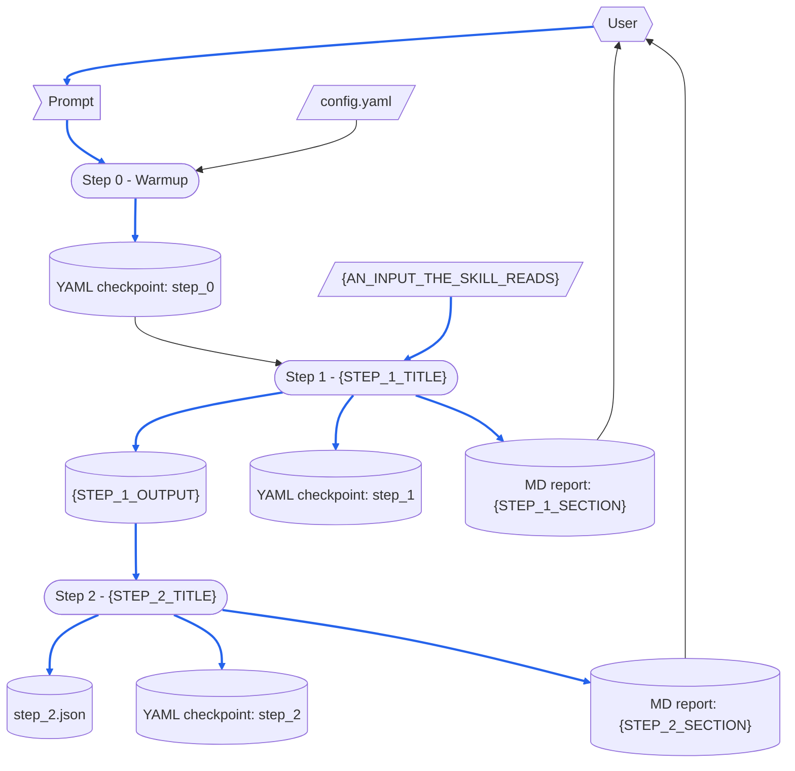

# {SKILL_NAME}

> [DFD.md]({COMMON_PATH}/references/DFD.md)
> [md-style.md]({COMMON_PATH}/rules/md-style.md)
> [skill-writing.md]({COMMON_PATH}/rules/skill-writing.md)
> [report-md-rules.md]({COMMON_PATH}/rules/report-md-rules.md)
> [report-yaml-rules.md]({COMMON_PATH}/rules/report-yaml-rules.md)
> [scratch-rules.md]({COMMON_PATH}/rules/scratch-rules.md)
> [SKILL-tmp.md]({COMMON_PATH}/templates/SKILL-tmp.md)
> [README-tmp.md]({COMMON_PATH}/templates/README-tmp.md)
> [chinese/SKILL.md]({COMMON_PATH}/skills/chinese/SKILL.md)
> [[ASD-STE100_ISSUE9.pdf]]  `2026-10-18`  `d1f4ea9e7cd6`
> [[ste-custom]]  `2026-10-30`  `8cc2e2061175`

> 本檔案以 ASD-STE100 Simplified Technical English（STE）第 9 版寫成。
> 技術用字：black、blue、box、checkpoint、Checkpoint Dir、content、cylinder、data file、diagram、document、dotted arrow、external input、file、flag、format、header quote、heading、hexagon、line、link、MD report、notation、one-run data、parallelogram、parse、path、record、script、section、skill、two-headed arrow、user、workflow、YAML checkpoint。

這份 README.md 說明 {SKILL_NAME} skill 由哪些部分組成，以及它的 [SKILL.md](SKILL.md) 依賴哪些檔案。
skill 每次執行時，都會讀取整份 SKILL.md。
因此，執行時不需要的部分都放在這份 README.md。
SKILL.md 沒有連到這份 README.md 的連結，所以沒有任何一次執行會讀它。

修改本 skill 之前，先讀這份 README.md。
做完「When the Skill Is Changed」列出的每一項修改，再做那裡列出的檢查。
skill 的各個 step 怎麼寫，見 [skill-writing.md]({COMMON_PATH}/rules/skill-writing.md)。

圖中的路徑都用簡寫：`{SKILL_NAME}/` 指 `{SKILL_DIR}/`，`common/` 指 `{COMMON_DIR}/`。
{MORE_PATH_ABBREVIATIONS}

# When the Skill Runs

## Dataflow

本節說明一次執行如何把它的 prompt 變成它的輸出。
它畫出 [SKILL.md](SKILL.md) 中 Workflow 的每一個 step，以及每個 step 讀寫的資料。
它是以 [DFD.md]({COMMON_PATH}/references/DFD.md) 的畫法畫成的 DFD。
SKILL.md 的各個 step 寫明每個 step 讀寫哪些資料，這張圖則把這些資料畫出來。
因此，被後續 step 再次寫入的 record，以及沒有來源的資料，在圖上一眼就看得出來。
讀取後續 step 所寫資料的 step，也一樣看得出來。

每個 step 的名稱都和它的標題相同，連編號一起，因此每個讀者都知道一個方框指的是哪一個 step。
圖中只畫出 step 在執行時讀寫的資料。
step 只引用的文件不畫。



圖的讀法：

- 平行四邊形是 external input，旗形是 one-run data，圓柱是 record。
  這些 record 是 YAML checkpoint 中每個 step 的群組，以及 MD report 中每個 step 的一節。
  Checkpoint Dir 中的每個資料檔也是 record。
  圓角方框是 step。
- 六角形是 skill 外部的 role：使用者，提供 prompt 並閱讀 MD report。
- 實線箭頭沿著資料移動的方向搬移資料。
  雙頭箭頭是某個 step 既讀又寫的資料。
  虛線箭頭不搬移資料：它表示順序，或一項由人做的變更。
- 藍色箭頭搬移的資料會進入某個 record，或成為某個 record 的內容。
  其餘箭頭一律是黑色。
  只決定某個 step 如何運作的資料，箭頭是黑色，即使那個 step 會寫 record。
  例如 `config.yaml`，以及 Step 0 解析 prompt 時取得的輸入。

## Step Purposes

每個 step，以它在 SKILL.md 中的標題為名，並附上它的 Purpose：要有這個 step 的原因。

- Step 0 - Warmup
  {STEP_0_PURPOSE}
- Step 1 - {STEP_1_TITLE}
  {STEP_1_PURPOSE}
- Step 2 - {STEP_2_TITLE}
  {STEP_2_PURPOSE}

## Files Each Step Uses

這份 README.md 只說明一次，這個 skill 如何遵守 skill-writing.md 的「scripted-versus-not」規則：
**{WHICH_STEPS_ARE_SCRIPTED} 執行 script，{WHICH_STEPS_ARE_NOT_SCRIPTED} 不執行**，因為 {WHY_THOSE_STEPS_NEED_JUDGMENT}。

```
Step 0 - Warmup
  reads   config.yaml
  checks  that these exist:
          {SKILL_NAME}/scripts/{SCRIPT_PATH_1}
  writes  the YAML checkpoint: step_0

Step 1 - {STEP_1_TITLE}
  runs    {SCRIPT_PATH_1}
          ├─ reads {AN_INPUT_THE_SKILL_READS}
          └─ writes {STEP_1_OUTPUT}
  writes  the YAML checkpoint: step_1
  writes  the MD report: {STEP_1_SECTION}

Step 2 - {STEP_2_TITLE}
  reads   {STEP_1_OUTPUT}
  writes  step_2.json
  writes  the YAML checkpoint: step_2
  writes  the MD report: {STEP_2_SECTION}
```

沒有任何一次執行會讀 SKILL-tw.md、這份 README.md 或 README-tw.md。

# When the Skill Is Changed

`⇄`：兩份檔案一起改。
`─▶`：一份檔案依賴另一份的規定或格式。

```
{SKILL_NAME}/SKILL.md
 ├─⇄ {SKILL_NAME}/SKILL-tw.md
 │     every change goes into both: the chinese skill's diff_md.py, a translation, then check_parity.py
 │     └─▶ common/references/tw-keep-english.md: which terms stay English
 ├─⇄ {SKILL_NAME}/README.md and README-tw.md
 │     the Dataflow, Step Purposes and Files Each Step Uses name each step exactly as its heading:
 │     a step added, removed or renamed changes all three
 ├─⇄ {SKILL_NAME}/scripts/{SCRIPT_PATH_1}
 │     what Step 1 says the script does, its arguments and its output
 ├─▶ common/rules/skill-writing.md: how the steps are written
 ├─▶ common/rules/report-md-rules.md: the MD report's header and shape
 ├─▶ common/rules/report-yaml-rules.md: the shape of the YAML checkpoint and the fields it requires
 ├─▶ common/rules/scratch-rules.md: where a run's throwaway files go and how they are cleaned up
 └─▶ common/rules/md-style.md: one sentence on each line
       └─ checked by reformat_md.py and check_reformat.py (--twin: the twin's sentences one for one)

{SKILL_NAME}/README.md
 ├─⇄ {SKILL_NAME}/README-tw.md: line for line, through the chinese skill
 └─▶ common/references/DFD.md: how the Dataflow is drawn
       a step or a piece of data added or removed redraws the DFD and renumbers its blue arrows

the templates and the tools
 ├─▶ common/templates/SKILL-tmp.md and README-tmp.md: the structure gen-skill writes from
 └─ common/skills/check-skill: checks SKILL.md and this file against the two templates

outputs already written
 └─ {OUTPUTS_ALREADY_WRITTEN}
```

改動之後，做適用於它的檢查：

- 對 SKILL.md 與 SKILL-tw.md、README.md 與 README-tw.md 各執行一次 `check_parity.py`：兩次檢查都沒有 `[FAIL]` 行。
- 對這份 README.md 執行 `depends_on.py check`：header quote 中的每一個檔案都是 UNCHANGED，或你讀過改動並重新記錄該檔案。
- `/check-skill {SKILL_NAME}`：每一項檢查都沒有問題，或你對每一個結果都做出決定。
- {SKILL_REGRESSION_CHECK}

# Tracked Dependencies

header quote 列出一個檔案所依賴的檔案。
`depends_on.py check` 指出其中哪些檔案在 `depends_on.py record` 記錄之後改過。
為了讓 SKILL.md 保持精簡，這份 README.md 列出 SKILL.md 在 skill 之外所依賴的檔案。

```
{SKILL_NAME}/README.md (and README-tw.md, which copies its header quote)
  ─▶ common/references/DFD.md
  ─▶ common/rules/md-style.md
  ─▶ common/rules/skill-writing.md
  ─▶ common/rules/report-md-rules.md
  ─▶ common/rules/report-yaml-rules.md
  ─▶ common/rules/scratch-rules.md
  ─▶ common/templates/SKILL-tmp.md
  ─▶ common/templates/README-tmp.md
  ─▶ common/skills/chinese/SKILL.md
```

如果 `depends_on.py check` 把其中某個檔案顯示為 CHANGED，就讀它的改動。
讓 SKILL.md 與這份 README.md 跟它一致，再以 `depends_on.py record` 重新記錄。
