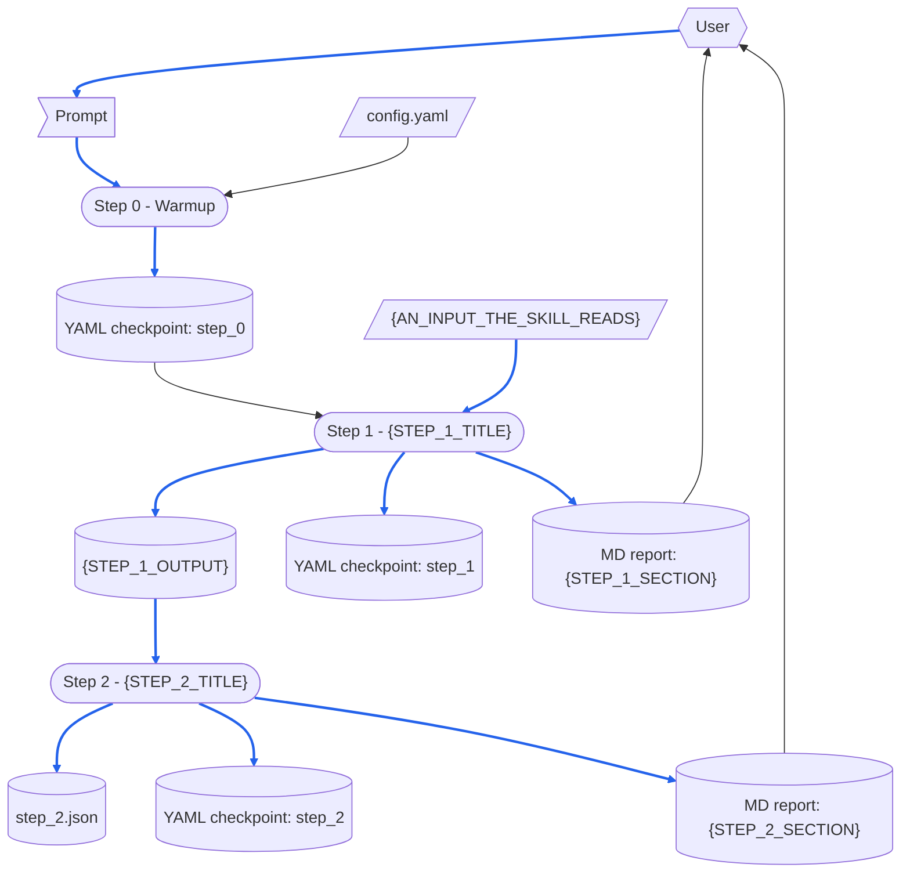

# {SKILL_NAME}

> [DFD.md]({COMMON_PATH}/references/DFD.md)
> [md-style.md]({COMMON_PATH}/rules/md-style.md)
> [skill-writing.md]({COMMON_PATH}/rules/skill-writing.md)
> [report-md-rules.md]({COMMON_PATH}/rules/report-md-rules.md)
> [report-yaml-rules.md]({COMMON_PATH}/rules/report-yaml-rules.md)
> [scratch-rules.md]({COMMON_PATH}/rules/scratch-rules.md)
> [SKILL-tmp.md]({COMMON_PATH}/templates/SKILL-tmp.md)
> [README-tmp.md]({COMMON_PATH}/templates/README-tmp.md)
> [chinese/SKILL.md]({COMMON_PATH}/skills/chinese/SKILL.md)
> [[ASD-STE100_ISSUE9.pdf]]  `2026-10-18`  `d1f4ea9e7cd6`
> [[ste-custom]]  `2026-10-30`  `8cc2e2061175`

> This file is in ASD-STE100 Simplified Technical English (STE), Issue 9.
> Technical words: black, blue, box, checkpoint, Checkpoint Dir, content, cylinder, data file, diagram, document, dotted arrow, external input, file, flag, format, header quote, heading, hexagon, line, link, MD report, notation, one-run data, parallelogram, parse, path, record, script, section, skill, two-headed arrow, user, workflow, YAML checkpoint.

This README.md tells about the parts of the {SKILL_NAME} skill, and about the files that its [SKILL.md](SKILL.md) depends on.
Each time a skill runs, it reads all of its SKILL.md.
Thus, the parts that a run does not need are in this README.md.
SKILL.md does not have a link to this README.md, thus no run reads it.

Read this README.md before you change the skill.
Make each change that "When the Skill Is Changed" names, and then do the checks that it gives.
[skill-writing.md]({COMMON_PATH}/rules/skill-writing.md) tells how to write the steps of a skill.

The paths in the diagrams are short: `{SKILL_NAME}/` is `{SKILL_DIR}/`, and `common/` is `{COMMON_DIR}/`.
{MORE_PATH_ABBREVIATIONS}

# When the Skill Runs

## Dataflow

This section shows how a run changes its prompt into its outputs.
It shows each step of the Workflow in [SKILL.md](SKILL.md), and the data that each step reads and writes.
It is a DFD in the notation of [DFD.md]({COMMON_PATH}/references/DFD.md).
The steps of SKILL.md tell which data each step reads and writes, and the diagram shows this data.
Thus, the diagram immediately shows a record that a subsequent step writes again, and data that has no source.
It also shows a step that reads the data that a subsequent step writes.

The name of each step is the same as its heading, with its number, thus each reader knows which step a box identifies.
The diagram shows only the data that a step reads or writes when it runs.
It does not show a document that a step only refers to.



How to read the diagram:

- A parallelogram is an external input, a flag is one-run data, and a cylinder is a record.
  The records are the group of each step in the YAML checkpoint and the section of each step in the MD report.
  Each data file in the Checkpoint Dir is also a record.
  A rounded box is a step.
- A hexagon is a role external to the skill: the user, who supplies the prompt and reads the MD report.
- A solid arrow moves data, in the direction in which the data moves.
  A two-headed arrow is data that one step reads and also writes.
  A dotted arrow moves no data: it is a sequence, or a change that a person makes.
- A blue arrow moves data that goes into a record, or that becomes the content of a record.
  All the other arrows are black.
  Data that only controls how a step operates has a black arrow, although that step writes a record.
  Examples are `config.yaml`, and the inputs that Step 0 gets when it parses the prompt.

## Step Purposes

Each step, with the same name as its heading in SKILL.md, and its Purpose: the cause to have this step.

- Step 0 - Warmup
  {STEP_0_PURPOSE}
- Step 1 - {STEP_1_TITLE}
  {STEP_1_PURPOSE}
- Step 2 - {STEP_2_TITLE}
  {STEP_2_PURPOSE}

## Files Each Step Uses

This README.md tells one time how the skill obeys the "scripted-versus-not" rule of skill-writing.md:
**{WHICH_STEPS_ARE_SCRIPTED} run a script, and {WHICH_STEPS_ARE_NOT_SCRIPTED} do not**, because {WHY_THOSE_STEPS_NEED_JUDGMENT}.

```
Step 0 - Warmup
  reads   config.yaml
  checks  that these exist:
          {SKILL_NAME}/scripts/{SCRIPT_PATH_1}
  writes  the YAML checkpoint: step_0

Step 1 - {STEP_1_TITLE}
  runs    {SCRIPT_PATH_1}
          ├─ reads {AN_INPUT_THE_SKILL_READS}
          └─ writes {STEP_1_OUTPUT}
  writes  the YAML checkpoint: step_1
  writes  the MD report: {STEP_1_SECTION}

Step 2 - {STEP_2_TITLE}
  reads   {STEP_1_OUTPUT}
  writes  step_2.json
  writes  the YAML checkpoint: step_2
  writes  the MD report: {STEP_2_SECTION}
```

No run reads SKILL-tw.md, this README.md or README-tw.md.

# When the Skill Is Changed

`⇄`: the two files change together.
`─▶`: one file depends on the rules or the format of the other.

```
{SKILL_NAME}/SKILL.md
 ├─⇄ {SKILL_NAME}/SKILL-tw.md
 │     every change goes into both: the chinese skill's diff_md.py, a translation, then check_parity.py
 │     └─▶ common/references/tw-keep-english.md: which terms stay English
 ├─⇄ {SKILL_NAME}/README.md and README-tw.md
 │     the Dataflow, Step Purposes and Files Each Step Uses name each step exactly as its heading:
 │     a step added, removed or renamed changes all three
 ├─⇄ {SKILL_NAME}/scripts/{SCRIPT_PATH_1}
 │     what Step 1 says the script does, its arguments and its output
 ├─▶ common/rules/skill-writing.md: how the steps are written
 ├─▶ common/rules/report-md-rules.md: the MD report's header and shape
 ├─▶ common/rules/report-yaml-rules.md: the shape of the YAML checkpoint and the fields it requires
 ├─▶ common/rules/scratch-rules.md: where a run's throwaway files go and how they are cleaned up
 └─▶ common/rules/md-style.md: one sentence on each line
       └─ checked by reformat_md.py and check_reformat.py (--twin: the twin's sentences one for one)

{SKILL_NAME}/README.md
 ├─⇄ {SKILL_NAME}/README-tw.md: line for line, through the chinese skill
 └─▶ common/references/DFD.md: how the Dataflow is drawn
       a step or a piece of data added or removed redraws the DFD and renumbers its blue arrows

the templates and the tools
 ├─▶ common/templates/SKILL-tmp.md and README-tmp.md: the structure gen-skill writes from
 └─ common/skills/check-skill: checks SKILL.md and this file against the two templates

outputs already written
 └─ {OUTPUTS_ALREADY_WRITTEN}
```

After a change, do the checks that apply to it:

- `check_parity.py` for SKILL.md with SKILL-tw.md, and for README.md with README-tw.md: the two checks show no `[FAIL]` line.
- `depends_on.py check` on this README.md: it gives UNCHANGED for each file in the header quote, or you read the change and record the file again.
- `/check-skill {SKILL_NAME}`: each check shows no problem, or you make a decision about each result.
- {SKILL_REGRESSION_CHECK}

# Tracked Dependencies

A header quote gives the files that a file depends on.
`depends_on.py check` tells which of these files changed after `depends_on.py record` recorded them.
To keep SKILL.md short, this README.md gives the files external to the skill that SKILL.md depends on.

```
{SKILL_NAME}/README.md (and README-tw.md, which copies its header quote)
  ─▶ common/references/DFD.md
  ─▶ common/rules/md-style.md
  ─▶ common/rules/skill-writing.md
  ─▶ common/rules/report-md-rules.md
  ─▶ common/rules/report-yaml-rules.md
  ─▶ common/rules/scratch-rules.md
  ─▶ common/templates/SKILL-tmp.md
  ─▶ common/templates/README-tmp.md
  ─▶ common/skills/chinese/SKILL.md
```

If `depends_on.py check` shows one of these files as CHANGED, read the change.
Make SKILL.md and this README.md agree with it, and then record it again with `depends_on.py record`.
