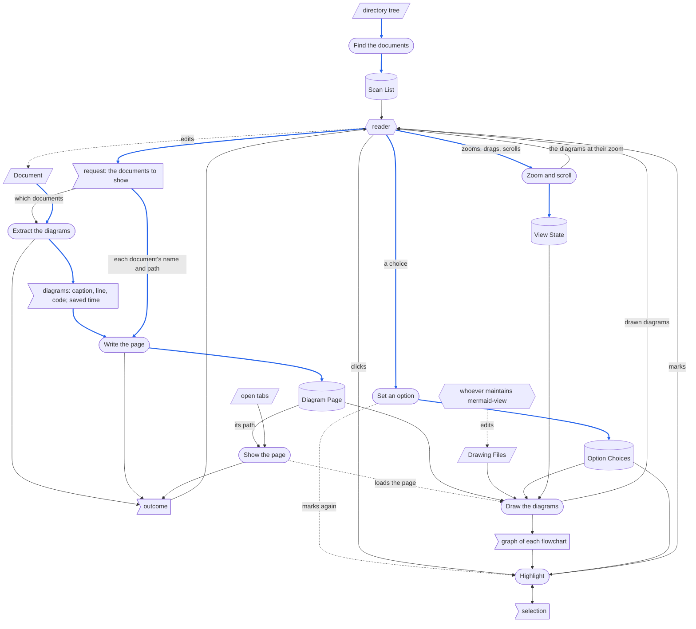
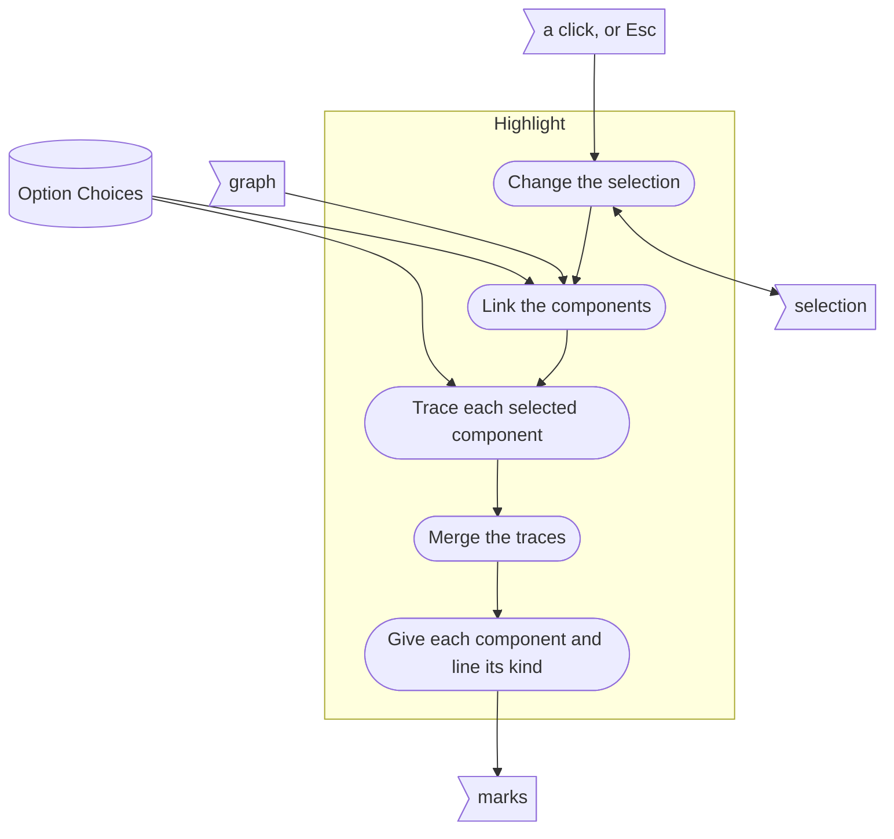

# **Mermaid View Software Requirements, Specification, Design, and Coding Document (RSDC)**

mermaid-view 的設計正本：它把一份 Markdown 文件裡的 mermaid 圖畫在瀏覽器的網頁上，並讓網頁上的 flowchart 能從任何一個 component 開始追溯。
任何與本文件不一致的實作，就是該改的那一方。
本文件記錄 2026-10-07 建成的 mermaid-view；最後一節說明它怎麼走到現在的樣子。

## **1. Requirements - "What problem does this solve?"**

本章定義 mermaid-view 為何存在、必須達成什麼。
它不涉及任何檔案、程式或程式庫。

### **1.1 Target Users**

* **Reader**：用 Markdown 寫設計文件的人——需求與設計文件、skill 文件、筆記——在文件裡用 mermaid 圖畫出流程，撰寫與審閱時需要看到這些圖畫出來的樣子。
  reader 在檔案管理員與 AI 寫程式的 session 裡工作，在網頁瀏覽器裡閱讀。
* **維護 mermaid-view 的一方**：改變圖怎麼畫、怎麼回應點選的人或 agent。
  一項修改必須送到 reader 手上已有的每一個網頁，而不必把每個網頁重做一次。

### **1.2 Core Vision**

一份文件的每一張圖，從 reader 正在看這份文件的地方，一個動作就畫出來——永遠是文件此刻的樣子，畫在這份文件原本就有的那一個畫面裡，而且不需要網路；每一張流程圖都讀得懂：指著它的 component，就看到誰餵資料給它們、它們又餵資料給誰。

### **1.3 Current Pain Points**

* **reader 工作的地方只顯示程式碼，不顯示圖。**
  檔案檢視器把 mermaid 區塊當成文字顯示，而 AI app 內建的瀏覽器打不開 reader 磁碟上的檔案。
  要看到一張圖，就得把它的程式碼複製到某個能畫圖的地方。
* **畫好的網頁會不知不覺落後於文件。**
  從文件畫出來的網頁是一份快照：文件一改，重新整理網頁看到的仍是舊圖，而網頁上沒有任何東西說它們是舊的。
* **每看一次就多開一個畫面。**
  同一份文件再畫一次，就多一個分頁，舊分頁留著舊圖，和新圖並列。
* **網頁難找，也留不久。**
  放在暫存資料夾、用自動產生的檔名，網頁再也找不回來，也無法加書籤，system 還隨時可能刪掉它。
* **畫圖需要網路。**
  離線時什麼都畫不出來。
* **用眼睛追流程又慢又容易錯。**
  哪些 component 餵資料給某一個、它又餵給哪些，得一條線一條線地追；而不承載資料的線——表示順序或人手修改的虛線——很容易被誤認成承載資料的線。
* **一個迴圈讓「所有上游」變成「全部」。**
  在一個經由 system 外部 role 繞回來的流程裡——例如提供 request、讀取回應的 caller——每一個 component 都同時是其他每一個的上游與下游，追到底就什麼也看不出來。
  reader 最常想看的，其實是隔一條線的那些。
* **流程的兩個部分只能一次看一個。**
  兩個 component 之間有什麼、兩個 component 共有什麼，需要同時追溯兩者。
* **大的圖小得讀不清楚，放大整個網頁也沒有用。**
  比網頁寬的圖會被縮到網頁的寬度，連同上面的字；放大整個網頁也無法讓它比視窗更寬，所以字仍然很小。

### **1.4 System Goals**

* **在文件所在之處一個動作就完成**：在檔案管理員裡，一次一份或好幾份文件；在 AI session 裡，指定一份文件，或從含圖文件的清單中挑一份。
* **永遠是最新的**：每次顯示都畫出文件此刻的樣子，而且網頁會說明它畫的是文件的哪一個版本。
* **一份文件一個畫面**：再次顯示一份文件時，重新整理它已經開著的畫面，而不是再加一個。
* **找得到、留得住**：文件畫好的網頁就放在文件旁邊，檔名由文件的檔名而來。
* **離線可用**：畫圖不需要網路。
* **可追溯回文件**：每一張畫出來的圖都說明它來自文件的哪裡，旁邊也讀得到它的程式碼。
* **跟著流程走**：選取流程圖中的一個或多個 component，就顯示誰餵資料給它們、它們又餵給誰，並把兩者區分開來，其餘的淡化。
  reader 可以選擇追多遠、不承載資料的線算不算、追到 system 外部 role 時要不要停，而且這些選擇會被記住。
* **任何大小都讀得清楚**：任何一張圖都能放大到字讀得清楚、縮小到看得見全貌，放大時還能移動；再顯示一次它的文件時，在那個畫面裡保留原本的大小與位置。
* **處處同一套行為**：兩種顯示文件的方式產生同一個網頁；改變網頁怎麼畫、怎麼回應，會送到每一個已經做好的網頁，而不必重做。
* **唯讀且留在本機**：沒有任何東西會改動文件，文件的任何內容都不會離開這台電腦。

## **2. Specification - "What are the system rules?"**

本章定義 mermaid-view 的資料、它的 record 如何配置、資料如何在它的 stage 之間移動、它顯示卻不是直接讀到的每個值如何推導，以及它的網頁必須講清楚什麼。
它點名那些名稱本身就是契約一部分的檔案，此外不涉及設計的任何部分。

### **2.1 Artifact Types**

mermaid-view 有兩種執行。
一次 **showing** 把一個 request——一份或多份文件——轉成每份一個網頁，並把這些網頁帶到眼前。
一次 **page load** 是網頁在瀏覽器裡的一生：從瀏覽器載入它，到網頁被關閉或重新整理為止。
它的資料分三種：**external input**，來自 system 外部、存在時間超過任何一次執行；**record**，由某個 stage 寫入、在那次執行之後由 system 保留；以及 **one-run data**，只存在於一次執行之中，不論來源。

**External inputs**

* **Document**：reader 指定的一份 Markdown 檔案。
  它的 diagram 就是它的 Mermaid block。
  reader 寫它；mermaid-view 只讀它。
* **Drawing Files**：每一個網頁都會載入的三個檔案，放在同一個資料夾——`mermaid.min.js`，繪圖程式庫，mermaid 11.17.2，存在本機，畫圖就不需要網路；`mermaid-view.js`，網頁腳本，負責畫出網頁上的 diagram，並讓其中的 flowchart 能回應點選；以及 `mermaid-view.css`，網頁樣式。
  由維護 mermaid-view 的一方寫入。
  本機的繪圖程式庫無法載入時，改從 `https://cdn.jsdelivr.net/npm/mermaid@11.17.2/dist/mermaid.min.js` 取得同一個版本。
* **Open tabs**：Google Chrome 裡開著的分頁，每一個附上它的視窗、它在該視窗中的位置與它的網址，以詢問當下 Chrome 的回報為準。
* **Directory tree**：AI session 的工作目錄，用來搜尋含 diagram 的文件。

**Record**

* **Diagram Page**：一份文件的網頁——文件在網頁寫出當時的每一張 diagram，以及把每一張追溯回文件所需的資訊。
* **Option Choices**：reader 追溯 flowchart 的三個 choice——只看直接相鄰、dotted line 算不算、追到 outside role 要不要停——由瀏覽器跨 page load 保存。
  在 Chrome 裡，從本機檔案開啟的每一個網頁共用同一組：在一個網頁做的 choice，在其他每一個網頁都成立。
* **Scan List**：session 目錄下至少含一張 diagram 的文件，每份附上張數——保存到這個 AI session 結束。
* **View State**：reader 在一個分頁裡最後看一個網頁的樣子——每一張 diagram 的 zoom 與它橫向捲動的位置，以及網頁捲動的位置——由瀏覽器為那個分頁保存，重新整理也不會消失，直到分頁關閉為止。

**One-run data**

* **Request**：reader 交給一次 showing 的東西——要顯示的文件：在檔案管理員中選取的一份或多份；或在 AI session 中指定的一份，或從 Scan List 挑出的一份。
* **Diagrams**：一份文件的每一個 Mermaid block，附上它的 caption 與 line（行號），依文件順序排列，連同文件的 saved time——從讀取文件到寫出它的網頁為止。
* **Outcome**：一次 showing 告訴 reader 的事——哪些文件沒有得到網頁、原因為何；哪些網頁無法帶到眼前；以及在 AI session 中，網頁是在原本開著的分頁裡重畫，還是另外開啟。
  被帶到最前面的網頁本身，就是 outcome 的一部分。
* **Graph**：一次 page load 中畫出的每一張 flowchart——它的 component、它的 line、哪些 line 是 dotted、哪些是 two-headed，以及哪些 component 是 outside role。
* **Selection**：一次 page load 中，每一張 flowchart 被 reader 選取的 component。

**術語**

* **A document's lines**：文件的文字，去掉最開頭的 byte-order mark 之後，在每一個 `\r\n`、單獨的 `\r` 與 `\n` 處分開——而且只在這些地方分開：form feed、NEL 或 Unicode 的行分隔字元，都是行內的文字。
  文字最後的換行結束最後一行，不會再開出一個空行。
  這些就是 Markdown 本身的換行；用其他方式切行的文件，行號與區塊的切法都會和它本來的 Markdown 不同。
* **Space**，在以下的規則中：空白或 tab，此外沒有別的——一如 Markdown：`#` 後面接全形空白，不構成標題。
* **Saved time**：文件最後一次存檔的時間，精確到秒。
* **Mermaid block**：一個 fenced code block——以三個以上的反引號或波浪號開頭，縮排最多三個空白——其 info string 在任何 space 之後的第一個字（到下一個 space 或反引號為止）是 `mermaid`，不分大小寫。
  它結束於第一個只含相同字元、至少同樣多個、縮排最多三個空白、後面只接 space 的行；從未結束的 block 一直延續到文件結尾。
  它的 **code** 是兩者之間的行，每一行去掉與開頭 fence 相同數量的前置空白。
  縮排四個空白以上的區塊是縮排程式碼，不是 fence。
  其他語言的 fenced block 整個被跳過：裡面的任何東西——即使是看起來像標題的行——都不算標題，也不算 diagram。
* **Component** 與 **line**：flowchart 的節點與邊。
* **Outside role**：畫成六角形的 component——mermaid-view 所服務的文件，用這個形狀表示它們所描述之 system 外部的 role，例如 caller。
* **Dotted line**：畫成虛線的 line——在那些文件中，表示不承載資料的 line：一個順序，或一次人手修改。
  **Two-headed line**：兩端都有箭頭的 line——在那些文件中，表示一個既讀又寫的 stage。
* **Upstream** 與 **downstream**：餵資料給被選取 component 的那些 component，以及它餵資料給的那些。
  追多遠、沿著哪些 line，由 reader 選擇。
* **Kind**：一個 component 或一條 line 對目前的 selection 而言是什麼——**selected**、**upstream**、**downstream**、**both**（同時是 upstream 與 downstream），或 **receded**（以上皆非）。
* **Natural size**：繪圖程式庫畫出 diagram 時的大小。
  **Zoom**：diagram 顯示的大小，相對於它的 natural size 的比例。
  **Fit**：讓 diagram 以它的 natural size 顯示、網頁比較窄時就縮到網頁寬度的 zoom——視窗改變大小時也會跟著改變。

### **2.2 Data Structures**

Diagram Page、Drawing Files 的資料夾、Option Choices、Scan List 與 View State 如何配置與命名。

**Diagram Page**

* **放在哪裡、叫什麼名字**：放在文件自己的資料夾，檔名是文件檔名去掉最後一個副檔名，再接上 `.mermaid.html`——`RSDC.md` 得到 `RSDC.mermaid.html`。
  一份文件一個網頁；再寫一次就取代它。
  這個名稱是契約：要重新整理時，靠它找回顯示這個網頁的分頁，而兩種顯示文件的方式都寫到它。
  用任何其他名稱寫出的網頁，會讓已經開著的分頁停在舊的那一個。
* **它包含什麼**，依序為：文件的檔名；它的絕對路徑——`.` 與 `..` 摺疊、不跟隨連結——它有幾張 diagram，以及它的 saved time，以 UTC 表示；接著依文件順序，每一張 diagram 的 caption、line、要畫的 diagram，以及照原樣的 code。
  它以 UTF-8 編碼，從文件取來的每一段文字都經過跳脫——`&`、`<`、`>`、`"` 與 `'`——讓 diagram 的 code 完全照原樣顯示，裡面的任何東西都絕不會被當成網頁的一部分。
* **它不包含什麼**：任何自己的繪圖或回應方式。
  它以絕對網址連到三個 Drawing Files，除了網頁腳本無法載入時的一則提示之外，不含任何其他行為。
  自帶繪圖方式的網頁會永遠保留它，不受之後任何修改影響。
* **兩種方式寫出相同的位元組**：不論用哪一種方式顯示文件，只要是同一份文件——它的文字、路徑與 saved time——與同一個家目錄，寫出的網頁就是相同的位元組。
  若兩者不同，分頁顯示的內容就會取決於文件上次是用哪一種方式顯示的，而且即使文件沒改，重新整理後的分頁也可能變了。

**Drawing Files 的資料夾**

`~/Library/Application Support/mermaid-view/`，存放 `mermaid.min.js`、`mermaid-view.js` 與 `mermaid-view.css`。
這個資料夾與三個檔名，是與每一個寫出過的網頁之間的契約——網頁以絕對網址連到它們：搬動或改名其中任何一個，都會讓每一個已寫出的網頁失效，直到網頁重新寫出為止。

**Option Choices**

瀏覽器 local storage 中的三個項目，choice 開啟時為 `1`、關閉時為 `0`；項目不存在表示採用預設值。

| Entry | Choice | Default |
|---|---|---|
| `mermaid-view.directOnly` | 只追直接相鄰 | 開 |
| `mermaid-view.dottedCounts` | dotted line 也算 | 開 |
| `mermaid-view.stopAtRoles` | 追到 outside role 就停 | 關 |

項目名稱是與每一個存過它的瀏覽器之間的契約。
存下的值會比預設值的變更活得更久，所以新的預設值只能在新的名稱下生效——而新的名稱會為每一位 reader 把那個 choice 重設一次。

**Scan List**

搜尋的目錄；每份文件相對於該目錄的路徑、它的絕對路徑與它含幾張 diagram，依路徑排序；是否正在搜尋；以及一行關於上一次搜尋、或上一份從清單顯示之文件的說明。

**View State**

瀏覽器中這個分頁的 session storage 裡的項目，每一個存放 JSON：

| Entry | Holds |
|---|---|
| `mermaid-view.view:<page path>#<k>` | 網頁上第 k 張 diagram（從 0 起算）：`caption`，它的 caption；`scale`，它的 zoom，為不經四捨五入的數字，fit 時為 `null`；`left`，它橫向捲動的位置，以像素計 |
| `mermaid-view.view:<page path>@scroll` | 分頁上一次離開網頁時，網頁捲動的位置，以像素計 |

這些項目屬於這個分頁：重新整理會保留它們，新分頁沒有它們，關閉分頁就刪除它們。
zoom 顯示時四捨五入到整數百分比，保存時不四捨五入，所以放大再縮回去，會剛好回到原點。

### **2.3 Dataflow**

資料如何在 mermaid-view 的活動之間移動：有哪些 stage、每個 stage 讀取與寫入什麼、每一份資料由誰寫入、誰可以讀，以及資料本身強加的順序。
一次 showing 執行前四個 stage 中適用的部分；一次 page load 執行後四個：

* **Find the documents** 列出 session 目錄下含 diagram 的文件——Scan List。
  指定了文件的 request 不需要 Find。
* **Extract the diagrams** 讀取每一份被要求的文件，找出它的 Mermaid block，連同 caption 與 line。
* **Write the page** 整份寫出每一份文件的 Diagram Page。
* **Show the page** 把每一個網頁帶到眼前：重新整理已經顯示它的 Chrome 分頁，或開啟它。
* **Draw the diagrams** 在網頁載入時畫出它的每一張 diagram，並讀出每一張 flowchart 的 graph。
* **Set an option** 記下 reader 的一個追溯 choice。
* **Highlight** 依 reader 的 selection 與當下生效的 choice，給 flowchart 的每個 component 與每條 line 一個 kind。
* **Zoom and scroll** 改變 reader 看到每一張 diagram 與整個網頁的大小與位置，並保存在 View State 中。

#### **Flowchart**

圖的讀法：

* **平行四邊形**：external input。
* **旗形**：one-run data。
* **圓柱**：record——由某個 stage 寫入、在寫入它的那次執行之後仍保留的資料。
* **圓角框**：stage。
* **六角形**：mermaid-view 外部的 role——reader：編輯文件、提供 request、讀取 Scan List、outcome 以及畫好、標記過與縮放過的 diagram，並做出 choice、click 與縮放；以及維護 mermaid-view 的一方：編輯 Drawing Files。
* **雙向箭頭**：同一個 stage 既讀取、也寫入的資料——selection：一次 click 依它原本的內容改變它。
* **藍色實線**：本身被寫進 record、或被轉成 record 內容的資料——文件的 diagram、名稱與路徑，成為 Diagram Page；找到的路徑，成為 Scan List；reader 的 choice，成為 Option Choices；reader 的縮放與捲動，成為 View State。
  只決定 stage 怎麼做的資料——Extract 要讀哪些文件、Show 要找的網頁路徑——即使該 stage 會寫 record，也不是藍色。
* **黑色實線**：其他資料——不會超出所到達之 stage 或 role 的資料。
* **虛線**：不承載資料——表示順序，或由人手做出的變更：Show the page 讓瀏覽器載入網頁；設定一個 choice 會重新標記 flowchart；reader 編輯文件；維護 mermaid-view 的一方編輯 Drawing Files。

#### **Stage Read/Write Table**

每個 stage 一列。

| Stage | Reads | Writes | Read next by |
|---|---|---|---|
| Find the documents | directory tree | 整份 Scan List | reader |
| Extract the diagrams | request 中的哪些文件；每一份 Document——它的文字與 saved time | 每份文件的 diagrams，連同它的 saved time；找不到、不是 Markdown、讀不到或沒有 Mermaid block 的文件，outcome 中屬於它的部分 | Write the page；reader |
| Write the page | 每份文件的 diagrams 與 saved time；request 中它的名稱與路徑 | 整份 Diagram Page，取代上一份；無法寫出的網頁，outcome 中屬於它的部分 | Show the page；Draw the diagrams；reader |
| Show the page | 網頁的路徑；open tabs | 不保留任何東西：outcome 中屬於它的部分——網頁經重新整理或開啟而被帶到眼前，或它無法開啟的發現 | reader |
| Draw the diagrams | Diagram Page；Drawing Files；Option Choices；View State | 畫好的 diagram，各自以保存的 zoom 顯示，連同當下生效的 choice；每一張 flowchart 的 graph；網頁回到保存的位置 | reader；Highlight；Zoom and scroll |
| Set an option | reader 的 choice | Option Choices 中那個 choice 的項目 | Highlight；下一次 page load 的 Draw the diagrams |
| Highlight | reader 的 click；selection；graph；Option Choices | selection；marks | reader；下一次 click 或 choice 時的 Highlight |
| Zoom and scroll | reader 的縮放、拖曳與捲動；每一張 diagram 的 natural size | 每一張 diagram 以它的 zoom 與位置顯示；每次改變時，View State 中那張 diagram 的項目；分頁離開網頁時，網頁捲動的位置 | reader；同一個分頁下一次 page load 的 Draw the diagrams |

#### **Data Read/Write Rules**

mermaid-view 接觸的每一份資料——由誰寫入、誰可以讀，以及它屬於哪一種：external input、record，或 one-run data。

| Data | Kind | Written by | Read by |
|---|---|---|---|
| Document | external input | reader——沒有任何 stage | Extract the diagrams |
| Drawing Files | external input | 維護 mermaid-view 的一方——沒有任何 stage | Draw the diagrams |
| open tabs | external input | Chrome——沒有任何 stage | Show the page |
| directory tree | external input | 沒有任何 stage | Find the documents |
| request | one-run data | reader | Extract the diagrams；Write the page |
| diagrams | one-run data | Extract the diagrams | Write the page |
| outcome | one-run data | Extract the diagrams、Write the page 與 Show the page，各寫各的部分 | reader |
| graph | one-run data | Draw the diagrams | Highlight |
| selection | one-run data | Highlight | Highlight |
| Diagram Page | record | Write the page | Show the page；Draw the diagrams |
| Option Choices | record | Set an option | Draw the diagrams；Highlight |
| Scan List | record | Find the documents | reader |
| View State | record | Zoom and scroll | Draw the diagrams |

凡適用者——是否整份寫入、寫入後是否唯讀、由誰刪除：

* **external input** 不由任何 stage 寫入，讀取它們的每個 stage 都只讀不寫。
  尤其是 Document：mermaid-view 寫在文件旁邊，絕不寫進文件。
  一個會寫進它所顯示之物的檢視器，可能只因為看一眼就弄丟 reader 的文字。
* **Diagram Page** 由 Write the page 在每次 showing 時，依文件當時的樣子整份寫出。
  它絕不就地修改，兩次 showing 之間是唯讀的。
  Show the page 讀它的路徑，Draw the diagrams 在每次 page load 時讀它。
  沒有任何 stage 刪除它：它留在文件旁邊，直到 reader 刪除它，並跟著文件的資料夾走——包括同步資料夾與版本控制。
* **Write the page 可從兩個地方抵達**——檔案管理員與 AI session——從任一處都寫出相同的位元組（2.2）。
  因此不論 showing 從哪裡開始，網頁都只有一個寫入者：這個 stage。
  若兩者寫出不同的位元組，網頁實際上就有兩個寫入者，最後執行的那一個決定 reader 看到什麼。
* **Option Choices**：每個項目在 reader 改變那個 choice 時，由 Set an option 整筆寫入；Draw the diagrams 在每次 page load 時讀取，Highlight 在每次標記時讀取。
  沒有任何 stage 刪除它們；它們會保留到瀏覽器清除本機網頁的儲存空間為止。
  瀏覽器拒絕儲存時，choice 仍在開著的網頁上生效，只是不會被保留。
* **Scan List** 由每次 Find the documents 整份寫出，取代上一份，由 reader 讀取。
  它保留到 AI session 結束。
* **View State**：每個項目由 Zoom and scroll 整筆寫入——diagram 的項目在它的 zoom 或橫向捲動每次改變時寫入，網頁的項目在分頁離開網頁時寫入——同一個分頁下一次 page load 時由 Draw the diagrams 讀取。
  它屬於這個分頁：重新整理會保留它，新分頁沒有它，關閉分頁就刪除它；沒有任何 stage 刪除它。
  瀏覽器拒絕儲存時，縮放在開著的網頁上照樣可用，只是重新整理後每一張 diagram 都從 fit 開始。
* **one-run data** 只存在於它那次執行之中：request、diagrams 與 outcome 存在於該次 showing；graph 與 selection 存在於該次 page load，所以重新整理會清除所有 selection。
  沒有東西保留它們，也就沒有東西刪除它們。

#### **Order Imposed by the Data**

* **Extract 先於 Write**：Write 寫出的是 Extract 找到的 diagrams。
* **Write 先於 Show**：Show 找的是 Write 寫出之網頁的分頁，開啟的也是那個網頁。
* **在一次 showing 中，Show 先於 Draw**：Draw 畫的是 Show 載入的網頁。
  瀏覽器裡的重新整理，會開始一次前面沒有 showing 的 page load。
* **Draw 先於 Highlight**：Highlight 標記的是 Draw 讀出的 graph。
* **Set an option 先於緊接其後的標記**：那次標記讀取新的 choice。
* **Find 先於從 Scan List 挑選**：reader 從 Find 列出的清單中挑選。
* **Draw 先於 Zoom and scroll**：Zoom and scroll 縮放的是 Draw 畫好的 diagram。
* 同一次執行中，沒有任何 stage 讀取後面 stage 寫入的東西。
  看似往回讀的，是 Draw 讀取 Option Choices 與 View State：它讀的都是後面的 stage 在較早一次 page load 寫入的值，絕不是同一次。

#### **Exception Paths**

* **什麼都沒寫就結束**：被要求的檔案在以下情況得不到網頁，outcome 會指出它並說明原因：找不到；不是 Markdown 文件——在檔案管理員中，是資料夾，或檔名不以 `.md` 或 `.markdown` 結尾；不含 Mermaid block；或讀不到。
  不論是什麼讓一份文件停下，showing 都會繼續處理下一份。
* **中途停止**：無法寫出的網頁——例如所在資料夾是唯讀的——會在 outcome 中被指出並附上原因，showing 繼續處理下一份文件。
  已寫出卻無法帶到眼前的網頁——因為沒有東西能開啟它——也會在 outcome 中被指出。
* **另外開啟，而不是重新整理**：Chrome 沒有在執行、沒有 Chrome 分頁顯示這個網頁，或 reader 沒有允許 mermaid-view 控制 Chrome 時，Show 會在預設瀏覽器中開啟網頁——一個新分頁，舊分頁維持原樣。
* **只畫出一部分**：在一次 page load 中，繪圖程式庫讀不懂的 diagram，會在原位畫成程式庫的錯誤圖，其他的照常畫出；不是 flowchart 的 diagram，或 graph 讀不出來的 flowchart，會畫出來但不接受標記。
  繪圖程式庫無論從本機或網路都無法載入時，網頁會說明並且什麼都不畫；網頁腳本無法載入時，網頁會說明這一點。
* **從中途重新進入**：瀏覽器裡的重新整理從 Draw 重新進入。
  它畫的是最後寫出的網頁——絕不是文件——並使用此刻的 Drawing Files、Option Choices 與 View State，所有 selection 都被清除：每一張 diagram 回到它在這個分頁裡的 zoom 與橫向捲動位置，網頁也回到原來的位置；在網頁上的位置或 caption 改變了的 diagram，則從 fit 開始。
  Drawing Files 的修改就是這樣送到已寫出的網頁：在它下一次載入時，不需要新的 showing。
  要看到修改過的文件，就再顯示一次文件——網頁本身就在文件的 saved time 旁邊這麼說。

#### **Inside Highlight**

Highlight 展開來看：每當 reader 點選一個 component 或改變一個 choice，它依序做的事。

圖的讀法：同 Flowchart 的圖例；subgraph 是展開後的 Highlight。

| Inside Highlight | Reads | Passes on |
|---|---|---|
| Change the selection——只在 click 或 Esc 時 | click——點到哪個 component 或背景、是否為加選——或 Esc；selection | selection |
| Link the components | graph 的 line；dotted line 算不算 | 每個 component 往 upstream 一步與往 downstream 一步各有哪些 component |
| Trace each selected component | 這些連結；selection；是否只看直接相鄰；追到 outside role 要不要停；哪些是 outside role | 每個被選取 component 的 upstream 與 downstream，以及通往它們的 line |
| Merge the traces | 每個被選取 component 的 trace | 位於任一被選取 component 之 upstream 的，以及位於任一被選取 component 之 downstream 的，連同它們的 line |
| Give each component and line its kind | 合併後的 trace；selection | 每個 component 與每條 line 的 kind——marks |

**Highlight 內部的順序。**
selection 最先改變，所以一次 click 是從它留下的 selection 開始追溯。
連結在任何追溯之前建立，因為 choice 決定有哪些 line。
kind 最後才決定，在每個被選取的 component 都追溯完之後：這樣一個位於某個被選取 component 之 upstream、又位於另一個之 downstream 的 component，會被標成 both，而不是標成最後追到的那一種。

### **2.4 Derivation Rules**

mermaid-view 顯示、卻不是直接讀到的每一個值：如何得到它，以及什麼絕不能代替它。

#### **The Caption and the Line**

* **標題**是以一到六個 `#` 開頭、縮排最多三個空白、後面接至少一個 space 的行；它的文字是其後的內容，去掉結尾的 space 與 `#`。
* diagram 的 **caption** 是它所在區塊上方最後兩個標題，較近的放在後面，以 ` › ` 連接，並各自去掉 `**`、`__` 與反引號。
  一個標題會結束它之前所有更深層的標題：在 `# Doc`、`## A`、`### B`、然後 `## C` 之下，區塊的 caption 是 `Doc › C`。
* 上方沒有任何標題的區塊，caption 是 `Diagram k`，`k` 是它在網頁上的位置，從 1 起算。
* **絕不採用其他區塊裡的行**：其他語言 fenced block 裡的行，不論多像標題，都絕不是標題。
  把 Python 區塊裡的 `# comment` 當成標題，會讓之後每一張 diagram 的 caption 都錯。
* diagram 的 **line** 是它開頭 fence 所在的行號，從 1 起算。

#### **The View That Already Shows a Page**

* 它是第一個——依視窗順序，再依各視窗內的分頁順序——網址為 `file://` 網址、解碼後指向與網頁同一個檔案（以實際路徑比較）的 Chrome 分頁。
  這個分頁會被重新整理、設為它所在視窗的作用中分頁，並把它的視窗帶到最前面。
  無法重新整理時，改試下一個這樣的分頁；都沒有時，就另外開啟網頁。
* **絕不比較未解碼的網址**：含空白或中文字的路徑會永遠比對不上，每次 showing 都會再多開一個分頁。
* **絕不採用另一個資料夾裡同名的網頁**：兩份同名的文件有兩個網頁，重新整理另一份的分頁，會讓 reader 看到錯的文件。

#### **The Graph of a Flowchart**

* 它的 component 是繪圖程式庫讀這張 flowchart 的 code 所得到的節點，各自對應到為它畫出的節點；它的 outside role 是六角形的那些。
* 它的 line 是 flowchart 的連結，畫成隱形的除外。
  畫成虛線的 line 是 dotted；兩端都有箭頭的是 two-headed。
* **絕不從畫面猜出 graph**：graph 來自 code，由畫出它的同一個程式庫讀出。
  從螢幕上的形狀與位置取得的 graph，可能把 code 沒有連起來的東西連起來。
* 只有 flowchart 有 graph。
  其他各種 diagram 都會畫出來，但絕不會被標記。

#### **Upstream and Downstream**

三個 choice 各自是它在 Option Choices 中的項目，項目不存在時採用預設值（2.2）。

* 從 A 到 B 的 line，讓 B 成為 A 往 downstream 一步、A 成為 B 往 upstream 一步；two-headed line 兩個方向都如此。
  dotted line 只在「dotted line 也算」時才算。
* **只看直接相鄰**（預設）：被選取 component 的 upstream，是往 upstream 一步的那些；它的 downstream，是往 downstream 一步的那些。
* **一路追到底**：沿 upstream 一步步能到的每一個 component，以及沿 downstream 一步步能到的每一個。
  在「追到 outside role 就停」時，outside role 會被到達但不會被穿過——不再沿著它往外追，除非它本身就是被選取的那一個。
* 選了「只看直接相鄰」時，「追到 outside role 就停」沒有作用：第一步之後就不再穿過任何東西。
* 選取多個 component 時，upstream 是位於其中任何一個之 upstream 的，downstream 是位於其中任何一個之 downstream 的。

#### **The Kind of a Component**

沒有選取任何東西時，沒有 component 有 kind，也沒有東西被淡化。
否則每個 component 恰好有一個 kind，取以下第一個適用的：

1. **selected**：reader 選取了它——不論它還是什麼；
2. **both**：它位於某個被選取 component 的 upstream，又位於某個被選取 component 的 downstream，同一個或不同個皆可；
3. **upstream**；
4. **downstream**；
5. **receded**：以上皆不適用。

**絕不以一邊代替 both。**
一個 selection 既餵資料給它、又從它取得資料的 component——例如在迴圈中——若只顯示成 upstream 或 downstream，就藏起了它與 selection 相連的一半方式。

#### **The Kind of a Line**

對每一個被選取的 component S，從 A 到 B 的 line：

* 是 **S 的 upstream**：當 A 位於 S 的 upstream，而且 B 就是 S，或——一路追到底時——B 位於 S 的 upstream，且不是追溯會停下的 outside role；
* 是 **S 的 downstream**：當 B 位於 S 的 downstream，而且 A 就是 S，或——一路追到底時——A 位於 S 的 downstream，且不是追溯會停下的 outside role；
* two-headed line 兩個方向都判斷。

接著，一條 line 若是某個被選取 component 的 upstream、又是某個被選取 component 的 downstream（同一個或不同個皆可），就是 **both**；否則依情況是 **upstream** 或 **downstream**；否則是 **receded**。

* 只看直接相鄰時，line 只有碰到被選取的 component 才算：兩個相鄰 component 之間的 line 是 receded。
* **絕不因為兩端都被標記就標記一條 line**：兩個被標記的 component 之間、卻不在任何從被選取 component 出發之 trace 上的 line，會讓流程看起來走了一條它沒走的路。

#### **The Zoom**

* diagram 從 fit 開始，除非 View State 中有一個 zoom，屬於網頁上同一個位置、同一個 caption 的 diagram；這時它就從那個 zoom 開始，並橫向捲動到原本的位置。
* 每按一次縮放按鈕，zoom 乘以 1.25 或除以 1.25。
  按住 ⌘ 或 Ctrl 轉動滾輪、或用兩指縮放，會平順地改變它：滾輪移動 Δ 像素，zoom 乘以 e^(−Δ/500)。
  zoom 絕不低於 10%，也絕不高於 800%。
* 用滾輪或兩指縮放時，指標下的那一點一直留在指標下；按鈕則以 diagram 在螢幕上那部分的中央為準縮放。
  diagram 比它的卡片窄時，它維持置中，只保留那一點的高度。
* diagram 縮放過時，按下後移動超過 4 像素就是拖曳——在卡片內橫向移動、捲動網頁上下移動——而不是點選。
  在 fit 時，按下一律是點選。
* **絕不縮放整個網頁**：縮放 diagram 只改變它自己的大小，絕不改變網頁或文字的大小；而且 diagram 會以新的大小重新繪製，絕不是把圖片放大，所以線條與文字都保持清晰。

### **2.5 Presentation Contract**

mermaid-view 呈現的是畫好的網頁、flowchart 上的 marks，以及一次 showing 的 outcome。
它們的形式與用字屬於設計；以下是它們必須講清楚的事，讓任何忠實呈現它們的方式都不會誤導人。

**網頁要講清楚的事**

* **文件的每一張 diagram，各一次，依文件順序**，網頁上給的 diagram 張數等於它實際包含的張數。
  張數不符，會對一個以為自己全看過了的 reader 藏起一張 diagram。
* **每一張 diagram 來自哪裡**：文件的路徑，以及每一張 diagram 的 caption 與 line。
* **code 就在圖旁邊**：每一張 diagram 的 code 都能在網頁上照原樣讀到，畫錯或沒畫出來的 diagram，就能對照文件寫的內容檢查。
* **畫不出來的 diagram 在原位說明**，絕不是悄悄消失。
* **它顯示的是文件的哪一個版本**：網頁寫出時文件的 saved time，以 reader 的本地時間表示；並說明重新整理只會照原樣重畫網頁，絕不重讀文件。
  少了它們，文件改了之後仍開著的網頁，讀起來會和最新的一模一樣，而什麼都不會改變的重新整理，反倒像在證實它是最新的。
* **每一張 diagram 的 zoom**：當下生效的 zoom，以相對於 natural size 的比例、四捨五入到整數百分比表示。
  比卡片寬的放大 diagram 可以捲動，讓 reader 知道自己只看到它的一部分。

**marks 要講清楚的事**

* **恰好是 selection 與當下生效的 choice 所定義的**，不多也不少。
  每一次 click、每一次改變 choice，marks 都重新計算；不會殘留先前 selection 的任何 mark。
* **四種 kind 彼此可區分**——selected、upstream、downstream 與 both——其餘的淡化但仍看得見，同時是兩者的 component 顯示為 both。
* **顯示的 choice 就是生效的 choice。**
  reader 看到選了什麼，追溯就依什麼進行；在其他 choice 之下沒有作用的 choice——選了「只看直接相鄰」時的「追到 outside role 就停」——會顯示為沒有作用。
  顯示為啟用卻被忽略的 choice，會讓 reader 以為追溯在某處停下，實際上卻沒有。
* **清除後還原為畫出時的 diagram**：沒有任何東西被標記，也沒有任何東西被淡化。
* **縮放不改變 marks**：縮放或拖曳都不改變 selection，也不改變 marks。
  會選取或清除的拖曳，會毀掉 reader 正為了追它而放大的那條 trace。

**outcome 要講清楚的事**

* 每一份沒有得到網頁的被要求文件，以及原因：找不到、不是 Markdown 文件、沒有 Mermaid block、讀不到，或網頁無法寫出；以及每一個已寫出卻無法帶到眼前的網頁。
* 在 AI session 中，網頁是在原本開著的分頁裡重畫，還是另外開啟。

**reader 必須能發起的動作**

* 從檔案管理員顯示一份或多份文件。
* 從 AI session 顯示一份文件：指定它，或從 session 目錄下含 diagram 的文件清單中挑選；並重新搜尋這份清單。
* 讀取每一張 diagram 的 code。
* 單獨選取一個 component；把一個 component 加進 selection 或從中移除；清除一張 flowchart 的 selection；清除網頁上所有的 selection。
* 開啟或關閉三個 choice 中的每一個。
* 放大與縮小一張 diagram；讓它回到 fit；以它的 natural size 顯示；放大時在它上面移動。

**每一種呈現都要回答的問題**

1. *沒有東西可顯示時*：不含 Mermaid block 的文件得不到網頁，outcome 會指出它。
   找不到任何文件的搜尋，會說在它的目錄下一份都沒找到。
   網頁從不過濾：它顯示文件的每一張 diagram，所以網頁上沒有任何東西被略過。
2. *reader 能發起什麼*：上面列出的每一個動作。
   reader 無法從網頁本身讓網頁變成最新：重新整理只會照網頁寫出時的樣子重畫，因為網頁背後沒有任何東西會重新讀取文件。
   要讓網頁變成最新，就再顯示一次它的文件——網頁本身就這麼說。
3. *每一次取得在 reader 的環境中都成功過嗎*：從本機那份繪圖程式庫畫圖，已在 reader 機器上的 Chrome 中觀察到。
   從網路取得程式庫，從未觀察到。
   在 reader 的 Chrome 中重新整理已開著的分頁，任何檢查都沒有觀察到：這需要 reader 允許控制 Chrome，目前只用模擬的分頁清單檢查過。
4. *素材在 mermaid-view 之外也取得到嗎*：網頁是放在文件旁邊的一般檔案，檔名由文件的檔名而來（2.2）；它可以像任何檔案一樣被開啟、加書籤或分享。
   它只有在 Drawing Files 位於它所指的網址時才畫得出來，所以到了另一台機器上，只有那裡也有它們時才畫得出來。
5. *收窄檢視後，計數還一致嗎*：網頁從不收窄，它的 diagram 張數涵蓋每一張。
   marks 收窄的是注意力，不是內容：淡化的仍然看得見，marks 也不給任何計數。
   縮放過的 diagram 只顯示它的一部分，旁邊標出它的 zoom，卡片可以捲動到其餘的部分。
   Scan List 中一份文件的張數，就是它的網頁會包含的 diagram 張數，以同一條規則計算。
6. *批次的上限*：從檔案管理員，一次任意份數的文件，各自獨立、各自一個網頁；一份失敗不會讓其他的停下。
   從 AI session，一個 request 一份文件。
   搜尋涵蓋整個目錄樹，工具與相依套件的資料夾除外，一分鐘後中止。
   zoom 介於 10% 與 800% 之間。
7. *被拒絕的 reader 下一步做什麼*：outcome 會指出每一份沒有得到網頁的文件及原因，以及每一個無法開啟的網頁。
   畫不出來的網頁會說明缺了什麼——網頁腳本或繪圖程式庫——讓 reader 知道要把 Drawing Files 補回來。
   因為 reader 沒有允許 mermaid-view 控制 Chrome 而沒被重新整理的分頁，會改成另外開啟；給予這項允許後，重新整理就會恢復。
8. *mermaid-view 的觸及範圍*：沒有任何東西在聆聽，也沒有任何東西被送出。
   網頁是從磁碟開啟的檔案；唯一一次經過網路的連線，是本機那份無法載入時取得繪圖程式庫，它不帶任何文件的內容。
   網頁放在文件旁邊，跟著文件的資料夾走——包括同步資料夾與版本控制；版本控制會把每一個新網頁列為新檔案，reader 就是這樣發現的。

### **2.6 Invariants**

在每一個 stage 中都成立、沒有例外的規則：

* **Document 絕不被寫入。**
  mermaid-view 讀取文件，並寫在文件旁邊。
  一個會寫進它所顯示之物的檢視器，可能只因為看一眼就弄丟 reader 的文字。
* **網頁是它的文件的函數。**
  它依文件當下的樣子整份寫出，不論用哪一種方式顯示，寫出的位元組都相同，而且絕不就地修改。
  否則一個網頁可能混雜文件的兩個版本，或隨著上次的顯示方式而改變。
* **行為存在 Drawing Files 裡，絕不在網頁裡。**
  網頁包含它的 diagram 與 Drawing Files 的網址，此外不含任何行為，所以改變網頁怎麼畫、怎麼回應，會在每一個網頁下一次載入時送到。
  自帶行為的網頁，會永遠保留它寫出時的行為。
* **marks 與 zoom 都不改變 diagram。**
  標記只改變 component 與 line 的顯示方式，縮放只改變 diagram 顯示的大小與位置——絕不改變有哪些 component 與 line，也不改變它們在圖中的位置——清除後，畫面完全回到畫出時的樣子。
* **文件的任何內容都不會離開這台電腦**，如 2.5 第 8 題所述。
  繪圖程式庫以它的嚴格模式執行，所以 diagram 文字中的任何東西，在畫出時都無法執行腳本或跟隨連結。

1.4 的目標，以及承載它們的規則：

| Goal | Carried by |
|---|---|
| 在文件所在之處一個動作就完成 | 2.1，request；2.3，Find the documents 與 Write the page 可從兩個地方抵達；2.5，reader 必須能發起的動作 |
| 永遠是最新的 | 2.3，每次 showing 都整份寫出 Diagram Page；2.5，網頁顯示的是文件的哪一個版本；上面第二條規則 |
| 一份文件一個畫面 | 2.2，網頁的名稱；2.4，已經顯示網頁的分頁 |
| 找得到、留得住 | 2.2，網頁寫在哪裡、叫什麼名字 |
| 離線可用 | 2.1，存在本機的 Drawing Files；2.5，第 3 題 |
| 可追溯回文件 | 2.1，A document's lines；2.2，網頁包含什麼；2.4，caption 與 line；2.5，code 就在圖旁邊 |
| 跟著流程走 | 2.1，Option Choices；2.3，Inside Highlight；2.4，upstream 與 downstream，以及各種 kind；2.5，marks 要講清楚的事 |
| 任何大小都讀得清楚 | 2.1，View State 與 zoom；2.2，View State；2.3，Zoom and scroll；2.4，zoom；2.5，每一張 diagram 的 zoom，以及縮放不改變 marks |
| 處處同一套行為 | 2.2，兩種方式寫出相同的位元組，以及 Drawing Files 的資料夾；上面第三條規則 |
| 唯讀且留在本機 | 上面第一條與最後一條規則；2.5，第 8 題 |

## **3. Design - "How is the system structured?"**

本章描述執行 2.3 各個 stage 的組件、它們放在哪裡，以及各自如何完成工作。

### **3.1 Core Component Responsibilities**

| Component | Its one job | Where it lives | Stages it carries out |
|---|---|---|---|
| **Finder Quick Action** 顯示 Mermaid 圖 | 顯示在 Finder 中選取的文件 | `~/Library/Services/顯示 Mermaid 圖.workflow` | Extract the diagrams、Write the page、Show the page |
| **mermaid-view mod** | 從 Claude Code session 顯示一份文件，並列出 session 中含 diagram 的文件 | `~/.claude/dev-mods/438db5fa-5da6-456a-90db-c9e6ad1178b3/mermaid-view/` | Find the documents、Extract the diagrams、Write the page、Show the page |
| **Page Script** | 畫出網頁上的 diagram、讓其中的 flowchart 回應點選，並讓每一張 diagram 都能縮放 | `mermaid-view.js`，在 Drawing Files 的資料夾中 | Draw the diagrams、Set an option、Highlight、Zoom and scroll |
| **Page Style** | 網頁、工具列、縮放列與各種 kind 的外觀 | `mermaid-view.css`，同一個資料夾 | 沒有：它只顯示 Highlight 的決定 |
| **Drawing Library** | 畫出 diagram，並把 flowchart 的 code 讀成節點與連結 | `mermaid.min.js`，同一個資料夾——mermaid 11.17.2，不是我們寫的 | 在 Draw the diagrams 之內 |

邊界在哪裡：

* **Quick Action 與 mod 各自以自己的程式碼執行 Extract、Write 與 Show**，因為一個從 Finder 執行、沒有 Claude Code session，另一個在 session 之內。
  只要它們寫出相同的位元組（2.2），它們就是 Diagram Page 的同一個寫入者；只改其中一個、沒改另一個，會無聲無息地把它們分開。
* **寫入者從不畫圖，Page Script 也從不寫網頁。**
  寫入者把資料放進網頁；所有負責畫圖或回應的東西都在 Page Script 與 Page Style 裡，正因如此，改它們才能在每一個網頁下一次載入時送到（2.6）。
  把行為放進網頁的寫入者，會把那份行為凍結在從此寫出的每一個網頁裡。
* **Page Style 只決定外觀。**
  哪些 component 與 line 被標記，由 Page Script 決定；Page Style 只負責顯示每一種 kind。

### **3.2 Presentation Form**

2.5 授予的能力、提供每一項能力的組件，以及 reader 認得它的名稱：

| Capability | Provided by | Name the reader sees |
|---|---|---|
| 從檔案管理員顯示一份或多份文件 | Finder Quick Action | 在 Finder 中，文件的右鍵選單 → 快速動作（部分 macOS 版本為「服務」）→ **顯示 Mermaid 圖** |
| 從 AI session 指定並顯示一份文件 | mermaid-view mod | `/mermaid <file.md>` |
| 列出含 diagram 的文件、重新搜尋，並顯示其中一份 | mermaid-view mod | `/mermaid`；**Mermaid** 面板、它的 **Rescan** 按鈕，以及每份文件一個項目 `<path>  (<count>)` |
| 讀取 diagram 的 code | 網頁，由任一寫入者寫出 | 每張 diagram 下方的 **source** |
| 單獨選取一個 component | Page Script | 點一下該 component |
| 把一個 component 加進 selection，或從中移除 | Page Script | Shift-click 或 ⌘-click；其他 system 為 Ctrl-click |
| 清除一張 flowchart 的 selection | Page Script | 點一下它唯一被選取的 component，或點 diagram 的背景 |
| 清除網頁上所有的 selection | Page Script | Esc |
| 只追直接相鄰，或一路追到底 | Page Script | **只顯示直接的上游下游** |
| dotted line 算或不算 | Page Script | **虛線也算上下游** |
| 追到 outside role 停或不停 | Page Script | **追到外部角色（六角形）就停** |
| 放大或縮小一張 diagram | Page Script | 行號旁的 **+** 與 **−**；在 diagram 上按住 ⌘ 或 Ctrl 轉動滾輪，或用兩指縮放 |
| 讓 diagram 回到 fit | Page Script | **符合寬度** |
| 以 natural size 顯示 diagram | Page Script | **原始大小** |
| 在放大的 diagram 上移動 | Page Script | 拖曳它；卡片的捲軸 |

2.5 中限制而非授予的規則——marks 恰好依 selection 與 choice 而定、沒有作用的 choice 顯示為沒有作用、both 絕不只顯示一邊、marks 不改變任何東西——不授予任何能力，依設計不列於此表。
工具列的顏色說明與提示行也不列：它們只是說明 reader 看到的東西，拿掉它們不會少掉任何能力。
− 與 + 之間顯示的 zoom 也不列：它只回報當下生效的 zoom，不是控制項。

### **3.3 Directory Structure**

**Drawing Files**——`~/Library/Application Support/mermaid-view/`：

* `mermaid.min.js`——Drawing Library，mermaid 11.17.2，3.4 MB，從 jsDelivr 下載過一次。
* `mermaid-view.js`——Page Script。
* `mermaid-view.css`——Page Style。

**Finder Quick Action**——`~/Library/Services/顯示 Mermaid 圖.workflow/Contents/`：

* `Info.plist`——登錄這個服務：選單名稱「顯示 Mermaid 圖」；只有 Finder 提供它；接受任何項目。
* `document.wflow`——workflow：一個 Run Shell Script 動作，它的指令包含完成工作的整份 script。

**mermaid-view mod**——`~/.claude/dev-mods/438db5fa-5da6-456a-90db-c9e6ad1178b3/mermaid-view/`，建立它的那個 Claude Code session 的資料夾：

* `.claude-plugin/plugin.json`——manifest：名稱、版本 0.1.0、說明，以及型別契約的位置。
* `.claude-plugin/types/`——Claude Code 為編輯器寫出的型別宣告；從不編輯。
* `hooks/hooks.json`——指定 `register.tsx` 為 mod 的模組。
* `hooks/register.tsx`——mod 本身。
* `types/index.d.ts`——型別契約：Scan List，作為 mod 的 state 保存。
* `tests/mermaid.test.ts`——mod 的測試；`// BEGIN FIXTURES` 與 `// END FIXTURES` 之間，是測試文件，以及 Quick Action 的 script 為它們寫出的網頁。
* `tests/regen_fixtures.py`——執行已安裝之 Quick Action 裡的 script，改寫上述區塊。
* `tsconfig.json`——延伸 Claude Code 寫出的設定。

**本文件**——`SkillsGestalt/mods/mermaid-view/MermaidView-RSDC.md`。

**Diagram Pages**——在各自的文件旁邊，檔名為 `<name>.mermaid.html`。

什麼可以搬動，代價是什麼：

* **Drawing Files 的資料夾不能搬動。**
  每一個寫出的網頁都以絕對網址連到它，兩個寫入者也都指名它。
* **Quick Action 必須留在 `~/Library/Services/`**：放在其他地方，Finder 就不會提供它。
* **mod 的資料夾可以搬動**，搬到任何 Claude Code 被告知要載入 plugin 的地方——`--plugin-dir` 或 `CLAUDE_CODE_PLUGIN_DIRS`。
  留在建立它的 session 的資料夾裡，就只會在那個 session 載入。
* **網頁可以跟著文件一起搬動**，仍然畫得出來，因為它的連結是絕對的；它顯示的路徑會停在舊的，直到文件再被顯示一次。

### **3.4 Execution Flow**

每個組件如何完成它的部分。

#### **Finder Quick Action**

1. Finder 交出選取項目的路徑，Run Shell Script 動作以這些路徑為參數，用 system 的 Python 執行內嵌的 script。
2. 每一個路徑各自處理，任何一個出了問題都不會讓下一個停下。
   指向不存在之處的路徑，記為找不到；資料夾，或檔名不以 `.md` 或 `.markdown` 結尾的檔案，記為不是 Markdown。
   否則以 UTF-8 讀取檔案，無法解碼的位元組以替代字元取代，並取得它的 saved time；讀不到的檔案連同原因記下。
   接著擷取它的 diagram，沒有任何 diagram 的文件也記下。
3. 在文件旁邊整份寫出網頁。
   寫入失敗時連同原因記下，接著處理下一個路徑。
4. 印出網頁的路徑，並顯示網頁：列出 Chrome 的分頁——Chrome 沒有執行時為空——重新整理第一個顯示這個網頁的分頁，設為它所在視窗的作用中分頁，並把它的視窗連同 Chrome 帶到最前面。
   沒有任何分頁被重新整理時，在預設瀏覽器中開啟網頁；這也失敗時，記為網頁打不開。
   環境設定 `MERMAID_VIEW_NO_OPEN=1` 時，什麼都不顯示。
5. 最後一個路徑處理完之後，最多三則通知：不是 Markdown 的檔案；沒有 Mermaid block 的文件；以及其他每一個被記下的檔案，各附原因。
   每則訊息也會印到標準錯誤輸出。

#### **mermaid-view mod**

1. session 開始時，它登錄指令 `/mermaid`，可接一個檔案參數。
2. `/mermaid <file>`：路徑去掉外層的引號，開頭的 `~/` 換成家目錄，相對路徑從 session 的目錄算起，並摺疊 `.` 與 `..`。
   讀取檔案，取得它的 saved time，擷取它的 diagram，在它旁邊寫出網頁，並以 Quick Action 的方式顯示網頁——第一種開啟方式失敗時，還有第二種。
   回答是一行：diagram 已在它開著的 Chrome 分頁中重畫；已在瀏覽器中開啟；沒有找到 mermaid diagram；已寫出但沒有開啟，附上位置；或無法開啟，附上錯誤。
3. 單獨的 `/mermaid` 會開啟 **Mermaid** 面板並搜尋 session 的目錄，找出含有「開啟 fence、且 info string 以 `mermaid` 開頭」之行的 `.md` 檔，略過工具與相依套件的資料夾，最多一分鐘。
   找到的每個檔案都會被讀取，擷取得到 diagram 時保留，並記下張數。
   清單存為 Scan List，回答給出它的數量。
4. 面板顯示 **Rescan** 按鈕、Scan List 的那一行說明，以及每份文件一個項目。
   按下一個項目，就如 step 2 顯示那份文件，並把回答放進 toast 與面板的那一行說明。

#### **Page Script**

1. 它在網頁最後、Drawing Library 的 script 之後執行，把工具列放在網頁頂端：三個 choice，各取自它在 Option Choices 中的項目或預設值；顏色說明；以及一行提示。
   選了「只看直接相鄰」時，「追到 outside role 就停」會變灰、不能更改，並附上說明原因的提示。
2. 它把網頁以 UTC 保存的 saved time 以本地時間顯示，並在路徑下方加上一則說明：重新整理只會照原樣重畫這個網頁，絕不重讀文件，所以文件改過後要再顯示一次。
3. Drawing Library 沒有從本機載入時，它從網路載入；這也失敗時，在網頁上說明。
4. 它先保留每一張 diagram 的 code，再讓 Drawing Library 畫出每一張 diagram——預設主題、嚴格的安全等級——遇到失敗的 diagram 就跳過繼續。
5. 對每一張畫好的 flowchart，它讀出 graph：Drawing Library 再讀一次 code，得到節點——其中六角形的是 outside role——與連結——其中隱形的捨去。
   每個節點依畫面給它的 id 對應到它畫出的群組，每個連結對應到它畫出的路徑與標籤；每個節點都變成可點選。
6. 每一張畫好的 diagram，不論哪一種，都在行號旁加上一列縮放按鈕：−、它的 zoom、+、符合寬度與原始大小。
   在 diagram 上按住 ⌘ 或 Ctrl 轉動滾輪、或用兩指縮放，會以指標為準縮放，並阻止瀏覽器縮放整個網頁；縮放過時，按下後移動就是拖曳 diagram，結束拖曳的那次 click 會在任何 component 或背景收到之前被吞掉。
   diagram 的 zoom 或橫向捲動每次改變，都保存在 View State 中；分頁離開網頁時，也保存網頁捲動的位置。
   網頁載入時，每一張 diagram 的項目若是同一個 caption，就取回保存的 zoom 與橫向捲動位置；每一張 diagram 都畫好之後，網頁回到保存的捲動位置。
7. 點一下 component，會改變那張 flowchart 的 selection：一般的點選只選取這個 component——若它已是唯一被選取的，則清除 selection；Shift-、⌘- 或 Ctrl-click 加選它，若它已被選取則移除。
   點 diagram 的背景，清除那張 flowchart 的 selection；按 Esc 清除每一張的。
   接著重新標記這張 flowchart。
8. 改變一個 choice 時，把它存起來，顯示它對其他 choice 的影響，並重新標記網頁上的每一張 flowchart。
9. 標記時，依 choice 從 graph 的 line 建立一步一步的連結，追溯每一個被選取的 component，合併 trace，並給每個 component 與每條 line 四種標記 kind 之一，或不給；只要有任何東西被選取，整張圖就標為作用中。

#### **Page Style**

1. 網頁是置中的一欄；關於重新整理的說明緊接在路徑下方，以小號灰字顯示；每一張 diagram 放在一張卡片裡，上方是它的 caption 與 line，code 收合在下方。
2. 網頁捲動時，工具列一直留在視窗頂端。
3. 一張 flowchart 有 selection 時，其中沒有 kind 的一切都淡化到 15% 不透明度。
   被選取的 component 加上 4 px 的深色外框；upstream 的外框為橘色，downstream 的為藍色，both 的為紫色——都是 3 px，底下填同色系的淺色。
   line 以它的 kind 的顏色顯示，3 px 寬。
4. component 的外框，以 Drawing Library 畫它的兩種形式重新設定樣式：直接位於 component 群組內的形狀；以及圓角形狀的、label container 裡的路徑——一條畫填色、沒有外框線，一條畫外框、沒有填色。
   畫成沒有填色的路徑維持不填色。
5. component 裡的文字不能被選取，所以 Shift-click 不會選到任何文字。
6. 縮放列放在行號的右邊。
   放大的 diagram 在卡片內橫向捲動，網頁則隨它的高度變長；縮放過時，diagram 上的游標是張開的手，拖曳時變成握住的手。

## **4. Coding - "How should the code be written?"**

本章規定組件如何撰寫、絕不能做什麼，以及前面各章的每一條規則如何證明成立。

### **4.1 Key Development Guidelines**

* **一個網頁、兩個寫入者、相同的位元組。**
  mod 一字不差地依照 Quick Action 的範本；在兩種語言可能分歧之處，也依照它的規則：
  * 只在 `\r\n`、`\r` 與 `\n` 處切行，先去掉開頭的 U+FEFF，並捨去最後一段空字串——絕不用 Python 的 `splitlines()`，它還會在 `\v`、`\f`、`\x1c` 到 `\x1e`、`\x85`、U+2028 與 U+2029 處切開；也絕不用 JavaScript 的 `/\r?\n/`，它會留下單獨的 `\r`；
  * space 是 `[ \t]`，絕不是 `\s`——兩種語言的 `\s` 成員不同：Python 的包含 `\x1c` 到 `\x1f` 與 `\x85`，JavaScript 的包含 U+FEFF——文字也只去掉 `[ \t]`；
  * 在標題的樣式中，`.` 涵蓋每一個字元：JavaScript 的 `s` 旗標，用於留在行內的 U+2028；
  * 路徑照 `os.path.abspath` 的方式摺疊，檔名照 `os.path.splitext` 的方式在副檔名處切開，保留開頭的點；
  * 文字照 `html.escape(…, quote=True)` 的方式跳脫——包括把 `'` 寫成 `&#x27;`——檔案網址照 `Path.as_uri()` 的方式寫出，`!`、`'`、`(`、`)` 與 `*` 也要百分比編碼；
  * saved time 取整數秒——`int(os.stat(path).st_mtime)`、`Math.floor(mtimeMs / 1000)`——並以 UTC 寫出——`time.gmtime`、`toISOString()`——因為 mod 時鐘的時區無從得知。

  改了一個寫入者，就在同一次修改中改另一個；mod 的測試所預期的網頁，由 `tests/regen_fixtures.py` 從已安裝之 Quick Action 裡的 script 改寫，絕不手動編輯：手動編輯的預期值，只能證明 mod 與那隻手一致。
* **原始碼中不得有看不見的字元。**
  byte-order mark、行或段落分隔字元、全形空白，一律寫成跳脫序列，絕不寫成字元本身：眼睛看不見的字元無法被審閱。
* **網頁裡只有資料。**
  絕不把任何繪圖或回應點選的程式碼寫進網頁；它唯一的內嵌 script，只在 Page Script 不見時發出警告。
* **網頁的 HTML 結構是與 Page Script 的契約。**
  每一張 diagram 的 code 放在 `pre.mermaid` 裡，網頁內容放在 `main` 裡，工具列也插入其中。
  改了其中任何一個的寫入者，會讓每一個新網頁都畫不出來。
* **改了預設值，就換一個新的項目名稱**（2.2）；每一次讀寫瀏覽器的儲存空間都有防護，被拒絕時退回預設值。
* **錯誤只留在它的 diagram 裡。**
  畫圖時開啟 `suppressErrors`，讀取每一張 flowchart 的 graph 也各自攔截錯誤。
* **Quick Action 以 system 的 Python 執行**，`/usr/bin/python3`，版本 3.9：不用任何比 3.9 新的語法，只用標準程式庫，因為沒有為它安裝任何東西。
* **mod 只透過 `$` 接觸這台機器**：`$.fs`、`$.process.run`、`$.env` 與 `$.session`。
* **以解碼後的實際路徑比對分頁。**
  網址的路徑先解碼——`unquote`、`decodeURIComponent`——再以實際路徑比較：`os.path.realpath`，或 `$.fs.stat(path, { resolve: true }).realPath`。
* **Page Style 以 `!important` 重新設定樣式。**
  圖本身帶有自己的樣式——包括 `linkStyle`，以 inline style 寫在它上色的每一條 line 上——所以 Page Style 的外框線與填色必須蓋過它們。
* **fit 就是繪圖程式庫自己的尺寸。**
  fit 時，diagram 保留繪圖程式庫給它的 100% 寬度與最大寬度；其他任何 zoom 都以像素設定它的寬與高。
  用像素寫出的 fit，就不會再跟著視窗改變。
* **拖曳不是點選。**
  縮放過時，按下後移動超過 4 像素，會在 diagram 卡片的 capture phase 吞掉結束拖曳的那次 click，搶在任何 component 或背景收到之前；下一次按下會清除這個旗標，所以在卡片外結束的拖曳，之後不會吞掉任何東西。

### **4.2 Implementation Guidelines and Tools**

* **Finder Quick Action**：一個 Automator 快速動作。
  `Info.plist` 把這個服務登錄為只在 Finder 提供（`NSRequiredContext`，`com.apple.finder`）、接受任何項目（`NSSendFileTypes`，`public.item`）。
  `document.wflow` 含一個 Run Shell Script 動作——`/bin/zsh`，輸入以參數傳入——它的指令是 `/usr/bin/python3 - "$@" <<'PY'`、script 本身，以及 `PY`。
  script 使用 `html`、`json`、`os`、`re`、`subprocess`、`pathlib` 與 `urllib.parse`；它透過 `osascript` 列出與重新整理 Chrome 的分頁、發出通知——每則通知的文字也印到標準錯誤輸出——並用 `open` 開啟網頁。
  服務改變之後，`/System/Library/CoreServices/pbs -update` 會更新「服務」選單；`automator -i <file> <workflow>` 可從 shell 執行它。
* **mermaid-view mod**：以 TypeScript 寫在 Claude Code 的 plugin API 上——`on('session.start')` 配合 `$.command.register`；`on('command.run', { command: 'mermaid' })`；面板用 `$.ui.open` 配合 `on('ui.render', { component: 'Pane', requestId: 'mermaid-view' })`；以及保存 Scan List 的 `atom`，在 `types/index.d.ts` 中宣告為 state `mermaid-view.scan`。
  它用 `grep -rlE` 搜尋，用 `osascript` 列出與重新整理分頁，用 `open`、再用 `xdg-open` 開啟網頁。
  檢查方式是 `claude plugin validate <folder>` 與 `claude plugin test <folder>`；任一寫入者改變之後，先以 `/usr/bin/python3 tests/regen_fixtures.py` 改寫測試的 fixtures。
* **Page Script**：ES5 風格的純 JavaScript——`var`、函式、沒有模組、不需建置——除了以 `window.mermaid` 存在的 Drawing Library 之外沒有任何相依：`mermaid.initialize({ startOnLoad: false, theme: 'default', securityLevel: 'strict' })`，接著 `mermaid.run({ querySelector: 'pre.mermaid', suppressErrors: true })`；graph 則用 `mermaid.mermaidAPI.getDiagramFromText(code)` 及其 `db.getVertices()` 與 `db.getEdges()`。
  節點畫出的群組，id 是 `<svg id>-flowchart-<node id>-<n>`；連結畫出的路徑與它的標籤，以 `data-id` 帶有連結的 id。
  縮放把 View State 存在 `sessionStorage`；它的滾輪監聽以 `passive: false` 註冊，才能阻止瀏覽器縮放整個網頁，並把滾輪以行或頁為單位的 `deltaMode` 換算成像素。
* **Page Style**：純 CSS，使用 `:is()` 與 `:not()`。
* **檢查網頁**：headless Chrome——`--headless=new --dump-dom`，配合用完即丟的 `--user-data-dir` 與 `--virtual-time-budget`——在網頁的複本上執行，複本最後加上一段測試 script，以 `dispatchEvent` 點選、在關掉所有 transition 的情況下讀取 class 與計算後的樣式，並把結果寫進網頁供 dump 輸出。
  Chrome 寫完 dump 之後永遠不會結束，所以檢查時在背景執行它，等待固定的時間後把它結束。

### **4.3 Safety and Robustness**

已知的偏差與缺口，各附代價：

* **兩種方式接受的檔案不同。**
  Quick Action 只接受檔名以 `.md` 或 `.markdown` 結尾的檔案；`/mermaid <file>` 接受任何檔案；搜尋只列出 `.md` 檔。
* **超過 4 MiB 的文件。**
  mod 透過 Claude Code 讀檔，而 Claude Code 拒絕超過 4 MiB 的檔案，所以 `/mermaid` 會回答無法開啟；Quick Action 沒有這個限制。
* **不是有效 UTF-8 的文件。**
  Quick Action 以 Python 解碼器的方式取代每一段無法解碼的位元組；Claude Code 如何為 mod 解碼這種文件，尚未觀察過，所以這種文件可能得到兩個不同的網頁。
* **只有 Chrome 的分頁會被重新整理。**
  在其他瀏覽器開著的網頁從不會被重新整理；每次 showing 都會在預設瀏覽器中另外開啟它。
* **graph 依賴 Drawing Library 的內部介面。**
  `mermaidAPI.getDiagramFromText`、`getVertices`、`getEdges` 與畫面的 id，都不是 mermaid 公開的契約。
  換了版本，flowchart 可能畫得出來卻不接受標記，而網頁上不會有任何東西說明原因。
* **一分鐘後中止的搜尋會回報什麼**，尚未觀察過。
* **用鍵盤或觸控螢幕縮放。**
  縮放要用縮放列、按住 ⌘ 或 Ctrl 轉動滾輪，或觸控板的兩指縮放；沒有鍵盤快捷鍵，觸控螢幕的兩指縮放也沒有試過。
* **mod 放在某個 session 的資料夾裡**，在它的資料夾被交給 Claude Code 作為 plugin 資料夾之前，只會在建立它的那個 session 載入（3.3）。
* **mod 尚未做過型別檢查**：這台機器沒有安裝 `tsc`，安裝它需要下載。

### **4.4 Platform Traps**

只收錄實際造成過看似合理、卻是錯誤之結果的狀況：

* **淡化規則蓋過了強調規則。**
  淡化一切的規則 `svg.mv-active g.node`，比還原被標記節點的規則 `svg.mv-active .mv-up` 更具體。
  每次點選都讓整張圖淡掉：每個節點都帶著正確的 class，reader 看到的卻是一整頁灰。
  現在淡化只套用在沒有 kind 的東西上——`:not(.mv-sel, .mv-up, .mv-down, .mv-both)`——也就沒有任何還原規則會被蓋過。
* **圓角形狀的外框在下一層。**
  體育場形的節點 `([…])`，外框畫成 `g.label-container` 裡的兩條路徑——一條畫填色、`stroke="none"`，一條畫外框、`fill="none"`——而不是節點群組的直接子元素。
  為直接子元素寫的規則，讓 Judge 與 Back-solve 被選取時毫無變化。
  現在兩種形式都會重新設定樣式，畫成 `fill="none"` 的路徑維持不填色。
* **單獨的 `/mermaid` 沒有 `args`。**
  指令送來時沒有 `args`，而不是 `""`，於是 `e.args.trim()` 拋出錯誤，引擎跳過了這個 hook：單獨的 `/mermaid` 會什麼都不做，也什麼都不說。
  mod 的測試在使用前就抓到了；現在以 `(e.args ?? '').trim()` 讀取 `args`。
* **class 檢查在一整頁灰時通過了。**
  第一個強調測試只檢查每個節點拿到哪些 class，在螢幕上每個節點都淡掉的情況下照樣通過。
  現在強調測試會在關掉 transition 的情況下，讀取計算後的樣式——不透明度、外框線與填色。
* **跳脫序列變成了字元本身。**
  為 U+FEFF、U+2028 與 U+3000 寫的跳脫序列，在三個檔案中變成了看不見的字元本身——包括已安裝之 Quick Action 的 script，以及 mod 中一個肉眼看起來是 `/^/` 的樣式——而每個測試都照樣通過。
  掃描格式字元、分隔字元與特殊空白的檢查找出了它們，現在原始碼只用跳脫序列。

### **4.5 Verification Obligations**

本文件陳述的每一條規則、如何證明它成立，以及由誰證明。
規則要在其行為被觀察到之後才算證明成立，而不是在讀過負責產生它的程式碼之後。

| Claim | Rule | Proven by | Performed by |
|---|---|---|---|
| mod 寫出的網頁與 Quick Action 寫出的逐位元組相同 | 2.1、2.2、2.6 | `tests/mermaid.test.ts` 的測試 1 與 2，七份文件——`~~~` 中的區塊與含 `#` 行的 Python 區塊；`\r\n` 與單獨的 `\r` 換行；一直開到結尾的區塊；行內的 U+2028、form feed 與 NEL；`#` 之後的全形空白、NEL 與 U+001F；byte-order mark；含 `.` 與 `..` 的路徑，以及以點開頭的檔名；需要百分比編碼的家目錄——每個網頁都與已安裝之 Quick Action 的 script 寫出的相同。mod 的八條規則——換行、最後的空行、byte-order mark、`.` 跨過 U+2028、`#` 之後的 space、路徑摺疊、百分比編碼與副檔名切分——在 mod 的複本中逐一改回舊的寫法，每一次都讓測試 2 失敗——2026-10-07 | `claude plugin test`：2026-10-07 4 個全數通過 |
| 已開著的分頁被重新整理，而不是多開一個 | 2.4 | 測試 3：給定一份含網頁網址的模擬分頁清單，mod 重新整理那個視窗的那個分頁，沒有開啟任何東西 | `claude plugin test`；在 reader 的 Chrome 上 *not observed* |
| 搜尋只列出含 diagram 的文件，按下一份就顯示它 | 2.3、2.5 | 測試 4：唯一的 fence 縮排四個空白的檔案被排除；在終端機與桌面 app 中按下列出的文件，都會開啟它的網頁 | `claude plugin test` |
| Quick Action 在文件旁邊寫出網頁 | 2.2 | 以 `automator -i` 配合 `MERMAID_VIEW_NO_OPEN=1`，對路徑含空白、括號與中文的文件執行：網頁出現在各自的文件旁邊，帶有它的 diagram、它的 saved time，以及連到 Drawing Files 的連結——2026-10-07 | 修改 Quick Action 的人 |
| Quick Action 指出每一個沒得到網頁的檔案，並繼續往下處理 | 2.3、2.5 | 已安裝的 script，給定八個路徑——一份文件；一份沒有讀取權限的；一份在唯讀資料夾中的；一份沒有 Mermaid block 的；一個 `.txt`；一個名為 `.md` 的資料夾；一份不存在的；再一份文件：兩份文件都得到網頁，標準錯誤輸出指出 `.txt` 與資料夾不是 Markdown、那份文件沒有區塊，其他三個附上各自的原因。在找不到 `osascript` 與 `open` 的情況下再執行一次，網頁寫出了，並被記為打不開——2026-10-07 | 修改 Quick Action 的人 |
| 網頁說明它顯示的是文件的哪一個版本 | 2.5 | headless Chrome 開啟一份於 Asia/Taipei 17:30:05 存檔之文件的網頁：網頁保存 `09:30:05Z`，顯示 `17:30:05`，說明緊接在路徑下方；在這條規則之前寫出的網頁，顯示說明但沒有時間——2026-10-07 | 修改 Page Script 的人 |
| Drawing Library 讀不懂的 diagram 不會讓其他的停下 | 2.3 | 一個含壞掉的 flowchart、正常的 flowchart 與 sequence diagram 的網頁，在 headless Chrome 中：第一張畫成程式庫的錯誤圖，第二張畫出且兩個節點都可點選，第三張畫出但不可點選——2026-10-07 | 修改 Page Script 的人 |
| 單一選取時，marks 依 2.4 | 2.4、2.5 | headless Chrome 開啟 StopPriceChecker-RSDC 的 Dataflow 圖：一路追到底選取 Judge，含與不含 dotted line、停或不停在 role，以及只看直接相鄰；選取 Back-solve；選取 stage 展開圖中的一個節點；然後清除——每個節點與 line 的 class，以及計算後的不透明度、外框線與填色，都與手算的 kind 相符——2026-10-07 | 修改 Page Script 或 Page Style 的人 |
| 多重選取時，marks 依 2.4 | 2.4、2.5 | headless Chrome 開啟同一張圖，2026-10-07：Judge，再 Shift-click Back-solve——兩者 selected；request、Rule Copies 與 holding data 為 upstream；Check Table 為 both；outcome 為 downstream；caller 與 keeper 為 receded，不透明度 0.15。⌘-click 移除 Judge；在兩個被選取者之一上一般點選，只留下它；在唯一被選取者上一般點選，清除；Esc 與點背景都會清除；同時選取 request 與 outcome，讓 Judge、Back-solve 與 caller 成為 both；一路追到底、停在 role 時也相符 | 同上 |
| 預設值 | 2.2 | 全新的瀏覽器設定檔：只看直接相鄰與 dotted line 開啟；停在 role 關閉且變灰 | 同上 |
| diagram 能縮放，並讓指標下的那一點留在原處 | 2.4、2.5 | headless Chrome，1280 × 800，在含三張 diagram 的網頁上——本文件的 Flowchart（natural size 1805 × 1553）、它的 Inside Highlight，以及一張 sequence diagram：fit 顯示 64%；+ 得到 80%；原始大小得到 100%、寬 1805 px；−100 的 Ctrl-wheel 得到 122%，指標下的那一點在兩個方向都移動 0 px，並阻止了瀏覽器縮放網頁；一般的滾輪什麼都沒改變；符合寬度回到 64% 與繪圖程式庫自己的尺寸；sequence diagram 從 100% 放大到 125%——2026-10-09 | 修改 Page Script 的人 |
| 拖曳會移動縮放過的 diagram，而且不是點選 | 2.4、2.5 | 同一個網頁：從一個 component 開始、向右 120 px 向下 40 px 的拖曳，讓卡片捲動 120 px、網頁捲動 40 px，selection 維持原樣；接著不移動的按下，只選取那個 component；在 fit 時，同樣的拖曳什麼都沒移動——2026-10-09 | 同上 |
| 縮放不改變 marks | 2.5、2.6 | 選取一個 component 後縮放 diagram：它仍被選取——2026-10-09 | 同上 |
| 同一個分頁重新整理，保留每一個 zoom 與網頁的位置 | 2.2、2.3 | Flowchart 為 195%、卡片橫向捲動 200 px、網頁向下捲動 900 px，sequence diagram 為 125%；重新整理後，四者都和之前一樣——2026-10-09 | 同上 |
| fit 跟著網頁寬度改變 | 2.1、2.4 | 把網頁變窄並送出 resize：fit 中的 diagram 從 100% 變成 59%——2026-10-09 | 同上 |
| 觸控板的兩指縮放會縮放 | 2.4 | — | *not verified*：兩指縮放送到網頁時是帶 Ctrl 的滾輪，這已測試過；但沒有做過真正的兩指縮放 |
| 每一個本機網頁共用同一組 Option Choices，跨 page load 保存 | 2.1、2.3 | 在同一個 Chrome 設定檔中，一個資料夾裡的網頁存下的值，被下一次 page load——另一個資料夾裡的網頁——讀到——2026-10-07；重新啟動 Chrome 之後是否仍在，*not verified* | — |
| 畫圖不需要網路 | 1.4、2.1 | 上面每一次 headless 檢查，都用本機那份 Drawing Library 畫圖；沒有一次是在關掉網路的情況下執行 | — |
| 本機那份不見時，從網路取得 Drawing Library | 2.3 | — | *not verified* |
| Shift-click 不會選到文字 | 3.4 | — | *not verified*：不論樣式如何，模擬的點選都不會選到文字 |
| Quick Action 的通知會出現 | 2.5 | 通知的文字（印到標準錯誤輸出的）見「指出每一個沒得到網頁的檔案」那一列；通知本身—— | *not observed* |
| Document 絕不被寫入 | 2.6 | — | *not verified*：兩個寫入者都沒有以寫入模式開啟文件——讀過，沒有測試過 |
| marks 絕不改變 diagram | 2.6 | — | *not verified*：標記只會加上或移除 class——讀過，沒有測試過 |
| mod 的 manifest 與 hooks 為引擎所接受 | 3.3 | `claude plugin validate` 於 2026-10-07 通過，有一則警告：沒有作者資訊 | 修改 mod 的人 |
| mod 通過型別檢查 | 4.1 | — | *not verified*：沒有安裝 `tsc` |

**沒有驗證的那幾列**，是還要寫的檢查。
大多可以機械化：把本機那份 Drawing Library 改名移開後載入網頁；在一次 showing 前後各取一次文件的指紋；在標記前、標記後與清除後，計算圖的節點與 line 的數量。
在它們存在之前，那些規則只在沒有人破壞它們時才成立。

## **How This Version Came About**

mermaid-view 是 2026-10-07 一天之內建成的，每一步都是在前一步實際用過之後才提出的。

1. **一份文件的圖畫在一個網頁上。**
   reader 要求把 StopPriceChecker-RSDC 的兩張 Dataflow 圖顯示在另一個視窗。
   AI app 內建的瀏覽器打不開磁碟上的檔案，所以寫了一個一次性的網頁放在暫存資料夾，在預設瀏覽器中開啟，用從網路取得的 mermaid 畫圖。
2. **任何文件都能用的指令。**
   reader 要求一個 mod：給它一份 Markdown 文件，就把它所有的圖顯示在網頁上——`/mermaid`，附一個列出含圖文件的面板，以及 `/mermaid <file>`。
   網頁仍然放在暫存資料夾、使用自動產生的檔名，從網路取得 mermaid 來畫。
3. **從 Finder。**
   reader 要求更簡單的方式：在文件上按右鍵。
   在 Finder 與編輯器的檔案總管之間選了 Finder，並以與 mod 相同的邏輯寫出快速動作「顯示 Mermaid 圖」。
4. **落後於文件的網頁。**
   reader 發現重新整理網頁看不到修改過的文件，要求顯示文件時重新寫出網頁並開啟它，動手之前先問問題。
   做了四個選擇：重新整理已經顯示網頁的分頁，而不是每次另開一個，或關掉再重開；把網頁寫在文件旁邊，而不是暫存或快取資料夾；用存在本機的 mermaid 畫圖——11.17.2，3.41 MB，經 reader 同意從 jsDelivr 下載一次；並用同樣的方式修改 mod。
   接著選擇讓網頁在版本控制中保持可見。
   另一個方案——在每次載入網頁時重讀文件的本機小型伺服器——提出過，沒有被選。
5. **會回應點選的 flowchart。**
   reader 要求點選一個 component 時，強調它及其 upstream 與 downstream。
   做了四個選擇：一路追到底；upstream 與 downstream 用不同顏色；用一個選項決定 dotted line 算不算；以及再點一次、點背景或按 Esc 取消。
   多重選取與點選 line，當時提出過、沒有被選。
   繪圖與回應從網頁移到共用的 Page Script 與 Page Style，讓之後的修改能在每一個網頁下次重新整理時送到。
   「追到 outside role 就停」是主動加上的：在 StopPriceChecker 的圖中，經由 caller 的迴圈讓五個 component 同時是 Judge 的 upstream 與 downstream。
6. **一整頁灰。**
   reader 發現點選之後整張圖都淡掉了。
   背後是一條蓋過強調規則的淡化規則；修正時又發現圓角形狀的外框沒有被重新設定樣式；而本該抓到這兩者的測試只檢查了 class（4.4）。
7. **只看直接相鄰。**
   reader 要求一個只顯示直接 upstream 與 downstream 的 choice，一開始預設關閉。
   它開啟時，「追到 outside role 就停」沒有作用，所以變灰。
8. **新的預設值。**
   reader 要求「只看直接相鄰」預設開啟，接著要求「dotted line 也算」也是——它本來就預設開啟。
   兩個選項都換了新的項目名稱，讓瀏覽器以舊名稱存下的值，無法以舊的 choice 取代預設值（2.2）。
9. **同時選取多個 component。**
   reader 要求可以同時選取多個 component：Shift- 或 ⌘-click 加選與移除，marks 成為每一個被選取 component 之 trace 的聯集。
10. **本文件**，依 mermaid-view 當時的樣子、以 RSDC-Responsibilities.md 的結構寫成。
    寫作過程中發現三個缺口：網頁沒有說明文件何時存檔；Quick Action 遇到讀不到的檔案就停下，也不提打不開的網頁；兩個寫入者切行的方式不同。
11. **補上缺口，並寫出繁體中文版。**
    reader 兩者都要。
    網頁現在會說明它顯示的是文件的哪一個版本，以及重新整理不會重讀文件；Quick Action 遇到讀不到、寫不進或打不開的檔案會繼續往下處理，並指出它；兩個寫入者共用決定網頁位元組的每一條規則——包括 Markdown 本身的換行與 space——並以七份文件，對照 Quick Action 自己的 script 寫出的網頁證明。
    過程中，三個跳脫序列變成了它們所代表的看不見的字元（4.4）。
    繁體中文版 MermaidView-RSDC-tw.md 最後寫成。
12. **與 DFD 對齊。**
    標準的圖示畫法移到了 DFD.md，本文件也隨之對齊：三種資料改用新名稱——external input、record、one-run data——one-run data 也有了自己的形狀：旗形；Data Read/Write Rules 的 Kind 改用這些名稱；Highlight 的內部圖把 Option Choices 畫成它本來就是的 record，並附上自己的圖例；虛線表示順序或由人手做出的變更。
    mermaid-view 本身沒有改變。
13. **縮放。**
    reader 要求顯示的圖可以放大與縮小。
    每一張 diagram 都加上一列按鈕——−、它的 zoom、+、符合寬度與原始大小——按住 ⌘ 或 Ctrl 轉動滾輪、或用兩指縮放，會以指標為準縮放；放大的 diagram 可以拖曳移動，而且同一個分頁重新整理時，會保留每一個 zoom 與網頁的位置，因為再顯示一次文件就是重新整理它的分頁。
    這些全都在 Page Script 與 Page Style 裡，所以每一個已經寫出的網頁，下一次載入時就有了。
