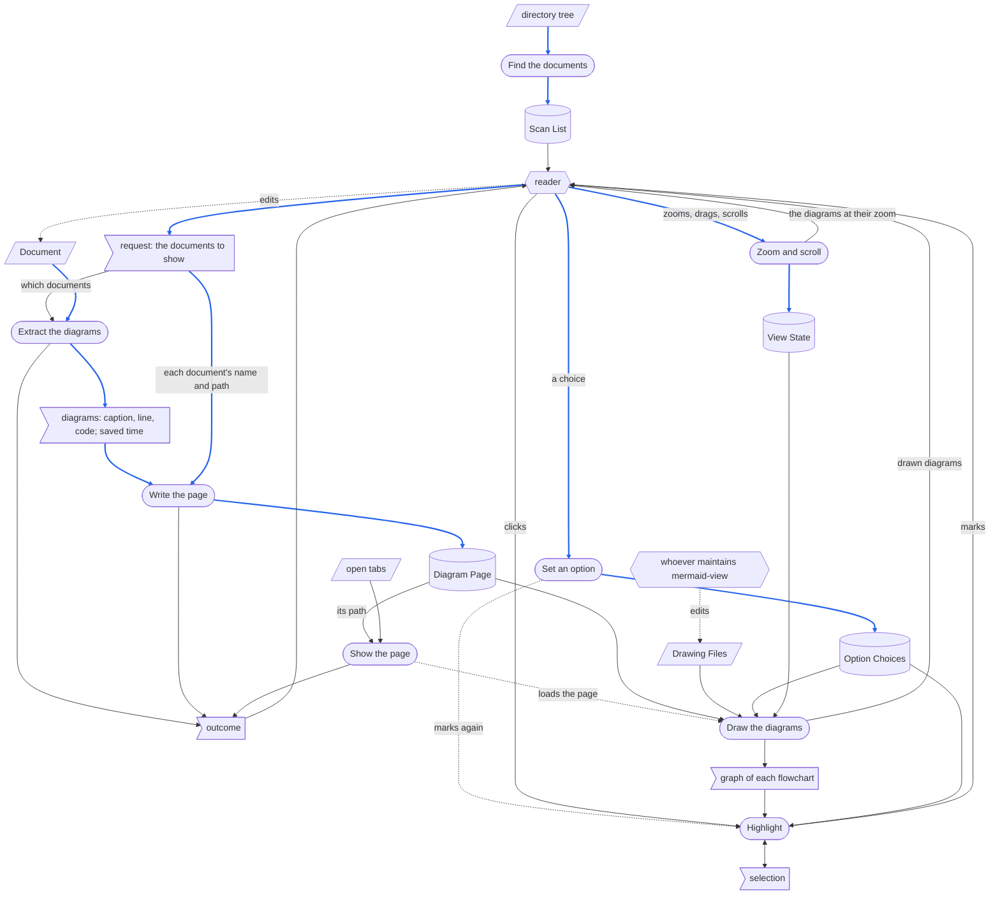
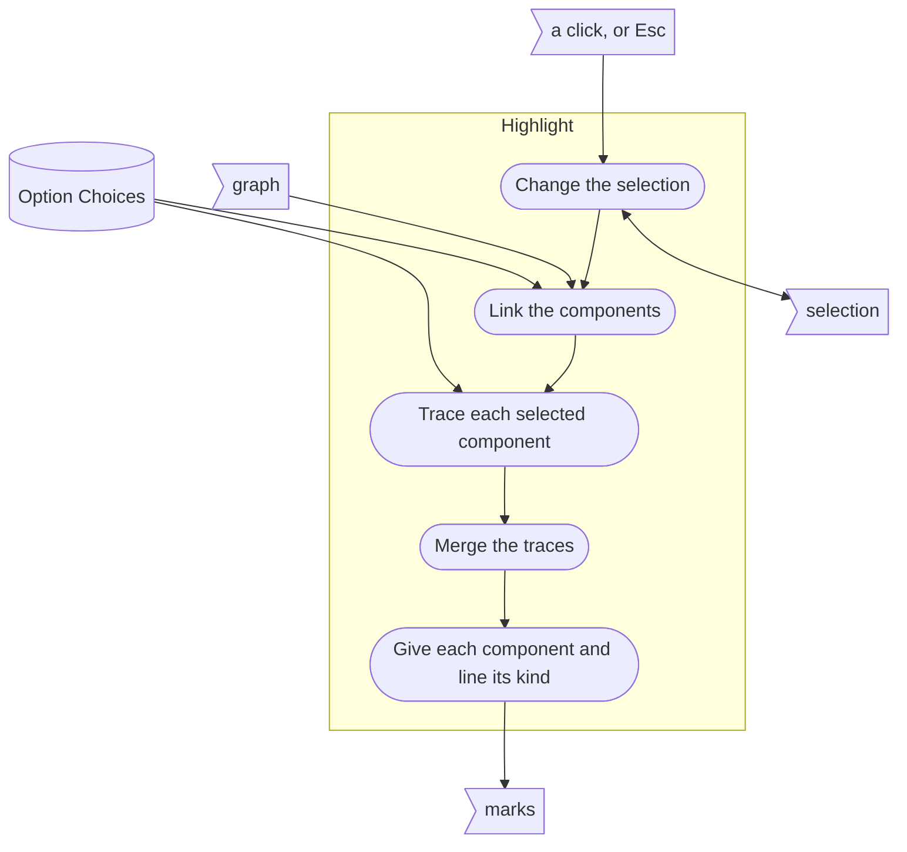

# **Mermaid View Software Requirements, Specification, Design, and Coding Document (RSDC)**

The design of record for mermaid-view, which draws the mermaid diagrams of a Markdown document on a page in the browser and lets a flowchart there be traced from any of its components.
Any implementation disagreeing with this document is what changes.
It records mermaid-view as built on 2026-10-07; its last section tells how it came to be this way.

## **1. Requirements - "What problem does this solve?"**

This chapter defines why mermaid-view exists and what it must achieve.
It does not involve any file, program or library.

### **1.1 Target Users**

* **The reader**: the person who writes design documents in Markdown — requirement and design documents, skill documents, notes — draws their flows as mermaid diagrams inside them, and needs to see those diagrams drawn while writing and reviewing.
  The reader works in a file manager and in an AI coding session, and reads in a web browser.
* **Whoever maintains mermaid-view**: the person, or the agent, who changes how diagrams are drawn and how they respond.
  A change must reach every page the reader already has, without each page being made again.

### **1.2 Core Vision**

Every diagram of a document, drawn in one action from wherever the reader is looking at the document — always as the document stands now, in the one view that document already has, without a network — and every flowchart readable by pointing at its components and seeing what feeds them and what they feed.

### **1.3 Current Pain Points**

* **The places the reader works show the code, not the diagram.**
  A file viewer shows a mermaid block as text, and the browser built into the AI app cannot open a file on the reader's disk.
  Seeing a diagram meant copying its code somewhere that draws it.
* **A drawn page goes stale without a sign.**
  A page drawn from a document is a snapshot: once the document changes, reloading the page shows the old diagrams, and nothing on it says they are old.
* **Every look opened another view.**
  Drawing a document again added another tab, and the old tabs kept the old diagrams beside the new.
* **Pages were hard to find and did not last.**
  Kept in a temporary folder under generated names, a page could not be found again or bookmarked, and the system could delete it at any time.
* **Drawing needed the network.**
  Offline, nothing was drawn.
* **Following a flow by eye is slow and error-prone.**
  Which components feed a given one, and which it feeds, has to be traced line by line; and lines that carry no data — the dotted ones of an order or a change made by hand — are easy to mistake for lines that do.
* **A loop makes "everything upstream" mean everything.**
  In a flow that returns through a role outside the system — a caller who gives the request and reads what comes back — every component is both upstream and downstream of every other, so tracing all the way tells nothing.
  What the reader most often wants is what lies one line away.
* **Two parts of a flow can only be looked at one at a time.**
  What lies between two components, or what two components share, needs both traced at once.
* **A large diagram is too small to read, and zooming the page does not help.**
  A diagram wider than the page is shrunk to the page's width, labels and all; zooming the whole page cannot make it wider than the window, so its labels stay small.

### **1.4 System Goals**

* **One action from where the document is**: from the file manager, for one document or several at once; and from the AI session, by naming a document or picking it from a list of the documents that hold diagrams.
* **Always current**: every showing draws the document as it stands at that moment, and a page says which version of the document it shows.
* **One view per document**: showing a document again refreshes the view of it already open, instead of adding another.
* **Findable and lasting**: a document's drawn page stays beside it, under a name that follows from the document's.
* **Offline**: drawing needs no network.
* **Traceable to the document**: each drawn diagram says where in the document it comes from, and its code can be read beside it.
* **Follow the flow**: selecting one or more components of a flowchart shows what feeds them and what they feed, tells the two apart, and recedes the rest.
  The reader chooses how far to trace, whether lines that carry no data count, and whether tracing stops at roles outside the system, and the choices are remembered.
* **Readable at any size**: any diagram can be enlarged until its labels read easily, reduced to be seen whole, and moved about while enlarged; showing its document again keeps the size and the place it had in that view.
* **One behaviour everywhere**: both ways of showing a document give the same page, and a change to how pages are drawn or respond reaches every page already made, without making it again.
* **Read-only and local**: nothing changes the document, and nothing of it leaves the machine.

## **2. Specification - "What are the system rules?"**

This chapter defines mermaid-view's data, how its records are laid out, how data moves between its stages, how each value it shows but does not read is derived, and what its pages must make plain.
It names the files whose names are part of a contract, and no other part of the design.

### **2.1 Artifact Types**

mermaid-view works in two kinds of run.
A **showing** turns a request — one or more documents — into a page for each, and brings the pages into view.
A **page load** is one life of a page in the browser: from the browser loading it until the page is closed or reloaded.
Its data is of three kinds: **external inputs**, which come from outside the system and outlast any run; **records**, which a stage writes and the system keeps after the run that wrote them; and **one-run data**, which lives within one run only, wherever it comes from.

**External inputs**

* **Document**: a Markdown file the reader names.
  Its diagrams are its mermaid blocks.
  The reader writes it; mermaid-view only reads it.
* **Drawing Files**: the three files every page loads, kept together in one folder — `mermaid.min.js`, the drawing library, mermaid 11.17.2, kept on the machine so that drawing needs no network; `mermaid-view.js`, the page script, which draws a page's diagrams and makes its flowcharts respond; and `mermaid-view.css`, the page style.
  Whoever maintains mermaid-view writes them.
  When the drawing library cannot be loaded from the machine, the same version is fetched from `https://cdn.jsdelivr.net/npm/mermaid@11.17.2/dist/mermaid.min.js` instead.
* **Open tabs**: the tabs open in Google Chrome, each with its window, its place in that window and its address, as Chrome reports them when asked.
* **Directory tree**: the AI session's working directory, searched for the documents that hold diagrams.

**Records**

* **Diagram Page**: one document's page — every diagram of the document as the document stood when the page was written, with what is needed to trace each back to it.
* **Option Choices**: the reader's three choices for tracing a flowchart — direct neighbours only, whether dotted lines count, and whether tracing stops at outside roles — kept by the browser across page loads.
  In Chrome one set serves every page opened from a file on the machine: a choice made on one page holds on every other.
* **Scan List**: the documents under the session's directory that hold at least one diagram, each with how many — kept for the rest of the AI session.
* **View State**: how the reader last saw a page in one tab — each diagram's zoom and how far it is scrolled sideways, and how far the page is scrolled — kept by the browser for that tab, across reloads, until the tab is closed.

**One-run data**

* **Request**: what the reader gives a showing — the documents to show: one or more selected in the file manager; or, in the AI session, one named, or picked from the Scan List.
* **Diagrams**: each mermaid block of a document, with its caption and its line, in document order, together with the document's saved time — from the reading of the document to the writing of its page.
* **Outcome**: what a showing tells the reader — which documents got no page, and why; which pages could not be brought into view; and, in the AI session, whether the page was redrawn in its open view or opened anew.
  A page brought to the front is itself part of the outcome.
* **Graph**: for each flowchart drawn in a page load, its components, its lines, which lines are dotted and which two-headed, and which components are outside roles.
* **Selection**: for each flowchart of a page load, the components the reader has selected.

**Terms**

* **A document's lines**: its text, less a byte-order mark at its very start, divided at every `\r\n`, lone `\r` and `\n` — and at nothing else: a form feed, a NEL or a Unicode line separator is text inside a line.
  A line ending at the very end of the text ends the last line, and starts no empty one.
  These are Markdown's own line endings; a document divided any other way would number its lines, and cut its blocks, otherwise than the Markdown it is.
* **Space**, in the rules that follow: a space or a tab, and nothing else — as in Markdown, where a full-width space after `#` makes no heading.
* **Saved time**: the time a document was last saved, to the second.
* **Mermaid block**: a fenced code block — opened by three or more backticks or tildes, indented at most three spaces — whose info string, after any space, has `mermaid` as its first word, up to the next space or backtick, in any letter case.
  It closes at the first line holding only the same character, at least as many times, indented at most three spaces and followed by nothing but space; a block never closed runs to the end of the document.
  Its **code** is the lines between, each with as many leading spaces removed as the opening fence was indented.
  A block indented four spaces or more is indented code, not a fence.
  A fenced block of any other language is passed over whole: nothing inside it — not even a line that looks like a heading — counts as a heading or a diagram.
* **Component** and **line**: a node and an edge of a flowchart.
* **Outside role**: a component drawn as a hexagon — the shape the documents mermaid-view serves give a role outside the system they describe, such as a caller.
* **Dotted line**: a line drawn dotted — in those documents, a line that carries no data: an order, or a change made by hand.
  **Two-headed line**: a line with an arrowhead at each end — in those documents, a stage that both reads and writes.
* **Upstream** and **downstream**: the components that feed a selected component, and those it feeds.
  How far, and along which lines, is the reader's choice.
* **Kind**: what a component or a line is for the current selection — **selected**, **upstream**, **downstream**, **both** (upstream and downstream at once), or **receded** (none of these).
* **Natural size**: the size the drawing library draws a diagram at.
  **Zoom**: the size a diagram is shown at, as a share of its natural size.
  **Fit**: the zoom that shows a diagram at its natural size, or narrower where the page is narrower — following the page as the window is resized.

### **2.2 Data Structures**

How the Diagram Page, the Drawing Files' folder, the Option Choices, the Scan List and the View State are laid out and named.

**The Diagram Page**

* **Where, and under what name**: in the document's own folder, named as the document's file name without its last extension, followed by `.mermaid.html` — `RSDC.md` gives `RSDC.mermaid.html`.
  One page per document; writing it again replaces it.
  The name is a contract: a view of the page is found again by it, to be refreshed, and both ways of showing a document write to it.
  A page written under any other name would leave the view already open on the old one.
* **What it holds**, in order: the document's file name; its absolute path — `.` and `..` folded, no link followed — how many diagrams it has, and its saved time, in UTC; then, for each diagram in document order, its caption, its line, the diagram to draw, and its code as written.
  It is UTF-8, and every piece of text taken from the document is escaped — `&`, `<`, `>`, `"` and `'` — so that a diagram's code shows exactly as written and nothing in it is ever taken as part of the page.
* **What it does not hold**: any drawing or responding of its own.
  It links to the three Drawing Files by absolute address and holds nothing else of behaviour, beyond a notice for when the page script cannot be loaded.
  A page that carried its own way of drawing would keep it forever, untouched by any later change.
* **The same bytes either way**: whichever way a document is shown, its page is written with the same bytes, for the same document — its text, its path and its saved time — and the same home folder.
  Were the two to differ, what a view showed would depend on which way the document was last shown, and a refreshed view could change although the document had not.

**The Drawing Files' folder**

`~/Library/Application Support/mermaid-view/`, holding `mermaid.min.js`, `mermaid-view.js` and `mermaid-view.css`.
The folder and the three names are a contract with every page ever written, which links to them by absolute address: moving or renaming any of them breaks every page already written, until the page is written again.

**The Option Choices**

Three entries in the browser's local storage, each `1` when its choice is on and `0` when it is off; an absent entry means the default.

| Entry | Choice | Default |
|---|---|---|
| `mermaid-view.directOnly` | trace direct neighbours only | on |
| `mermaid-view.dottedCounts` | dotted lines count | on |
| `mermaid-view.stopAtRoles` | tracing stops at outside roles | off |

An entry's name is a contract with every browser that has stored it.
A stored value outlives a change of default, so a new default takes effect only under a new name — and a new name resets that choice, once, for every reader.

**The Scan List**

The directory searched; for each document, its path relative to that directory, its absolute path and how many diagrams it holds, in order of path; whether a search is under way; and one line about the last search, or about the last document shown from the list.

**The View State**

Entries in the browser's session storage for the tab, each holding JSON:

| Entry | Holds |
|---|---|
| `mermaid-view.view:<page path>#<k>` | the k-th diagram of the page, counting from 0: `caption`, its caption; `scale`, its zoom as a number, unrounded, or `null` at fit; `left`, how far it is scrolled sideways, in pixels |
| `mermaid-view.view:<page path>@scroll` | how far the page was scrolled, in pixels, when the tab last left it |

The entries belong to the tab: a reload keeps them, a new tab starts without them, and closing the tab deletes them.
A zoom is shown rounded to a whole percent, and kept unrounded, so that zooming in and back out returns exactly where it began.

### **2.3 Dataflow**

How data moves between mermaid-view's activities: the stages, what each one reads and writes, who writes and who may read each piece of data, and the order the data itself imposes.
A showing runs the first four stages, as far as they apply; a page load runs the last four:

* **Find the documents** lists the documents under the session's directory that hold diagrams — the Scan List.
  A request that names its document needs no Find.
* **Extract the diagrams** reads each requested document and finds its mermaid blocks, with their captions and lines.
* **Write the page** writes each document's Diagram Page whole.
* **Show the page** brings each page into view: it reloads the Chrome tab already showing it, or opens it.
* **Draw the diagrams** draws every diagram of a page as the page loads, and reads the graph of each flowchart.
* **Set an option** records one of the reader's choices for tracing.
* **Highlight** gives each component and line of a flowchart its kind, for the reader's selection and the choices in force.
* **Zoom and scroll** changes the size and the place at which the reader sees each diagram and the page, and keeps them in the View State.

#### **Flowchart**

How to read the diagram:

* **Parallelogram**: an external input.
* **Flag**: one-run data.
* **Cylinder**: a record — data a stage writes, kept after the run that wrote it.
* **Rounded box**: a stage.
* **Hexagon**: a role outside mermaid-view — the reader, who edits documents, gives the request, reads the Scan List, the outcome and the drawn, marked and zoomed diagrams, and makes the choices, the clicks and the zooms; and whoever maintains mermaid-view, who edits the Drawing Files.
* **Two-headed arrow**: data the same stage both reads and writes — the selection, which a click changes according to what it already holds.
* **Blue solid arrow**: data that is itself written into a record, or turned into the content of one — the documents' diagrams, names and paths, which become the Diagram Page; the paths found, which become the Scan List; the reader's choice, which becomes the Option Choices; and the reader's zooming and scrolling, which become the View State.
  Data that only steers a stage — which documents Extract reads, the page's path Show looks for — is not blue, even where the stage writes a record.
* **Black solid arrow**: any other data — data that goes no further than the stage or role it reaches.
* **Dotted arrow**: no data — an order, or a change made by hand: Show the page makes the browser load the page; a choice set marks the flowcharts again; the reader edits documents; whoever maintains mermaid-view edits the Drawing Files.

#### **Stage Read/Write Table**

One row per stage.

| Stage | Reads | Writes | Read next by |
|---|---|---|---|
| Find the documents | the directory tree | the Scan List, whole | the reader |
| Extract the diagrams | which documents, from the request; each Document — its text and its saved time | each document's diagrams, with its saved time; for a document not found, not Markdown, unreadable or with no mermaid block, its part of the outcome | Write the page; the reader |
| Write the page | each document's diagrams and saved time; its name and path, from the request | the Diagram Page, whole, in place of the last; for a page that cannot be written, its part of the outcome | Show the page; Draw the diagrams; the reader |
| Show the page | the page's path; the open tabs | nothing kept: its part of the outcome — the page brought into view, refreshed or opened, or the finding that it could not be opened | the reader |
| Draw the diagrams | the Diagram Page; the Drawing Files; the Option Choices; the View State | the drawn diagrams, each at its kept zoom, with the choices in force; the graph of each flowchart; the page back at its kept place | the reader; Highlight; Zoom and scroll |
| Set an option | the reader's choice | that choice's entry in the Option Choices | Highlight; Draw the diagrams, at the next page load |
| Highlight | the reader's clicks; the selection; the graph; the Option Choices | the selection; the marks | the reader; Highlight, at the next click or choice |
| Zoom and scroll | the reader's zooming, dragging and scrolling; each diagram's natural size | each diagram shown at its zoom and place; that diagram's entry in the View State, at every change; the page's scroll, when the tab leaves the page | the reader; Draw the diagrams, at the next page load in the same tab |

#### **Data Read/Write Rules**

Every piece of data mermaid-view touches — who writes it, who may read it, and its kind: an external input, a record, or one-run data.

| Data | Kind | Written by | Read by |
|---|---|---|---|
| Document | external input | the reader — no stage | Extract the diagrams |
| Drawing Files | external input | whoever maintains mermaid-view — no stage | Draw the diagrams |
| open tabs | external input | Chrome — no stage | Show the page |
| directory tree | external input | no stage | Find the documents |
| request | one-run data | the reader | Extract the diagrams; Write the page |
| diagrams | one-run data | Extract the diagrams | Write the page |
| outcome | one-run data | Extract the diagrams, Write the page and Show the page, each its own part | the reader |
| graph | one-run data | Draw the diagrams | Highlight |
| selection | one-run data | Highlight | Highlight |
| Diagram Page | record | Write the page | Show the page; Draw the diagrams |
| Option Choices | record | Set an option | Draw the diagrams; Highlight |
| Scan List | record | Find the documents | the reader |
| View State | record | Zoom and scroll | Draw the diagrams |

Where it applies — whether it is written whole, whether it is read-only once written, and who deletes it:

* **The external inputs** are written by no stage, and every stage that reads them only reads them.
  The Document above all: mermaid-view writes beside a document, never into it.
  A viewer that wrote into what it shows could lose the reader's text to a mere look.
* **The Diagram Page** is written whole by Write the page, at every showing, from the document as it then stands.
  It is never edited in place, and between showings it is read-only.
  Show the page reads its path, and Draw the diagrams reads it at every page load.
  No stage deletes it: it stays beside its document until the reader deletes it, and goes wherever the document's folder goes — synced folders and version control included.
* **Write the page is reached from two places**, the file manager and the AI session, and writes the same bytes from either (2.2).
  The page therefore has one writer, the stage, however the showing began.
  Were the two to write different bytes, the page would have two writers in all but name, and whichever ran last would decide what the reader sees.
* **The Option Choices**: each entry is written whole by Set an option, when the reader changes that choice; Draw the diagrams reads them at every page load, and Highlight at every marking.
  No stage deletes them; they last until the browser's storage for local pages is cleared.
  Where the browser refuses storage, a choice still holds on the open page but is not kept.
* **The Scan List** is written whole by each run of Find the documents, in place of the last, and read by the reader.
  It lasts as long as the AI session.
* **The View State**: each entry is written whole by Zoom and scroll — a diagram's at every change of its zoom or sideways scroll, the page's when the tab leaves the page — and read by Draw the diagrams at the next page load in the same tab.
  It belongs to the tab: a reload keeps it, a new tab starts without it, and closing the tab deletes it; no stage deletes it.
  Where the browser refuses storage, zooming still works on the open page, and a reload starts every diagram at fit.
* **One-run data** lasts as long as its run: the request, the diagrams and the outcome as long as the showing; the graph and the selection as long as the page load, so a reload clears every selection.
  Nothing keeps them, so nothing deletes them.

#### **Order Imposed by the Data**

* **Extract before Write**: Write writes the diagrams Extract found.
* **Write before Show**: Show looks for the view of the page Write wrote, and opens that page.
* **Show before Draw, in a showing**: Draw draws the page Show loaded.
  A reload in the browser starts a page load with no showing before it.
* **Draw before Highlight**: Highlight marks the graph Draw read.
* **Set an option before the marking that follows it**: that marking reads the new choice.
* **Find before a pick from the Scan List**: the reader picks from what Find listed.
* **Draw before Zoom and scroll**: Zoom and scroll sizes the diagrams Draw drew.
* No stage reads what a later stage writes in the same run.
  The reads that look backwards are Draw's reads of the Option Choices and of the View State: each reads what a later stage wrote in an earlier page load, never in the same one.

#### **Exception Paths**

* **Ending with nothing written**: a requested file gets no page, and the outcome names it with the reason, when it cannot be found; when it is not a Markdown document — from the file manager, a folder, or a name that does not end in `.md` or `.markdown`; when it holds no mermaid block; or when it cannot be read.
  Whatever stops one document, the showing goes on to the next.
* **Stopping midway**: a page that cannot be written — in a folder that is read-only, say — is named in the outcome with the reason, and the showing goes on to the next document.
  A page written but not brought into view, because nothing could open it, is named in the outcome too.
* **Opened anew instead of refreshed**: when Chrome is not running, when no Chrome tab shows the page, or when the reader has not let mermaid-view control Chrome, Show opens the page in the default browser — a new view, while any older view stays as it was.
* **Drawn in part**: on a page load, a diagram the drawing library cannot read is drawn, in its place, as the library's error picture, and the others are still drawn; a diagram that is not a flowchart, or a flowchart whose graph cannot be read, is drawn but takes no marks.
  When the drawing library can be loaded neither from the machine nor from the network, the page says so and draws nothing; when the page script cannot be loaded, the page says that.
* **Re-entering midway**: a reload in the browser re-enters at Draw.
  It draws the page as last written — never the document — with the Drawing Files, the Option Choices and the View State as they are now, and with every selection cleared: each diagram goes back to the zoom and sideways scroll it had in this tab, and the page to its place, while a diagram whose place on the page or caption changed starts at fit.
  That is how a change to the Drawing Files reaches a page already written: at its next load, with no new showing.
  To see a changed document, the document is shown again — as the page itself says, beside the document's saved time.

#### **Inside Highlight**

Highlight drawn open: what it does, in order, each time the reader clicks a component or changes a choice.

How to read the diagram: as the Flowchart's, with the subgraph standing for Highlight drawn open.

| Inside Highlight | Reads | Passes on |
|---|---|---|
| Change the selection — on a click or Esc only | the click — which component, or the background, and whether it adds — or Esc; the selection | the selection |
| Link the components | the graph's lines; whether dotted lines count | for each component, what lies one step upstream and one step downstream of it |
| Trace each selected component | the links; the selection; direct only or not; whether tracing stops at outside roles; the outside roles | each selected component's upstream and downstream, and the lines that lead there |
| Merge the traces | every selected component's trace | what lies upstream of any selected component, and what lies downstream of any, with their lines |
| Give each component and line its kind | the merged traces; the selection | each component's and each line's kind — the marks |

**The order inside Highlight.**
The selection changes first, so that a click is traced from the selection it leaves.
The links come before any tracing, because the choices decide which lines there are.
The kinds come last, after every selected component has been traced: a component upstream of one selected component and downstream of another is then marked both, rather than as whichever was traced last.

### **2.4 Derivation Rules**

Every value mermaid-view shows that it does not read directly: how it is reached, and what never stands in for it.

#### **The Caption and the Line**

* A **heading** is a line opening with one to six `#`, indented at most three spaces, then at least one space; its text is what follows, less any trailing space and `#`s.
* A diagram's **caption** is the last two headings above its block, the nearer one last, joined by ` › `, with `**`, `__` and backticks taken out of each.
  A heading closes every deeper heading before it: under `# Doc`, `## A`, `### B` and then `## C`, a block is captioned `Doc › C`.
* A block with no heading above it is captioned `Diagram k`, `k` being its place on the page, counting from 1.
* **Never a line inside another block**: a line inside a fenced block of another language is never a heading, however much it looks like one.
  A `# comment` in a Python block taken as a heading would caption every later diagram wrongly.
* A diagram's **line** is the line number of its opening fence, counting from 1.

#### **The View That Already Shows a Page**

* It is the first Chrome tab — in the order of the windows, then of the tabs within each — whose address is a `file://` address that, once decoded, names the same file as the page, compared as real paths.
  That tab is reloaded, made its window's active tab, and its window brought to the front.
  If it cannot be reloaded, the next such tab is tried; with none left, the page is opened anew.
* **Never an address compared before it is decoded**: a path with a space or a Chinese character in it would never match, and every showing would open another tab.
* **Never a page of the same name in another folder**: two documents of one name have two pages, and refreshing the other one's view would show the reader the wrong document.

#### **The Graph of a Flowchart**

* Its components are the flowchart's nodes as the drawing library reads its code, each matched to the node drawn for it; its outside roles are those of hexagon shape.
* Its lines are the flowchart's links, except those drawn invisible.
  A line is dotted when it is drawn dotted, and two-headed when it has an arrowhead at each end.
* **Never a graph guessed from the drawing**: the graph is the code's, read by the same library that drew it.
  A graph taken from shapes and positions on the screen could join what the code does not.
* Only flowcharts have a graph.
  Every other kind of diagram is drawn and never marked.

#### **Upstream and Downstream**

Each of the three choices is its entry in the Option Choices, or its default where the entry is absent (2.2).

* A line from A to B puts B one step downstream of A, and A one step upstream of B; a two-headed line does so both ways.
  A dotted line counts only while dotted lines count.
* **Direct only** (the default): a selected component's upstream is what lies one step upstream of it, and its downstream what lies one step downstream.
* **All the way**: every component reached by steps upstream, and every one reached by steps downstream.
  While tracing stops at outside roles, an outside role is reached but not passed — the steps beyond it are not followed, unless the role is itself the one selected.
* Stopping at outside roles has no effect while direct only is chosen: nothing is passed after the first step.
* With several components selected, upstream is what lies upstream of any of them, and downstream what lies downstream of any.

#### **The Kind of a Component**

With nothing selected, no component has a kind and nothing recedes.
Otherwise every component has exactly one kind, the first of these that applies:

1. **selected**, when the reader selected it — whatever else it is;
2. **both**, when it lies upstream of a selected component and downstream of a selected component, the same one or another;
3. **upstream**;
4. **downstream**;
5. **receded**, when none applies.

**Never one side in place of both.**
A component the selection both feeds and is fed by — as in a loop — shown as upstream or downstream only would hide half of how it is joined to the selection.

#### **The Kind of a Line**

For each selected component S, a line from A to B is:

* **upstream of S** when A lies upstream of S, and either B is S, or — tracing all the way — B lies upstream of S and is not an outside role where tracing stops;
* **downstream of S** when B lies downstream of S, and either A is S, or — tracing all the way — A lies downstream of S and is not an outside role where tracing stops;
* and a two-headed line is judged in both directions.

A line is then **both** when it is upstream of a selected component and downstream of a selected component, the same one or another; otherwise **upstream** or **downstream**, as it is; otherwise **receded**.

* With direct only, a line counts only where it touches a selected component: a line between two of its neighbours is receded.
* **Never a line marked because both its ends are**: a line between two marked components that lies on no trace from a selected one would show the flow taking a path it does not take.

#### **The Zoom**

* A diagram starts at fit, unless the View State holds a zoom for the diagram at the same place on the page under the same caption; then it starts at that zoom, scrolled sideways as it was.
* Each press of a zoom button multiplies the zoom by 1.25, or divides it by 1.25.
  ⌘ or Ctrl with the wheel, or a pinch, changes it smoothly: a wheel movement of Δ pixels multiplies it by e^(−Δ/500).
  The zoom never goes below 10% or above 800%.
* As the wheel or a pinch zooms, the point under the pointer stays under the pointer; a button zooms about the middle of the part of the diagram on the screen.
  Where the diagram is narrower than its card it stays centred, and only the point's height is kept.
* While a diagram is zoomed, a press that moves more than 4 pixels drags it — sideways inside its card, up and down by scrolling the page — and is not a click.
  At fit, a press is always a click.
* **Never a zoom of the page**: zooming a diagram changes its size alone, never the page's or its text's, and the diagram is drawn again at its new size, never magnified as a picture, so its lines and text stay sharp.

### **2.5 Presentation Contract**

What mermaid-view presents is the drawn page, the marks on its flowcharts, and the outcome of a showing.
Their form and their words belong to the design; what follows is what they must make plain, so that no faithful presentation of them can mislead.

**What a page makes plain**

* **Every diagram of the document, once, in document order**, with the number of diagrams the page gives equal to the number it holds.
  A number that disagreed would hide a diagram from a reader who believed they had seen them all.
* **Where each diagram comes from**: the document's path, and each diagram's caption and line.
* **The code beside the drawing**: each diagram's code can be read on the page exactly as written, so that a diagram drawn wrongly, or not at all, can be checked against what the document says.
* **A diagram that could not be drawn says so, in its place**, never by going missing.
* **Which version of the document it shows**: the document's saved time when the page was written, in the reader's local time, and that a reload redraws the page as written, never the document.
  Without them, a page left open after its document changed would read exactly like a current one, and a reload — which changes nothing — would seem to confirm it.
* **Each diagram's zoom**: the zoom in force, as a share of the natural size, to a whole percent.
  An enlarged diagram wider than its card can be scrolled, so the reader can tell they are seeing part of it.

**What the marks make plain**

* **Exactly what the selection and the choices in force define**, and nothing else.
  The marks are worked out afresh at every click and every change of choice; none lingers from an earlier selection.
* **Four kinds told apart** — selected, upstream, downstream and both — with the rest receded but still visible, and a component that is both shown as both.
* **The choices shown are the choices in force.**
  What the reader sees chosen is what traces, and a choice that has no effect under the others — stopping at outside roles, while direct only is chosen — is shown to have none.
  A choice shown as active while ignored would let the reader believe a trace had stopped where it had not.
* **Clearing restores the diagram as it was drawn**: nothing marked, nothing receded.
* **Zooming keeps the marks**: a zoom or a drag changes neither the selection nor the marks.
  A drag that selected or cleared would undo the very trace the reader enlarged the diagram to follow.

**What the outcome makes plain**

* Every requested document that got no page, and why: not found, not a Markdown document, no mermaid block, unreadable, or a page that could not be written; and every page written that could not be brought into view.
* In the AI session, whether the page was redrawn in the view already open, or opened anew.

**What the reader must be able to start**

* Show one or more documents from the file manager.
* Show a document from the AI session, by naming it, or by picking it from the list of the documents under the session's directory that hold diagrams; and search for that list again.
* Read each diagram's code.
* Select a component alone; add a component to the selection, or take one out; clear a flowchart's selection; clear every selection on the page.
* Turn each of the three choices on or off.
* Zoom a diagram in and out; return it to fit; show it at its natural size; move about it while it is enlarged.

**The questions every presentation answers**

1. *When there is nothing to show*: a document with no mermaid block gets no page, and the outcome names it.
   A search that finds no document says that none was found under its directory.
   A page is never filtered: it shows every diagram of its document, so nothing on it is skipped.
2. *What the reader can start*: every action listed above.
   The reader cannot make a page current from the page itself: a reload draws the page as it was written, because nothing behind the page reads the document again.
   A page is made current by showing its document again, as the page itself says.
3. *Whether every retrieval works in the reader's environment*: drawing from the machine's copy of the drawing library has been observed in Chrome on the reader's machine.
   Fetching the library from the network has never been observed.
   Refreshing a view already open in the reader's Chrome has not been observed by any check: it needs the reader's leave to control Chrome, and has been checked only against a simulated list of tabs.
4. *Whether the material is reachable outside mermaid-view*: a page is a plain file beside its document, under a name that follows from the document's (2.2); it can be opened, bookmarked or shared like any file.
   It draws only where the Drawing Files sit at the address it names, so on another machine it draws only if they are there too.
5. *Whether a narrowed view keeps its counts*: a page is never narrowed, and its number of diagrams covers every one.
   The marks narrow attention, not content: what recedes stays visible, and no count is given for the marks.
   A zoomed diagram shows part of itself, with its zoom beside it and its card scrollable to the rest.
   The Scan List's number for a document is the number of diagrams its page would hold, counted by the same rule.
6. *The limit of a batch*: from the file manager, any number of documents at once, each on its own and each with its own page; a document that fails does not stop the others.
   From the AI session, one document per request.
   A search covers the whole directory tree except tool and dependency folders, and is cut off after one minute.
   A zoom stays between 10% and 800%.
7. *What a refused reader does next*: the outcome names each document left without a page, and why, and each page that could not be opened.
   A page that cannot draw says what is missing — the page script, or the drawing library — so the reader knows to restore the Drawing Files.
   A view not refreshed because the reader has not let mermaid-view control Chrome is opened anew instead; granting that leave restores refreshing.
8. *How far mermaid-view reaches*: nothing listens and nothing is sent.
   Pages are files opened from the disk; the one request ever made over the network is the fetch of the drawing library when the machine's copy cannot be loaded, and it carries nothing of any document.
   Pages sit beside their documents and go wherever the documents' folders go — synced folders and version control included; version control lists every new page as a new file, which is how the reader finds out.

### **2.6 Invariants**

Rules that hold in every stage, without exception:

* **The Document is never written.**
  mermaid-view reads documents and writes beside them.
  A viewer that wrote into what it shows could lose the reader's text to a mere look.
* **A page is a function of its document.**
  It is written whole from the document as it stands, by either way of showing it, with the same bytes, and never edited in place.
  Otherwise a page could mix two versions of a document, or change with the way it was last shown.
* **Behaviour lives in the Drawing Files, never in a page.**
  A page holds its diagrams and the addresses of the Drawing Files, and nothing else of behaviour, so a change to how pages draw or respond reaches every page at its next load.
  A page that carried its own behaviour would keep forever the behaviour it was written with.
* **Neither marks nor zoom change a diagram.**
  Highlighting changes only how components and lines are shown, and zooming only the size and place a diagram is shown at — never which components and lines there are, nor where they sit in the drawing — and clearing returns the drawing exactly as drawn.
* **Nothing of a document leaves the machine**, as question 8 of 2.5 sets out.
  The drawing library runs in its strict mode, so nothing in a diagram's text can run a script or follow a link when it is drawn.

The goals of 1.4, and the rules that carry them:

| Goal | Carried by |
|---|---|
| One action from where the document is | 2.1, the request; 2.3, Find the documents and the two places Write the page is reached from; 2.5, what the reader must be able to start |
| Always current | 2.3, the Diagram Page written whole at every showing; 2.5, which version of the document a page shows; the second rule above |
| One view per document | 2.2, the page's name; 2.4, the view that already shows a page |
| Findable and lasting | 2.2, where the page is written and under what name |
| Offline | 2.1, the Drawing Files kept on the machine; 2.5, question 3 |
| Traceable to the document | 2.1, a document's lines; 2.2, what the page holds; 2.4, the caption and the line; 2.5, the code beside the drawing |
| Follow the flow | 2.1, the Option Choices; 2.3, inside Highlight; 2.4, upstream and downstream and the kinds; 2.5, what the marks make plain |
| Readable at any size | 2.1, the View State and the zoom; 2.2, the View State; 2.3, Zoom and scroll; 2.4, the zoom; 2.5, each diagram's zoom, and zooming keeps the marks |
| One behaviour everywhere | 2.2, the same bytes either way, and the Drawing Files' folder; the third rule above |
| Read-only and local | the first and the last rules above; 2.5, question 8 |

## **3. Design - "How is the system structured?"**

This chapter describes the components that carry out the stages of 2.3, where they live, and how each does its work.

### **3.1 Core Component Responsibilities**

| Component | Its one job | Where it lives | Stages it carries out |
|---|---|---|---|
| **Finder Quick Action** 顯示 Mermaid 圖 | shows the documents selected in Finder | `~/Library/Services/顯示 Mermaid 圖.workflow` | Extract the diagrams, Write the page, Show the page |
| **mermaid-view mod** | shows a document from a Claude Code session, and lists the session's documents that hold diagrams | `~/.claude/dev-mods/438db5fa-5da6-456a-90db-c9e6ad1178b3/mermaid-view/` | Find the documents, Extract the diagrams, Write the page, Show the page |
| **Page Script** | draws a page's diagrams, makes its flowcharts respond, and lets every diagram be zoomed | `mermaid-view.js`, in the Drawing Files' folder | Draw the diagrams, Set an option, Highlight, Zoom and scroll |
| **Page Style** | how a page, its toolbar, its zoom bars and the kinds look | `mermaid-view.css`, the same folder | none: it shows what Highlight decides |
| **Drawing Library** | draws diagrams, and reads a flowchart's code into its nodes and links | `mermaid.min.js`, the same folder — mermaid 11.17.2, not ours | inside Draw the diagrams |

Where the boundaries lie:

* **The Quick Action and the mod each carry out Extract, Write and Show, with code of their own**, because one runs from Finder with no Claude Code session and the other inside one.
  They are one writer of the Diagram Page only as long as they write the same bytes (2.2); a change made to one and not the other splits them without a sign.
* **The writers never draw, and the Page Script never writes a page.**
  The writers put data into a page; everything that draws or responds lives in the Page Script and the Page Style, which is what lets a change to them reach every page at its next load (2.6).
  A writer that put behaviour into a page would freeze it into every page written from then on.
* **The Page Style decides only looks.**
  Which components and lines are marked is decided by the Page Script; the Page Style only shows each kind.

### **3.2 Presentation Form**

The capabilities 2.5 grants, what provides each, and the name the reader knows it by:

| Capability | Provided by | Name the reader sees |
|---|---|---|
| Show one or more documents from the file manager | Finder Quick Action | in Finder, a document's right-click menu → 快速動作 (on some macOS versions, 服務) → **顯示 Mermaid 圖** |
| Show a document from the AI session, by naming it | mermaid-view mod | `/mermaid <file.md>` |
| List the documents that hold diagrams, search again, and show one | mermaid-view mod | `/mermaid`; the **Mermaid** pane, its **Rescan** button, and one entry per document, `<path>  (<count>)` |
| Read a diagram's code | the page, as either writer writes it | **source**, under each diagram |
| Select a component alone | Page Script | a click on the component |
| Add a component to the selection, or take one out | Page Script | Shift-click or ⌘-click; Ctrl-click on other systems |
| Clear a flowchart's selection | Page Script | a click on its only selected component, or on the diagram's background |
| Clear every selection on the page | Page Script | Esc |
| Trace direct neighbours only, or all the way | Page Script | **只顯示直接的上游下游** |
| Count dotted lines, or not | Page Script | **虛線也算上下游** |
| Stop at outside roles, or not | Page Script | **追到外部角色（六角形）就停** |
| Zoom a diagram in, or out | Page Script | **+** and **−** beside its line number; ⌘ or Ctrl with the wheel, or a pinch, over it |
| Return a diagram to fit | Page Script | **符合寬度** |
| Show a diagram at its natural size | Page Script | **原始大小** |
| Move about an enlarged diagram | Page Script | dragging it; its card's scrollbar |

The rules of 2.5 that constrain rather than grant — the marks exactly as the selection and the choices define, a choice without effect shown to have none, both never shown as one side, marks that change nothing — grant nothing, and have no row here by design.
Neither do the toolbar's colour key and its line of hints: they explain what the reader sees, and removing them would take away no capability.
Nor does the zoom shown between − and +: it reports the zoom in force, and is no control.

### **3.3 Directory Structure**

**The Drawing Files** — `~/Library/Application Support/mermaid-view/`:

* `mermaid.min.js` — the Drawing Library, mermaid 11.17.2, 3.4 MB, downloaded once from jsDelivr.
* `mermaid-view.js` — the Page Script.
* `mermaid-view.css` — the Page Style.

**The Finder Quick Action** — `~/Library/Services/顯示 Mermaid 圖.workflow/Contents/`:

* `Info.plist` — registers the service: its menu name, 顯示 Mermaid 圖; Finder as the only application that offers it; any item as what it takes.
* `document.wflow` — the workflow: one Run Shell Script action, whose command holds the whole of the script that does the work.

**The mermaid-view mod** — `~/.claude/dev-mods/438db5fa-5da6-456a-90db-c9e6ad1178b3/mermaid-view/`, the folder of the Claude Code session that built it:

* `.claude-plugin/plugin.json` — the manifest: name, version 0.1.0, description, and where the type contract is.
* `.claude-plugin/types/` — type declarations Claude Code writes for the editor; never edited.
* `hooks/hooks.json` — names `register.tsx` as the mod's module.
* `hooks/register.tsx` — the mod.
* `types/index.d.ts` — the type contract: the Scan List, held as the mod's state.
* `tests/mermaid.test.ts` — the mod's tests; between `// BEGIN FIXTURES` and `// END FIXTURES`, the test documents and the pages the Quick Action's script writes for them.
* `tests/regen_fixtures.py` — rewrites that block, by running the script inside the installed Quick Action.
* `tsconfig.json` — extends the configuration Claude Code writes.

**This document** — `SkillsGestalt/mods/mermaid-view/MermaidView-RSDC.md`.

**The Diagram Pages** — beside their documents, each as `<name>.mermaid.html`.

What may move, and what it costs:

* **The Drawing Files' folder may not move.**
  Every page written links to it by absolute address, and both writers name it.
* **The Quick Action stays in `~/Library/Services/`**: anywhere else, Finder does not offer it.
* **The mod's folder may move** to anywhere Claude Code is told to load plugins from — `--plugin-dir`, or `CLAUDE_CODE_PLUGIN_DIRS`.
  Kept in the folder of the session that built it, it loads in that session only.
* **A page may move with its document** and still draws, since its links are absolute; the path it shows is stale until the document is shown again.

### **3.4 Execution Flow**

How each component does its part.

#### **Finder Quick Action**

1. Finder hands over the paths of the selected items, and the Run Shell Script action runs the embedded script on the system's Python with them as arguments.
2. Each path is handled on its own, so that nothing that goes wrong with one stops the next.
   A path that leads nowhere is set aside as not found; a folder, or a file whose name does not end `.md` or `.markdown`, as not Markdown.
   Otherwise the file is read as UTF-8, any byte that cannot be decoded replaced, and its saved time taken; a file that cannot be read is set aside with the reason.
   Its diagrams are extracted, and a document with none is set aside too.
3. The page is written beside the document, whole.
   A write that fails is set aside with its reason, and the next path is taken.
4. The page's path is printed, and the page shown: Chrome's tabs are listed — none when Chrome is not running — and the first tab showing the page is reloaded, made its window's active tab, and its window brought to the front with Chrome.
   When no tab is reloaded, the page is opened in the default browser; when that fails too, the page is set aside as not opened.
   When the environment sets `MERMAID_VIEW_NO_OPEN=1`, nothing is shown.
5. After the last path, up to three notifications: the files that are not Markdown; the documents with no mermaid block; and every other file set aside, each with why.
   Each message is printed to standard error as well.

#### **mermaid-view mod**

1. At the start of a session, it registers the command `/mermaid`, taking an optional file.
2. `/mermaid <file>`: the path loses any surrounding quotes, a leading `~/` becomes the home folder, a relative path is taken from the session's directory, and `.` and `..` are folded.
   The file is read, its saved time taken, its diagrams extracted, its page written beside it, and the page shown as by the Quick Action, with a second way to open it where the first fails.
   The answer is one line: the diagrams redrawn in their open Chrome tab; opened in the browser; no mermaid diagram found; written but not opened, with where; or not opened, with the error.
3. `/mermaid` alone opens the **Mermaid** pane and searches the session's directory for `.md` files with a line opening a fence whose info string begins with `mermaid`, passing over tool and dependency folders, for at most one minute.
   Each file found is read and kept when extraction finds a diagram in it, with how many.
   The list is kept as the Scan List, and the answer gives its count.
4. The pane shows a **Rescan** button, the Scan List's line, and one entry per document.
   Pressing an entry shows that document as in step 2, and puts the answer in a toast and in the pane's line.

#### **Page Script**

1. It runs at the end of the page, after the Drawing Library's script, and puts the toolbar at the top of the page: the three choices, each from its Option Choices entry or its default; the colour key; and a line of hints.
   While direct only is chosen, stopping at outside roles is greyed out and cannot be changed, with a tip saying why.
2. It shows the document's saved time, which the page holds in UTC, in local time, and puts a note under the path: a reload redraws this page as written, never the document, so a changed document is shown again.
3. If the Drawing Library did not load from the machine, it loads it from the network; if that fails too, it says so on the page.
4. It keeps each diagram's code, then has the Drawing Library draw every diagram — the default theme, the strict security level — carrying on past a diagram that fails.
5. For each drawn flowchart it reads the graph: the Drawing Library reads the code again into nodes, of which the hexagons are outside roles, and links, of which the invisible are dropped.
   Each node is matched to its drawn group, and each link to its drawn path and label, by the ids the drawing gives them; each node is made clickable.
6. Every drawn diagram, of any kind, gets a zoom bar beside its line number: −, its zoom, +, 符合寬度 and 原始大小.
   ⌘ or Ctrl with the wheel, or a pinch, over the diagram zooms about the pointer, and keeps the browser from zooming the page; while zoomed, a press that moves drags the diagram, and the click that ends the drag is swallowed before any component or the background sees it.
   Each change of a diagram's zoom or sideways scroll is kept in the View State, and the page's scroll when the tab leaves the page.
   As the page loads, each diagram takes back its kept zoom and sideways scroll when its entry has the same caption, and once every diagram is drawn the page goes back to its kept scroll.
7. A click on a component changes that flowchart's selection: a plain click selects the component alone — or, when it is the only one selected, clears the selection; a Shift-, ⌘- or Ctrl-click adds it, or takes it out if it is selected.
   A click on the diagram's background clears that flowchart's selection, and Esc clears every flowchart's.
   The flowchart is then marked again.
8. A changed choice is stored, its effect on the other choices shown, and every flowchart of the page marked again.
9. Marking builds the step links from the graph's lines under the choices, traces each selected component, merges the traces, and gives every component and line one of the four marked kinds, or none; the drawing as a whole is marked active while anything in it is selected.

#### **Page Style**

1. The page is one centred column; the note about reloading sits right under the path, in small grey type; each diagram sits in a card under its caption and line, with its code folded away beneath it.
2. The toolbar stays at the top of the window while the page scrolls.
3. While a flowchart has a selection, everything in it without a kind fades to 15% opacity.
   The selected component takes a dark outline, 4 px wide; an upstream one is outlined orange, a downstream one blue, and one that is both purple — each 3 px wide, over a pale fill of the same hue.
   A line takes its kind's colour, 3 px wide.
4. A component's outline is restyled in both of the forms the Drawing Library draws it in: a shape directly inside the component's group, and, for rounded shapes, paths inside a label container — one painting the fill with no stroke, and one the outline with no fill.
   A path drawn with no fill is left unfilled.
5. The text inside a component cannot be selected, so a Shift-click selects no text.
6. The zoom bar sits at the right of the line number.
   An enlarged diagram scrolls sideways inside its card, and the page grows with its height; while zoomed, the diagram shows an open hand, which closes while the diagram is dragged.

## **4. Coding - "How should the code be written?"**

This chapter sets how the components are written, what they must never do, and how each rule of the earlier chapters is shown to hold.

### **4.1 Key Development Guidelines**

* **One page, two writers, the same bytes.**
  The mod follows the Quick Action's template character for character, and its rules wherever the two languages could part:
  * lines are split at `\r\n`, `\r` and `\n` alone, after a leading U+FEFF is dropped, and a final empty piece is dropped — never by Python's `splitlines()`, which also splits at `\v`, `\f`, `\x1c` to `\x1e`, `\x85`, U+2028 and U+2029, nor by JavaScript's `/\r?\n/`, which keeps a lone `\r`;
  * space is `[ \t]`, never `\s`, whose members differ between the two — Python's takes `\x1c` to `\x1f` and `\x85`, JavaScript's U+FEFF — and text is stripped of `[ \t]` only;
  * in a heading's pattern, `.` takes every character: JavaScript's `s` flag, for a U+2028 left inside a line;
  * a path is folded as `os.path.abspath` folds it, and a file name cut at its extension as `os.path.splitext` cuts it, leading dots kept;
  * text is escaped as `html.escape(…, quote=True)` escapes it — `'` as `&#x27;` included — and a file's address written as `Path.as_uri()` writes it, `!`, `'`, `(`, `)` and `*` percent-encoded too;
  * the saved time is taken in whole seconds — `int(os.stat(path).st_mtime)`, `Math.floor(mtimeMs / 1000)` — and written in UTC — `time.gmtime`, `toISOString()` — since the zone of the mod's clock is not known.

  A change to one writer is made to the other in the same change, and the pages the mod's test expects are rewritten by `tests/regen_fixtures.py` from the script inside the installed Quick Action, never edited by hand: an expectation edited by hand proves only that the mod matches the hand.
* **No invisible character in a source.**
  A byte-order mark, a line or paragraph separator, or a full-width space is written as its escape, never as itself: a character the eye cannot see cannot be reviewed.
* **Nothing but data in a page.**
  No drawing or interaction code is ever written into a page; its one inline script warns when the Page Script is missing.
* **The page's markup is a contract with the Page Script.**
  Each diagram's code sits in a `pre.mermaid`, and the page's content in `main`, which receives the toolbar.
  A writer that changed either would leave every new page undrawn.
* **A changed default takes a new entry name** (2.2), and every read and write of the browser's storage is guarded, so that a refusal falls back to the default.
* **An error stays in its diagram.**
  Drawing runs with `suppressErrors`, and the reading of each flowchart's graph is caught on its own.
* **The Quick Action runs on the system's Python**, `/usr/bin/python3`, version 3.9: no syntax newer than 3.9, and the standard library only, since nothing is installed for it.
* **The mod reaches the machine only through `$`**: `$.fs`, `$.process.run`, `$.env` and `$.session`.
* **A tab is matched by its decoded real path.**
  The address's path is decoded — `unquote`, `decodeURIComponent` — and compared as a real path: `os.path.realpath`, or `$.fs.stat(path, { resolve: true }).realPath`.
* **The Page Style restyles with `!important`.**
  The drawing carries its own styles — a `linkStyle` among them, written as an inline style on each line it colours — so the Page Style's strokes and fills must outrank them.
* **Fit is the drawing library's own sizing.**
  At fit a diagram keeps the width of 100% and the maximum width the drawing library gave it; any other zoom sets its width and height in pixels.
  A fit written in pixels would stop following the window.
* **A drag is not a click.**
  While zoomed, a press that moves more than 4 pixels swallows the click that ends it, in the capture phase on the diagram's card, before any component or the background sees it; the next press clears the flag, so a drag that ends off the card swallows nothing later.

### **4.2 Implementation Guidelines and Tools**

* **Finder Quick Action**: an Automator Quick Action.
  `Info.plist` registers the service for Finder alone (`NSRequiredContext`, `com.apple.finder`) on any item (`NSSendFileTypes`, `public.item`).
  `document.wflow` holds one Run Shell Script action — `/bin/zsh`, input passed as arguments — whose command is `/usr/bin/python3 - "$@" <<'PY'`, the script, and `PY`.
  The script uses `html`, `json`, `os`, `re`, `subprocess`, `pathlib` and `urllib.parse`; it lists and reloads Chrome's tabs, and posts its notifications, through `osascript` — each notification's text printed to standard error as well — and opens a page with `open`.
  After the service changes, `/System/Library/CoreServices/pbs -update` refreshes the Services menu; `automator -i <file> <workflow>` runs it from a shell.
* **mermaid-view mod**: TypeScript on Claude Code's plugin API — `on('session.start')` with `$.command.register`; `on('command.run', { command: 'mermaid' })`; `$.ui.open` with `on('ui.render', { component: 'Pane', requestId: 'mermaid-view' })` for the pane; and an `atom` holding the Scan List, declared in `types/index.d.ts` as the state `mermaid-view.scan`.
  It searches with `grep -rlE`, lists and reloads tabs with `osascript`, and opens a page with `open`, then `xdg-open`.
  It is checked with `claude plugin validate <folder>` and `claude plugin test <folder>`; after either writer changes, `/usr/bin/python3 tests/regen_fixtures.py` first rewrites the test's fixtures.
* **Page Script**: plain JavaScript in the manner of ES5 — `var`, functions, no modules, no build — with no dependency but the Drawing Library, as `window.mermaid`: `mermaid.initialize({ startOnLoad: false, theme: 'default', securityLevel: 'strict' })`, then `mermaid.run({ querySelector: 'pre.mermaid', suppressErrors: true })`; for the graph, `mermaid.mermaidAPI.getDiagramFromText(code)` with its `db.getVertices()` and `db.getEdges()`.
  A node's drawn group has the id `<svg id>-flowchart-<node id>-<n>`; a link's drawn path, and its label, carry the link's id as `data-id`.
  Zoom keeps the View State in `sessionStorage`; its wheel listener is registered with `passive: false`, so that it can keep the browser from zooming the page, and turns a wheel's `deltaMode` of lines or pages into pixels.
* **Page Style**: plain CSS, with `:is()` and `:not()`.
* **Checking a page**: headless Chrome — `--headless=new --dump-dom`, with a throw-away `--user-data-dir` and a `--virtual-time-budget` — on a copy of a page with a test script added at its end, which clicks by `dispatchEvent`, reads classes and computed styles with every transition turned off, and writes what it finds into the page for the dump.
  Chrome writes the dump and then never exits, so a check runs it in the background, waits a fixed time, and kills it.

### **4.3 Safety and Robustness**

Known deviations and gaps, each with what it costs:

* **The two ways take different files.**
  The Quick Action takes only names ending `.md` or `.markdown`; `/mermaid <file>` takes any file; the search lists `.md` files only.
* **A document over 4 MiB.**
  The mod reads through Claude Code, which refuses a file over 4 MiB, so `/mermaid` answers that it could not open one; the Quick Action has no such limit.
* **A document that is not valid UTF-8.**
  The Quick Action replaces each sequence it cannot decode as Python's decoder does; how Claude Code decodes one for the mod has not been observed, so such a document may get two different pages.
* **Only Chrome's views are refreshed.**
  A page open in another browser is never refreshed; each showing opens it anew in the default browser.
* **The graph rests on the Drawing Library's internals.**
  `mermaidAPI.getDiagramFromText`, `getVertices`, `getEdges` and the drawing's ids are no published contract of mermaid.
  Under another version, flowcharts may be drawn and take no marks, and nothing on the page would say why.
* **What a search cut off at one minute reports** has not been observed.
* **Zooming by keyboard or touch screen.**
  Zooming is by the bar, by ⌘ or Ctrl with the wheel, or by a trackpad's pinch; there are no keyboard shortcuts, and a touch screen's pinch has not been tried.
* **The mod lives in a session's folder**, and loads only in the session that built it until its folder is given to Claude Code as a plugin folder (3.3).
* **The mod has not been type-checked**: `tsc` is not installed on the machine, and installing it means a download.

### **4.4 Platform Traps**

Only cases that have actually produced a plausible but wrong result:

* **A fade rule that outranked the highlight.**
  The rule fading everything, `svg.mv-active g.node`, was more specific than the rule restoring a marked node, `svg.mv-active .mv-up`.
  Every click faded the whole diagram: each node carried the right class, and the reader saw a grey page.
  The fade now applies only to what has no kind — `:not(.mv-sel, .mv-up, .mv-down, .mv-both)` — and there is no restoring rule left to be outranked.
* **A rounded shape keeps its outline one level down.**
  A stadium-shaped node, `([…])`, draws its outline as two paths inside `g.label-container` — one painting the fill with `stroke="none"`, one the outline with `fill="none"` — not as a direct child of the node's group.
  A rule written for direct children left Judge and Back-solve unchanged when they were selected.
  Both forms are now restyled, and a path drawn `fill="none"` is left unfilled.
* **A bare `/mermaid` has no `args`.**
  The command arrived with `args` absent rather than `""`, so `e.args.trim()` threw and the engine skipped the hook: `/mermaid` alone would have done nothing, with nothing said.
  The mod's test caught it before use; `args` is read as `(e.args ?? '').trim()`.
* **A class check passed on a grey page.**
  The first highlight test checked only which classes each node received, and passed while every node was faded on the screen.
  Highlight tests now read computed styles — opacity, stroke and fill — with transitions turned off.
* **An escape that became the character.**
  Escapes written for U+FEFF, U+2028 and U+3000 landed in three files as the invisible characters themselves — the installed Quick Action's script among them, and in the mod a pattern that read, to the eye, as `/^/` — while every test still passed.
  A scan for format, separator and odd space characters found them, and the sources now hold escapes only.

### **4.5 Verification Obligations**

Each rule this document states, how it is shown to hold, and who shows it.
A rule is proven when its behaviour has been observed, not when the code meant to produce it has been read.

| Claim | Rule | Proven by | Performed by |
|---|---|---|---|
| The mod writes the page the Quick Action writes, byte for byte | 2.1, 2.2, 2.6 | tests 1 and 2 of `tests/mermaid.test.ts`, on seven documents — a block in `~~~` and a Python block holding a `#` line; `\r\n` and lone `\r` endings; a block left open at the end; U+2028, a form feed and a NEL inside lines; a full-width space, a NEL and U+001F after `#`; a byte-order mark; a path with `.` and `..` and a name of leading dots; a home folder that needs percent-encoding — each page equal to the one the installed Quick Action's script writes. Eight of the mod's rules, each put back to its old form in a copy of the mod — the line endings, the final empty line, the byte-order mark, `.` across U+2028, space after `#`, path folding, percent-encoding and the extension cut — each failed test 2 — 2026-10-07 | `claude plugin test`: 4 of 4 passed on 2026-10-07 |
| A view already open is refreshed, not doubled | 2.4 | test 3: given a simulated list of tabs naming the page's address, the mod reloads that window's tab and opens nothing | `claude plugin test`; *not observed* against the reader's Chrome |
| The search lists only documents that hold a diagram, and pressing one shows it | 2.3, 2.5 | test 4: a file whose only fence is indented four spaces is left out; pressing the listed document opens its page, in both the terminal and the desktop app | `claude plugin test` |
| The Quick Action writes the page beside the document | 2.2 | run by `automator -i` with `MERMAID_VIEW_NO_OPEN=1` on documents whose paths hold spaces, parentheses and Chinese: the page appeared beside each, with its diagrams, its saved time and links to the Drawing Files — 2026-10-07 | whoever changes the Quick Action |
| The Quick Action names every file that got no page, and goes on past it | 2.3, 2.5 | the installed script, given eight paths — a document; one it may not read; one in a read-only folder; one with no mermaid block; a `.txt`; a folder named `.md`; a missing one; another document: both documents got pages, and standard error named the `.txt` and the folder as not Markdown, the document without a block, and the other three with their reasons. Run again with neither `osascript` nor `open` to be found, the page was written and named as not opened — 2026-10-07 | whoever changes the Quick Action |
| A page says which version of its document it shows | 2.5 | headless Chrome on the page of a document saved at 17:30:05, Asia/Taipei: the page held `09:30:05Z` and showed `17:30:05`, with the note right under the path; a page written before this rule showed the note and no time — 2026-10-07 | whoever changes the Page Script |
| A diagram the Drawing Library cannot read stops no other | 2.3 | a page holding a broken flowchart, a valid flowchart and a sequence diagram, in headless Chrome: the first drawn as the library's error picture, the second drawn with both its nodes clickable, the third drawn and not clickable — 2026-10-07 | whoever changes the Page Script |
| The marks follow 2.4, for one selection | 2.4, 2.5 | headless Chrome on the Dataflow diagram of StopPriceChecker-RSDC: Judge selected all the way, with and without dotted lines and stopping at roles, and direct only; Back-solve selected; a node of the stage expansion selected; then clearing — the classes of every node and line, and the computed opacity, stroke and fill, matched the kinds worked out by hand — 2026-10-07 | whoever changes the Page Script or the Page Style |
| The marks follow 2.4, for several selections | 2.4, 2.5 | headless Chrome on the same diagram, 2026-10-07: Judge, then Back-solve by Shift-click — both selected; request, Rule Copies and holding data upstream; Check Table both; outcome downstream; caller and keeper receded, at opacity 0.15. ⌘-click took Judge out; a plain click on one of two selected kept it alone; a plain click on the only selected cleared; Esc and the background cleared; request and outcome together made Judge, Back-solve and caller both; all the way, stopping at roles, matched too | as above |
| The defaults | 2.2 | a fresh browser profile: direct only and dotted lines on; stopping at roles off, and greyed out | as above |
| A diagram zooms, keeping its point under the pointer | 2.4, 2.5 | headless Chrome at 1280 × 800 on a page of three diagrams — this document's Flowchart, 1805 × 1553 at natural size, its Inside Highlight, and a sequence diagram: fit showed 64%; + gave 80%; 原始大小 gave 100%, 1805 px wide; a Ctrl-wheel of −100 gave 122%, moved the point under the pointer by 0 px either way, and kept the browser from zooming the page; a plain wheel changed nothing; 符合寬度 gave back 64% and the drawing library's own sizing; the sequence diagram zoomed from 100% to 125% — 2026-10-09 | whoever changes the Page Script |
| A drag moves a zoomed diagram, and is not a click | 2.4, 2.5 | the same page: a drag of 120 px right and 40 px down, begun on a component, scrolled the card 120 px and the page 40 px, and left the selection as it was; a press without moving then selected that component alone; at fit, the same drag moved nothing — 2026-10-09 | as above |
| Zooming keeps the marks | 2.5, 2.6 | a component selected, then the diagram zoomed: it was still selected — 2026-10-09 | as above |
| A reload in the same tab keeps each zoom and the page's place | 2.2, 2.3 | the Flowchart at 195%, its card scrolled 200 px sideways and the page 900 px down, and the sequence diagram at 125%; after a reload, all four were as they had been — 2026-10-09 | as above |
| Fit follows the page's width | 2.1, 2.4 | the page narrowed and a resize sent: a diagram at fit went from 100% to 59% — 2026-10-09 | as above |
| A pinch on a trackpad zooms | 2.4 | — | *not verified*: a pinch reaches the page as a wheel with Ctrl, which was tested; no real pinch has been made |
| One set of Option Choices serves every local page, across page loads | 2.1, 2.3 | in one Chrome profile, a value stored by a page in one folder was read by the next page load, of a page in another folder — 2026-10-07; across a restart of Chrome, *not verified* | — |
| Drawing needs no network | 1.4, 2.1 | every headless check above drew with the machine's copy of the Drawing Library; none ran with the network turned off | — |
| The Drawing Library is fetched when the machine's copy is missing | 2.3 | — | *not verified* |
| A Shift-click selects no text | 3.4 | — | *not verified*: a synthetic click selects no text whatever the style |
| The Quick Action's notifications appear | 2.5 | their text, as printed to standard error, is in the row on naming every file; the notifications themselves — | *not observed* |
| The Document is never written | 2.6 | — | *not verified*: neither writer opens a document for writing — read, not tested |
| Marks never change a diagram | 2.6 | — | *not verified*: marking only adds and removes classes — read, not tested |
| The mod's manifest and hooks are what the engine accepts | 3.3 | `claude plugin validate` passed on 2026-10-07, with one warning: no author | whoever changes the mod |
| The mod type-checks | 4.1 | — | *not verified*: `tsc` is not installed |

**The rows not verified** are the checks still to be written.
Most could be made mechanical: a page loaded with the Drawing Library's local copy renamed away; a fingerprint of a document taken before and after a showing; the drawing's nodes and lines counted before marking, after it and after clearing.
Until they exist, those rules hold only as long as nobody breaks them.

## **How This Version Came About**

mermaid-view was built in one working session, on 2026-10-07, each step asked for after the one before had been seen in use.

1. **A page of one document's diagrams.**
   The reader asked to see the two Dataflow diagrams of StopPriceChecker-RSDC in a window of their own.
   The browser built into the AI app cannot open a file on the disk, so a one-off page was written to a temporary folder and opened in the default browser, drawn by mermaid fetched from the network.
2. **A command for any document.**
   The reader asked for a mod that, given a Markdown document, shows all its diagrams on a page: `/mermaid`, with a pane listing the documents that hold diagrams, and `/mermaid <file>`.
   Pages still went to a temporary folder, under generated names, drawn from the network.
3. **From Finder.**
   The reader asked for something simpler: a right-click on a document.
   Of Finder and the editor's file explorer, Finder was chosen, and the Quick Action 顯示 Mermaid 圖 was written with the same logic as the mod.
4. **Pages that go stale.**
   The reader found that reloading a page did not show a changed document, and asked that showing a document write its page afresh and open it, with questions first.
   Four choices were made: refresh the tab already showing the page, rather than open another each time or close and reopen it; write the page beside its document, rather than in a temporary or cache folder; draw from a copy of mermaid kept on the machine — 11.17.2, 3.41 MB, downloaded once from jsDelivr with the reader's leave; and change the mod the same way.
   The pages were then left visible to version control, by choice.
   A small local server that would read the document again at every page load had been offered, and was not chosen.
5. **Flowcharts that respond.**
   The reader asked that clicking a component highlight it with its upstream and downstream.
   Four choices were made: trace all the way; colour upstream and downstream apart; let an option decide whether dotted lines count; and clear by clicking again, clicking the background or pressing Esc.
   Selecting several components and clicking a line were offered and not chosen then.
   Drawing and responding moved out of the pages into the shared Page Script and Page Style, so that later changes would reach every page at its next reload.
   Stopping at outside roles was added unasked: in the StopPriceChecker diagram, the loop through the caller made five components both upstream and downstream of Judge.
6. **The grey page.**
   The reader found the whole diagram faded after a click.
   A fade rule that outranked the highlight lay behind it, a rounded shape's outline was found unrestyled while fixing it, and the test that should have caught both had checked classes only (4.4).
7. **Direct neighbours only.**
   The reader asked for a choice to show only the direct upstream and downstream, off by default at first.
   While it is on, stopping at outside roles has no effect, so it is greyed out.
8. **New defaults.**
   The reader asked that direct only be on by default, and then dotted lines counting — on by default already.
   Both options took new entry names, so that a value a browser had stored under the old names could not keep an old choice in place of the default (2.2).
9. **Several components at once.**
   The reader asked that components could be selected together: Shift- or ⌘-click adds and takes out, and the marks become the union of every selected component's traces.
10. **This document**, written from mermaid-view as it then stood, in the structure of RSDC-Responsibilities.md.
    Writing it brought three gaps to light: a page did not say when its document was saved; the Quick Action stopped at a file it could not read, and said nothing of a page it could not open; and the two writers split a document's lines in different ways.
11. **The gaps closed, and the twin.**
    The reader asked for both.
    A page now says which version of its document it shows, and that a reload does not read the document again; the Quick Action goes on past a file it cannot read, write or open, and names it; and the two writers share every rule that decides a page's bytes — Markdown's own line endings and spaces among them — proven on seven documents against pages the Quick Action's own script writes.
    On the way, three escapes turned into the invisible characters they stood for (4.4).
    The 繁體中文 twin, MermaidView-RSDC-tw.md, was written last.
12. **Aligned with DFD.**
    The standard's diagram notation moved into DFD.md, and this document was brought in line with it: the three kinds of data take their new names — external input, record, one-run data — and one-run data its own shape, the flag; the Data Read/Write Rules give each Kind by those names; the inside of Highlight draws the Option Choices as the record they are, and has a legend of its own; and a dotted arrow is an order or a change made by hand.
    mermaid-view itself did not change.
13. **Zoom.**
    The reader asked that the diagrams shown could be enlarged and reduced.
    Each diagram got a bar of buttons — −, its zoom, +, 符合寬度 and 原始大小 — and ⌘ or Ctrl with the wheel, or a pinch, zooms about the pointer; an enlarged diagram can be dragged about, and a reload in the same tab keeps each zoom and the page's place, since showing a document again reloads its tab.
    It all lives in the Page Script and the Page Style, so every page already written gained it at its next load.
