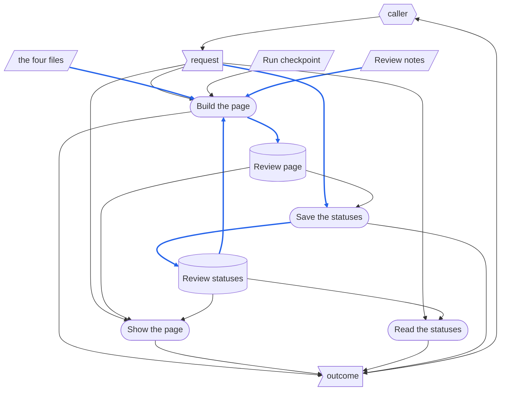

# ReviewPage - RSDC

> [[RSDC-Standard]]  `2026-11-02`  `71f2a43590d2`
> [[DFD]]  `2026-11-02`  `4030d6783acf`
> [[RSDC-App-tmp]]  `2026-11-01`  `fe18ef9acd6f`

- **App**：asd-ste 的 review page —— 把 STE 草稿放在它改寫的檔案旁邊，連同兩份 TW twin，給審核草稿的人看，並保存 reviewer 給 review notes 每一個 item 的標記。
- **Started with**：`node review_server.js`，它提供 asd-ste 的 Step 6 以 `make_review.py` 建出的每一份 review page。
- **Authority**: 任何與本文件不一致的實作，就是要改的那一方。

# 1. Requirements — "What problem does this solve?"

本章定義這個 app 的目標與它要解決的痛點，以使用者自己的說法來寫，絕不觸及它如何建構：
不寫 component、函式庫、路由或取自 app 原始碼的識別碼，也不寫從某一次執行中量到的數字。
指名這個 app 接管的是什麼（即使那是一支程式），以及舊做法讓使用者付出什麼代價，描述的是使用者面對的問題，所以寫在這一章。

## 1.1 Target Users

- **The reviewer** —— 在 STE 草稿取代它改寫的檔案之前，核准這份草稿的人。
  他們一次審一份草稿，有時分好幾次審完；他們需要看到每一處修改與被修改的原文並排，英文與繁體中文都要，也要記得哪些重點已經定案。
- **Callers** —— 為 reviewer 呼叫 app 的任何東西：人在其中工作的頁面、AI agent，或 script。

## 1.2 Core Vision

reviewer 對照草稿與原文的方式，就像在 code review 裡讀程式碼：並排、直接跳到 agent 要他們判斷的每一處，並在每個重點上留下一個標記，直到那個重點本身改變之前都保留。
審核最後得出一個 reviewer 與 agent 都讀得懂的決定：哪些通過、哪些必須改、哪些要 agent 先解釋。

## 1.3 Current Pain Points

在有這個頁面之前，草稿在對話裡、在兩個編輯器視窗裡審核，agent 提的重點與 reviewer 的回答只存在聊天紀錄裡。
這個頁面接手對照，以及每個重點決定了什麼的紀錄；是否取代原文的決定仍屬於 reviewer，在對話中做出。

- **一個重點指出一行，reviewer 得自己去找。**
  agent 提出的每個重點，引用最多四個檔案裡的行，reviewer 得一一手動查找，還要找對檔案、找對語言。
- **長檔案在畫面上漸漸錯開。**
  原文與它的草稿，只有在 reviewer 一節一節手動捲動兩邊時，才保持同步。
- **定案的事在兩次審核之間遺失。**
  一個重點是被接受、被拒絕還是看不懂，只存在對話裡，所以第二次審核從零開始，而且 agent 改寫過的重點，分不出是不是已經定案的那一個。
- **同意建議被讀成核准。**
  reviewer 同意草稿應該修改時，沒有標記能表達這一點，而一個單純的「核准」會讓沒改過的草稿取代原文。

## 1.4 System Goals

- **一個地方對照** —— 原文、草稿與它們的兩份 twin 都在同一頁上，一個重點提到的行，點一下就到。
- **每一欄各自獨立** —— 每個檔案各自捲動，reviewer 要求時，也能一節一節跟著另一欄走。
- **每個重點的標記會保留** —— reviewer 在每個重點上的標記，頁面重建之後仍在，只有改變了的重點會失去標記。
- **不會混淆的標記** —— 四種標記分別表示照現狀通過、先解釋、要改、還沒審，頁面也說明同意建議時該用哪一個。
- **所有審核一眼看完** —— 一個地方列出每一份審核中的草稿，以及它的審核進行到哪裡。
- **不必安裝，不對外公開** —— 頁面在什麼都沒安裝的機器上也能用，而且只能從這台機器連到。
- **可從 hub 開啟，也能獨自執行** —— hub 是使用者打開各個 app 的共同入口。
  使用者不必先啟動這個 app，就能從 hub 打開它；而 app 仍然可以獨自執行，不需任何修改。

# 2. Specification — "What are the system rules?"

本章定義這個 app 從外部觀察得到的行為：caller 看得到什麼、能要求什麼、又會被拒絕什麼。
這是讀者拿來對照檢查 app 的部分，所以這裡的每一句陳述，都必須是實際使用 app 就可能被推翻的。
它指名 caller 呼叫的路由，以及 hub 所掛載的 handler，因為這些名稱是契約；設計的其他部分一概不指名。

## 2.1 Terminology

後面各節所依賴、卻沒有一節定義的每一個名詞，各在這裡定義一次。

- **Caller** —— 1.1 所說的 caller 在本章中的 role：呼叫 app 路由的一方。
- **Hub** —— 1.4 所說的 hub 在本章中的 role：app 自己的 server 以外、在它自己選定的路徑前綴之下提供這個 app 的程式。
- **Reviewer** —— 1.1 的 reviewer：打開 review page、為它的 item 加上標記的人。
- **Run directory** —— asd-ste 的一個 Checkpoint Dir：存放一份草稿的執行所寫出的一切的目錄，review page 也在其中。
- **Review root** —— app 提供其中各個 run directory 的那個目錄：伺服器啟動所在目錄下的 `checkpoints/asd-ste`，除非另外告訴伺服器。
- **Item** —— review notes 的一個清單項目；它底下的每個 item，各自也是一個 item。
- **Review status** —— 一個 item 帶的標記：待審、審核通過、待解釋或不通過。
  審核通過表示草稿在這一處照現狀通過；不通過表示草稿這一處必須修改，reviewer 同意這個 item 的建議時也是如此；待解釋表示 reviewer 看不懂這個 item 的處理方式，由 agent 在對話中解釋。
- **Line reference** —— review notes 指出行的方式：四個檔案之一的第 N 行、範圍 N-M，或清單 N,M。
- **Tab** —— 頁面的三種檢視之一：English、中文，以及草稿與它的 TW twin 逐行對照。

## 2.2 Artifact Types

app 處理的每一種資料：它是什麼、用來做什麼，以及它的內容必須是什麼。
它的資料分三種：**external input**，來自 app 外部、存在時間超過任何一次呼叫；**record**，由 app 寫入、在寫入它的那次呼叫之後仍保留；以及 **one-run data**，只存在於一次執行之中——對 app 來說，一次執行就是一次呼叫——不論它從哪裡來。

**External input**

*The four files* —— 下面這些輸入，合稱 **the four files**：頁面並排顯示的文字。
它們位在建頁呼叫所指名的地方，asd-ste 把它們放在原文旁邊。

- **Source file** —— 草稿所改寫的英文 Markdown 檔；只讀。
- **STE draft** —— 以 STE 寫的草稿，可能取代原文；只讀。
- **Source twin** —— 原文的繁體中文 TW twin；只讀。
- **Draft twin** —— 草稿的 TW twin，與草稿逐行對應，只差 twin 在 frontmatter 下加的、指回英文檔的那一段。

其餘的輸入位在 run directory 裡：

- **Run checkpoint** —— 這份草稿執行的 YAML record：必須有 STE check 的 verdict 與留下的 warning，也可以有保留原文措辭的陳述。
- **Review notes** —— agent 請 reviewer 判斷的重點，是由標題與清單組成的 HTML 片段，以繁體中文寫，每一行都以 line reference 指出。

**Record**

- **Review page** —— 一次建頁寫進 run directory 的頁面：三個 tab 上的 the four files、run checkpoint 與草稿對這次改寫說了什麼、每個 item 前有狀態方框的 review notes，以及建頁當時的 review statuses。
- **Review statuses** —— 存在 run directory 裡的 record，記錄每個不是待審的 item 的 review status，連同標記當時這個 item 的文字，以及最後一次儲存的時間。

**One-run data**

- **The request** —— caller 在一次呼叫中送出的東西：建頁所用的 the four files、run checkpoint、review notes 與 review statuses；或是伺服器的一個路由，儲存時再加上頁面持有的整組標記。
- **The outcome** —— app 對那次呼叫的回答：review page 與它的摘要，或沒有寫出的原因；或是一個頁面、一份索引、review statuses、一次儲存的計數，或一次拒絕。

## 2.3 Dataflow

資料如何在 app 的活動之間移動：有哪些 stage、每個 stage 讀取與寫入什麼、每一份資料由誰寫入、誰可以讀，以及資料本身強加了什麼順序。
一次呼叫依序有以下各 stage：

- **Build the page** 以 the four files 檢查每一個 line reference，並寫出 review page，連同建頁所依據的 review statuses。
- **Show the page** 回答 review page，或列出每一份 review page 及其審核進度的索引。
- **Read the statuses** 把最後一次儲存的 review statuses 交給頁面，讓 reviewer 看到最新的標記，而不是建頁當時的。
- **Save the statuses** 以那一份 review page 的 item 檢查頁面送來的標記，並把它們寫成 review statuses。

### DFD

圖的讀法：

- **平行四邊形** —— external input：the four files、run checkpoint 與 review notes。
- **旗形** —— one-run data：request 與 outcome。
- **圓柱** —— record：review page 與 review statuses。
- **圓角框** —— stage。
- **六角形** —— app 外部的 role：caller，它提供 request —— 建頁的 agent，或是顯示、讀取與儲存的 reviewer 頁面 —— 並讀取 outcome。
- **藍色實線箭頭** —— 本身被寫進 record，或被轉成 record 內容的資料：the four files、review notes 與 review statuses 變成 review page，儲存的 request 裡的標記變成 review statuses。
  只影響 stage 怎麼做事的資料 —— run checkpoint 的 verdict，或是儲存時用來檢查 key 的 review page —— 不是藍色，即使那個 stage 會寫 record。
- **黑色實線** —— 其他資料：不會超出所到達之 stage 或 role 的資料。

### Data Read/Write Rules

圖畫不出來的資料性質——凡適用者，是否整份寫入、寫入後是否唯讀、由誰刪除：

- **external input** 不由任何 stage 寫入；讀取它們的每個 stage 都只讀不寫。
- **request 與 outcome** 只存在於該次呼叫之中。
  review statuses 保留儲存的 request 裡的標記；review page 除了 request 指名的路徑之外，不保留 request 的任何東西。
  除此之外沒有東西保留它們，也就沒有東西刪除它們。
- **Review page** 由 Build the page 整份寫出，每次建頁取代上一次；之後沒有 stage 改它，app 也從不刪除它。
- **Review statuses** 由 Save the statuses 整份寫出，每次儲存都以頁面送來的那一組取代整組；app 從不刪除它們。
  Build the page 讀取它們、從不寫入，所以重建會保留每一個標記。

### Order Imposed by the Data

- **Build the page 先於 Show the page、Read the statuses 與 Save the statuses** —— 它們顯示或用來檢查 key 的 review page，是建頁寫出的；沒有 review page 的 run directory 沒有東西可顯示，也拒絕儲存。
- **Save the statuses 先於 Read the statuses 與下一次 Build the page** —— 兩者交回的標記，都是最後一次儲存留下的。
- 沒有任何 stage 讀取後面 stage 寫入的東西。

### Exception Paths

- **Ending with nothing written** —— 一次建頁若有 line reference 指不到它檔案的任何一行、檔案讀不到，或 run checkpoint 沒有 STE check 的結果，就不寫出頁面，上一次建頁的 review page 維持原樣；outcome 指出每一個有錯的 line reference，或那個檔案。
  被 guard 拒絕的儲存不寫任何東西，它的 outcome 說明原因。
- **Stopping midway** —— 無：建頁在最後一次寫出整份 review page，儲存先把 review statuses 寫到暫存檔再放到定位，所以兩者都不會留下半份 record。
- **Re-entering midway** —— Build the page 隨時都可以單獨執行，並保留每個沒有改變的 item 的標記；當時顯示中的頁面，在重新載入之前仍顯示舊的建頁結果。

## 2.4 Naming and Data Structures

app 寫出或讀取的資料如何命名與配置。

- **Run directory** —— review root 底下直接的一個目錄，名稱只有字母、數字、`.`、`_` 與 `-`；asd-ste 依原文把它命名為 `{parent}-{name}`。
- **Review page** —— run directory 裡的 `step_6-review.html`，UTF-8 HTML。
- **Review notes** —— run directory 裡的 `step_6-notes.html`，UTF-8 HTML。
- **Review statuses** —— run directory 裡的 `step_6-status.json`，UTF-8 JSON。
- **Run checkpoint** —— run directory 裡的 `process.yaml`。
- **Line reference** —— `{{en-o:N}}` 指原文、`{{en-d:N}}` 指 STE 草稿、`{{tw-o:N}}` 指原文的 twin、`{{tw-d:N}}` 指草稿的 twin；`N-M` 是範圍，`N,M` 是清單，例如 `{{tw-d:7,9-10}}`。
  `{{` 與 `}}` 在 review notes 裡沒有其他意思：兩者之間任何不是 line reference 的內容，都會讓建頁失敗。
- **Item key** —— 指稱一個 item 的 12 個小寫十六進位字元。

行的編號與編輯器的編號相同：最後的換行字元結束最後一行，而不是開始新的一行；第一行之前的 byte-order mark 不算在那一行裡。
item 只以它的 item key 對應到儲存的標記，所以用任何其他方式算出的 key，會失去所有標記。

review statuses 的欄位：

| Field | Meaning |
|---|---|
| `version` | record 的格式版本 |
| `updated` | 最後一次儲存的時間，本地時間 |
| `items` | 每個不是待審的 item 一筆，以 item key 為鍵 |
| `items.{key}.s` | 這個 item 的 review status |
| `items.{key}.text` | 標記當時這個 item 自己的文字，最多 120 個字元 |

存放代碼標籤的欄位，以及每個欄位可能存放的每一個代碼標籤：

| Field | Values |
|---|---|
| `version` | `1` |
| `items.{key}.s` | `v` 審核通過、`?` 待解釋、`x` 不通過 |

`updated` 寫到秒，格式是 `yyyy-mm-dd HH:MM:SS`。

## 2.5 Config Schemas

app 不讀任何設定檔，所以沒有 schema。
設定檔原本會放的內容，改由命令列提供，作為每支程式啟動方式的一部分：review root、監聽的 port 與位址，以及建頁用的路徑。
省略某個值時，伺服器使用 review root `checkpoints/asd-ste`、port 8790 與位址 127.0.0.1，建頁則以原文的檔名作為頁面標題。

## 2.6 Derivation Rules

app 並非直接觀察而來的每個值如何推導。

### Item Key

- 一個 item 的 key 由三樣東西導出：它上方的標題、它父項的 key，以及它自己不含底下各 item 的文字；三者連續的空白都合成一個空格。
- 三者都相同的兩個 item，以順序區分，第一個算 0。
- key 是把這三者與這個計數接起來之後，SHA-1 的前 12 個十六進位字元。
- 所以只要 item 本身、它的標題與它的父項都不變，它就保有它的 key 與它的標記；其中任何一個改了，它就是新的 item，待審。

### Where a Column Is

- 每一欄，以及逐行對照的 tab，都顯示它捲到的 chapter 與其下的小節：在這一欄上緣以上的最後一個第一層標題，以及在它之後的最後一個第二層標題。
- 捲到第一個標題之上的欄位，不顯示任何 chapter。

### How Far a Review Is

- 頁面與索引上的計數，以 review page 持有的 item 為範圍，而不是以 review statuses 為範圍：一個已儲存的標記，若它的 item 已不在頁面上，就不計入任何一類。
- 待審是頁面上沒有其他標記的每一個 item。

## 2.7 Presentation Contract

什麼可以被顯示、顯示給誰、使用者必須能夠啟動哪些動作，以及所見與所為是否一致。

**app 的輸出講清楚的事**

- **行號指向哪一欄。**
  重點裡的行號帶著指向它那一欄的箭頭，左欄的在數字前、右欄的在數字後，滑鼠提示寫出 tab、欄位與檔案；少了它，原文的第 9 行與草稿的第 9 行看起來一樣。
- **一個重點已經顯示過哪些行。**
  reviewer 從同一個 item 打開的每一行都保持反白，最後一個較深，直到他們從另一個 item 打開一行為止；否則同一個重點提到的幾行無法互相比較。
- **每種標記的意思，以及同意要用不通過的標記。**
  頁面寫明標記的順序，以及同意建議要標成不通過；否則一個核准，會讓沒改過的草稿取代原文。
- **標記有沒有儲存。**
  由 app 提供的頁面，說明每一次儲存，或儲存失敗的原因；直接以檔案開啟的頁面，說明不會儲存任何標記。
- **標題對不上的地方。**
  原文與草稿的標題不同、或順序不同時，頁面在兩欄上方列出它們，因為這時一節一節跟著捲動，只能依順序配對各節。

**每一種呈現都要回答的問題**

1. *沒有結果時，使用者看到什麼？
   被略過的數量在哪裡回報？*
   沒有寫出頁面的建頁，會回答每一個有錯的 line reference，reviewer 看到的是上一次建出的頁面。
   沒有任何 review page 的索引，會說明一份都沒有；在 item 有標記之前建出的 review page，列出時不帶計數，並附上一句要它重建的說明。
   沒有任何東西被略過，所以沒有略過的計數。
2. *哪些流程是使用者自己能啟動的？
   不能啟動的那些，原因是什麼？*
   reviewer 可以從一個重點打開一行、切換 tab、讓兩欄互相跟著捲、調整上下兩區的大小、標記一個 item，以及打開索引並從中打開一份頁面。
   他們不能從頁面建出或重建頁面，也不能啟動或關掉伺服器：agent 以只有它會寫的 review notes 建頁，並在同一個 step 啟動伺服器。
3. *每一項擷取，都已在使用者自己的環境中實際觀察到成功了嗎？*
   建頁與每一個路由都是，在 macOS 上以 Node 22 與 Python 3.9 觀察過；頁面上的點擊，是在桌面版 app 的瀏覽器面板中觀察的。
4. *如果這些內容在這個 app 之外也抵達得到，app 會把那個位址交給使用者嗎？*
   the four files 是 reviewer 自己的檔案，頁面在每一欄頂端與每個行號的滑鼠提示中寫出它們的名稱；但不連到它們。
5. *檢視範圍縮小之後，畫面上的計數與下一個動作的範圍相符嗎？*
   沒有任何檢視會被縮小範圍：每個 tab 都顯示完整的檔案，計數也一律涵蓋頁面上的每一個 item。
6. *批次動作的上限是多少？
   超出時如何拒絕，又是否可能留下做到一半的結果？*
   沒有批次動作：一次點擊標記一個 item，每次儲存送出頁面的整組標記；超過 1 MiB 的一組會被拒絕，而且沒有一次儲存會留下半份 record（2.3）。
7. *被拒絕的使用者接下來該做什麼？*
   無法儲存的頁面會說明這一點，標記只留在畫面上：從伺服器的連結重新打開它。
   一個標記因為它的 item 不在頁面上而被拒絕，表示頁面是 stale 的：重新載入它。
8. *它預設暴露到什麼程度，暴露範圍放寬時又有誰會知道？*
   只對這台機器：伺服器監聽 127.0.0.1。
   伺服器啟動時可以指定別的位址，而沒有任何東西會報告範圍變大了。

## 2.8 HTTP API

caller 可以透過 HTTP 呼叫的每一條路由——頁面、AI agent、script——以及每次呼叫執行 2.3 的哪些 stage。

caller 只透過這些路由、或 hub 所掛載的 handler 接觸 app，絕不 import 它的其他模組，也不讀它內部的檔案。

除了這些路由，app 還有兩個命令列入口，由 agent 執行：

- **The build** —— 執行 Build the page。
  - **Takes** —— the four files、run checkpoint、review notes、要寫出的 review page 的路徑，有的話再加上 review statuses 的路徑；以及指定時的標題。
  - **Answers** —— review page 與一份摘要：它的路徑、節數與行數、找到的 line reference、各 review status 的 item 數；exit status 0。
  - **Refuses** —— 指不到任何一行的 line reference，以 exit status 1 回應，不寫出頁面；讀不到的檔案、沒有 STE check 結果的 run checkpoint，或錯誤的參數，以 exit status 2 回應。
- **The server** —— 啟動下面的路由，或在要求探測時，說明有沒有審核伺服器在回應。
  - **Takes** —— review root、port 與位址，或全部省略；或是探測與 port。
  - **Answers** —— 伺服器的 process 編號、它的 review root 與位址，然後一直執行到被停止；探測在有審核伺服器回應時以 0 結束，沒有任何東西回應時以 1，別的程式回應時以 2。
  - **Refuses** —— 已被占用的 port，以 exit status 1 回應；超出範圍的 port 或不認得的參數，以 exit status 2 回應。

路由：

- `GET /` —— 執行 Show the page。
  - **Takes** —— 無
  - **Answers** —— 索引：每一個有 review page 的 run directory，附上它的 item 數，以及審核通過、待解釋、不通過與待審各幾項，還有最後一次儲存的時間；以及如何關掉伺服器
  - **Refuses** —— 不拒絕任何東西
- `GET /{run directory}/` —— 執行 Show the page。
  - **Takes** —— run directory 的名稱
  - **Answers** —— 上一次建頁寫出的 review page；同一個位址少了最後的 `/` 時，回答一個導向它的 redirect
  - **Refuses** —— 不符合 run directory 命名的名稱，或沒有 review page 的名稱，以 404 回應；其他 method，以 405 回應
- `GET /{run directory}/status` —— 執行 Read the statuses。
  - **Takes** —— run directory 的名稱
  - **Answers** —— review statuses；還沒有 record 或讀不到時，回答空的一組
  - **Refuses** —— 同 `GET /{run directory}/`
- `PUT /{run directory}/status` —— 執行 Save the statuses。
  - **Takes** —— 帶 `items` 的 JSON body：頁面上所有不是待審的標記
  - **Answers** —— 儲存了幾項、儲存的時間，以及 2.6 的計數
  - **Refuses** —— 由下面的 guard 拒絕：不是 JSON 或不含 items 的 body，以 400 回應；不在 review page 上的 key，或不是 review status 的狀態，以 400 回應，什麼都不儲存；超過 1 MiB 的 body，以關閉連線回應；讀不到的 review page，以 404 回應；寫不出去的 record，以 500 回應；其他 method，以 405 回應
- `GET /healthz` —— 不執行任何 stage。
  - **Takes** —— 無
  - **Answers** —— app 在啟動時所解析出的內容
  - **Refuses** —— 不拒絕任何東西；它不帶任何機密

**Guards**

- **Loopback address** —— 伺服器監聽 127.0.0.1，除非啟動時給了別的位址；它守護每一個路由。
- **Run directory name** —— 只由字母、數字、`.`、`_` 與 `-` 組成、後面最多再接一段的名稱；其他名稱，包括想爬出 review root 的，以 404 回應，無法解碼的路徑以 400 回應。
- **Keys on the page** —— 一次儲存只能指名 review page 持有的 item key；只要有一個別的 key，整次儲存就以 400 拒絕，所以重建過的頁面，無法帶回已改變的 item 的標記。
- **Review statuses** —— 儲存的狀態必須是 `v`、`?` 或 `x`；其他任何值，整次儲存都以 400 拒絕。
- **Body size** —— 儲存的 body 最多 1 MiB；超過的 body 會被截斷、連線關閉，不給任何回答。
- **Methods** —— 頁面只回答 GET 與 HEAD，review statuses 只回答 GET 與 PUT；其他的以 405 回應。
- **Line references** —— 建頁拒絕每一個指不到它檔案任何一行的 line reference，以及每一個不是 line reference 的記號，並且不寫出頁面。

## 2.9 Mountable Handler

一個 hub 如何提供這個 app：它 require `app.js`，並在啟動時呼叫 `createApp(options)` 一次。

- `mountedAt` —— app 所在的路徑前綴；請求到達 handler 時，這個前綴已經被去掉。
- `root` —— review root，與伺服器本身取得它的方式相同。

它回傳 `(req, res)` handler——或一個最終給出 handler 的 promise——像 app 自己的 server 一樣，提供 2.8 的路由，guard 也包括在內。
載入 `app.js` 不會啟動任何東西。
review root 讀不到時，handler 仍然回答，給出一份沒有列出任何 review page 的索引。

## 2.10 Invariants

在每一個 stage、每一條路由都成立、沒有例外的規則：

- **沒有 stage 會改變 external input。**
  the four files、run checkpoint 與 review notes 都是只讀；一個能修改它們的頁面，審的會是沒有人寫過的草稿。
- **每個 record 只有一個寫入者。**
  只有 Build the page 寫 review page，只有 Save the statuses 寫 review statuses；若有兩個寫入者，重建會抹掉標記，或儲存會改變 reviewer 看到的內容。
- **標記只保留給它所標的那個 item。**
  改變了的 item 會回到待審；否則一個改寫過的重點，會帶著 reviewer 對舊措辭的 verdict。
- **不產生帶有無效連結的頁面。**
  只有每一個 line reference 都指到一行時，建頁才寫出頁面；帶著死連結的頁面看起來會像已經完成。
- **不從網路取得任何東西。**
  頁面與伺服器不需要這台機器以外的任何東西；審核必須能離線進行。
- **頁面以繁體中文呈現。**
  頁面與索引上的每個標籤、提示與訊息，都以 reviewer 的語言繁體中文寫；只有檔名與英文檔的內文是英文。

1.4 的目標，以及承載它們的規則：

| Goal | Carried by |
|---|---|
| One place to compare | 2.2 Review page；2.7，行號指向哪一欄 |
| Each column on its own | 2.6 Where a Column Is；2.7，標題對不上的地方 |
| A mark per point that lasts | 2.6 Item Key；標記只保留給它所標的 item 這一條 invariant |
| Unambiguous marks | 2.1 Review status；2.7，每種標記的意思 |
| Every review at a glance | 2.8 `GET /`；2.6 How Far a Review Is |
| Nothing installed, nothing exposed | 2.8 Loopback address；不從網路取得任何東西這一條 invariant |
| 可從 hub 開啟，也能獨自執行 | 2.9 Mountable Handler |

# 3. Design — "How is the system structured?"

本章描述 app 如何被建構出來以遵守第 2 章：它的 component、每個 component 如何完成工作、檔案放在哪裡，以及每項 capability 呈現給使用者的形式。

## 3.1 Core Component Responsibilities

每個 component 一條，寫出它的檔案、它執行 2.3 的哪些 stage、它唯一的工作與它的邊界：跨越邊界的一次修改，就是對兩個 component 的修改。
2.3 的每一個 stage 都由其中一個執行；沒有任何 component 執行的 stage，是沒有人實作的活動。

- **Review Builder**，檔案 `make_review.py` —— 執行 2.3 的 Build the page。
  它唯一的工作：把 the four files、run checkpoint、review notes 與 review statuses，轉成一份自成一體的 review page。
  它的邊界：它寫出頁面、從不提供頁面；若一項修改讓它去讀伺服器，或讓頁面去讀 the four files，頁面就會分給兩個寫入者。
- **Page Script**，Review Builder 寫進每一份 review page 的 script —— 執行 2.3 的 Read the statuses，並發起 Save the statuses。
  它唯一的工作：讓頁面有反應 —— tab、欄位、行號連結、標記 —— 並把 reviewer 的標記送給提供這個頁面的伺服器。
  它的邊界：它決定下一個標記並送出整組，從不決定一個標記是否有效；那是伺服器的事。
- **Review Server**，檔案 `review_server.js` —— 執行 2.3 的 Show the page、Read the statuses 與 Save the statuses。
  它唯一的工作：提供一個 review root 底下的 review page、列出它們，並保存每一份頁面的 review statuses。
  它的邊界：它從不建出或修改頁面；若一項修改讓它改寫頁面，它就成了 review page 的第二個寫入者。

How they interact：Review Builder 與 Review Server 從不互相呼叫；在兩者之間傳遞的，是 review page —— builder 寫出它，伺服器提供它並從中讀出 item key —— 以及 review statuses —— 伺服器寫出它們，builder 在下一次建頁時讀取。
Page Script 只透過 2.8 的路由接觸伺服器，用的是相對於頁面的位址，只有 `/healthz` 例外。

**Python 建頁；Node 提供頁面並保存標記。**

Review Builder 決定頁面的一切：它的版面、它的 item key，以及哪些 line reference 有效。
Review Server 只決定要保存哪些標記：它從頁面讀出 item key，並以這些 key 與四種 review status 檢查每一個標記。
兩者都不啟動對方：agent 執行建頁，並為所有 review page 啟動一次伺服器。

## 3.2 Execution Flow

3.1 的每一個 component 在運行時如何完成工作：它的 step 依序寫出，用程式碼裡的名稱，包括實作自己選擇、而非資料強制的分支、重試、平行處理與順序。
需要畫圖時，以 DFD 的記法繪製。
這裡引用第 2 章的規則，絕不重述。

### Review Builder

1. `main` 檢查 the four files 每一個都是檔案，並以 `read_lines` 讀入。
2. 它以 PyYAML 載入 run checkpoint，沒有 `step_3` 群組時停下（2.8）。
3. 它以 `pane` 建出 English 與中文兩個 tab，在第一層標題處以 `sections` 切開每個檔案，以 `render` 呈現每一行，並把每個 fenced block 摺起來；再以 `line_pane` 建出逐行對照的 tab，它略過 `pairing_block` 找到的 twin 的 pairing line。
4. 它以 `facts` 列出 run checkpoint 與草稿說了什麼。
5. `check_refs` 以各 tab 顯示的行，檢查這份清單與 review notes 裡的每一個 line reference；只要有一個有錯，建頁就在寫出任何東西之前以 exit status 1 結束。
6. `item_keys` 以 parser `_Items` 導出每個 item 的 key（2.6）；parser 沒看到每一個清單項目時，沒有 item 會得到狀態方框，並附上警告。
7. `read_statuses` 取出 `--status` 中屬於這份頁面的 key 的標記。
8. `add_status_boxes` 與 `link_refs` 在每個 item 前加上狀態方框，並把每個 line reference 轉成連結；頁面與它的樣式和 Page Script 組在一起，一次寫出。

### Page Script

1. `show` 切換 tab；跟著捲動的開關打開時，`follow` 把另一欄捲到同一節的同一處。
2. 點一個行號連結時，`mark` 把它反白，展開含有那一行的摺疊區塊，並捲過去；另一個 item 裡的連結會清掉上一個 item 的反白。
3. 拖曳分隔線或按方向鍵，調整上下兩區的大小；`where` 寫出每一欄所在的 chapter。
4. 狀態的部分先畫出建頁時的標記，接著 `load` 向伺服器要 review statuses；直接以檔案開啟的頁面，或伺服器沒有回應時，它保留建頁時的標記，並說明不會儲存。
5. 點一個狀態方框，它就換到下一個標記；頁面是由伺服器提供時，`save` 送出整組標記。

### Review Server

1. `main` 以 `parseArgs` 讀取參數；要求探測時，`probe` 詢問 `/healthz` 後結束。
2. 否則它開始監聽；port 已被占用時以 exit status 1 結束。
3. `handler` 解碼路徑，以 `indexPage` 回答 `/`，自己回答 `/healthz`，並在做任何事之前，先檢查 run directory 的名稱與它的 review page。
4. 儲存交給 `saveStatus`：`readBody` 最多讀 1 MiB，`pageKeys` 從 review page 讀出 item key，每一個標記都經過檢查，record 先寫到暫存檔，再改名放到定位。

## 3.3 Directory Structure

app 的檔案實際放在哪裡，以及它們分層的邏輯。
app 的兩支程式跟 asd-ste skill 放在一起，它們寫出的東西放在 review root 底下的各個 run directory，git 不追蹤這些目錄。

- `skill-groups/common/skills/asd-ste/scripts/make_review.py` —— Review Builder。
- `skill-groups/common/skills/asd-ste/scripts/review_server.js` —— Review Server。
- `checkpoints/asd-ste/{run directory}/step_6-review.html` —— review page。
- `checkpoints/asd-ste/{run directory}/step_6-status.json` —— review statuses。
- `checkpoints/asd-ste/{run directory}/step_6-notes.html` 與 `process.yaml` —— review notes 與 run checkpoint，由 asd-ste 寫出。

**什麼可以搬動，搬動的代價是什麼。**
兩支程式可以一起搬，也可以分開搬：兩者都不寫死對方的路徑，建頁讀寫的每一個路徑都以參數傳入。
review root 以伺服器啟動所在的目錄為基準解析，所以在 workspace 根目錄以外的地方啟動的伺服器，若沒有另外指定，就會提供另一個 root。

## 3.4 Presentation Form

2.7 裡的每一條「使用者必須能夠……」：提供它的 component、它呈現給人的形式——控制項、頁面、捷徑，以及有幾個——還有使用者實際認得它的名稱。

| Capability | Component | Form | Name the user sees |
|---|---|---|---|
| 打開一個重點指出的行 | Page Script | 重點裡每一行、每個範圍或清單中的每一項各一個連結 | `◄ 9`、`10 ►` |
| 在三種檢視之間切換 | Page Script | tab 列上的三個按鈕 | **English**、**中文**、**草稿英中逐行** |
| 讓兩欄互相跟著捲動 | Page Script | tab 列右端的一個切換按鈕，一開始是關的，在逐行對照的 tab 上不能按 | **同步捲動** |
| 調整 notes 與檔案兩區的大小 | Page Script | 一條可以拖曳、或用方向鍵移動的分隔線 | — |
| 標記一個 item | Page Script | 每個 item 開頭的一個方框，點一下就換到下一個 | `[ ]`、`[v]`、`[?]`、`[x]` |
| 看到所有審核並打開其中一份 | Review Server | 一個頁面，每份 review page 一列、一個連結 | **asd-ste 審核** |

2.7 中只說明可以顯示什麼的規則 —— 行號的箭頭與滑鼠提示、一個重點各行的反白、每種標記的意思、標記有沒有儲存、標題對不上的地方 —— 不授予任何能力，依設計在這裡沒有列。
標記的計數與 notes 上方的提示也沒有：它們解釋 reviewer 看到的東西，拿掉它們不會讓任何能力消失。
摺疊區塊點它的摘要就會展開，和瀏覽器裡任何摺疊區塊一樣；那是顯示更多內容的方式，不是一項能力。

# 4. Coding — "How should the code be written?"

本章讓程式碼維持品質，並讓 app 在每一個平台上都一樣運作：它遵守的規則、可以使用的工具、如何保持安全、已經遇過的陷阱、每一項宣稱如何被證明，以及它還在哪裡沒做到。

## 4.1 Key Development Guidelines

- **`server.js` 把 `listen` 放在 `require.main === module` 的判斷之後，`app.js` 匯出 `createApp(options)`。**
  否則像 2.9 的 hub 那樣載入 app 時，就會在 hub 旁邊另外啟動一個 server。
- **頁面發出的每一個位址都相對於頁面：`./api/x`，絕不是 `/api/x`。**
  否則在 2.9 的前綴之下，頁面會去問 hub 的根目錄，而不是這個 app。
- **一份頁面，內容全在其中。**
  review page 帶著它的樣式、它的 script 與建頁時的標記，所以直接以檔案開啟也能用，不需要伺服器，也不需要網路（2.10）。
- **item key 只在一個地方計算。**
  只有 Review Builder 導出 key，伺服器從頁面讀出 key，而不是自己再算一次；兩份計算會漸漸不一致，每一個標記都會遺失（2.4）。
- **執行時不提示。**
  兩支程式都以參數取得一切，並印出它們做了什麼；執行它們的 agent 讀取這些輸出。

## 4.2 Implementation Guidelines and Tools

- Node 22 或更新版本，Python 3.9 或更新版本。
- **Node 與 Python 只用標準函式庫。**
  不 `npm install`、不 `pip install`、不用 CDN，也不在載入時抓取字型。
  app 必須能在一台什麼都沒安裝的機器上執行。
- Review Builder 另外需要 PyYAML 來讀 run checkpoint，它在 workspace 的虛擬環境裡。
- Review Builder 使用 type hint；Review Server 是 strict mode 的純 JavaScript。
- app 寫出的一切都是 UTF-8，換行是 LF。

## 4.3 Safety and Robustness

- **命令列上不放任何機密。**
  行程清單是其他每一個行程都讀得到的，所以密碼只能經由 `stdin` 抵達 Python，否則就完全不送。
- **每一個抵達頁面的值都要經過跳脫，兩種引號都包括在內。**
  否則來自 request 或檔案的值，會在頁面上被當成 markup 執行。
  Review Builder 跳脫 the four files 的每一行與每一個標題；review notes 是 agent 自己的 HTML，照原樣採用。
- **一次儲存在寫入任何東西之前整份檢查。**
  只要有一個 key 或狀態有錯，整次儲存就被拒絕，所以 record 永遠不會一部分舊、一部分新。
- **review statuses 先寫到暫存檔，再改名放到定位。**
  寫到一半被停止的伺服器，會留下完整的上一份 record。

## 4.4 Platform Traps

只收錄真的產生過「看似合理卻是錯的」結果的情況：

- **本機的頁面無法在桌面版 app 的瀏覽器面板裡保存資料。**
  面板把本機的 HTML 檔以 `data:` 位址載入，瀏覽器在那裡什麼都不保存，所以把標記存在瀏覽器裡的頁面，每次載入都失去標記；因此標記改由伺服器保存，寫進檔案。

## 4.5 Verification Obligations

本文件陳述的每一條規則、如何證明它成立，以及由誰證明；3.1 的每一個 component 都至少在一列中被指名，因為沒有任何一列證明的 component，無從證明它能運作。
規則要在其行為被觀察到之後才算證明成立，而不是在讀過負責產生它的程式碼之後。

| Claim | Rule | Proven by | Performed by |
|---|---|---|---|
| Review Builder 在每一個 line reference 都指到一行時，寫出頁面與它的摘要 | 2.8 the build | 四個 15 行的測試檔與三個 item：exit 0，各 3 節，4 個 line reference，3 個 item 待審 | agent，2026-11-01 |
| Review Builder 在 line reference 指不到任何一行時，不寫出頁面 | 2.10；2.8 Line references | 15 行草稿中的 `{{en-d:99}}`：exit 1，一行 `[FAIL]`，沒有寫出頁面 | agent，2026-11-01 |
| Review Builder 拒絕缺少的檔案，以及沒有 STE check 結果的 run checkpoint | 2.8 the build | 缺少的草稿，以及沒有 `step_3` 的 checkpoint：各以 exit 2 結束 | agent，2026-11-01 |
| 重建只保留沒有改變的 item 的標記 | 2.6 Item Key；2.10 | `--status` 帶一個認得與一個不認得的 key：一項通過、兩項待審；改寫一個 item：只有它的 key 改變 | agent，2026-11-01 |
| 行號帶著它們的箭頭 | 2.7 | 測試頁：原文是 `◄ 3`，兩份草稿是 `3 ►` 與 `7 ►` | agent，2026-11-01 |
| Review Server 列出每一份 review page 與它的計數，並標出在有標記之前建的頁 | 2.8 `GET /`；2.6 How Far a Review Is | 有兩個 run directory 的 review root，其中一頁沒有狀態方框：計數，以及要它重建的說明 | agent，2026-11-01 |
| Review Server 提供頁面、把少了最後 `/` 的位址導向正確位址，並拒絕其餘的 | 2.8 Guards | 200；301；POST 405；DELETE 405；沒有頁面的目錄 404；其他部分 404；`..%2f..%2fetc` 404；錯誤的編碼 400 | agent，2026-11-01 |
| Review Server 整份儲存有效的標記，並拒絕無效的、什麼都不儲存 | 2.8 `PUT`；4.3 | 一個 `?` 被儲存並讀回；不認得的 key、狀態 `y`、不是 JSON 的 body、沒有 items 的 body：各以 400 回應 | agent，2026-11-01 |
| Review Server 對超過 1 MiB 的 body 關閉連線 | 2.8 Body size | 1.1 MB 的 body：連線被重設，沒有回答 | agent，2026-11-01 |
| 探測與已被占用的 port | 2.8 the server | 沒有東西：exit 1；審核伺服器：exit 0；別的程式：exit 2；同一個 port 上的第二個伺服器：exit 1；port 70000：exit 2 | agent，2026-11-01 |
| Page Script 切換 tab、讓兩欄跟著捲、反白一個重點的各行，並顯示每一欄所在的 chapter | 2.6 Where a Column Is；2.7 | 一份測試頁與 RSDC-Standard 的頁，在瀏覽器中以 1280×800 與 700 像素寬開啟 | agent，2026-10-13（[[Task 40]] 第 1、5、7 項） |
| Page Script 依序在四種標記之間切換、每次點擊都儲存，重新載入後仍保留 | 2.1 Review status；2.3 Save the statuses | 測試頁在瀏覽器中、由 Review Server 提供：`[v]`、`[?]`、`[x]`、`[ ]`，每一個都進了 record | agent，2026-10-13（[[Task 40]] 第 3、8 項） |
| 直接以檔案開啟的頁面，顯示建頁時的標記，並說明不會儲存 | 2.7 | 測試頁以檔案開啟，以及由一個沒有狀態路由的靜態伺服器提供 | agent，2026-10-18（[[Task 40]] 第 9 項） |
| 頁面說明同意建議要標成不通過 | 2.7 | scratch-rules 的頁，由 Review Server 提供，以及作為靜態頁 | agent，2026-10-18（[[Task 40]] 第 9 項） |
| hub 能掛載這個 app | 2.9 | — | *not verified*：沒有 `app.js` |

**標為 not verified 的列**，是尚待撰寫的檢查。
`app.js` 存在之後，hub 這一列就能寫成測試：require 它，以一個前綴與一個測試用 review root 呼叫 `createApp`，再在前綴底下請求 2.8 的每一個路由。
2026-11-01 之前的各列，是在瀏覽器中手動觀察的；一支驅動瀏覽器的 script 可以重做它們。

## 4.6 Defects

app 做了第 2 章說它不該做之事的每一處，各附觀察到的地方與代價：

- **沒有 hub 能掛載的 handler。**
  沒有 `app.js`，而 `review_server.js` 一被載入就呼叫 `listen`；hub 無法提供 review page（2.9），所以「Opens from the hub, runs alone」這個目標沒有達成。
- **有兩個位址是絕對位址。**
  Page Script 詢問 `/healthz`，索引以 `/{run directory}/` 連到每一份頁面；在 hub 的前綴底下提供時，兩者都會連到 hub 的根目錄，而不是這個 app（4.1）。
- **同一份頁面開第二份，會抹掉第一份的標記。**
  每次儲存都以一份頁面持有的那一組取代整組：2026-11-01 觀察到，先儲存一個標記、再儲存另一個標記，結果只剩第二個。
  在兩個分頁裡標記的 reviewer，或在另一次儲存之前就載入的頁面上標記的 reviewer，會在沒有任何提示的情況下失去標記。
- **超過 1 MiB 的 body 得不到回答。**
  伺服器關閉連線，而不是回答 400，2026-11-01 觀察到；頁面這時只會說伺服器沒有回應。
- **監聽的位址可以被擴大，卻沒有任何提示。**
  伺服器接受給它的任何位址，雖然它自己的說明寫著只用 loopback；以別的位址啟動時，它把每一份 review page 提供給整個網路，沒有任何警告（2.7，第 8 題）。
