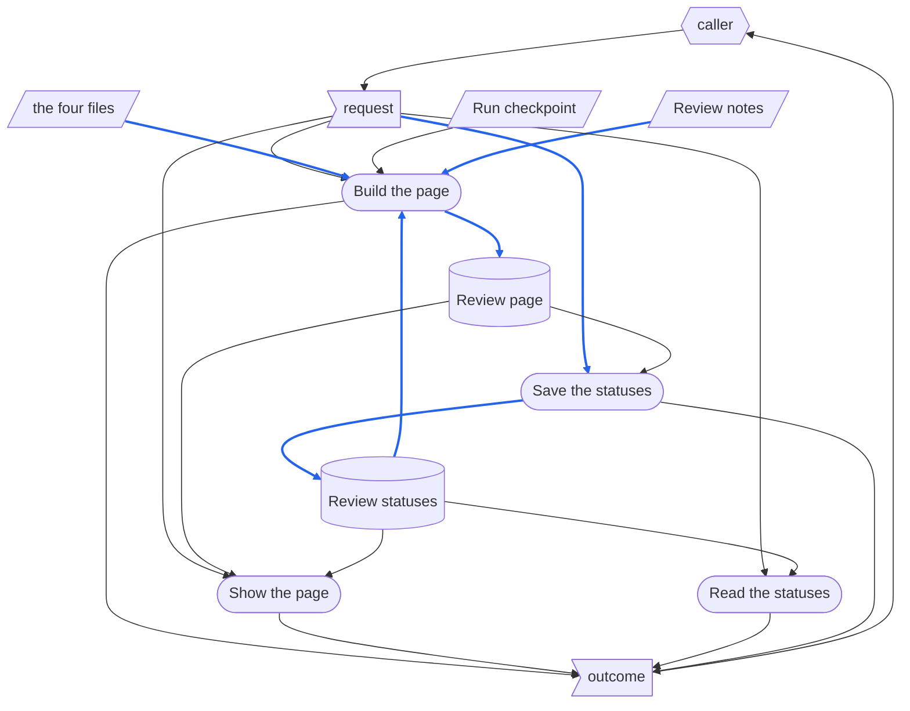

# ReviewPage - RSDC

> [[RSDC-Standard]]  `2026-11-02`  `71f2a43590d2`
> [[DFD]]  `2026-11-02`  `4030d6783acf`
> [[RSDC-App-tmp]]  `2026-11-01`  `fe18ef9acd6f`

- **App**: the asd-ste review page — sets an STE draft beside the file it rewrites, with the two TW twins, for the person who reviews the draft, and keeps the mark the reviewer gives each item of the review notes.
- **Started with**: `node review_server.js`, which serves every review page that Step 6 of asd-ste builds with `make_review.py`.
- **Authority**: any implementation disagreeing with this document is what changes.

# 1. Requirements — "What problem does this solve?"

This chapter defines the app's goals and the pain points it answers, in the user's own terms, and never touches on how it is built:
no component, library, route or identifier out of the app's own source, and no figure measured from a run.
Naming what the app takes over from — even a program — and what the old way costs the user describes the user's problem, so it belongs here.

## 1.1 Target Users

- **The reviewer** — the person who approves an STE draft before it takes the place of the file it rewrites.
  They review one draft at a time, sometimes over several sittings, and need to see each change beside what it changes, in English and in 繁體中文, and to keep track of which points they have settled.
- **Callers** — whatever calls the app for the reviewer: the page a person works in, an AI agent, or a script.

## 1.2 Core Vision

A reviewer reads a draft against its source the way they read code in a review: side by side, going straight to each place the agent wants them to judge, and leaving a mark on each point that survives until the point itself changes.
The review then ends in a decision that both the reviewer and the agent can read: what passed, what must change, and what the agent must first explain.

## 1.3 Current Pain Points

Before this page, a draft was reviewed in the conversation and in two editor windows, and the agent's points and the reviewer's answers lived only in the chat.
The page takes over the comparison and the record of what was decided on each point; the decision to replace the source stays with the reviewer, in the conversation.

- **A point names a line, and the reviewer has to find it.**
  Each point the agent raises cites lines in up to four files, and the reviewer looks each one up by hand, in the right file and the right language.
- **Long files drift apart on screen.**
  A source and its draft are read in step only while the reviewer scrolls both by hand, section by section.
- **What was settled is lost between sittings.**
  Whether a point was accepted, rejected or not understood lived in the conversation, so a second sitting started from nothing, and a point the agent reworded could not be told from one already settled.
- **Agreeing with a suggestion read as approval.**
  A reviewer who agreed that a draft should change had no mark that said so, and a plain "approved" let the unchanged draft replace the source.

## 1.4 System Goals

- **One place to compare** — the source, the draft and their two twins are on one page, and a point's lines are one click away.
- **Each column on its own** — each file scrolls on its own, and can follow the other section by section when the reviewer asks.
- **A mark per point that lasts** — the reviewer's mark on each point outlives a rebuild of the page, and only a point that changed loses it.
- **Unambiguous marks** — the four marks say pass as it stands, explain first, change it, or not yet, and the page says which one agreeing with a suggestion takes.
- **Every review at a glance** — one place lists every draft under review and how far its review is.
- **Nothing installed, nothing exposed** — the page works on a machine with nothing installed, and is reachable from that machine only.
- **Opens from the hub, runs alone** — the hub is the one place a user opens their apps from.
  A user opens the app from the hub without starting it first, and the app still runs alone, unchanged.

# 2. Specification — "What are the system rules?"

This chapter defines the app's externally observable behaviour: what a caller can see, ask for and be refused.
This is the part a reader checks the app against, so every statement here is one that could be falsified by using the app.
It names the routes a caller calls, and the handler a hub mounts, because their names are contracts; it names no other part of the design.

## 2.1 Terminology

Every noun the later sections rely on and none of them defines, each defined here once.

- **Caller** — a caller of 1.1, in the role this chapter gives it: whoever calls a route of the app.
- **Hub** — the hub of 1.4, in the role this chapter gives it: a program other than the app's own server that serves the app, under a path prefix it chooses.
- **Reviewer** — the reviewer of 1.1: the person who opens a review page and marks its items.
- **Run directory** — one Checkpoint Dir of asd-ste: the directory that holds everything one run of asd-ste wrote, the review page among it.
- **Workspace root** — the root of the workspace a program of the app is started in: the directory the program is told, or else the nearest directory, from the current directory up, whose `config.yaml` has `skillGroups`; never one found from the program's own location, since a workspace can read the skill group that holds the app in place from a different workspace.
- **Review root** — the directory whose run directories the app serves: `checkpoints/asd-ste` under the workspace root, unless the server is told another; a review root given as a relative path is read from the workspace root as well.
- **Item** — one list item of the review notes, each item under it being an item of its own.
- **Review status** — the mark an item carries: pending, approved, to be explained or rejected.
  Approved means the draft passes at that point as it stands; rejected means the draft must change there, including when the reviewer agrees with the item's suggestion; to be explained means the reviewer does not follow how the item is handled, and the agent explains it in the conversation.
- **Line reference** — how the review notes name lines: line N, a range N-M or a list N,M of one of four files.
- **Tab** — one of the page's three views: English, 中文, and the draft against its TW twin line by line.

## 2.2 Artifact Types

Every kind of data the app handles: what it is, what it is for, and what its content must be.
Its data is of three kinds: **external inputs**, which come from outside the app and outlast any call; **records**, which the app writes and keeps after the call that wrote them; and **one-run data**, which lives for one run only — for the app, a run is one call — wherever it comes from.

**External inputs**

*The four files* — the inputs below, named together as **the four files**: the texts the page sets side by side.
They lie wherever the build call names them, which asd-ste keeps beside the source.

- **Source file** — the English Markdown file the draft rewrites; read only.
- **STE draft** — the draft in STE that may take the source's place; read only.
- **Source twin** — the source's 繁體中文 TW twin; read only.
- **Draft twin** — the draft's TW twin, which matches the draft line for line, but for the paragraph a twin adds under a frontmatter to point back to its English file.

The other inputs lie in the run directory:

- **Run checkpoint** — the step files of the draft's run: the STE check's must hold its verdict and the warnings left, and the rewrite's, when there is one, holds the statements kept in source wording.
- **Review notes** — the points the agent asks the reviewer to judge, as an HTML fragment of headings and lists, in 繁體中文, with every line given as a line reference.

**Records**

- **Review page** — the page one build writes into the run directory: the four files on three tabs, what the run checkpoint and the draft say about the rewrite, the review notes with a status box on each item, and the review statuses as they were at the build.
- **Review statuses** — the record, in the run directory, of each item's review status that is not pending, with the item's text as it was marked and the time of the last save.
  A build of a run directory that has none yet may start from the review statuses of an earlier run directory of the same source.

**One-run data**

- **The request** — what a caller sends in one call: the four files, the run checkpoint, the review notes and the review statuses to build from; or a route of the server, and for a save the full set of marks the page holds.
- **The outcome** — the app's answer to that call: the review page and a summary of it, or the reason it was not written; or a page, an index, the review statuses, a save's counts, or a refusal.

## 2.3 Dataflow

How data moves between the app's activities: what the stages are, what each stage reads and writes, who writes each piece of data and who may read it, and what order the data itself imposes.
A call has these stages, in this order:

- **Build the page** checks every line reference against the four files, and writes the review page with the review statuses it was built from.
- **Show the page** answers the review page, or the index of every review page with how far each review is.
- **Read the statuses** gives the page the review statuses saved last, so the reviewer sees the latest marks, not those of the build; while its run directory has none, the page keeps the marks it was built with, and its first save writes them there.
- **Save the statuses** checks the marks a page sends against the items of that review page, and writes them as the review statuses.

### DFD

How to read the diagram:

- **Parallelogram** — an external input: the four files, the run checkpoint and the review notes.
- **Flag** — one-run data: the request and the outcome.
- **Cylinder** — a record: the review page and the review statuses.
- **Rounded box** — a stage.
- **Hexagon** — a role outside the app: the caller, who supplies the request — the agent that builds a page, or the reviewer's page that shows, reads and saves — and reads the outcome.
- **Blue solid arrow** — data that is itself written into a record, or turned into the content of one: the four files, the review notes and the review statuses become the review page, and the marks of a save's request become the review statuses.
  Data that only steers what a stage does — the run checkpoint's verdict, or the review page that a save checks its keys against — is not blue, even when the stage writes a record.
- **Black solid arrow** — any other data: data that goes no further than the stage or role it reaches.

### Data Read/Write Rules

What the diagram cannot show about the data it draws — where it applies, whether it is written whole, whether it is read-only once written, and who deletes it:

- **External inputs** are written by no stage; every stage that reads one only reads it.
- **The request and the outcome** last as long as the call.
  The review statuses keep the marks of a save's request; the review page keeps nothing of a request but the paths it names.
  Nothing else keeps them, so nothing deletes them.
- **Review page** is written whole by Build the page, each build replacing the last; no stage changes it after, and the app never deletes it.
- **Review statuses** are written whole by Save the statuses, each save replacing the whole set with the set the page sent; the app never deletes them.
  Build the page reads them and never writes them, so a rebuild keeps every mark.

### Order Imposed by the Data

- **Build the page before Show the page, Read the statuses and Save the statuses** — the review page they show or check keys against is what a build wrote; a run directory with no review page has nothing to show, and refuses a save.
- **Save the statuses before Read the statuses and the next Build the page** — the marks either one gives back are those the last save left.
- No stage reads what a later stage writes.

### Exception Paths

- **Ending with nothing written** — a build whose line reference names no line of its file, whose file cannot be read, or whose run checkpoint has no STE check result writes no page, and leaves the review page of the last build as it was; the outcome names each line reference at fault, or the file.
  A save that a guard refuses writes nothing, and its outcome says why.
- **Stopping midway** — none: a build writes the review page in one write at its end, and a save writes the review statuses to a temporary file and then puts it in place, so neither leaves half a record.
- **Re-entering midway** — Build the page runs alone at any time, and keeps the mark of every item that did not change; the page shown at that moment still shows the old build until it is loaded again.

## 2.4 Naming and Data Structures

How the data the app writes or reads is named and laid out.

- **Run directory** — a directory directly under the review root, whose name is letters, digits, `.`, `_` and `-` only; asd-ste names it `{yymmdd}.{N}`, the Run Number of its run, and its `step_0.yaml` names the source as `source_file`.
- **Review page** — `step_6-review.html` in the run directory, UTF-8 HTML.
- **Review notes** — `step_6-notes.html` in the run directory, UTF-8 HTML.
- **Review statuses** — `step_6-status.json` in the run directory, UTF-8 JSON.
- **Run checkpoint** — `step_3.yaml`, and `step_2.yaml` when there is one, in the run directory.
- **Line reference** — `{{en-o:N}}` for the source file, `{{en-d:N}}` for the STE draft, `{{tw-o:N}}` for the source twin and `{{tw-d:N}}` for the draft twin; `N-M` is a range and `N,M` a list, as `{{tw-d:7,9-10}}`.
  `{{` and `}}` mean nothing else in the review notes: anything between them that is not a line reference fails the build.
- **Item key** — 12 lowercase hexadecimal characters that name an item.

A line is numbered as an editor numbers it: a final newline ends the last line rather than opening another, and a byte-order mark before the first line is not part of it.
An item is matched to its saved mark by its item key alone, so a key computed any other way loses every mark.

The review statuses' fields:

| Field | Meaning |
|---|---|
| `version` | the layout of the record |
| `updated` | when the last save was made, local time |
| `items` | one entry per item that is not pending, by item key |
| `items.{key}.s` | the item's review status |
| `items.{key}.text` | the item's own text when it was marked, at most 120 characters |

The fields that hold code labels, with every code label each may hold:

| Field | Values |
|---|---|
| `version` | `1` |
| `items.{key}.s` | `v` approved, `?` to be explained, `x` rejected |

`updated` is written to the second, as `yyyy-mm-dd HH:MM:SS`.

## 2.5 Config Schemas

The app reads no configuration file, so it has no schema: the server only reads whether a `config.yaml` has `skillGroups`, to find the workspace root.
What a configuration file would hold is given on the command line instead, as part of how each program is started: the workspace root, the review root, the port and the address to listen on, and the paths of a build.
Where a value is left out, the server uses the workspace root it finds, the review root `checkpoints/asd-ste`, the port 8790 and the address 127.0.0.1, and a build uses the workspace root it finds and titles the page after the source file.

## 2.6 Derivation Rules

How each value the app does not observe directly is derived.

### Item Key

- An item's key is derived from three things: the heading above it, its parent item's key, and its own text without the items under it, each with its runs of white space made one space.
- Two items alike in all three are told apart by their order, the first counted as 0.
- The key is the first 12 hexadecimal characters of the SHA-1 of the three, and the count, joined.
- So an item keeps its key, and its mark, while it, its heading and its parents stay the same; change any of them, and it is a new item, pending.

### Where a Column Is

- Each column, and the line-by-line tab, shows the chapter it has reached and the section under it: the last level-1 heading, and the last level-2 heading after it, above the column's top edge.
- A column above its first heading shows none.

### How Far a Review Is

- The counts on a page and on the index are counted over the items the review page holds, not over the review statuses: a saved mark whose item is no longer on the page counts nowhere.
- Pending is every item of the page with no other mark.

## 2.7 Presentation Contract

What may be shown, to whom, which actions the user must be able to start, and whether what is seen is what is done.

**What the app's output makes plain**

- **Which column a line number points to.**
  A line number in a point carries a pointer toward its column, before the number on the left and after it on the right, and its tooltip names the tab, the column and the file; without it, line 9 of the source and line 9 of the draft read alike.
- **Which lines a point has shown.**
  Every line the reviewer opens from one item stays marked, the last one darker, until they open a line from another item; otherwise lines named by one point cannot be compared.
- **What each mark means, and that agreeing takes the rejected mark.**
  The page states the order of the marks and that agreeing with a suggestion is marked rejected; otherwise an approval lets the unchanged draft replace the source.
- **Whether a mark is saved.**
  A page served by the app says each save, or why it failed; a page opened as a file says that no mark is saved.
- **Where the headings do not match.**
  When the source and the draft do not have the same headings in the same order, the page lists them above the columns, since following each other section by section then pairs sections by their order alone.

**The questions every presentation answers**

1. *What does the user see when there is no result?
   Where is the skipped count reported?*
   A build that writes no page answers each line reference at fault, and the reviewer sees the last page built.
   An index with no review page says there is none; a review page built before items had marks is listed with no counts and a note to build it again.
   Nothing is skipped, so there is no skipped count.
2. *Which flows can the user start themselves?
   For those they cannot, why not?*
   The reviewer can open a line from a point, switch tabs, have the columns follow each other, resize the two regions, mark an item, and open the index and a page from it.
   They cannot build or rebuild a page, or start or stop the server from the page: the agent builds the page from review notes only it writes, and starts the server in the same step.
3. *Has every retrieval been observed to succeed in the user's own environment?*
   Yes for the build and for every route, on macOS with Node 22 and Python 3.9; the page's clicks were observed in a browser in the desktop app's browser pane.
4. *If the material is also reachable outside this app, does the app hand over that address?*
   The four files are the reviewer's own, and the page names each one at the top of its column and in each line number's tooltip; it does not link to them.
5. *After the view is narrowed, does the count on screen match the scope of the next action?*
   No view is narrowed: every tab shows whole files, and the counts always cover every item of the page.
6. *What is the ceiling on a bulk action?
   How is an excess refused, and can it leave a half-done result?*
   There is no bulk action: a click marks one item, and each save sends the page's whole set; a set over 1 MiB is refused, and no save leaves half a record (2.3).
7. *What should a refused user do next?*
   A page that cannot save says so and keeps the marks on screen only: open it again from the server's link.
   A mark refused because its item is not on the page means the page is stale: load it again.
8. *How far is it exposed by default, and who finds out when that widens?*
   To this machine only: the server listens on 127.0.0.1.
   A different address can be given when the server starts, and nothing reports the wider reach.

## 2.8 HTTP API

Every route a caller may call over HTTP — the page, an AI agent, a script — and the stages of 2.3 each call runs.

A caller reaches the app only through these routes, or the handler a hub mounts, and never by importing another of its modules or reading its internal files.

Besides the routes, the app has two command-line entrances, run by the agent:

- **The build** — runs Build the page.
  - **Takes** — the paths of the four files, the run checkpoint, the review notes, the review page to write and, when there is one, the review statuses, a relative one read from the workspace root; and, if given, the workspace root and a title.
  - **Answers** — the review page, and a summary: its path, the section and line counts, the line references found, the items with each review status; exit status 0.
  - **Refuses** — a line reference that names no line, with exit status 1 and no page; a file that cannot be read, a run checkpoint with no STE check result, a bad argument, or a relative path with no workspace root, with exit status 2.
- **The server** — starts the routes below, or, asked to probe, says whether a review server answers.
  - **Takes** — the workspace root, the review root, the port and the address, or none of them; or the probe and the port.
  - **Answers** — the server's process number, its review root and its address, and then it runs until it is stopped; a probe exits 0 when a review server answers, 1 when nothing does, and 2 when another program does.
  - **Refuses** — a port that is taken, with exit status 1; a port out of range, an unknown argument, or no workspace root to serve, with exit status 2.

The routes:

- `GET /` — runs Show the page.
  - **Takes** — nothing
  - **Answers** — the index: each run directory that holds a review page, with the source its `step_0.yaml` names, its items, how many are approved, to be explained, rejected and pending, and the last save's time; and how to stop the server
  - **Refuses** — nothing
- `GET /{run directory}/` — runs Show the page.
  - **Takes** — the run directory's name
  - **Answers** — the review page as the last build wrote it; the same address without its last `/` answers a redirect to it
  - **Refuses** — a name that breaks the run directory's naming, or one with no review page, with 404; another method, with 405
- `GET /{run directory}/status` — runs Read the statuses.
  - **Takes** — the run directory's name
  - **Answers** — the review statuses; none, and no time of a save, when there is no record yet or it cannot be read
  - **Refuses** — as `GET /{run directory}/`
- `PUT /{run directory}/status` — runs Save the statuses.
  - **Takes** — a JSON body with `items`: the page's whole set of marks that are not pending
  - **Answers** — how many were saved, the save's time, and the counts of 2.6
  - **Refuses** — by the guards below: a body that is not JSON or holds no items, with 400; a key not on the review page or a status that is not a review status, with 400 and nothing saved; a body over 1 MiB, by closing the connection; a review page that cannot be read, with 404; a record that cannot be written, with 500; another method, with 405
- `GET /healthz` — runs no stage.
  - **Takes** — nothing
  - **Answers** — what the app resolved at startup
  - **Refuses** — nothing; it carries no secret

**Guards**

- **Loopback address** — the server listens on 127.0.0.1 unless it is started with another address; it guards every route.
- **Run directory name** — a name of letters, digits, `.`, `_` and `-` only, with no more than one part after it; any other, including one that climbs out of the review root, is answered 404, and a path that cannot be decoded 400.
- **Keys on the page** — a save may name only item keys the review page holds; one other key refuses the whole save with 400, so a page built again cannot bring back a changed item's mark.
- **Review statuses** — a save's status must be `v`, `?` or `x`; any other refuses the whole save with 400.
- **Body size** — a save's body may be up to 1 MiB; a body over it is cut off, and the connection closed, with no answer.
- **Methods** — a page answers GET and HEAD only, the review statuses GET and PUT only; any other is answered 405.
- **Line references** — a build refuses every line reference that names no line of its file, or is not a line reference, and writes no page.

## 2.9 Mountable Handler

How a hub serves the app: it requires `app.js` and calls `createApp(options)` once, when it starts.

- `mountedAt` — the path prefix the app answers under; requests reach the handler with it already stripped.
- `root` — the review root, as the server's own is given.

It returns the `(req, res)` handler — or a promise of it — that serves the routes of 2.8, guards included, as the app's own server would.
Loading `app.js` starts nothing.
When the review root cannot be read, the handler still answers, with an index that lists no review page.

## 2.10 Invariants

Rules that hold in every stage and every route, without exception:

- **No stage changes an external input.**
  The four files, the run checkpoint and the review notes are read only; a page that could edit them would review a draft nobody wrote.
- **Each record has one writer.**
  Only Build the page writes the review page, and only Save the statuses writes the review statuses; with two writers, a rebuild would wipe out marks, or a save would change what the reviewer sees.
- **A mark is kept only for the item it was given to.**
  A changed item is pending again; otherwise a reworded point would carry the reviewer's verdict on the old wording.
- **No page with a link that leads nowhere.**
  A build writes the page only when every line reference names a line; a page with dead links would look finished.
- **Nothing is fetched from the network.**
  The page and the server need nothing beyond the machine; a review must work offline.
- **The page is in 繁體中文.**
  Every label, hint and message on a page and on the index is in 繁體中文, the reviewer's language; only the file names and the English file's text are English.

The goals of 1.4, and the rules that carry them:

| Goal | Carried by |
|---|---|
| One place to compare | 2.2 Review page; 2.7, which column a line number points to |
| Each column on its own | 2.6 Where a Column Is; 2.7, where the headings do not match |
| A mark per point that lasts | 2.6 Item Key; the invariant that a mark is kept only for its item |
| Unambiguous marks | 2.1 Review status; 2.7, what each mark means |
| Every review at a glance | 2.8 `GET /`; 2.6 How Far a Review Is |
| Nothing installed, nothing exposed | 2.8 Loopback address; the invariant that nothing is fetched from the network |
| Opens from the hub, runs alone | 2.9 Mountable Handler |

# 3. Design — "How is the system structured?"

This chapter describes how the app is built to keep chapter 2: its components, how each component does its work, where the files live, and the form each capability takes for the user.

## 3.1 Core Component Responsibilities

One bullet per component, with its file, the stages of 2.3 it performs, its one job and its boundary: a change that crosses the boundary is a change to two components.
Every stage of 2.3 is performed by one of them; a stage none performs is an activity nobody implemented.

- **Review Builder**, the file `make_review.py` — performs Build the page of 2.3.
  Its one job: turn the four files, the run checkpoint, the review notes and the review statuses into one self-contained review page.
  Its boundary: it writes the page and never serves it; a change that made it read the server, or the page read the four files, would split the page between two writers.
- **Page Script**, the script the Review Builder writes into every review page — performs Read the statuses, and starts Save the statuses, of 2.3.
  Its one job: make the page respond — tabs, columns, line links, marks — and send the reviewer's marks to the server that served it.
  Its boundary: it decides the next mark and sends the whole set, and never decides whether a mark is valid; that is the server's.
- **Review Server**, the file `review_server.js` — performs Show the page, Read the statuses and Save the statuses of 2.3.
  Its one job: serve the review pages of one review root, list them, and keep each page's review statuses.
  Its boundary: it never builds or changes a page; a change that made it rewrite a page would make it a second writer of the review page.

How they interact: the Review Builder and the Review Server never call each other; what passes between them is the review page, which the builder writes and the server serves and reads the item keys from, and the review statuses, which the server writes and the builder reads at the next build.
The Page Script reaches the server only through the routes of 2.8, by addresses relative to the page, but for `/healthz`.

**Python builds; Node serves and keeps the marks.**

The Review Builder decides everything about a page: its layout, its item keys, and which line references are valid.
The Review Server decides only which marks to keep: it reads the item keys out of the page, and checks each mark against them and against the four review statuses.
Neither spawns the other: the agent runs the build, and starts the server once for every review page.

## 3.2 Execution Flow

For each component of 3.1, how it does its work at run time: its steps in order, named as the code names them, with the branches, retries, parallel work and orders the implementation chose rather than the data forced.
Where a drawing helps, it is drawn in the notation of the DFD.
Chapter 2's rules are cited here, never restated.

### Review Builder

1. `main` reads each relative path from the workspace root that `workspace_root` finds, checks that each of the four files is a file, and reads them with `read_lines`.
2. It loads the run checkpoint, `step_3.yaml` and `step_2.yaml` in the run directory that `--checkpoint` names, with PyYAML, and stops when there is no `step_3.yaml` (2.8).
3. It builds the English and 中文 tabs with `pane`, which splits each file at its level-1 headings with `sections` and renders each line with `render`, folding each fenced block; and the line-by-line tab with `line_pane`, which sets aside the twin's pairing lines found by `pairing_block`.
4. It lists what the run checkpoint and the draft say with `facts`.
5. `check_refs` checks every line reference in that list and in the review notes against the lines the tabs show; one at fault ends the build with exit status 1, before anything is written.
6. `item_keys` derives each item's key (2.6), with the parser `_Items`; when the parser does not see every list item, no item gets a status box, with a warning.
7. `read_statuses` takes the marks of `--status` for the keys of this page.
8. `add_status_boxes` and `link_refs` put a status box on each item and turn each line reference into a link; the page is assembled with its style and the Page Script, and written in one write.

### Page Script

1. `show` switches tabs; `follow` scrolls the other column to the same place in the same section while the switch to follow is on.
2. A click on a line link marks it with `mark`, opening a folded block that holds the line, and scrolls to it; a link in another item clears the marks of the last.
3. A drag or the arrow keys on the divider resize the two regions; `where` writes each column's chapter.
4. The status part paints the marks of the build, then `load` asks the server for the review statuses, and takes them in place of the build's only when they have the time of a save; on a page opened as a file, or when the server does not answer, it keeps the build's marks and says that none is saved.
5. A click on a status box moves it to the next mark, and `save` sends the whole set when the page was served.

### Review Server

1. `main` reads the arguments with `parseArgs`, which reads the review root from the workspace root that `workspaceRoot` finds with `isWorkspaceConfig`; with the probe, `probe` asks `/healthz` and exits.
2. Otherwise it listens; a taken port ends it with exit status 1.
3. `handler` decodes the path, answers `/` with `indexPage`, which names the source of each run directory with `sourceOf`, and `/healthz` itself, and checks the run directory's name and its review page before anything else.
4. A save goes to `saveStatus`: `readBody` reads up to 1 MiB, `pageKeys` reads the item keys out of the review page, every mark is checked, and the record is written to a temporary file and renamed into place.

## 3.3 Directory Structure

Where the app's files physically live, and the logic of their layering.
The app's two programs live with the asd-ste skill, and what they write lives in each run directory under the review root, which git ignores.

- `skill-groups/common/skills/asd-ste/scripts/make_review.py` — the Review Builder.
- `skill-groups/common/skills/asd-ste/scripts/review_server.js` — the Review Server.
- `checkpoints/asd-ste/{run directory}/step_6-review.html` — the review page.
- `checkpoints/asd-ste/{run directory}/step_6-status.json` — the review statuses.
- `checkpoints/asd-ste/{run directory}/step_6-notes.html`, `step_2.yaml` and `step_3.yaml` — the review notes and the run checkpoint, which asd-ste writes.
- `checkpoints/asd-ste/{run directory}/step_0.yaml` — the source of the run, which the index names.

**What is relocatable, and what that costs.**
The two programs can move together or apart: neither names the other's path, and the build takes every path it reads and writes as an argument, and reads a relative one from the workspace root.
The review root is read from the workspace root, never from the server's own directory, so the server's file can live in a skill group that a different workspace reads in place; a server started outside every workspace finds no workspace root, and stops.

## 3.4 Presentation Form

Every "the user must be able to…" of 2.7: the component that provides it, the form it takes for a person — a control, a page, a shortcut, and how many — and the name the user knows it by.

| Capability | Component | Form | Name the user sees |
|---|---|---|---|
| Open a line a point names | Page Script | one link per line, range or list item in a point | `◄ 9`, `10 ►` |
| Switch between the three views | Page Script | three buttons in the tab bar | **English**, **中文**, **草稿英中逐行** |
| Have the two columns follow each other | Page Script | one toggle button at the right of the tab bar, off at first, disabled on the line-by-line tab | **同步捲動** |
| Resize the notes and the files | Page Script | one divider to drag, or to move with the arrow keys | — |
| Mark an item | Page Script | one box at the start of each item, a click moving it on | `[ ]`, `[v]`, `[?]`, `[x]` |
| See every review and open one | Review Server | one page, one row and one link per review page | **asd-ste 審核** |

The rules of 2.7 that only say what may be shown — the pointer and tooltip of a line number, the marks of a point's lines, the meaning of each mark, whether a mark is saved, the headings that do not match — grant nothing, and have no row here by design.
Neither do the counts of marks and the hints above the notes: they explain what the reviewer sees, and removing them would take away no capability.
A folded block opens with a click on its summary, as any folded block in a browser does; it is a way to show more, and no capability.

# 4. Coding — "How should the code be written?"

This chapter keeps the code's quality up and the app working alike on every platform: the rules the code follows, the tools it may use, how it stays safe, the traps already met, how each claim is proved, and where it still falls short.

## 4.1 Key Development Guidelines

- **`server.js` keeps its `listen` behind `require.main === module`, and `app.js` exports `createApp(options)`.**
  Otherwise loading the app, as the hub of 2.9 does, starts a server of its own beside the hub's.
- **Every address the page emits is relative to the page: `./api/x`, never `/api/x`.**
  Otherwise, served under the prefix of 2.9, the page asks the hub's root instead of the app.
- **One page, everything in it.**
  The review page carries its style, its script and the marks of its build, so that it also works opened as a file, with no server and no network (2.10).
- **The item key is computed in one place.**
  Only the Review Builder derives keys, and the server reads them out of the page rather than computing them again; two computations would drift, and every mark would be lost (2.4).
- **No prompt at run time.**
  Both programs take everything as arguments and print what they did; the agent that runs them reads the output.

## 4.2 Implementation Guidelines and Tools

- Node 22 or later, Python 3.9 or later.
- **Node and Python use their standard libraries only.**
  No `npm install`, no `pip install`, no CDN, no font fetched at load.
  The app must run on a machine with nothing installed.
- The Review Builder also needs PyYAML, which the workspace's virtual environment holds, to read the run checkpoint.
- The Review Builder uses type hints; the Review Server is plain JavaScript in strict mode.
- Everything the app writes is UTF-8, with LF line ends.

## 4.3 Safety and Robustness

- **No secret on a command line.**
  A process list is readable by every other process, so a password reaches Python on `stdin` or not at all.
- **Every value that reaches the page is escaped, both quote forms included.**
  Otherwise a value from a request or a file runs as markup in the page.
  The Review Builder escapes every line of the four files and every title; the review notes are the agent's own HTML and are taken as they are.
- **A save is checked whole before anything is written.**
  One key or status at fault refuses the save, so a record is never part old, part new.
- **The review statuses are written to a temporary file and renamed into place.**
  A server stopped mid-write leaves the last record whole.

## 4.4 Platform Traps

Only cases that have actually produced a plausible but wrong result:

- **A local page cannot keep data in the desktop app's browser pane.**
  The pane loads a local HTML file as a `data:` address, where the browser keeps nothing, so a page that saved its marks in the browser lost them on every load; marks are therefore kept by a server and written to a file.
- **A server that found its workspace above its own file served the runs of another workspace.**
  On 2026-11-09, a server started from the InvestForge root, which reads this skill group in place from SkillsGestalt, gave SkillsGestalt's `checkpoints/asd-ste` as its review root.
  The server therefore finds the workspace root from the current directory (2.1).

## 4.5 Verification Obligations

Each rule this document states, how it is shown to hold, and who shows it; every component of 3.1 is named in at least one row, since a component no row proves cannot be shown to work.
A rule is proven when its behaviour has been observed, not when the code meant to produce it has been read.

| Claim | Rule | Proven by | Performed by |
|---|---|---|---|
| The Review Builder writes the page, and its summary, when every line reference names a line | 2.8 the build | four 15-line test files and three items: exit 0, 3 sections each, 4 line references, 3 items pending | agent, 2026-11-01 |
| The Review Builder writes no page when a line reference names no line | 2.10; 2.8 Line references | `{{en-d:99}}` in a 15-line draft: exit 1, a `[FAIL]` line, no page written | agent, 2026-11-01 |
| The Review Builder refuses a missing file and a run checkpoint with no STE check result | 2.8 the build | a missing draft, and a checkpoint without `step_3`: exit 2 each | agent, 2026-11-01 |
| The Review Builder reads the run checkpoint from the step files of a run directory | 2.4 Run checkpoint | a run directory with `step_3.yaml`, and no `step_2.yaml`: exit 0, the page written | agent, 2026-11-06 |
| The Review Builder reads a relative path from the workspace root | 2.8 the build; 2.1 Workspace root | a build from a directory below a test workspace, with every path relative to its root: exit 0, the page written in the run directory, nothing where it ran; outside every workspace: exit 2; every path absolute: exit 0 | agent, 2026-11-09 |
| A rebuild keeps the marks of unchanged items, and only those | 2.6 Item Key; 2.10 | `--status` with one known and one unknown key: one approved, two pending; one item reworded: only its key changed | agent, 2026-11-01 |
| Line numbers carry their pointers | 2.7 | the test page: `◄ 3` for the source, `3 ►` and `7 ►` for the drafts | agent, 2026-11-01 |
| The Review Server lists every review page with its counts, and marks one built before marks | 2.8 `GET /`; 2.6 How Far a Review Is | a review root with two run directories, one page with no status box: the counts, and the note to build it again | agent, 2026-11-01 |
| The Review Server finds its review root under the workspace root, and names the source of each run directory on the index | 2.1 Workspace root; 3.3; 2.8 `GET /` | servers started below a test workspace, beside a `config.yaml` with no `skillGroups`, and from the InvestForge root: `/healthz` gives `checkpoints/asd-ste` under that workspace's root; one started outside every workspace stops with exit 2; `/` lists both runs with their `source_file` | agent, 2026-11-09 |
| The Review Server serves a page, redirects the address without its last `/`, and refuses the rest | 2.8 Guards | 200; 301; POST 405; DELETE 405; a directory with no page 404; another part 404; `..%2f..%2fetc` 404; a bad encoding 400 | agent, 2026-11-01 |
| The Review Server saves valid marks whole, and refuses invalid ones with nothing saved | 2.8 `PUT`; 4.3 | one `?` saved and read back; an unknown key, a status `y`, a body not JSON, and one with no items: 400 each | agent, 2026-11-01 |
| The Review Server closes the connection on a body over 1 MiB | 2.8 Body size | 1.1 MB body: connection reset, no answer | agent, 2026-11-01 |
| The probe and a taken port | 2.8 the server | nothing: exit 1; a review server: exit 0; another program: exit 2; a second server on the same port: exit 1; port 70000: exit 2 | agent, 2026-11-01 |
| The Page Script switches tabs, follows columns, marks a point's lines, and shows each column's chapter | 2.6 Where a Column Is; 2.7 | a test page and the RSDC-Standard page in the browser at 1280×800 and 700 pixels wide | agent, 2026-10-13 ([[Task 40]] items 1, 5, 7) |
| The Page Script moves a mark through the four in order, saves each click, and keeps them over a reload | 2.1 Review status; 2.3 Save the statuses | the test page in the browser, served by the Review Server: `[v]`, `[?]`, `[x]`, `[ ]`, each in the record | agent, 2026-10-13 ([[Task 40]] items 3, 8) |
| A page built from an earlier run's statuses keeps them while its run directory has none, and its first save writes them there | 2.3 Read the statuses | a page built with `--status` of an earlier run directory, served for a run directory with no record, in the browser pane: the earlier `[v]` shown, and one click saved both marks into its own record | agent, 2026-11-06 |
| A page opened as a file shows its build's marks and says it saves none | 2.7 | the test page opened as a file, and served by a static server that has no status route | agent, 2026-10-18 ([[Task 40]] item 9) |
| The page says that agreeing with a suggestion is marked rejected | 2.7 | the scratch-rules page served by the Review Server, and as a static page | agent, 2026-10-18 ([[Task 40]] item 9) |
| A hub can mount the app | 2.9 | — | *not verified*: there is no `app.js` |

**The rows not verified** are the checks still to be written.
The hub row becomes a test once `app.js` exists: require it, call `createApp` with a prefix and a test review root, and request each route of 2.8 under the prefix.
The rows dated before 2026-11-01 were observed in a browser by hand; a script that drives a browser could repeat them.

## 4.6 Defects

Every place where the app does what chapter 2 says it should not, each where it was observed and what it costs:

- **No handler a hub can mount.**
  There is no `app.js`, and `review_server.js` calls `listen` when it is loaded; a hub cannot serve the review pages (2.9), so the goal "Opens from the hub, runs alone" is not met.
- **Two addresses are absolute.**
  The Page Script asks `/healthz`, and the index links each page as `/{run directory}/`; served under a hub's prefix, both would reach the hub's root instead of the app (4.1).
- **A second open copy of a page erases the first one's marks.**
  Each save replaces the whole set with the set one page holds: observed on 2026-11-01, when a save of one mark and then a save of another left only the second.
  A reviewer who marks in two tabs, or in a page loaded before another save, loses marks without a sign.
- **A body over 1 MiB gets no answer.**
  The server closes the connection instead of answering 400, observed on 2026-11-01; the page then says only that the server did not answer.
- **A probe does not tell which workspace a review server serves.**
  One server on the port serves the review root of the workspace it was started in (2.1), and a probe exits 0 for any review server (2.8): on 2026-11-09, a probe from SkillsGestalt exited 0 for a server started from the InvestForge root.
  A link to that server leads to the runs of the other workspace; the probe prints the review root it was given, which shows it.
- **The address to listen on can be widened, and nothing says so.**
  The server takes any address it is given, though its own description says loopback only; started on another address, it serves every review page to the network without a warning (2.7, question 8).
