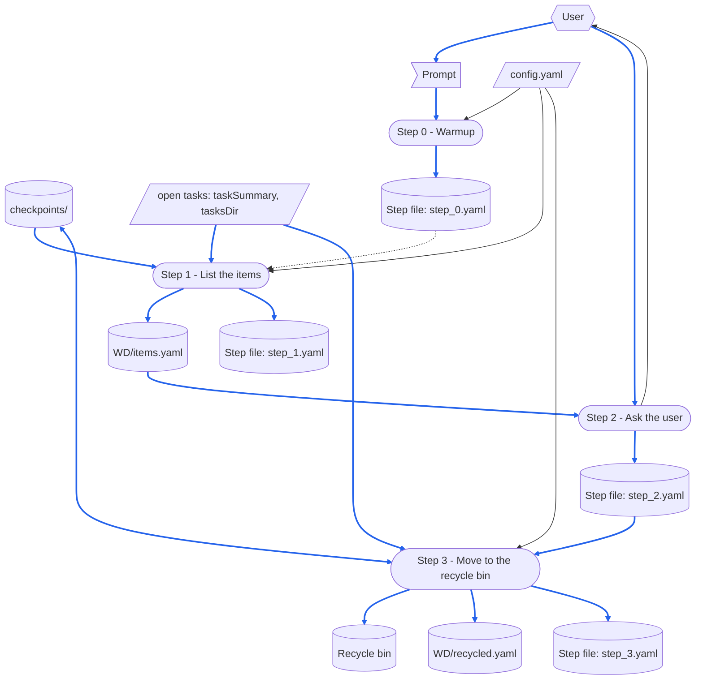

# clean-checkpoints

> [DFD.md](../../references/DFD.md)  `2026-11-12`  `4030d6783acf`
> [md-style.md](../../rules/md-style.md)  `2026-11-12`  `639a95083dd2`
> [skill-writing.md](../../rules/skill-writing.md)  `2026-11-12`  `4884a31a0b2c`
> [run-data-rules.md](../../rules/run-data-rules.md)  `2026-11-12`  `cb4e585a6fbc`
> [chore-rules.md](../../rules/chore-rules.md)  `2026-11-12`  `bfd62b81486e`
> [task-rules.md](../../rules/task-rules.md)  `2026-11-12`  `1f28de9855a4`
> [SKILL-tmp.md](../../templates/SKILL-tmp.md)  `2026-11-12`  `0a1b73b86b05`
> [README-tmp.md](../../templates/README-tmp.md)  `2026-11-12`  `549f2d3ba535`

This README.md tells about the parts of the clean-checkpoints skill, and about the files that its [SKILL.md](SKILL.md) depends on.
Each time a skill runs, it reads all of its SKILL.md.
Thus, the parts that a run does not need are in this README.md.
SKILL.md does not have a link to this README.md, thus no run reads it.

Read this README.md before you change the skill.
Make each change that "When the Skill Is Changed" names, and then do the checks that it gives.
[skill-writing.md](../../rules/skill-writing.md) tells how to write the steps of a skill.

The paths in the diagrams are short: `clean-checkpoints/` is `skill-groups/common/skills/clean-checkpoints/`, and `common/` is `skill-groups/common/`.
`WD/` is the Working Dir of a run, `temp/clean-checkpoints/{yymmdd}.{N}/`.

# When the Skill Runs

## Dataflow

This section shows how a run changes its prompt into its outputs.
It shows each step of the Workflow in [SKILL.md](SKILL.md), and the data that each step reads and writes.
It is a DFD in the notation of [DFD.md](../../references/DFD.md).

The name of each step is the same as its heading, with its number, thus each reader knows which step a box identifies.
The diagram shows only the data that a step reads or writes when it runs.



How to read the diagram:

- A parallelogram is an external input, a flag is one-run data, and a cylinder is a record.
  The records are the step file of each step, each data file in the Working Dir, `checkpoints/` and the recycle bin.
  Each step also adds its time and model to the run record, and the diagram does not show this record.
  A rounded box is a step.
- A hexagon is a role external to the skill: the user, who supplies the prompt and confirms the items.
- A solid arrow moves data, in the direction in which the data moves.
  A two-headed arrow is data that one step reads and also writes: Step 3 measures `checkpoints/` again, and moves items out of it.
  A dotted arrow moves no data: it is a sequence.
- A blue arrow moves data that goes into a record, or that becomes the content of a record.
  All the other arrows are black.

## Step Purposes

Each step, with the same name as its heading in SKILL.md, and its Purpose: the cause to have this step.

- Step 0 - Warmup
  It finds the settings and the Run Number before the script runs, thus a stop for a missing `config.yaml` occurs before any measurement.
- Step 1 - List the items
  Its measurement can take minutes on a large `checkpoints\`; as a step of its own, `run step 2` can show the list again without a new measurement.
- Step 2 - Ask the user
  It is the only step that makes a decision, thus no item moves without a confirmation that the step file records.
- Step 3 - Move to the recycle bin
  It is the only step that changes `checkpoints\`; it classifies each item again, because the files can change between the confirmation and the move.

## Files Each Step Uses

This README.md tells one time how the skill obeys the "scripted-versus-not" rule of skill-writing.md:
**Step 1 and Step 3 run a script, and Step 0 and Step 2 do not**, because the measurement, the verdicts and the moves are deterministic, but Step 2 shows a list and records the decision of the user.

```
Step 0 - Warmup
  reads   config.yaml
  checks  that these exist:
          clean-checkpoints/scripts/clean_checkpoints.py
  writes  the step file: step_0.yaml

Step 1 - List the items
  runs    clean_checkpoints.py list
          ├─ reads config.yaml: cleanCheckpoints, tasksDir, taskSummary
          ├─ reads the task summary table and the files of the open tasks
          ├─ reads checkpoints/: the size and the newest file of each item
          └─ writes WD/items.yaml
  writes  the step file: step_1.yaml

Step 2 - Ask the user
  reads   WD/items.yaml
  writes  the step file: step_2.yaml (confirmed)

Step 3 - Move to the recycle bin
  runs    clean_checkpoints.py recycle
          ├─ reads WD/step_2.yaml: confirmed
          ├─ reads config.yaml, the open tasks and checkpoints/ again: each verdict again
          ├─ moves each item that is still clean to the recycle bin
          │    Windows: PowerShell, Microsoft.VisualBasic.FileIO.FileSystem, SendToRecycleBin
          │    macOS and Linux: the Python package send2trash; without it, exit 3 and no move
          └─ writes WD/recycled.yaml
  writes  the step file: step_3.yaml
```

No run reads this README.md.

# When the Skill Is Changed

`⇄`: the two files change together.
`─▶`: one file depends on the rules or the format of the other.

```
clean-checkpoints/SKILL.md
 ├─⇄ clean-checkpoints/README.md
 │     the Dataflow, Step Purposes and Files Each Step Uses name each step exactly as its heading:
 │     a step added, removed or renamed changes all three
 ├─⇄ clean-checkpoints/scripts/clean_checkpoints.py
 │     the terms Item, Threshold, Keep period, Keep list, Open task and Clean item;
 │     the defaults (10 GB, 60 days, no keep list); the keys of items.yaml that Step 1 copies;
 │     the confirmed list of step_2.yaml that Step 3 reads; the exit codes 2, 3 and 4
 ├─⇄ config.example.yaml at the root of SkillsGestalt: the cleanCheckpoints example
 ├─⇄ common/CHANGES.md: an entry when a key of cleanCheckpoints changes, because each Forge sets them
 ├─⇄ chores/clean-checkpoints.md at the root of SkillsGestalt: how the chore runs the skill
 ├─▶ common/rules/skill-writing.md: how the steps are written
 ├─▶ common/rules/run-data-rules.md: the step files, the run record, the Working Dir,
 │     and the Checkpoint Dir that the skill cleans
 ├─▶ common/rules/chore-rules.md: checkpoints/chores/ is for the chores, thus the skill keeps it
 ├─▶ common/rules/task-rules.md: the summary table and its status icons, which the script reads
 └─▶ common/rules/md-style.md: one sentence on each line
       └─ checked by reformat_md.py and check_reformat.py

clean-checkpoints/README.md
 └─▶ common/references/DFD.md: how the Dataflow is drawn
       a step or a piece of data added or removed redraws the DFD and renumbers its blue arrows

the templates and the tools
 ├─▶ common/templates/SKILL-tmp.md and README-tmp.md: the structure gen-skill writes from
 └─ common/skills/check-skill: checks SKILL.md and this file against the two templates
```

After a change, do the checks that apply to it:

- `depends_on.py check` on this README.md: it gives UNCHANGED for each file in the header quote, or you read the change and record the file again.
- `/check-skill clean-checkpoints`: each check shows no problem, or you make a decision about each result.
- Make a workspace with a `config.yaml` and a `checkpoints\` that has old, new, kept, chore and task items, in the temporary directory of the system.
  Run `clean_checkpoints.py list` and `recycle` in it, and make sure that each verdict is correct, and that `recycle` skips each item that is not clean now.

# Tracked Dependencies

A header quote gives the files that a file depends on.
`depends_on.py check` tells which of these files changed after `depends_on.py record` recorded them.
To keep SKILL.md short, this README.md gives the files external to the skill that SKILL.md depends on.

```
clean-checkpoints/README.md
  ─▶ common/references/DFD.md
  ─▶ common/rules/md-style.md
  ─▶ common/rules/skill-writing.md
  ─▶ common/rules/run-data-rules.md
  ─▶ common/rules/chore-rules.md
  ─▶ common/rules/task-rules.md
  ─▶ common/templates/SKILL-tmp.md
  ─▶ common/templates/README-tmp.md
```

If `depends_on.py check` shows one of these files as CHANGED, read the change.
Make SKILL.md and this README.md agree with it, and then record it again with `depends_on.py record`.
